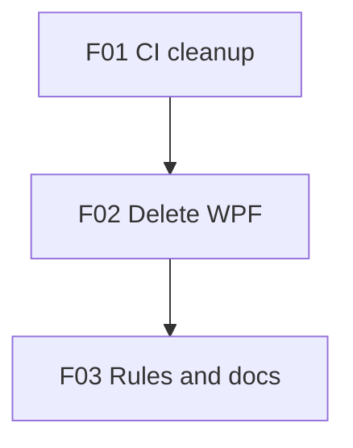

# Remove the WPF Front End

## 1. Executive Summary

This project removes `Financial.App`, the WPF desktop front end, from the Financial application. `Financial.Web` (React, served by `Financial.Api`) becomes the only front end for both bounded contexts, Investment and CashFlow. The decision and its reasons are recorded in `docs/decisions/ADR-002-remove-wpf-front-end.md`. This work is F00 of the CashFlow accounts generalization (`docs/pending/cashflow-accounts-generalization.md`): it runs first, so the account-centred redesign is built once, in React only.

It is for the single owner and developer of this self-hosted tool, who uses the app in the browser and also maintains it. The core value is that every later UI change is built, tested and reviewed once instead of twice. CI gets smaller and faster, and the rules, skills and review agents lose their parity sections.

It works in three pull requests. F01 stops CI and the nightly run from building, testing and measuring WPF. F02 deletes the WPF projects and everything that builds or launches them (solution entries, architecture rules, coverage exclusions, local deploy scripts, editor tasks). Its merge is gated by the user's sign-off of a WPF-to-React parity table. F03 rewrites the living rules, docs, skills and agents so they describe one React front end.

## 2. Problem and Opportunity

### The Problem

**Every UI change is built twice**
- `CLAUDE.md` UI / UX invariant 1 requires WPF to match React's tasks, terminology, field order, validation and outcomes.
- `Financial.App` is about 35k lines of C# and XAML in 389 files; `Tests/Financial.Presentation.Tests` adds about 30k lines, plus a FlaUI end-to-end project.
- The planned account-centred CashFlow redesign would roughly double its UI work if built in both front ends.

**CI carries a second, slower UI pipeline**
- `build.yml` runs two Windows WPF jobs (`wpf`, `wpf-e2e`), and `ci-status` waits on both.
- `nightly.yml` runs a full WPF end-to-end job (`e2e-wpf`) that the failure-issue job depends on.
- Coverage tooling (baseline file, baseline scripts, gate action, PR comment, diff coverage) has a third project row only for WPF.

**Rules and tooling repeat everything for WPF**
- `docs/rules/ui.md`, `docs/ui/wpf.md`, `docs/ui/review-checklist.md` and about 10 other living `docs/ui` files carry WPF guidance.
- The `fluent-ui`, `testing-guide-Financial` and `implement-feature` skills and the `ui-reviewer` and `architecture-reviewer` agents check WPF parity on every UI change.
- `docs/rules/design.md` fixes the slice order as "API → WPF → Web".

**Local deploy publishes a second app**
- `scripts/deploy.ps1` publishes and stamps settings for `Financial.App` next to the API.
- `start-all.ps1` launches the desktop app, and `deploy.local.example.json` keeps a WPF-only OAuth redirect (`http://localhost:8082/`).

### The Opportunity

- **Build once:** after F02, React is the only UI, so each UI change is built, tested and reviewed once. The account-centred redesign needs about half the UI work.
- **Smaller CI:** F01 removes both WPF CI jobs, the nightly WPF job and the WPF coverage row, so `ci-status` and the nightly run have fewer, faster dependencies.
- **One UI standard:** F03 removes the parity rules, so the rule files, skills and agents describe one front end.
- **Simpler deploy:** F02 makes the local deploy publish only the API and SPA, and cleans up the old desktop folder.
- **No lost workflow:** the F02 parity table proves every WPF workflow already exists in React before anything is deleted.

## 3. Target Audience

### Primary Users

**Owner and developer**
- Uses the app daily in the browser (Docker on port 8080, or the local deploy) for investments and household cash flow.
- Maintains the code with Claude Code, following the rule files, skills and review agents in the repo.
- Needs every change to leave `main` deployable, and wants no workflow lost when WPF goes.

## 4. Objectives

### Product Objectives

1. **Remove** every WPF project from the solution and the repo.
2. **Shrink** CI and the nightly run to backend and web jobs only.
3. **Prove** no workflow is lost, through a signed-off WPF-to-React parity table.
4. **Rewrite** the living rules, skills and agents for one React front end.
5. **Keep** `main` deployable after each of the three PRs.

### Success Metrics

| Objective | Metric | Measurement condition |
|---|---|---|
| Remove | 0 WPF projects in `Financial.slnx`; 0 files under `Financial.App/`, `Tests/Financial.Presentation.Tests/`, `Tests/Financial.App.E2ETests/` | After F02 merges, checked with `git ls-files` |
| Shrink | 0 jobs named `wpf`, `wpf-e2e` or `e2e-wpf` in `.github/workflows/*.yml`; `coverage-baseline.json` has exactly 2 entries (`backend`, `web`) | After F01 merges |
| Prove | 100% of parity-table rows marked Present or accepted by the user; 0 open gaps | Before F02 merges |
| Rewrite | 0 matches of `WPF`, `Financial.App` or `Presentation.App` in `CLAUDE.md`, `docs/rules/`, living `docs/ui/` files, `.claude/agents/`, `.claude/skills/` (except references to ADR-002 and to `Tools/ImportGoogleSpreadSheets`) | After F03 merges, checked with grep |
| Keep | `ci-status` green on each of the 3 PRs and on the `main` run after each merge; `docker-compose up` starts and serves the SPA | Each merge |

## 5. User Stories

### F01. CI Stops Building WPF
- As the owner, I want a PR's CI to run only backend and web jobs so that results arrive faster and nothing waits on a Windows desktop runner.
- As the owner, I want the coverage PR comment to show only backend and web rows so that it no longer reports a project being removed.
- As the owner, I want the nightly run to stop running the WPF end-to-end suite so that a WPF failure can no longer open a `nightly-failure` issue.
- As the system, I want `ci-status` to depend only on the remaining jobs so that it stays the single required check.

### F02. Delete the WPF App
- As the owner, I want to review a table of every WPF workflow and its React counterpart so that I can confirm nothing I use is lost before deletion.
- As the owner, I want the WPF projects and their tests deleted so that the solution builds without a Windows desktop workload.
- As the owner, I want `scripts/deploy.ps1` to publish only the API and SPA so that a deploy does not fail on a missing project.
- As the owner, I want the next deploy to remove the old desktop folder and launcher so that no stale WPF build stays in `deploy/`.
- As the owner, I want my Google Calendar connection to keep working after the change so that I do not have to reconnect.

### F03. Rules and Docs Become React-Only
- As the owner, I want `CLAUDE.md` and the rule files to describe one React front end so that Claude Code stops planning WPF work.
- As the owner, I want the UI review checklist and `ui-reviewer` agent to check React only so that reviews stop flagging missing WPF parity.
- As the owner, I want the testing guide to drop its WPF artifacts so that test planning covers only projects that exist.
- As the owner, I want `README.md` and `context.md` to stop documenting the desktop app so that setup instructions match the repo.

## 6. Functionalities

### F01. CI Stops Building WPF

**Provides:**
- A CI pipeline and coverage tooling with no WPF job, entry or parameter (used by F02)

**Capabilities:**
- `.github/workflows/build.yml`:
  - remove the `wpf` and `wpf-e2e` jobs;
  - remove the `wpf` and `wpf_e2e` outputs of the `changes` job;
  - remove the WPF diff-coverage step and the `WPF_*` inputs of the coverage comment;
  - remove `wpf` and `wpf-e2e` from every `needs` list (coverage comment, baseline reminder, `ci-status`);
  - keep the backend test filter's `FullyQualifiedName!~Financial.Presentation.Tests` clause and the `-Financial.Presentation.App` term of its `-assemblyfilters` until F02. While `Financial.Architecture.Tests` references `Financial.App`, the filter keeps that near-zero WPF assembly out of the backend coverage figure, where it would pull the number under the 90% floor.
- `.github/scripts/detect-changes.sh` stops emitting `wpf` and `wpf_e2e`. Until F02, `Financial.App/**`, `Tests/Financial.Presentation.Tests/**` and `Tests/Financial.App.E2ETests/**` paths classify as `backend`, because the backend job's solution build still compiles them and `Financial.Architecture.Tests` still references `Financial.App`. `detect-changes.test.sh` cases are updated to match.
- `.github/workflows/nightly.yml`:
  - remove the `e2e-wpf` job;
  - remove `e2e-wpf` from the failure-issue job's `needs`;
  - replace `e2e-wpf` with real nightly job names in the sample inputs of `.github/scripts/nightly-issue.test.ps1`.
- Coverage tooling:
  - remove the `-Wpf` parameter and the `wpf` key from `.github/scripts/coverage-baseline.ps1`;
  - remove the WPF entry from `.github/scripts/baseline-reminder.ps1` and its instruction text (`-Backend … -Web …` only);
  - update `baseline-reminder.test.ps1` and `coverage-gate.test.ps1`;
  - remove the WPF examples from the descriptions in `.github/actions/coverage-gate/action.yml`;
  - remove `Financial.App/ViewModels` from the diff-coverage scope in `.github/scripts/diff-coverage.ps1`;
  - remove the `wpf` entry from `coverage-baseline.json`. The `backend` and `web` figures stay exactly as they are; the file is still refreshed only by the script after this change.
- `Financial.App` still exists. CI stops testing it; the backend job's solution build still compiles it until F02.
- `docs/ci-affected-pipeline.md` is updated in the same PR, because it documents exactly these jobs, rules and scripts.
- Mutation testing is unchanged: `scripts/stryker.ps1` and `Financial.Web/stryker.config.json` have no WPF target.

**Experience:**
- On a PR, the job list shows `changes`, `backend`, `web`, `web-e2e`, `coverage-comment` and `ci-status` (each only when affected).
- The sticky coverage comment has 2 rows. The baseline reminder names 2 artifacts.
- The F01 PR itself touches `.github/`, so it runs the full pipeline and proves the edited workflow is valid.

**Error Handling:**
- A `needs` entry still points at a removed job: GitHub rejects the workflow file. The F01 PR's own run fails before any job starts, so it cannot merge.
- `coverage-gate` still reads a `wpf` baseline key somewhere: the gate fails closed ("missing baseline entry"). Fix the caller, never by re-adding the key.
- `detect-changes.test.sh` still expects `wpf=true`: the `changes` job fails with the test diff. Update the expected output.
- The nightly failure-issue job still lists `e2e-wpf`: `nightly-issue.test.ps1` fails on the PR. Remove the case.

### F02. Delete the WPF App

**Consumes:**
- F01: a CI pipeline and coverage tooling with no WPF job, entry or parameter

**Provides:**
- A repo with no WPF front end, its projects, tests or deploy steps (used by F03)

**Capabilities:**
- **Parity gate.** The PR description contains the parity table below. The user marks it signed off before merge. Status was verified in code: each React location is wired to an API endpoint.

| Area | WPF workflow | React location | Status |
|---|---|---|---|
| Investment | Dashboard: KPI tiles, currency, allocation, data-quality warnings, upcoming income, retry | `pages/DashboardPage.tsx`, `components/dashboard/*` | Present |
| Investment | Active and historic tree, drag-drop move, archive, delete empty portfolio | `ActiveInvestmentsPage.tsx`, `HistoricInvestmentsPage.tsx`, `InvestmentTree.tsx`, `MoveAssetDialog.tsx`, `usePortfolioDeletion.ts` | Present |
| Investment | Asset summary (refresh price, copy name, XIRR), broker and portfolio summaries, holdings | `AssetSummaryTab.tsx`, `DetailPanel.tsx`, `AggregatedSummaryTab.tsx`, `PortfolioSummaryTab.tsx`, `PortfolioHoldingsTab.tsx` | Present |
| Investment | Transactions with lot allocation, credits, corporate actions, price history, disposals | `TransactionsTab.tsx`, `CreditsTab.tsx`, `CorporateActionsTab.tsx`, `PriceHistoryTab.tsx`, `DisposalsTab.tsx` | Present |
| Investment | Dividend check, current values, tax workbook CSV export | `DividendCheckPage.tsx`, `CurrentValuesPage.tsx`, `TaxPage.tsx` | Present (CSV downloads in the browser) |
| CashFlow | Monthly: expenses with UK prompt, income with split, transfers, balance adjustments, card statement paid, tithe carry-forward, withdrawal, grid filters | `MonthlyPage.tsx` and its sections and forms | Present |
| CashFlow | Reserva, Mensais (status, mark paid, reset), Controle Mãe, investment snapshots with suggested values, annual summary | `ReservaPage.tsx`, `MensaisPage.tsx`, `ControleMaePage.tsx`, `InvestmentSnapshotsPage.tsx`, `AnnualSummaryPage.tsx` | Present |
| Admin | Assets, brokers, portfolios, tax rules, banks, categories, credit cards, income sources, investment accounts, recurring bills, reserve buckets | Matching `*Page.tsx` and `*FormDialog.tsx` | Present |
| Settings | Appearance, reporting currency, Google Calendar connect, disconnect and resync | `AppearancePage.tsx`, `ReportingCurrencyPage.tsx`, `IntegrationsPage.tsx` | Present (sign-in through the API callback) |
| Cross-cutting | Payment-due overlay, sync status, sidebar and breadcrumb | `PaymentDueBanner.tsx`, `SyncStatusBanner.tsx`, `Sidebar.tsx`, `Breadcrumb.tsx` | Present |
| Plumbing | In-process services, file log `logs/app-.log`, OTel service `Financial.App` | API host and its own telemetry | Not needed (accepted) |

- **Delete:** `Financial.App/` (including `Financial.App/CLAUDE.md`), `Tests/Financial.Presentation.Tests/`, `Tests/Financial.App.E2ETests/`.
- **Solution and tests:**
  - remove their entries from `Financial.slnx`;
  - remove the `Financial.App` project reference from `Tests/Financial.Architecture.Tests/Financial.Architecture.Tests.csproj`, along with the WPF rules in `PresentationDependencyRuleTests.cs`; the API rules stay;
  - remove the `Financial.Presentation.Tests` clause from the backend job's test filter and the `-Financial.Presentation.App` term from its `-assemblyfilters` in `build.yml`, along with the comment explaining that term;
  - remove the WPF rule from `.github/scripts/detect-changes.sh` and its cases from `detect-changes.test.sh`, and the WPF row from `docs/ci-affected-pipeline.md`.
- **Coverage settings:** remove the `Financial.Presentation.App` exclusions and their explaining comments from `coverlet.runsettings`.
- **Local deploy:**
  - `scripts/deploy.ps1` stops publishing `Financial.App`. It removes the WPF publish step, `Financial.Presentation.App` from the process stop, the WPF `appsettings.Production.json` stamping and the WPF summary line, and the synopsis drops the WPF paragraphs.
  - On every run, the script deletes `deploy/Financial.App/` and `deploy/start-app.ps1` if they exist, because step 3 only cleans the folders it knows.
  - Delete `scripts/deploy-templates/start-app.ps1`. `start-all.ps1` starts only the web server.
  - Remove `GoogleCalendarAppRedirectUri` from `scripts/deploy.local.example.json`.
- **Editor:** remove the `Financial.App/Financial.App.csproj` build entry from `.vscode/tasks.json`.
- **Unchanged:**
  - `Integrations/Observability` and the API's `AddObservability(…, "Financial.Api")`;
  - the API's Google Calendar callback and its redirect URIs;
  - the shared calendar token file, so the existing connection keeps working;
  - `Tools/ImportGoogleSpreadSheets`.
- The PR is one deletion sweep plus mechanical reference removals, so it is exempt from the 8-file limit (`docs/rules/design.md` §PR size).

**Experience:**
- The user reads the parity table in the PR and comments "parity signed off" (or names a gap). The PR is merged only after that comment.
- After merge, the user runs `scripts/deploy.ps1` once. Output lists only `Financial.Web -> …\deploy\Financial.Web`, and `deploy/` no longer contains `Financial.App` or `start-app.ps1`.
- `start-all.ps1` starts the web server only. The user opens `http://localhost:8080`.
- Optional manual step, listed in the PR body: remove `http://localhost:8082/` from the Google Cloud OAuth client's authorized redirect URIs, and keep the API callback URIs.

**Error Handling:**
- The user names a gap in the parity table: the PR stays open. The gap is closed in React by its own PR first, then the table is updated and re-signed.
- A test project still references `Financial.App`: `dotnet build` fails in the `backend` job with a missing project. Remove the reference in the same PR.
- An architecture test still loads `Financial.Presentation.App`: the test fails with a type-load error. Remove that rule.
- An old `deploy/Financial.App` folder is locked by a running process: the deploy stops the process first (the existing stop step keeps matching `Financial.Presentation.App` for that cleanup run), then deletes the folder. If deletion still fails, the script throws with the folder path.
- `start-all.ps1` still calls `start-app.ps1`: the launcher fails with "not found". Update `start-all.ps1` in the same PR.

### F03. Rules and Docs Become React-Only

**Consumes:**
- F02: a repo with no WPF front end, its projects, tests or deploy steps

**Capabilities:**
- `CLAUDE.md`:
  - remove `Financial.App` from the solution layout and the feature-parity paragraph;
  - remove the WPF test commands (`Financial.App.E2ETests` smoke);
  - remove the `wpf` and `wpf-e2e` jobs from the CI paragraph;
  - remove the `wpf` coverage and assembly-filter paragraphs;
  - rewrite UI / UX invariant 1 as React-only, citing ADR-002;
  - drop WPF from the rule-file table.
- Rule files:
  - `docs/rules/ui.md`: React-only workflow, no parity steps;
  - `docs/rules/design.md`: slice order becomes Domain → Application → Infrastructure → API → Web → tests;
  - `docs/rules/implementation.md`: drop its WPF mentions.
- `docs/ui/`:
  - delete `wpf.md`;
  - remove WPF items from `review-checklist.md`;
  - remove WPF guidance from `README.md`, `standards-hierarchy.md`, `forms-data-and-visualisations.md`, `design-tokens.md`, `accessibility.md`, `ux-principles.md`, `react.md` and `fluent-ui-react-v9-pages/splitButton.md`.
- Skills and agents:
  - `fluent-ui` skill: drop the WPF mapping, including `references/cross-platform-mapping.md`;
  - `testing-guide-Financial` skill: delete the `artifacts/wpf-*.md` files and remove the WPF rows from `SKILL.md`, the references and the other artifacts;
  - `implement-feature` skill;
  - `ui-reviewer` and `architecture-reviewer` agents;
  - `.specify/memory/constitution.md`.
- Other docs:
  - `README.md`: remove the "Desktop (Financial.App)" section and the WPF parts of the local-deploy and observability text;
  - `context.md`;
  - `Financial.Web/CLAUDE.md`;
  - the living discovery docs (`docs/discovery-*.md`): current-state statements only.
- Left as written, because they are dated records:
  - PRDs under `docs/prd/` and `specs/`;
  - compliance audits under `docs/ui/compliance-audit/`;
  - `docs/ui/current-state-audit.md`;
  - UI ADRs under `docs/ui/decisions/`;
  - `docs/app-*.md` backlogs.
- Mentions of `Tools/ImportGoogleSpreadSheets` as a legacy WPF utility stay accurate and are kept.
- One mechanical sweep of text edits across many files, so it is exempt from the 8-file limit. Any file needing a judgement call beyond removal is listed in the PR body.

**Experience:**
- After merge, the grep in Section 4 returns only the allowed references.
- A new UI change planned with `implement-feature` lists no WPF step. The `ui-reviewer` agent's report has no parity section.
- The final PR body reminds the user of the optional Google Cloud redirect-URI tidy-up.

## 7. Out of Scope

**Tools**
- `Tools/ImportGoogleSpreadSheets` (legacy WPF import utility) stays as it is, along with `Tools/InvestmentSpreadsheetImport` and its tests.

**Telemetry**
- No client-side telemetry is added to React. Server-side tracing through the API is unchanged.

**Code clean-up beyond WPF**
- The unused React client methods `calculateXirr` and `resyncAllCalendars` in `Financial.Web/src/api/financialApiClient.ts` stay.
- No API, Application or Domain change. The Application services keep their interfaces; only one caller (WPF) goes away.

**Historical records**
- Past PRDs, specs, compliance audits, UI ADRs and backlog files are not rewritten.

**Follow-on work**
- The CashFlow account model and account-centred UI (F01–F05 of `docs/pending/cashflow-accounts-generalization.md`).

**External configuration**
- Removing the `http://localhost:8082/` redirect URI from the Google Cloud OAuth client is a manual, optional step for the user, not part of any PR.

## 8. Dependency Graph

### Part 1: Dependency Table

| # | Feature | Priority | Dependencies |
|---|---------|----------|--------------|
| F01 | CI Stops Building WPF | 1 | None |
| F02 | Delete the WPF App | 1 | F01 |
| F03 | Rules and Docs Become React-Only | 1 | F02 |

### Part 3: Execution Waves

Features within the same wave can be built in parallel. A wave starts only after every feature in earlier waves is complete.

- **Wave 1**: F01
- **Wave 2**: F02
- **Wave 3**: F03

### Part 4: Priority levels

- **1** = Essential — product does not work without it
- **2** = Important — significant value addition
- **3** = Desirable — incremental improvement

### Part 5: Diagram

## 9. Acceptance Criteria

### F01. CI Stops Building WPF
- [ ] `build.yml` has no `wpf` or `wpf-e2e` job, no `wpf`/`wpf_e2e` output in `changes`, and no `wpf` in any `needs` list
- [ ] The backend job still filters `Financial.Presentation.App` out of its coverage report, and its coverage stays within 0.5 points of the baseline
- [ ] `docs/ci-affected-pipeline.md` lists only the backend, web and web-e2e jobs and the two-job baseline command
- [ ] `nightly.yml` has no `e2e-wpf` job and the failure-issue job's `needs` does not list it; `nightly-issue.test.ps1` passes
- [ ] `detect-changes.sh` emits no `wpf` or `wpf_e2e` key, and `detect-changes.test.sh` passes
- [ ] `coverage-baseline.json` contains only `backend` and `web`, with the same figures as before the PR
- [ ] `coverage-baseline.ps1` has no `-Wpf` parameter, and `baseline-reminder.ps1` names only Backend and Web; `baseline-reminder.test.ps1` and `coverage-gate.test.ps1` pass
- [ ] The F01 PR's run executes the full pipeline and `ci-status` is green
- [ ] The coverage PR comment on the F01 PR shows exactly 2 project rows
- [ ] `Financial.App` still builds locally with `dotnet build Financial.App` after F01

### F02. Delete the WPF App
- [ ] The PR body contains the parity table and the user has commented the sign-off before merge
- [ ] A named parity gap blocks merge until it is closed and the table re-signed
- [ ] `git ls-files Financial.App Tests/Financial.Presentation.Tests Tests/Financial.App.E2ETests` returns nothing
- [ ] `Financial.slnx` has no entry for those three projects, and `dotnet build --configuration Release` succeeds
- [ ] `Financial.Architecture.Tests` has no reference to `Financial.App`, and all its tests pass
- [ ] `coverlet.runsettings` has no `Financial.Presentation.App` exclusion
- [ ] The backend job's test filter has no `Financial.Presentation.Tests` clause and its `-assemblyfilters` is `+*`
- [ ] `detect-changes.sh` has no WPF rule and `detect-changes.test.sh` passes
- [ ] `scripts/deploy.ps1` runs on a machine with an old `deploy/Financial.App` folder and leaves `deploy/` without `Financial.App` or `start-app.ps1`, with the web app published
- [ ] `scripts/deploy-templates/start-app.ps1` no longer exists; `start-all.ps1` starts only the web server
- [ ] `deploy.local.example.json` has no `GoogleCalendarAppRedirectUri`
- [ ] `.vscode/tasks.json` has no `Financial.App` entry
- [ ] After deploy, Google Calendar shows as connected on the Integrations page without reconnecting
- [ ] `docker-compose up` starts and the SPA loads both Investment and CashFlow pages
- [ ] `ci-status` is green on the PR and on the `main` run after merge

### F03. Rules and Docs Become React-Only
- [ ] grep for `WPF`, `Financial.App` or `Presentation.App` in `CLAUDE.md`, `docs/rules/`, living `docs/ui/` files, `.claude/agents/` and `.claude/skills/` returns only references to ADR-002 or `Tools/ImportGoogleSpreadSheets`
- [ ] `CLAUDE.md` UI / UX invariant 1 describes React as the only front end and cites ADR-002
- [ ] `docs/rules/design.md` slice order has no WPF step
- [ ] `docs/ui/wpf.md` and `.claude/skills/testing-guide-Financial/artifacts/wpf-*.md` no longer exist
- [ ] `README.md` has no "Desktop (Financial.App)" section, and its local-deploy text describes only the web app
- [ ] Historical PRDs, specs, audits and UI ADRs are unchanged in the diff
- [ ] The final PR body includes the reminder to remove the `http://localhost:8082/` redirect URI from the Google Cloud OAuth client

### Cross-Feature Integration
- [ ] After F01, the F02 PR that deletes `Financial.App` triggers no WPF job and `ci-status` is green (F01 → F02)
- [ ] After F02, every path F03 removes from the docs (`Financial.App`, the two WPF test projects, `start-app.ps1`, the `wpf` CI jobs) is absent from the repo (F02 → F03)
