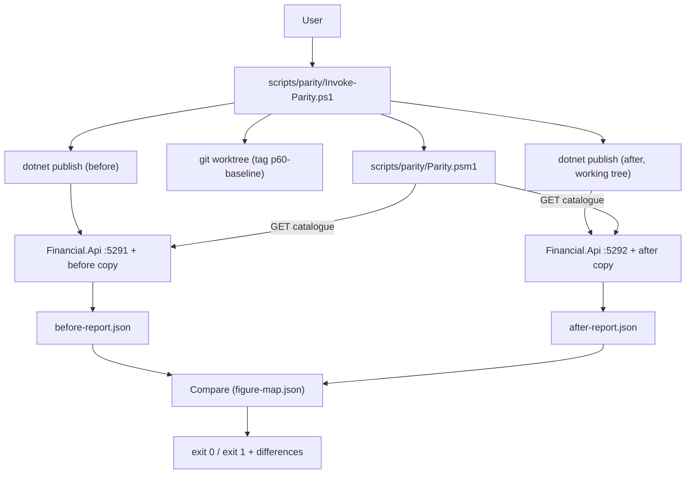

# Technical Specification: Parity Toolkit

**Complexity:** medium

## 1. Technical Overview

**What:** A PowerShell toolkit in `scripts/parity/` that runs two builds of `Financial.Api` against two copies of the same CashFlow data file and compares every figure they produce. The **before** build is the git tag `p60-baseline`, today's released behaviour. The **after** build is the current working tree. Its copy has been through the migration chain, which in F01 is a plain copy. A fixed catalogue of read-only GET endpoints (the same ones the screens read) produces a flat, sorted figures report for each side. Compare checks the two reports key by key with exact decimal equality, applies the figure map, prints every difference and exits 1 if there is one.

**Why:** Every later P60 feature's Definition of Done needs 0 differences on the latest live copy. Unit and integration tests run on seeded test data. They cannot show that 9 years of real records still produce the same balances, totals and statements after a model change and a data migration. The comparison goes through the HTTP API, not the domain types, because those types change in F02 and the API is what the screens read.

**Scope:**

**Included:**
- `Invoke-Parity.ps1`, the entry point, with the steps Baseline, Migrate, After, Compare and All, plus `-KeepRunning` for the side-by-side screen check.
- `Parity.psm1`: report building, the monthly figures computed by the script, compare, the figure map, the month range and the safety guards. These are pure functions, testable without an API.
- `figure-map.json`, empty in F01, and its format.
- `screen-checklist.md`, `README.md` (commands and figure catalogue) and `Parity.test.ps1` (self-test), plus one CI step.
- Input contract: a copy of the live `data-cashflow.json` (PRD Consumes: none; the user supplies it).
- Output contract: the commands, the report format, the figure map format and the checklist (PRD Provides: used by F02 and every later feature's Definition of Done).

**Deferred to later features:**
- The Migrate step running `CashFlowSpreadsheetImport migrate` arrives in F02, the first migration. F01's Migrate is a byte-for-byte copy.
- Figure-map entries and new report figures: F04 adds summary figures, F07 the card balance, and so on.
- Account-screen rows in the screen checklist arrive with each UI feature (F05, F08, F10, F12).

**Excluded:**
- No production code, no API change, and no OpenAPI or generated-types change.
- No Investment-context figures. Investment runs on a copy of `data/data-investment.example.json` only so that the API can start.
- No automatic screen comparison. The screen check stays manual (PRD decision).

## 2. Architecture Impact

The toolkit sits outside the solution. It talks to two short-lived API processes over HTTP and to git and dotnet on the command line. It never touches `data/data-cashflow.json` or port 8080.



**Affected components:**
- `scripts/parity/` (new folder): entry script, module, figure map, checklist, README and self-test.
- `.github/workflows/build.yml` (modified): one self-test step in the `changes` job, next to the existing `.github/scripts/*.test.ps1` steps.
- `docs/prd/.../prd-cashflow-accounts-generalization.md` (modified at the end): the F01 boxes are ticked in the feature's last PR.

## 3. Technical Decisions

| Decision | Chosen Approach | Alternative Considered | Trade-off |
|----------|----------------|----------------------|-----------|
| Where the logic lives | `Parity.psm1` holds every pure function (catalogue, report builder, monthly figures, compare, map, range, guards). `Invoke-Parity.ps1` only orchestrates git, dotnet and processes. | One large script | Two files instead of one. In exchange, the self-test runs everything on the Ubuntu `changes` job without building or starting anything. |
| Script tests | Plain `pwsh` self-test `Parity.test.ps1` with `Check`/`$cases`/`$failures`, in the same style as `.github/scripts/coverage-gate.test.ps1`. Run as one step in the `changes` job. | Pester 5 | No new framework or runner dependency. The repo already has 8 tests in this style. (User decision.) |
| Number exactness | Responses are parsed with `System.Text.Json.JsonDocument`. Each number's raw text becomes `[decimal]` with the invariant culture, and sums use `[decimal]`. | `ConvertFrom-Json` | `ConvertFrom-Json` turns non-integers into `double`, so sums like `0.1 + 0.2` would make false differences. JsonDocument is a little more code. |
| Building each version | `dotnet publish Financial.Api -c Release -o <work>\<side>\app`, the same as CI's web-e2e action. The baseline worktree is removed right after its publish. | `dotnet build` inside the worktree (PRD wording) | Same output as CI. The running API does not depend on the worktree, so cleanup is simpler and `-KeepRunning` needs no worktree. |
| API configuration | `ASPNETCORE_ENVIRONMENT=Parity`, which loads only `appsettings.json`. Environment variables force `LocalJson` and a temp file for CashFlow, Investment (`data-investment.example.json` copy) and FxRates (`data-fx-rates.example.json` copy). `ASPNETCORE_URLS=http://localhost:<port>`. The step fails if `/health` does not report `LocalJson` for both contexts. | Default environment | With no environment set, the API runs as Production, and `appsettings.Production.json` points all three stores at **Google Drive**. Development points at the repo's `data/` files. A neutral environment plus the health check rules out both. |
| Month range | Computed once, from the **input** copy before migration. It runs from the first month with any record to the later of the current month and the last month with any record, and is stored in `run.json`. Both sides use it. | Ask each API, or compute per side | One range for both sides, read from the stable V1 shape, so it is unaffected by later migrations. Future invoice months are included. (User decision.) |
| Figure keys | Keys use display names (`2026-09/banks/Barclays/balance`), joined with ` / ` when printed. Two figures with the same key stop the build with an error. | Ids | `banks/month/.../balances` returns only names, and names are what the screens show. A duplicate name fails loudly instead of overwriting. |
| Port check | `[System.Net.NetworkInformation.IPGlobalProperties]::GetIPGlobalProperties().GetActiveTcpListeners()` | `Get-NetTCPConnection` (PRD wording) | Works on Windows and Linux, so the guard is covered by the self-test on Ubuntu. |
| Web app for the screen check | Only `-KeepRunning` runs `npm ci` and `npm run build` (`API_BASE_URL=/api/v1/financial`) in each version and copies `dist` into its `wwwroot`. | Always build it | Figures-only runs stay fast; the screen check costs roughly 2–4 minutes per version. (User decision.) |
| Writes during GET | The catalogue runs in one fixed order. `run.json` records whether each copy's SHA-256 changed during its read. That is information only. | Block writes | Today's card-statement and tithe GETs write. Both copies start identical and get the same calls, so the writes match. |

## 4. Component Overview

**Scripts:**

| File Path | New/Modified | Purpose | Key Responsibilities |
|-----------|--------------|---------|---------------------|
| `scripts/parity/Invoke-Parity.ps1` | New | Entry point | Parses `-Step Baseline\|Migrate\|After\|Compare\|All`, `-LiveCopy`, `-WorkFolder`, `-BeforePort` (5291), `-AfterPort` (5292), `-BaselineTag` (`p60-baseline`) and `-KeepRunning`. Runs the guards before anything else. Creates the baseline worktree, publishes, starts the APIs, waits for health and verifies the provider. Fetches the reports through the module, then compares. Always cleans up in `finally` (stops the processes it started, removes the worktree) unless `-KeepRunning` succeeded. Prints the `[n/4]` progress lines and the final `Parity OK` / `Parity FAILED` line. |
| `scripts/parity/Parity.psm1` | New | Pure logic | **Catalogue:** the endpoints, their scope (per month, per year or once) and how each response becomes figures. **Report builder:** takes a fetch scriptblock (a URL path in, JSON text out) so tests can inject saved responses. **Monthly figures:** the script's copies of `useMonthly.ts`'s browser sums. **Pots at month end** from movements. **Compare:** exact decimals; strings, booleans and nulls compared exactly; a value missing on either side is a difference. **Figure map** loading and application. **Month range** from the input copy. **Guards:** live-file path, ports and hash change. Formats difference lines and the summary. |
| `scripts/parity/figure-map.json` | New | Source moves | `{ "mappings": [] }` in F01. The format is described in §6. |
| `scripts/parity/screen-checklist.md` | New | Manual screen check | One table with columns Page, Month, Value, Before (5291), After (5292) and Same?. Rows cover Monthly (bank balances, round-up totals, card outstanding, category totals sum, income totals, total incoming, tithe), card statements, Reserva (pot balances, movements total), Controle Mãe totals, Annual summary and Investment snapshot suggestions, for 3 months: the current month, the last complete month and one month from 2024. |
| `scripts/parity/README.md` | New | Documentation | Prerequisites (pwsh 7, .NET 10 SDK, git; Node 20+ only for `-KeepRunning`). Every command with an example. The work-folder layout. The figure catalogue (family → endpoint → key pattern). How a feature adds a figure or a mapping. Safety rules. How to read a failure. |
| `scripts/parity/Parity.test.ps1` | New | Self-test | The cases listed in §7. Exits 1 on any failure and prints `FAIL <case>`. |
| `.github/workflows/build.yml` | Modified | CI | Adds the step `Self-test the parity toolkit` (`pwsh scripts/parity/Parity.test.ps1`) to the `changes` job after the existing self-test steps. |

**Work folder** (`[IO.Path]::GetTempPath()\financial-parity\<yyyyMMdd-HHmmss>\`):

| Path | Content |
|------|---------|
| `run.json` | See §6 |
| `before\data-cashflow.json`, `after\data-cashflow.json` | Copies of the input; the after copy is migrated |
| `before\app\`, `after\app\` | Published APIs, with `wwwroot` only under `-KeepRunning` |
| `before\api.log`, `after\api.log` | API stdout and stderr |
| `before\build.log`, `after\build.log` | Publish and npm output |
| `before-report.json`, `after-report.json` | Figures reports |
| `differences.txt` | Written only when Compare finds differences |
| `before\data-investment.json`, `before\data-fx-rates.json` (same under `after\`) | Copies of the example files, one set per side, so the two APIs never share a file |

## 5. API Contracts

No API is added or changed. The toolkit consumes these existing endpoints, all under `http://localhost:<port>/api/v1/financial/`. There is no authentication.

| Family | Endpoint | Scope | Figures (key under `<scope>/`) |
|--------|----------|-------|-------------------------------|
| readiness | `GET health` | once per side | Not a figure. Both `contexts.*.provider` values must be `LocalJson`. |
| banks | `GET banks/month/{y}/{m}/balances` | month | `banks/<bank>/balance` |
| banks | `GET banks` + `GET expenses/month/{y}/{m}` | month | `banks/<bank>/roundUpTotal`: sum of `roundUpAmount` (null = 0) over expenses whose `paymentSourceBankId` is that bank's id, as `useMonthly.ts` does |
| cards | `GET card-statements/{y}/{m}` | month | `cards/<card>/outstandingTotal`, `accumulatedOutstandingTotal`, `isPaid`, `warning` |
| cards | `GET expenses/month/{y}/{m}/unpaid-card-charges` | month | `cards/unpaidChargesTotal`: sum of `value` |
| categories | `GET expenses/month/{y}/{m}/category-totals` | month | `categories/<category>/total` |
| incomes | `GET incomes/month/{y}/{m}` | month | `incomes/<source>/net`; `incomes/<source>/gross` (null when no income of that source has a gross value); `incomes/totalIncoming` |
| tithe | `GET tithe/month/{y}/{m}` | month | `tithe/calculatedTithe`, `tithe/titheBalance`, `tithe/carryForward/<field>` for each scalar field |
| snapshots | `GET investment-snapshots/{y}/{m}/suggestions` | month | `snapshots/<account>/suggestedValue`, `currentValue`, `source`; `snapshotsSkipped/<account>/reason` |
| monthly | computed from the responses above | month | `monthly/bankTotalsSum`, `monthly/roundUpTotalsSum`, `monthly/cardOutstandingTotal` (sum of the statements' `outstandingTotal`), `monthly/categoryTotalsSum` |
| pots | `GET reserve/movements` | month (one fetch) | `pots/<bucket>/balance`: sum of `amount` with `date` up to the month's last day; `pots/total` |
| current | `GET reserve/balances`, `GET controle-mae/entries/totals` | once | `current/pots/<bucket>/balance`, `current/mae/totalBrl`, `current/mae/totalGbp` |
| annual | `GET annual-summary/{y}/category-totals` | year | `annual/categories/<category>/annualTotal`, `average`, `monthly/<01-12>`; `annual/income/<field>` and `annual/income/<field>/<01-12>` for each income summary series; `annual/resultado/...` and `annual/totalDespesas/...` (annual total, average, months) |
| annual | `GET annual-summary/{y}/historic-summary-averages` | year | `averages/<year>/<category>` |
| annual | `GET annual-summary/{y}/investment-annual-result` | year | `investment/<account>/value/<01-12>`, `investment/<account>/diff/<01-12>`; `investment/net/value/<01-12>`, `diff/<01-12>`, `averageMonthResult`, `fullYearNetChange`, `sumOfMonthResults` |

`<scope>` is `yyyy-MM` for month figures, `yyyy` for year figures and `current` for once-only figures. Within each side, calls go month by month in ascending order, families in the order of this table, then years ascending.

**Command contract** (`Invoke-Parity.ps1`):

| Parameter | Required | Default | Rule |
|-----------|----------|---------|------|
| `-Step` | Yes | — | `Baseline`, `Migrate`, `After`, `Compare` or `All` |
| `-LiveCopy` | For every step except `Compare` | — | Must exist. Refused if its full path equals `<repo>\data\data-cashflow.json` (case-insensitive, after resolving relative paths). |
| `-WorkFolder` | No | `All` and `Baseline` create a new folder; the other steps use the newest folder under `financial-parity` | The path is printed at the start |
| `-BeforePort` / `-AfterPort` | No | 5291 / 5292 | Refused if 8080, if they are equal, or if already listening |
| `-BaselineTag` | No | `p60-baseline` | Must resolve with `git rev-parse` |
| `-KeepRunning` | No | off | With `All`, `Baseline` or `After`: builds the web app and leaves the API(s) running. Prints the URLs and process ids, and the `Stop-Process` line to end them. |

**Exit codes and messages:**

| Situation | Exit | Message |
|-----------|------|---------|
| Compare finds no difference | 0 | `Parity OK: 0 differences in <n:N0> figures across <m> months` |
| Compare finds differences | 1 | One `<key joined by " / "> \| <before> \| <after>` line each (`(missing)` for an absent value), then `Parity FAILED: <n> difference(s)`. The work folder is kept. |
| Live file passed | 1 | `Refusing to run on the live data file data/data-cashflow.json. Pass a copy.` |
| Port 8080, busy or equal | 1 | `Port <p> is in use (or is the live port 8080). Free it or pass -BeforePort/-AfterPort.` |
| Tag missing | 1 | `Tag p60-baseline not found. Create it on main before the first run.` |
| Publish or npm failure | 1 | `<Side> build failed; see <build.log path>` |
| API not ready in 60 s, or wrong provider | 1 | `<Side> API on port <p> did not become ready (or is not LocalJson); see <api.log path>` |
| Input hash changed | 1 | `The input copy changed during the run; results discarded.` |
| Duplicate figure key | 1 | `Duplicate figure key <key> on the <side> side` |

## 6. Data Model

No database or data-file change. The toolkit writes three file formats.

**`before-report.json` / `after-report.json`:** one JSON object with keys in ordinal sort order, each a figure key, and values that are a JSON number, string, boolean or null. Numbers are written from `[decimal]` with the invariant culture.

```json
{
  "2026-09/banks/Barclays/balance": 130.83,
  "2026-09/banks/Barclays/roundUpTotal": 4.17,
  "2026-09/cards/Amex/isPaid": false,
  "2026-09/monthly/bankTotalsSum": 5210.40,
  "2026/annual/categories/Mercado/monthly/09": 612.33,
  "current/mae/totalBrl": 167.88
}
```

**`figure-map.json`:**

| Field | Type | Required | Description |
|-------|------|----------|-------------|
| `mappings[].after` | string | Yes | After-side key pattern. A segment `*` matches one segment; `{month}` matches a `yyyy-MM` segment. |
| `mappings[].before` | string | Yes | Before-side key pattern, using the same placeholders |
| `mappings[].negate` | boolean | No (false) | Compares `after = -before` |
| `mappings[].reason` | string | Yes | Which feature moved the figure and why |

Compare rules: each after key is matched to a before key, either directly or through the first mapping that matches. The values must be equal; decimals use numeric equality, so `130.8` equals `130.80`, and other types must match exactly. A before key that no after key reaches, and an after key with no before key, both count as differences. A mapping only renames; it never makes a different value acceptable.

**`run.json`:** `liveCopy` (full path), `runDate` (`-Step After` refuses a folder whose Baseline ran on another day, because several figures read the API's current date), `liveCopySha256Start`, `liveCopySha256End`, `range` (`first`, `last` as `yyyy-MM`; `currentMonth`), `baseline` (`tag`, `commit`), `afterBuild` (`commit`, `dirty` true/false), `before`/`after` (`copyChangedDuringRead`, a hint only, and `figures`), `figures`, `differences`. Each step updates its own fields, which lets separate step runs share the range and the result.

**Input copy (read-only, V1 shape) used for the month range:** `Expenses[].Date`, `ChargeDate`, `InvoiceDate`; `Incomes[].Date`; `ReserveMovements[].Date`; `MaeLedgerEntries[].Date`; `Transfers[].Date`; `BalanceAdjustments[].Date`; `InvestmentSnapshots[].Year/Month`; `CardStatements[].Year/Month`. On the 2026-10-18 copy this gives 2017-01 to 2027-02.

## 7. Testing Strategy

**Test file structure:**

| Test File | Test Type | Target | Coverage Goal |
|-----------|-----------|--------|---------------|
| `scripts/parity/Parity.test.ps1` | Unit (self-test, CI `changes` job) | `Parity.psm1` functions and the `-Step Compare` path of `Invoke-Parity.ps1` | Every module function, plus both outcomes of every guard |
| Manual runs on the latest live copy (recorded in the PR body) | End-to-end acceptance | The full `Invoke-Parity.ps1` with git, dotnet and the APIs | ACs that need real builds and processes |

**`Parity.test.ps1` cases** (fixtures are inline here-strings: saved responses for 2 months and 1 year, and a small V1 data copy):

| Case | Description | Assertions |
|------|-------------|------------|
| `compare identical reports passes` | Same report on both sides | 0 differences; `-Step Compare` exits 0 and prints `Parity OK: 0 differences in` |
| `compare reports one changed figure` (AC P60-F01-03) | `2026-09/banks/Barclays/balance` is 130.83 vs 131.83 | Exactly one line `2026-09 / banks / Barclays / balance \| 130.83 \| 131.83`; `-Step Compare` exits 1 and ends with `Parity FAILED: 1 difference` |
| `compare treats equal decimals of different scale as equal` | 130.8 vs 130.80 | 0 differences |
| `compare reports keys missing on either side` | A key only in before, another only in after | 2 differences, each showing `(missing)` |
| `compare reports type mismatch` | `false` vs `0` | 1 difference |
| `mapping renames without allowing a different value` | After key mapped to a before key with an equal value, then with a different value | 0 then 1 difference |
| `mapping negate compares opposite sign` | `negate: true`, -50.00 vs 50.00 | 0 differences |
| `report contains every figure family for every month` (AC P60-F01-04) | Build from saved responses through the fake fetcher | For each month and year in range, at least one key for each family in §5 |
| `monthly figures are exact decimal sums` | Category totals 0.1 + 0.2; incomes with and without gross | `monthly/categoryTotalsSum` = 0.3 exactly; gross is null for a source with no gross |
| `round-up total follows the bank id` | Expenses across two banks, null round-ups | Per-bank sums match; null counts as 0 |
| `pots balance at month end uses movements up to the last day` | A movement on the last day and one on the 1st of the next month | Only the first is counted in the month |
| `duplicate figure key fails` | Two banks with the same name | Throws `Duplicate figure key` |
| `month range spans first record to later of now and last record` | Fixture copy with records 2019-03 to 2027-02; injected now 2026-10-18 | 2019-03 to 2027-02; with injected now 2027-05 it ends at 2027-05 |
| `live data file is refused` (AC P60-F01-05) | Repo `data\data-cashflow.json` by relative path, in different casing | Guard throws the live-file message; a different file name passes |
| `port guard refuses 8080 busy and equal ports` (AC P60-F01-06) | Port 8080; a port held by a `TcpListener` the test opens on an ephemeral port; equal before and after ports; a free port | First three throw the port message; the free port passes |
| `hash change is detected` (AC P60-F01-07) | The file's hash is taken, the file edited, the check run | The check throws `The input copy changed during the run` |
| `readme documents every catalogue family` (AC P60-F01-09) | README text against the catalogue's family names and every `-Step` value | Each appears in `README.md`; `screen-checklist.md` exists |

**Acceptance criteria → verification:**

| AC | Verified by |
|----|-------------|
| Tag `p60-baseline` on the `main` commit where F01 starts | `git rev-parse p60-baseline` equals the PRD PR's merge commit on `main` (manual, recorded in the PR) |
| `-Step All` ends with 0 differences with no behaviour change | Manual run on the 2026-10-18 live copy (`data\2026-10-18-live-data-cashflow.json`) or a newer one; output in the PR body |
| One changed figure → path, values, exit 1 | Self-test case above, plus a manual `-Step Compare` after editing one value in `after-report.json` |
| Every figure family for every month in range | Self-test case above, plus checking the live run's report for the first, a middle and the last month |
| Live file refused before anything runs | Self-test case, plus a manual run with `-LiveCopy data\data-cashflow.json` (no work folder created) |
| Port 8080 or a busy port refused | Self-test case, plus a manual `-BeforePort 8080` |
| Live copy SHA-256 unchanged | `run.json` from the live run shows the same start and end hash; self-test hash case |
| Processes stopped and worktree removed after success and after a failed build | After the live run: nothing listens on 5291/5292 and `git worktree list` shows no parity worktree. Failed build: a manual run with `-BaselineTag` pointing at a temporary local tag on a scratch commit where `Financial.Api` does not compile; same checks; then the tag and scratch commit are deleted. |
| README and checklist describe every command and figure | Self-test `readme documents every catalogue family` |
| Cross-feature: parity commands run unchanged in later features | Not testable in F01; checked from F02 on, when each later feature's run uses the same commands |

**Integration tests:** F01 has no Consumes. Its one Cross-Feature Integration criterion ("the parity commands and report from F01 run unchanged at the end of every later feature") is checked by every later feature's Definition of Done run, not by an F01 test.

**Assumptions:**
- Display names are unique within each family on the live data (3 banks, 5 cards, 14 categories, 4 income sources, 5 buckets, 20 investment accounts). The duplicate-key guard catches any future clash.
- About 122 months × 8 per-month calls plus 11 years × 3 calls is roughly 1,000 GETs per side, a few seconds against a local API.
- `-KeepRunning` needs Node 20+ and network access for `npm ci`. Plain runs need neither.
- F01 creates the tag `p60-baseline` locally on the PRD merge commit. It is pushed together with the F01 branch when the user asks for a push.
