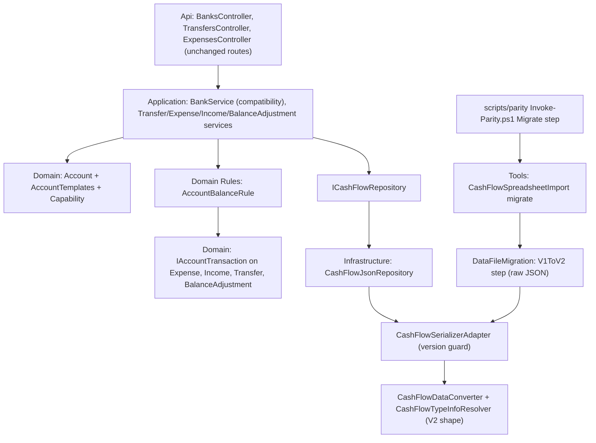

# Technical Specification: Account Model and Bank Migration

Complexity: **complex**. It touches every backend layer plus the import tool, the data file format and the parity script. There is no frontend change.

## 1. Technical Overview

**What.** The CashFlow `Bank` entity is replaced by an `Account` aggregate built from the **Bank** template, keeping the same Ids.
- An account's capabilities come from its template's fixed capability set, defined in code.
- Expense, Income, Transfer and BalanceAdjustment keep their own entities; only their bank reference becomes an account reference.
- One pure Domain rule calculates an account's balance. It replaces `BankService.ComputeBalance`.
- The data file goes from version 1 to version 2 through a new `CashFlowSpreadsheetImport migrate` command.
- The API, the spreadsheet import and the migrate command all refuse a file whose `Version` isn't the one the build needs.

**Why.**
- Every later P60 feature builds on this: F03 adds the generic transfer, F04 the summary, F05–F06 the screens, and F07, F09 and F11 the other templates.
- All of it needs one account model, one balance calculation and a versioned file format with an explicit migration step.

**Delivery.** The feature ships as two PRs. Each one leaves `main` deployable, and each one ends with a parity run showing 0 differences.

| PR | Content | Data file |
|---|---|---|
| **A — model** | `Account` aggregate, template table, capabilities and value objects; the balance rule; the references renamed in every layer; `/banks` served from accounts; the import builds accounts | Unchanged: still V1, read and written in the V1 bank shape |
| **B — format** | The V2 file shape; the version guard; the `migrate` command and the V1→V2 step; the import refuses an old output file; seed, test and example data moved to V2; the parity Migrate step calls `migrate`; the ArchUnitNET architecture test; docs; PRD ticks | V2 |

**Scope.**

*Included:*
- Everything in PRD F02 Capabilities, Error Handling and Section 9 F02, plus the cross-feature criteria that name F02 as the provider and can be checked now.
- *Input contract (Consumes F01):* the parity commands and figures report, run unchanged. Only the Migrate step changes, and it now calls `migrate`.
- *Output contracts (Provides):*
  - the `Account` aggregate with template, currency, active flag and capability check;
  - the Bank template;
  - account references on expenses, incomes, transfers and balance adjustments;
  - the shared balance calculation;
  - the versioned `migrate` command and the version guard;
  - the template architecture test.

*Excluded:*
- Linked transactions and the operation id (moved to F08 by the 2026-10-18 review).
- Per-currency balances (added in F11, with their first caller).
- Any new endpoint or DTO, and any change to the web app.
- Deleting or deactivating accounts beyond today's bank delete.
- Any template other than Bank.

## 2. Architecture Impact

**Layers and direction** (design.md's four questions):
1. **Where it belongs:** the CashFlow bounded context. The account model and balance rule are Domain; the compatibility services are Application; the file format, version guard and migration are Infrastructure and Tools.
2. **Which layers, in which direction:** Domain ← Application ← Infrastructure ← Api, with Tools depending on Infrastructure. All four layers are touched, which is why the feature is split into two PRs.
3. **What keeps Domain free of Infrastructure:** `ICashFlowRepository` and `ICashFlowSerializer`, declared in Application, implemented in Infrastructure. Domain knows nothing about JSON or versions.
4. **Which SOLID principles it leans on:**
   - **OCP:** a new template is a new table row plus its value objects, with no edits to existing code paths.
   - **SRP:** each record type owns its own balance contribution; the rule only sums contributions.
   - **ISP/DIP:** the architecture test reaches ArchUnitNET only through a one-method interface.



## 3. Technical Decisions

| Decision | Chosen approach | Alternative considered | Trade-off |
|---|---|---|---|
| **Template and capability representation** | `AccountTemplate` enum (`Bank`) and `Capability` enum, plus an `AccountTemplates` table mapping each template to a fixed `IReadOnlySet<Capability>`. `account.Has(c)` reads the table every time; the account stores only its template. | Capability list stored per account | Changing a template in code applies to every account at once. In exchange, an account can't hold a one-off capability, which the design doesn't want anyway. |
| **What the architecture test forbids** | Calling the `Account.Template` getter outside an allow-list. Naming a template when *creating* an account is allowed anywhere. | Forbid any dependency on `AccountTemplate` | This targets exactly "checking the template", and the allow-list stays at 1–2 types instead of growing with every creation site. The trade-off: a check written through `Has` is the expected path, and the rule can't stop someone comparing capability sets, which is acceptable. |
| **Architecture library** | `TngTech.ArchUnitNET` in `Tests/Financial.Architecture.Tests` only, behind `IArchitectureQuery` (one method) and a single adapter class. | Source-text scan; NetArchTest (eNhanced) | It reads compiled calls, and it's the best-maintained option. Replacing it means rewriting one adapter file. |
| **Balance calculation** | A static pure `AccountBalanceRule` in `Domain/Rules`. Each record type implements `IAccountTransaction` (`Date` plus `ContributionTo(Account)`), and the rule sums contributions inside the account's window. | Keep one switch over the record types inside the rule | Each type owns its own sign (SRP), and a new record type only needs to implement the interface. The window rule lives in exactly one place. |
| **Currency in the rule** | Not in F02: `Balance(account, asOf, records)`. | `Balance(account, currency, asOf, records)` now | No unused parameter. F11 adds the per-currency variant together with Settlement, its first caller. |
| **Test-only minimal accounts** | `Account` has an `internal` factory that takes a capability set. The Domain test project already has `InternalsVisibleTo` (Domain/AssemblyInfo.cs). | A fake template in production code | This lets the PRD's "one unit test per capability on a minimal account" run without adding a test template to the table. |
| **Which accounts `/banks` lists** | Accounts made from the Bank template. `BankService` reads `Account.Template` and is on the architecture rule's allow-list, marked "removed in F13 with `/banks`". | Use a capability as a proxy (`HasOpeningBalance`) | `/banks` literally means "Bank-template accounts" and is a compatibility endpoint that F13 retires. Being honest about that costs one temporary allow-list entry; a capability proxy would read as if having an opening balance made something a bank. |
| **Where the transactions live** | `Entities/Transactions/` holds `IAccountTransaction`, `Expense`, `Income`, `Transfer` and `BalanceAdjustment`, in namespace `Financial.CashFlow.Domain.Entities.Transactions`. Later pot movements and settlement entries join them. | Keep `Entities/` flat | It groups everything that moves money in or out of an account. The records *implement* a shared role and don't inherit from a base class, because they share almost no data. PR A already rewrites these four files, so the move costs nothing extra. |
| **Compatibility service names** | Keep `IBankService`/`BankService`, `BanksController` and the bank DTOs, served from accounts, until F13. | Rename to Account services now | Every existing screen and test keeps working unchanged. F06 adds the account endpoints. |
| **V2 file shape** | `Banks` becomes `Accounts`, with `Template`, `Currency`, `IsActive`, a nested `OpeningBalance` and a nested `RoundUp`. The reference keys are renamed: `PaymentSourceAccountId`, `AccountId`, `SourceAccountId`, `DestinationAccountId`. | Rename the collection only | The file matches the model, and later features won't carry "Bank" in keys that point at cards or pots. The DTO names stay as they are. |
| **Migration mechanism** | An explicit `migrate` command. The V1→V2 step rewrites the raw JSON (the `JsonNode` style of `InvestmentDataMigrations`), then the result is loaded with the current serializer before anything is written. | Migrate on load, like Investment | Each version step must pass a parity run on a copy before the live file changes, and restarting the app never rewrites data. |
| **Version guard** | `CashFlowSerializerAdapter.Deserialize` reads `Version` (missing means 1) and throws `InvalidDataException` with the PRD message unless it equals `CurrentVersion` (2). Because `ShutdownFlushHostedService` takes the repository in its constructor, the repository is created and the file loaded at host start, so the exception stops startup. | A new custom exception type | It's a BCL type, so there's nothing extra to maintain. The Tools code catches it to print the message and exit 1. |
| **Import on an existing V1 output** | Refuse: "run the migrate command first", exit 1, nothing written. | The import migrates silently | No hidden migration. A fresh import (no existing output) writes V2 through the serializer. |
| **PR size** | PR A's heterogeneous core is about 10 non-test files: the new Domain types plus `BankService` and the V1 persistence mapping. The reference rename is one repeated change and is exempt. PR B is about 9 non-test files. | Split PR A again | Splitting the new Domain types away from their first callers would leave unused types (scaffolding), which design.md forbids. The slight overage is accepted and named here for review. |

## 4. Component Overview

All paths are relative to the repo root. **A** and **B** mark the PR. Everything follows the existing patterns:
- entities: private setters, private constructor, static `Create`, `ArgumentException` for invalid input;
- enums: one per file in `Domain/Enums`;
- rules: `Domain/Rules`;
- the span/log telemetry pattern in every service.

**Domain (`Financial.CashFlow.Domain`)**

| File | New/Modified | PR | Purpose | Key responsibilities |
|---|---|---|---|---|
| `Entities/Account.cs` | New | A | Account aggregate | `Id`, `Name`, `Template`, `Currency`, `IsActive` (true on create), `OpeningBalance` (null unless `HasOpeningBalance`), `RoundUp` (null unless `SupportsRoundUp`). `Create(name, template, currency)`, `Update(name)`, `SetOpeningBalance(amount, date)`, `SetRoundUp(enabled)` and `Has(capability)`. A setter whose capability is missing throws `ArgumentException` ("<name> has no opening balance."). Plus an internal factory taking a capability set. |
| `Enums/AccountTemplate.cs` | New | A | Template names | `Bank` |
| `Enums/Capability.cs` | New | A | Capability names | `HasOpeningBalance`, `ReceivesIncome`, `HasCategories`, `CanSendTransfers`, `CanReceiveTransfers`, `CanReconcile`, `CanPayBills`, `SupportsRoundUp` |
| `Rules/AccountTemplates.cs` | New | A | Template table | Template → fixed capability set; unknown template throws |
| `ValueObjects/OpeningBalance.cs` | New | A | Opening balance | `Amount` ≥ 0 (otherwise `ArgumentException`, today's message), `StartDate`; immutable, value equality |
| `ValueObjects/RoundUpSetting.cs` | New | A | Round-up setting | `Enabled`; immutable, value equality |
| `Entities/Transactions/IAccountTransaction.cs` | New | A | Role of every record that moves money in or out of an account | `Date`, `ContributionTo(Account)` |
| `Rules/AccountBalanceRule.cs` | New | A | The one balance calculation | `Balance(account, asOf, records)`; see §6 Business rules |
| `Entities/Transactions/Expense.cs` | Modified | A | Reference rename plus contribution | `PaymentSourceBank` → `PaymentSourceAccount`. Round-up needs `Has(SupportsRoundUp)` and `RoundUp.Enabled`; a payment source needs `HasCategories`. Contribution: −(Value + RoundUp) on its payment source account. |
| `Entities/Transactions/Income.cs` | Modified | A | Same | `Bank` → `Account`; requires `ReceivesIncome`; contribution +Net |
| `Entities/Transactions/Transfer.cs` | Modified | A | Same | `SourceBank`/`DestinationBank` → `SourceAccount`/`DestinationAccount`. Requires `CanSendTransfers` and `CanReceiveTransfers`, and keeps today's messages. Contribution: −Amount on the source, +Amount on the destination. |
| `Entities/Transactions/BalanceAdjustment.cs` | Modified | A | Same | `Bank` → `Account`; requires `CanReconcile`; contribution +Delta |
| `Entities/CashFlowData.cs` | Modified | A | Document root | `Banks`/`AddBank`/`RemoveBank` → `Accounts`/`AddAccount`/`RemoveAccount` |
| `Entities/Bank.cs` | Deleted | A | — | Replaced by `Account` |

**Application (`Financial.CashFlow.Application`)**

| File | New/Modified | PR | Purpose | Key responsibilities |
|---|---|---|---|---|
| `Services/BankService.cs` | Modified | A | `/banks` compatibility | Lists accounts made from the Bank template (reads `Template`, allow-listed until F13). Create builds a Bank-template account in GBP, then applies `SetRoundUp`. Balances come from `AccountBalanceRule`. The DTO shapes and every message stay the same. `ComputeBalance` is deleted. |
| `Services/BalanceAdjustmentService.cs` | Modified | A | Delta from the shared rule | Delta = target − `AccountBalanceRule` balance with the edited adjustment left out |
| `Services/MensaisService.cs` | Modified | A | Pay a recurring bill | The payment source must have `CanPayBills`, otherwise the same 400 as an unknown bank |
| `Validation/CashFlowReferenceResolver.cs` | Modified | A | Payment-source lookup | Returns an `Account` |
| `Services/ExpenseService.cs`, `IncomeService.cs`, `TransferService.cs`, `CardStatementService.cs`, `ReserveService.cs` | Modified | A | Reference rename | Repeated change: bank → account, DTO Ids unchanged |
| `Interfaces/ICashFlowRepository.cs` | Modified | A | Repository contract | `GetAccounts`/`AddAccount`/`DeleteAccount` |

**Infrastructure (`Financial.CashFlow.Infrastructure`)**

| File | New/Modified | PR | Purpose | Key responsibilities |
|---|---|---|---|---|
| `Persistence/AccountJsonConverter.cs` | New | A, changed in B | Account ↔ JSON | **A:** reads and writes the V1 bank shape. Reading sets template Bank, GBP, `IsActive` true; writing produces exactly today's bytes. **B:** reads and writes the V2 account shape (§6). |
| `Persistence/CashFlowDataConverter.cs` | Modified | A, B | Root read/write | **A:** reads `Banks` as accounts and keeps the property order. **B:** uses `Accounts` in the same position. |
| `Persistence/CashFlowTypeInfoResolver.cs` | Modified | A, B | Reference wire names | **A:** account references keep the V1 wire names (`BankId`, …). **B:** they become `PaymentSourceAccountId`, `AccountId`, `SourceAccountId` and `DestinationAccountId`. |
| `Persistence/BankReferenceConverter.cs` → `AccountReferenceConverter.cs` | Renamed | A | Reference lookup | Resolves an account by Id. The not-found message names `Account`. |
| `Persistence/ReferenceResolutionContext.cs` | Modified | A | Seeded lookups | Accounts instead of banks |
| `Persistence/CashFlowSerializerAdapter.cs` | Modified | B | Version guard | `CurrentVersion = 2`. Serialize writes 2. Deserialize refuses any other version with the PRD message (§6 Error Handling). The doc comment is removed (no-comments policy). |
| `Repositories/CashFlowJsonRepository.cs` | Modified | A | Repository | Account methods |

**Tools (`Tools/CashFlowSpreadsheetImport`)**

| File | New/Modified | PR | Purpose | Key responsibilities |
|---|---|---|---|---|
| `CommandLine/MigrateArguments.cs` | New | B | Parse `migrate --input <path> --output <path>` | Both required; unknown flags refused; follows `ImportArguments` (a refusal string) |
| `DataFileMigration/DataFileMigrator.cs` | New | B | Runs the chain | Reads the raw input. `Version` missing means 1; a version above current is refused. Runs every step from the stored version upward, then validates the result by deserializing it with `CashFlowSerializerAdapter`. Returns the new bytes, or the input bytes unchanged when already current. |
| `DataFileMigration/V1ToV2BanksToAccounts.cs` | New | B | Step 1 → 2 | Rewrites `Banks` into `Accounts` and renames the reference keys. An unknown bank Id stops the step and names the record. Sets `Version` 2. |
| `Program.cs` | Modified | B | Command routing | `migrate` as the first argument goes to the migrate flow (§5), otherwise the import runs. On an import, an existing output that isn't the current version is refused before the backup. |
| `Migrations/Banks/BankMigrator.cs`, `Migrations/BankOpeningBalance/BankOpeningBalanceMigrator.cs`, `SheetImporters/MonthlyExpenseSheetImporter.cs`, `Migrations/RawJsonMigrationHelpers.cs`, `Migrations/EntityReferences/EntityReferenceMigrator.cs` | Modified | A | Import builds accounts | Repeated change. `BankMigrator` seeds Barclays, Trading212 and Chase as Bank-template accounts in GBP with the same round-up flags; the opening-balance step uses `Account.SetOpeningBalance`. |

**Api, scripts, data and docs**

| File | New/Modified | PR | Purpose |
|---|---|---|---|
| `Financial.Api/Controllers/BanksController.cs`, `TransfersController.cs` | Unchanged | — | Routes and DTOs stay as they are; served by the compatibility services |
| `scripts/parity/Invoke-Parity.ps1` | Modified | B | `Invoke-MigrateStep` runs `dotnet run --project Tools/CashFlowSpreadsheetImport -c Release -- migrate --input <live copy> --output <after>\data-cashflow.json`, logged to `after\migrate.log`. A failure gives "Migrate failed; see <log>" and exit 1. |
| `scripts/parity/README.md` | Modified | B | The Migrate step now runs `migrate` |
| `README.md` | Modified | B | Deploy section: download `data-cashflow.json` from Drive (keep it as the backup), run `migrate --input <download> --output <new>`, upload `<new>`, deploy |
| `data/data-cashflow.example.json` | Modified | B | `"Accounts": []`, `"Version": 2` |
| `Tests/Financial.Api.Tests/TestData/data-cashflow.test.json` | Modified | B | V2 accounts with the same Ids, `Version` 2 (used by web-e2e) |

**Tests (new or changed, details in §7)**

| File | PR |
|---|---|
| `Tests/Financial.CashFlow.Domain.Tests/Entities/AccountTests.cs` (replaces `BankTests.cs`), `Rules/AccountTemplatesTests.cs`, `Rules/AccountBalanceRuleTests.cs`, `ValueObjects/OpeningBalanceTests.cs`, `ValueObjects/RoundUpSettingTests.cs`, `Entities/CapabilityGuardTests.cs` | A |
| `Tests/Financial.TestUtilities/StubCashFlowRepository.cs` (accounts), the existing Application, Infrastructure and Api tests (rename only, same expected values) | A |
| `Tests/Financial.CashFlow.Infrastructure.Tests/Persistence/CashFlowSerializerAdapterTests.cs`, `ExampleDataFileTests.cs`, `AccountJsonConverterTests.cs` | A, B |
| `Tests/Financial.CashFlowSpreadsheetImport.Tests/DataFileMigration/DataFileMigratorTests.cs`, `V1ToV2BanksToAccountsTests.cs`, `CommandLine/MigrateArgumentsTests.cs`, `MigrateCommandTests.cs`, `FreshImportVersionTests.cs` | B |
| `Tests/Financial.Api.Tests/ApiTestFactory.cs` (`SeededBanksJson` moved to V2 and renamed `SeededCashFlowJson`) | B |
| `Tests/Financial.Api.Tests/Acceptance/AccountModelBankMigrationAcceptanceTests.cs` | A, B |
| `Tests/Financial.Architecture.Tests/Infrastructure/IArchitectureQuery.cs`, `ArchUnitArchitectureQuery.cs`, `AccountTemplateReadRuleTests.cs`; the csproj gains `TngTech.ArchUnitNET` and a reference to `Tools/CashFlowSpreadsheetImport` | B |

## 5. API Contracts

**HTTP: no change.** Every `/banks`, `/transfers` and `/expenses` route keeps its request and response shape and its status codes. That covers:
- `GET/POST /banks`, `PUT/DELETE /banks/{id}`;
- `PUT /banks/{id}/opening-balance`;
- `GET /banks/month/{y}/{m}/balances`;
- `POST/PUT/DELETE/GET /banks/{id}/adjustments...`;
- the transfer and expense routes.

`Tests/Financial.Api.Tests/Contract/openapi-v1.snapshot.json` must stay byte-identical; the openapi-v1 snapshot test is the proof. Nothing new is added for the web.

Example (unchanged), `GET /api/v1/financial/banks`:
```json
[
  { "id": "5db5c88d-0000-0000-0000-000000000001", "name": "Barclays", "roundUpEnabled": false,
    "openingBalance": 0, "openingBalanceDate": "2026-09-01", "hasReferences": true }
]
```

**CLI contract (new, PR B): `CashFlowSpreadsheetImport migrate`**

| Argument | Required | Validation | Description |
|---|---|---|---|
| `migrate` | Yes (first argument) | literal | Selects the migrate command |
| `--input <path>` | Yes | the file exists; not `data/data-cashflow.json` | File to upgrade |
| `--output <path>` | Yes | not `data/data-cashflow.json`; not the same full path as `--input` | File to write. If it exists, `MigrationBackup.Create` copies it first. |

Exit codes and console output:

| Case | Exit | Output (stdout, or stderr for errors) | Files |
|---|---|---|---|
| Upgraded | 0 | `Migrated <input> from version 1 to 2: 3 banks became accounts; <n> references renamed. Wrote <output>.` | output written |
| Already current | 0 | `<input> is already version 2; copied unchanged to <output>.` | output = input bytes |
| Bad or missing arguments | 2 | usage line `CashFlowSpreadsheetImport migrate --input <path> --output <path>` | none |
| Live file as input or output | 1 | `Refusing to migrate the live data file. Pass a copy.` | none |
| Output same as input | 1 | `--output must be a different file from --input.` | none |
| Input missing | 1 | `Input file not found: <input>` | none |
| Version above current | 1 | `<input> is version 3; this build needs version 2.` | none |
| Step failure (e.g. unknown bank) | 1 | `Migration step V1ToV2BanksToAccounts failed: Expense <id> references unknown bank <id>` | none written; input and backup untouched |

## 6. Data Model

**V2 account (collection `Accounts`, written where `Banks` is today):**

| Field | JSON type | Nullable | Rule |
|---|---|---|---|
| `Id` | string (Guid) | No | Same Id as the V1 bank |
| `Name` | string | No | Required; unique among accounts (case-insensitive, as today) |
| `Template` | string enum | No | `"Bank"` |
| `Currency` | string enum | No | `"GBP"` for every migrated bank |
| `IsActive` | bool | No | `true` |
| `OpeningBalance` | object or null | Yes | `{ "Amount": number ≥ 0, "StartDate": "yyyy-MM-dd" }`. Present exactly when the template has `HasOpeningBalance`. |
| `RoundUp` | object or null | Yes | `{ "Enabled": bool }`. Present exactly when the template has `SupportsRoundUp`. |

```json
{ "Id": "5db5c88d-0000-0000-0000-000000000001", "Name": "Barclays", "Template": "Bank", "Currency": "GBP",
  "IsActive": true, "OpeningBalance": { "Amount": 0, "StartDate": "2026-09-01" }, "RoundUp": { "Enabled": false } }
```

**Reference keys, V1 → V2:**

| Record | V1 key | V2 key |
|---|---|---|
| Expense | `PaymentSourceBankId` | `PaymentSourceAccountId` |
| Income | `BankId` | `AccountId` |
| Transfer | `SourceBankId`, `DestinationBankId` | `SourceAccountId`, `DestinationAccountId` |
| BalanceAdjustment | `BankId` | `AccountId` |

Root `Version`: missing or 1 → V1; 2 → V2. No other field changes. Computed properties such as `PaymentStatus` keep being written.

**V1 → V2 step rules:**
1. Every `Banks[i]` becomes an `Accounts` entry with these mappings:
   - `RoundUpEnabled` → `RoundUp.Enabled`;
   - `OpeningBalance`/`OpeningBalanceDate` → `OpeningBalance.Amount`/`StartDate`;
   - a missing `OpeningBalanceDate` → `0001-01-01`, which is today's `default` meaning "count everything".
2. Every reference key is renamed, keeping its value. A null stays null.
3. A non-null reference to an Id not in `Banks` stops the step with `<Record> <id> references unknown bank <id>`.
4. `Version` = 2.
5. Validate: the result must deserialize with the V2 serializer.

**Business rules:**
- **Template table.** Bank = {`HasOpeningBalance`, `ReceivesIncome`, `HasCategories`, `CanSendTransfers`, `CanReceiveTransfers`, `CanReconcile`, `CanPayBills`, `SupportsRoundUp`}.
- **Capability guards.** Each guard throws `ArgumentException`. Where a bank message exists today, it stays word for word.
  - A payment source needs `HasCategories`.
  - An income account needs `ReceivesIncome`.
  - A transfer needs `CanSendTransfers` on the source and `CanReceiveTransfers` on the destination.
  - An adjustment needs `CanReconcile`.
  - Paying a recurring bill needs `CanPayBills`.
  - Round-up needs `SupportsRoundUp`, and the setting must be enabled.
  - Setting an opening balance needs `HasOpeningBalance`.
- **`AccountBalanceRule.Balance(account, asOf, records)`:**
  - **Window:** when the account has `HasOpeningBalance`, the window runs from `OpeningBalance.StartDate` to `asOf`, both inclusive, and the result starts from `OpeningBalance.Amount`. Otherwise the window is every record dated on or before `asOf`, and the result starts from 0.
  - **Balance:** the start value plus the sum of `ContributionTo(account)` over the records whose `Date` is in the window.
  - This reproduces `ComputeBalance` exactly: expense −(Value + RoundUpAmount ?? 0), income +Net, transfer ∓Amount, adjustment +Delta. The adjustment being edited is excluded by the caller.
- **`/banks` balances by month:** as-of = the last day of the month, keyed by account name. Same as today.
- **Records before the start date:** still counted by category totals, history and every other read. Only the balance window ignores them.

## 7. Testing Strategy

Following the `testing-guide-Financial` skill:
- **Unit:** Domain and Application.
- **Integration:** persistence, Tools on temp JSON, the API host via `ApiEndpointTests`, and the architecture tests.
- **AC tracing:** one tagged test per PRD F02 bullet (`[Trait("AC", "P60-F02-account-model-and-bank-migration-NN")]`), numbered in PRD order 01–12.
- **Other rules:** every class carries `[Trait("Category", …)]`; names follow `Method_Condition_Result`; shared doubles live only in `Tests/Financial.TestUtilities`.

| Test file | Type | Target | Coverage goal |
|---|---|---|---|
| `Domain.Tests/Entities/AccountTests.cs` | Unit | `Account` | Every invariant and rejected input |
| `Domain.Tests/Entities/CapabilityGuardTests.cs` | Unit | Guards on Expense, Income, Transfer, BalanceAdjustment and Account | One test per capability, on a minimal account that has only that capability; one rejection per missing capability |
| `Domain.Tests/Rules/AccountTemplatesTests.cs` | Unit | Template table | The Bank set is exact |
| `Domain.Tests/Rules/AccountBalanceRuleTests.cs` | Unit | Balance rule | Window boundaries, each contribution sign, round-up, no-opening-balance path |
| `Domain.Tests/ValueObjects/OpeningBalanceTests.cs`, `RoundUpSettingTests.cs` | Unit | Value objects | Bounds, equality |
| `Application.Tests/Services/BankServiceTests.cs`, `BalanceAdjustmentServiceTests.cs`, … | Unit | Compatibility services | Existing expected values unchanged; failed-span assertions kept |
| `Infrastructure.Tests/Persistence/AccountJsonConverterTests.cs` | Unit/Integration | Converter | PR A: V1 bytes round-trip identically. PR B: V2 round-trip. |
| `Infrastructure.Tests/Persistence/CashFlowSerializerAdapterTests.cs` | Integration | Version guard | V1, V3 and missing-Version refused; V2 loads; serialize writes 2 |
| `Infrastructure.Tests/Persistence/ExampleDataFileTests.cs` | Integration | Example file | Loads under V2 |
| `CashFlowSpreadsheetImport.Tests/DataFileMigration/*` | Integration | Migrator and step | Temp files; every row of the §5 exit table |
| `CashFlowSpreadsheetImport.Tests/FreshImportVersionTests.cs` | Integration | Import | An in-memory `XLWorkbook` through the import pipeline writes V2 accounts; an existing V1 output is refused |
| `Api.Tests/Acceptance/AccountModelBankMigrationAcceptanceTests.cs` | Integration (AC) | Host | ACs 05, 07, 10, 11. ACs 01–04 are tagged in the Tools tests, 06 and 08 in the Domain tests, 09 in the architecture tests. |
| `Architecture.Tests/AccountTemplateReadRuleTests.cs` | Integration | Template rule | Passes on production code; catches a planted violation |

**Key functions:**

| Test function | Description | Assertions |
|---|---|---|
| `Create_WithBankTemplate_HasAllEightCapabilitiesAndIsActive` | Account factory | `Has` is true for each Bank capability; `IsActive`; `OpeningBalance` is 0 at `0001-01-01`; `RoundUp` disabled |
| `SetOpeningBalance_Negative_ThrowsArgumentException` | Opening balance bound | Exception type and today's message |
| `SetOpeningBalance_WithoutCapability_ThrowsArgumentException` | Guard (minimal account) | Throws; nothing changed |
| `Income_Create_AccountWithoutReceivesIncome_Throws` (one per capability) | AC 08, per capability | Throws on a minimal account without the capability; succeeds with only it |
| `BankTemplate_AllCapabilities_CombinationWorks` | AC 08, combination | A Bank account accepts an expense with round-up, an income, a transfer each way, an adjustment and a bill payment |
| `Balance_AsOfBeforeStartDate_ReturnsOpeningAmountOnly` | AC 06 | Equals the opening amount |
| `Balance_RecordOnStartDateAndOnAsOf_AreBothCounted` | Inclusive window | Both counted |
| `Balance_ExpenseWithRoundUp_SubtractsValuePlusRoundUp` | Round-up | −(value + round-up) |
| `Balance_AccountWithoutOpeningBalance_CountsEveryRecordUpToAsOf` | No-capability path | All records up to `asOf` counted |
| `Deserialize_Version1_ThrowsWithMigrateMessage` | AC 05 | `InvalidDataException`; the message equals the PRD text |
| `Deserialize_NoVersion_TreatedAsVersion1AndRefused` | Guard | Refused |
| `Deserialize_Version3_Refused` | Guard | Refused |
| `Migrate_Version1File_ProducesThreeAccountsSameIdsAndVersion2` | AC 01 | 3 accounts with the same Ids, names, opening amounts, dates and round-up flags; reference keys renamed with their values kept; `Version` 2 |
| `Migrate_Version2File_OutputIsByteIdentical` | AC 02 | Output bytes equal input bytes |
| `Migrate_LiveFileAsInputOrOutput_RefusesAndWritesNothing` | AC 03 | Exit 1, the message, no output file |
| `Migrate_UnknownBankReference_FailsAndWritesNothing` | Error Handling | Exit 1 naming the step and record; output absent; input unchanged |
| `Migrate_OutputExists_BackupCreatedFirst` | Backup | Backup file holds the old bytes |
| `Import_FreshWorkbook_WritesVersion2WithBankAccounts` | AC 04 | `Version` 2; Barclays, Trading212 and Chase as Bank accounts with today's round-up flags |
| `Import_ExistingVersion1Output_RefusesWithMigrateMessage` | Import + V1 decision | Exit 1; output unchanged; no backup |
| `ApiHost_Version1File_FailsToStart` / `ApiHost_Version2File_Starts` | AC 05 | Resolving the hosted services throws, or succeeds |
| `RecordsBeforeStartDate_CountInCategoryTotalsNotInBalance` | AC 07 | Category total includes the expense; `/banks` balance doesn't |
| `BanksTransfersExpenses_ShapesUnchanged` | AC 10 | OpenAPI snapshot identical; seeded responses equal the pre-F02 expected JSON |
| `SeedAndExampleData_AreVersion2` | AC 11 | Both files load; `Version` 2 |
| `Production_Should_Not_Read_The_Account_Template_Outside_The_Allow_List` | AC 09 | The query over Domain, Application, Infrastructure, Api and Tools returns only the allow-listed types: `Account`, `BankService` (marked "removed in F13 with `/banks`"), and the account converter if it reads the getter |
| `TemplateReadQuery_FindsPlantedViolation` | AC 09, negative | A test-assembly type that reads `Template` is reported |
| `OnlyTheAdapter_ReferencesArchUnitNet` | AC 09 | No type in the test assembly other than `ArchUnitArchitectureQuery` depends on `ArchUnitNET` |

**Proved by the Definition of Done rather than an automated test:**
- **AC 06 on real data:** the parity run on the latest live copy shows 0 differences after PR A (Migrate step still a plain copy) and after PR B (Migrate step running `migrate`). Every bank balance and round-up figure for every month from 2017-01 is covered.
- **AC 12:** parity, `/simplify` and the architecture-reviewer.

**Cross-feature criteria** that name F02 as the provider and can be checked now:
- **The parity commands run unchanged**, extended only through the Migrate step: proved by the PR B parity run.
- **One `migrate` chain from V1 that refuses to skip a step:** in F02, `DataFileMigratorTests.Migrate_RunsStepsInVersionOrder` and `Migrate_VersionAboveCurrent_Refused`. F07, F09 and F11 extend the chain.
- The rest are verified when the consuming features ship.
