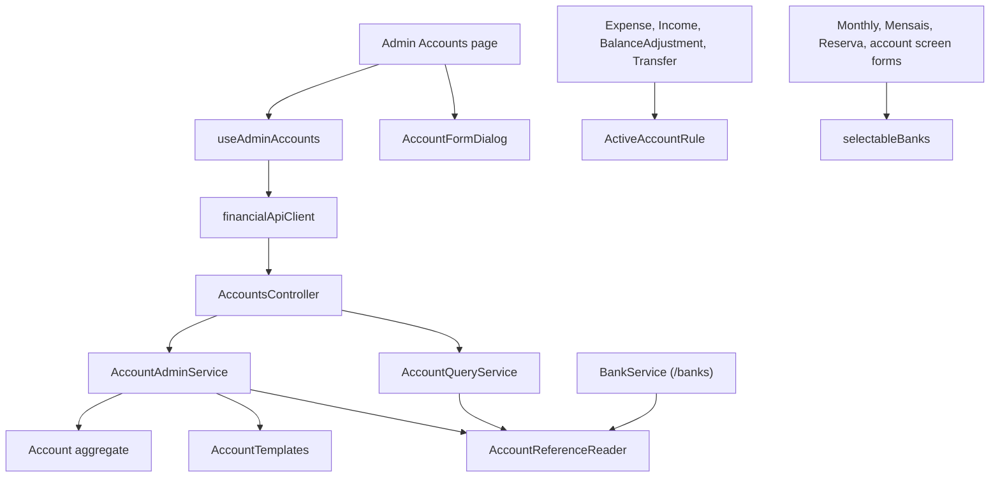

# Technical Specification: Admin Accounts Page

Complexity: **complex**. It touches Domain, Application, the API, a new admin screen and seven existing form components. There is no data-file change.

## 1. Technical Overview

**What.**
- Account maintenance endpoints on `AccountsController`:
  - `GET accounts/templates`: the templates available so far, each with its allowed currencies and its capabilities;
  - `POST accounts`, `PUT accounts/{id}`, `DELETE accounts/{id}`.
- `GET accounts` gains `hasRecords`, `openingBalance`, `balanceStartDate` and `roundUpEnabled`.
- `Account` can be deactivated and reactivated. It enforces a 60-character name and its template's allowed currencies; the Bank template allows GBP only.
- One Domain rule refuses an inactive account for new records:
  - it applies to expenses, incomes, balance adjustments, transfers and card-statement settles;
  - an edit that keeps the same account still works.
- `/banks` gains `isActive`.
- A new **Admin → Accounts** page (`/admin/cashflow/accounts`) has:
  - a grid;
  - a New account / Edit dialog (ADR-006);
  - a delete confirmation that offers Deactivate when the account has records.
- The old new-entry bank pickers hide inactive banks: Monthly's forms, Mensais's dialog, Reserva's withdrawal form, the card statement payment, and the account screen's form options. An edit keeps showing its own bank.

**Why.**
- A new account must need no code. F07, F09 and F11 add their templates to this page instead of building new admin screens.
- Deactivation is the only way to retire an account with history. Until now no code could set `IsActive`; F03's tests set it by reflection.

**Delivery.** Four PRs. Each leaves `main` deployable and ends with a parity run showing 0 differences against `p60-deployed-f05`. The PRD review agreed two stages; interview Q6 split both by file count.

| PR | Content | Non-test code files |
|---|---|---|
| **1. Account endpoints** | `Account` active flag, name limit, allowed currencies and template change; `AccountTemplates` currencies and list; shared account-reference reader; three request and template DTOs; `AccountDTO` extension; admin service, interface and DI; four routes on `AccountsController`; OpenAPI snapshot and `openapi.ts` | ~12 (3 flat DTOs) + generated files |
| **2. Inactive accounts in the API** | Shared Domain rule; `Expense`, `Income`, `BalanceAdjustment` and `Transfer` use it; `BankDTO.IsActive`; `BankService` switched to the shared reference reader | ~7 + generated files |
| **3. Admin Accounts page** | Page, dialog, hook, client calls, type aliases, route, nav entry | ~7 |
| **4. Inactive banks hidden in pickers** | One selection helper; seven form components use it; PRD ticks | ~8 |

**Scope.**
- **Included:**
  - everything in PRD F06's Capabilities, Experience and Error Handling, as amended by the F06 review (#1083);
  - the spec decisions below.
- **Input contracts (Consumes F02):**
  - the `Account` aggregate, the Bank template and its capabilities;
  - `OpeningBalance` and `RoundUpSetting`;
  - `AccountBalanceRule`, the shared balance calculation.
- **Output contracts (Provides):**
  - the account create, edit and deactivate flow per template, used by F07, F09 and F11;
  - each later feature adds its template to `AccountTemplates`. It builds dialog fields only for capabilities this page doesn't render yet.
- **Excluded:**
  - BRL banks (PRD Out of Scope);
  - any change to Admin Banks' screen; it keeps its own messages until F13;
  - account groups;
  - the Credit card, Pots and Settlement templates (F07, F09, F11).

## 2. Architecture Impact



Layers:
- **Domain:**
  - `Account`: active flag, name limit, template change;
  - `AccountTemplates`: allowed currencies and the template list;
  - the new `ActiveAccountRule`, which the four record entities use.
- **Application:**
  - the admin service and its interface;
  - the shared `AccountReferenceReader`;
  - the DTOs.
- **API:** four routes on the existing `AccountsController`.
- **Web:** the page, dialog, hook and client; the picker helper used by seven components.

## 3. Technical Decisions

| Decision | Chosen approach | Alternative considered | Trade-off / source |
|---|---|---|---|
| Admin list data | `GET accounts` gains `hasRecords`, `openingBalance`, `balanceStartDate` and `roundUpEnabled`. The last three are null when the template lacks the capability. One list serves the admin grid, F05's picker and the Accounts page. | A separate `GET accounts/admin` | Interview Q1. The OpenAPI change is additive. `hasRecords` costs one pass over the records, as `GET banks` already does. |
| Template list | `GET accounts/templates` returns each template in `AccountTemplates` order: name, allowed currencies and capability names. The dialog shows opening balance and start date for `HasOpeningBalance`, and round-up for `SupportsRoundUp`. | Web constants | Interview Q2. Allowed currencies live only in Domain. A later template with known capabilities needs no dialog change. |
| Allowed currencies | `AccountTemplates.AllowedCurrencies(template)`: Bank → GBP. `Account.Create` and the template change reject any other currency with `ArgumentException` "Bank accounts must be GBP." (`<Template> accounts must be <list>.`). The test-only `CreateWithCapabilities` keeps accepting any currency. | Checking in the service | F06 review decision 4. Domain owns the rule, so the import tool and `/banks` can't bypass it. `/banks` already creates GBP. |
| Name rules | `Account` trims the name and requires 1–60 characters ("Account name is required.", "Account name must be 60 characters or fewer."). Uniqueness is case-insensitive on both routes: `EnsureNameIsUnique` gains an optional comparer, and the account call sites pass `StringComparer.OrdinalIgnoreCase`. The new routes use the display name "An account"; `/banks` keeps "A bank". | Case-insensitive on the new routes only | PRD F06 and review decision 5. The live file has no two account names differing only by case. Categories and other entities keep exact matching. |
| Active flag | `Account.SetActive(bool)`. Reactivation is allowed. `PUT accounts/{id}` carries `isActive`. The reflection setter in `TransferTests` is replaced by `SetActive(false)`. | Separate deactivate and activate routes | PRD Edit includes "active"; F03 follow-up. |
| Template and currency change | `PUT` carries `templateName` and `currency`. If either differs from the stored value and the account has records: 400 "Template and currency can't change once the account has transactions." Without records, `Account.ChangeTemplate(template, currency)` applies it, with the allowed-currency check. It also resets the capability fields the new template lacks and defaults the ones it gains. | Ignoring the fields on edit | PRD AC 3. With only the Bank template, a change can't succeed yet. The guard is still what AC 3 tests. |
| Opening balance and start date | Required when the template has `HasOpeningBalance`. Amount ≥ 0 (existing `OpeningBalance` rule). Start date not in the future, using `TimeProvider.GetLocalToday()`: 400 "Balance start date can't be in the future." The dialog pre-fills 0.00 and today. Sending them for a template without the capability is a 400 from the existing `Account.SetOpeningBalance` check. `roundUpEnabled` is required for `SupportsRoundUp` (default false), and the same applies when it's sent for a template without it. | Optional fields | Interview Q3. Editing the opening balance or start date of an account with records changes its past balances, as Admin Banks' opening-balance edit does today. |
| Has records | A new internal `AccountReferenceReader` returns the ids of accounts referenced by any expense (payment source), income, transfer (either side) or balance adjustment. It is moved out of `BankService` (`IsReferenced`, `BuildReferencedAccountIds`), which switches to it in PR 2. | `IAccountTransaction.ContributionTo` ≠ 0 | A zero-delta adjustment contributes 0 but is still a record. No entity changes in PR 1. |
| Delete | `DELETE accounts/{id}`: unknown id → 404. An account with records → `EntityInUseException`, 409 "Barclays has transactions and cannot be deleted. Deactivate it instead." Otherwise it's removed. | — | PRD Error Handling. |
| Inactive rule | `Domain/Rules/ActiveAccountRule.EnsureUsable(Account? current, Account candidate)` throws `ArgumentException` "Barclays is inactive." when the candidate is inactive and differs from the current account. Callers: `Transfer` (its private `EnsureIsActiveWhenChanged` is removed), `Expense.Create` and `UpdateDetails` (payment source), `Expense.Settle` (current null, interview Q5), `Income.Create` and `UpdateDetails`, `BalanceAdjustment.Create`. `Unsettle`, deletes and same-account edits are unaffected. | Checks in each service | F06 review decision 3. One rule; every flow that creates records gets it, including Mensais's paid-bill expense, Reserva's withdrawal expense pair and the card statement payment. The credit-card inactive message is unchanged. |
| `/banks` | `BankDTO.IsActive`. `GET banks` still lists every bank. Admin Banks' screen is unchanged. | Filtering inactive banks in `/banks` | F06 review decision 2. Past records' bank names keep resolving. |
| Admin page | `AdminAccountsPage` on `AdminEntityPage` ("Accounts", create label "New account", empty "No accounts yet"). Grid columns: Name, Template, Currency, Active ("Active" or "Inactive" text), row Edit and Delete through `RowActionsCell`. Ordered by name (from `GET accounts`). | — | PRD; Banks page pattern. |
| Dialog | `AccountFormDialog` on `EntityFormDialog`. Field order: Template (a `Select`, focused first), then Name, then Currency (a `Select` listing the template's allowed currencies; read-only text when there's one choice or the account has records), then the capability fields, then Active (edit only, `Switch`). Template is read-only text on edit when the account has records. Save stays enabled except while saving. On submit, each problem shows under its field. A 409 duplicate shows under Name; any other server error shows in the dialog's `MessageBar`. Titles "New account" and "Edit account". | Save disabled until valid | PRD Experience; the F05 stage 5 UI review (per-field messages on submit, B1). |
| Unsaved changes | Closing a dirty dialog (Cancel, Escape, the close button) goes through F05's `useDiscardPrompt` and `DiscardChangesDialog`. A form is dirty when its values differ from those it opened with. | — | PRD Experience. The other admin dialogs have no prompt and are left as they are. |
| Delete with records | Delete on an account with `hasRecords` opens `ConfirmDialog`: title "Can't delete Barclays", body "Barclays has transactions and cannot be deleted. Deactivate it instead.", primary "Deactivate" (calls `PUT` with `isActive: false`) and "Cancel". An already inactive account shows only "Close". An unused account gets `ConfirmDeleteDialog`. A 409 that slips through shows on the page's action error. | A disabled Delete button, or showing the 409 | Interview Q4. |
| Toasts | "Account created", "Account updated", "Account deactivated", "Account deleted" through `useSuccessToast`. | — | F05 building block. |
| Navigation | "Accounts" first under Admin → CashFlow (alphabetical), route `admin/cashflow/accounts`, lazy like its siblings. | — | `navTree.ts`, `routes.tsx` |
| Picker filtering | `utils/selectableBanks.ts`: `selectableBanks(banks, selectedId?)` returns the active banks plus the currently selected one, in the given order. It's used by `ExpenseForm`, `IncomeForm`, `BalanceAdjustmentForm`, `TransferForm` (source and destination, each keeping its own selection), `BillExpenseFields`, `WithdrawalForm` and `CardsGrid`'s statement payment bank. | Filtering in each page hook | F06 review decision 2. The current value covers edits and a stale open form. Order stays as `/banks` gives it, until F13. |
| PRD ticks | In PR 4, in their own commit. No cross-feature box is ticked: both F06 boxes also name F07, F09 or F11. | — | `feedback_prd_ac_ticks_in_last_pr` |

## 4. Component Overview

**Domain (`Financial.CashFlow.Domain`):**

| File | New/Modified | PR | Responsibilities |
|---|---|---|---|
| `Entities/Account.cs` | Modified | 1 | Trim and validate the name (required, 60 characters) in `Create`, `Update` and the rest; `SetActive`; `ChangeTemplate(template, currency)`; allowed-currency check in `Create` (not in `CreateWithCapabilities`) |
| `Rules/AccountTemplates.cs` | Modified | 1 | `AllowedCurrencies(template)`; `Available` (templates in definition order) |
| `Rules/ActiveAccountRule.cs` | New | 2 | `EnsureUsable(current, candidate)` |
| `Entities/Transactions/Expense.cs`, `Income.cs`, `BalanceAdjustment.cs`, `Transfer.cs` | Modified | 2 | Call the rule where an account is set; `Transfer` drops its private copy |

**Application (`Financial.CashFlow.Application`):**

| File | New/Modified | PR | Responsibilities |
|---|---|---|---|
| `Services/AccountReferenceReader.cs` | New | 1 | Internal static: referenced account ids, and whether one id is referenced |
| `Interfaces/IAccountAdminService.cs`, `Services/AccountAdminService.cs` | New | 1 | `GetTemplates`, `CreateAsync`, `UpdateAsync`, `DeleteAsync`; spans and logging as in `BankService`; `ApplyAndSaveAsync` |
| `DTOs/AccountCreateDTO.cs`, `AccountUpdateDTO.cs`, `AccountTemplateDTO.cs` | New | 1 | Flat request and response shapes (§5) |
| `DTOs/AccountDTO.cs` | Modified | 1 | `HasRecords`, `OpeningBalance?`, `BalanceStartDate?`, `RoundUpEnabled?` |
| `Services/AccountQueryService.cs` | Modified | 1 | Fill the new `AccountDTO` fields from the reference reader |
| `Validation/EntityLookupExtensions.cs` | Modified | 1 | Optional comparer on `EnsureNameIsUnique` |
| `DependencyInjection/…ServiceCollectionExtensions.cs` | Modified | 1 | Register `IAccountAdminService` (singleton, like its siblings) |
| `Services/BankService.cs` | Modified | 1, 2 | PR 1: case-insensitive uniqueness. PR 2: `IsActive` in `ToDto`; use the reference reader |
| `DTOs/BankDTO.cs` | Modified | 2 | `IsActive` |

**API (`Financial.Api`):**

| File | New/Modified | PR | Responsibilities |
|---|---|---|---|
| `Controllers/AccountsController.cs` | Modified | 1 | `GET templates`, `POST`, `PUT {id:guid}`, `DELETE {id:guid}`; inject `IAccountAdminService` |
| `Tests/Financial.Api.Tests/Contract/openapi-v1.snapshot.json`, `Financial.Web/src/api/generated/openapi.ts` | Regenerated | 1, 2 | Additive only |

**Web (`Financial.Web/src`):**

| File | New/Modified | PR | Responsibilities |
|---|---|---|---|
| `api/types.ts`, `api/financialApiClient.ts` | Modified | 3 | Aliases; `getAccountTemplates`, `createAccount`, `updateAccount`, `deleteAccount` |
| `hooks/useAdminAccounts.ts` | New | 3 | Accounts and templates through `useCrudResource`; create, update, deactivate, delete |
| `pages/AdminAccountsPage.tsx` | New | 3 | Grid, dialogs, delete and deactivate flow, toasts |
| `components/AccountFormDialog.tsx` | New | 3 | Fields by template capability, per-field validation, the 409 under Name, discard prompt |
| `navigation/navTree.ts`, `navigation/routes.tsx` | Modified | 3 | Entry and route |
| `utils/selectableBanks.ts` | New | 4 | Active banks plus the selected one |
| `components/ExpenseForm.tsx`, `IncomeForm.tsx`, `BalanceAdjustmentForm.tsx`, `TransferForm.tsx`, `BillExpenseFields.tsx`, `WithdrawalForm.tsx`, `CardsGrid.tsx` | Modified | 4 | Render `selectableBanks(banks, currentValue)` |

No data-file change, no migration, no new package.

## 5. API Contracts

All routes sit under `/api/v1/financial`. There is no authentication (single-user, as for every route).

**`GET accounts/templates`** → 200

```json
[
  { "name": "Bank", "currencies": ["GBP"], "capabilities": ["HasOpeningBalance", "ReceivesIncome", "HasCategories", "CanSendTransfers", "CanReceiveTransfers", "CanReconcile", "CanPayBills", "SupportsRoundUp"] }
]
```

**`GET accounts`** → 200. The existing fields plus:

| Field | Type | Description |
|---|---|---|
| `hasRecords` | bool | Any expense, income, transfer or adjustment references the account |
| `openingBalance` | number \| null | Null when the template has no `HasOpeningBalance` |
| `balanceStartDate` | date \| null | Same |
| `roundUpEnabled` | bool \| null | Null when the template has no `SupportsRoundUp` |

```json
[{ "id": "…", "name": "Barclays", "templateName": "Bank", "currency": "GBP", "isActive": true, "hasRecords": true, "openingBalance": 0.00, "balanceStartDate": "2026-09-01", "roundUpEnabled": false }]
```

**`POST accounts`** → 201 with `AccountDTO`

| Field | Type | Required | Validation |
|---|---|---|---|
| `templateName` | string | yes | A name from `GET accounts/templates`; otherwise 400 "Unknown account template 'X'." |
| `name` | string | yes | Trimmed, 1–60 characters, unique across accounts ignoring case |
| `currency` | string | yes | One of the template's currencies; an unknown code is 400 "Unknown currency 'X'." |
| `openingBalance` | number | with `HasOpeningBalance` | ≥ 0 |
| `balanceStartDate` | date | with `HasOpeningBalance` | Not in the future |
| `roundUpEnabled` | bool | with `SupportsRoundUp` | — |

```json
{ "templateName": "Bank", "name": "Monzo", "currency": "GBP", "openingBalance": 250.00, "balanceStartDate": "2026-10-24", "roundUpEnabled": true }
```

**`PUT accounts/{id}`** → 200 with `AccountDTO`. Same fields as POST plus `isActive` (bool, required).

**`DELETE accounts/{id}`** → 204.

| Case | Status | Message |
|---|---|---|
| Duplicate name (create or rename) | 409 | `An account named "Barclays" already exists.` |
| Delete with records | 409 | `Barclays has transactions and cannot be deleted. Deactivate it instead.` |
| Template or currency changed with records | 400 | `Template and currency can't change once the account has transactions.` |
| Currency not allowed | 400 | `Bank accounts must be GBP.` |
| Name missing / too long | 400 | `Account name is required.` / `Account name must be 60 characters or fewer.` |
| Missing capability field | 400 | `Opening balance is required.`, `Balance start date is required.`, `Round-up is required.` |
| Future start date | 400 | `Balance start date can't be in the future.` |
| Negative opening balance | 400 | `Opening balance cannot be negative.` (existing) |
| Unknown id (PUT, DELETE) | 404 | — |

**Inactive rule (PR 2), existing routes:** `POST`/`PUT expenses`, `POST`/`PUT incomes`, `POST banks/{id}/adjustments`, the Mensais paid-bill expense, the Reserva withdrawal, `POST card-statements/{id}/mark-paid`, `/transfers` and `accounts/transfers` → 400 `Barclays is inactive.` when the record is new on, or moves onto, an inactive account.

**`GET banks`** (PR 2) gains `isActive` (bool).

## 6. Data Model and Business Rules

There's no data-file change: `IsActive`, `Currency`, `Template`, `OpeningBalance` and `RoundUp` are already persisted by `AccountJsonConverter`.

Rules:
1. **Name:** trimmed; 1–60 characters; unique across all accounts, ignoring case. Every route enforces it, because the limit lives in `Account`.
2. **Currency:** must be in the template's allowed list (Bank: GBP).
3. **Capability fields:**
   - `HasOpeningBalance` needs an opening balance ≥ 0 and a start date that isn't in the future;
   - `SupportsRoundUp` needs `roundUpEnabled`;
   - a field for a capability the template lacks is a 400.
4. **Template and currency:** they change only while the account has no records.
5. **Delete:** only while the account has no records.
6. **Active:** an inactive account keeps its history, balance and figures. It shows in the default group under F04's rule, and on its account screen with no actions. It takes no new records: a create on it, or an edit moving a record onto it, is refused. Deleting and same-account edits work.
7. **Ordering:** `GET accounts` stays ordered by name (ordinal, ignoring case, stable).

## 7. Testing Strategy

Following the `testing-guide-Financial` skill:
- **Unit:** Domain rules, the services, hooks and components.
- **Integration:** the API host through `ApiEndpointTests`; pages with `financialApiClient` mocked at module level.
- **AC tracing:** one tagged test per PRD F06 bullet, `[Trait("AC", "P60-F06-admin-accounts-page-NN")]`, 01–08 in PRD order. Web tests carry the tag in the test name.
- **Other rules:** `[Trait("Category", …)]` on every class; names follow `Method_Condition_Result`; shared doubles only in `Tests/Financial.TestUtilities`; failure paths assert the failed span and the logged exception type; every component test covers the negative path.

| Test file | PR | Type | Coverage goal |
|---|---|---|---|
| `Tests/Financial.CashFlow.Domain.Tests/Entities/AccountTests.cs` | 1 | Unit | Name trimmed, required, 60 allowed and 61 rejected; Bank with BRL rejected; `SetActive` both ways; `ChangeTemplate` resets and defaults capability fields; `CreateWithCapabilities` still takes any currency |
| `Tests/Financial.CashFlow.Domain.Tests/Rules/AccountTemplatesTests.cs` | 1 | Unit | Bank allows GBP only; `Available` lists Bank |
| `Tests/Financial.CashFlow.Application.Tests/Services/AccountAdminServiceTests.cs` | 1 | Unit | Create, update and delete happy paths; duplicate in any case → `DuplicateNameException`; unknown template or currency; missing, extra and invalid capability fields; future start date; template or currency change with records → 400 and without → applied; delete with records → `EntityInUseException`; unknown id → `KeyNotFoundException`; failed span on exception |
| `Tests/Financial.CashFlow.Application.Tests/Services/AccountQueryServiceTests.cs` | 1 | Unit | New fields; `hasRecords` true for a zero-delta adjustment and false for an unused account |
| `Tests/Financial.Api.Tests/Acceptance/AdminAccountsAcceptanceTests.cs` | 1–2 | Integration (AC) | API halves of ACs 01–06 (table below) and the F05 picker half of cross-feature line 832 (account created through `POST accounts` is in `GET accounts` and the group summary; not ticked, as it names F07/F09/F11) |
| `Tests/Financial.Api.Tests/BanksEndpointsTests.cs` | 1–2 | Integration | Case-insensitive duplicate → 409 "A bank named…"; `isActive` in `GET banks` |
| `Tests/Financial.CashFlow.Domain.Tests/Rules/ActiveAccountRuleTests.cs` | 2 | Unit | Inactive candidate rejected; same account allowed; active allowed |
| `Tests/Financial.CashFlow.Domain.Tests/Entities/ExpenseTests.cs`, `IncomeTests.cs`, `BalanceAdjustmentTests.cs`, `TransferTests.cs` | 2 | Unit | Each create and account-moving edit refused on an inactive account; same-account edit allowed; `Settle` refused and `Unsettle` allowed; `TransferTests` uses `SetActive(false)` (no reflection) |
| `Tests/Financial.Api.Tests/ConstructorGuardTests.cs`, `Contract/OpenApiContractTests.cs` | 1–2 | Unit / Integration | Picked up automatically; snapshot diff additive only |
| `Tests/Financial.Architecture.Tests/AccountTemplateReadRuleTests.cs` | 1 | Integration | Unchanged allow-list stays green: the new code reads `TemplateName` and `AccountTemplates`, never `Account.Template` |
| `Financial.Web/src/api/__tests__/financialApiClient.test.ts` | 3 | Unit | URLs, methods and bodies; `ApiError` on non-2xx |
| `Financial.Web/src/hooks/__tests__/useAdminAccounts.test.ts` | 3 | Unit | Load, retry, create/update/delete refresh, deactivate sends `isActive: false` |
| `Financial.Web/src/components/__tests__/AccountFormDialog.test.tsx` | 3 | Unit | Template first and fields by capability; defaults 0.00 and today; per-field messages on submit; 409 under Name; other errors in the `MessageBar`; read-only template and currency with records; Active only on edit; dirty close prompts, clean close doesn't; saving disables the fields |
| `Financial.Web/src/pages/__tests__/AdminAccountsPage.test.tsx` | 3 | Integration (frontend) | ACs 01–04 and 07 (UI halves); loading, empty, error with retry; delete with records offers Deactivate; unused account deleted; toasts |
| `Financial.Web/src/utils/__tests__/selectableBanks.test.ts` | 4 | Unit | Inactive hidden; selected inactive kept; order kept |
| Component tests of the seven forms (`ExpenseForm`, `IncomeForm`, `BalanceAdjustmentForm`, `TransferForm`, `BillExpenseFields`, `WithdrawalForm`, `CardsGrid`) | 4 | Unit | AC 05 (UI half): inactive bank absent when creating, present when editing a record on it |

**Acceptance criteria → tests** (`P60-F06-admin-accounts-page-NN`):

| # | PRD criterion | Tests |
|---|---|---|
| 01 | Bank account created appears in Admin → Accounts, the Accounts page and the default group; GBP only | API: create then `GET accounts` and the group summary; BRL → 400. Page: created row in the grid (PR 3) |
| 02 | Duplicate name (any case) → 409 under Name | API: "barclays" → 409 with the message. Dialog: message under Name (PR 3) |
| 03 | Template and currency read-only with records; API 400 | API: PUT with another currency on an account with records → 400. Dialog: read-only fields (PR 3) |
| 04 | Delete with records → 409 with the suggestion; unused removed | API: both cases. Page: Deactivate offered; unused deleted (PR 3) |
| 05 | Deactivated account gone from pickers and destination lists; history and figures unchanged; edits keep their own account | API: deactivate, then `transfer-destinations` excludes it, and the account detail balance and group summary figures for a past month are unchanged. Forms (PR 4) |
| 06 | New expense, income or adjustment on an inactive account (or moved onto it) → 400; delete and same-account edits work | API (PR 2) |
| 07 | Dialog states behave as specified and pass the review checklist | Dialog and page tests (PR 3); ui-reviewer |
| 08 | Parity 0 differences; `/simplify`; architecture-reviewer and ui-reviewer | Definition of Done, every PR |

**Parity:** no figure changes. Each PR runs `Invoke-Parity.ps1 -Step All` on that day's fresh Drive copy against `p60-deployed-f05`, expecting 0 differences and an unchanged SHA-256. PR 3 and PR 4 also check Monthly's screen rows (M1–M3) and the bank screen rows (B1–B4) with `-KeepRunning`, because PR 4 touches Monthly's, Mensais's and Reserva's forms.
