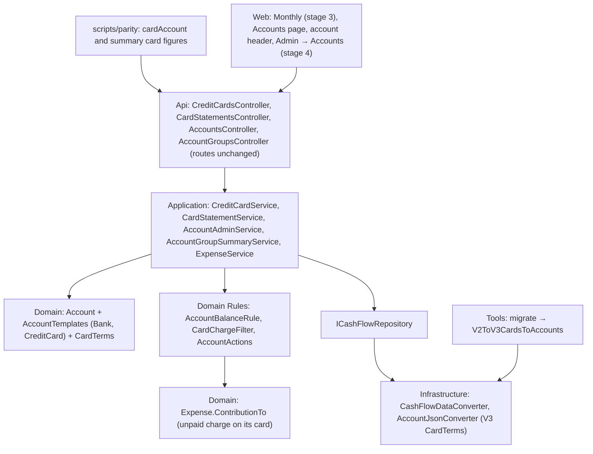

# Technical Specification: Credit Card Template and Card Migration

Complexity: **complex**. It touches every backend layer, the import tool, the data file format, the parity script and two web pages.

**Strict no-comments policy** in all code, XML docs included (CLAUDE.md). Existing doc comments on lines a stage rewrites are deleted, not reworded.

## 1. Technical Overview

**What.** Credit cards stop being their own entity and become accounts made from a new **Credit card** template, keeping their Ids.
- Charges, statements and investment accounts reference the card account through their existing `CreditCard` property (now of type `Account`) and the existing `CreditCardId` key.
- A card's balance comes from the shared balance calculation: each unpaid charge contributes −value to its card.
- One Domain charge filter replaces the four copies of "charges of a card for a statement month".
- The data file goes from version 2 to version 3: cards move into `Accounts`, and any month with charges but no statement gets one.
- From F07 on, adding or editing a card charge creates its statement if it is missing.
- Card accounts can't pay anything and have no actions until F08.
- Cards join the default group: the group summary gains each card's statement-month outstanding and paid status and the card total per currency, and Monthly reads its card total from the summary.

**Why.** F08 (statement payment and card screen) needs cards as accounts with a balance, one charge filter and a statement for every month with charges. The summary rule from F04 ("no browser sums") still has one browser sum left, Monthly's card total.

**Delivery.** Four PRs. Each one leaves `main` deployable and ends with a parity run showing 0 differences against `p60-deployed-f06`. Nothing is deployed between stages.

| Stage | Content | Data file | Web |
|---|---|---|---|
| **1 — card model** | Template, capabilities, `CardTerms`; cards as accounts in every layer; card balance; charge filter; payer refusal; no card actions; in-use check; calendar sync from Admin → Accounts; `/credit-cards` from accounts; account DTOs gain the due date; import builds card accounts; parity card balance | Unchanged: V2, cards read and written in the V2 `CreditCards` shape | Generated types only |
| **2 — V3 format** | V3 file shape; version guard 3; the V2→V3 step with the statement backfill; seed, test and example data to V3; a charge creates its statement | V3 | None |
| **3 — summary and Monthly** | Cards join the default group; summary card fields and per-currency card total; Monthly's Banks grid and card total switch to the summary; parity summary mappings | V3 | Monthly |
| **4 — screens and ticks** | Accounts page and account header show a card's balance as owed; Admin → Accounts card fields; template display names; PRD ticks | V3 | Accounts page, account screen header, Admin → Accounts |

**Scope.**

*Included:*
- Everything in PRD F07 Capabilities, Experience, Error Handling and Section 9 F07, plus the cross-feature criteria that name F07 and can be checked now.
- *Input contracts (Consumes):*
  - F02: the `Account` aggregate and references, `AccountBalanceRule`, the `migrate` chain and version guard, the template-read architecture test;
  - F04: the derived default group (`DefaultAccountGroup`, `AccountGroupSummaryService`);
  - F06: the account create and edit flow (`AccountAdminService`, `AccountFormDialog`).
- *Output contracts (Provides, used by F08 and F09):*
  - credit card accounts with `CardTerms`, the `CreditCard` reference on charges, statements and investment accounts, and the single charge filter;
  - a statement for every card and month with charges, created when a charge lands in its month;
  - the V2→V3 step, which F09's V3→V4 step follows.

*Excluded:*
- Paying a statement as a transfer, the card's Statements tab, Add charge, moving a charge, statement creation on move and pay, removing the statements GET write (all F08).
- Any change to `/credit-cards`, `/card-statements` or `/expenses` shapes (kept until F13).
- Non-GBP cards.
- Showing paid charges on the card's own grid.

## 2. Architecture Impact

**Layers and direction** (design.md's four questions):
1. **Where it belongs:** the CashFlow bounded context. The template, `CardTerms`, the card balance, the charge filter and the payer rule are Domain; the compatibility services, the summary and the statement creation are Application; the file shape and version guard are Infrastructure; the V2→V3 step is Tools.
2. **Which layers, in which direction:** Domain ← Application ← Infrastructure ← Api, with Tools depending on Infrastructure, plus the web app over the API. No new dependency.
3. **What keeps Domain free of Infrastructure:** `ICashFlowRepository` and `ICashFlowSerializer`, as in F02.
4. **Which SOLID principles it leans on:**
   - **OCP:** the Credit card template is one new row in `AccountTemplates` plus its value object. Code asks `Has(Capability.HasStatements)`, never the template name.
   - **SRP:** `Expense` declares its own contribution to the card; `CardChargeFilter` owns the one charge predicate; `AccountBalanceRule` still only sums.
   - **DIP:** `AccountAdminService` triggers the calendar through the existing `ICreditCardCalendarSyncService`.



## 3. Technical Decisions

| Decision | Chosen approach | Alternative considered | Trade-off |
|---|---|---|---|
| **Reference name** (user, 2026-10-25) | Keep `CreditCard`. `Expense.CreditCard`, `CardStatement.CreditCard` and `InvestmentAccount.CreditCard` become type `Account`; the JSON key stays `CreditCardId`; DTOs unchanged. The V2→V3 step renames no keys. | `CardAccount` / `CardAccountId`, like F02's bank → account renames | Least churn, and the name stays accurate: only credit card accounts have statements. |
| **Picking cards** (user) | `account.Has(Capability.HasStatements)` everywhere a card list is needed: `CreditCardService`, `CardStatementService`, `CreditCardCalendarSyncService`, `PaymentsDueService`, `ExpenseService`'s card lookup, `InvestmentAccountService`, the import, and the stage 1 file writer. | Read `Template == CreditCard` and grow the allow-list | No allow-list growth. Having statements is exactly what makes an account a card, and F08's card screen asks the same thing. |
| **Template** | `AccountTemplate.CreditCard` = {`HasStatements`, `HasCategories`, `ReceivesPayments`}, currencies [GBP]. `HasStatements` and `ReceivesPayments` are new `Capability` values. `ReceivesPayments` has no reader until F08's pair rule; it is template data, not code. | Leave `ReceivesPayments` to F08 | The PRD defines the template's set now, so `AccountTemplatesTests` pins it once. |
| **`CardTerms`** | Value object with `DateOnly? NextInvoiceDueDate`, value equality. `Account.CardTerms` is non-null exactly when the template has `HasStatements` (set by `ApplyCapabilityDefaults`, like `OpeningBalance` and `RoundUp`). `Account.SetCardTerms(DateOnly?)` throws `ArgumentException` "<name> has no card terms." without the capability. | A due-date property on `Account` | Same shape as the other capability-bound value objects. |
| **Default group timing** (user) | `JoinsDefaultGroup` is false for Credit card in stages 1–2 and turns true in stage 3, together with the summary card fields and Monthly's switch. | Join in stage 1 | If cards joined early, Monthly's Banks grid would list them and the bank total would subtract what they owe. |
| **Card balance** | `Expense.ContributionTo(account)`: −(Value + RoundUp) on its payment-source account, as today; −Value on its `CreditCard` account while it is an unpaid charge (`PaymentStatus == CreditCardCharge`); 0 otherwise. A charge settled the old way counts on its bank only. The template has no `HasOpeningBalance`, so every record dated on or before as-of counts. | A card-specific balance | One calculation for every account (cross-feature criterion). Bank balances don't move: unpaid charges contributed 0 to banks before and still do. |
| **Accumulated outstanding** | `CardStatementService`'s per-card accumulated outstanding = −`AccountBalanceRule.Balance(card, DateOnly.MaxValue, records)`. | Keep its own sum | Identical values (all unpaid charges, whatever their date). This is the PRD's "outstanding logic replaced by the shared calculation". |
| **Charge filter** | `Domain/Rules/CardChargeFilter.ChargesFor(expenses, card, year, month, includePaid)`: `CreditCard.Id == card.Id`, `InvoiceDate` in that month, and unpaid only unless `includePaid`. Statements, the calendar total and `GetOutstandingTotalForPeriod` pass `false`; snapshot suggestions pass `true`. | Merge into one behaviour | Keeps both behaviours; merging would change the snapshot suggestions. |
| **No card actions** | `AccountActions`: AddExpense needs `HasCategories` and not `HasStatements`. A card account therefore has no actions. | Drop `HasCategories` from the template | Cards keep categories (charges have them) and F08 adds Add charge. |
| **Card can't pay** | `Expense.EnsureCanBePaymentSource`: an account with `HasStatements` throws `ArgumentException` "<name> is a card account and can't pay." before the existing `HasCategories` check. This covers expense create and update, `Settle` from mark-paid, and recurring bills. `MensaisService` resolves the payer over accounts with `CanPayBills` or `HasStatements`, so a card reaches the card message; any other account without `CanPayBills` keeps "Payment source '<id>' is not recognized." | A check in each service | One rule in the entity every path goes through. |
| **Card grid** (user) | `AccountQueryService` rows for a card account are its unpaid charges dated in the month (charge date): Kind `CardCharge`, no counterpart, Category, Amount −Value, `CanEdit` false. This follows F05's "records that touched the account" rule and matches the owed header. | Also list paid charges | Paid-before-V3 charges already show on the bank's grid as "Card charge" rows. |
| **In use** | `AccountReferenceReader` also counts charges whose `CreditCard` is the account, statements of the account, and investment accounts linked to it. `CreditCardService.DeleteAsync` uses it, so a card linked to an investment account can't be deleted any more (409, existing message). | Separate guards | One definition of "in use" for Admin → Accounts and `/credit-cards`. |
| **Calendar from Admin → Accounts** | `AccountAdminService` takes `ICreditCardCalendarSyncService` and calls `TriggerSync(id)` after create, update and delete of an account with `HasStatements`, as `CreditCardService` does. | Leave Admin → Accounts silent | PRD F07 In use. |
| **Card names** | Card names are unique across all accounts, case-insensitive. `/credit-cards` create and rename use the same check as `AccountAdminService` (`DuplicateNameException` → 409, `An account named "<name>" already exists.`). The 60-character limit is `Account`'s. | Keep `/credit-cards` without a uniqueness check | Two accounts can't share a name any more. No live name clashes. |
| **Admin interim** (user) | Stage 1 lists Credit card in `GET accounts/templates`, and `AccountDTO`, `AccountCreateDTO` and `AccountUpdateDTO` gain `NextInvoiceDueDate` (optional; null when the template lacks `HasStatements`; ignored then). The dialog builds its fields from capabilities, so a card shows Name and Currency only until stage 4 adds the due-date field and the template display names. | Hide the template until stage 4 | No hiding flag (scaffolding). Until stage 4, the due date is edited on Admin Credit cards or Monthly's Card tab. |
| **Stage 1 persistence** | Cards load from the V2 `CreditCards` collection into the one accounts collection (template Credit card, GBP, `IsActive`, `CardTerms` from `NextInvoiceDueDate`). On write, accounts with `HasStatements` go back to `CreditCards` in the V2 card shape (`Id`, `Name`, `IsActive`, `NextInvoiceDueDate`) and the rest to `Accounts`, keeping today's bytes. | Ship stage 1 with the format change | Same pattern as F02 PR A: the model change is proved by parity before the file changes. |
| **V3 shape** | Cards follow the banks in `Accounts`, in their V2 order. A card account: `Template "CreditCard"`, `Currency "GBP"`, `IsActive`, `OpeningBalance null`, `RoundUp null`, `CardTerms { "NextInvoiceDueDate": "yyyy-MM-dd" | null }`. A bank has `CardTerms null`. `CreditCards` is removed. | Keep `CreditCards` | The file matches the model; F09 and F11 append their accounts the same way. |
| **Statement backfill** | `V2ToV3CardsToAccounts` adds a statement for every (card, invoice month) that has charges and no statement: `IsPaid` true when every charge of that month is settled, false otherwise. Statements get new Ids. | Create on first read only | Every month with charges has a statement from the F07 deploy on. On the 2026-10-24 live copy this adds none. |
| **A charge creates its statement** (stage 2) | `Application/Services/CardStatementCreation.EnsureFor(repository, expense)`: when the expense has a `CreditCard` and an `InvoiceDate` and no statement exists for that card and month, it adds one (unpaid). `ExpenseService` calls it inside the add, update and invoice-date save lambdas. `CardStatementService`'s GET keeps creating statements for active cards until F08 removes that. | A `CashFlowData` method | Keeps the repository contract unchanged (`GetCardStatements` and `AddCardStatement` already exist). |
| **Summary card fields** (stage 3) | `AccountGroupMemberDTO` gains `Statement` (`AccountGroupStatementDTO { OutstandingTotal, IsPaid }`, null unless `HasStatements`) and `BalanceIsOwed` (true for `HasStatements`). `OutstandingTotal` = sum of `CardChargeFilter.ChargesFor(…, includePaid: false)`; `IsPaid` = that month's statement `IsPaid`, false when none exists. `CurrencyTotalDTO.Balance` sums members without `HasStatements`; new `CardOutstandingTotal` sums the members' `Statement.OutstandingTotal`. Member `Balance` stays signed (owed is negative). `AccountDetailDTO` gains `BalanceIsOwed` in stage 3 too. | Net totals (banks minus owed) | `Balance` keeps meaning today's bank total, so its parity mapping is unchanged. The UI decides how to show owed from one flag instead of a template name. |
| **Monthly** (stage 3) | `useMonthly` builds bank rows from members whose `statement` is null. The card total shown by `CardsGrid` comes from the summary totals' `cardOutstandingTotal`: one line when there is one currency, one line per currency labelled with its code otherwise (F04's Banks footer rule). The per-statement rows on the Card tab still come from `card-statements`. | Sum statements in the browser | PRD: the browser no longer sums card statements. |
| **Owed display** (stage 4) | Where `balanceIsOwed` is true, the Accounts page and the account header show the balance negated with the label "Owed", using the same number format. | Show the signed balance | PRD Experience: "card balance shown as owed". |
| **Template display names** (stage 4) | `Financial.Web/src/utils/accountTemplateLabel.ts`: `Bank` → "Bank", `CreditCard` → "Credit card", anything else → the name. It is used by the Admin → Accounts list and dialog and by the account header's group label. | A display name in the API | The wire value stays the template name (F04). Until stage 4, Admin → Accounts shows "CreditCard". |
| **Parity** | **Stage 1:** the after side emits each account whose `templateName` is `CreditCard` as `{month}/cardAccount/<name>/balance`, only in the run's current month (`CurrentMonth` from `Get-ParityMonthRange`). A new `figure-map.json` mapping sends it, negated, to `{month}/cards/*/accumulatedOutstandingTotal`. Other months emit no card balance, because accumulated outstanding ignores charge dates. **Stage 3:** card members are emitted as `{month}/summary/cardMembers/<name>/outstandingTotal` and `/isPaid` every month and `/balance` in the current month; `summary/totals/<cur>/cardOutstandingTotal` maps to `monthly/cardOutstandingTotal`. Bank members keep `summary/members/<name>/...`. | Map the card balance in every month | The PRD's card parity rule (2026-10-25). The emission rule avoids a new mapping option. |
| **PR size** | Stage 1 has about 14 heterogeneous non-test files (the new Domain types, `Account`, `Expense`, `CardChargeFilter`, `AccountActions`, `CardStatementService`, `CreditCardService`, `AccountAdminService`, `AccountReferenceReader`, `AccountQueryService`, `MensaisService`, `CashFlowDataConverter`, the parity script) plus the repeated `CreditCard` type change, which is exempt. Stages 2–4 are 8–10 each. | Split stage 1 again | Splitting the Domain types from their first callers would leave unused types (scaffolding). The overage is named here for review, as in F02 PR A. |

## 4. Component Overview

All paths are relative to the repo root. The **Stage** column is 1–4. Existing patterns: entities with private setters and static `Create`; `ArgumentException` for invalid input (→ 400); `EntityInUseException` and `DuplicateNameException` (→ 409); the span/log telemetry pattern in every service; one enum per file in `Domain/Enums`.

**Domain (`Financial.CashFlow.Domain`)**

| File | New/Modified | Stage | Key responsibilities |
|---|---|---|---|
| `Enums/AccountTemplate.cs` | Modified | 1 | Adds `CreditCard` |
| `Enums/Capability.cs` | Modified | 1 | Adds `HasStatements`, `ReceivesPayments` |
| `Rules/AccountTemplates.cs` | Modified | 1, 3 | **1:** Credit card definition ({`HasStatements`, `HasCategories`, `ReceivesPayments`}, [GBP], `JoinsDefaultGroup` false). **3:** `JoinsDefaultGroup` true. |
| `ValueObjects/CardTerms.cs` | New | 1 | `NextInvoiceDueDate` (nullable); value equality |
| `Entities/Account.cs` | Modified | 1 | `CardTerms` property; `SetCardTerms(DateOnly?)` guarded by `HasStatements`; `ApplyCapabilityDefaults` sets `CardTerms` |
| `Entities/CreditCard.cs` | Deleted | 1 | Replaced by card accounts |
| `Entities/CardStatement.cs` | Modified | 1 | `CreditCard` is an `Account`; `Create` requires `HasStatements` |
| `Entities/InvestmentAccount.cs` | Modified | 1 | `CreditCard` is an `Account?`; the source check requires `HasStatements` and active, with today's messages |
| `Entities/Transactions/Expense.cs` | Modified | 1 | `CreditCard` is an `Account?` and must have `HasStatements` ("<name> is not a card account."); today's inactive-card message stays; `EnsureCanBePaymentSource` refuses `HasStatements`; `ContributionTo` adds the unpaid-charge contribution |
| `Entities/CashFlowData.cs` | Modified | 1 | Removes the credit card collection and its add/remove methods |
| `Rules/AccountActions.cs` | Modified | 1 | AddExpense requires not `HasStatements` |
| `Rules/CardChargeFilter.cs` | New | 1 | `ChargesFor(expenses, card, year, month, includePaid)` |

**Application (`Financial.CashFlow.Application`)**

| File | New/Modified | Stage | Key responsibilities |
|---|---|---|---|
| `Interfaces/ICashFlowRepository.cs` | Modified | 1 | Removes `GetCreditCards`, `AddCreditCard`, `DeleteCreditCard` (cards are accounts) |
| `Services/CreditCardService.cs` | Modified | 1 | Lists accounts with `HasStatements`; create builds a Credit card account in GBP; update sets name, active and `CardTerms`; name uniqueness across accounts; delete uses `AccountReferenceReader`; calendar triggers unchanged; DTOs and messages unchanged |
| `Services/CardStatementService.cs` | Modified | 1, 2 | **1:** card accounts; `CardChargeFilter`; accumulated outstanding from `AccountBalanceRule`; payer resolved over all accounts (the entity refuses a card). **2:** the GET's creation goes through `CardStatementCreation`. |
| `Services/CardStatementCreation.cs` | New | 2 | `EnsureFor(repository, expense)` |
| `Services/ExpenseService.cs` | Modified | 1, 2 | **1:** resolves `CreditCardId` among accounts with `HasStatements` (unknown Id: today's message). **2:** calls `CardStatementCreation.EnsureFor` in add, update and invoice-date saves. |
| `Services/MensaisService.cs` | Modified | 1 | Payer lookup over accounts with `CanPayBills` or `HasStatements` |
| `Services/AccountReferenceReader.cs` | Modified | 1 | Counts charges, statements and investment-account links |
| `Services/AccountAdminService.cs` | Modified | 1 | `NextInvoiceDueDate` on create and update (applied through `SetCardTerms` when `HasStatements`); calendar trigger for card accounts on create, update and delete |
| `Services/AccountQueryService.cs` | Modified | 1, 3 | **1:** card grid rows (§3). **3:** `BalanceIsOwed` on the detail. |
| `Services/AccountGroupSummaryService.cs` | Modified | 3 | Member `Statement` and `BalanceIsOwed`; totals `Balance` without card members; `CardOutstandingTotal` |
| `Services/CreditCardCalendarSyncService.cs`, `PaymentsDueService.cs`, `InvestmentAccountService.cs`, `InvestmentSnapshotService.cs` | Modified | 1 | Repeated change: card accounts via `HasStatements`; due date from `CardTerms`; snapshot suggestions through `CardChargeFilter(includePaid: true)` |
| `DTOs/AccountDTO.cs`, `AccountCreateDTO.cs`, `AccountUpdateDTO.cs` | Modified | 1 | `NextInvoiceDueDate` (`DateOnly?`) |
| `DTOs/AccountGroupMemberDTO.cs`, `CurrencyTotalDTO.cs`, `AccountDetailDTO.cs` | Modified | 3 | `Statement`, `BalanceIsOwed`; `CardOutstandingTotal`; `BalanceIsOwed` |
| `DTOs/AccountGroupStatementDTO.cs` | New | 3 | `OutstandingTotal`, `IsPaid` |

**Infrastructure (`Financial.CashFlow.Infrastructure`)**

| File | New/Modified | Stage | Key responsibilities |
|---|---|---|---|
| `Persistence/CashFlowDataConverter.cs` | Modified | 1, 2 | **1:** reads `CreditCards` as card accounts; writes card accounts to `CreditCards` and the rest to `Accounts`, same order and bytes. **2:** one `Accounts` collection; `CreditCards` gone. |
| `Persistence/CreditCardV2JsonConverter.cs` | New, then deleted | 1 → 2 | The V2 card shape ↔ card account (stage 1 only) |
| `Persistence/AccountJsonConverter.cs` | Modified | 2 | Writes and reads `CardTerms` after `RoundUp` |
| `Persistence/CashFlowTypeInfoResolver.cs` | Modified | 1 | The three `CreditCard` properties resolve through the account reference converter; wire names stay `CreditCardId` |
| `Persistence/CreditCardReferenceConverter.cs` | Deleted | 1 | Replaced by the account reference converter |
| `Persistence/ReferenceResolutionContext.cs` | Modified | 1 | Drops the card lookup |
| `Persistence/CashFlowDataFileVersion.cs` | Modified | 2 | `Current = 3` |
| `Repositories/CashFlowJsonRepository.cs` | Modified | 1 | Removes the card methods |

**Tools (`Tools/CashFlowSpreadsheetImport`)**

| File | New/Modified | Stage | Key responsibilities |
|---|---|---|---|
| `Migrations/CreditCards/CreditCardMigrator.cs` | Modified | 1 | Seeds the 5 cards as Credit card accounts (GBP, active, no due date) when missing by name |
| `Program.cs`, `SheetImporters/MonthlyExpenseSheetImporter.cs`, `Migrations/ExpenseChargeDate/ExpenseChargeDateMigrator.cs`, `ExpenseChargeDateMigrationSummary.cs` | Modified | 1 | Repeated change: cards are accounts with `HasStatements`; the carry-over keeps card accounts as it kept `CreditCards` |
| `DataFileMigration/V2ToV3CardsToAccounts.cs` | New | 2 | Step 2 → 3 (§6) |
| `DataFileMigration/DataFileMigrator.cs` | Modified | 2 | `CreateDefault` lists both steps |

**Web (`Financial.Web/src`)**

| File | New/Modified | Stage | Key responsibilities |
|---|---|---|---|
| `api/generated/openapi.ts` | Regenerated | 1, 3 | From the snapshot |
| `hooks/useMonthly.ts` | Modified | 3 | Bank rows from members without `statement`; card totals from `summary.totals` |
| `components/CardsGrid.tsx`, `pages/MonthlyPage.tsx` | Modified | 3 | `CardsGrid` takes the per-currency card totals instead of one browser-summed number |
| `pages/AccountsPage.tsx`, `components/AccountHeader.tsx` | Modified | 4 | Owed display; template labels |
| `components/AccountFormDialog.tsx`, `pages/AdminAccountsPage.tsx` | Modified | 4 | Next invoice due date field (optional date) when the template has `HasStatements`; template labels |
| `utils/accountTemplateLabel.ts` | New | 4 | Display names |

**Scripts, data and docs**

| File | New/Modified | Stage | Purpose |
|---|---|---|---|
| `scripts/parity/Parity.psm1`, `figure-map.json`, `Parity.test.ps1`, `README.md` | Modified | 1, 3 | §3 Parity row; self-test cases for the current-month rule and the card member keys |
| `Tests/Financial.Api.Tests/ApiTestFactory.cs` (`SeededCashFlowJson`) | Modified | 2 | V3: the 6 test cards in `Accounts` with the same Ids, `"Version": 3` |
| `Tests/Financial.Api.Tests/TestData/data-cashflow.test.json` | Modified | 2 | `"Version": 3` |
| `data/data-cashflow.example.json` | Modified | 2 | `"Version": 3`, no `CreditCards` |
| `docs/prd/P60-…/prd-cashflow-accounts-generalization.md` | Modified | 4 | F07 ticks, own commit |

## 5. API Contracts

**Unchanged:** every `/credit-cards`, `/card-statements`, `/expenses`, `/banks` and `mensais` route keeps its shape and status codes. Behaviour changes, all within existing status codes:
- `DELETE /credit-cards/{id}` returns 409 also when an investment account links the card.
- `POST`/`PUT /credit-cards` return 409 `An account named "<name>" already exists.` when any account has the name.
- A card account as payer (`POST`/`PUT /expenses` with a card's Id as `paymentSourceBankId`, `POST mensais/{id}/paid`, `POST card-statements/{id}/paid`) returns 400 "Platinum Visa 8003 is a card account and can't pay."; nothing is saved.
- `DELETE /accounts/{id}` on a card with charges, statements or investment links returns 409 "<name> has transactions and cannot be deleted. Deactivate it instead.".

**Stage 1 (additive):** `AccountDTO`, `AccountCreateDTO`, `AccountUpdateDTO` gain `nextInvoiceDueDate` (date or null). `GET accounts/templates` lists:

```json
[
  { "name": "Bank", "currencies": ["GBP"], "capabilities": ["HasOpeningBalance", "ReceivesIncome", "HasCategories", "CanSendTransfers", "CanReceiveTransfers", "CanReconcile", "CanPayBills", "SupportsRoundUp"] },
  { "name": "CreditCard", "currencies": ["GBP"], "capabilities": ["HasStatements", "HasCategories", "ReceivesPayments"] }
]
```

`GET accounts/{id}/2026/10` for a card: `allowedActions: []`; `balance` = −(unpaid charges dated on or before 2026-10-31).

**Stage 3 (additive):** `GET accounts/groups/default/summary/2026/10`:

```json
{
  "members": [
    { "accountId": "…01", "name": "Barclays", "templateName": "Bank", "currency": "GBP", "balance": 1520.40, "roundUpTotal": 3.12, "statement": null, "balanceIsOwed": false },
    { "accountId": "…501", "name": "BarclaysPlatinumVisa8003", "templateName": "CreditCard", "currency": "GBP", "balance": -812.33, "roundUpTotal": null, "statement": { "outstandingTotal": 640.10, "isPaid": false }, "balanceIsOwed": true }
  ],
  "totals": [ { "currency": "GBP", "balance": 1520.40, "roundUpTotal": 3.12, "cardOutstandingTotal": 640.10 } ]
}
```

`AccountDetailDTO` gains `balanceIsOwed`. The OpenAPI snapshot changes are additions only, in stages 1 and 3.

## 6. Data Model

**V3 account (in `Accounts`, cards after the banks):**

| Field | JSON type | Nullable | Rule |
|---|---|---|---|
| `Id`, `Name`, `Template`, `Currency`, `IsActive`, `OpeningBalance`, `RoundUp` | as V2 | as V2 | A card: `"CreditCard"`, `"GBP"`, `OpeningBalance null`, `RoundUp null` |
| `CardTerms` | object or null | Yes | `{ "NextInvoiceDueDate": "yyyy-MM-dd" or null }`. Present exactly when the template has `HasStatements`. |

```json
{ "Id": "…501", "Name": "BarclaysPlatinumVisa8003", "Template": "CreditCard", "Currency": "GBP", "IsActive": true,
  "OpeningBalance": null, "RoundUp": null, "CardTerms": { "NextInvoiceDueDate": "2026-11-05" } }
```

**V2 → V3 step (`V2ToV3CardsToAccounts`, `FromVersion` 2) rules:**
1. Each `CreditCards[i]` is appended to `Accounts` as above: `IsActive` copied; `NextInvoiceDueDate` copied into `CardTerms`.
2. Every bank account gets `"CardTerms": null`.
3. A non-null `CreditCardId` on an expense, statement or investment account that isn't a card Id stops the step with `<Record> <id> references unknown card <id>` (`InvalidDataException`); nothing is written.
4. For each (card, invoice year-month) of the expenses with that card and no matching statement: append `{ "Id": <new Guid>, "CreditCardId", "Year", "Month", "IsPaid": <every such charge has a PaymentSourceAccountId> }`.
5. `CreditCards` is removed. `Version` = 3 (stamped by `DataFileMigrator`).
6. Summary: `"{n} cards became accounts; {m} statements added"`.
7. The result is validated by deserializing it with the V3 serializer (existing `DataFileMigrator` behaviour).

**Business rules:**
- **Card balance:** see §3. On the live copy, every card's balance in the current month equals −accumulated outstanding.
- **Statement outstanding (unchanged):** the sum of the card's unpaid charges with that invoice month. **Paid:** the statement's flag.
- **Snapshot suggestion (unchanged):** paid + unpaid charges of the card with that invoice month.
- **Statement on write (stage 2):** a charge on card C with invoice month M ensures a statement (C, M) exists. It never changes `IsPaid`.
- **Card can't pay:** "<name> is a card account and can't pay." (§3).
- **Inactive cards:** unchanged. No new charges ("Credit card '<name>' is inactive and cannot be used for new entries."), no investment-account link; existing records stay readable.

## 7. Testing Strategy

Following the `testing-guide-Financial` skill:
- **Unit:** Domain and Application.
- **Integration:** persistence, Tools on temp JSON, the API host through the acceptance tests, the architecture test.
- **AC tracing:** one tagged test per PRD F07 bullet, `[Trait("AC", "P60-F07-credit-card-template-and-card-migration-NN")]`, numbered 01–14 in PRD order.
- **Other rules:** every class carries `[Trait("Category", …)]`; names follow `Method_Condition_Result`; shared doubles only in `Tests/Financial.TestUtilities` (`StubCashFlowRepository` keeps `seedDefaultCreditCards`, now seeding card accounts; `TestAccounts` gains `CreditCard(name, isActive, nextInvoiceDueDate)`).

| Test file | Type | Stage | Coverage goal |
|---|---|---|---|
| `Domain.Tests/ValueObjects/CardTermsTests.cs` | Unit | 1 | Null and set due date; equality |
| `Domain.Tests/Entities/AccountTests.cs` | Unit | 1 | Credit card factory, `CardTerms` default, `SetCardTerms` guard |
| `Domain.Tests/Rules/AccountTemplatesTests.cs` | Unit | 1, 3 | The Credit card set and currencies are exact; `JoinsDefaultGroup` (false, then true) |
| `Domain.Tests/Entities/ExpenseTests.cs`, `CapabilityGuardTests.cs` | Unit | 1 | Card payer refused with the message; non-card account as `CreditCard` refused; inactive card unchanged |
| `Domain.Tests/Rules/AccountBalanceRuleTests.cs` | Unit | 1 | Unpaid charge −value on the card; settled charge only on the bank; date boundary |
| `Domain.Tests/Rules/CardChargeFilterTests.cs` | Unit | 1 | Unpaid only vs paid + unpaid; other card; other month |
| `Domain.Tests/Rules/AccountActionsTests.cs` | Unit | 1 | A card account has no actions; a bank unchanged |
| `Application.Tests/Services/CardStatementServiceTests.cs`, `InvestmentSnapshotServiceTests.cs`, `CreditCardServiceTests.cs`, `CreditCardCalendarSyncServiceTests.cs`, `PaymentsDueServiceTests.cs` | Unit | 1 | Existing expected values unchanged; investment link blocks delete; duplicate name 409 |
| `Application.Tests/Services/AccountAdminServiceTests.cs`, `AccountReferenceReaderTests.cs`, `AccountQueryServiceTests.cs`, `MensaisServiceTests.cs` | Unit | 1 | Card create with due date; calendar triggered for cards only; in-use counts; card grid rows; card refused as bill payer |
| `Application.Tests/Services/CardStatementCreationTests.cs`, `ExpenseServiceTests.cs` | Unit | 2 | Statement created once on add, on edit onto a card, on invoice-month change; never duplicated |
| `Application.Tests/Services/AccountGroupSummaryServiceTests.cs` | Unit | 3 | Card member fields; `Balance` excludes cards; `CardOutstandingTotal` |
| `Infrastructure.Tests/Persistence/CashFlowDataConverterTests.cs`, `AccountJsonConverterTests.cs`, `CashFlowSerializerAdapterTests.cs`, `ExampleDataFileTests.cs` | Integration | 1, 2 | **1:** a V2 file with cards round-trips byte-identically. **2:** V3 round-trip; V2 refused with the migrate message; example file loads. |
| `CashFlowSpreadsheetImport.Tests/DataFileMigration/V2ToV3CardsToAccountsTests.cs`, `DataFileMigratorTests.cs`, `FreshImportVersionTests.cs` | Integration | 2 | Every step rule in §6; chain V1→V3; fresh import writes V3 with card accounts |
| `Api.Tests/Acceptance/CreditCardTemplateAcceptanceTests.cs` | Integration (AC) | 1–3 | The AC table below |
| `Financial.Web` `useMonthly.test.ts`, `CardsGrid.test.tsx`, `MonthlyPage.test.tsx` | Unit | 3 | Cards not in bank rows; card total from the summary; per-currency labels |
| `Financial.Web` `AccountsPage.test.tsx`, `AccountHeader.test.tsx`, `AccountFormDialog.test.tsx`, `accountTemplateLabel.test.ts` | Unit | 4 | Owed display; due-date field; labels |
| `Architecture.Tests/AccountTemplateReadRuleTests.cs` | Integration | 2 | Passes unchanged with the Credit card template (allow-list unchanged) |

**AC mapping (PRD Section 9, F07):**

| AC | Criterion (short) | Test | Stage |
|---|---|---|---|
| 01 | `migrate` V2→V3: 5 card accounts, same Ids, active flags, due dates; references; cards in the default group | `V2ToV3CardsToAccountsTests.Apply_FiveCards_BecomeCreditCardAccountsWithSameIdsFlagsAndDueDates`; default-group half: `CreditCardTemplateAcceptanceTests.Summary_AfterMigration_IncludesTheCards` | 2, 3 |
| 02 | Missing statements created, paid only when all charges settled | `V2ToV3CardsToAccountsTests.Apply_MonthWithChargesAndNoStatement_AddsStatementPaidOnlyWhenAllSettled` | 2 |
| 03 | A charge creates its statement when missing | `CreditCardTemplateAcceptanceTests.AddOrEditCardCharge_CreatesTheMissingStatementOnce` | 2 |
| 04 | Card account: no actions; refused with 400 as payer | `CreditCardTemplateAcceptanceTests.CardAccount_HasNoActions_AndIsRefusedAsPayerWith400` | 1 |
| 05 | Used card can't be deleted (both routes); Admin → Accounts card changes update the calendar | `CreditCardTemplateAcceptanceTests.UsedCard_DeleteReturns409_OnBothRoutes`, `AccountAdminServiceTests.CardChanges_TriggerCalendarSync` | 1 |
| 06 | Statement totals, outstanding and paid identical | `CardStatementServiceTests` (existing values) + parity | 1 |
| 07 | Snapshot suggestions identical | `InvestmentSnapshotServiceTests` (existing values, paid + unpaid) | 1 |
| 08 | Summary: card statement outstanding and status, card total per currency, balance as owed | `CreditCardTemplateAcceptanceTests.Summary_CardMembers_CarryStatementFieldsAndCardTotal`; owed display in `AccountsPage.test.tsx` | 3, 4 |
| 09 | Monthly's card total from the summary | `useMonthly.test.ts` "reads the card total from the summary and makes no statement sum" | 3 |
| 10 | Calendar sync and payments-due banner work against card accounts | `CreditCardCalendarSyncServiceTests`, `PaymentsDueServiceTests` on card accounts | 1 |
| 11 | Creating a card in Admin → Accounts needs no code and joins the default group | `CreditCardTemplateAcceptanceTests.CreateCardThroughAccounts_ListedOnCreditCards_AndInTheSummary` | 1, 3 |
| 12 | `/credit-cards` and `/card-statements` same shapes and values | OpenAPI snapshot (no removals) + `CreditCardTemplateAcceptanceTests.CreditCardsAndCardStatements_ReturnTheSameValues` | 1 |
| 13 | Fresh spreadsheet import writes Credit card accounts and the API starts | `FreshImportVersionTests.Import_FreshWorkbook_WritesVersion3WithCardAccounts` | 2 |
| 14 | Parity 0 differences; `/simplify`; architecture-reviewer | Definition of Done, every stage | 1–4 |

**Cross-feature criteria** checked in F07:
- **Parity commands run unchanged, extended only through the report and figure map:** the stage 1 and 3 script changes add figures and mappings only.
- **`migrate` runs the chain from V1 and refuses to skip a step:** `DataFileMigratorTests.Migrate_Version1File_RunsBothStepsToVersion3`.
- **Card balances come from the shared calculation:** `AccountBalanceRuleTests` card cases; no other card balance code remains (accumulated outstanding uses the rule).
- **The architecture test passes with the Credit card template:** stage 2 run.
- **The default group appears on the Accounts page and includes the cards after migration:** stage 3 acceptance test plus the stage 4 page test.
- **F06's dialog creates F07's accounts:** AC 11.
- **F07's card accounts and charge filter give the statement totals F08 pays:** `CardChargeFilterTests`, checked again in F08.

**Proved by the Definition of Done:** for each stage, `dotnet build --configuration Release`, `dotnet test`, `npm run build` and `npm test` when the web changed, and the parity run on a fresh live copy against `p60-deployed-f06` with 0 differences and an unchanged SHA-256. Then `/simplify`, the architecture-reviewer, and the ui-reviewer for stages 3 and 4.
