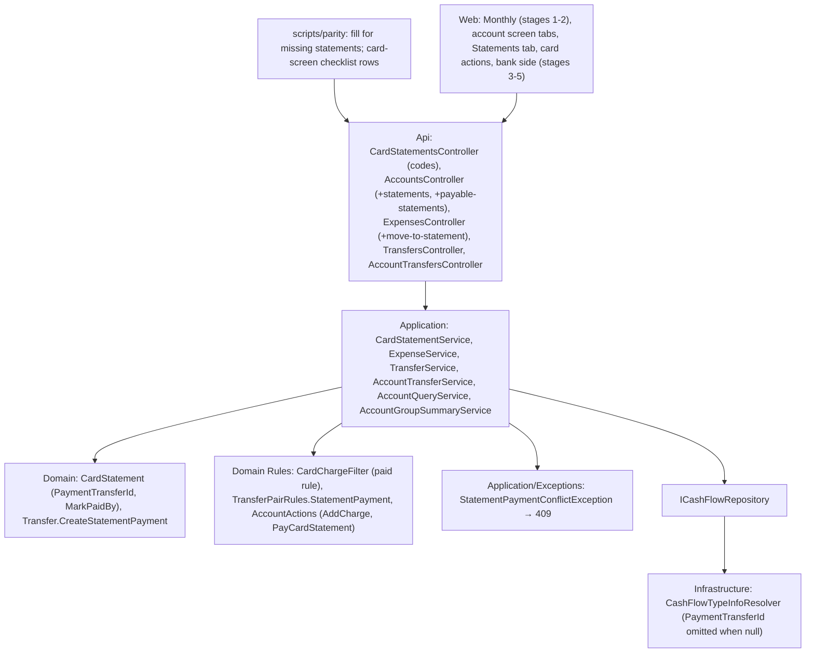

# Technical Specification: Statement Payment and Card Screen

Complexity: **complex**. It touches every backend layer, the parity script, Monthly and the account screen.

**Strict no-comments policy** in all code, XML docs included (CLAUDE.md). Existing doc comments on lines a stage rewrites are deleted, not reworded.

## 1. Technical Overview

**What.**
- **Paying a card statement** writes one transfer, bank → card, for the statement's total. The statement stores that transfer's id and becomes paid. Charges keep their own date, category and statement month.
- **Paid status:** a charge counts as paid when it was settled the old way (re-pointed to a bank) or when its statement is paid. One Domain rule answers this, and every reader of "unpaid" uses it.
- **Locks on a paid statement:** a charge can't be added, moved in, deleted, or have anything changed except its description, category and counts-as-tithe.
- **Unmark** has two paths: for a transfer-paid statement it deletes the transfer; for a legacy paid statement it runs today's reversal.
- **Reads never write:** the statements GET stops creating rows.
- **The card screen** gains a tab bar (Transactions, Statements). The Statements tab has Pay and Unmark, and Transactions picks charges by statement month. Card actions are Add charge, plus Edit, Delete and Move on unpaid charges.
- **The bank side** gets "Pay card statement" and a read-only "Card payment" row that opens the statement.

**Why.** Today paying a statement re-points and re-dates every charge to the bank, which moves charges out of the card's history and gives the bank one row per charge. The PRD's model is one payment, with the charges staying on the card (design doc, "Credit cards").

**Delivery.**
- Five PRs (user, 2026-10-26).
- Each one leaves `main` deployable and ends with a parity run against `p60-deployed-f07` showing 0 differences.
- There is no data-file version change: the statement's link is an optional field, written only when set (§6).
- Deploy only after stage 5.

| Stage | Content | Web |
|---|---|---|
| **1. Paid rule and reads** | The paid-from-statement rule in the charge filter. Locks on charges of a paid statement. Mark-paid and unmark response codes; `Warning` removed. Read-only statements GET. Parity fill for missing statements. | Monthly: card actions show errors, a missing statement shows 0.00 / Unpaid, and value and date are locked on a settled charge |
| **2. Payment as a transfer** | Statement payment pair rule and transfer factory. The statement links its transfer. Mark-paid writes the transfer with an optional date. Unmark has both paths. Payment transfers are hidden from `/transfers` lists and refused (409) for edit or delete on both transfer routes. Charges paid by statement report a new payment status. | Monthly shows charges paid by transfer like settled ones |
| **3. Card screen** | `GET accounts/{id}/statements`. Card Transactions by statement month, with card payments as rows. Tab bar and Statements tab with Pay and Unmark (due date read-only). Parity screen-checklist rows for the card screen. | Account screen |
| **4. Card charges** | `AddCharge` action. Add charge, and Edit, Delete and Move on unpaid charges. `POST expenses/{id}/move-to-statement`. | Account screen |
| **5. Bank side** | `PayCardStatement` action. `GET accounts/payable-statements`. "Card payment" row kind with its statement link. PRD ticks. | Account screen |

**Scope.**

*Included:*
- Everything in PRD F08 Capabilities, Experience, Error Handling and Section 9, plus the cross-feature criteria that name F08 and can be checked now.
- *Input contracts (Consumes):*
  - **F05:** the account screen shell, meaning `AccountScreenPage`, `useAccountScreen`, `AccountHeader`, `AccountActionBar`, `AccountTransactionsGrid`, the form hooks, the discard prompt and the toaster.
  - **F07:**
    - card accounts and the `CreditCard` reference;
    - `CardChargeFilter`;
    - `CardStatementCreation`;
    - statements with due dates;
    - `Expense.ContributionTo`, which gives −value on the card for every charge not settled to a bank.
- *Output contracts (Provides, used by F13):*
  - statement payments as transfers linked to their statement;
  - "Card payment" transactions on banks;
  - the card screen, with the Statements tab, Pay, Move charge and Unmark.

*Excluded:*
- Editing due dates on the card screen. Editing stays on Admin Credit cards and Monthly's Card tab until F13.
- Partial payments.
- The linked-transactions operation id, which moved to F10.
- Changing any route that F13 retires. `card-statements` keeps its routes, and only its responses change, as listed in §5.
- Non-GBP cards.

## 2. Architecture Impact

**Layers and direction** (design.md's four questions):

1. **Where it belongs:** the CashFlow bounded context.
   - **Domain:** the paid rule, the statement payment pair, the payment transfer factory, the statement's link and the action rules.
   - **Application:** the payment, unmark, move and lock orchestration, and the read models.
   - **Infrastructure:** one omit-when-null entry.
   - **Api:** routes and the 409 mapping.
2. **Which layers, in which direction:** Domain ← Application ← Infrastructure ← Api, plus the web app over the API. No new dependency.
3. **What keeps Domain free of Infrastructure:** `ICashFlowRepository`, as in F02.
4. **Which SOLID principles it leans on:**
   - **OCP:** the payment pair is a second `TransferPairRules` set built from capabilities, and `Default` stays unchanged.
   - **SRP:**
     - `CardChargeFilter` owns "which charges are unpaid";
     - `CardStatement` owns its paid state and link;
     - `Transfer` owns its own validation.
   - **DIP:** services reach data only through `ICashFlowRepository`.



## 3. Technical Decisions

| Decision | Choice | Alternatives considered | Rationale |
|---|---|---|---|
| **Paid rule** (user, 2026-10-26) | `CardChargeFilter` gains the statements:<br>• `IsPaid(expense, statements)` is true when `PaymentStatus == CreditCardSettled`, or when the (card, invoice month) statement exists and `IsPaid`.<br>• `UnpaidChargesFor(expenses, statements, card, year, month)` returns that month's charges in `CreditCardCharge` status, or nothing when that month's statement is paid.<br>• `OutstandingTotal(expenses, statements, card, year, month)` sums them.<br>• `ChargesFor(…, includePaid: true)` stays for totals and snapshot suggestions; the `includePaid: false` overload is removed.<br>Readers: `CardStatementService` (outstanding, `GetOutstandingTotalForPeriod` for the calendar title), `AccountGroupSummaryService`, and `ExpenseService`'s two Monthly lists. | A per-charge payment link | One rule. A transfer-paid charge keeps no bank, so only its statement can say it is paid. The live data has no paid statement with unpaid charges. |
| **Card balance** | Unchanged code. Every charge not settled to a bank contributes −value to the card (`Expense.ContributionTo`). The payment transfer contributes +total to the card and −total to the bank on its date. | Stop counting a charge once paid | The F07 rule already gives the right owed balance once the payment exists. |
| **Locks on a paid statement** (user, Q1) | These are refused with 400 "This charge's statement is paid; unmark it first." (`ArgumentException`), checked in `ExpenseService` before any change:<br>• **add:** a charge whose (card, invoice month) statement is paid;<br>• **update:** a charge whose current statement is paid, when the date, value, payment source, card, invoice month or round-up differ from the stored ones; also a charge whose target statement is paid;<br>• **delete:** a charge whose statement is paid.<br>Description, category and counts-as-tithe stay editable. This covers legacy paid statements too: today their charges can change value and date, or be deleted. | Lock only value, card and month | PRD: "description, category and counts-as-tithe stay editable", so nothing else is. Changing the date of a legacy settled charge changes its bank's balance, and deleting a charge leaves the payment bigger than the charges. |
| **Monthly's move rule** (user, 2026-10-26) | `PUT /expenses` keeps moving an unpaid charge's invoice month either way. The paid-statement lock above refuses moving out of or into a paid statement. "Later, unpaid only" applies to the new move endpoint. | Same rule everywhere | User decision in the review. |
| **Mark-paid and unmark codes** (user, Q4) | The new `Application/Exceptions/StatementPaymentConflictException` maps to 409 in `DomainExceptionMappingMiddleware`.<br>• **409:** already paid, unmarking an unpaid statement, linked transfer missing, editing or deleting a payment transfer.<br>• **400** (`ArgumentException`): nothing to pay, i.e. the statement's unpaid total is ≤ 0.<br>`CardStatementDTO.Warning` is removed. | Keep 200 with warnings | PRD Error Handling. Follows `ReserveMovementLinkedToIncomeException` ("change it through its parent"). |
| **Reads never write** (stage 1) | `GET card-statements/{y}/{m}` returns the stored statements of that month only. `CardStatementCreation.EnsureFor` is no longer called there. | Virtual rows in the GET | User decision (finding 4). Every month with charges already has a statement (F07 backfill and create-on-charge). |
| **Monthly with a missing statement** (stage 1) | `CardsGrid` renders a card with no statement this month as Outstanding 0.00, Accumulated "—", Status "Unpaid", and no Mark paid control. | Fetch accumulated elsewhere | Same figures as today except the accumulated cell, which needs a stored statement. With nothing to pay, Mark paid would be the 400. Named in the screen checklist. |
| **Parity fill** (stage 1) | The after side of `Add-ParityCardFigures` collects each card's `accumulatedOutstandingTotal` from any stored row in the run (the value doesn't depend on the month). After all months are read, it adds, for every month and every active card account without a row, `outstandingTotal` 0, `isPaid` false, `warning` null and that card's accumulated value, or 0 when the card has no stored row in the run. A card with no stored statement has no charges, so its accumulated value is 0. The active cards come from the `accounts` list the after side already reads (`templateName` `CreditCard`, `isActive`). | A figure-map skip rule | No comparer change, and the before side (the deployed app) still creates those rows. |
| **Payment pair** (stage 2) | `TransferPairRules.StatementPayment` = [(`CanPayBills`, `ReceivesPayments`)]. `Default` is unchanged, so `/transfers`, `/accounts/transfers` and the transfer-destination lists never offer a card. | Add the pair to `Default` | PRD: "allowed only through this action". |
| **Payment transfer** (stage 2) | `Transfer.CreateStatementPayment(date, bank, card, amount, today)`:<br>• pair checked against `StatementPayment`;<br>• the bank must be active (`ActiveAccountRule`), the card need not be (user, Q3);<br>• amount > 0;<br>• date not in the future ("Date must not be in the future.");<br>• no note and no destination amount (both GBP).<br>`Transfer.IsStatementPayment` is true when `DestinationAccount.Has(ReceivesPayments)`. | A transfer flag in the file | Only this factory can create a transfer into a `ReceivesPayments` account, so the destination identifies a payment without a lookup or a new field. |
| **Statement link** (stage 2) | `CardStatement.PaymentTransferId` (`Guid?`).<br>• `MarkPaidBy(transferId)` sets it and `IsPaid`.<br>• `MarkPaid()` remains only for legacy (no caller after stage 2), so it is deleted.<br>• `MarkUnpaid()` clears both.<br>• `IsPaidByTransfer` is `PaymentTransferId is not null`.<br>The JSON key `PaymentTransferId` is omitted when null (`CashFlowTypeInfoResolver.PropertiesOmittedWhenNull`). | Operation id | User decision (finding 2). The file stays byte-identical until the first payment, and there's no version bump (F03 precedent, `DestinationAmount`). |
| **Paying** (stage 2) | `POST card-statements/{id}/mark-paid` with `{ paymentSourceBankId, date? }`, in this order:<br>1. **409** if the statement is already paid.<br>2. **Payer resolved:** unknown → 400 "Payment source '<id>' is not recognized."; then `EnsureCanPay()`, so a card gets the F07 message.<br>3. **Amount:** the statement's unpaid total; ≤ 0 → 400 "There is nothing to pay on this statement.".<br>4. **Date:** `date ?? today`, not in the future.<br>5. **One save:** add the transfer and `MarkPaidBy`.<br>Charges are untouched. Response: the statement DTO. | Keep settling charges | PRD Capabilities and AC 01, 05, 14. |
| **Unmark** (stage 2) | `POST card-statements/{id}/unmark-paid`:<br>• **unpaid:** 409 "This statement is not paid.";<br>• **transfer-paid:** link missing in transfers → 409 "The payment for this statement was changed elsewhere. Reload and try again." and nothing changes; otherwise, in one save, remove the transfer and `MarkUnpaid()`;<br>• **legacy** (no link): today's reversal, i.e. `Unsettle()` every settled charge of that month, then `MarkUnpaid()`. | One path | PRD "Unmark paid, two paths". |
| **Payment transfers on transfer routes** (stage 2) | Transfers with `IsStatementPayment` are left out of `GET transfers/month/{y}/{m}` and `GET transfers/bank/{id}`. `PUT` and `DELETE` on one, through `/transfers` or `/accounts/transfers`, throw `StatementPaymentConflictException` "This transfer pays a card statement; unmark the statement instead." before any other check. | Show them read-only on Monthly | User decision (finding 3). Monthly looks the same. |
| **Charges paid by transfer on Monthly** (user, Q5, stage 2) | `ExpenseDTO.PaymentStatus` is `"CreditCardStatementPaid"` for a charge in `CreditCardCharge` status whose statement is paid; other values are unchanged. `ExpenseService.ToDto(expense, statements)` computes it, and every caller passes the statements.<br>`GetExpensesByMonth` includes these charges (by `ListingDate`); `GetUnpaidCardChargesByMonth` leaves them out.<br>Web:<br>• `useExpenseForm` treats the new value as card mode and settled;<br>• `ExpenseForm`, when settled with no bank, reads "Paid through <card>'s statement. Date, value, card and invoice month are locked while the statement is paid — unmark the statement to change them.";<br>• `ExpensesSection`'s Bank column is renamed "Paid from" and shows `paymentSourceBankName ?? creditCardName`;<br>• on locked rows (`CreditCardSettled` or `CreditCardStatementPaid`) Delete is disabled with the tooltip "Unmark the statement to delete this charge". | Keep them in the unpaid list marked Paid | Monthly looks as it does after today's payment. |
| **Payment transfer rows on the account screen** (stage 2) | Until stage 5, `AccountQueryService` lists a transfer with `IsStatementPayment` as an ordinary transfer row with `CanEdit` false (`CanEdit = account.IsActive && !transfer.IsStatementPayment`); stage 5 turns it into a "Card payment" row. | Leave it editable | Its edit and delete routes return 409. |
| **Settled form locks** (stage 1) | When `isSettled`, `ExpenseForm` disables Date and Value as well as the payment fields and invoice month (today it locks only the last two). | Leave them editable and let the API refuse | Matches the lock rule, so nothing invalid can be submitted. |
| **Statements list** (user, Q7, stage 3) | `GET accounts/{id}/statements` (400 "<name> is not a card account." without `HasStatements`) returns every statement of the card that has at least one charge or is paid, newest first. Each row has:<br>• `id`, `year`, `month`;<br>• `total`: every charge of that month, paid or not;<br>• `isPaid` and `dueDate`;<br>• `paidOn` and `paidFromAccountName`: the transfer's date and bank, or for legacy the settled charges' date and bank (the latest date when they differ), null when unpaid. | One statement per viewed month | User decision. Hides the 53 empty statements the old GET created. |
| **Statements tab** (stage 3) | The tab lists all rows. The viewed month's row is highlighted (`aria-current`) and scrolled into view.<br>Columns: Month, Total, Due date (read-only, "—" when none), Status ("Paid 12 Nov 2026 from Barclays" / "Unpaid"), Actions.<br>**Pay:** unpaid rows only; disabled with tooltip "Nothing to pay" when the total is ≤ 0. It opens an inline form with Bank (required; active accounts that can pay bills), Date (today, not in the future) and Amount (read-only). Save, then the toast "Statement paid".<br>**Unmark:** paid rows only. It opens a confirmation dialog "Unmark <Month Year> as paid? The payment will be deleted." Confirm, then the toast "Statement unmarked".<br>The tab is in the URL (`?tab=statements`). Switching tabs with a dirty form goes through the discard prompt. | Month-scoped tab | PRD Experience. F05 state rules. |
| **Pay date** (user, Q6) | Today, editable, not in the future, on both the card and the bank side. It is not F05's viewed-month date rule. | F05 rule | A statement is paid when due, usually after its month. |
| **Card Transactions by statement month** (user, 2026-10-26, stage 3) | For an account with `HasStatements`, `GetTransactions` returns:<br>• **charges:** every charge whose `CreditCard` is the card and whose invoice month is the viewed month, paid or not. Kind `CardCharge`, Date = the purchase date (`ChargeDate`). `CanEdit` is true only when the card is active and the charge is unpaid (`CardChargeFilter.IsPaid` false). Legacy settled charges have `Counterpart` = their bank.<br>• **payments:** transfers into the card dated in the month. Kind `CardPayment`, Counterpart = the bank, Amount +total, `CanEdit` false.<br>On a card, the grid's Date column header reads "Purchased". Banks are unchanged. | Keep the purchase-date filter | User decision. Matches Monthly and category totals. |
| **Card row actions** (user, Q2, stage 4) | A `CardCharge` row with `CanEdit` offers:<br>• **Edit:** `ExpenseForm` in card mode, card shown as locked text, Invoice Month editable either way like Monthly;<br>• **Delete:** `ConfirmDeleteDialog`;<br>• **Move to a later statement.**<br>Other charge rows are read-only. | Move only | User decision. |
| **Add charge** (stage 4) | `AccountAction.AddCharge` is allowed for active accounts with `HasStatements`. It opens `ExpenseForm` in card mode with the card locked, the date from F05's viewed-month rule and the Invoice Month defaulting to the date's month. It posts through `POST /expenses` with `creditCardId`, and keep-open after Save follows F05. | A new endpoint | Reuses the existing create path, its statement creation and the paid lock. |
| **Move** (user, Q8, stage 4) | `POST expenses/{id}/move-to-statement` with `{ year, month }`:<br>• not a card charge in `CreditCardCharge` status → 400 "Only an unpaid card charge can move to another statement.";<br>• current statement paid → the lock message;<br>• target not later, or target statement paid → 400 "Charges can only move to a later, unpaid statement.";<br>• inactive card → the existing inactive-card message.<br>Then `SetInvoiceDate`, `CardStatementCreation.EnsureFor` and the calendar notify, as the update path does. Response: the expense DTO.<br>UI: an inline form with a dropdown of the 12 statement months after the charge's current one, leaving out paid months and marking months with no statement "(new)". | Reuse `PUT /expenses` | PRD: the move rule differs from Monthly's edit. |
| **Bank side** (stage 5) | `AccountAction.PayCardStatement` is allowed for active accounts with `CanPayBills`. `GET accounts/payable-statements` returns unpaid statements with a total > 0 across all card accounts, inactive ones included (Q3), ordered by card name then month: `{ id, creditCardId, creditCardName, year, month, total }`.<br>The form has Card (cards in that list), Statement (that card's months, with totals), Date (today) and Amount (read-only). It saves through `mark-paid` with this bank and closes with the toast "Statement paid". | Pick the card, then call the card's statements | One request. The same records as paying from the card (AC 04). |
| **Card payment row on banks** (stage 5) | `AccountQueryService` maps a transfer with `IsStatementPayment` on its source bank as Kind `CardPayment`, Counterpart = the card, Amount −total, `CanEdit` false. The row also carries `statement` (`{ accountId, year, month }` of the statement whose `PaymentTransferId` is the transfer). Selecting the row navigates to `/cashflow/accounts/{cardId}?month=YYYY-MM&tab=statements`. | Edit from the bank | PRD Bank screen. |
| **Inactive card** (user, Q3) | Its statements can be paid from a bank. Its own screen shows no actions (F06 rule), so it is paid from the bank side. Adding or moving charges onto it stays refused. | Refuse payment | Paying off a closed card is normal. |
| **Rollback** | An F07 build ignores `PaymentTransferId` (unknown fields are ignored) and loads the file. Its unmark would leave the payment transfer in place, so after a rollback, check paid statements by hand before unmarking. | A version bump | Named for the deploy notes; rollback is not expected. |
| **PR size** | Stage 1: about 11 non-test files. Stage 2: about 13. Stage 3: about 10. Stage 4: about 8. Stage 5: about 9. Overages are named here for review. | Fewer, larger stages | User decision (Q9). |

## 4. Component Overview

All paths are relative to the repo root. The **Stage** column is 1–5.

Existing patterns:
- entities with private setters and static `Create`;
- `ArgumentException` → 400;
- conflict exceptions → 409 in `DomainExceptionMappingMiddleware`;
- the span/log telemetry pattern in every service;
- route tests in `Api.Tests/Acceptance`;
- web hooks per form under `src/hooks`, and the F05 form area, discard prompt and toaster.

**Domain (`Financial.CashFlow.Domain`)**

| File | New/Modified | Stage | Key responsibilities |
|---|---|---|---|
| `Rules/CardChargeFilter.cs` | Modified | 1 | `IsPaid`, `UnpaidChargesFor`, `OutstandingTotal` with statements (§3 "Paid rule"); `ChargesFor(…, includePaid: true)` kept |
| `Entities/CardStatement.cs` | Modified | 2 | `PaymentTransferId`, `MarkPaidBy`, `IsPaidByTransfer`; `MarkUnpaid` clears the link; `MarkPaid` removed |
| `Entities/Transactions/Transfer.cs` | Modified | 2 | `CreateStatementPayment`, `IsStatementPayment` |
| `Rules/TransferPairRules.cs` | Modified | 2 | `StatementPayment` set |
| `Enums/AccountAction.cs`, `Rules/AccountActions.cs` | Modified | 4, 5 | **4:** `AddCharge` (`HasStatements`). **5:** `PayCardStatement` (`CanPayBills`) |

**Application (`Financial.CashFlow.Application`)**

| File | New/Modified | Stage | Key responsibilities |
|---|---|---|---|
| `Exceptions/StatementPaymentConflictException.cs` | New | 1 | 409 conflicts on statements and payment transfers |
| `Services/CardStatementService.cs` | Modified | 1, 2 | **1:** the GET writes nothing; outstanding from the paid rule; 409/400 codes; no `Warning`. **2:** payment transfer, optional date, unmark on both paths |
| `Services/ExpenseService.cs` | Modified | 1, 2, 4 | **1:** paid-statement locks on add, update and delete. **2:** `ToDto(expense, statements)` with `CreditCardStatementPaid`; the two Monthly lists use the paid rule. **4:** `MoveToStatementAsync` |
| `Services/AccountGroupSummaryService.cs` | Modified | 1 | Card member outstanding from the paid rule |
| `DTOs/CardStatementDTO.cs` | Modified | 1 | `Warning` removed |
| `DTOs/MarkCardStatementPaidDTO.cs` | Modified | 2 | `Date` (`DateOnly?`) |
| `Services/TransferService.cs`, `Services/AccountTransferService.cs` | Modified | 2 | Payment transfers left out of the lists; 409 on update and delete |
| `Services/AccountQueryService.cs` | Modified | 2, 3, 5 | **2:** passes statements to `ExpenseService.ToDto`. **3:** card rows by statement month and `CardPayment` rows on the card; `GetStatements(id)`. **5:** `CardPayment` rows on banks with the statement link; `GetPayableStatements()` |
| `DTOs/AccountStatementDTO.cs` | New | 3 | Statements tab row (§5) |
| `DTOs/AccountTransactionDTO.cs`, `DTOs/AccountTransactionStatementDTO.cs` | Modified, New | 5 | `Statement` link on card payment rows |
| `DTOs/PayableStatementDTO.cs` | New | 5 | Bank-side statement option |
| `DTOs/MoveChargeToStatementDTO.cs` | New | 4 | `{ Year, Month }` |
| `Interfaces/ICardStatementService.cs`, `IExpenseService.cs`, `IAccountQueryService.cs` | Modified | 2–5 | New members as above |

**Infrastructure (`Financial.CashFlow.Infrastructure`)**

| File | New/Modified | Stage | Key responsibilities |
|---|---|---|---|
| `Persistence/CashFlowTypeInfoResolver.cs` | Modified | 2 | `(CardStatement, PaymentTransferId)` omitted when null |

**Api (`Financial.Api`)**

| File | New/Modified | Stage | Key responsibilities |
|---|---|---|---|
| `Middleware/DomainExceptionMappingMiddleware.cs` | Modified | 1 | `StatementPaymentConflictException` → 409 |
| `Controllers/CardStatementsController.cs` | Modified | 1 | 409 and 400 response attributes on mark and unmark |
| `Controllers/TransfersController.cs`, `Controllers/AccountTransfersController.cs` | Modified | 2 | 409 response attributes on PUT and DELETE |
| `Controllers/AccountsController.cs` | Modified | 3, 5 | `GET {id:guid}/statements` (3); `GET payable-statements` (5) |
| `Controllers/ExpensesController.cs` | Modified | 4 | `POST {id:guid}/move-to-statement` |
| `Tests/Financial.Api.Tests/Contract/openapi-v1.snapshot.json`, `Financial.Web/src/api/generated/openapi.ts` | Regenerated | 1–5 | Each stage's contract change |

**Web (`Financial.Web/src`)**

| File | New/Modified | Stage | Key responsibilities |
|---|---|---|---|
| `hooks/useMonthly.ts`, `components/CardsGrid.tsx` | Modified | 1 | No warning path for card actions; a missing statement renders 0.00 / — / Unpaid with no Mark paid |
| `components/ExpenseForm.tsx` | Modified | 1, 2, 4 | **1:** Date and Value disabled when settled. **2:** settled text for a charge paid by statement. **4:** locked card text (the counterpart of `lockedBank`) |
| `hooks/useExpenseForm.ts`, `components/ExpensesSection.tsx` | Modified | 2 | `CreditCardStatementPaid` handling; Bank cell falls back to the card name |
| `hooks/useAccountScreen.ts`, `pages/AccountScreenPage.tsx` | Modified | 3, 4, 5 | `tab` URL parameter; Fluent `TabList` (Transactions, Statements) for accounts with `HasStatements`; card actions and row actions; bank-side form |
| `components/CardStatementsTab.tsx`, `hooks/useCardStatements.ts` | New | 3 | Statements list, Pay form, Unmark dialog, states |
| `components/AccountTransactionsGrid.tsx`, `components/accountActions.ts` | Modified | 3, 4, 5 | "Purchased" header on cards; `CardPayment` label; Move row action; `AddCharge` and `PayCardStatement` labels; card payment row navigation |
| `hooks/useAccountActionForms.ts`, `components/MoveChargeForm.tsx` | Modified, New | 4 | Add charge (card locked), charge edit, move form |
| `components/PayCardStatementForm.tsx`, `hooks/usePayCardStatementForm.ts` | New | 5 | Bank-side form |
| `api/financialApiClient.ts` | Modified | 2–5 | `date` on mark-paid; `getAccountStatements`; `moveChargeToStatement`; `getPayableStatements` |

**Parity (`scripts/parity`)**

| File | New/Modified | Stage | Key responsibilities |
|---|---|---|---|
| `Parity.psm1`, `Parity.test.ps1` | Modified | 1 | After-side fill for missing statements (§3); self-test cases |
| `screen-checklist.md` | Modified | 1, 3 | **1:** the Card statements row drops "warning" and notes "—" accumulated for months with no statement. **3:** card screen rows C1–C4 (§7) |

## 5. API Contracts

**Behaviour changes on existing routes:**

| Route | Before | After |
|---|---|---|
| `GET card-statements/{y}/{m}` | Creates missing statements for active cards | Returns stored statements only; no write (stage 1) |
| `POST card-statements/{id}/mark-paid` | 200 with a warning when already paid or empty; settles charges at today's date | 409 "This statement is already paid."; 400 "There is nothing to pay on this statement." (stage 1). From stage 2: writes the transfer on `date ?? today` |
| `POST card-statements/{id}/unmark-paid` | 200 with a warning when not paid | 409 "This statement is not paid." (stage 1); transfer path (stage 2) |
| `POST/PUT/DELETE expenses` | Settled charge: payment fields locked | Charge on a paid statement: 400 "This charge's statement is paid; unmark it first." for anything other than description, category and counts-as-tithe (stage 1) |
| `GET transfers/month/{y}/{m}`, `GET transfers/bank/{id}` | All transfers | Without statement payments (stage 2) |
| `PUT/DELETE transfers/{id}`, `PUT/DELETE accounts/transfers/{id}` | — | 409 "This transfer pays a card statement; unmark the statement instead." for a statement payment (stage 2) |

**Contract changes:**
- `CardStatementDTO.warning` is removed (stage 1).
- `MarkCardStatementPaidDTO` gains `date` (stage 2).
- `ExpenseDTO.paymentStatus` gains the value `CreditCardStatementPaid` (stage 2; it's a string, so the schema doesn't change).

`POST card-statements/{id}/mark-paid` (stage 2):

```json
{ "paymentSourceBankId": "…01", "date": "2026-11-12" }
```

Returns 200 with:

```json
{ "id": "…9a", "creditCardId": "…501", "creditCardName": "Platinum Visa 6007", "year": 2026, "month": 10, "isPaid": true, "outstandingTotal": 0.00, "accumulatedOutstandingTotal": 210.45 }
```

`GET accounts/{id}/statements` (stage 3):

```json
[
  { "id": "…9b", "year": 2026, "month": 11, "total": 210.45, "isPaid": false, "dueDate": "2026-12-03", "paidOn": null, "paidFromAccountName": null },
  { "id": "…9a", "year": 2026, "month": 10, "total": 512.30, "isPaid": true, "dueDate": "2026-11-03", "paidOn": "2026-11-12", "paidFromAccountName": "Barclays" }
]
```

`GET accounts/{id}/transactions/2026/10` for a card (stage 3): the charges of the October statement, with `date` = purchase date, plus:

```json
{ "id": "…t1", "kind": "CardPayment", "date": "2026-10-12", "description": null, "counterpart": "Barclays", "amount": 480.00, "canEdit": false, "transfer": { "…": "…" } }
```

`POST expenses/{id}/move-to-statement` (stage 4): `{ "year": 2026, "month": 12 }` → 200 with the expense DTO, or 400 with the messages in §3.

`GET accounts/payable-statements` (stage 5):

```json
[ { "id": "…9b", "creditCardId": "…501", "creditCardName": "Platinum Visa 6007", "year": 2026, "month": 11, "total": 210.45 } ]
```

A bank's `CardPayment` row (stage 5):

```json
{ "id": "…t1", "kind": "CardPayment", "date": "2026-11-12", "counterpart": "Platinum Visa 6007", "amount": -512.30, "canEdit": false, "statement": { "accountId": "…501", "year": 2026, "month": 10 } }
```

`allowedActions` gains `AddCharge` on active cards (stage 4) and `PayCardStatement` on active banks (stage 5).

Every snapshot change is additive except the removal of `warning` in stage 1.

## 6. Data Model

**Statement (in `CardStatements`), stage 2:**

```json
{ "Id": "…9a", "CreditCardId": "…501", "Year": 2026, "Month": 10, "IsPaid": true, "DueDate": "2026-11-03", "PaymentTransferId": "…t1" }
```

- `PaymentTransferId` is present only on a statement paid by transfer, so existing statements are written byte-identically.
- The payment transfer is an ordinary record in `Transfers`:

```json
{ "Id": "…t1", "Date": "2026-11-12", "SourceAccountId": "…01", "DestinationAccountId": "…501", "Amount": 512.30 }
```

- The file stays at version 3, with no migrate step. Legacy paid statements keep their settled charges and have no link.

**Invariants:**
- A statement with `PaymentTransferId` is paid, and its transfer goes from a `CanPayBills` account to the statement's card for the statement's total at payment time.
- No transfer into a `ReceivesPayments` account exists without a statement linking it.

## 7. Testing Strategy

Following the `testing-guide-Financial` skill:
- **Unit:** Domain and Application.
- **Integration:** persistence, and the API host through the acceptance tests.
- **AC tracing:** one tagged test per PRD F08 bullet, `[Trait("AC", "P60-F08-statement-payment-and-card-screen-NN")]`, numbered 01–15 in PRD order. Web-only criteria are tagged in their vitest names.
- **Other rules:** every class carries `[Trait("Category", …)]`; names follow `Method_Condition_Result`; shared doubles only in `Tests/Financial.TestUtilities`.

| Test file | Type | Stage | Coverage goal |
|---|---|---|---|
| `Domain.Tests/Rules/CardChargeFilterTests.cs` | Unit | 1 | `IsPaid`: legacy settled, statement paid, statement unpaid, no statement. `UnpaidChargesFor` is empty on a paid statement. Outstanding |
| `Application.Tests/Services/CardStatementServiceTests.cs` | Unit | 1, 2 | **1:** GET writes nothing (repository save not called, count unchanged); 409 already paid; 400 nothing to pay; 409 unmark unpaid. **2:** transfer written with total and date; charges untouched; future date 400; card payer 400; inactive card paid; unmark deletes the transfer; missing transfer 409, nothing changed; legacy unmark reverses |
| `Application.Tests/Services/ExpenseServiceTests.cs` | Unit | 1, 2, 4 | **1:** locks: add, update of each locked field, delete, move out of or into a paid statement (400); description, category and tithe edits pass; Monthly either-way move on unpaid statements. **2:** `CreditCardStatementPaid` status; list membership. **4:** move rules and messages; target statement created |
| `Application.Tests/Services/TransferServiceTests.cs`, `AccountTransferServiceTests.cs` | Unit | 2 | Lists exclude payments; PUT and DELETE return 409 with the message |
| `Domain.Tests/Entities/TransferTests.cs`, `CardStatementTests.cs`, `Rules/TransferPairRulesTests.cs` | Unit | 2 | Factory rules; `Default` refuses bank → card; `StatementPayment` allows only `CanPayBills` → `ReceivesPayments`; link set and cleared |
| `Application.Tests/Services/AccountQueryServiceTests.cs` | Unit | 3, 5 | Card rows by invoice month, paid and unpaid, `CanEdit` rule, purchase date; card payment rows on card and bank; statements list (empty statements hidden, paid info for both paths); payable statements |
| `Application.Tests/Services/AccountGroupSummaryServiceTests.cs` | Unit | 1 | Card member outstanding is 0 for a paid statement |
| `Domain.Tests/Rules/AccountActionsTests.cs` | Unit | 4, 5 | `AddCharge` on active cards; `PayCardStatement` on active banks; none on inactive accounts |
| `Infrastructure.Tests/Persistence/CashFlowDataConverterTests.cs` | Integration | 2 | A file without the link round-trips byte-identically; the link round-trips |
| `Api.Tests/Acceptance/StatementPaymentAcceptanceTests.cs` | Integration (AC) | 1–5 | The AC table below |
| `scripts/parity/Parity.test.ps1` | Script | 1 | Fill adds 0/unpaid rows with the card's accumulated value, or 0 when the card has no rows; stored rows untouched |
| `Financial.Web` `useMonthly.test.ts`, `CardsGrid.test.tsx` | Unit | 1 | Errors shown for 409/400; missing statement row |
| `Financial.Web` `ExpenseForm.test.tsx`, `useExpenseForm.test.ts`, `ExpensesSection.test.tsx` | Unit | 1, 2 | Settled locks; statement-paid text; Bank fallback |
| `Financial.Web` `AccountScreenPage.test.tsx`, `CardStatementsTab.test.tsx`, `useCardStatements.test.ts`, `AccountTransactionsGrid.test.tsx` | Unit | 3 | Tabs (URL, keyboard, discard prompt); list, highlight, Pay (states: loading, empty "No statements yet", validation, server error, saving, success), Nothing to pay tooltip, Unmark dialog; "Purchased" header |
| `Financial.Web` `useAccountActionForms.test.ts`, `MoveChargeForm.test.tsx` | Unit | 4 | Add charge with locked card; edit and delete on unpaid charges only; move dropdown (12 months, paid excluded, "(new)") |
| `Financial.Web` `PayCardStatementForm.test.tsx`, `usePayCardStatementForm.test.ts` | Unit | 5 | Card then statement choice, same request as the card side; card payment row opens the Statements tab |

**AC mapping (PRD Section 9, F08):**

| AC | Criterion (short) | Test | Stage |
|---|---|---|---|
| 01 | Paying writes one bank → card transfer for the total, linked, no category; charges keep date, category, month | `StatementPaymentAcceptanceTests.MarkPaid_WritesOneTransferForTheTotal_AndLeavesChargesUntouched` | 2 |
| 02 | Owed drops by the total; the bank shows one Card payment row that opens the statement | `StatementPaymentAcceptanceTests.MarkPaid_CardOwedDrops_AndBankListsOneCardPaymentRowWithItsStatement`; navigation in `AccountTransactionsGrid.test.tsx` | 2, 5 |
| 03 | Category totals and tithe count every charge in its statement month | `StatementPaymentAcceptanceTests.CategoryTotalsAndTithe_CountChargesInStatementMonth_PaidOrNot` | 2 |
| 04 | Paying from the bank gives the same records | `StatementPaymentAcceptanceTests.PayFromBank_ProducesTheSameRecordsAsFromTheCard`; `usePayCardStatementForm.test.ts` | 5 |
| 05 | Already paid or empty rejected, nothing saved | `StatementPaymentAcceptanceTests.MarkPaid_AlreadyPaidOrEmpty_IsRejectedAndSavesNothing` | 1 |
| 06 | Unmark: transfer-paid deletes the transfer; legacy reverses | `StatementPaymentAcceptanceTests.Unmark_TransferPaid_DeletesTransfer`, `Unmark_LegacyPaid_RestoresTodaysReversal` | 2 |
| 07 | Move to a later unpaid statement works; paid or earlier → 400 | `StatementPaymentAcceptanceTests.MoveToStatement_LaterUnpaid_Works_PaidOrEarlier_Returns400` | 4 |
| 08 | Statement GETs write nothing and return stored statements only | `StatementPaymentAcceptanceTests.StatementsGet_WritesNothing_AndReturnsStoredStatementsOnly` | 1 |
| 09 | Charges on a paid statement are paid; add, move in, change value, card, month → 400; description, category, tithe editable | `StatementPaymentAcceptanceTests.ChargeOnPaidStatement_LockedFieldsReturn400_DescriptionCategoryTitheEditable` | 1 |
| 10 | Payment transfers absent from `/transfers`; edit and delete on both routes → 409 | `StatementPaymentAcceptanceTests.PaymentTransfer_HiddenFromTransfers_AndEditOrDeleteReturns409` | 2 |
| 11 | Statements tab shows each due date | `StatementPaymentAcceptanceTests.AccountStatements_CarryDueDates`; `CardStatementsTab.test.tsx` | 3 |
| 12 | Card Transactions lists every charge of the statement month with its purchase date | `StatementPaymentAcceptanceTests.CardTransactions_ListEveryChargeOfTheStatementMonth_WithPurchaseDate` | 3 |
| 13 | Card screen states, keyboard, narrow layout pass the checklist | ui-reviewer on stages 3–5; `CardStatementsTab.test.tsx` states; checklist row C4 | 3–5 |
| 14 | Pay stores the transfer id with the paid status in one save; unmark deletes it in one save | `StatementPaymentAcceptanceTests.MarkPaidAndUnmark_EachSaveOnce` (save count 1) and `CardStatementServiceTests` save-failure cases | 2 |
| 15 | Parity 0; card screen checklist rows; `/simplify`; reviewers | Definition of Done, every stage | 1–5 |

**Card screen checklist rows** (added to `screen-checklist.md` in stage 3; after side only):
- **C1:** the Statements tab's total and status per month equal Monthly's Card tab for the same card (outstanding when unpaid).
- **C2:** the Transactions tab for a month lists the same charges as Monthly's card charges for that statement month.
- **C3:** a month with no charges shows "No transactions in <Month Year>".
- **C4:** at 320 px wide there's no horizontal page scroll on either tab.

**Cross-feature criteria checked in F08:**
- **F05's shell hosts the Statements tab with no change to its allowed-actions rendering:** `AccountScreenPage.test.tsx` (the action bar renders `AddCharge` and `PayCardStatement` through the same `formActionsOf` path).
- **F07's card accounts and charge filter give the statement totals F08 pays:** `CardStatementServiceTests`, where the transfer amount equals `CardChargeFilter.OutstandingTotal`.
- **Card balances come from the shared calculation:** `AccountBalanceRuleTests` with a payment transfer (owed = charges − payment).

**Proved by the Definition of Done:** for each stage:
- `dotnet build --configuration Release` and `dotnet test`;
- `npm run build` and `npm test` when the web changed;
- the parity run on a fresh live copy against `p60-deployed-f07`, with 0 differences and an unchanged SHA-256;
- `/simplify` and the architecture-reviewer, plus the ui-reviewer for stages 1–5 where the web changed.
