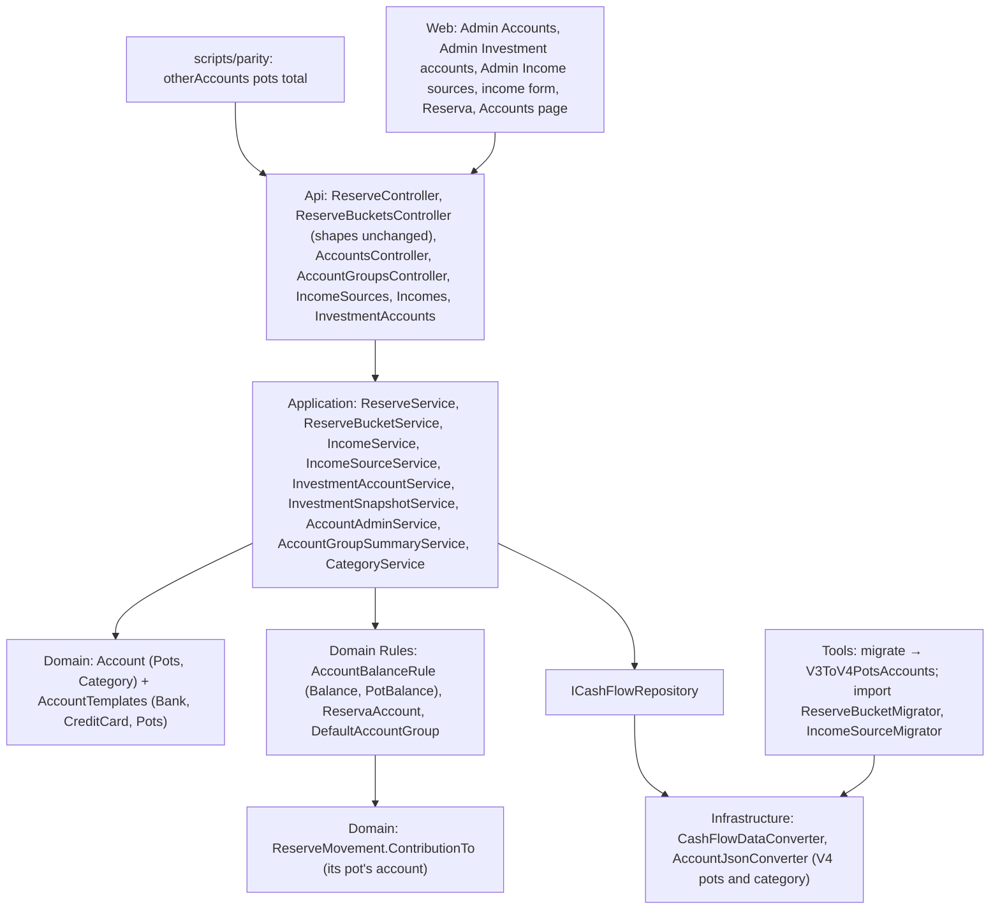

# Technical Specification: Pots Template and Reserva Migration

Complexity: **complex**. It touches every backend layer, the import tool, the data file format, the parity script and five web screens.

**Strict no-comments policy** in all code, XML docs included (CLAUDE.md). Existing doc comments on lines a stage rewrites are deleted, not reworded.

## 1. Technical Overview

**What.**
- Reserve buckets become pots owned by a new **Pots** account. The data file goes from version 3 to version 4: one Pots account named "Reserva" holds the five buckets with the same Ids, and movements keep pointing at them.
- Pot and Pots account balances come from the shared balance calculation (`AccountBalanceRule`), so the reserve service, the as-of resolver and the snapshot stop summing on their own.
- Each Pots account has a category setting. It replaces the lookup of the category named "Reserva" in the withdrawal (server) and in the withdrawal category list (web).
- An investment account fed by the pots total names its Pots account.
- An income source optionally names the Pots account its incomes split to. Each income stores the Pots account it split to, and the income form offers the split with a picker.
- The Accounts page gains an "Other accounts" section, which lists Reserva with its balance.

**Why.** F10 (deposits, withdrawals and the Pots screen) needs pots inside an account, a category setting and an income split target. The cross-feature rule "no other balance code remains" still has three reserve sums left.

**Delivery.** Eleven PRs, each within the PR size rule (8 non-test code files, about 15 files in total) except where §3 "PR size" names the overage. Each PR leaves `main` deployable and ends with a parity run against `p60-deployed-f08`. Nothing is deployed between stages. The V3→V4 step is created in stage 2, and stages 4, 6 and 8 each add their part to it (user, 2026-10-27). That is safe because no stage deploys, and every parity run migrates a fresh V3 copy through the whole step as it stands.

| Stage | Content | Data file | Web |
|---|---|---|---|
| **1 — Pots template** | Template and three capabilities; Admin → Accounts can create an empty Pots account | V3 | None (the template shows as "Pots") |
| **2 — V4: Reserva and its pots** | Pots inside the account; the Reserva rule (first Pots account); V4 shape and guard; the V3→V4 step (pots part); import; seed, test and example data | V4 | None |
| **3 — Shared balance** | Movements count toward their Pots account; per-pot sum in the rule; the reserve service, resolver and snapshot read the rule; an account with pots is in use | V4 | None |
| **4 — Category setting (server)** | `Account.Category`; step part; withdrawal uses it; `Category.ReservaName` removed; category delete guard | V4 | None |
| **5 — Category setting (web)** | Admin → Accounts category field and its 400; account DTOs carry the category and capabilities; the web withdrawal list drops its name lookup | V4 | Admin → Accounts, Reserva |
| **6 — Snapshot source (server)** | `PotsAccountTotal` names a Pots account; step part; suggestion from the rule, text names the account | V4 | None |
| **7 — Snapshot source (web)** | DTOs switch to `PotsAccountTotal` + `potsAccountId`; Admin investment accounts picker | V4 | Admin → Investment accounts |
| **8 — Income split target (server)** | `IncomeSource.PotsAccount`, `Income.PotsAccount`; step part; the split goes into the income's Pots account; import | V4 | None |
| **9 — Income sources (web)** | Income source DTOs switch to `potsAccountId`; Admin income sources picker | V4 | Admin → Income sources |
| **10 — Income form (web)** | Income DTOs switch to `potsAccountId`; split checkbox and Pots account picker | V4 | Monthly, account screen |
| **11 — Other accounts and ticks** | Other accounts endpoint and section; parity figure; PRD ticks | V4 | Accounts page |

**Scope.**

*Included:*
- Everything in PRD F09 Capabilities, Experience, Error Handling and Section 9 F09, plus the cross-feature criteria that name F09 and can be checked now.
- *Input contracts (Consumes):*
  - F02: `AccountBalanceRule`, `IAccountTransaction`, the `migrate` chain and version guard, the template-read architecture test;
  - F06: the account create and edit flow (`AccountAdminService`, `AccountFormDialog`);
  - F07: the V2→V3 step, which the V3→V4 step follows.
- *Output contracts (Provides, used by F10 and F11):*
  - Pots accounts with pots, split percentages and a category setting;
  - the income split target: each income source's optional Pots account and each income's chosen Pots account;
  - the V3→V4 step, which F11's V4→V5 step follows.

*Excluded:*
- Deposits and withdrawals as linked operations, the Pots tab, Manage pots and the enforced 100% rule (all F10). F09 keeps today's split warning.
- Links from the "Other accounts" rows to the account screen (F10).
- Any change to the `reserve` and `reserve-buckets` shapes (kept until F13).
- Renaming `ReserveBucket` and `ReserveMovement` (user, 2026-10-27).
- Non-GBP Pots accounts.

## 2. Architecture Impact

**Layers and direction** (design.md's four questions):
1. **Where it belongs:** the CashFlow bounded context.
   - **Domain:** the template, pots in the account, the category setting, the Reserva rule, the movement contribution and the per-pot sum, the source and split targets.
   - **Application:** the services.
   - **Infrastructure:** the file shape.
   - **Tools:** the V3→V4 step and the import.
2. **Which layers, in which direction:** Domain ← Application ← Infrastructure ← Api, with Tools depending on Infrastructure, plus the web app over the API. No new dependency.
3. **What keeps Domain free of Infrastructure:** `ICashFlowRepository` and `ICashFlowSerializer`, as in F02.
4. **Which SOLID principles it leans on:**
   - **OCP:** the Pots template is one new row in `AccountTemplates`; code asks `Has(Capability.HasPots)` or `Has(Capability.ReceivesIncomeSplit)`, never the template name.
   - **SRP:** each movement declares its own contribution; `AccountBalanceRule` still only sums; `ReservaAccount` owns the one "which account is Reserva" rule.
   - **ISP:** pickers filter on the capability list carried by `AccountDTO`.



## 3. Technical Decisions

| Decision | Chosen approach | Alternative considered | Trade-off |
|---|---|---|---|
| **Staging the file change** (user, 2026-10-27) | Version 4 from stage 2. The step `V3ToV4PotsAccounts` grows in stages 4, 6 and 8, each adding its file field. Each stage moves the seed, test and example data along. | One V4 PR (about 20 code files); model first with temporary V3 converters that invent the Reserva account | Smaller PRs with no throw-away converters. Safe only because nothing deploys between stages. A partial V4 file must never be deployed, which the deploy rule already forbids. |
| **Names** (user) | Keep `ReserveBucket`, `ReserveMovement`, `ReserveMovements` and `BucketId`. A pot is a `ReserveBucket` held in `Account.Pots`. `ReserveMovement.cs` moves to `Entities/Transactions/` (F02 decision: balance-affecting records live there). | Rename to `Pot` | Least churn. The `reserve` endpoints and DTOs keep their names until F13 anyway. |
| **Template** | `AccountTemplate.Pots` = {`HasPots`, `ReceivesIncomeSplit`, `CanWithdraw`}, the three new `Capability` values, currencies [GBP], `JoinsDefaultGroup` false. No `AccountActions` entry reads them in F09, so a Pots account has no actions. | Gate actions now | F10 adds Deposit, Withdraw and Manage pots. |
| **Pots in the aggregate** | `Account.Pots` (`IReadOnlyList<ReserveBucket>`): empty for an account with `HasPots`, null otherwise. `AddPot(ReserveBucket)` is refused without `HasPots` ("<name> has no pots.") and refused for a name already used in that account, ignoring case (today's "A reserve bucket named …" text). The Domain can't see `DuplicateNameException`, so `AddPot` throws `ArgumentException`; `ReserveBucketService` checks the name first and raises `DuplicateNameException` (409), ignoring case on create and update alike. `OwnsPot(Guid potId)`. The pot list is copy-on-write, so a read that is enumerating it survives a save that adds a pot. Bucket edits stay on the bucket (`ReserveBucket.Update`). | Pots as child accounts (design doc) | PRD deviation already accepted. |
| **Which account is Reserva** (user) | `Domain/Rules/ReservaAccount.Find(accounts)` returns the first account with `HasPots` in file order, or null. The migrated Reserva is appended before any account created later, it can't be deleted while it has movements, and renaming it changes nothing. The `reserve` and `reserve-buckets` endpoints, the income split until stage 8 and the snapshot until stage 6 use it. `ICashFlowRepository.GetReserveBuckets()` stays, returning Reserva's pots, or none. The rule is removed in F13 together with the `reserve` and `reserve-buckets` endpoints. | Look up the account named "Reserva"; use every Pots account | A second Pots account never shows on the Reserva page (AC 06), and renaming Reserva doesn't break the page. |
| **Bucket create** (stage 2) | `ReserveBucketService.CreateReserveBucketAsync` adds the pot to Reserva. With no Pots account it returns 400 "Create a Pots account first.". Update and split status read Reserva's pots. | — | — |
| **V4 account shape** | Every account gains `Pots` (an array for `HasPots`, else null) and, from stage 4, `CategoryId` (Guid for `HasPots`, else null), written after `RoundUp`. A pot: `{ Id, Name, IsActive, SplitPercentage }`. `ReserveBuckets` is removed from the root. | Keep a root `ReserveBuckets` with an `AccountId` | The file matches the aggregate. The null fields follow F07's convention for capability-gated fields. |
| **Reading pots** | `CashFlowDataConverter` fills `ReferenceResolutionContext.ReserveBuckets` from the pots of every account, so `BucketId` resolves to a pot of any Pots account. An unknown `BucketId` fails the load, as it does today. A Pots account without `Pots`, or another account with a `Pots` array, also fails the load ("Account <id> must have Pots exactly when its template has pots."). | — | — |
| **Movement contribution** (stage 3) | `ReserveMovement` implements `IAccountTransaction`. `ContributionTo(account)` is `Amount` when `account.OwnsPot(Bucket.Id)`, else 0. `AccountTransactionReader.Read` adds the movements, so every balance (summary, account detail, Other accounts) sees them; banks and cards get 0 from them. `AccountQueryService` maps a movement to no row, so `accounts/{id}/transactions` lists nothing for a Pots account until F10 adds its rows. | A pots-only balance | One calculation for every account (cross-feature criterion). The Pots template has no opening balance, so every movement up to as-of counts. |
| **Per-pot sum** (stage 3) | `AccountBalanceRule.PotBalance(ReserveBucket pot, DateOnly asOf, IEnumerable<ReserveMovement> movements)` sums the movements of that pot dated on or before as-of. `ReserveService.GetBucketBalances` and the overdraft check use it with `DateOnly.MaxValue`, which keeps today's every-movement sum. | Keep `GroupBy` sums | The PRD's "the same rule gives the per-pot sum". |
| **Snapshot total** (stage 3, then 6) | `ReserveBucketAsOfDateResolver.TotalBalanceAsOf` is removed (`LastDayOfPriorMonth` stays). The suggestion is `AccountBalanceRule.Balance(potsAccount, lastDayOfPriorMonth, movements)`. That is Reserva in stage 3 and the named account from stage 6. | — | It equals today's sum of every movement, since Reserva owns every bucket. |
| **In use** (stage 3, extended in 6 and 8) | `AccountReferenceReader` also counts an account that owns pots, an investment account naming it (stage 6), and an income source or income naming it (stage 8). So deleting Reserva, or changing its template, returns 409 as for any account with records. | — | One definition of "in use". |
| **Category setting** (stage 4) | `Account.Category` (`Category?`), set with `SetCategory(Category)`, which is refused without `HasPots` ("<name> has no category setting."). The withdrawal's bank expenses use Reserva's category. A missing category is a 400, "Choose the category for this account's bank expenses.". The withdrawal's chosen category may not be investment or the category of any Pots account. `Category.ReservaName` is deleted. | Gate on `CanWithdraw` | `HasPots` already marks the template that owns the setting. Excluding every Pots account's category matches the web list and F10's rule. |
| **Category in the file** (stage 4) | `CategoryId` is read through the reference context. `CashFlowDataConverter` reads `Categories` before `Accounts`, which only works because categories reference nothing. An unknown `CategoryId` fails the load, and so does a `CategoryId` on an account without `HasPots`. A Pots account with a null `CategoryId` still loads: Admin → Accounts can create a Pots account without a category until stage 5, and the withdrawal's 400 covers it. | — | — |
| **Category delete guard** (stage 4) | `CategoryService.IsReferenced` and the `HasReferences` flag on `GET categories` also count a category set on any account. Deleting it returns 409 with today's message. | — | PRD Error Handling. |
| **Admin category field** (stage 5) | `AccountCreateDTO`, `AccountUpdateDTO` and `AccountDTO` gain `CategoryId` (null without `HasPots`). Creating a `HasPots` account without one returns 400 "Choose the category for this account's bank expenses."; an unknown, inactive or investment category returns 400 "Category '<id>' is not recognized." (the current one is kept on edit even when inactive). The dialog shows a "Bank expense category" select for a template with `HasPots`: active non-investment categories by name, plus the current one; with none to choose it is disabled and says to add one in Admin → Categories. | — | — |
| **Capabilities on AccountDTO** (stage 5) | `AccountDTO.Capabilities` (string list from the account's template). The withdrawal category list reads `HasPots` from it directly (stage 5). Web pickers keep accounts with `HasPots` (snapshot) or `ReceivesIncomeSplit` (income source, income form) through `utils/accountCapabilities.ts`, added in stage 7 with the first picker. | Join `GET accounts` with `GET accounts/templates` | One request, no template-name checks in the web. |
| **Web withdrawal list** (stage 5) | `eligibleWithdrawalCategories(categories, excludedCategoryIds)` drops inactive, investment and the categories of Pots accounts. `useReserva` loads `GET accounts` to collect those ids. `RESERVA_CATEGORY_NAME` is deleted. The pot-named default category stays (PRD). | — | — |
| **Snapshot source** (stage 6, then 7) | `InvestmentAccountSource.ReserveBucketsSum` is renamed `PotsAccountTotal`. `InvestmentAccount.PotsAccount` (`Account?`, file key `PotsAccountId`) is required exactly for that source ("A pots-account-sourced investment account requires a Pots account." / "Only a pots-account-sourced investment account can name a Pots account."). It must have `HasPots` ("<name> is not a Pots account.") and be active when set or changed ("<name> is inactive."). **Stage 6** keeps the DTOs: `Source` "ReserveBucketsSum" in and out maps to `PotsAccountTotal` with Reserva. **Stage 7** switches the DTOs to `"PotsAccountTotal"` + `potsAccountId` and removes the old value. | Change DTOs in stage 6 | Each PR stays in the size limit, and the web never sees a value it can't show (user, 2026-10-27: backend first, then web). |
| **Snapshot text** (user) | "<Pots account name> total — as of <MMM yyyy>", e.g. "Reserva total — as of Oct 2026". | Keep "Sum of reserve buckets — as of …" | From stage 6 on, the parity run shows one intended difference per month: `snapshots/<pots-sourced investment account>/source`. Every value stays identical. The PR lists them, and the PRD criterion says so. |
| **Income split target** (stage 8, then 9 and 10) | `IncomeSource.PotsAccount` (`Account?`, key `PotsAccountId`) replaces `AutoSplitToReserve`. `Income.PotsAccount` (key `PotsAccountId`) replaces `SplitToReserve`. Both accounts must have `ReceivesIncomeSplit` ("<name> can't receive an income split.") and be active when set or changed (`ActiveAccountRule`). An income may name a Pots account only when its source has one ("<source> doesn't split income to pots."). It may name a different Pots account than its source. The split movements use the active pots of the income's Pots account. **Stage 8** keeps the DTOs: a source's `autoSplitToReserve` true keeps its current account or takes Reserva, and false clears it; an income's `splitToReserve` true takes its source's account (400 above when the source has none), and false clears it. The outputs are `PotsAccount != null`. **Stage 9** switches the income source DTOs to `potsAccountId`; **stage 10** switches the income DTOs. | Change DTOs in stage 8 | Same reason as the snapshot source (user, 2026-10-27). |
| **Income form** (stage 10) | Shown only when the selected source has a `potsAccountId`. "Split to pots" checkbox: on create it starts ticked, on edit it starts as stored. When ticked, a "Pots account" Dropdown appears: active accounts with `ReceivesIncomeSplit` by name, plus the stored one. It defaults to the source's account when that is active; otherwise nothing is selected and Save says "Choose a Pots account.". Changing the source resets both. The request sends `potsAccountId`, or null when unticked. The confirmation reads "Income added and split to <account>". | Picker always visible | Keeps today's single checkbox look for the common case. |
| **Other accounts** (stage 11) | `GET accounts/groups/other/{year}/{month}` returns `AccountGroupMemberDTO[]`. The accounts are those that don't join the default group, with the same rule as the default group: active, or inactive with a non-zero month-end balance or a record that month. They are ordered by name. The balance is the month-end balance from the shared rule; `RoundUpTotal`, `Statement` and `BalanceIsOwed` are null, null and false. `DefaultAccountGroup.OthersFor` shares the membership rule. The Accounts page shows a second `TotalsGrid`, "Other accounts" (Account as plain text, Template, Currency, Balance, the Inactive badge), with the empty message "No other accounts this month" and no footer. | Add others to the default summary | F04's summary and its parity mappings stay untouched. |
| **Parity** | **Stage 11:** the after side sums the Other accounts members whose `templateName` is `Pots` into `{month}/otherAccounts/potsTotal`. A new `figure-map.json` mapping sends it to `{month}/pots/total` ("F09 Pots account total"). The `pots/*` and `current/pots/*` figures keep coming from the unchanged `reserve` endpoints on both sides. **From stage 6:** the snapshot source text difference (above). | Map each pot | The `reserve` endpoints already compare every pot per month. |
| **Import** | **Stage 2:** `ReserveBucketMigrator` creates the "Reserva" Pots account (GBP) when no Pots account exists and adds the seeded buckets to it, by name as today. `Program.cs` stops carrying `ReserveBuckets` over; they ride inside `Accounts`. The bank list it passes to `MonthlyExpenseSheetImporter` keeps the accounts that can pay (`Account.CanPay`) instead of every account without `HasStatements`, so Reserva is never matched as a bank. **Stage 4:** the same migrator sets Reserva's category to the category named "Reserva" when it has none. Its second pass runs after `CategoryMigrator` (`Program.cs:171-174`), so a fresh import gets it; this lookup lives in the import only. **Stage 8:** `IncomeSourceMigrator` gives Ariana the Reserva account in place of the flag. | — | The F02 import rule: a fresh import loads under the version guard. |
| **PR size** | Over the limit, named for review: **stage 2**, about 13 non-test code files. The model, file shape, step, guard and import must change together for `main` to load and migrate. **Stage 8**, about 9. Every other stage is at or under 8. Stage 3 came to 9, so it ships as two PRs: the `ReserveMovement` move first (namespace and using lines only), then the behaviour (user, 2026-10-28). Stage 4 came to 9 code files and 26 in all, so it ships as three PRs, each merged before the next opens: the category on the account with its file field and delete guard; the step's and the import's category part; then the withdrawal and the removal of `Category.ReservaName` (user, 2026-10-28). | Split stage 2 further | Any split leaves either an unused Domain type or a version the app can't read. |

## 4. Component Overview

All paths are relative to the repo root. The **Stage** column is 1–11. Existing patterns:
- entities with private setters and a static `Create`;
- `ArgumentException` → 400, `EntityInUseException` and `DuplicateNameException` → 409;
- the span/log telemetry pattern in every service;
- one enum per file in `Domain/Enums`;
- `selectableBanks`-style "active plus the kept one" pickers on the web.

**Domain (`Financial.CashFlow.Domain`)**

| File | New/Modified | Stage | Key responsibilities |
|---|---|---|---|
| `Enums/Capability.cs` | Modified | 1 | Adds `HasPots`, `ReceivesIncomeSplit`, `CanWithdraw` |
| `Enums/AccountTemplate.cs` | Modified | 1 | Adds `Pots` |
| `Rules/AccountTemplates.cs` | Modified | 1 | Pots definition ({`HasPots`, `ReceivesIncomeSplit`, `CanWithdraw`}, [GBP], `JoinsDefaultGroup` false) |
| `Entities/Account.cs` | Modified | 2, 4 | **2:** `Pots`, `AddPot`, `OwnsPot`; `ApplyCapabilityDefaults` gives an empty list with `HasPots`, else null. **4:** `Category`, `SetCategory`. |
| `Entities/CashFlowData.cs` | Modified | 2 | Removes the bucket collection and `AddReserveBucket` |
| `Rules/ReservaAccount.cs` | New | 2 | `Find(accounts)` |
| `Entities/Transactions/ReserveMovement.cs` | Moved, Modified | 3 | Implements `IAccountTransaction` (namespace `…Entities.Transactions`) |
| `Rules/AccountBalanceRule.cs` | Modified | 3 | `PotBalance` |
| `Rules/ReserveBucketAsOfDateResolver.cs` | Modified | 3 | `TotalBalanceAsOf` removed |
| `Entities/Category.cs` | Modified | 4 | `ReservaName` removed |
| `Enums/InvestmentAccountSource.cs`, `Entities/InvestmentAccount.cs` | Modified | 6 | `PotsAccountTotal`; `PotsAccount` and its rules |
| `Entities/IncomeSource.cs`, `Entities/Transactions/Income.cs` | Modified | 8 | `PotsAccount` replaces the booleans, with the rules in §3 |
| `Rules/DefaultAccountGroup.cs` | Modified | 11 | `OthersFor` |

**Application (`Financial.CashFlow.Application`)**

| File | New/Modified | Stage | Key responsibilities |
|---|---|---|---|
| `Interfaces/ICashFlowRepository.cs` | Modified | 2 | `AddReserveBucket` removed; `GetReserveBuckets` documented by behaviour (Reserva's pots) |
| `Services/ReserveBucketService.cs` | Modified | 2 | Create into Reserva; uniqueness within Reserva |
| `Services/AccountTransactionReader.cs` | Modified | 3 | Adds the movements |
| `Services/ReserveService.cs` | Modified | 3, 4 | **3:** balances and overdraft through `PotBalance`. **4:** withdrawal expenses in Reserva's category; the chosen category check. |
| `Services/InvestmentSnapshotService.cs` | Modified | 3, 6 | **3:** Reserva's total through the rule. **6:** the named account and the new text. |
| `Services/AccountReferenceReader.cs` | Modified | 3, 6, 8 | Pots owner; investment link; income source and income links |
| `Services/CategoryService.cs` | Modified | 4 | Delete guard and `HasReferences` count account categories |
| `DTOs/AccountDTO.cs`, `AccountCreateDTO.cs`, `AccountUpdateDTO.cs`; `Services/AccountAdminService.cs` | Modified | 5 | `CategoryId`; `Capabilities` (DTO only); category rules |
| `Services/InvestmentAccountService.cs` | Modified | 6, 7 | **6:** the "ReserveBucketsSum" wire value maps to Reserva. **7:** `PotsAccountTotal` + `potsAccountId`. |
| `DTOs/InvestmentAccountDTO.cs`, `InvestmentAccountCreateDTO.cs`, `InvestmentAccountUpdateDTO.cs` | Modified | 7 | `PotsAccountId` |
| `Services/IncomeService.cs`, `IncomeSourceService.cs` | Modified | 8, 9, 10 | **8:** the targets and the boolean mapping (§3). **9:** source DTO mapping. **10:** income DTO mapping. |
| `DTOs/IncomeSourceDTO.cs`, `IncomeSourceCreateDTO.cs`, `IncomeSourceUpdateDTO.cs` | Modified | 9 | `AutoSplitToReserve` → `PotsAccountId` (`Guid?`) |
| `DTOs/IncomeDTO.cs`, `IncomeCreateDTO.cs`, `IncomeUpdateDTO.cs` | Modified | 10 | `SplitToReserve` → `PotsAccountId` (`Guid?`) |
| `Services/AccountGroupSummaryService.cs`, `Interfaces/IAccountGroupSummaryService.cs` | Modified | 11 | `GetOtherAccounts(year, month)` |

**Infrastructure (`Financial.CashFlow.Infrastructure`)**

| File | New/Modified | Stage | Key responsibilities |
|---|---|---|---|
| `Persistence/AccountJsonConverter.cs` | Modified | 2, 4 | **2:** `Pots`. **4:** `CategoryId` resolved from the context. |
| `Persistence/CashFlowDataConverter.cs` | Modified | 2, 4, 8 | **2:** no root `ReserveBuckets`; the context holds the pots. **4:** categories first. **8:** income sources resolved after accounts. |
| `Persistence/CashFlowDataFileVersion.cs` | Modified | 2 | `Current = 4` |
| `Repositories/CashFlowJsonRepository.cs` | Modified | 2 | `GetReserveBuckets` from `ReservaAccount`; `AddReserveBucket` removed |
| `Persistence/CashFlowTypeInfoResolver.cs` | Modified | 6, 8 | `InvestmentAccount.PotsAccount` → `PotsAccountId`; `IncomeSource.PotsAccount` and `Income.PotsAccount` → `PotsAccountId` (all optional) |

**Tools (`Tools/CashFlowSpreadsheetImport`)**

| File | New/Modified | Stage | Key responsibilities |
|---|---|---|---|
| `DataFileMigration/V3ToV4PotsAccounts.cs` | New, extended | 2, 4, 6, 8 | §6 |
| `DataFileMigration/DataFileMigrator.cs` | Modified | 2 | `CreateDefault` lists three steps |
| `Migrations/ReserveBuckets/ReserveBucketMigrator.cs` | Modified | 2, 4 | Reserva account and its pots; its category |
| `Program.cs` | Modified | 2 | Carry-over without `ReserveBuckets` |
| `Migrations/IncomeSources/IncomeSourceMigrator.cs` | Modified | 8 | Ariana → Reserva |

**Api (`Financial.Api`)**

| File | New/Modified | Stage | Key responsibilities |
|---|---|---|---|
| `Controllers/AccountGroupsController.cs` | Modified | 11 | `GET other/{year:int}/{month:int}` |

**Web (`Financial.Web/src`)**

| File | New/Modified | Stage | Key responsibilities |
|---|---|---|---|
| `api/generated/openapi.ts` | Regenerated | 5, 7, 9, 10, 11 | From the snapshot |
| `components/AccountFormDialog.tsx`, `hooks/useAdminAccounts.ts` | Modified | 5 | Category select; categories loaded with accounts and templates |
| `utils/withdrawalExpenseCategories.ts`, `hooks/useReserva.ts` | Modified | 5 | Exclusion by Pots account category ids |
| `utils/accountCapabilities.ts` | New | 7 | `accountsWith(accounts, capability, ...keptIds)` (active by name, plus kept) |
| `components/InvestmentAccountFormDialog.tsx`, `pages/InvestmentAccountsPage.tsx` | Modified | 7 | "Pots account total" option with a Pots account select; list text "<name> total" |
| `components/IncomeSourceFormDialog.tsx`, `pages/IncomeSourcesPage.tsx`, `hooks/useIncomeSources.ts` | Modified | 9 | "Pots account" select (empty = "No split") in place of the switch; column "Splits to" |
| `components/IncomeForm.tsx`, `hooks/useIncomeForm.ts`, `pages/AccountScreenPage.tsx`, `pages/MonthlyPage.tsx`, `hooks/useAccountActionForms.ts` | Modified | 10 | §3 "Income form" |
| `api/financialApiClient.ts`, `hooks/useDefaultGroupAccounts.ts`, `pages/AccountsPage.tsx` | Modified | 11 | `getOtherAccounts`; one load for both sections; the Other accounts grid |

**Scripts, data and docs**

| File | New/Modified | Stage | Purpose |
|---|---|---|---|
| `Tests/Financial.Api.Tests/ApiTestFactory.cs` (`SeededCashFlowJson`) | Modified | 2, 4, 8 | V4: a test "Reserva" Pots account holding the 4 seeded buckets with the same Ids; its category; Ariana's Pots account |
| `Tests/Financial.Api.Tests/TestData/data-cashflow.test.json`, `data/data-cashflow.example.json` | Modified | 2 | `"Version": 4`, no `ReserveBuckets`, pots inside an account (test file) |
| `Tests/Financial.TestUtilities/StubCashFlowRepository.cs`, `TestAccounts.cs` | Modified | 2 | Seeded buckets live in a Pots account; `TestAccounts.Pots(name, isActive, category)` |
| `scripts/parity/Parity.psm1`, `figure-map.json`, `Parity.test.ps1`, `README.md` | Modified | 11 | §3 Parity row |
| `docs/prd/P60-…/prd-cashflow-accounts-generalization.md` | Modified | 11 | F09 ticks, own commit |

## 5. API Contracts

**Unchanged:** every `reserve` and `reserve-buckets` route keeps its shape and status codes, now against Reserva. Behaviour changes within existing codes:
- `POST reserve-buckets` with no Pots account returns 400 "Create a Pots account first.".
- `DELETE categories/{id}` returns 409 when an account uses the category (stage 4).
- `DELETE accounts/{id}` on Reserva returns 409 "Reserva has transactions and cannot be deleted. Deactivate it instead." (stage 3).

**Stage 1:** `GET accounts/templates` adds:

```json
{ "name": "Pots", "currencies": ["GBP"], "capabilities": ["HasPots", "ReceivesIncomeSplit", "CanWithdraw"] }
```

**Stage 5:** `AccountDTO` gains `categoryId` and `capabilities`; create and update take `categoryId`.

```json
{ "id": "…", "name": "Reserva", "templateName": "Pots", "currency": "GBP", "isActive": true, "hasRecords": true,
  "openingBalance": null, "balanceStartDate": null, "roundUpEnabled": null,
  "categoryId": "…", "capabilities": ["HasPots", "ReceivesIncomeSplit", "CanWithdraw"] }
```

| Error | Status | Message |
|---|---|---|
| Pots account created without a category | 400 | Choose the category for this account's bank expenses. |
| Unknown, inactive or investment category | 400 | Category '<id>' is not recognized. |

**Stage 7:** investment accounts take `"source": "PotsAccountTotal"` and `"potsAccountId"`; `"ReserveBucketsSum"` is no longer accepted (400, today's unknown-source message). Suggestions: `"sourceDescription": "Reserva total — as of Oct 2026"`.

**Stage 9:** income sources:

```json
{ "id": "…", "name": "Ariana", "isActive": true, "group": "Salary", "potsAccountId": "…", "hasReferences": true }
```

**Stage 10:** incomes take and return `"potsAccountId"` (null = no split) in place of `splitToReserve`.

| Error | Status | Message |
|---|---|---|
| Income names a Pots account and its source has none | 400 | Ariana doesn't split income to pots. |
| Account without `ReceivesIncomeSplit` | 400 | Barclays can't receive an income split. |
| Inactive Pots account set or changed | 400 | Reserva is inactive. |
| Unknown account id | 400 | Today's "not recognized" message of `CashFlowReferenceResolver` |

**Stage 11:** `GET accounts/groups/other/2026/10`:

```json
[ { "accountId": "…", "name": "Reserva", "templateName": "Pots", "currency": "GBP", "balance": 4210.55, "roundUpTotal": null, "statement": null, "balanceIsOwed": false } ]
```

A month outside 1–12 returns 400, as on the default summary. The OpenAPI snapshot changes in stages 5, 7, 9, 10 and 11: additions in 5 and 11, replacements in 7, 9 and 10.

## 6. Data Model

**V4 account (in `Accounts`):**

| Field | JSON type | Nullable | Rule |
|---|---|---|---|
| `Id`, `Name`, `Template`, `Currency`, `IsActive`, `OpeningBalance`, `RoundUp` | as V3 | as V3 | Reserva: `"Pots"`, `"GBP"`, `OpeningBalance null`, `RoundUp null` |
| `Pots` | array of pot | Yes | Present (possibly empty) exactly with `HasPots` |
| `CategoryId` (stage 4) | string (Guid) | Yes | Non-null only with `HasPots`; written as null on every other account. A Pots account may load with null (see §3 "Category in the file"). |

```json
{ "Id": "…", "Name": "Reserva", "Template": "Pots", "Currency": "GBP", "IsActive": true,
  "OpeningBalance": null, "RoundUp": null,
  "Pots": [ { "Id": "…", "Name": "Investimento", "IsActive": true, "SplitPercentage": 33.33 } ],
  "CategoryId": "…" }
```

**V4 references:** `InvestmentAccounts[].PotsAccountId` (stage 6); `IncomeSources[].PotsAccountId` replaces `AutoSplitToReserve` (stage 8); `Incomes[].PotsAccountId` replaces `SplitToReserve` (stage 8). All are optional Guids.

**V3 → V4 step (`V3ToV4PotsAccounts`, `FromVersion` 3) rules:**
1. **Stage 2.**
   - An account whose `Template` is "Pots" stops the step: `'<name>' is a Pots account; Pots accounts start in V4. Remove it and migrate again.` (`InvalidDataException`). Nothing is written. Stage 1 lets Admin → Accounts create such an account in a V3 file, and keeping it would make it Reserva instead of the migrated account (user, 2026-10-27).
   - An account already named "Reserva", ignoring case, stops the step: `An account named "Reserva" already exists.` (`InvalidDataException`). Nothing is written.
   - A movement whose `BucketId` is not a bucket stops the step: `ReserveMovement <id> references unknown bucket <id>`.
   - The step appends the Reserva account with a new Id, holding `ReserveBuckets` in file order with every field copied.
   - Every other account gets `"Pots": null`.
   - `ReserveBuckets` is removed.
2. **Stage 4.**
   - Reserva's `CategoryId` is the Id of the first category named "Reserva", ignoring case. When there is none, the step stops: `No category named "Reserva" to assign to the Reserva Pots account.`
   - Every other account gets `"CategoryId": null`.
3. **Stage 6.**
   - Investment accounts with `Source "ReserveBucketsSum"` get `Source "PotsAccountTotal"` and `PotsAccountId` = Reserva.
   - Every other investment account gets `"PotsAccountId": null`.
4. **Stage 8.**
   - Income sources: `AutoSplitToReserve` true → `PotsAccountId` = Reserva, false or missing → null; the key is removed.
   - Incomes: `SplitToReserve` true → `PotsAccountId` = Reserva, else null; the key is removed.
5. `Version` = 4, stamped by `DataFileMigrator`, and the result is validated by loading it with the V4 serializer.
6. Summary, growing with the stages: `"Reserva Pots account created with {n} pots; category Reserva; {s} snapshot sources, {i} income sources and {m} incomes point at it"`.

**Business rules:**
- **Pot balance:** the sum of its movements up to as-of. **Pots account balance:** the sum of the movements of its pots up to as-of; with no opening balance, every movement counts.
- **Reserva:** the first account with `HasPots` in the file.
- **Split warning (unchanged):** the active split percentages of Reserva's pots, checked against 100 ± 0.01 (`ReserveSplitRule`).
- **Income split (stage 8):** the amount is 90% of net, rounded as today, split across the active pots of the income's Pots account. An edit rebuilds the movements in the account the income names.

## 7. Testing Strategy

Following the `testing-guide-Financial` skill:
- **Unit:** Domain and Application.
- **Integration:** persistence and Tools on temp JSON; the API host through the acceptance tests; the architecture test.
- **AC tracing:** one tagged test per PRD F09 bullet, `[Trait("AC", "P60-F09-pots-template-and-reserva-migration-NN")]`, numbered 01–08 in PRD order.
- **Conventions:** every class carries `[Trait("Category", …)]`, and names follow `Method_Condition_Result`. Shared doubles live only in `Tests/Financial.TestUtilities`.

| Test file | Type | Stage | Coverage goal |
|---|---|---|---|
| `Domain.Tests/Rules/AccountTemplatesTests.cs` | Unit | 1 | The Pots set, currencies, `JoinsDefaultGroup` false |
| `Application.Tests/Services/AccountAdminServiceTests.cs` | Unit | 1, 5 | **1:** creating a Pots account. **5:** category required, unknown or inactive refused, kept on edit. |
| `Domain.Tests/Entities/AccountTests.cs`, `Rules/ReservaAccountTests.cs` | Unit | 2, 4 | Pots only with `HasPots`; duplicate pot name; `OwnsPot`; first Pots account wins; none → null; `SetCategory` only with `HasPots` |
| `Infrastructure.Tests/Persistence/AccountJsonConverterTests.cs`, `CashFlowDataConverterTests.cs`, `CashFlowSerializerAdapterTests.cs`, `ExampleDataFileTests.cs` | Integration | 2, 4, 6, 8 | V4 round trip, including pots, category and Pots account references; V3 refused with the migrate message; unknown `BucketId` or `CategoryId` fails the load |
| `Application.Tests/Services/ReserveBucketServiceTests.cs`, `ReserveServiceTests.cs` | Unit | 2, 3, 4 | Create into Reserva; none → 400; a second Pots account's pots are not listed; balances unchanged; withdrawal in Reserva's category; a Pots category refused as the target |
| `Domain.Tests/Rules/AccountBalanceRuleTests.cs`, `Entities/ReserveMovementTests.cs` | Unit | 3 | Movement contributes only to its pot's account; `PotBalance` date boundary; inactive pots still counted |
| `Application.Tests/Services/InvestmentSnapshotServiceTests.cs` | Unit | 3, 6 | Same suggested values; the text names the account; a second Pots account doesn't change Reserva's suggestion |
| `Application.Tests/Services/AccountReferenceReaderTests.cs`, `CategoryServiceTests.cs` | Unit | 3, 4, 6, 8 | In use by pots, investment link and income links; category in use by an account. Stage 3 covers in use by pots through `AccountAdminServiceTests` and `AccountQueryServiceTests`, as the reader has no test class of its own. |
| `Domain.Tests/Entities/InvestmentAccountTests.cs`, `IncomeSourceTests.cs`, `IncomeTests.cs` | Unit | 6, 8 | Every rule and message in §3 |
| `Application.Tests/Services/IncomeServiceTests.cs`, `IncomeSourceServiceTests.cs`, `InvestmentAccountServiceTests.cs` | Unit | 6–10 | Boolean mapping (6, 8) and its removal (7, 9, 10); split into the chosen account; an edit recalculates into the same account; unticked = no movements |
| `CashFlowSpreadsheetImport.Tests/DataFileMigration/V3ToV4PotsAccountsTests.cs`, `DataFileMigratorTests.cs`, `FreshImportVersionTests.cs` | Integration | 2, 4, 6, 8 | Every rule in §6; chain V1→V4; fresh import writes V4 with Reserva, its pots, its category and Ariana's Pots account |
| `Api.Tests/Acceptance/PotsTemplateAcceptanceTests.cs` | Integration (AC) | 2–11 | The AC table below |
| `Financial.Web` `AccountFormDialog.test.tsx`, `withdrawalExpenseCategories.test.ts`, `useReserva.test.ts` | Unit | 5 | Category field states (shown only with `HasPots`, required, kept inactive); exclusion by id and renaming the category |
| `Financial.Web` `InvestmentAccountFormDialog.test.tsx`, `InvestmentAccountsPage.test.tsx` | Unit | 7 | Pots account select, required, display text |
| `Financial.Web` `IncomeSourceFormDialog.test.tsx`, `IncomeSourcesPage.test.tsx` | Unit | 9 | Picker with "No split"; column text |
| `Financial.Web` `IncomeForm.test.tsx`, `useIncomeForm.test.ts` | Unit | 10 | Ticked by default; untick sends null; another account; inactive default needs a choice; source change resets; edit keeps the stored account; no split field without a source account |
| `Financial.Web` `AccountsPage.test.tsx`, `useDefaultGroupAccounts.test.ts` | Unit | 11 | Other accounts section, rows not links, empty message, loading and error shared |
| `Architecture.Tests/AccountTemplateReadRuleTests.cs` | Integration | 1 | Passes unchanged with the Pots template |

**AC mapping (PRD Section 9, F09):**

| AC | Criterion (short) | Test | Stage |
|---|---|---|---|
| 01 | `migrate` V3→V4: Reserva with 5 pots (Ids, names, split %, active); category; movements; auto-split sources and split incomes name Reserva | `V3ToV4PotsAccountsTests.Apply_Buckets_BecomePotsOfReservaWithSameFields`, `Apply_ReservaCategory_IsSet`, `Apply_SplitSourcesAndIncomes_NameReserva` | 2, 4, 8 |
| 02 | Each pot balance and the Reserva total identical every month | `ReserveServiceTests` (existing values) + `AccountBalanceRuleTests` + parity `pots/*`, `otherAccounts/potsTotal` | 3, 11 |
| 03 | Snapshot source names Reserva; suggestions identical | `PotsTemplateAcceptanceTests.Suggestions_PotsSourcedAccount_NameReservaWithTheSameValue` + parity values | 6 |
| 04 | Renaming "Reserva" doesn't break deposits or withdrawals; no name lookup remains | `PotsTemplateAcceptanceTests.Withdrawal_AfterRenamingTheCategory_UsesTheAccountCategory`; `withdrawalExpenseCategories.test.ts` "excludes by id after a rename" | 4, 5 |
| 05 | Income from a source with a Pots account starts ticked into it; untick or another account is saved; edit recalculates into the same account; no source account → no split | `PotsTemplateAcceptanceTests.Income_SplitTarget_IsSavedAndRecalculatedIntoTheSameAccount`; `IncomeForm.test.tsx` | 8, 10 |
| 06 | A second Pots account needs no code and doesn't change Reserva's figures or suggestions | `PotsTemplateAcceptanceTests.SecondPotsAccount_CreatedThroughAccounts_LeavesReservaUnchanged` | 5 |
| 07 | Fresh import writes Reserva with its pots and the API starts | `FreshImportVersionTests.Import_FreshWorkbook_WritesVersion4WithReservaPotsAccount` | 2, 4, 8 |
| 08 | Parity (only the intended snapshot text differences); `/simplify`; architecture-reviewer | Definition of Done, every stage | 1–11 |

**Cross-feature criteria checked in F09:**
- **Parity commands run unchanged, extended only through the report and figure map:** stage 11 adds one figure and one mapping.
- **`migrate` runs the chain from V1 and refuses to skip a step:** `DataFileMigratorTests.Migrate_Version1File_RunsAllStepsToVersion4`.
- **Pot and Pots account balances come from the shared calculation; no other balance code remains:** `AccountBalanceRuleTests` pot cases; `TotalBalanceAsOf` and the service sums are gone. The Settlement half waits for F11.
- **The architecture test passes with the Pots template:** stage 1 run.
- **F09 accounts are created through F06's dialog:** AC 06.
- **F09's Pots account category is the category F10's expenses use:** prepared by stage 4, ticked in F10.

**Proved by the Definition of Done.** Each stage runs:
- `dotnet build --configuration Release` and `dotnet test`;
- `npm run build` and `npm test` when the web changed;
- the parity run on a fresh live copy against `p60-deployed-f08`, with an unchanged SHA-256. It shows 0 differences in stages 1–5 and only the listed snapshot source text differences from stage 6 on;
- `/simplify` and the architecture-reviewer, plus the ui-reviewer for stages 5, 7, 9, 10 and 11.
