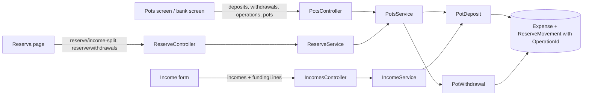

# Technical Specification: Linked Deposit, Withdrawal and Pots Screen

Complexity: **complex**. It adds linked operations across expenses and pot movements, a new API area, changes the income save, and builds the Pots screen and its forms. No data file version change.

**Strict no-comments policy** in all code, XML docs included (CLAUDE.md). Existing doc comments on lines a stage rewrites are deleted, not reworded.

## 1. Technical Overview

**What.**
- **Linked operations:** every record a deposit or withdrawal writes (bank expenses and pot movements) carries the same optional `OperationId`. Editing or deleting the operation edits or deletes all of them in one save. No operation record is stored; an operation is read back from its records (user, 2026-10-31).
- **Deposit:** manual (amount, date, description; into the active pots by split or into one pot, inactive pots included; 0–5 funding lines) or from an income (90% of net, the income's date; one default funding line from the income's bank, or up to 5 hand-split lines).
- **Withdrawal:** pot −X; with a bank, the two bank expenses of today (−X in the Pots account's category, +X in the chosen category), all linked.
- **Pots screen:** a Pots account's screen gets two tabs, Pots (default) and Transactions, and the actions Deposit, Withdraw and Manage pots. Banks get "Withdraw from pots". The Accounts page's Pots rows become links.
- **Manage pots** saves all pots together and enforces the 100% split; it replaces Admin → Reserve buckets.
- **Reserva page until F13:** its income split and withdrawal keep their routes and screens but run through the linked operations.

**Why.** Today a split income writes only pot movements and the user types the "Reserva" bank expense by hand; a withdrawal's bank expenses are not tied to its movement, so edits drift. Reimbursements back into one pot have no action.

**Delivery.** Eleven PRs. Server stages 1–7 each stay within the PR size rule (8 non-test code files, about 15 in total; generated `openapi.ts` excluded). Web stages 8–11 are fewer and larger; the user accepted their overage (2026-10-31), and each PR names it. Each PR leaves `main` deployable and ends with a parity run against `p60-deployed-f14`. Nothing is deployed between stages.

| Stage | Content | Web |
|---|---|---|
| **1 — Linked withdrawal (Reserva route)** | `OperationId` on expenses and movements; `POST reserve/withdrawals` writes linked records; 409 on editing or deleting a linked record through the old routes | None (Reserva page and Monthly show the 409 message) |
| **2 — Withdrawal operations API** | `POST accounts/{potsId}/withdrawals`; `PUT accounts/{potsId}/withdrawals/{operationId}`; `GET`/`DELETE accounts/operations/{operationId}` | None |
| **3a — Manual deposit** | `POST accounts/{potsId}/deposits` and `PUT accounts/{potsId}/deposits/{operationId}` (into active pots or one pot, 0–5 funding lines) | None |
| **3b — Reserva routes** | `POST reserve/income-split` becomes a manual deposit with no bank; `POST reserve/withdrawals` delegates to `IPotsService` (so it also refuses a future date); the shared checks move to `Application/Validation` | None |
| **4 — Deposit from an income** | Income save writes a linked deposit with funding lines; older split incomes keep today's behaviour | None |
| **5 — Manage pots (server)** | `PUT accounts/{potsId}/pots`; 100% enforced | None |
| **6 — Pots read, old-delete fix, parity** | `GET accounts/{potsId}/pots/{y}/{m}`; legacy manual-split delete narrowed; parity figures for pots | None |
| **7 — Actions and rows** | Deposit, Withdraw, Manage pots, Withdraw from pots actions; Pots account movement rows; bank rows carry their operation link | None |
| **8 — Pots screen (read)** | Tabs, Pots tab, Transactions rows; Accounts page Pots links | Account screen, Accounts page |
| **9 — Manage pots dialog; Admin retired** | Dialog; Admin → Reserve buckets page, menu entry and `reserve-buckets` write endpoints removed; route redirect | Pots screen, Admin |
| **10 — Deposit and Withdraw forms** | Both forms on the Pots screen; Withdraw from pots on banks; editing an operation from `?operation=` | Account screens |
| **11 — Income funding lines, bank links, ticks** | Funded-from section in the shared income form; bank rows link to their operation; withdrawal category list fix; PRD ticks | Income form, bank screen |

**Scope.**

*Included:* everything in PRD F10 Capabilities, Experience, Error Handling and Section 9 F10, plus the cross-feature criteria naming F10 that can be checked now.
- *Input contracts (Consumes):* F05 account screen shell; F09 Pots accounts, pots, split percentages, category setting and the income split target; F14 the Accounts page Pots grid.
- *Output contracts (Provides):* linked deposit and withdrawal operations, the operation link on bank rows and the Pots screen (used by F13); the `OperationId` contract (used by later multi-record operations).

*Excluded:* a dedicated reimbursement transaction (a later idea); deleting a pot; non-GBP Pots accounts; retiring the Reserva page and the `reserve` routes (F13).

## 2. Architecture Impact

**Layers** (design.md's four questions):
1. **Where it belongs:** the CashFlow bounded context.
   - **Domain:** `OperationId` on `Expense` and `ReserveMovement`; `PotDeposit` and `PotWithdrawal` rules that build an operation's records; the 100% rule on the account's pots.
   - **Application:** `PotsService` (operations and pots), `IncomeService` (income deposit), `ReserveService` (Reserva routes delegate), guards in `ExpenseService`.
   - **Infrastructure:** `OperationId` left out of the JSON when null.
   - **Presentation:** `PotsController`; the Pots screen, forms and dialog.
2. **Dependencies:** unchanged direction; no new package.
3. **Template reads:** none; behaviour keys off `HasPots`, `ReceivesIncomeSplit`, `CanWithdraw` and `CanPayBills`.
4. **Data file:** stays V4. `OperationId` is optional and omitted when null, as `CardStatement.PaymentTransferId` (user, 2026-10-31).



## 3. Technical Decisions

| Decision | Chosen approach | Alternative considered | Trade-off |
|---|---|---|---|
| **Link** (user, 2026-10-31) | `Guid? OperationId` on `Expense` and `ReserveMovement`, set at creation by the operation rules and never changed. An operation = all records with that id. No stored operation. | A stored "pot operation" record | Derive, don't store; the file gains no collection. |
| **Reading an operation** | `GET accounts/operations/{id}` rebuilds it: kind (withdrawal when a movement is negative), Pots account (the movements' pots' account), date and description (the movements'), amount (sum of movement magnitudes), into (`OnePot` with that pot when exactly one movement, otherwise `ActivePots`; a split while only one pot is active reads back as that one pot, and saving it again writes the same records), funding lines (the bank expenses in the Pots account's category), withdrawal bank and category (the +X expense), income id (the movements' `IncomeId`). | Store the form input | Reconstruction is exact for every shape the forms can save. |
| **Routes** (user) | `PotsController` under `accounts`: `POST {potsId:guid}/deposits`, `POST {potsId:guid}/withdrawals`, `PUT {potsId:guid}/deposits/{operationId:guid}`, `PUT {potsId:guid}/withdrawals/{operationId:guid}`, `GET`/`DELETE operations/{operationId:guid}`, `GET {potsId:guid}/pots/{year:int}/{month:int}`, `PUT {potsId:guid}/pots`. Income routes gain `fundingLines`. | One generic operations route with a kind | One request shape per route, so later stages only add to the snapshot. |
| **Deposit rule** | `Domain/Rules/PotDeposit.Build(potsAccount, amount, date, description, target, fundingLines, operationId, income?)` returns the `PotOperation`. Target `ActivePots` splits once with `ReserveSplitAllocator` (residual to the largest %) and needs the active pots to total exactly 100.00 (else 400 "Active pots must total 100% (now 99.99%).", so the pots always receive the full amount); `OnePot(potId)` credits that pot only, any pot of the account, inactive included. Funding lines 0–5, each bank `CanPay` and active, amounts > 0, sum = amount exactly. Each line → one expense in the Pots account's category, description "Deposit to <account>" (from an income: "Deposit to <account> – <income source>"), `countsAsTithe` false, no round-up. Movements use the deposit's description (from an income: today's income movement description). | Split per funding line | Splitting once avoids per-pot rounding drift (PRD). |
| **Withdrawal rule** | `Domain/Rules/PotWithdrawal.Build(pot, amount, date, description, bank?, category?, operationId)`: movement −X; with a bank, expense −X in the Pots account's category and +X in the chosen category, both with the request description and today's flags; returns the `PotOperation`. Category must be active, not investment and not any account's category (today's server rule). Overdraft: amount > pot balance without `confirmed` → `OverdraftConfirmationRequiredException` (409), checked after the rule so an invalid amount is always the 400. | — | Same records as today, now linked. |
| **Deposit from an income** | Only when the income has a Pots account. Amount = `round(net − 10%, 2)` as today, date = the income's. A bank is required ("Choose the bank this income landed in."). Default funding: one line from the income's bank for the full amount; `fundingLines` on create or update replaces it. Edit rebuilds the whole deposit in the same save (new records, same `OperationId`); hand-split lines that no longer add up → 400. Unticking the split or deleting the income deletes every record of the deposit. | — | PRD. |
| **Older split incomes** (user) | An income whose movements have no `OperationId` keeps today's path: edit rebuilds movements only, delete removes them; no expense, no link. `fundingLines` sent for such an income are ignored. | Convert on edit | No double counting with the hand-typed lines; parity unchanged. |
| **Operation edit and delete** | `PUT accounts/{potsId}/deposits/{operationId}` or `PUT accounts/{potsId}/withdrawals/{operationId}` takes that kind's request and rebuilds all records in one save, keeping the id. Another kind's id or another Pots account → 404. An income's deposit is edited through the income (on the deposit route → 409 "This deposit belongs to an income; edit the income."). `DELETE operations/{id}` removes all records in one save (an income deposit → the same 409). | Patch records in place | One rebuild path; one save. |
| **Guards on old routes** (user, 2026-10-31) | `PUT`/`DELETE expenses/{id}` (and the account-screen expense routes) on an expense with `OperationId` → 409 "This expense belongs to a pot deposit or withdrawal; edit it from the Pots account." `PUT`/`DELETE reserve/movements/{id}` on a linked movement → 409 "This movement belongs to a pot deposit or withdrawal; edit it from the Pots account." New `LinkedOperationConflictException` (Application/Exceptions), mapped to 409 next to `StatementPaymentConflictException`. Monthly keeps listing these expenses; totals unchanged. | Hide them from Monthly | Lists keep adding up to the totals. |
| **Reserva routes** (user) | `POST reserve/withdrawals` → `PotWithdrawal` on the first Pots account (stage 1). `POST reserve/income-split` → a manual deposit with no funding lines into the active pots of the first Pots account (stage 3b). In stage 3b both routes delegate to `IPotsService`, so both refuse a future date, and the split also needs the active pots to total exactly 100.00 (the deposit rule's 400). Request and response shapes unchanged; the response is built from the saved movements. A split posted this way is linked, so its lines get the 409 on `PUT`/`DELETE reserve/movements/{id}`, as a withdrawal's do. An unknown bucket keeps the route's own "not recognized" 400. | Leave unlinked until F13 | Every new record is linked. |
| **Old manual-split delete** (user) | `DELETE reserve/movements/{id}` on an unlinked movement without an income removes the movements with the same date and description that are positive, unlinked and have no income; a negative (withdrawal) movement is deleted alone. The Reserva page's warning states the real count of lines. | Keep today's | Fixes deleting unrelated movements. |
| **Manage pots** | `PUT accounts/{potsId}/pots` takes the full list: existing pots by id (name, split %, active) and new ones without id. A pot missing from the list → 400 "Every pot must be in the list; pots can't be deleted." Active split % must total exactly 100.00 → else 400 "Active pots must total 100% (now 95%)." (one decimal shown only when needed). Names unique ignoring case (today's 409 text). `Account.ReplacePots` applies the rules in the Domain; `ReserveSplitRule` (Application) keeps its warning for `GET reserve-buckets/split-status` until F13. | Per-pot endpoints | The 100% rule can hold only when all pots save together. |
| **Pots read** (user, 2026-10-31) | `GET accounts/{potsId}/pots/{year}/{month}`: each pot (id, name, split %, active, balance at the end of the month from `AccountBalanceRule`'s per-pot sum) and the account total; pots by name, inactive after active. | Today's balances | Matches the header. |
| **Account actions** | New `AccountAction` values `Deposit`, `Withdraw`, `ManagePots` (from `HasPots`) and `WithdrawFromPots` (on accounts with `CanPayBills`). An inactive account has none, as today. The bank form shows "Create a Pots account first." when there is none. | — | Capability-driven, as F05. |
| **Rows** | Pots account Transactions: one row per movement in the month (`Kind` "PotMovement": date, pot name in Counterpart, description, amount). Bank and Pots rows of a linked record carry `Operation { OperationId, PotsAccountId, Year, Month, IncomeId? }`; such rows have `CanEdit` false. Legacy movements keep today's edit/delete (Reserva routes). | — | — |
| **Web: Pots screen** | Tabs Pots (default for Pots accounts) and Transactions, Fluent `TabList` as on cards. Pots tab: grid Pot, Split %, Balance (right-aligned), footer "Pots total <currency>". Actions in the action bar: Deposit, Withdraw, Manage pots. Accounts page: `TEMPLATE_GRIDS.Pots.linksRows` true, linking with `&tab=pots`. | — | — |
| **Web: forms** | Deposit and Withdraw are inline forms like F05's actions (discard prompt, keep-open off, toast "Deposit saved" / "Withdrawal saved"). Deposit: Source (Manual / From an income — the latter opens the shared income form with split ticked and this Pots account chosen), Into (Active pots by split / One pot + pot picker listing every pot, inactive marked), Amount, Date, Description, funding lines (Bank + Amount, "Add line" up to 5, "No bank — money from outside CashFlow"), live split preview. Withdraw: Pot, Date, Description, Amount, Through bank (optional), Category (when a bank is chosen; default the category named like the pot; list excludes inactive, investment and any account's category), overdraft dialog "This takes <pot> below zero (−£12.40). Continue?". Edit: `?operation=<id>` opens the right form filled from `GET operations/{id}`, with Delete. | Modal dialogs | Same pattern as the account screen's other actions. |
| **Web: income funding** (user) | The shared `IncomeForm` gets a "Funded from" section when split is ticked: one read-only line (income's bank, full deposit amount) and "Split across banks", which turns it into editable lines (up to 5) with "Lines add up to £88.00; the deposit is £90.00." under them and Save disabled until they match. Used by Monthly, the bank screen and the Pots screen. Hidden for older split incomes. | Account screens only | One form everywhere until F13. |
| **Web: bank rows** (user) | A row with `operation` is read-only; its description links to `/cashflow/accounts/<potsId>?month=<yyyy-MM>&tab=transactions&operation=<id>`; with `incomeId`, it opens the income's edit form on the bank screen instead. | Edit in place | One place to edit each operation. |
| **Admin retirement** (user) | Stage 9 removes `ReserveBucketsPage`, `ReserveBucketFormDialog`, `useReserveBuckets`, the nav entry and lazy import; `admin/cashflow/reserve-buckets` redirects to the first Pots account's screen with `tab=pots` (Accounts page when none). Server: `POST`/`PUT reserve-buckets` and their service methods go; `GET reserve-buckets` and `split-status` stay for the Reserva page. | Keep until F13 | One place edits pots, so the 100% rule holds. |
| **Parity** | Stage 6 emits `{month}/potsTab/<pot>/balance` and `{month}/potsTab/total` from `GET accounts/{potsId}/pots/{y}/{m}` for the first Pots account, mapped to `{month}/pots/*/balance` and `{month}/pots/total`. Legacy data is unchanged, so every stage expects 0 differences. | — | The new read is checked every month. |
| **PR size** | Server stages ≤ 8 code files. Web stages 8–11 exceed it with the user's approval; each PR names its count. | — | — |

## 4. Component Overview

All paths are relative to the repo root. Existing patterns: entities with private setters and static `Create`; `ArgumentException` → 400, conflicts → 409; the span/log telemetry pattern; `ApplyAndSaveAsync` for one save; name-ordered account lists.

**Domain (`Financial.CashFlow.Domain`)**

| File | New/Modified | Stage | Key responsibilities |
|---|---|---|---|
| `Entities/Transactions/Expense.cs` | Modified | 1 | `OperationId`; `Create(..., operationId: null)` |
| `Entities/Transactions/ReserveMovement.cs` | Modified | 1 | `OperationId`; `Create(..., operationId: null)` |
| `Rules/PotWithdrawal.cs` | New | 1 | Builds a withdrawal's records; category rule |
| `Rules/PotDeposit.cs` | New | 3, 4 | Builds a deposit's records; target; funding-line rules; income amount |
| `Rules/PotOperation.cs` | New | 2, 3 | Reads an operation back from its records |
| `Entities/Account.cs` | Modified | 5 | `ReplacePots` with the 100% and no-delete rules |

**Application (`Financial.CashFlow.Application`)**

| File | New/Modified | Stage | Key responsibilities |
|---|---|---|---|
| `Exceptions/LinkedOperationConflictException.cs` | New | 1 | 409 for linked records on old routes and income deposits |
| `Services/ExpenseService.cs` | Modified | 1 | Guard on update and delete |
| `Services/ReserveService.cs` | Modified | 1, 2, 3, 6 | Withdrawal and income-split delegate; shares the withdrawal checks with `PotsService` (2); movement guards; narrowed legacy delete |
| `Validation/PotWithdrawalValidator.cs` | New | 3b | The withdrawal's bank and category checks and the overdraft check, moved out of `PotsService` |
| `Interfaces/IPotsService.cs`, `Services/PotsService.cs` | New | 2–6 | Withdrawals (2), deposits (3), operation read/edit/delete (2, 3), pots replace (5), pots read (6) |
| `DTOs/PotWithdrawalRequestDTO.cs`, `PotOperationDTO.cs` | New | 2 | Withdrawal request; operation read model |
| `DTOs/PotDepositRequestDTO.cs`, `FundingLineDTO.cs` | New | 3 | Deposit request; funding line |
| `Services/IncomeService.cs`, `DTOs/IncomeCreateDTO.cs`, `IncomeUpdateDTO.cs`, `IncomeDTO.cs` | Modified | 4 | Income deposit; `fundingLines` in and out; `HasLinkedDeposit` on `IncomeDTO` |
| `DTOs/PotsUpdateDTO.cs`, `PotUpdateDTO.cs` | New | 5 | Manage pots request |
| `DTOs/PotsSummaryDTO.cs`, `PotBalanceDTO.cs` | New | 6 | Pots tab read |
| `Services/AccountQueryService.cs`, `DTOs/AccountTransactionDTO.cs`, `DTOs/AccountTransactionOperationDTO.cs` | Modified/New | 7 | Movement rows; operation link on rows |
| `DependencyInjection/CashFlowApplicationServiceCollectionExtensions.cs` | Modified | 2 | `IPotsService` |
| `Services/ReserveBucketService.cs`, `Interfaces/IReserveBucketService.cs` | Modified | 9 | Create and update removed |

Domain `Enums/AccountAction.cs` and `Rules/AccountActions.cs` change in stage 7.

**Infrastructure:** `Financial.CashFlow.Infrastructure/Persistence/CashFlowTypeInfoResolver.cs` (stage 1): `Expense.OperationId` and `ReserveMovement.OperationId` join the omitted-when-null list.

**Presentation**

| File | New/Modified | Stage | Key responsibilities |
|---|---|---|---|
| `Financial.Api/Middleware/DomainExceptionMappingMiddleware.cs` | Modified | 1 | `LinkedOperationConflictException` → 409 |
| `Financial.Api/Controllers/PotsController.cs` | New | 2, 3, 5, 6 | Routes in §5 |
| `Financial.Api/Controllers/ReserveBucketsController.cs` | Modified | 9 | `POST`/`PUT` removed |
| `Financial.Web/src/api/financialApiClient.ts`, `src/api/types.ts` | Modified | 8–11 | Pots, operations, income funding lines; reserve-bucket writes removed |
| `src/pages/AccountScreenPage.tsx`, `src/hooks/useAccountScreen.ts` | Modified | 8, 10 | Pots tab, `tab` and `operation` query values |
| `src/components/PotsTab.tsx`, `src/hooks/usePots.ts` | New | 8 | Pots grid |
| `src/components/AccountTransactionsGrid.tsx`, `src/components/accountActions.ts` | Modified | 8, 10, 11 | Movement rows; new action labels; operation links |
| `src/utils/accountTemplateLabel.ts` | Modified | 8 | Pots rows link |
| `src/components/ManagePotsDialog.tsx`, `src/hooks/useManagePots.ts` | New | 9 | Manage pots |
| `src/navigation/routes.tsx`, `navTree.ts`, `lazyPages.tsx` | Modified | 9 | Admin entry removed; redirect |
| `src/pages/ReserveBucketsPage.tsx`, `src/components/ReserveBucketFormDialog.tsx`, `src/hooks/useReserveBuckets.ts` | Deleted | 9 | — |
| `src/components/PotDepositForm.tsx`, `src/hooks/usePotDepositForm.ts`, `src/components/PotWithdrawalForm.tsx`, `src/hooks/usePotWithdrawalForm.ts`, `src/components/FundingLinesField.tsx` | New | 10 | Forms; shared funding lines |
| `src/components/IncomeForm.tsx`, `src/hooks/useIncomeForm.ts` | Modified | 11 | Funded from |
| `src/utils/withdrawalExpenseCategories.ts`, `src/pages/ReservaPage.tsx` | Modified | 11 | Category exclusion as the server; real line count |

**Scripts:** `scripts/parity/Parity.psm1`, `figure-map.json`, `Parity.test.ps1`, `README.md` (stage 6).

**Files per stage (non-test code, generated `openapi.ts` excluded):**
- 1: 8 (`Expense`, `ReserveMovement`, `PotWithdrawal`, `CashFlowTypeInfoResolver`, `LinkedOperationConflictException`, `ExpenseService`, `ReserveService`, `DomainExceptionMappingMiddleware`).
- 2: 8 (`PotOperation`, `IPotsService`, `PotsService`, `PotWithdrawalRequestDTO`, `PotOperationDTO`, `PotsController`, DI extensions, `ReserveService`).
- 3a: 8 (`PotDeposit`, `PotOperation`, `PotDepositRequestDTO`, `FundingLineDTO`, `PotOperationDTO`, `IPotsService`, `PotsService`, `PotsController`).
- 3b: 5 (`ReserveService`, `PotsService`, the new `Application/Validation` file for the shared bank and overdraft checks, `PotDeposit` and `PotWithdrawal`, which both return `PotOperation` as the one records type). `IncomeService` keeps calling `ReserveService.CreateSplitMovements` until stage 4.
- 4: 5 (`PotDeposit`, `IncomeService`, `IncomeCreateDTO`, `IncomeUpdateDTO`, `IncomeDTO`).
- 5: 6 (`Account`, `PotsUpdateDTO`, `PotUpdateDTO`, `IPotsService`, `PotsService`, `PotsController`).
- 6: 8 (`PotsSummaryDTO`, `PotBalanceDTO`, `IPotsService`, `PotsService`, `PotsController`, `ReserveService`, `Parity.psm1`, `figure-map.json`).
- 7: 5 (`AccountAction`, `AccountActions`, `AccountQueryService`, `AccountTransactionDTO`, `AccountTransactionOperationDTO`). The web lists only actions it knows (`formActionsOf`), so the new actions stay hidden until stages 8–10.
- 8–11: over the limit with the user's approval (2026-10-31); each PR states its count.

## 5. API Contracts

**`POST accounts/{potsId}/deposits`** (stage 3) → 201 `PotOperationDTO`
```json
{ "amount": 90.00, "date": "2026-10-31", "description": "Ramsay bonus",
  "potId": null,
  "fundingLines": [ { "bankId": "…", "amount": 85.00 }, { "bankId": "…", "amount": 5.00 } ] }
```
`potId` null = active pots by split; set = that pot only. `fundingLines` empty = money from outside CashFlow (no expense).

**`POST accounts/{potsId}/withdrawals`** (stage 2) → 201 `PotOperationDTO`
```json
{ "potId": "…", "amount": 38.25, "date": "2026-10-12", "description": "Boots",
  "bankId": "…", "categoryId": "…", "confirmed": false }
```

**`GET accounts/operations/{operationId}`** → 200
```json
{ "operationId": "…", "kind": "Deposit", "potsAccountId": "…", "date": "2026-10-31", "description": "Ramsay bonus",
  "amount": 90.00, "potId": null, "fundingLines": [ { "bankId": "…", "amount": 85.00 } ],
  "bankId": null, "categoryId": null, "incomeId": null }
```
**`PUT accounts/{potsId}/deposits/{operationId}`** takes the deposit request and **`PUT accounts/{potsId}/withdrawals/{operationId}`** the withdrawal request → 200; an operation of the other kind or of another Pots account → 404; an income deposit → 409. **`DELETE accounts/operations/{operationId}`** → 204; an income deposit → 409.

**Incomes** (stage 4): `IncomeCreateDTO` and `IncomeUpdateDTO` gain `"fundingLines": [ { "bankId": "…", "amount": 62.00 }, … ]` (optional); `IncomeDTO` gains `fundingLines` and `hasLinkedDeposit`.

**`PUT accounts/{potsId}/pots`** (stage 5) → 204
```json
{ "pots": [ { "id": "…", "name": "Investimento", "splitPercentage": 33.33, "isActive": true },
            { "id": null, "name": "Holidays", "splitPercentage": 0, "isActive": false } ] }
```

**`GET accounts/{potsId}/pots/2026/10`** (stage 6) → 200
```json
{ "potsAccountId": "…", "currency": "GBP", "total": 1524.50,
  "pots": [ { "id": "…", "name": "Ariana", "splitPercentage": 16.67, "isActive": true, "balance": 210.40 } ] }
```

**Account rows** (stage 7): `AccountTransactionDTO.operation` = `{ "operationId": "…", "potsAccountId": "…", "year": 2026, "month": 10, "incomeId": null }`.

**Errors**

| Case | Status | Message |
|---|---|---|
| Funding lines don't add up | 400 | `Funding lines must add up to £90.00.` |
| More than 5 funding lines | 400 | `A deposit has at most 5 funding lines.` |
| Funding bank not usable (card, inactive, not a bank) | 400 | today's payer messages |
| Split income without a bank | 400 | `Choose the bank this income landed in.` (from `PotDeposit`) |
| One-pot deposit with a pot of another account | 400 | `That pot isn't in <account>.` |
| Pots account without a category, deposit or withdrawal with a bank | 400 | `Set a category on <account> first.` |
| Amount ≤ 0 / future date | 400 | `Amount must be greater than zero.` / `Date must not be in the future.` |
| Pot overdraft without `confirmed` | 409 | today's overdraft text |
| Manage pots total ≠ 100, or a deposit into active pots that don't total 100 | 400 | `Active pots must total 100% (now 95%).` |
| Manage pots missing a pot | 400 | `Every pot must be in the list; pots can't be deleted.` |
| Linked expense / movement on old routes | 409 | §3 "Guards on old routes" |
| Edit or delete an income's deposit as an operation | 409 | `This deposit belongs to an income; edit the income.` |
| Unknown operation or account | 404 | — |

## 6. Data Model

Version stays 4. Two optional fields, written only when set:
- `Expenses[].OperationId` (GUID)
- `ReserveMovements[].OperationId` (GUID)

A deposit's expenses and movements share one id; a withdrawal's movement and its two expenses share one id. Existing records have none, so `migrate`, the version guard and the spreadsheet import are unchanged, and the file round trip is byte-identical for existing data.

## 7. Testing Strategy

Following the `testing-guide-Financial` skill: Domain and Application unit tests; the API host through acceptance tests; web components and hooks with Vitest. AC tracing: `[Trait("AC", "P60-F10-linked-deposit-withdrawal-and-pots-screen-NN")]` (web: the AC id in the test name), 01–16 in PRD order. Every class carries `[Trait("Category", …)]`; names follow `Method_Condition_Result`.

| Test file | Type | Stage | Coverage goal |
|---|---|---|---|
| `Infrastructure.Tests/Persistence/CashFlowSerializerAdapterTests.cs` | Integration | 1 | `OperationId` round trip; omitted when null; existing file byte-identical |
| `Application.Tests/Services/ReserveServiceTests.cs` | Unit | 1, 3, 6 | Linked withdrawal records; income-split as deposit; guards; narrowed delete |
| `Domain.Tests/Rules/PotWithdrawalTests.cs` | Unit | 1 | Three records, signs, categories, flags; without a bank only the movement |
| `Application.Tests/Services/ExpenseServiceTests.cs` | Unit | 1 | 409 on linked expense update and delete |
| `Domain.Tests/Rules/PotDepositTests.cs`, `PotOperationTests.cs` | Unit | 2–4 | Records, signs, categories, descriptions, flags; split once with residual; one pot incl. inactive; line rules; read-back of every shape |
| `Application.Tests/Services/PotsServiceTests.cs` | Unit | 2–6 | Create, read, edit, delete; overdraft; pots replace rules; pots read at month end |
| `Application.Tests/Services/IncomeServiceTests.cs` | Unit | 4 | Linked deposit on create; edit rebuild; untick and delete remove; older incomes unchanged; bank required |
| `Domain.Tests/Entities/AccountTests.cs` | Unit | 5 | `ReplacePots` 100%, missing pot, duplicate name |
| `Domain.Tests/Rules/AccountActionsTests.cs`, `Application.Tests/Services/AccountQueryServiceTests.cs` | Unit | 7 | New actions; movement rows; operation links; `CanEdit` false |
| `Api.Tests/Acceptance/LinkedPotOperationsAcceptanceTests.cs` | Integration (AC) | 1–7, 9 | The AC table below |
| `scripts/parity/Parity.test.ps1` | Self-test | 6 | Pots tab figures emitted and mapped |
| `Financial.Web` `PotsTab.test.tsx`, `AccountScreenPage.test.tsx`, `AccountsPage.test.tsx` | Unit | 8 | Tabs, grid, footer, states, links |
| `Financial.Web` `ManagePotsDialog.test.tsx`, `useManagePots.test.ts`, routes test | Unit | 9 | Running total, 400 shown, save all; redirect |
| `Financial.Web` `PotDepositForm.test.tsx`, `PotWithdrawalForm.test.tsx`, `FundingLinesField.test.tsx` | Unit | 10 | Into, lines, mismatch text, preview, overdraft dialog, edit from `operation` |
| `Financial.Web` `IncomeForm.test.tsx`, `useIncomeForm.test.ts`, `AccountTransactionsGrid.test.tsx`, `withdrawalExpenseCategories.test.ts` | Unit | 11 | Funded from; older incomes hide it; bank row links; category exclusion |

**Acceptance criteria (PRD Section 9, F10):**

| # | Criterion | Test | Stage |
|---|---|---|---|
| 01 | Split income writes income, pot credits and one bank expense in one save | `LinkedPotOperationsAcceptanceTests.Income_WithSplit_WritesLinkedDeposit` | 4 |
| 02 | Hand-split lines saved per bank; mismatch 400 | `…Deposit_FundingLines_OneExpensePerBankOrRejected`; `FundingLinesField.test.tsx` | 3, 10 |
| 03 | Manual deposit without lines writes no expense | `…ManualDeposit_NoLines_CreditsPotsOnly` | 3 |
| 04 | Editing the income recalculates; deleting removes all | `…Income_EditAndDelete_RebuildAndRemoveDeposit` | 4 |
| 05 | Withdrawal through a bank writes three linked records; without, only the pot | `…Withdrawal_ThroughBank_WritesLinkedRecords` | 2 |
| 06 | Overdraft needs confirmation | `…Withdrawal_Overdraft_Returns409UntilConfirmed` | 2 |
| 07 | Both sides produce the same records | `…Withdrawal_FromBankOrPotsAccount_SameRecords`; `PotWithdrawalForm.test.tsx` | 7, 10 |
| 08 | Legacy deposits and withdrawals keep today's edit and delete | `…LegacyMovements_KeepTodaysEditAndDelete` | 1, 6 |
| 09 | One-pot deposit, active or inactive, credits only that pot | `…ManualDeposit_OnePot_CreditsOnlyThatPot` | 3 |
| 10 | Older split income edit adds no bank expense | `…OlderSplitIncome_Edit_AddsNoExpense` | 4 |
| 11 | Old manual split delete removes only its own lines | `…LegacyManualSplit_Delete_RemovesOnlyItsLines` | 6 |
| 12 | Reserva page split and withdrawal write linked records | `…ReservaRoutes_WriteLinkedRecords` | 1, 3b |
| 13 | Admin → Reserve buckets retired; route opens the Pots tab | `…ReserveBucketWrites_AreGone`; routes test | 9 |
| 14 | Manage pots saves together and rejects ≠ 100.00 | `…ManagePots_TotalNot100_Returns400`; `ManagePotsDialog.test.tsx` | 5, 9 |
| 15 | Pots screen states, keyboard, narrow layout | ui-reviewer with `docs/ui/review-checklist.md`; `PotsTab.test.tsx` | 8–10 |
| 16 | Parity 0 differences; checklist rows; `/simplify`; reviewers | Definition of Done, every stage | 1–11 |

**Cross-feature criteria checked in F10:**
- **The account screen shell hosts F10's Pots tab without changing allowed-actions rendering:** `AccountScreenPage.test.tsx` (stage 8). Ticked when F12 ships too.
- **F09's Pots account category is the category F10's deposit and withdrawal expenses use:** `PotDepositTests`, `PotWithdrawalTests`.
- **F10's deposits and withdrawals carry one operation id each; edit or delete changes all in one save:** `PotsServiceTests` and AC 04/05.

**Proved by the Definition of Done.** Each stage runs `dotnet build --configuration Release` and `dotnet test`; `npm run build` and `npm test` when the web changed; the OpenAPI snapshot and `openapi.ts` regenerated when the contract changed; the parity run on `data/data-cashflow.json` against `p60-deployed-f14` with 0 differences and an unchanged SHA-256; `/simplify` and the architecture-reviewer, plus the ui-reviewer for stages 8–11.
