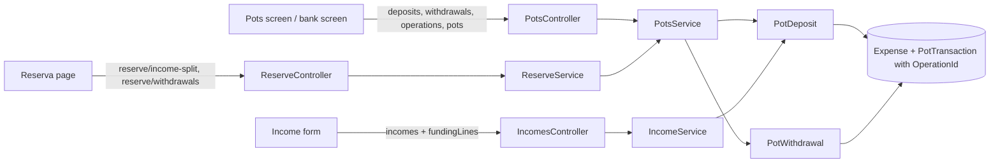

# Technical Specification: Linked Deposit, Withdrawal and Pots Screen

Complexity: **complex**. It adds linked operations across expenses and pot movements, a new API area, changes the income save, and builds the Pots screen and its forms. No data file version change.

**Strict no-comments policy** in all code, XML docs included (CLAUDE.md). Existing doc comments on lines a stage rewrites are deleted, not reworded.

## 1. Technical Overview

**What.**
- **Linked operations:** every record a deposit or withdrawal writes (bank expenses and pot movements) carries the same optional `OperationId`. Editing or deleting the operation edits or deletes all of them in one save. No operation record is stored; an operation is read back from its records (user, 2026-10-31).
- **Deposit:** manual (amount, date, description; into the active pots by split or into one pot, inactive pots included; 0–5 funding lines) or from an income (90% of net, the income's date; one default funding line from the income's bank, or up to 5 hand-split lines).
- **Withdrawal:** pot −X; with a bank, the two bank expenses of today (−X in the Pots account's category, +X in the chosen category), all linked.
- **Pots screen:** a Pots account's screen gets two tabs, Pots (default) and Transactions, and the actions Deposit, Withdraw and Manage pots. Banks get "Withdraw from pots". The Accounts page's Pots rows become links.
- **Manage pots** saves all pots together and enforces the 100% split; it replaces Admin → Reserve buckets.
- **Reserva page until F13:** its income split and withdrawal keep their routes and screens but run through the linked operations.

**Why.** Today a split income writes only pot movements and the user types the "Reserva" bank expense by hand; a withdrawal's bank expenses are not tied to its movement, so edits drift. Reimbursements back into one pot have no action.

**Delivery.** Thirteen PRs. Server stages 1–7 and 10b each stay within the PR size rule (8 non-test code files, about 15 in total; generated `openapi.ts` excluded). Web stages 8–11 are fewer and larger; the user accepted their overage (2026-10-31), and each PR names it. Each PR leaves `main` deployable and ends with a parity run against `p60-deployed-f14`. Nothing is deployed between stages.

| Stage | Content | Web |
|---|---|---|
| **1 — Linked withdrawal (Reserva route)** | `OperationId` on expenses and movements; `POST reserve/withdrawals` writes linked records; 409 on editing or deleting a linked record through the old routes | None (Reserva page and Monthly show the 409 message) |
| **2 — Withdrawal operations API** | `POST accounts/{potsId}/withdrawals`; `PUT accounts/{potsId}/withdrawals/{operationId}`; `GET`/`DELETE accounts/operations/{operationId}` | None |
| **3a — Manual deposit** | `POST accounts/{potsId}/deposits` and `PUT accounts/{potsId}/deposits/{operationId}` (into active pots or one pot, 0–5 funding lines) | None |
| **3b — Reserva routes** | `POST reserve/income-split` becomes a manual deposit with no bank and `POST reserve/withdrawals` delegates to `IPotsService`, so both refuse a future date; the bank and overdraft checks move to `Application/Validation` | None |
| **4 — Deposit from an income** | Income save writes a linked deposit with funding lines; older split incomes keep today's behaviour | None |
| **5 — Manage pots (server)** | `PUT accounts/{potsId}/pots`; 100% enforced | None |
| **6 — Pots read, old-delete fix, parity** | `GET accounts/{potsId}/pots/{y}/{m}`; legacy manual-split delete narrowed; parity figures for pots | None |
| **7 — Actions and rows** | Deposit, Withdraw, Manage pots, Withdraw from pots actions; Pots account movement rows; bank rows carry their operation link | Hides row actions on movement rows until stage 8 |
| **8 — Pots screen (read)** | Tabs, Pots tab, Transactions rows with today's edit and delete on legacy rows; Accounts page Pots links | Account screen, Accounts page |
| **9 — Manage pots dialog; Admin retired** | Dialog; Admin → Reserve buckets page, menu entry and `reserve-buckets` write endpoints removed; route redirect | Pots screen, Admin |
| **10 — Deposit and Withdraw forms** | Both forms on the Pots screen; Withdraw from pots on banks; editing an operation from `?operation=` | Account screens |
| **10b — Split line count (server)** | `ReserveMovementDTO` gains the number of lines a delete removes (user, 2026-11-04) | Test fixtures only, as the type generator makes the field required |
| **11 — Income funding lines, bank links, ticks** | Funded-from section in the shared income form; bank rows link to their operation; withdrawal category list fix; PRD ticks | Income form, bank screen |

**Scope.**

*Included:* everything in PRD F10 Capabilities, Experience, Error Handling and Section 9 F10, plus the cross-feature criteria naming F10 that can be checked now.
- *Input contracts (Consumes):* F05 account screen shell; F09 Pots accounts, pots, split percentages, category setting and the income split target; F14 the Accounts page Pots grid.
- *Output contracts (Provides):* linked deposit and withdrawal operations, the operation link on bank rows and the Pots screen (used by F13); the `OperationId` contract (used by later multi-record operations).

*Excluded:* a dedicated reimbursement transaction (a later idea); deleting a pot; non-GBP Pots accounts; retiring the Reserva page and the `reserve` routes (F13).

## 2. Architecture Impact

**Layers** (design.md's four questions):
1. **Where it belongs:** the CashFlow bounded context.
   - **Domain:** `OperationId` on `Expense` and `PotTransaction`; `PotDeposit` and `PotWithdrawal` rules that build an operation's records; the 100% rule on the account's pots.
   - **Application:** `PotsService` (operations and pots), `IncomeService` (income deposit), `ReserveService` (Reserva routes delegate), guards in `ExpenseService`.
   - **Infrastructure:** `OperationId` left out of the JSON when null.
   - **Presentation:** `PotsController`; the Pots screen, forms and dialog.
2. **Dependencies:** unchanged direction; no new package.
3. **Template reads:** none; behaviour keys off `HasPots`, `ReceivesIncomeSplit`, `CanWithdraw` and `CanPayBills`.
4. **Data file:** stays V4. `OperationId` is optional and omitted when null, as `CardStatement.PaymentTransferId` (user, 2026-10-31).



## 3. Technical Decisions

| Decision | Chosen approach | Alternative considered | Trade-off |
|---|---|---|---|
| **Link** (user, 2026-10-31) | `Guid? OperationId` on `Expense` and `PotTransaction`, set at creation by the operation rules and never changed. An operation = all records with that id. No stored operation. | A stored "pot operation" record | Derive, don't store; the file gains no collection. |
| **Reading an operation** | `GET accounts/operations/{id}` rebuilds it: kind (withdrawal when a movement is negative), Pots account (the movements' pots' account), date and description (the movements'), amount (sum of movement magnitudes), into (`OnePot` with that pot when exactly one movement, otherwise `ActivePots`; a split while only one pot is active reads back as that one pot, and saving it again writes the same records), funding lines (the bank expenses in the Pots account's category), withdrawal bank and category (the +X expense), income id (the movements' `IncomeId`). | Store the form input | Reconstruction is exact for every shape the forms can save. |
| **Routes** (user) | `PotsController` under `accounts`: `POST {potsId:guid}/deposits`, `POST {potsId:guid}/withdrawals`, `PUT {potsId:guid}/deposits/{operationId:guid}`, `PUT {potsId:guid}/withdrawals/{operationId:guid}`, `GET`/`DELETE operations/{operationId:guid}`, `GET {potsId:guid}/pots/{year:int}/{month:int}`, `PUT {potsId:guid}/pots`. Income routes gain `fundingLines`. | One generic operations route with a kind | One request shape per route, so later stages only add to the snapshot. |
| **Deposit rule** | `Domain/Rules/PotDeposit.Build(potsAccount, amount, date, description, pot, fundingLines, operationId)` and, for an income, `PotDeposit.BuildFromIncome(income, potsAccount, handSplitLines, operationId)` return the `PotOperation`. No pot (`ActivePots`) splits once with `PotSplitAllocator` (residual to the largest %) and needs the active pots to total exactly 100.00 (else 400 "Active pots must total 100% (now 99.99%).", so the pots always receive the full amount); a pot (`OnePot`) credits that pot only, any pot of the account, inactive included. Funding lines 0–5, each bank `CanPay` and active, amounts > 0, sum = amount exactly. Each line → one expense in the Pots account's category, description "Deposit to <account>" (from an income: "Deposit to <account> – <income source>"), `countsAsTithe` false, no round-up. Movements use the deposit's description (from an income: today's income movement description). | Split per funding line | Splitting once avoids per-pot rounding drift (PRD). |
| **Withdrawal rule** | `Domain/Rules/PotWithdrawal.Build(potsAccount, pot, amount, date, description, bank?, category?, operationId)`: movement −X; with a bank, expense −X in the Pots account's category and +X in the chosen category, both with the request description and today's flags; returns the `PotOperation`. Category must be active, not investment and not any account's category (today's server rule). Overdraft: amount > pot balance without `confirmed` → `OverdraftConfirmationRequiredException` (409), checked after the rule so an invalid amount is always the 400. | — | Same records as today, now linked. |
| **Deposit from an income** | Only when the income has a Pots account. Amount = `round(net − 10%, 2)` as today, date = the income's. A bank is required ("Choose the bank this income landed in."). Default funding: one line from the income's bank for the full amount; `fundingLines` on create or update replaces it, and omitted or empty lines mean the default, also on an income that was hand-split, so the form sends its lines on every save. `fundingLines` on an income with no Pots account are ignored. Edit rebuilds the whole deposit in the same save (new records, same `OperationId`); hand-split lines that no longer add up → 400. Unticking the split or deleting the income deletes every record of the deposit. The deposit rule applies, so a split needs active pots totalling 100.00 and a net above zero (today a split with no active pots saved with no movements, and a zero net saved zero movements; both are now the rule's 400). An edit rebuilds the expenses, so a funding bank that has since gone inactive refuses it with 400 "<bank> is inactive.", from an income and from a manual deposit alike; the user moves the bank, unticks the split or deletes the income (user, 2026-11-04). | — | PRD. |
| **Older split incomes** (user) | An income whose movements have no `OperationId` keeps today's path: edit rebuilds movements only, delete removes them; no expense, no link. `fundingLines` sent for such an income are ignored, and the deposit rule's checks do not apply to it (no bank needed, no 100.00 rule). An older income unticked and later ticked again has no movements left to mark it as older, so it gets a linked deposit like any new split. An income counts as older when its first movement has no `OperationId`; the live file has no split income without movements (0 of 8), so none escapes this check. | Convert on edit | No double counting with the hand-typed lines; parity unchanged. |
| **Operation edit and delete** | `PUT accounts/{potsId}/deposits/{operationId}` or `PUT accounts/{potsId}/withdrawals/{operationId}` takes that kind's request and rebuilds all records in one save, keeping the id. Another kind's id or another Pots account → 404. An income's deposit is edited through the income (on the deposit route → 409 "This deposit belongs to an income; edit the income."). `DELETE operations/{id}` removes all records in one save (an income deposit → the same 409). | Patch records in place | One rebuild path; one save. |
| **Guards on old routes** (user, 2026-10-31) | `PUT`/`DELETE expenses/{id}` (and the account-screen expense routes) on an expense with `OperationId` → 409 "This expense belongs to a pot deposit or withdrawal; edit it from the Pots account." `PUT`/`DELETE reserve/movements/{id}` on a linked movement → 409 "This movement belongs to a pot deposit or withdrawal; edit it from the Pots account." New `LinkedOperationConflictException` (Application/Exceptions), mapped to 409 next to `StatementPaymentConflictException`. Monthly keeps listing these expenses; totals unchanged. | Hide them from Monthly | Lists keep adding up to the totals. |
| **Reserva routes** (user) | `POST reserve/withdrawals` → `PotWithdrawal` on the first Pots account (stage 1). `POST reserve/income-split` → a manual deposit with no funding lines into the active pots of the first Pots account (stage 3b). In stage 3b both routes delegate to `IPotsService`, so both refuse a future date, and the split also needs the active pots to total exactly 100.00 (the deposit rule's 400). Request and response shapes unchanged; the response is built from the saved movements. A split posted this way is linked, so its lines get the 409 on `PUT`/`DELETE reserve/movements/{id}`, as a withdrawal's do. An unknown bucket keeps the route's own "not recognized" 400. | Leave unlinked until F13 | Every new record is linked. |
| **Old manual-split delete** (user) | `DELETE reserve/movements/{id}` on an unlinked movement without an income removes the movements with the same date and description that are positive, unlinked and have no income; a negative (withdrawal) movement is deleted alone, and so is a zero one, which is not a split line. The Reserva page's warning states the real count of lines. | Keep today's | Fixes deleting unrelated movements. |
| **Manage pots** | `PUT accounts/{potsId}/pots` takes the full list: existing pots by id (name, split %, active) and new ones without id. A pot missing from the list or listed twice → 400 "Every pot must be in the list; pots can't be deleted." An id that is not this account's pot → 400 "That pot isn't in <account>." Active split % must total exactly 100.00 → else 400 "Active pots must total 100% (now 95%)." (up to four decimals, only when needed, so 100.004 does not read as 100). Names are trimmed and unique ignoring case within the account, checked on the final list so two pots can swap names → 409 `A pot named "X" already exists.`; a blank name → 400 "Pot name is required." (user, 2026-11-04: pot wording, also in `Pot` and `Account.AddPot`; the old Admin page keeps its own text until stage 9, as `ReserveBucketService` checks first). All rules run before anything changes, and before the save starts. Existing pots keep their stored order and new ones go last, because `PotSplitAllocator` gives the rounding residual to the first largest split. `Account.ReplacePots` applies the rules in the Domain; `PotChange` (beside `Pot`) carries one line of the list. `ReserveSplitRule` (Application) keeps its warning for `GET reserve-buckets/split-status` until F13, with its ±0.01 tolerance: a 99.99 total shows no warning there and is refused here. `Pot.Create` stores the name trimmed and `ReplacePots` trims before `Pot.Update`; `Pot.Update` keeps the name as given, so `PUT reserve-buckets/{id}` behaves as today until stage 9. `POST reserve-buckets` with a padded copy of an existing name now gets a 400 from `Account.AddPot` instead of storing a near-duplicate; the Admin dialog already sends trimmed names, so only a direct API call reaches it. | Per-pot endpoints | The 100% rule can hold only when all pots save together. |
| **Pots read** (user, 2026-10-31) | `GET accounts/{potsId}/pots/{year}/{month}`: each pot (id, name, split %, active, balance at the end of the month from `AccountBalanceRule`'s per-pot sum) and the account total; pots by name, inactive after active. | Today's balances | Matches the header. |
| **Account actions** | New `AccountAction` values: `Deposit` and `ManagePots` (from `HasPots`), `Withdraw` (from `CanWithdraw`) and `WithdrawFromPots` (on accounts with `CanPayBills`) (user, 2026-11-04). An inactive account has none, as today. The bank form shows "Create a Pots account first." when there is none. | — | Capability-driven, as F05. |
| **Rows** | Pots account Transactions: one row per movement in the month (`Kind` "PotTransaction": date, pot name in Counterpart, description, amount). Bank and Pots rows of a linked record carry `Operation { OperationId, PotsAccountId, Year, Month, IncomeId? }`; such rows have `CanEdit` false. Legacy movements keep today's edit/delete (Reserva routes), so a movement row carries its record in `Movement` (`ReserveMovementDTO`), as the other kinds carry theirs. A movement of an older split income has no link and `CanEdit` false, because `reserve/movements/{id}` refuses it (edit the income). The income row itself is not a linked record: it stays editable, has no `Operation`, and its `income` carries `hasLinkedDeposit` and `fundingLines`. | — | — |
| **Web: Pots screen** | Tabs Pots (default for Pots accounts) and Transactions, Fluent `TabList` as on cards. Pots tab: grid Pot, Split %, Balance (right-aligned), footer "Pots total <currency>". Actions in the action bar: Deposit, Withdraw, Manage pots. Accounts page: `TEMPLATE_GRIDS.Pots.linksRows` true, linking with `&tab=pots`. The screen knows a Pots account from `HasPots` in the capabilities of `GET accounts`, so an inactive one, which has no actions, still gets its tabs. `useAccountScreen` owns each account's tab list: the first tab is the default and is left out of the URL, and an unknown `tab` reads as the default, so `tab=transactions` keeps the Transactions tab and `&tab=pots` opens the default. Until the route's account has loaded, the panel shows a neutral skeleton. A failed account reload replaces every tab's content with the error and its retry, so the figures never disagree with the header. The Transactions grid shows Date, Pot, Description, Amount (PRD). The pots are read on either tab, because Edit on a legacy row needs them as its pot list; until they load Edit stays disabled, and a failed read offers a retry on both tabs. | — | — |
| **Web: legacy movement rows** (stage 8) | Edit and delete go to `reserve/movements/{id}` from the row's `movement`, and work with no form action on the account. Edit opens the Reserva page's `EditMovementForm`, titled "Edit pot transaction" with the field "Pot", through `usePotTransactionEditForm` (fields, validation and request shared with `useReserva` in `utils/movementEdit.ts`, so they outlive the Reserva page), inline with the discard prompt and toast "Pot transaction updated". That form becomes a real `form`, focuses the first invalid field, returns focus to Save after a failed save and marks an inactive pot. Delete's confirmation states the real line count of a manual split, using, for now, a copy of the server's rule on the month's rows (`isManualSplitLine` and `linesDeletedWith` in `accountActions.ts`): "It is part of a split, so all 2 lines will be deleted."; the toast reads "2 pot transaction lines deleted", and an open edit form on any deleted line closes. A movement of an older split income stays read-only with no hint on the row. The web copy is interim (user, 2026-11-04): stage 10b adds the count to `ReserveMovementDTO`, and stage 11 uses it here and on the Reserva page and removes the copy. |
| **Split line count** (user, 2026-11-04) | `ReserveMovementDTO.SplitLineCount` (stage 10b): how many lines `DELETE reserve/movements/{id}` removes, from `ReserveService`'s own rule (`IsLineOfSameManualSplit`), so 1 for a withdrawal, a zero line or a line outside a manual split. | Keep the web copy until F13 | One rule, so the wording on an irreversible delete can't drift from what the server deletes. | A second edit form | One form until F13 retires the Reserva page. |
| **Web: forms** | Deposit and Withdraw are inline forms like F05's actions (discard prompt, keep-open off, toast "Deposit saved" / "Withdrawal saved"). Deposit: Source (Manual / From an income — the latter opens the shared income form with split ticked and this Pots account chosen), Into (Active pots by split / One pot + pot picker listing every pot, inactive marked), Amount, Date, Description, funding lines (Bank + Amount, "Add line" up to 5, "No bank — money from outside CashFlow"), live split preview. Withdraw: Pot, Date, Description, Amount, Through bank (optional), Category (when a bank is chosen; default the category named like the pot; list excludes inactive, investment and any account's category), overdraft dialog "This takes <pot> below zero (−£12.40). Continue?". Edit: `?operation=<id>` opens the right form filled from `GET operations/{id}`, with Delete. | Modal dialogs | Same pattern as the account screen's other actions. |
| **Web: forms, details** (stage 10) | Each form reads its own pots through `usePots` for the month on screen, because Withdraw from pots picks an account whose pots the screen has not read, so `action === 'ManagePots'` stays the only action that waits for the screen's pots; a form shows "Loading pots…" or the error with a retry and keeps Save disabled until they arrive. "Funded from" starts with one blank line whose amount follows the deposit's until edited; a new line starts with what remains. The overdraft figure comes from the balance in the server's 409 message, which already leaves out the withdrawal being edited; if that text can't be read, the dialog asks without a figure. The split preview uses a web copy of the allocation for display only, and shows the 100% rule's text instead of a table when the active pots don't total 100; Save stays enabled, so the server keeps the rule. `GET pots` lists pots by name and the server splits in stored order, so when two pots tie for the largest percentage the preview may show the rounding penny on the other one; the saved amounts are the server's. Withdraw lists every pot, inactive marked, and defaults to the first active one. From an income picks the first active income source naming this Pots account, else the first naming any; with none, the option is disabled with a hint, and the income form closes after a save with the toast "Deposit saved". A deposit with an income opens the income form, read through `GET incomes/month/{y}/{m}` because there is no single-income route. An operation that doesn't exist, or belongs to another Pots account, shows "This deposit or withdrawal no longer exists." with Dismiss. A form opened from a link removes `operation` from the address when it closes. Row links on Pots rows only; bank rows follow in stage 11. | — | — |
| **Web: income funding** (user) | The shared `IncomeForm` gets a "Funded from" section when split is ticked: one read-only line (income's bank, full deposit amount) and "Split across banks", which turns it into editable lines (up to 5) with "Lines add up to £88.00; the deposit is £90.00." under them and Save disabled until they match. Used by Monthly, the bank screen and the Pots screen. Hidden for older split incomes. | Account screens only | One form everywhere until F13. |
| **Web: bank rows** (user) | A row with `operation` is read-only; its description links to `/cashflow/accounts/<potsId>?month=<yyyy-MM>&tab=transactions&operation=<id>`; with `incomeId`, it opens the income's edit form on the bank screen instead. | Edit in place | One place to edit each operation. |
| **Web: Manage pots** (stage 9) | A dialog (ADR-006) opened by the Manage pots action, which stays disabled until the pots are read and loads no form options. One group of labelled fields per pot, in the order of `GET pots`: Name, Split %, Active (form rows, not a data table, so each field has its own visible label and the row height and wrap rules of grids don't apply). "Add pot", above the rows, adds a row (split 0, active) and focuses its name; only a row not saved yet has a remove button, so an existing pot can only be turned off. Under the rows, in a status region, which also says "Fix the marked pots to save." when a row has a field error: "Active pots total: 95.00%. Active pots must total exactly 100% to save.", with up to four decimals; with every pot inactive "Keep at least one pot active. ...", and with no pots "Add a pot. ...". Save is disabled while the list is unchanged or a row has a blank name or a split outside 0-100 (shown on the row); a wrong total does not disable it, so the 100% rule stays in one place and the server's 400 or 409 shows in the dialog in an alert, values kept, with focus on Save (`EntityFormDialog`, so every Admin dialog gains this). Cancel, Escape or the backdrop ask before discarding changes. A save closes the dialog, shows the toast "Pots saved", refreshes the account and the Pots tab, and focus returns to the action. A route change to another account closes it. | Client-side 100% check | One rule, on the server. |
| **Admin retirement** (user) | Stage 9 removes `ReserveBucketsPage`, `ReserveBucketFormDialog`, `useReserveBuckets`, the nav entry and lazy import; `admin/cashflow/reserve-buckets` redirects to the first Pots account's screen with `tab=pots` (Accounts page when none), through `ReserveBucketsRedirect`, a route in `REDIRECT_ROUTES`, off the sidebar. "First" is the first active one in `GET accounts`, which is by name, not by file order, so with a second Pots account named before Reserva it opens that one, and an inactive Reserva is skipped; the web has no other way to tell, and this only serves an old address. A failed accounts read shows the error with a retry. Server: `POST`/`PUT reserve-buckets` and their service methods go; `GET reserve-buckets` and `split-status` stay for the Reserva page, with `ReserveBucketDTO.Warning` kept in the shape (always null now) until F13. | Keep until F13 | One place edits pots, so the 100% rule holds. |
| **Code names** (user, 2026-11-04) | The domain type is `Pot` (was `ReserveBucket`) and a movement is `PotTransaction` (was `ReserveMovement`), with `PotTransaction.Pot`, `PotSplitAllocator`, `PotAsOfDateResolver`, `PotReferenceConverter` and the matching repository and `CashFlowData` members, and `PotOperation.Transactions` (was `Movements`); the repository's `GetReserveBuckets` becomes `GetReservaPots`, as it returns only the pots of the Reserva account. The JSON keys (`ReserveMovements`, `BucketId`), every `Reserve*DTO`, `ReserveService`, `ReserveBucketService`, `ReserveSplitRule`, `ReservaAccount`, `ReserveMovementLinkedToIncomeException`, the `reserve` and `reserve-buckets` routes and all web code keep their names; F13 removes those that go. | Keep the old names until F13 | New pot code reads as pots; the data file and the API do not change. |
| **Parity** | Stage 6 emits `{month}/potsTab/<pot>/balance` and `{month}/potsTab/total` from `GET accounts/{potsId}/pots/{y}/{m}` for the first Pots account, mapped to `{month}/pots/*/balance` and `{month}/pots/total`. A pot with no movements has no `pots` figure, so it is emitted only when its balance is not zero, which then shows as a difference. Legacy data is unchanged, so every stage expects 0 differences. | — | The new read is checked every month. |
| **PR size** | Server stages ≤ 8 code files. Web stages 8–11 exceed it with the user's approval; each PR names its count. | — | — |

## 4. Component Overview

All paths are relative to the repo root. Existing patterns: entities with private setters and static `Create`; `ArgumentException` → 400, conflicts → 409; the span/log telemetry pattern; `ApplyAndSaveAsync` for one save; name-ordered account lists.

**Domain (`Financial.CashFlow.Domain`)**

| File | New/Modified | Stage | Key responsibilities |
|---|---|---|---|
| `Entities/Transactions/Expense.cs` | Modified | 1 | `OperationId`; `Create(..., operationId: null)` |
| `Entities/Transactions/PotTransaction.cs` | Modified | 1 | `OperationId`; `Create(..., operationId: null)` |
| `Rules/PotWithdrawal.cs` | New | 1 | Builds a withdrawal's records; category rule |
| `Rules/PotDeposit.cs` | New | 3, 4 | Builds a deposit's records; target; funding-line rules; income amount |
| `Rules/PotOperation.cs` | New | 2, 3, 4 | Reads an operation back from its records; `Transactions` rename (4) |
| `Entities/Account.cs` | Modified | 5 | `ReplacePots` with the 100% and no-delete rules; `PotDeposit` calls its 100% check |
| `Entities/Pot.cs` | Modified | 5 | `PotChange`; `Create` stores the name trimmed |

**Application (`Financial.CashFlow.Application`)**

| File | New/Modified | Stage | Key responsibilities |
|---|---|---|---|
| `Exceptions/LinkedOperationConflictException.cs` | New | 1 | 409 for linked records on old routes and income deposits |
| `Services/ExpenseService.cs` | Modified | 1 | Guard on update and delete |
| `Services/ReserveService.cs` | Modified | 1, 2, 3, 4, 6 | Withdrawal through `PotWithdrawal` (1); calls `PotsService`'s withdrawal checks (2); both Reserva routes delegate to `IPotsService` (3b); movement guards (1); `CreateSplitMovements` removed (4); narrowed legacy delete (6) |
| `Validation/PotWithdrawalValidator.cs` | New | 3b | The withdrawal's bank and category checks and the overdraft check, moved out of `PotsService`, its only caller once both Reserva routes delegate |
| `Interfaces/IPotsService.cs`, `Services/PotsService.cs` | New | 2–6 | Withdrawals (2), deposits (3), operation read/edit/delete (2, 3), pots replace (5), pots read (6) |
| `DTOs/PotWithdrawalRequestDTO.cs`, `PotOperationDTO.cs` | New | 2 | Withdrawal request; operation read model |
| `DTOs/PotDepositRequestDTO.cs`, `FundingLineDTO.cs` | New | 3 | Deposit request; funding line |
| `Services/IncomeService.cs`, `DTOs/IncomeCreateDTO.cs`, `IncomeUpdateDTO.cs`, `IncomeDTO.cs` | Modified | 4 | Income deposit; `fundingLines` in and out; `HasLinkedDeposit` on `IncomeDTO` |
| `DTOs/PotsUpdateDTO.cs`, `PotUpdateDTO.cs` | New | 5 | Manage pots request |
| `DTOs/PotsSummaryDTO.cs`, `PotBalanceDTO.cs` | New | 6 | Pots tab read |
| `Services/AccountQueryService.cs`, `DTOs/AccountTransactionDTO.cs`, `DTOs/AccountTransactionOperationDTO.cs`, `Services/IncomeService.cs`, `Services/ReserveService.cs` | Modified/New | 7 | Movement rows; operation link on rows; income and movement mappers usable from the rows |
| `DependencyInjection/CashFlowApplicationServiceCollectionExtensions.cs` | Modified | 2 | `IPotsService` |
| `DTOs/ReserveMovementDTO.cs`, `Services/ReserveService.cs`, `Services/AccountQueryService.cs` | Modified | 10b | `SplitLineCount`; `ReserveService.ToDto` has no repository, so the row mapper passes the count in |
| `Services/ReserveBucketService.cs`, `Interfaces/IReserveBucketService.cs` | Modified | 9 | Create and update removed |

Domain `Enums/AccountAction.cs` and `Rules/AccountActions.cs` change in stage 7.

**Infrastructure:** `Financial.CashFlow.Infrastructure/Persistence/CashFlowTypeInfoResolver.cs` (stage 1): `Expense.OperationId` and `PotTransaction.OperationId` join the omitted-when-null list.

**Presentation**

| File | New/Modified | Stage | Key responsibilities |
|---|---|---|---|
| `Financial.Api/Middleware/DomainExceptionMappingMiddleware.cs` | Modified | 1 | `LinkedOperationConflictException` → 409 |
| `Financial.Api/Controllers/PotsController.cs` | New | 2, 3, 5, 6 | Routes in §5 |
| `Financial.Api/Controllers/ReserveBucketsController.cs` | Modified | 9 | `POST`/`PUT` removed |
| `Financial.Web/src/api/financialApiClient.ts`, `src/api/types.ts` | Modified | 8–11 | Pots, operations, income funding lines; reserve-bucket writes removed |
| `src/pages/AccountScreenPage.tsx`, `src/hooks/useAccountScreen.ts` | Modified | 8, 10 | Pots tab, `tab` and `operation` query values |
| `src/components/PotsTab.tsx`, `src/hooks/usePots.ts` | New | 8 | Pots grid |
| `src/hooks/usePotTransactionEditForm.ts`, `src/utils/movementEdit.ts` | New | 8 | Edit a legacy movement row; movement fields, validation and request |
| `src/hooks/useAccountActionForms.ts`, `src/hooks/useAccountRowDelete.ts`, `src/components/EditMovementForm.tsx`, `src/hooks/useReserva.ts` | Modified | 8 | Legacy row edit and delete; shared movement validation |
| `src/components/AccountTransactionsGrid.tsx`, `src/components/accountActions.ts` | Modified | 8, 10, 11 | Movement rows; new action labels; operation links |
| `src/utils/accountTemplateLabel.ts`, `src/pages/AccountsPage.tsx` | Modified | 8 | Pots rows link to the Pots tab |
| `src/components/ManagePotsDialog.tsx`, `ManagePotsDialog.css`, `src/hooks/useManagePots.ts` | New | 9 | Manage pots |
| `src/components/AccountActionBar.tsx`, `src/components/accountActions.ts`, `src/hooks/useAccountActionForms.ts`, `src/pages/AccountScreenPage.tsx`, `src/utils/formatters.ts`, `src/api/financialApiClient.ts`, `src/api/types.ts` | Modified | 9 | Manage pots action opens the dialog; total format; `updatePots`; reserve-bucket writes removed |
| `src/pages/ReserveBucketsRedirect.tsx` | New | 9 | Redirect of the retired address |
| `src/navigation/routes.tsx`, `navTree.ts`, `lazyPages.tsx` | Modified | 9 | Admin entry removed; redirect |
| `src/pages/ReserveBucketsPage.tsx`, `src/components/ReserveBucketFormDialog.tsx`, `src/hooks/useReserveBuckets.ts` | Deleted | 9 | — |
| `src/components/PotDepositForm.tsx`, `src/hooks/usePotDepositForm.ts`, `src/components/PotWithdrawalForm.tsx`, `src/hooks/usePotWithdrawalForm.ts`, `src/components/FundingLinesField.tsx`, `src/utils/fundingLines.ts`, `src/utils/potSplitPreview.ts` | New | 10 | Forms; shared funding lines; display-only split preview |
| `src/hooks/useOperationRoute.ts`, `src/hooks/usePotOperationDelete.ts`, `src/hooks/useFormErrorFocus.ts` | New | 10 | `?operation=` opens its form; delete an operation; focus after a failed save, shared with `EditMovementForm` |
| `src/components/IncomeForm.tsx`, `src/hooks/useIncomeForm.ts` | Modified | 4, 11 | `useIncomeForm` sends `fundingLines: null`, the default line (4); Funded from (11) |
| `src/utils/withdrawalExpenseCategories.ts` | Modified | 10 | `accountCategoryIds`, any account's category, used by the new forms |
| `src/utils/withdrawalExpenseCategories.ts`, `src/pages/ReservaPage.tsx`, `src/components/accountActions.ts` | Modified | 11 | The Reserva page moves to `accountCategoryIds` and `potsAccountCategoryIds` goes; both screens' line count from `splitLineCount`; web copy of the rule removed |

**Scripts:** `scripts/parity/Parity.psm1`, `figure-map.json`, `Parity.test.ps1`, `README.md` (stage 6).

**Files per stage (non-test code, generated `openapi.ts` excluded):**
- 1: 8 (`Expense`, `PotTransaction`, `PotWithdrawal`, `CashFlowTypeInfoResolver`, `LinkedOperationConflictException`, `ExpenseService`, `ReserveService`, `DomainExceptionMappingMiddleware`).
- 2: 8 (`PotOperation`, `IPotsService`, `PotsService`, `PotWithdrawalRequestDTO`, `PotOperationDTO`, `PotsController`, DI extensions, `ReserveService`).
- 3a: 8 (`PotDeposit`, `PotOperation`, `PotDepositRequestDTO`, `FundingLineDTO`, `PotOperationDTO`, `IPotsService`, `PotsService`, `PotsController`).
- 3b: 5 (`ReserveService`, `PotsService`, the new `Application/Validation` file for the bank and overdraft checks, `PotDeposit` and `PotWithdrawal`, which both return `PotOperation` as the one records type). `IncomeService` keeps calling `ReserveService.CreateSplitMovements` until stage 4.
- 4: 9, 23 in total, over the limit with the user's approval (2026-11-04) (`PotDeposit`, `IncomeService`, `IncomeCreateDTO`, `IncomeUpdateDTO`, `IncomeDTO`, plus `PotOperation` and `PotsService` for the `Transactions` rename, `ReserveService` for the removal of `CreateSplitMovements`, and one line in `useIncomeForm` because the type generator makes the new request property required, which also changes 7 web test fixture files).
- 5: 8 (`Account`, `Pot`, `PotDeposit`, `PotsUpdateDTO`, `PotUpdateDTO`, `IPotsService`, `PotsService`, `PotsController`).
- 6: 8 (`PotsSummaryDTO`, `PotBalanceDTO`, `IPotsService`, `PotsService`, `PotsController`, `ReserveService`, `Parity.psm1`, `figure-map.json`).
- 7: 8 (`AccountAction`, `AccountActions`, `AccountQueryService`, `AccountTransactionDTO`, `AccountTransactionOperationDTO`, plus `IncomeService` and `ReserveService`, whose mappers the rows call, and `accountActions.ts`, whose `hasRowActions` hides the actions on `PotTransaction` rows until stage 8 wires them, as Pots accounts are already in the account screen's picker). `AccountQueryService` also fills `hasLinkedDeposit` and `fundingLines` on the income carried by a bank row; until then those read false and empty on `AccountTransactionDTO.income`, and only `incomes` routes carry them (user, 2026-11-04). The web lists only actions it knows (`formActionsOf`), so the new actions stay hidden until stages 8–10.
- 8: 17, 30 in total, over the limit with the user's approval (2026-10-31) (`financialApiClient`, `types`, `useAccountScreen`, `usePots`, `PotsTab`, `AccountScreenPage`, `AccountScreenPage.css`, `AccountTransactionsGrid`, `accountActions`, `accountTemplateLabel`, `AccountsPage`, `useAccountRowDelete`, `useAccountActionForms`, `usePotTransactionEditForm`, `movementEdit`, `EditMovementForm`, `useReserva`).
- 9: 19, over the limit with the user's approval (2026-10-31): new `useManagePots`, `ManagePotsDialog`, its CSS, `ReserveBucketsRedirect`; changed `EntityFormDialog`, `AccountActionBar`, `accountActions`, `useAccountActionForms`, `AccountScreenPage`, `formatters`, `financialApiClient`, `types`, `routes`, `navTree`, `lazyPages`; server `ReserveBucketsController`, `IReserveBucketService`, `ReserveBucketService`, `ReserveBucketDTO`; plus 5 deleted code files (`ReserveBucketsPage`, `ReserveBucketFormDialog`, `useReserveBuckets`, `ReserveBucketCreateDTO`, `ReserveBucketUpdateDTO`), not in the 19.
- 10: 24, over the limit with the user's approval (2026-10-31): new `PotDepositForm`, `PotDepositForm.css`, `usePotDepositForm`, `PotWithdrawalForm`, `usePotWithdrawalForm`, `FundingLinesField`, `FundingLinesField.css`, `fundingLines`, `potSplitPreview`, `useOperationRoute`, `usePotOperationDelete`, `useFormErrorFocus`; changed `financialApiClient`, `types`, `accountActions`, `AccountTransactionsGrid`, `EditMovementForm`, `formPanelStyles`, `useAccountActionForms`, `useAccountScreen`, `useIncomeForm`, `AccountScreenPage`, `AccountScreenPage.css`, `withdrawalExpenseCategories`.
- 11: over the limit with the user's approval (2026-10-31); its PR states its count.
- 10b: 3 (`ReserveMovementDTO`, `ReserveService`, `AccountQueryService`), generated `openapi.ts` excluded. The generator makes the new property required in the web types, so the web test fixtures that build a `ReserveMovementDto` change with it (up to 7 files). No product web code changes.

## 5. API Contracts

**`POST accounts/{potsId}/deposits`** (stage 3) → 201 `PotOperationDTO`
```json
{ "amount": 90.00, "date": "2026-10-31", "description": "Ramsay bonus",
  "potId": null,
  "fundingLines": [ { "bankId": "…", "amount": 85.00 }, { "bankId": "…", "amount": 5.00 } ] }
```
`potId` null = active pots by split; set = that pot only. `fundingLines` empty = money from outside CashFlow (no expense).

**`POST accounts/{potsId}/withdrawals`** (stage 2) → 201 `PotOperationDTO`
```json
{ "potId": "…", "amount": 38.25, "date": "2026-10-12", "description": "Boots",
  "bankId": "…", "categoryId": "…", "confirmed": false }
```

**`GET accounts/operations/{operationId}`** → 200
```json
{ "operationId": "…", "kind": "Deposit", "potsAccountId": "…", "date": "2026-10-31", "description": "Ramsay bonus",
  "amount": 90.00, "potId": null, "fundingLines": [ { "bankId": "…", "amount": 85.00 } ],
  "bankId": null, "categoryId": null, "incomeId": null }
```
**`PUT accounts/{potsId}/deposits/{operationId}`** takes the deposit request and **`PUT accounts/{potsId}/withdrawals/{operationId}`** the withdrawal request → 200; an operation of the other kind or of another Pots account → 404; an income deposit → 409. **`DELETE accounts/operations/{operationId}`** → 204; an income deposit → 409.

**Incomes** (stage 4): `IncomeCreateDTO` and `IncomeUpdateDTO` gain `"fundingLines": [ { "bankId": "…", "amount": 62.00 }, … ]` (optional); `IncomeDTO` gains `fundingLines` and `hasLinkedDeposit`.

**`PUT accounts/{potsId}/pots`** (stage 5) → 204
```json
{ "pots": [ { "id": "…", "name": "Investimento", "splitPercentage": 33.33, "isActive": true },
            { "id": null, "name": "Holidays", "splitPercentage": 0, "isActive": false } ] }
```

**`GET accounts/{potsId}/pots/2026/10`** (stage 6) → 200
```json
{ "potsAccountId": "…", "currency": "GBP", "total": 1524.50,
  "pots": [ { "id": "…", "name": "Ariana", "splitPercentage": 16.67, "isActive": true, "balance": 210.40 } ] }
```

**Reserve movements** (stage 10b): `ReserveMovementDTO` gains `splitLineCount`, the number of lines `DELETE reserve/movements/{id}` removes, 1 unless the movement is a line of a manual split. Additions only.

**Account rows** (stage 7): `AccountTransactionDTO.operation` = `{ "operationId": "…", "potsAccountId": "…", "year": 2026, "month": 10, "incomeId": null }`; `AccountTransactionDTO.movement` = a `ReserveMovementDTO` on `PotTransaction` rows, otherwise null.

**Errors**

| Case | Status | Message |
|---|---|---|
| Funding lines don't add up | 400 | `Funding lines must add up to £90.00.` |
| More than 5 funding lines | 400 | `A deposit has at most 5 funding lines.` |
| Funding bank not usable (card, inactive, not a bank) | 400 | today's payer messages |
| Split income without a bank | 400 | `Choose the bank this income landed in.` (from `PotDeposit`) |
| One-pot deposit with a pot of another account | 400 | `That pot isn't in <account>.` |
| Pots account without a category, deposit or withdrawal with a bank | 400 | `Set a category on <account> first.` |
| Amount ≤ 0 / future date | 400 | `Amount must be greater than zero.` / `Date must not be in the future.` |
| Pot overdraft without `confirmed` | 409 | today's overdraft text |
| Manage pots total ≠ 100, or a deposit into active pots that don't total 100 | 400 | `Active pots must total 100% (now 95%).` |
| Manage pots missing a pot, or listing one twice | 400 | `Every pot must be in the list; pots can't be deleted.` |
| Manage pots with a pot of another account | 400 | `That pot isn't in <account>.` |
| Manage pots with a blank name | 400 | `Pot name is required.` |
| Manage pots with a repeated name | 409 | `A pot named "X" already exists.` |
| Linked expense / movement on old routes | 409 | §3 "Guards on old routes" |
| Edit or delete an income's deposit as an operation | 409 | `This deposit belongs to an income; edit the income.` |
| Unknown operation or account | 404 | — |

## 6. Data Model

Version stays 4. Two optional fields, written only when set:
- `Expenses[].OperationId` (GUID)
- `ReserveMovements[].OperationId` (GUID)

A deposit's expenses and movements share one id; a withdrawal's movement and its two expenses share one id. Existing records have none, so `migrate`, the version guard and the spreadsheet import are unchanged, and the file round trip is byte-identical for existing data.

## 7. Testing Strategy

Following the `testing-guide-Financial` skill: Domain and Application unit tests; the API host through acceptance tests; web components and hooks with Vitest. AC tracing: `[Trait("AC", "P60-F10-linked-deposit-withdrawal-and-pots-screen-NN")]` (web: the AC id in the test name), 01–16 in PRD order. Every class carries `[Trait("Category", …)]`; names follow `Method_Condition_Result`.

| Test file | Type | Stage | Coverage goal |
|---|---|---|---|
| `Infrastructure.Tests/Persistence/CashFlowSerializerAdapterTests.cs` | Integration | 1 | `OperationId` round trip; omitted when null; existing file byte-identical |
| `Application.Tests/Services/ReserveServiceTests.cs` | Unit | 1, 3, 6 | Linked withdrawal records; income-split as deposit; guards; narrowed delete |
| `Domain.Tests/Rules/PotWithdrawalTests.cs` | Unit | 1 | Three records, signs, categories, flags; without a bank only the movement |
| `Application.Tests/Services/ExpenseServiceTests.cs` | Unit | 1 | 409 on linked expense update and delete |
| `Domain.Tests/Rules/PotDepositTests.cs`, `PotOperationTests.cs` | Unit | 2–4 | Records, signs, categories, descriptions, flags; split once with residual; one pot incl. inactive; line rules; read-back of every shape |
| `Application.Tests/Services/PotsServiceTests.cs` | Unit | 2–6 | Create, read, edit, delete; overdraft; pots replace rules; pots read at month end |
| `Application.Tests/Services/IncomeServiceTests.cs` | Unit | 4 | Linked deposit on create; edit rebuild; untick and delete remove; older incomes unchanged; bank required |
| `Domain.Tests/Entities/AccountTests.cs` | Unit | 5 | `ReplacePots` 100%, missing pot, duplicate name |
| `Domain.Tests/Rules/AccountActionsTests.cs`, `Application.Tests/Services/AccountQueryServiceTests.cs` | Unit | 7 | New actions; movement rows; operation links; `CanEdit` false |
| `Api.Tests/Acceptance/LinkedPotOperationsAcceptanceTests.cs` | Integration (AC) | 1–7, 9 | The AC table below |
| `scripts/parity/Parity.test.ps1` | Self-test | 6 | Pots tab figures emitted and mapped |
| `Financial.Web` `PotsTab.test.tsx`, `AccountScreenPage.test.tsx`, `AccountsPage.test.tsx`, `EditMovementForm.test.tsx`, `usePotTransactionEditForm.test.ts`, `accountActions.test.ts` | Unit | 8 | Tabs, grid, footer, states, links; legacy row edit and delete; split line count |
| `Financial.Web` `ManagePotsDialog.test.tsx` (covers `useManagePots` through the dialog), `AccountScreenPage.test.tsx`, `ReserveBucketsRedirect.test.tsx`, routes test | Unit | 9 | Running total, 400 shown, save all; redirect |
| `Financial.Web` `PotDepositForm.test.tsx`, `PotWithdrawalForm.test.tsx`, `FundingLinesField.test.tsx` | Unit | 10 | Into, lines, mismatch text, preview, overdraft dialog, edit from `operation` |
| `Application.Tests/Services/ReserveServiceTests.cs`, `AccountQueryServiceTests.cs` | Unit | 10b | `splitLineCount` for a manual split, a withdrawal, a zero line, linked and income lines; equals the lines the delete removes; on list rows and account rows |
| `Financial.Web` `IncomeForm.test.tsx`, `useIncomeForm.test.ts`, `AccountTransactionsGrid.test.tsx`, `withdrawalExpenseCategories.test.ts` | Unit | 11 | Funded from; older incomes hide it; bank row links; category exclusion |

**Acceptance criteria (PRD Section 9, F10):**

| # | Criterion | Test | Stage |
|---|---|---|---|
| 01 | Split income writes income, pot credits and one bank expense in one save | `LinkedPotOperationsAcceptanceTests.Income_WithSplit_WritesLinkedDeposit` | 4 |
| 02 | Hand-split lines saved per bank; mismatch 400 | `…Deposit_FundingLines_OneExpensePerBankOrRejected`; `FundingLinesField.test.tsx` | 3, 10 |
| 03 | Manual deposit without lines writes no expense | `…ManualDeposit_NoLines_CreditsPotsOnly` | 3 |
| 04 | Editing the income recalculates; deleting removes all | `…Income_EditAndDelete_RebuildAndRemoveDeposit` | 4 |
| 05 | Withdrawal through a bank writes three linked records; without, only the pot | `…Withdrawal_ThroughBank_WritesLinkedRecords` | 2 |
| 06 | Overdraft needs confirmation | `…Withdrawal_Overdraft_Returns409UntilConfirmed` | 2 |
| 07 | Both sides produce the same records | `…Withdrawal_FromBankOrPotsAccount_SameRecords`; `PotWithdrawalForm.test.tsx` | 7, 10 |
| 08 | Legacy deposits and withdrawals keep today's edit and delete | `…LegacyMovements_KeepTodaysEditAndDelete` | 1, 6 |
| 09 | One-pot deposit, active or inactive, credits only that pot | `…ManualDeposit_OnePot_CreditsOnlyThatPot` | 3 |
| 10 | Older split income edit adds no bank expense | `…OlderSplitIncome_Edit_AddsNoExpense` | 4 |
| 11 | Old manual split delete removes only its own lines | `…LegacyManualSplit_Delete_RemovesOnlyItsLines` | 6 |
| 12 | Reserva page split and withdrawal write linked records | `…ReservaRoutes_WriteLinkedRecords` | 1, 3b |
| 13 | Admin → Reserve buckets retired; route opens the Pots tab | `…ReserveBucketWrites_AreGone`; `ReserveBucketsRedirect.test.tsx`; routes test | 9 |
| 14 | Manage pots saves together and rejects ≠ 100.00 | `…ManagePots_TotalNot100_Returns400`; `ManagePotsDialog.test.tsx` | 5, 9 |
| 15 | Pots screen states, keyboard, narrow layout | ui-reviewer with `docs/ui/review-checklist.md`; `PotsTab.test.tsx` | 8–10 |
| 16 | Parity 0 differences; checklist rows; `/simplify`; reviewers | Definition of Done, every stage | 1–11 |

**Cross-feature criteria checked in F10:**
- **The account screen shell hosts F10's Pots tab without changing allowed-actions rendering:** `AccountScreenPage.test.tsx` (stage 8). Ticked when F12 ships too.
- **F09's Pots account category is the category F10's deposit and withdrawal expenses use:** `PotDepositTests`, `PotWithdrawalTests`.
- **F10's deposits and withdrawals carry one operation id each; edit or delete changes all in one save:** `PotsServiceTests` and AC 04/05.

**Proved by the Definition of Done.** Each stage runs `dotnet build --configuration Release` and `dotnet test`; `npm run build` and `npm test` when the web changed; the OpenAPI snapshot and `openapi.ts` regenerated when the contract changed; the parity run on `data/data-cashflow.json` against `p60-deployed-f14` with 0 differences and an unchanged SHA-256; `/simplify` and the architecture-reviewer, plus the ui-reviewer for stages 8–11.
