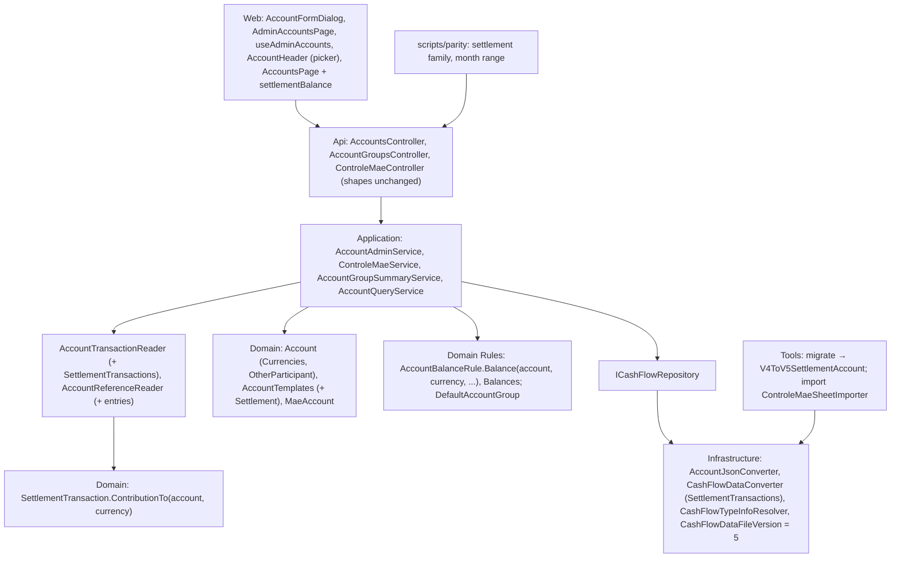

# Technical Specification: Settlement Template and Mãe Migration

Complexity: **complex**. It touches every backend layer, the data file format (V4 → V5), the import tool, the parity scripts, Admin → Accounts and the Accounts page.

**Strict no-comments policy** in all code, XML docs included (CLAUDE.md). Existing doc comments on lines a stage rewrites are deleted, not reworded (for example `ControleMaeSheetImporter`'s class doc, which names `MaeLedgerEntry`).

## 1. Technical Overview

**What.**
- A fourth template, **Settlement** = {`HasParticipants`, `MultiCurrency`, `CanSettle`}, currencies BRL and GBP, outside the default group, with no actions until F12.
- An account gains its **currencies** (a Settlement account holds GBP, BRL or both) and the **other participant's name**; the user is always the fixed participant "You". Both are written only for accounts that have them, so a V4 file without Settlement accounts loads and saves byte-identical.
- Admin → Accounts creates and edits Settlement accounts (currencies, other participant). The son's GBP-only account needs no code.
- `MaeLedgerEntry` becomes **`SettlementTransaction`**: account, date, description, note, paid by (You or Other), currency, amount > 0 and an optional converted value. The data file goes from version 4 to 5: the `V4ToV5SettlementAccount` step creates the "Mãe" Settlement account (BRL + GBP, other participant "Mãe"), moves the 36 entries into it with paid by from their sign and amounts stored positive, records the 5 pound entries tagged BRL as paid in GBP, and refuses to write anything if the BRL or GBP total would change at stored precision.
- A Settlement balance comes from the shared calculation, **per currency** (`AccountBalanceRule`); `ControleMaeService.GetTotals`' own sum is removed.
- `controle-mae` keeps every route, shape and value, now against the Mãe account. Its values edit sets paid by from the sign and refuses missing, zero or opposite-signed values.
- The Accounts page gains a **Settlement grid**: "Mãe · Mãe owes you R$167.88 / £7.94", no totals, no link.
- Parity gains a per-month `settlement` family on both sides, so the Mãe balance is checked every month at full precision against `p60-deployed-f16`.

**Why.** F12 builds the Settlement screen on accounts with participants, currencies and entries with "paid by". The cross-feature rule "no other balance code remains" still has `ControleMaeService.GetTotals`. A second Settlement account (the son, GBP only) must be a data entry.

**Delivery.** Three stages, seven PRs, each within the PR size rule except **2b**, named in §3 "PR size". Every PR leaves `main` deployable and ends with a parity run against `p60-deployed-f16`. The file becomes V5 in 2b. Deploy only after stage 3 (3b), with `migrate` on the Drive download (§7 "Deploy").

| Stage | PR | Content | Data file | Web |
|---|---|---|---|---|
| **1 — Settlement accounts** | **1a** | Settlement template and its three capabilities; `Account.Currencies` and `Account.OtherParticipant` with their rules and file fields | V4 | None (the template appears in Admin's list with one currency) |
| | **1b** | Admin → Accounts: account DTOs carry currencies and the other participant; create and edit rules; the dialog's Currencies and Other participant fields | V4 | Admin → Accounts |
| **2 — Entries and migration** | **2a** | Rename `MaeLedgerEntry` → `SettlementTransaction` and its collection and repository members; no behaviour or file change | V4 | None |
| | **2b** | V5: the entry model, the `SettlementTransactions` file collection, `MaeAccount`, `controle-mae` on the Mãe account, the V4 → V5 step, the import, fixtures to V5, refusal tests to 6 | **V5** | None |
| | **2c** | Per-currency shared balance; entries join the balance reader (not the rows); `GetTotals` through the rule; entries make an account in use; Settlement accounts leave the account-screen picker | V5 | Account screen picker |
| **3 — Accounts page and parity** | **3a** | Group members carry per-currency balances and the other participant; Settlement groups have no totals; parity `settlement` family and the month range | V5 | None (generated `openapi.ts` only) |
| | **3b** | The Settlement grid on the Accounts page; screen checklist; PRD ticks | V5 | Accounts page |

**Scope.**

*Included:*
- Everything in PRD F11 Capabilities, Experience, Error Handling and Section 9 F11, plus the cross-feature criteria that name F11 and can be checked now (§7).
- *Input contracts (Consumes):*
  - F02: `AccountBalanceRule`, `IAccountTransaction`, the `migrate` chain and version guard, the template-read architecture test;
  - F06: the account create and edit flow (`AccountAdminService`, `AccountFormDialog`);
  - F09: the V3 → V4 step, which the V4 → V5 step follows;
  - F14: `GET accounts/groups/by-template/{year}/{month}` and `AccountsPage`'s per-template grids.
- *Output contract (Provides, used by F12):* Settlement accounts with currencies and the other participant; `SettlementTransaction` with paid by, currency, amount and converted value; the per-currency balance (`AccountBalanceRule.Balances`); per-currency balances on group members.

*Excluded:*
- Settlement rows in the account Transactions grid and F16's All transactions, the Settlement screen, its header, Add entry and Settle (F12). `AccountActions` gets no Settlement action.
- The PRD's "use one action on it" manual check for Settlement (no action exists until F12).
- Any change to `controle-mae` shapes, the Controle Mãe page or its route (kept until F13).
- A Settlement row link on the Accounts page and Settlement accounts in the account-screen picker (F12).
- Currencies other than BRL and GBP; group settlements.

## 2. Architecture Impact

**Layers and direction** (design.md's four questions):
1. **Where it belongs:** the CashFlow bounded context.
   - **Domain:** the template, the account's currencies and other participant, `SettlementTransaction` and its contribution per currency, the per-currency balance rule, `MaeAccount`.
   - **Application:** `AccountAdminService`, `ControleMaeService`, `AccountGroupSummaryService`, the readers, the DTOs.
   - **Infrastructure:** the account and data converters, the type resolver, the version.
   - **Tools:** the V4 → V5 step and the import.
2. **Which layers, in which direction:** Domain ← Application ← Infrastructure ← Api, with Tools depending on Infrastructure, plus the web app over the API. No new dependency or package.
3. **What keeps Domain free of Infrastructure:** `ICashFlowRepository` and `ICashFlowSerializer` (Application), as in F02. `SettlementTransaction` and `AccountBalanceRule` are pure.
4. **Which SOLID principles it leans on:**
   - **OCP:** Settlement is one new row in `AccountTemplates`; code asks `Has(Capability.HasParticipants)` or `Has(Capability.MultiCurrency)`, never the template name. `IAccountTransaction` gains a per-currency contribution with a default, so the five existing record types are untouched.
   - **SRP:** each record declares its own contribution; `AccountBalanceRule` only sums; `MaeAccount` owns "which account is Controle Mãe's".
   - **LSP:** a `SettlementTransaction` is an `IAccountTransaction` like any other record; every reader of the balance reader keeps working because it contributes 0 to any other account.



## 3. Technical Decisions

| Decision | Chosen approach | Alternative considered | Trade-off |
|---|---|---|---|
| **Template** (1a) | `Capability` gains `HasParticipants`, `MultiCurrency`, `CanSettle`; `AccountTemplate.Settlement`; definition {those three}, currencies [BRL, GBP] (code order), `JoinsDefaultGroup` false, added last so `TemplateOrder` puts it after Pots. No pair rule names its capabilities, so no transfer reaches it. | — | `CanSettle` is unused until F12. |
| **Currency message** (1a) | `Account.EnsureCurrencyIsAllowed` keeps its format, so a Settlement account in USD reads "Settlement accounts must be BRL or GBP." | — | PRD Error Handling wording fixed. |
| **Account currencies** (1a) | `Account.Currencies` (`IReadOnlyList<Currency>`, code order). An account without `MultiCurrency` returns `[Currency]`. `SetCurrencies(IEnumerable<Currency>)` is refused without `MultiCurrency` ("<name> has one currency."), with none ("Choose at least one currency.") or with one the template doesn't allow (the message above); duplicates collapse; `Currency` becomes the first in code order, so Mãe's `Currency` is BRL. `Create` and `ChangeTemplate` start a multi-currency account with `[currency]`; `ApplyCapabilityDefaults` resets the list without `MultiCurrency`. | Replace `Currency` with a list on every account | `Currency` stays the main currency every existing reader uses (group members, detail header, month rows), so nothing else changes. |
| **Other participant** (1a) | `Account.OtherParticipant` (`string?`). `SetOtherParticipant(string)`: refused without `HasParticipants` ("<name> has no participants."); trimmed; required ("Enter the other participant's name."); at most 60 characters ("The other participant's name must be 60 characters or fewer."); not "You" ignoring case ("The other participant can't be called You."). `ApplyCapabilityDefaults` clears it without `HasParticipants`. The domain allows a Settlement account without the name (1a's Admin can't set it yet); 1b's Admin requires it. | Required in the domain | 1a stays loadable and testable on its own. |
| **File fields** (1a) | `AccountJsonConverter`'s record gains `Currencies` (array of codes) and `OtherParticipant` (string), after `CategoryId`, both with `JsonIgnore(WhenWritingNull)`. `Currencies` is written exactly for accounts with `MultiCurrency`; `OtherParticipant` when set. On read, `Currencies` on an account without `MultiCurrency`, or a `MultiCurrency` account without `Currencies`, fails the load ("Account <id> must have Currencies exactly when its template has several currencies."); so does an `OtherParticipant` without `HasParticipants` ("Account <id> can name another participant only when its template has participants.") and a `Currency` that isn't the first of `Currencies` ("Account <id> Currency must be the first of its Currencies."). | Always write both keys (null) | No key appears on Bank, card or Pots accounts, so V4 files stay byte-identical and stage 1 changes no version. |
| **Admin fields** (1b) | `AccountCreateDTO` and `AccountUpdateDTO` gain `Currencies` (`IReadOnlyList<string>?`) and `OtherParticipant` (`string?`); `AccountDTO` gains `Currencies` (`IReadOnlyList<string>`, required) and `OtherParticipant` (`string?`). For a template with `MultiCurrency`, `Currencies` is required ("Choose at least one currency."), each code parsed ("Unknown currency 'X'.") and allowed, and `Currency` must be one of them ("Currency must be one of the account's currencies."); the stored main currency is the first in code order. Without `MultiCurrency`, `Currencies` must be null or exactly `[Currency]` ("<name> has one currency."), so the web's deactivate request, which echoes `AccountDTO`, passes. `OtherParticipant` is required with `HasParticipants` (messages above) and must be null without it ("<name> has no participants."). | Make `Currency` optional | Smallest wire change; the web always sends the first ticked currency as `currency`. |
| **Locked currencies** (1b, 2c) | `UpdateAsync` treats a different currency set like a different currency: refused once the account has records, with today's "Template and currency can't change once the account has transactions." From 2c, entries count as records. The other participant stays editable. | Allow adding a currency later | Existing entries would have no converted value in the new currency. |
| **Dialog** (1b) | For a template with `MultiCurrency`, the Currency select is replaced by a labelled group of Fluent `Checkbox`es "Currencies", one per template currency (BRL, GBP); a new Settlement account starts with none ticked; validation "Choose at least one currency."; with records it is read-only text ("BRL, GBP") with today's locked hint. For `HasParticipants`, an "Other participant" `Input` (required, 60 max, hint "The person you settle with, for example Mãe."), validated as the server does. Field order: Template, Name, Currencies or Currency, Other participant, then today's fields. `FIELD_ORDER` and the discard prompt include both fields. The request sends `currency` = the first ticked in code order, `currencies` = the ticked codes, `otherParticipant` trimmed; other templates send `currencies: null`, `otherParticipant: null`. `useAdminAccounts.toUpdateRequest` and `AdminAccountsPage`'s create request carry both fields; the admin list's Currency cell shows `currencies` joined with ", ". | A multi-select dropdown | Two options read faster as checkboxes; keyboard and labels come from Fluent. |
| **Entry model** (2a, 2b) | **2a** renames only: `MaeLedgerEntry` → `SettlementTransaction` (`Entities/SettlementTransaction.cs`), `CashFlowData.SettlementTransactions` / `AddSettlementTransaction` / `RemoveSettlementTransaction`, `ICashFlowRepository.GetSettlementTransactions` / `AddSettlementTransaction` / `DeleteSettlementTransaction`; the file key stays `MaeLedgerEntries`, and the `ControleMaeService` span entity type becomes "SettlementTransaction". **2b** reshapes it: `Id`, `Account` (file `AccountId`, required reference), `Date`, `Description`, `Note` ("" when empty), `PaidBy` (`Enums/SettlementPayer.cs`: `You`, `Other`), `Currency`, `Amount`, `ConvertedValue` (`decimal?`). `Create(account, date, description, note, paidBy, currency, amount, convertedValue)` refuses an account without `HasParticipants` ("<name> is not a Settlement account."), a currency the account doesn't hold ("<name> doesn't use <cur>."), `amount` ≤ 0 ("Amount must be greater than zero."), a converted value on a one-currency account ("<name> has one currency, so an entry has no converted value."), a converted value ≤ 0 ("The converted value must be greater than zero.") and a blank description ("Description is required."). `UpdateValues(paidBy, amount, convertedValue)` applies the same value rules. From 2026-11-07 `UpdateValues`, and so `Create`, first rounds the amount and the converted value to 2 decimals (`ToCents`, `MidpointRounding.AwayFromZero`, as the rest of CashFlow), so an amount that rounds to 0 is refused; loading the file and the V4 → V5 step don't call it, so stored entries keep their values (user decision 2026-11-07). `SignedValueIn(currency)` returns +amount (You) or −amount (Other) in the entry's currency, ± the converted value in the account's other currency (null when empty), and null for any other currency. The shared sign rules live on the entity too: `PayerOf(signedValue)`, `HaveOneSign(signedValue, otherSignedValue)` and `ConvertedCurrencyOf(account, paidCurrency)`, used by `ControleMaeService` and the import. | Keep `MaeLedgerEntry` and its key | The son's entries would live in "MaeLedgerEntries" for good; V5 restructures the record anyway. Named `SettlementTransaction` to match `Expense`, `Income`, `Transfer` and `PotTransaction`; screens and messages still say "entry" (user, 2026-11-07). |
| **Which account Controle Mãe serves** (2b) | `Domain/Rules/MaeAccount.cs`: `Find(accounts)` = the first account with `HasParticipants` in file order; `Name` = "Mãe". `Create()` builds it (Settlement, the template's currencies, other participant "Mãe"); the import uses it. The migration appends Mãe after every V4 account, and a V4 file can't hold a Settlement account (step guard), so Mãe is always the first; a later son account comes after it. Removed in F13 with `controle-mae`. | Look up the account named "Mãe" | Renaming the account doesn't break Controle Mãe; F09's `ReservaAccount` precedent. |
| **`controle-mae` on the account** (2b) | Same routes, DTOs and status codes. **POST** keeps signed `sourceValue`: 0 → "Source value must not be zero." (today); `sourceCurrency` must be one of Mãe's currencies, else today's "Currency 'X' is not recognized."; future date → "Date must not be in the future."; no Settlement account → 400 "Create a Settlement account first."; paid by = You when positive, Other when negative; amount = \|sourceValue\| rounded to 2 decimals; converted = that amount × the historical rate to the account's other currency on the entry date, rounded to 2 decimals (unrounded before 2026-11-07), null when no rate (as today). **GET entries** returns Mãe's entries from the date, ordered by date: `sourceCurrency` = the entry's currency, `brlValue` / `gbpValue` = `SignedValueIn` (null when empty), so every value is today's value. **GET totals** = Mãe's balance per currency at `DateOnly.MaxValue` (2b: Σ `SignedValueIn`; 2c: `AccountBalanceRule.Balance(mae, currency, …)`); 0 and 0 with no Settlement account. **PUT values** keeps `{ brlValue?, gbpValue? }`: the value in the entry's currency must be present and non-zero ("BRL value is required and must not be zero." / "GBP value …"); the other, when present, must have the same sign ("BRL and GBP values must both be positive or both be negative.", which also refuses a zero); paid by follows the sign, amount and converted value are stored positive, and a missing other value empties the converted value. **DELETE** removes one of Mãe's entries. An entry of another account is 404, as an unknown id. | New account-scoped routes | The page doesn't change until F13 (PRD). |
| **Intended `controle-mae` difference** (2b) | The 5 pound entries return `sourceCurrency` "GBP" instead of "BRL"; their values and every other field and entry are unchanged. The Controle Mãe page doesn't show the source currency. | — | User decision Q1. |
| **Per-currency balance** (2c) | `IAccountTransaction` gains `decimal ContributionTo(Account account, Currency currency)` with a default of `ContributionTo(account)` when `currency` is the account's `Currency`, else 0. `SettlementTransaction` implements `IAccountTransaction`: `ContributionTo(account, currency)` = `SignedValueIn(currency) ?? 0` for its own account, else 0; `ContributionTo(account)` = the same in `account.Currency`. `AccountBalanceRule` gains `Balance(account, currency, asOf, records)` (the opening balance counts only in the account's `Currency`) and `Balances(account, asOf, records)` (one `(Currency, decimal)` per account currency, code order); the existing `Balance(account, asOf, records)` returns `Balance(account, account.Currency, …)`. | A Settlement-only sum | One calculation for every account (cross-feature criterion); F02 deferred the currency parameter to F11. |
| **Entries in the balance reader, not in the rows** (2c) | `AccountTransactionReader.Read` adds `GetSettlementTransactions()`, so the group summary, the template groups, the membership rule and the account detail see Settlement balances. `AccountQueryService` maps a `SettlementTransaction` to no row (its row switch has no case), so the account Transactions grid and F16's All transactions stay without Settlement rows until F12 (PRD Q5). Every other account gets 0 from an entry. | Keep entries out of the reader and read them separately where balances are needed | One balance path; the PRD's exclusion is about rows, which stay excluded. |
| **Membership per currency** (2c) | `DefaultAccountGroup.StillMattersIn` lists an inactive account when any of its currencies has a non-zero month-end balance or a record that month contributes in any of its currencies. | — | An inactive Settlement account owing only pounds still shows. |
| **In use** (2c) | `AccountReferenceReader` also yields each entry's account, so deleting Mãe returns 409 "Mãe has transactions and cannot be deleted. Deactivate it instead.", its template and currencies are locked, and `hasRecords` is true. | — | One definition of "in use". |
| **Picker** (2c) | `AccountHeader`'s account picker leaves out accounts whose `capabilities` include `HasParticipants` until F12 builds their screen. A Settlement account's screen still opens from its URL. | Show it with a one-currency header | PRD Q4 "no link until F12"; the screen would show only the BRL balance and no entries. |
| **Group members** (3a) | `AccountGroupMemberDTO` gains `CurrencyBalances` (`IReadOnlyList<CurrencyBalanceDTO>`, required: one `{ currency, balance }` per account currency at month end, from `AccountBalanceRule.Balances`) and `OtherParticipant` (`string?`). A group whose accounts have `HasParticipants` returns `Totals` empty. `Balance` stays the main-currency balance. | A Settlement-only DTO | Every member reads the same way; F12's header can reuse the list. |
| **Settlement grid** (3b) | `TEMPLATE_GRIDS.Settlement` = heading "Settlement", columns `'settlement'`, `linksRows` false. Columns: Account (plain text, Inactive badge, sorts by name) and Balance (the direction text, left-aligned text, sorts by the main-currency balance). No footer (no totals). `utils/settlementBalance.ts`: `settlementBalanceText(otherParticipant, currencyBalances)` → "Mãe owes you R$167.88 / £7.94" for positive balances, "You owe Mãe £15.00" for negative ones, both joined by " · " when the currencies disagree ("owes you" first), currencies that round to zero at 2 decimals left out, and "Settled" when every currency is zero; amounts are `formatCurrency(Math.abs(balance), currency)` (2 decimals, symbol from the currency code). An account without an other participant (the domain allows one) is named by its account name. The Settlement grid config has no `footerLabel`, and a grid without one shows no footer. | Reuse the balance column | Debts to different people don't add up (PRD). |
| **Parity** (3a) | New family `settlement`, on **both** sides, every month: `{month}/settlement/<account name>/<currency>` = the month-end balance. When the month's `accounts/groups/by-template/{y}/{m}` has a Settlement group, it comes from each member's `currencyBalances` (the after side reuses the response it already fetches); otherwise from `controle-mae/entries/from/0001-01-01`, fetched once, as "Mãe" BRL = Σ `brlValue` and GBP = Σ `gbpValue` of the entries dated on or before the month end (null counts 0). The `p60-deployed-f16` side has no Settlement group, so it computes from the entries; the after side reads the account; the keys are the same, so no figure-map entry is needed. `Get-ParityMonthRange` also reads `SettlementTransactions.Date`. `current/mae/totalBrl` and `totalGbp` keep coming from `controle-mae/entries/totals` on both sides. | An after-only template-group figure mapped to `current/mae/*` | It checks every month, not only the total, and keeps working from F12 when the baseline itself has Settlement accounts (the son). |
| **Parity across the version change** (2b on) | `-LiveCopy` always names the V4 live copy. Baseline runs `p60-deployed-f16` on a copy as it is (V4). Migrate runs the working tree's `migrate` on a second copy: a pass-through in 1a–2a, V4 → V5 from 2b. After runs the working tree on that output. So the run uses exactly the deploy's migrate, and nothing is migrated by hand. | Migrate the live copy first and point both sides at it | The f16 build can't read V5. |
| **Import** (2b) | `Program.cs`' `ImportControleMaeSheet` finds Mãe (`MaeAccount.Find`) or creates it (Settlement, BRL + GBP, other participant "Mãe") whether or not the sheet exists, then adds what `ControleMaeSheetImporter.Import(sheet, mae, report)` returns. The importer keeps today's date and currency rules (BRL when the BRL cell has a value); paid by from the sign of that value; amount and converted value positive. A zero value, or BRL and GBP with opposite signs, flags the row and skips it. No pound-entry correction (the sheet's tag is kept). From 2026-11-07 the entries go through `Create`, so the import saves their values rounded to 2 decimals too (one rule for every new entry; keeping more digits would need a second, non-rounding factory on the entity). | Correct the 5 entries in the import too | The import reproduces the sheet; the correction belongs to the user's migration decision. Totals are the same either way. |
| **Rename first** (2a) | The type and member rename ships alone, file key unchanged, so 2b's diff shows only behaviour. | Rename inside 2b | 2b would grow to 14 files. |
| **PR size** | Non-test code files, generated `openapi.ts` and the snapshot excluded: 1a → 5; 1b → 8; 2a → 9, one rename repeated (design.md exemption); **2b → 11, over by 3**: the entry model, the file shape, the version, the step, its registration, the import and `ControleMaeService` must change together for `main` to load, migrate and import (F09 stage 2 precedent at 13); 2c → 8; 3a → 4; 3b → 3. The fixtures' `"Version": 4` → 5 and the refusal tests' 5 → 6 in 2b are one repeated change, exempt (PRD). §4 lists the files. | 3 PRs (one per stage) | One PR per stage would be 13, 20 and 7 distinct code files (stage 3 about 18 files in total). Merging 2a into 2b is the fallback if the user prefers one V5 PR (14 code files); merging 3a and 3b gives one stage 3 PR of 7 code files and about 18 in total. |
| **Rollback** | Up to 2a, nothing in the file changes. After the deploy, the file is V5 and an F16 build refuses it: rollback means redeploying F16 with the V4 backup the deploy keeps, losing changes made since. | — | The deploy step keeps the download. |

**Choices made by the spec writer** (open after the review; for the user's review):
- The stages ship as 7 PRs: 1a, 1b, 2a, 2b, 2c, 3a, 3b; 2b is 11 non-test code files (over by 3).
- `Account.Currency` stays and is the first of the account's currencies in code order (Mãe: BRL; the son: GBP).
- The Settlement template allows BRL and GBP; a USD Settlement account gets "Settlement accounts must be BRL or GBP."
- The new file keys are `Currencies` and `OtherParticipant` on the account, both omitted when not applicable.
- Admin requests keep `currency` required; for a Settlement account it must be one of `currencies`.
- The other participant's name is required, at most 60 characters, and can't be "You".
- Currencies can't change once the account has entries (today's template/currency message).
- A new Settlement account in the dialog starts with no currency ticked; currencies are checkboxes.
- Until 3b the Accounts page shows a Settlement account through its existing fallback grid (plain row, main-currency balance); from 3a with no footer.
- The entity becomes `SettlementTransaction` in its own rename PR (2a); V5's collection is `SettlementTransactions` with `AccountId`, `PaidBy` ("You" / "Other"), `Currency`, `Amount`, `ConvertedValue`.
- Controle Mãe serves the first account with `HasParticipants` (`MaeAccount.Find`); with none, POST is 400 "Create a Settlement account first." and GETs return nothing and zero totals.
- Controle Mãe ignores the account's active flag, as today.
- Converted values use the account's other currency as the target, not a hard-coded pair.
- The 5 pound entries are matched by date, BRL tag and whole GBP value from a fixed list in the step; a listed pair not found is not an error, and the summary reports how many were corrected.
- The step always creates Mãe, even when `MaeLedgerEntries` is empty or missing.
- The fresh import keeps the sheet's currency tag (no pound correction) and skips rows with a zero or opposite-signed value.
- The values edit messages are "<CUR> value is required and must not be zero." and "BRL and GBP values must both be positive or both be negative."
- Settlement entries join `AccountTransactionReader` for balances but map to no rows until F12.
- `IAccountTransaction` gets a per-currency contribution with a default; `AccountBalanceRule` gains `Balance(account, currency, …)` and `Balances`.
- Settlement accounts are left out of the account-screen picker until F12; the cross-feature box about F05's picker waits for F12.
- Group members carry `CurrencyBalances` and `OtherParticipant` for every template; a Settlement group has no totals (server side).
- The Settlement grid is headed "Settlement", has Account and Balance columns, and its text helper lives in `utils/settlementBalance.ts`; mixed directions are joined with " · ".
- Parity adds a both-sides `settlement` family per month (from the Settlement group, else from the `controle-mae` entries as "Mãe") instead of a figure-map mapping.
- `ControleMaeEndpointsTests` move to their own V5 seed with a Mãe account; the shared API seed and `TestData/data-cashflow.test.json` only change their version; `data/data-cashflow.example.json` becomes what `migrate` produces (a Mãe account and empty `SettlementTransactions`).

## 4. Component Overview

All paths are relative to the repo root. Existing patterns: entities with private setters and a static `Create`; `ArgumentException` → 400, `EntityInUseException` → 409, `KeyNotFoundException` (from `FirstOrThrow`) → 404 (`DomainExceptionMappingMiddleware`); the span/log telemetry pattern in every public service method; one enum per file in `Domain/Enums`; raw-JSON migration steps with `InvalidDataException` guards (`V3ToV4PotsAccounts`); acceptance tests deriving from `ApiEndpointTests` with an inline seed (`ReplaceCashFlowDataBeforeStart`).

**Domain (`Financial.CashFlow.Domain`)**

| File | New/Modified | PR | Key responsibilities |
|---|---|---|---|
| `Enums/Capability.cs` | Modified | 1a | `HasParticipants`, `MultiCurrency`, `CanSettle` |
| `Enums/AccountTemplate.cs` | Modified | 1a | `Settlement` |
| `Rules/AccountTemplates.cs` | Modified | 1a | Settlement definition |
| `Entities/Account.cs` | Modified | 1a | `Currencies`, `SetCurrencies`, `OtherParticipant`, `SetOtherParticipant`, defaults |
| `Entities/SettlementTransaction.cs` (was `MaeLedgerEntry.cs`) | Renamed, Modified | 2a, 2b, 2c | **2a:** rename. **2b:** the V5 shape and rules. **2c:** `IAccountTransaction` |
| `Entities/CashFlowData.cs` | Modified | 2a | `SettlementTransactions` members |
| `Enums/SettlementPayer.cs` | New | 2b | `You`, `Other` |
| `Rules/MaeAccount.cs` | New | 2b | `Find(accounts)`, `Name` |
| `Entities/Transactions/IAccountTransaction.cs` | Modified | 2c | Per-currency contribution with a default |
| `Rules/AccountBalanceRule.cs` | Modified | 2c | `Balance(account, currency, …)`, `Balances` |
| `Rules/DefaultAccountGroup.cs` | Modified | 2c | Membership per currency |

**Application (`Financial.CashFlow.Application`)**

| File | New/Modified | PR | Key responsibilities |
|---|---|---|---|
| `DTOs/AccountCreateDTO.cs`, `DTOs/AccountUpdateDTO.cs`, `DTOs/AccountDTO.cs` | Modified | 1b | `Currencies`, `OtherParticipant` |
| `Services/AccountAdminService.cs` | Modified | 1b | The Admin rules in §3 |
| `Services/AccountQueryService.cs` | Modified | 1b | `ToAccountDto` maps both fields |
| `Interfaces/ICashFlowRepository.cs` | Modified | 2a | Settlement entry members |
| `Services/ControleMaeService.cs` | Modified | 2a, 2b, 2c | **2a:** rename. **2b:** Mãe account, paid by, values edit rules. **2c:** totals through the rule |
| `Services/AccountTransactionReader.cs` | Modified | 2c | Adds the entries |
| `Services/AccountReferenceReader.cs` | Modified | 2c | Entry accounts are in use |
| `DTOs/AccountGroupMemberDTO.cs` | Modified | 3a | `CurrencyBalances`, `OtherParticipant` |
| `DTOs/CurrencyBalanceDTO.cs` | New | 3a | `Currency`, `Balance` |
| `Services/AccountGroupSummaryService.cs` | Modified | 3a | Per-currency member balances; no totals for Settlement groups |

**Infrastructure (`Financial.CashFlow.Infrastructure`)**

| File | New/Modified | PR | Key responsibilities |
|---|---|---|---|
| `Persistence/AccountJsonConverter.cs` | Modified | 1a | `Currencies`, `OtherParticipant` (omitted when null) and the load checks |
| `Repositories/CashFlowJsonRepository.cs` | Modified | 2a | Settlement entry members |
| `Persistence/CashFlowDataConverter.cs` | Modified | 2a, 2b | **2a:** rename. **2b:** key `SettlementTransactions`, read after accounts |
| `Persistence/CashFlowTypeInfoResolver.cs` | Modified | 2a, 2b | **2a:** rename. **2b:** `SettlementTransaction.Account` → `AccountId` (required) |
| `Persistence/CashFlowDataFileVersion.cs` | Modified | 2b | `Current = 5` |

**Tools (`Tools/CashFlowSpreadsheetImport`)**

| File | New/Modified | PR | Key responsibilities |
|---|---|---|---|
| `SheetImporters/ControleMaeSheetImporter.cs` | Modified | 2a, 2b | **2a:** rename (class doc deleted). **2b:** entries on the Mãe account |
| `Program.cs` | Modified | 2a, 2b | **2a:** rename. **2b:** find or create Mãe |
| `DataFileMigration/V4ToV5SettlementAccount.cs` | New | 2b | §6 |
| `DataFileMigration/DataFileMigrator.cs` | Modified | 2b | `CreateDefault` lists four steps |

**Web (`Financial.Web/src`)**

| File | New/Modified | PR | Key responsibilities |
|---|---|---|---|
| `components/AccountFormDialog.tsx` | Modified | 1b | Currencies checkboxes, Other participant, validation, request |
| `hooks/useAdminAccounts.ts` | Modified | 1b | `toUpdateRequest` carries both fields |
| `pages/AdminAccountsPage.tsx` | Modified | 1b | Create request carries both fields; Currency cell lists `currencies` |
| `components/AccountHeader.tsx` | Modified | 2c | Picker leaves out `HasParticipants` accounts |
| `utils/accountTemplateLabel.ts` | Modified | 3b | Settlement grid config; column type `'settlement'` |
| `utils/settlementBalance.ts` | New | 3b | `settlementBalanceText` |
| `pages/AccountsPage.tsx` | Modified | 3b | Settlement columns |
| `api/generated/openapi.ts` | Regenerated | 1b, 3a | Not counted |

**Parity, data and docs**

| File | PR | Change |
|---|---|---|
| `scripts/parity/Parity.psm1` | 3a | `Add-ParitySettlementFigures` (both sides), the month range key; `figure-map.json` is unchanged (same keys on both sides) |
| `scripts/parity/Parity.test.ps1`, `scripts/parity/README.md` | 3a | `settlement` in `$figureFamilies`; cases in §7; catalogue row |
| `scripts/parity/screen-checklist.md` | 3b | Rows S1–S3 and the Controle Mãe row (§7) |
| `Tests/Financial.Api.Tests/ApiTestFactory.cs`, `TestData/data-cashflow.test.json`, the inline `"Version": 4` seeds in `Tests/Financial.Api.Tests/Acceptance/*` and `Tests/Financial.CashFlow.Infrastructure.Tests/Persistence/*` | 2b | `"Version": 5` (one repeated change); `MaeLedgerEntries` keys in seeds become `SettlementTransactions` |
| `data/data-cashflow.example.json` | 2b | V5 as `migrate` writes it |
| `docs/prd/P60-…/prd-cashflow-accounts-generalization.md` | 3b | F11 ticks and the cross-feature ticks, own commit |

**Files per PR (non-test code; generated `openapi.ts` and the snapshot excluded):**
- **1a (5):** `Capability.cs`, `AccountTemplate.cs`, `AccountTemplates.cs`, `Account.cs`, `AccountJsonConverter.cs`. With `AccountTemplatesTests`, `AccountTests`, `AccountJsonConverterTests`, `CashFlowSerializerAdapterTests`, `AccountActionsTests`, `TransferPairRulesTests`, `TestAccounts.cs`: about 12.
- **1b (8):** the three account DTOs, `AccountAdminService.cs`, `AccountQueryService.cs`, `AccountFormDialog.tsx`, `useAdminAccounts.ts`, `AdminAccountsPage.tsx`. With `AccountAdminServiceTests`, `SettlementTemplateAcceptanceTests` (new), `AccountFormDialog.test.tsx`, `useAdminAccounts.test.ts`, `AdminAccountsPage.test.tsx`, `src/test/account.ts` and the snapshot: about 15.
- **2a (9, one rename):** `SettlementTransaction.cs`, `CashFlowData.cs`, `ICashFlowRepository.cs`, `CashFlowJsonRepository.cs`, `CashFlowDataConverter.cs`, `CashFlowTypeInfoResolver.cs`, `ControleMaeService.cs`, `ControleMaeSheetImporter.cs`, `Program.cs`, with their tests and the two repository stubs.
- **2b (11):** `SettlementTransaction.cs`, `SettlementPayer.cs`, `MaeAccount.cs`, `CashFlowDataConverter.cs`, `CashFlowTypeInfoResolver.cs`, `CashFlowDataFileVersion.cs`, `ControleMaeService.cs`, `V4ToV5SettlementAccount.cs`, `DataFileMigrator.cs`, `ControleMaeSheetImporter.cs`, `Program.cs`. With about 14 test files, plus the exempt version fixtures and the example data.
- **2c (8):** `IAccountTransaction.cs`, `AccountBalanceRule.cs`, `DefaultAccountGroup.cs`, `SettlementTransaction.cs`, `AccountTransactionReader.cs`, `AccountReferenceReader.cs`, `ControleMaeService.cs`, `AccountHeader.tsx`. With about 7 test files: about 15.
- **3a (4):** `AccountGroupMemberDTO.cs`, `CurrencyBalanceDTO.cs`, `AccountGroupSummaryService.cs`, `Parity.psm1`. With `AccountGroupSummaryServiceTests`, `SettlementTemplateAcceptanceTests`, `Parity.test.ps1`, the parity README, the snapshot and the five web test files whose typed member fixtures gain the required `currencyBalances` (`financialApiClient.test.ts`, `useAccountTemplateGroups.test.ts`, `useMonthly.test.ts`, `AccountsPage.test.tsx`, `MonthlyPage.test.tsx`): 14.
- **3b (3):** `accountTemplateLabel.ts`, `settlementBalance.ts`, `AccountsPage.tsx`. With `AccountsPage.test.tsx`, `accountTemplateLabel.test.ts`, `settlementBalance.test.ts`, `screen-checklist.md` and the PRD: about 8.

## 5. API Contracts

No authentication (single-user app, as every route). Base path `/api/v1/financial`.

**1a — `GET accounts/templates`** adds:

```json
{ "name": "Settlement", "currencies": ["BRL", "GBP"], "capabilities": ["HasParticipants", "MultiCurrency", "CanSettle"] }
```

**1b — `POST accounts`, `PUT accounts/{id}`, `GET accounts`.** Requests gain `currencies` and `otherParticipant`; `AccountDTO` gains `currencies` (always present) and `otherParticipant`.

| Field | Type | Required | Validation |
|---|---|---|---|
| `currencies` | `string[]` | With `MultiCurrency` | At least one; each a template currency; `currency` among them. Without `MultiCurrency`: null or `[currency]` |
| `otherParticipant` | `string` | With `HasParticipants` | Trimmed, 1–60 characters, not "You"; null without `HasParticipants` |

```json
{ "templateName": "Settlement", "name": "Samuel", "currency": "GBP", "currencies": ["GBP"], "otherParticipant": "Samuel",
  "openingBalance": null, "balanceStartDate": null, "roundUpEnabled": null, "categoryId": null }
```

```json
{ "id": "…", "name": "Samuel", "templateName": "Settlement", "currency": "GBP", "currencies": ["GBP"], "otherParticipant": "Samuel",
  "isActive": true, "hasRecords": false, "openingBalance": null, "balanceStartDate": null, "roundUpEnabled": null,
  "categoryId": null, "capabilities": ["HasParticipants", "MultiCurrency", "CanSettle"] }
```

| Case | HTTP | Message |
|---|---|---|
| No currency for a Settlement account | 400 | Choose at least one currency. |
| A currency the template doesn't allow | 400 | Settlement accounts must be BRL or GBP. |
| `currency` not among `currencies` | 400 | Currency must be one of the account's currencies. |
| `currencies` on a one-currency template | 400 | Barclays has one currency. |
| No other participant | 400 | Enter the other participant's name. |
| Other participant over 60 characters | 400 | The other participant's name must be 60 characters or fewer. |
| Other participant "You" | 400 | The other participant can't be called You. |
| `otherParticipant` without `HasParticipants` | 400 | Barclays has no participants. |
| Currencies changed with records (from 2c) | 400 | Template and currency can't change once the account has transactions. |
| Deleting an account with entries (from 2c) | 409 | Mãe has transactions and cannot be deleted. Deactivate it instead. |

**2b — `controle-mae`** keeps its routes and shapes: `POST entries` `{ date, description, note, sourceCurrency, sourceValue }`; `GET entries/from/{fromDate}` → `MaeLedgerEntryDTO[]` `{ id, date, description, note, sourceCurrency, brlValue?, gbpValue? }`; `GET entries/totals` → `{ totalBrlValue, totalGbpValue }`; `PUT entries/{id}/values` `{ brlValue?, gbpValue? }`; `DELETE entries/{id}`. A migrated pound entry:

```json
{ "id": "…", "date": "2022-11-25", "description": "Presente Samuel 100 libras 25/…", "note": "libras",
  "sourceCurrency": "GBP", "brlValue": 654.24, "gbpValue": 100 }
```

| Case | HTTP | Message |
|---|---|---|
| POST with no Settlement account | 400 | Create a Settlement account first. |
| POST with `sourceValue` 0 | 400 | Source value must not be zero. |
| POST in a currency Mãe doesn't hold | 400 | Currency 'USD' is not recognized. |
| POST dated after today | 400 | Date must not be in the future. |
| PUT without, or with 0 for, the entry's currency | 400 | GBP value is required and must not be zero. |
| PUT with opposite signs or a zero other value | 400 | BRL and GBP values must both be positive or both be negative. |
| PUT or DELETE of an unknown id or another account's entry | 404 | Today's not-found message |

**3a — `GET accounts/groups/by-template/{year}/{month}`:** members gain `currencyBalances` and `otherParticipant`; a Settlement group has `totals: []`.

```json
{ "templateName": "Settlement",
  "members": [ { "accountId": "…", "name": "Mãe", "templateName": "Settlement", "currency": "BRL", "isActive": true,
                 "balance": 167.8768, "currencyBalances": [ { "currency": "BRL", "balance": 167.8768 }, { "currency": "GBP", "balance": 7.94214099 } ],
                 "otherParticipant": "Mãe", "roundUpTotal": null, "statement": null, "balanceIsOwed": false,
                 "totalOwed": null, "nextStatement": null } ],
  "totals": [] }
```

The OpenAPI snapshot changes in 1b (additions to three schemas) and 3a (two fields and `CurrencyBalanceDTO`); `openapi.ts` is regenerated in both. 2b changes no shape.

## 6. Data Model

**Account (in `Accounts`, from 1a):**

| Field | JSON type | Present | Rule |
|---|---|---|---|
| `Id`, `Name`, `Template`, `Currency`, `IsActive`, `OpeningBalance`, `RoundUp`, `Pots`, `CategoryId` | as V4 | always | Settlement: `"Settlement"`, `Currency` = first of `Currencies`, the rest null |
| `Currencies` | array of currency codes | exactly with `MultiCurrency` | Non-empty, code order, template currencies |
| `OtherParticipant` | string | when set; only with `HasParticipants` | 1–60 characters, not "You" |

```json
{ "Id": "…", "Name": "Mãe", "Template": "Settlement", "Currency": "BRL", "IsActive": true,
  "OpeningBalance": null, "RoundUp": null, "Pots": null, "CategoryId": null,
  "Currencies": ["BRL", "GBP"], "OtherParticipant": "Mãe" }
```

**V5 `SettlementTransactions`** (replaces `MaeLedgerEntries`):

| Field | JSON type | Nullable | Rule |
|---|---|---|---|
| `Id` | string (Guid) | No | Kept from the V4 entry |
| `AccountId` | string (Guid) | No | A Settlement account in `Accounts`; unknown → the load fails (today's reference message) |
| `Date` | string (date) | No | — |
| `Description`, `Note` | string | No | `Note` "" when empty |
| `PaidBy` | `"You"` \| `"Other"` | No | — |
| `Currency` | currency code | No | One of the account's currencies |
| `Amount` | number | No | > 0, stored precision kept |
| `ConvertedValue` | number | Yes | In the account's other currency; only on a 2-currency account; > 0 |

```json
{ "Id": "…", "AccountId": "…", "Date": "2022-05-18", "Description": "Taxa para apelo settle 18/05/…", "Note": "libras",
  "PaidBy": "You", "Currency": "GBP", "Amount": 80, "ConvertedValue": 491.04 }
```

**V4 → V5 step (`V4ToV5SettlementAccount`, `FromVersion` 4) rules:**
1. An account whose `Template` is "Settlement" stops the step: `'<name>' is a Settlement account; Settlement accounts start in V5. Remove it and migrate again.` An account named "Mãe", ignoring case, stops it: `An account named "Mãe" already exists.` (`InvalidDataException`; nothing is written, exit 1, as F09.)
2. Each `MaeLedgerEntries` item: the paid currency is its `SourceCurrency` (BRL or GBP, else `MaeLedgerEntry <id> has currency <x>; only BRL and GBP are allowed.`), except the five **pound entries**: `SourceCurrency` "BRL" with (`Date`, `GbpValue`) = (2022-05-18, 80), (2022-11-25, 100), (2023-11-23, 100), (2024-01-03, 10), (2024-10-11, 80), whose paid currency is GBP.
3. The paid value is `BrlValue` or `GbpValue` for the paid currency; null or 0 stops the step (`MaeLedgerEntry <id> has no <cur> value.`). The other value, when not null, must have the paid value's sign and not be 0 (`MaeLedgerEntry <id> has BRL and GBP values with different signs.`).
4. It becomes a `SettlementTransactions` item in file order: same `Id`, `Date`, `Description`, `Note` ("" when missing); `AccountId` = Mãe; `PaidBy` "You" when the paid value is positive, else "Other"; `Currency` = the paid currency; `Amount` = \|paid value\|; `ConvertedValue` = \|other value\| or null. Numbers are read and written as `decimal`, so their stored digits are kept.
5. Mãe is appended to `Accounts`: new Id, `Name` "Mãe", `Template` "Settlement", `Currency` "BRL", `IsActive` true, `OpeningBalance`, `RoundUp`, `Pots` and `CategoryId` null, `Currencies` ["BRL", "GBP"], `OtherParticipant` "Mãe" — also when there are no entries. Other accounts get no new key.
6. **Totals guard:** before = (Σ `BrlValue` ?? 0, Σ `GbpValue` ?? 0) over `MaeLedgerEntries`; after = Σ of each new entry's signed value per currency (amount in its currency, converted value in the other, negative when paid by Other). Any difference stops the step: `Mãe totals would change: BRL 167.8768 → <x>, GBP 7.94214099 → <y>.` Nothing is written.
7. `MaeLedgerEntries` is removed; `DataFileMigrator` stamps `Version` 5 and validates by loading with the V5 serializer.
8. Summary: `Mãe Settlement account created with 36 entries (19 paid by you, 17 by Mãe); 5 pound entries recorded in GBP; 22 without a converted value; totals BRL 167.8768 and GBP 7.94214099 unchanged` (numbers from the file).

**Business rules:**
- **Balance per currency:** opening amount (in the account's `Currency` only) + Σ `ContributionTo(account, currency)` of the records dated from the start date (none for Settlement) to as-of. A Settlement entry contributes its signed amount in its currency and its signed converted value in the other; an empty converted value contributes 0.
- **Live figures** (2026-11-05 copy, SHA-256 `d83852d4`): 36 entries (34 BRL, 2 GBP before the correction; 29 BRL, 7 GBP after), 19 positive, 17 negative, 22 without a converted value, none in the future, none zero, none with opposite signs; totals R$167.8768 and £7.94214099, shown as R$167.88 / £7.94.
- **Converted value on a new entry:** \|source value\| rounded to 2 decimals × the historical rate from the entry's currency to the account's other currency on the entry date (`IExchangeRateProvider.GetHistoricalRateAsync`), rounded to 2 decimals (unrounded before 2026-11-07); null when no rate. A one-currency account stores none.

## 7. Testing Strategy

Following the `testing-guide-Financial` skill:
- **Unit:** Domain, Application, web components, hooks and helpers.
- **Integration:** persistence and Tools on temp JSON; the API host through the acceptance tests; the OpenAPI contract test; the architecture test.
- **AC tracing:** one or more tagged tests per PRD F11 bullet, `[Trait("AC", "P60-F11-settlement-template-and-mae-migration-NN")]` (web: `[AC P60-F11-settlement-template-and-mae-migration-NN]` in the test name), numbered 01–09 in PRD order.
- **Conventions:** every class carries `[Trait("Category", …)]`; names follow `Method_Condition_Result`; shared doubles only in `Tests/Financial.TestUtilities` (`TestAccounts.Settlement(name, currencies, otherParticipant)` added in 1a); no wall-clock reads (`TestClock`); every new case includes a negative path.

| Test file | Type | PR | Coverage goal |
|---|---|---|---|
| `Tests/Financial.CashFlow.Domain.Tests/Rules/AccountTemplatesTests.cs` | Unit | 1a | `CapabilitiesOf_Settlement_IsExactlyParticipantsMultiCurrencyAndSettle`; `AllowedCurrencies_Settlement_IsBrlAndGbp`; `JoinsDefaultGroup_Settlement_IsFalse`; Settlement is the last template |
| `…/Domain.Tests/Entities/AccountTests.cs` | Unit | 1a | `SetCurrencies` code order, duplicates, none, USD (message), without `MultiCurrency`; `Currency` follows the first; `SetOtherParticipant` trim, empty, 61 characters, "you", without `HasParticipants`; `ChangeTemplate` away from Settlement clears both |
| `…/Domain.Tests/Rules/TransferPairRulesTests.cs`, `AccountActionsTests.cs` | Unit | 1a | No pair rule allows a Settlement account on either side; a Settlement account has no actions |
| `Tests/Financial.CashFlow.Infrastructure.Tests/Persistence/AccountJsonConverterTests.cs` | Integration | 1a | Round trip of `Currencies` and `OtherParticipant`; keys absent on Bank, card and Pots accounts; each load failure in §3 "File fields" |
| `…/Infrastructure.Tests/Persistence/CashFlowSerializerAdapterTests.cs` | Integration | 1a, 2b | **1a:** `SerializeThenDeserialize_V4FileWithoutSettlementAccounts_IsByteIdentical`. **2b:** V5 round trip with `SettlementTransactions` and the same entry instances' account; `Serialize_WritesVersion5`; `Deserialize_Version6_Refused`; V4 refused with the migrate message |
| `Tests/Financial.CashFlow.Application.Tests/Services/AccountAdminServiceTests.cs` | Unit | 1a, 1b, 2c | **1a:** a Settlement account with one currency through today's request. **1b:** every rule and message in §5 1b. **2c:** currencies locked once Mãe has an entry; the other participant stays editable with records; delete → 409 |
| `…/Application.Tests/Services/AccountQueryServiceTests.cs` | Unit | 1b, 2c | `ToAccountDto` fields; **2c:** a Settlement account's month transactions are empty with entries in the month; `hasRecords` true |
| `Tests/Financial.Api.Tests/Acceptance/SettlementTemplateAcceptanceTests.cs` (new) | Integration (AC) | 1b, 2b, 2c, 3a | The AC table below, plus `AdminAccounts_SettlementInUsd_Returns400WithTheCurrencyMessage` |
| `Financial.Web/src/components/__tests__/AccountFormDialog.test.tsx` | Unit | 1b | Currencies group only with `MultiCurrency`, none ticked on create, "Choose at least one currency.", read-only with records; Other participant only with `HasParticipants`, required, 60 max, "You"; request carries `currency` = first ticked, `currencies`, trimmed `otherParticipant`; other templates send nulls; discard prompt on a changed tick; focus goes to the first invalid field |
| `…/hooks/__tests__/useAdminAccounts.test.ts`, `…/pages/__tests__/AdminAccountsPage.test.tsx` | Unit | 1b | Deactivate echoes `currencies` and `otherParticipant`; create sends both; the Currency cell reads "BRL, GBP" |
| `Tests/Financial.CashFlow.Domain.Tests/Entities/SettlementTransactionTests.cs` (was `MaeLedgerEntryTests.cs`) | Unit | 2a, 2b, 2c | **2b:** every `Create` and `UpdateValues` rule and message; `SignedValueIn` for You / Other, converted, empty converted, a third currency. **2c:** `ContributionTo(account, currency)` own account only; `ContributionTo(account)` = main currency |
| `…/Domain.Tests/Rules/MaeAccountTests.cs` | Unit | 2b | First `HasParticipants` account in file order; none → null |
| `…/Application.Tests/Services/ControleMaeServiceTests.cs` | Unit | 2a, 2b, 2c | **2b:** POST paid by from the sign, amount positive, converted at the rate into the other currency, null without a rate; no Settlement account → 400; GET values equal the signed values; PUT every rule and message in §5; 404 for another account's entry; span success and failure. **2c:** totals equal `AccountBalanceRule.Balance` per currency |
| `Tests/Financial.Api.Tests/ControleMaeEndpointsTests.cs` | Integration | 2b | Every existing case passes on its own V5 seed with a Mãe account; `UpdateEntryValues_OppositeSigns_Returns400WithMessage`; `UpdateEntryValues_MissingPaidCurrencyValue_Returns400WithMessage` |
| `Tests/Financial.CashFlowSpreadsheetImport.Tests/DataFileMigration/V4ToV5SettlementAccountTests.cs` (new, with a `V4DataFile.cs` fixture) | Integration | 2b | Every rule in §6, including both guards, the five pound entries, an unlisted BRL entry with whole pounds left BRL, empty `MaeLedgerEntries`, a missing paid value, different signs, and `EnsureTotalsUnchanged` refusing a changed total |
| `…/DataFileMigration/DataFileMigratorTests.cs` | Integration | 2b | `Migrate_Version1File_RunsAllStepsToVersion5`; `Migrate_Version4File_AddsMaeSettlementAccount`; `Migrate_VersionAboveCurrent_Refused` with version 6; the chain-order and missing-step cases at V5 |
| `…/CommandLine/MigrateCommandTests.cs`, `…/FreshImportVersionTests.cs`, `…/SheetImporters/ControleMaeSheetImporterTests.cs` | Integration | 2b | Version 6 refusals; `Import_FreshWorkbook_WritesVersion5WithMaeSettlementAccountAndItsEntries`; rows become paid-by entries on the given account; zero and opposite-signed rows flagged and skipped |
| `…/Infrastructure.Tests/Persistence/CashFlowDataConverterTests.cs`, `ExampleDataFileTests.cs` | Integration | 2b | `SettlementTransactions.AccountId` resolves to the account instance; unknown `AccountId` fails the load; the example file loads |
| `…/Domain.Tests/Rules/AccountBalanceRuleTests.cs`, `DefaultAccountGroupTests.cs` | Unit | 2c | Per-currency balance with converted and empty values; opening balance only in the main currency; `Balances` order; an existing bank's balance unchanged; an inactive Settlement account with only a GBP balance is listed |
| `Financial.Web/src/components/__tests__/AccountHeader.test.tsx` | Unit | 2c | The picker leaves out a `HasParticipants` account and keeps the others |
| `…/Application.Tests/Services/AccountGroupSummaryServiceTests.cs` | Unit | 3a | `currencyBalances` per currency at month end; `otherParticipant`; Settlement group without totals; Bank, card and Pots members unchanged |
| `Tests/Financial.Api.Tests/Contract/OpenApiContractTests.cs` (snapshot) | Contract | 1b, 3a | The new fields and `CurrencyBalanceDTO` |
| `scripts/parity/Parity.test.ps1` | Script self-test | 3a | `settlement` in every month's report on both sides; from the Settlement group's `currencyBalances` when present; from the entries otherwise (Σ dated on or before the month end, null as 0, named "Mãe"); the two routes give the same keys; a different value is a difference; `Get-ParityMonthRange` reads `SettlementTransactions` dates |
| `Financial.Web/src/utils/__tests__/settlementBalance.test.ts` | Unit | 3b | Owes you, you owe, mixed directions joined by " · ", zero currency left out, all zero "Settled", 2 decimals with the currency symbol, one-currency account |
| `…/utils/__tests__/accountTemplateLabel.test.ts`, `…/pages/__tests__/AccountsPage.test.tsx` | Unit | 3b | Settlement grid config; grid after Pots with Account and Balance, plain text names, Inactive badge, no footer, the direction text; Bank, card and Pots grids unchanged |
| `Tests/Financial.Architecture.Tests/AccountTemplateReadRuleTests.cs` | Integration | every PR | Passes unchanged with the Settlement template |

**Acceptance criteria (PRD Section 9, F11):**

| AC | Criterion (short) | Test | PR |
|---|---|---|---|
| 01 | `migrate` V4 → V5: Settlement "Mãe" (BRL + GBP, 2 participants) with the 36 entries; positive paid by the user, negative by Mãe; amounts positive | `V4ToV5SettlementAccountTests.Apply_MaeAccount_IsSettlementWithBrlGbpAndOtherParticipantMae`, `Apply_Entries_MoveIntoMaeWithPaidByFromTheSignAndPositiveAmounts`; `DataFileMigratorTests.Migrate_Version4File_AddsMaeSettlementAccount` | 2b |
| 02 | Mãe BRL and GBP totals exactly the same at stored precision; the 5 pound entries paid in GBP | `V4ToV5SettlementAccountTests.Apply_Totals_AreUnchangedAtStoredPrecision`, `Apply_PoundEntriesTaggedBrl_AreRecordedAsPaidInGbp`, `EnsureTotalsUnchanged_DifferentTotal_RefusesAndWritesNothing`; `SettlementTemplateAcceptanceTests.ControleMae_MigratedFile_ReturnsTheSameTotals`; parity `current/mae/*` and `settlement/Mãe/*` | 2b, 2c, 3a |
| 03 | Entries without a converted value keep it empty | `V4ToV5SettlementAccountTests.Apply_EntryWithoutConvertedValue_KeepsItEmpty`; `SettlementTemplateAcceptanceTests.ControleMae_MigratedFile_ReturnsTheSameEntriesAndValues` (null stays null) | 2b |
| 04 | A new entry stores who paid, the original amount and, on a 2-currency account, the converted value at the entry date's rate | `SettlementTemplateAcceptanceTests.ControleMae_CreateEntry_StoresPaidByAmountAndConvertedValueAtTheDateRate`; `ControleMaeServiceTests` POST cases | 2b |
| 05 | A GBP-only son account from Admin → Accounts needs no code and asks no currency per entry | `SettlementTemplateAcceptanceTests.AdminAccounts_CreateGbpOnlySettlement_HasOneCurrencyAndItsOtherParticipant` (1b: one currency, other participant; 3a extends it to "Settled" in the template group and renames it `…_HasOneCurrencyAndIsSettled`); `SettlementTransactionTests.Create_OneCurrencyAccount_RefusesAConvertedValue`; `AccountFormDialog.test.tsx` "[AC …-05] creates a Settlement account with its currencies and other participant" | 1b, 2b, 3a |
| 06 | `controle-mae` returns the same shapes and values; a values edit sets who paid from the sign and refuses missing, zero or opposite-signed values | `SettlementTemplateAcceptanceTests.ControleMae_MigratedFile_ReturnsTheSameEntriesAndValues` (only the 5 `sourceCurrency` changes), `ControleMae_UpdateValues_SignSetsPaidBy_RefusesMissingZeroOrOppositeSigns`; `ControleMaeEndpointsTests` | 2b |
| 07 | The Accounts page shows a Settlement grid with who owes whom per currency and no totals | `SettlementTemplateAcceptanceTests.TemplateGroups_Settlement_HasPerCurrencyBalancesAndNoTotals` (3a); `AccountsPage.test.tsx` "[AC …-07] shows the Settlement grid with who owes whom per currency and no totals" (3b) | 3a, 3b |
| 08 | A fresh spreadsheet import writes the Mãe Settlement account with its entries and the API starts on it | `FreshImportVersionTests.Import_FreshWorkbook_WritesVersion5WithMaeSettlementAccountAndItsEntries` | 2b |
| 09 | Parity 0 differences; `/simplify`; architecture-reviewer | Definition of Done, every PR (ui-reviewer too for 1b, 2c and 3b) | all |

For AC 02, 03 and 06 the acceptance tests seed the host (`TestClock` in November 2026) with what `DataFileMigrator.CreateDefault()` writes from an inline V4 seed holding a BRL entry paid by you with a converted value, a BRL entry paid by Mãe without one, a GBP entry and one pound entry, and compare `controle-mae`'s entries and totals with the values those V4 entries had. AC 04, 05 and 07 use an inline V5 seed.

**Cross-feature criteria** (ticked in 3b only when every feature they name has shipped):
- **`migrate` runs the F07, F09 and F11 steps in one chain from V1 and refuses to skip one:** `DataFileMigratorTests.Migrate_Version1File_RunsAllStepsToVersion5`, `Migrate_MissingStepInTheChain_RefusesToSkipIt`. Tick.
- **The V4 → V5 step runs only after V3 → V4, which runs only after V2 → V3:** `DataFileMigratorTests.Migrate_RunsStepsInVersionOrder`. Tick.
- **Card, pot, Pots account and Settlement balances come from the shared calculation; no other balance code remains:** `AccountBalanceRuleTests` Settlement cases; `ControleMaeService` has no sum of its own. Tick after 3b greps the Application services for any other balance sum and finds none.
- **The architecture test passes with Credit card, Pots and Settlement:** every PR's run. Tick.
- **F07, F09 and F11 accounts are created through F06's dialog, and appear in F05's picker:** left for F12, because Settlement accounts join the picker there.
- **The parity commands run unchanged, extended only through the report and figure map:** 3a extends the report only; ticked in F13.

**Screen checklist rows** (added to `screen-checklist.md` in 3b, after side only unless noted):
- **Controle Mãe (both sides):** the existing totals row, plus "entries from 2022-01-01: every BRL and GBP value the same" (the 5 pound entries look the same; the page doesn't show their currency).
- **S1:** the Accounts page Settlement grid reads "Mãe · Mãe owes you R$167.88 / £7.94" when Controle Mãe's totals are R$167.88 / £7.94 (M1).
- **S2:** Admin → Accounts → New account → Settlement → GBP, "Samuel" → the Accounts page lists "Samuel · Settled"; delete it afterwards (M1, on the after side's copy only).
- **S3:** at 320 px the Settlement grid stacks with no horizontal page scroll; on a wide screen Tab reaches the sort buttons with visible focus; the Mãe account is not in the account screen's picker (M1).

**UI states** (reviewed with `docs/ui/review-checklist.md`):
- **Admin dialog (1b):** initial (create: no currency ticked, empty participant; edit: stored values), validation (both new fields, focus to the first invalid), server error (the dialog's error bar keeps the entered values), saving (fieldset disabled), success (today's toasts), disabled (currencies read-only with records), unsaved changes (discard prompt). Loading and empty belong to the page, unchanged.
- **Accounts page (3b):** the page's single loading and error states, unchanged; the Settlement grid only when a Settlement account is listed; its empty message never shows; no saving, validation or unsaved state (read-only). Direction is text, never colour alone.
- **Picker (2c):** unchanged states; one fewer group.

**Proved by the Definition of Done**, for each PR:
- `dotnet build --configuration Release` and `dotnet test`;
- `npm run build` and `npm test` when the web changed (1b, 2c, 3b; 3a regenerates `openapi.ts`, which `openapiFreshness.test.ts` checks);
- the OpenAPI snapshot and `openapi.ts` regenerated in 1b and 3a;
- `pwsh scripts/parity/Parity.test.ps1` passing (3a adds the family; 3b reruns it);
- `scripts/parity/Invoke-Parity.ps1 -Step All -LiveCopy "E:\dev\projetos\financial\data\data-cashflow.json"` against `p60-deployed-f16`, expecting `Parity OK: 0 differences`, with the file's SHA-256 unchanged (the 2026-11-05 download starts `d83852d4`). 1a–2c report the same figure count as F16's run in the same month (14,452 across 122 months in November 2026); 3a and 3b add two `settlement` figures per month;
- `/simplify` and the architecture-reviewer, plus the ui-reviewer for 1b, 2c and 3b; for 1b and 3b the view is looked at in a browser on a migrated temp copy of `data/dev/data-cashflow.json` (from 2b the dev file is V4 and the API refuses it; `data/dev` itself is not rewritten).

**Deploy** (after 3b, controller and user, P60.md "Deploys"): the user stops the app, downloads the Drive file and keeps it as the backup; `CashFlowSpreadsheetImport migrate --input <download> --output <new>` prints the §6 summary (36 or more entries, 5 pound entries, unchanged totals); `Invoke-Parity.ps1 -Step All -LiveCopy <download>` (V4, baseline `p60-deployed-f16`) shows 0 differences; the user uploads `<new>`, runs `scripts/deploy.ps1` and starts the app; tag `p60-deployed-f11`; the baseline PR moves the parity default to it. From then on live copies are V5 and Migrate passes them through.
