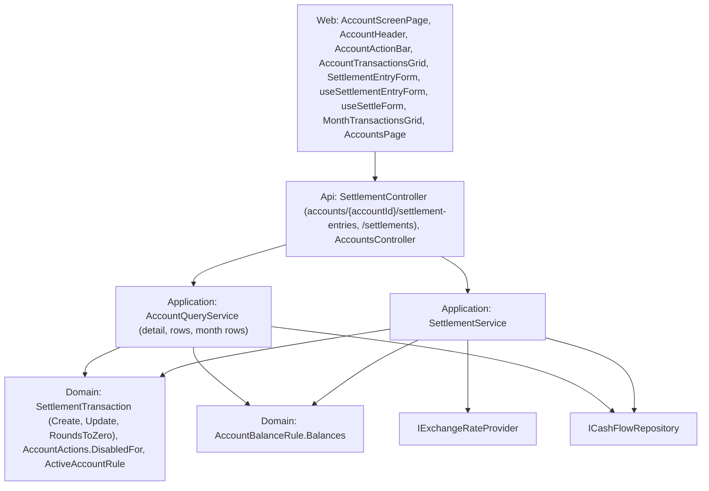

# Technical Specification: Settlement Screen

Complexity: **complex**. New account-scoped Settlement routes and service, an entity edit, two DTO changes the web reads everywhere (account detail and transaction rows), Settlement rows in the account screen and F16's All transactions, and a Settlement header, grid, entry form and Settle flow on the F05 account screen. No data-file change.

**Strict no-comments policy** in all code, XML docs included (CLAUDE.md). Existing doc comments on lines a stage rewrites are deleted, not reworded.

## 1. Technical Overview

**What.**
- **Settlement routes:** `POST accounts/{accountId}/settlement-entries` (add; the converted value comes from the date's rate), `PUT …/settlement-entries/{entryId}` (edit details and values), `DELETE …/settlement-entries/{entryId}` and `POST accounts/{accountId}/settlements` (Settle; values as entered). Any account with `HasParticipants` works (Mãe, the son's). Every save returns the entry and, when the converted value was left empty, a **warning** naming the other currency.
- **Entity:** `SettlementTransaction.Update` changes date, description, note, paid by, amount and converted value in one validated step; the currency never changes. A converted value that rounds to 0.00 is stored empty instead of refused.
- **Actions:** `AddEntry` and `Settle` for active accounts with `HasParticipants` / `CanSettle`. When every currency's current balance rounds to 0.00, Settle is still listed but **disabled with the reason** "Nothing to settle.", carried in the account detail's new `DisabledActions`.
- **Account detail:** the **current** balance per currency (every entry) and the other participant.
- **Rows:** every transaction row carries its **currency**; Settlement entries become rows (one per entry, paid amount signed by who paid, in the entry's own currency) on the account screen and in F16's All transactions, whose Amount and footer totals use the row's currency.
- **Screen:** the Settlement header ("Mãe owes you R$167.88 / £7.94", current, not the viewed month), Settlement grid columns, Settlement accounts in the picker, Accounts page rows as links, the Add entry / Edit entry form, and Settle with pre-fill, implied rate and a confirmation that states what remains.

**Why.** F11 moved Controle Mãe onto a Settlement account but left it without a screen; F13 retires Controle Mãe and needs every one of its tasks on the account screen. The son's GBP-only account has no screen at all. F16's All transactions must list every account's rows, so Settlement entries join it with their own currency.

**Delivery.** Four stages (user, Q10), six PRs: stage 1 and stage 3 each exceed 8 non-test code files as one PR and are split. Every PR leaves `main` deployable and ends with a parity run against `p60-deployed-f11` expecting 0 differences. Deploy only after stage 4.

| Stage | PR | Content | Web |
|---|---|---|---|
| **1 — Settlement API** | **1a** | Entry routes (add, edit, delete), `SettlementService`, entry DTOs, `SettlementTransaction.Update`, rounds-to-0 → empty, the future-date rule, the two warnings | None (generated `openapi.ts` only) |
| | **1b** | Settle route; `AddEntry` and `Settle` actions; `DisabledActions`; account detail `CurrentBalances` and `OtherParticipant` | Typed test fixtures only |
| **2 — Rows** | **2** | `AccountTransactionDTO.Currency` on every row; Settlement entry rows; All transactions Amount and footer by row currency; delete of an entry row | All transactions, row delete |
| **3 — Screen** | **3a** | Settlement header (current, per currency), Settlement grid columns, picker, Accounts page links, screen checklist | Account screen (read side), Accounts page |
| | **3b** | Add entry and Edit entry form with every state | Account screen (entry forms) |
| **4 — Settle** | **4** | Settle form, pre-fill, implied rate, confirmation, disabled reason in the action bar; PRD ticks | Account screen (Settle) |

**Compatibility between PRs.** Until 3a the Settlement screen keeps F11's state: out of the picker and without an Accounts-page link. From stage 2 an All transactions row links to it, where its entries show in the generic grid (amount without currency) until 3a; their Edit stays disabled until 3b because a Settlement account loads no form options (`useAccountFormOptions` is not ready), and Delete works from stage 2. From 1b `allowedActions` lists `AddEntry` and `Settle`, which the web ignores until 3b and 4 add their labels (`formActionsOf`).

**Scope.**

*Included:*
- Everything in PRD F12 Capabilities, Experience, Error Handling and Section 9 F12, plus the cross-feature criteria that name F12 (§7).
- *Input contracts (Consumes):*
  - **F05:** the account screen shell (`AccountScreenPage`, `AccountHeader`, `AccountActionBar`, `AccountTransactionsGrid`, `useAccountActionForms`, `useAccountRowDelete`, `ConfirmDialog`, `DiscardChangesDialog`, `useSuccessToast`), `GET accounts/{id}/{y}/{m}` and its `allowedActions`, the default-date rule (`getCreateFormDate`).
  - **F11:** `SettlementTransaction` (`Create`, `UpdateValues`, `SignedValueIn`, `ConvertedCurrencyOf`, `ConvertedValueAt`), `SettlementPayer`, `Account.Currencies` / `OtherParticipant`, `AccountBalanceRule.Balances`, `CurrencyBalanceDTO`, `settlementBalanceText`, the Settlement grid config.
  - **F16:** `GET accounts/transactions/{y}/{m}`, `MonthTransactionsGrid`, `monthTransactionTotals`.
- *Output contract (Provides, used by F13):* the Settlement screen with entries, balance per currency and Settle; the account-scoped Settlement routes that replace `controle-mae`.

*Excluded:*
- Any change to `controle-mae` routes, shapes, the Controle Mãe page or `useControleMae` (F13 retires them). The only behaviour they share is §3 "Converted value rounding to 0.00".
- Changing an entry's currency (delete and add again), recalculating a converted value on edit, group settlements, currencies beyond BRL and GBP.
- A parity figure family for the header (the header reads the same `AccountBalanceRule.Balances` as F11's `settlement` family).
- Settle on an inactive account (no actions; reactivate first, user Q8).

## 2. Architecture Impact

**Layers and direction** (design.md's four questions):
1. **Where it belongs:** the CashFlow bounded context.
   - **Domain:** `SettlementTransaction.Update` and `RoundsToZero`; `AccountAction.AddEntry` / `Settle`; `AccountActions` rules and `DisabledFor`.
   - **Application:** `SettlementService` (new), its DTOs, `AccountQueryService` (detail fields, rows), `AccountDetailDTO`, `AccountTransactionDTO`.
   - **Api:** `SettlementController` (new).
   - **Web:** account screen, All transactions, Accounts page.
2. **Which layers, in which direction:** Domain ← Application ← Api, plus the web app over the API. No Infrastructure change, no new package.
3. **What keeps Domain free of Infrastructure:** `ICashFlowRepository` (Application) and `IExchangeRateProvider` (`Financial.Shared.Abstractions`), as `ControleMaeService` uses them today; the Domain has no clock, so the future-date rule lives in the service with `TimeProvider`.
4. **Which SOLID principles it leans on:**
   - **SRP:** `SettlementService` owns Settlement writes; `AccountQueryService` stays the read side; `AccountActions` owns which actions an account has and why one is disabled.
   - **OCP:** actions come from capabilities (`HasParticipants`, `CanSettle`), never the template name; the shell renders any disabled action with its reason, not a Settle special case.
   - **LSP:** a Settlement row is an `AccountTransactionDTO` like any other; its `Currency` field is set on every row, so readers need no Settlement branch.
   - **DIP:** the service reaches data and rates only through `ICashFlowRepository` and `IExchangeRateProvider`; the web reaches the API only through `apiClient`.



## 3. Technical Decisions

| Decision | Chosen approach | Alternative considered | Trade-off |
|---|---|---|---|
| **Routes** (user; 1a, 1b) | New `Financial.Api/Controllers/SettlementController.cs`, `[Route("accounts")]` like `PotsController`: `POST {accountId:guid}/settlement-entries` → 201, `PUT {accountId:guid}/settlement-entries/{entryId:guid}` → 200, `DELETE {accountId:guid}/settlement-entries/{entryId:guid}` → 204 (1a); `POST {accountId:guid}/settlements` → 201 (1b). A null body → 400, as every controller. | Extend `controle-mae` | `controle-mae` is frozen and Mãe-only (PRD). |
| **Service** (1a) | `ISettlementService` / `SettlementService` (Application, singleton in `AddFinancialCashFlowApplication`): `AddEntryAsync(accountId, SettlementEntryCreateDTO)`, `UpdateEntryAsync(accountId, entryId, SettlementEntryUpdateDTO)`, `DeleteEntryAsync(accountId, entryId)`, `SettleAsync(accountId, SettleRequestDTO)` (1b). Span and log pattern of every service (`StartServiceSpan("CashFlow", nameof(SettlementService), op, "SettlementTransaction")`). The account is found by id (404 "Account"); it must have `HasParticipants` (`Create`'s "<name> is not a Settlement account.", checked first for edit and delete too) and be active (`ActiveAccountRule.EnsureUsable(null, account)`: "Mãe is inactive.", every route, user Q8). An entry id of another account is 404 ("Settlement entry"). `internal static SettlementEntryDTO ToDto(entry, warning)` is the one mapping (stage 2's rows use it, as `ExpenseService.ToDto`). | Grow `ControleMaeService` | That service is Mãe-only and retires in F13. |
| **Paid by on the wire** (1a) | String `"You"` or `"Other"` (the API has no enum converter; DTOs carry codes as strings like `Currency`). Anything else → 400 "Paid by must be You or Other." | Numeric enum | Readable, matches the stored value. |
| **Currency on add** (1a) | `currency` is optional: on a two-currency account it is required ("Choose the currency."); on a one-currency account it may be null (the account's currency) or that currency. An unknown code → "Unknown currency 'X'." (the Admin message); a currency the account doesn't hold → `Create`'s "<name> doesn't use <cur>." | Always required | The son's form never asks (PRD). |
| **Converted value on add** (1a) | On a two-currency account the service asks `IExchangeRateProvider.GetHistoricalRateAsync(date, currency, other)` and passes `SettlementTransaction.ConvertedValueAt(amount, rate)` (amount rounded, × rate, rounded). No rate (`null`) → the entry is saved without one and the response warning is `No exchange rate found for 17 Oct 2026; the GBP value is empty.` (date `d MMM yyyy`, invariant culture; "the BRL value" for a GBP entry, user Q7). A value that rounds to 0.00 → saved without one and `The GBP value rounds to 0.00, so it was left empty.` (user Q6). A one-currency account asks no rate. | Refuse the save without a rate | PRD: saves as today, with a warning. |
| **Converted value rounding to 0.00** (1a) | `UpdateValues` (and so `Create`, `Update`) rounds the converted value to 2 decimals; **0.00 becomes null** instead of the F11 refusal; below 0 is still refused ("The converted value must be greater than zero."). Public static `SettlementTransaction.RoundsToZero(decimal value)` (`Math.Round(value, 2, AwayFromZero) == 0`) is the one rule for "rounds to 0.00" (also used by `DisabledFor`). The service gives the rounds-to-0 warning when the request (or the rate) had a converted value and the saved entry has none. `controle-mae` shares the entity, so a POST whose computed converted value rounds to 0 now saves it empty (was 400); its shapes don't change and it gets no warning. | Keep the refusal on edit | User Q6 applies to every save path. |
| **Edit** (user Q4; 1a) | `SettlementTransaction.Update(date, description, note, paidBy, amount, convertedValue)` checks the description ("Description is required.") and the values (`UpdateValues`' rules) **before** changing anything, then sets all six; `Note` null → "". No currency parameter, so the currency can't change. The converted value is taken as sent (null empties it); changing the amount or date never recalculates it. The service refuses a future date first. | Separate details and values calls | One call can't half-apply a refused edit. |
| **Future date** (1a, 1b) | The service refuses `date > TimeProvider.GetLocalToday()` with "Date must not be in the future." on add, edit and Settle. | In the entity | The Domain has no clock; `ControleMaeService` and `PotsService` do the same. |
| **Save warning** (user Q6, Q7; 1a) | `SettlementEntryDTO.Warning` (`string?`): set only on a save response, null in transaction rows. | A wrapper DTO `{ entry, warning }` | One DTO file fewer; rows simply leave it null. |
| **Settle route** (user Q2; 1b) | `SettleAsync` takes paid by, currency, amount and the converted value **as entered** (no rate lookup; null leaves it empty; rounding to 0.00 gives the Q6 warning), plus date, description and note. The account must have `CanSettle` ("<name> can't be settled.") and be active, and `AccountActions.DisabledFor` must not disable Settle: when every currency's current balance (`AccountBalanceRule.Balances(account, DateOnly.MaxValue, entries)`) rounds to 0.00 it is refused with that reason, "Nothing to settle." (400). A Settle that leaves a remainder is allowed (the confirmation told the user). | One add route with an optional converted value | Add's null means "use the rate", Settle's null means "none"; one meaning per route. |
| **Actions** (1b) | `AccountAction` gains `AddEntry` and `Settle` (last). `AccountActions` rules: `AddEntry` ← `HasParticipants`, `Settle` ← `CanSettle`. Inactive accounts keep `[]`. New `AccountActions.DisabledFor(account, currentBalances)` → `IReadOnlyDictionary<AccountAction, string>`: `{ Settle: "Nothing to settle." }` when the account is active, has `CanSettle`, has at least one balance and every balance `RoundsToZero`; else empty (an empty balance list disables nothing). A disabled action stays in `AllowedFor`. | Leave Settle out when settled | PRD: disabled, with "Nothing to settle.". |
| **Disabled reason to the web** (1b, 4) | `AccountDetailDTO.DisabledActions` (`IReadOnlyDictionary<string, string>`, required; action name → reason). Stage 4's `AccountActionBar` takes it: an action in the map renders `disabledFocusable` (Tab still reaches it and a screen reader reads why) with `aria-describedby` pointing at the reason, shown as text after the buttons. This changes the shell's allowed-actions rendering in one generic way, so this spec updates the PRD cross-feature criterion to "…with the shell's allowed-actions rendering extended only to show an action the API returns as disabled, with the API's reason". | Web computes "settled" from balances | The rule stays in the back end (F05: "the front end renders only the actions the API returns"). |
| **Account detail** (user Q3; 1b) | `AccountDetailDTO` gains `CurrentBalances` (`IReadOnlyList<CurrencyBalanceDTO>`, required: one per account currency, code order, at `DateOnly.MaxValue`, full precision; **empty** for accounts without `HasParticipants`) and `OtherParticipant` (`string?`). `Balance` stays the viewed month-end main-currency figure. | A nested Settlement DTO | Same two fields as F11's group members. |
| **Row currency** (user Q5; 2) | `AccountTransactionDTO.Currency` (string, required): the currency `Amount` is in — the entry's currency on a Settlement row, the account's currency on every other row. `MonthTransactionDTO.AccountCurrency` keeps the account's currency. | A currency on month rows only | One meaning for every reader of a row. |
| **Settlement rows** (user Q5; 2) | `AccountQueryService.ToRows` maps a `SettlementTransaction` of the account to one row: `Kind` "SettlementEntry", `Date`, `Description`, `CategoryName` null, `Counterpart` null, `Amount` = `ContributionTo(account, entry.Currency)` (+ when You paid, − when the other paid), `Currency` = the entry's currency, `RoundUp` null, `CanEdit` = `account.IsActive`, `Settlement` = `SettlementService.ToDto(entry, null)` (new `SettlementEntryDTO?` on the row). The converted value is not a row and not in `Amount`. The month view gets them through the shared builder (F16). | Two rows per entry (one per currency) | User: one row in the paid currency; converted not counted. |
| **All transactions** (2) | `MonthTransactionsGrid` Amount = `formatSignedN2(amount)` + `transaction.currency`; `monthTransactionTotals` groups by `transaction.currency`. Settlement rows have no category, so the Category filter and Spend ignore them; the Type filter reads "Settlement entry". | — | Footer per currency (user Q5). |
| **Labels** (2) | `KIND_LABELS.SettlementEntry` = "Settlement entry"; `RECORD_NOUNS.SettlementEntry` = "entry" (delete prompt "Delete this entry? This cannot be undone.", toast "Entry deleted"). | — | PRD calls them entries. |
| **Delete** (2) | `useAccountRowDelete` deletes a row with `settlement` through `apiClient.deleteSettlementEntry(accountId, id)`. | — | Works wherever the row shows. |
| **Header** (user Q1, Q3; 3a) | For an account with `HasParticipants` (`useAccountScreen.hasParticipants`, from the accounts list's capabilities, as `hasPots`): identity line "Settlement · BRL, GBP" (currencies from `currentBalances`); one figure, label "Current balance", value `settlementBalanceText(settlementCounterparty(detail), currentBalances)` (`settlementCounterparty` is `otherParticipant ?? name`, one rule for the header, the grid and the Accounts page) → "Mãe owes you R$167.88 / £7.94", "You owe Samuel £15.00", "Settled" (a currency counts as settled when it rounds to 0.00, as the helper already compares in pence). The month selector stays and only picks the grid's month. Other templates' headers are unchanged. | Month-end balance | User Q3: current. |
| **Grid columns** (user Q5; 3a) | `AccountTransactionsGrid` replaces `showsPotColumns` with `columns: 'account' \| 'pots' \| 'settlement'`; `otherParticipant` is required exactly when `columns` is `'settlement'`. Settlement columns: Date, Description, Paid by ("You" or the other participant's name), Amount (`formatCurrency(Math.abs(amount), currency)`, e.g. "R$150.00", numeric; the row's signed amount without its sign, since Paid by gives the direction), Converted (`formatCurrency(convertedValue, convertedCurrency)` or "—", numeric), Note (`TruncatedText`); every column sorts; Edit and Delete trailing. | — | — |
| **Picker and links** (user; 3a) | `AccountHeader` drops `appearsInPicker`: active Settlement accounts appear under "Settlement". `TEMPLATE_GRIDS.Settlement.linksRows` = true; a row opens `/cashflow/accounts/{id}?month=…` (no tab). | — | — |
| **Entry form** (PRD; 3b) | `SettlementEntryForm` + `useSettlementEntryForm`, inline in the form area (ADR-003). Field order (docs/ui default: date, related entities, description, amounts, metadata): Date, Paid by (Fluent `RadioGroup`, horizontal: "You", the other participant), Currency (`RadioGroup`, add only, only with two currencies, default the account's main currency), Description, Amount ("Amount (BRL)", follows the currency), Converted ("GBP value", edit only, only with two currencies, hint "Leave empty when there is no GBP value."), Note. Edit shows the currency as read-only text. Title and submit: "Add entry" / "Add entry", "Edit entry" / "Save". Date default: `getCreateFormDate('settlementEntry.date', viewedMonth)`, `max` today. Paid by has no default (explicit, F11). | One form per action | Add, Edit and (stage 4) Settle share the fields. |
| **Entry validation** (3b) | Client: date required and not after today ("Date must not be in the future."), "Choose who paid.", "Choose the currency.", "Description is required.", "Amount must be greater than zero.", a negative converted value "The converted value must be greater than zero."; focus to the first invalid field. Server 400: the message in the form's error `MessageBar`, values kept. Network: `NETWORK_SAVE_ERROR`. | Map server messages per field | Client rules cover every field; server-only cases (inactive, not found) are form-level. |
| **After a save** (3b) | Add keeps the form open (F05) with date, paid by and currency kept, description, amount and note emptied, focus on Description; toast "Entry added". Edit closes and toasts "Entry updated". A response with a `warning` shows it in a warning `MessageBar` (`role="status"`) in the open form: after Add above the next entry; after Edit the form **stays open** on the saved values (not dirty) with the warning, so the empty value is visible; the next change or Cancel clears it. | Warning toast | Toasts vanish; a dropped value must stay visible. |
| **Settle form** (user Q1, Q2, Q9; 4) | `useSettleForm` + `SettlementEntryForm` in settle mode: Currency (two currencies), Date (same default rule), Paid by, Description (default "Settlement"), Amount, Converted, Note; title "Settle", submit "Save settlement". Pre-fill from `currentBalances` (outstanding = balance rounded to 2 decimals, in pence): default currency = the first, in code order, not settled; paid by = Other when outstanding > 0 (the other owes you), You when < 0; amount = \|outstanding\|; converted = \|other outstanding\| when the other currency points the same way and isn't settled, else empty. Changing the currency re-fills paid by, amount and converted. Single-currency accounts pre-fill the amount only. | Server-computed proposal | Precedent `useCardCreditRefundForm` pre-fills from server balances; the server still checks "Nothing to settle.". |
| **Implied rate** (user Q9; 4) | While amount and converted are both > 0: "Implied rate: 1 GBP = R$21.14" — 1 unit of the currency with the smaller value equals the other value ÷ it, `formatCurrency` with 2 decimals, whichever currency is settled; `aria-live="polite"`. Hidden otherwise. | — | — |
| **Confirmation** (user Q2; 4) | Save settlement validates, then opens `ConfirmDialog` "Save this settlement?" (confirm "Save settlement", cancel "Cancel"). Remainder per currency = balance + this entry's signed contribution, rounded to 2 decimals. All zero → "Both totals become zero." ("The total becomes zero." with one currency). Otherwise "This leaves R$0.00 / £10.00 outstanding (Mãe owes you)." — every currency in code order, then who owes, per currency when they differ ("(Mãe owes you R$3.20; you owe Mãe £1.00)"). Confirm closes the dialog and saves (form saving state); success closes the form, toasts "Settlement saved", refreshes the header. | — | PRD and Q2 texts combined. |
| **States** (3a, 3b, 4) | **Initial:** header and grid as F05. **Loading:** F05 skeletons. **Empty:** "No transactions in October 2026". **Validation:** inline per field. **Server error:** `MessageBar` above the fields, values kept. **Saving:** fieldset disabled, spinner on submit. **Success:** toasts above; warning `MessageBar` when returned. **Disabled:** inactive account has no actions; Settle disabled with "Nothing to settle."; Edit disabled while the account reloads. **Unsaved changes:** the three forms join `useAccountActionForms.isDirty` (discard prompt on switching account, month, action or row). | — | Mandatory state design. |
| **Narrow layout and keyboard** (3a, 3b, 4) | Grid cells use `DataTableCell` labels, so rows stack below 600 px; the header and actions stack (F05 CSS); forms use `useFormPanelStyles`' grid. Tab reaches picker, month, Add entry, Settle (also when disabled), the radio groups (arrow keys inside), row actions and dialog buttons with Fluent focus; the form takes focus on its first field and returns it to its opener. Direction is text ("owes you"), never colour alone. | — | — |
| **Parity** (every PR) | No figure changes: monthTransactions counts only categorised rows (entries have none), the `settlement` and `current/mae` families read unchanged routes, and bank and card details ignore entries. Expected 0 differences with the baseline run's figure count. Screen checklist S3 inverts ("Mãe is in the picker under Settlement") and gains S4–S8 (§7). | A header figure family | It would read the same rule F11's family already checks. |
| **PR size** | Non-test code files (generated `openapi.ts` and the snapshot excluded): 1a → 8, 1b → 8, 2 → 8, 3a → 5, 3b → 7, 4 → 8. Stage 1 (13 distinct files) and stage 3 (11) don't fit one PR. 1b and 2 add a **required** field to a DTO the web types literally, so their typed test fixtures change as **one repeated change** (1b: five files; 2: `src/test/accountTransactionRow.ts` only, whose default covers every typed row), F11 3a precedent: 1b ≈ 13 + 5, 2 ≈ 16 + 1. §4 lists the files. | Optional fields to avoid the fixture sweep | Required fields keep the contract exact. Fallback if the user wants every PR under 15: 1b → 1b (Settle and actions, 6) + 1c (detail, 2 + fixtures); 2 → 2a (row currency, 4 + fixtures) + 2b (entry rows and delete, 6). |
| **Rollback** | No data-file change: any PR reverts cleanly; entries saved through the new routes are ordinary V5 entries. | — | — |

**Choices made by the spec writer** (open after the review; for the user's review):
- Six PRs: 1a, 1b, 2, 3a, 3b, 4; 1b and 2 exceed about 15 files only through a typed-fixture sweep (fallback split named above).
- One `SettlementController` and `SettlementService`; routes `accounts/{accountId}/settlement-entries[/{entryId}]` and `accounts/{accountId}/settlements`; create routes return 201.
- Paid by travels as "You" / "Other"; the add route's `currency` is optional on a one-currency account and required ("Choose the currency.") on a two-currency one.
- Every new route refuses an inactive account ("Mãe is inactive."), including edit and delete; `controle-mae` keeps ignoring the active flag.
- The warning is a nullable `Warning` on `SettlementEntryDTO`, null in rows; the no-rate date reads "17 Oct 2026".
- A converted value rounding to 0.00 becomes empty in the entity, so `controle-mae` POST saves it empty too (was 400), without a warning.
- `SettlementTransaction.Update` sets all six edit fields in one validated step; `UpdateValues` stays for `controle-mae`.
- Settle takes values as entered, refuses only "Nothing to settle." (400) and "<name> can't be settled.", and allows a remainder.
- Settle stays in `allowedActions` when settled; `DisabledActions` (action → reason) carries "Nothing to settle."; the bar renders it `disabledFocusable` with the reason as visible text. The PRD cross-feature wording is updated in this commit.
- `AccountDetailDTO.CurrentBalances` is empty for accounts without participants; `OtherParticipant` sits beside it.
- `AccountTransactionDTO.Currency` is required on every row; Settlement rows are kind "SettlementEntry" (label "Settlement entry", noun "entry"), no counterpart, `CanEdit` = account active.
- Header label "Current balance", identity "Settlement · BRL, GBP", value from `settlementBalanceText`.
- Grid prop `showsPotColumns` becomes `columns: 'account' | 'pots' | 'settlement'`.
- Entry form field order follows docs/ui's default (Date, Paid by, Currency, Description, Amount, Converted, Note), not the PRD's listing order; paid by has no default; currency defaults to the main currency; Paid by and Currency are radio groups.
- Server 400s show in the form's MessageBar, not mapped per field.
- After Add the form keeps date, paid by and currency; an Edit whose response carries a warning stays open on the saved values with the warning.
- Settle's description defaults to "Settlement"; its date follows F05's default-date rule; changing its currency re-fills paid by, amount and converted.
- Implied rate: one unit of the currency with the smaller value ("1 GBP = R$21.14").
- Confirmation lists every currency's remainder then who owes; one-currency accounts say "The total becomes zero."; cancel label "Cancel".
- Toasts "Entry added", "Entry updated", "Entry deleted", "Settlement saved".
- No new parity family; checklist rows S3 (inverted) and S4–S8.

## 4. Component Overview

All paths are relative to the repo root. Existing patterns: entities with private setters and validated mutators; `ArgumentException` → 400, `KeyNotFoundException` (`FirstOrThrow`) → 404 in `DomainExceptionMappingMiddleware`; the span/log telemetry shape; DTO mapping as `internal static ToDto` on the owning service; acceptance tests deriving from `ApiEndpointTests` with an inline V5 seed and `StubExchangeRateProvider`; inline account-screen forms as hook + component (`useCardCreditRefundForm` / `CardCreditRefundForm`).

**Domain (`Financial.CashFlow.Domain`)**

| File | New/Modified | PR | Key responsibilities |
|---|---|---|---|
| `Entities/SettlementTransaction.cs` | Modified | 1a | `Update(date, description, note, paidBy, amount, convertedValue)`; converted rounding to 0.00 → null; `RoundsToZero` |
| `Enums/AccountAction.cs` | Modified | 1b | `AddEntry`, `Settle` |
| `Rules/AccountActions.cs` | Modified | 1b | Two rules; `DisabledFor(account, currentBalances)` |

**Application (`Financial.CashFlow.Application`)**

| File | New/Modified | PR | Key responsibilities |
|---|---|---|---|
| `Interfaces/ISettlementService.cs` | New, Modified | 1a, 1b | Add, update, delete (1a); settle (1b) |
| `Services/SettlementService.cs` | New, Modified | 1a, 1b | §3 "Service", "Currency on add", "Converted value on add", "Future date", "Save warning"; 1b "Settle route"; `ToDto` |
| `DTOs/SettlementEntryCreateDTO.cs` | New | 1a | `Date`, `Description`, `Note?`, `PaidBy`, `Currency?`, `Amount` |
| `DTOs/SettlementEntryUpdateDTO.cs` | New | 1a | `Date`, `Description`, `Note?`, `PaidBy`, `Amount`, `ConvertedValue?` |
| `DTOs/SettlementEntryDTO.cs` | New | 1a | `Id`, `AccountId`, `Date`, `Description`, `Note`, `PaidBy`, `Currency`, `Amount`, `ConvertedCurrency?`, `ConvertedValue?`, `Warning?` |
| `DependencyInjection/CashFlowApplicationServiceCollectionExtensions.cs` | Modified | 1a | Registers `ISettlementService` |
| `DTOs/SettleRequestDTO.cs` | New | 1b | `Date`, `Description`, `Note?`, `PaidBy`, `Currency?`, `Amount`, `ConvertedValue?` |
| `DTOs/AccountDetailDTO.cs` | Modified | 1b | `CurrentBalances`, `OtherParticipant`, `DisabledActions` |
| `Services/AccountQueryService.cs` | Modified | 1b, 2 | **1b:** the three detail fields. **2:** `Currency` on every row; Settlement rows |
| `DTOs/AccountTransactionDTO.cs` | Modified | 2 | `Currency` (required), `Settlement` (`SettlementEntryDTO?`) |

**Api (`Financial.Api`)**

| File | New/Modified | PR | Key responsibilities |
|---|---|---|---|
| `Controllers/SettlementController.cs` | New, Modified | 1a, 1b | §5 routes |
| `Tests/Financial.Api.Tests/Contract/openapi-v1.snapshot.json`, `Financial.Web/src/api/generated/openapi.ts` | Regenerated | 1a, 1b, 2 | Not counted |

**Web (`Financial.Web/src`)**

| File | New/Modified | PR | Key responsibilities |
|---|---|---|---|
| `components/accountActions.ts` | Modified | 2, 3b, 4 | **2:** kind label and noun. **3b:** `AddEntry` ("Add entry", no form options). **4:** `Settle` ("Settle", no form options) |
| `components/MonthTransactionsGrid.tsx` | Modified | 2 | Amount with `transaction.currency` |
| `utils/monthTransactionTotals.ts` | Modified | 2 | Totals by `transaction.currency` |
| `api/financialApiClient.ts` | Modified | 2, 3b, 4 | `deleteSettlementEntry` (2); `createSettlementEntry`, `updateSettlementEntry` (3b); `settleAccount` (4) |
| `api/types.ts` | Modified | 2, 3b, 4 | `SettlementEntryDto` (2); `SettlementEntryCreateDto`, `SettlementEntryUpdateDto` (3b); `SettleRequestDto` (4) |
| `hooks/useAccountRowDelete.ts` | Modified | 2 | Entry rows delete through the Settlement route |
| `components/AccountHeader.tsx` | Modified | 3a | Settlement header; picker includes Settlement accounts |
| `components/AccountTransactionsGrid.tsx` | Modified | 3a | `columns` prop; Settlement columns |
| `pages/AccountScreenPage.tsx` | Modified | 3a, 3b, 4 | **3a:** header and grid props. **3b:** entry form; Edit enabled for entry rows. **4:** Settle form, confirmation, disabled reasons |
| `utils/accountTemplateLabel.ts` | Modified | 3a | Settlement `linksRows: true` |
| `utils/settlementBalance.ts` | Modified | 3a | `settlementCounterparty` |
| `pages/AccountsPage.tsx` | Modified | 3a | Uses `settlementCounterparty` |
| `pages/AccountScreenPage.css` | Modified | 3a | Grid `min-width: 720px` from 600 px up, so columns scroll inside their container at medium widths instead of colliding |
| `hooks/useAccountScreen.ts` | Modified | 3a | `hasParticipants` |
| `components/SettlementEntryForm.tsx` | New, Modified | 3b, 4 | Add / edit fields, states (3b); settle mode and implied rate (4) |
| `hooks/useSettlementEntryForm.ts` | New | 3b | Values, defaults, validation, save, warning, dirty state |
| `hooks/useAccountActionForms.ts` | Modified | 3b, 4 | Openers, row edit, dirty and close for the entry (3b) and Settle (4) forms |
| `hooks/useSettleForm.ts` | New | 4 | Pre-fill, re-fill on currency, implied rate, remainder text, confirm and save |
| `components/AccountActionBar.tsx` | Modified | 4 | `disabledReasons` rendering |

**Parity and docs**

| File | PR | Change |
|---|---|---|
| `scripts/parity/screen-checklist.md` | 3a, 4 | S3 inverted, S4–S7 (3a); S8 (4) |
| `docs/prd/P60-…/prd-cashflow-accounts-generalization.md` | this commit, 4 | Cross-feature wording (this commit); F12 and cross-feature ticks (4, own commit) |

**Files per PR (non-test code; generated `openapi.ts` and the snapshot excluded):**
- **1a (8):** `SettlementTransaction.cs`, `ISettlementService.cs`, `SettlementService.cs`, `SettlementEntryCreateDTO.cs`, `SettlementEntryUpdateDTO.cs`, `SettlementEntryDTO.cs`, `CashFlowApplicationServiceCollectionExtensions.cs`, `SettlementController.cs`. With `SettlementTransactionTests`, `SettlementServiceTests` (new), `SettlementScreenAcceptanceTests` (new), `ControleMaeServiceTests` and the snapshot: about 13.
- **1b (8):** `AccountAction.cs`, `AccountActions.cs`, `ISettlementService.cs`, `SettlementService.cs`, `SettleRequestDTO.cs`, `AccountDetailDTO.cs`, `AccountQueryService.cs`, `SettlementController.cs`. With `AccountActionsTests`, `SettlementServiceTests`, `AccountQueryServiceTests`, `SettlementScreenAcceptanceTests` and the snapshot: about 13, plus the five web test files whose typed `AccountDetailDto` gains `currentBalances` and `disabledActions` (`financialApiClient.test.ts`, `AccountHeader.test.tsx`, `useAccountActionForms.test.ts`, `useAccountScreen.test.tsx`, `AccountScreenPage.test.tsx`).
- **2 (8):** `AccountTransactionDTO.cs`, `AccountQueryService.cs`, `accountActions.ts`, `MonthTransactionsGrid.tsx`, `monthTransactionTotals.ts`, `financialApiClient.ts`, `types.ts`, `useAccountRowDelete.ts`. With `AccountQueryServiceTests`, `SettlementScreenAcceptanceTests`, `MonthTransactionsGrid.test.tsx`, `monthTransactionTotals.test.ts`, `useAccountRowDelete.test.ts`, `accountActions.test.ts`, `financialApiClient.test.ts` and the snapshot: about 16, plus `src/test/accountTransactionRow.ts`, whose new `currency` default covers every typed row.
- **3a (8):** `AccountHeader.tsx`, `AccountTransactionsGrid.tsx`, `AccountScreenPage.tsx`, `AccountScreenPage.css`, `accountTemplateLabel.ts`, `useAccountScreen.ts`, `settlementBalance.ts`, `AccountsPage.tsx`. With `settlementBalance.test.ts`, `AccountHeader.test.tsx`, `AccountTransactionsGrid.test.tsx`, `AccountScreenPage.test.tsx`, `useAccountScreen.test.tsx`, `accountTemplateLabel.test.ts`, `AccountsPage.test.tsx` and `screen-checklist.md`: about 12.
- **3b (7):** `SettlementEntryForm.tsx`, `useSettlementEntryForm.ts`, `useAccountActionForms.ts`, `AccountScreenPage.tsx`, `accountActions.ts`, `financialApiClient.ts`, `types.ts`. With `SettlementEntryForm.test.tsx` and `useSettlementEntryForm.test.ts` (new), `useAccountActionForms.test.ts`, `AccountScreenPage.test.tsx`, `financialApiClient.test.ts`, `accountActions.test.ts`: about 13.
- **4 (8):** `useSettleForm.ts`, `SettlementEntryForm.tsx`, `useAccountActionForms.ts`, `AccountScreenPage.tsx`, `accountActions.ts`, `AccountActionBar.tsx`, `financialApiClient.ts`, `types.ts`. With `useSettleForm.test.ts` (new), `SettlementEntryForm.test.tsx`, `useAccountActionForms.test.ts`, `AccountScreenPage.test.tsx`, `AccountActionBar.test.tsx`, `financialApiClient.test.ts`, `screen-checklist.md` and the PRD: about 16.

## 5. API Contracts

No authentication (single-user app, as every route). Base path `/api/v1/financial`. Amounts are JSON numbers.

**`POST accounts/{accountId}/settlement-entries`** (1a) → **201** `SettlementEntryDTO`.

| Field | Type | Required | Validation |
|---|---|---|---|
| `date` | `date` | Yes | Not after today |
| `description` | `string` | Yes | Not blank |
| `note` | `string` | No | Null → "" |
| `paidBy` | `string` | Yes | "You" or "Other" |
| `currency` | `string` | Two-currency accounts | One of the account's currencies |
| `amount` | `number` | Yes | > 0 after rounding to 2 decimals |

```json
{ "date": "2026-10-17", "description": "Farmácia", "note": "", "paidBy": "You", "currency": "BRL", "amount": 150 }
```

**`SettlementEntryDTO`** (every save response; `transaction.settlement` in rows, where `warning` is null):

| Field | Type | Description |
|---|---|---|
| `id`, `accountId` | `uuid` | Entry and its account |
| `date`, `description`, `note` | `date`, `string`, `string` | As stored |
| `paidBy` | `string` | "You" or "Other" |
| `currency`, `amount` | `string`, `number` | Paid currency and amount (positive, 2 decimals for new and edited entries) |
| `convertedCurrency` | `string?` | The account's other currency; null on a one-currency account |
| `convertedValue` | `number?` | Null when empty |
| `warning` | `string?` | Why the converted value is empty, on a save response only |

```json
{ "id": "…e1", "accountId": "…ma", "date": "2026-10-17", "description": "Farmácia", "note": "", "paidBy": "You",
  "currency": "BRL", "amount": 150.00, "convertedCurrency": "GBP", "convertedValue": null,
  "warning": "No exchange rate found for 17 Oct 2026; the GBP value is empty." }
```

**`PUT accounts/{accountId}/settlement-entries/{entryId}`** (1a) → **200** `SettlementEntryDTO`. Body `SettlementEntryUpdateDTO`: `date`, `description`, `note`, `paidBy`, `amount` as above, `convertedValue` (`number?`, ≥ 0; rounds to 2 decimals; 0.00 → empty with the rounding warning; not allowed on a one-currency account). No `currency`.

```json
{ "date": "2026-10-16", "description": "Farmácia e mercado", "note": "metade", "paidBy": "Other", "amount": 180, "convertedValue": 25.6 }
```

**`DELETE accounts/{accountId}/settlement-entries/{entryId}`** (1a) → **204**.

**`POST accounts/{accountId}/settlements`** (1b) → **201** `SettlementEntryDTO`. Body `SettleRequestDTO`: the add fields plus `convertedValue` (`number?`, taken as entered).

```json
{ "date": "2026-11-07", "description": "Settlement", "note": "", "paidBy": "Other", "currency": "BRL", "amount": 167.88, "convertedValue": 7.94 }
```

**`GET accounts/{id}/{year}/{month}`** (1b) gains:

```json
{ "allowedActions": ["AddEntry", "Settle"], "disabledActions": {},
  "currentBalances": [ { "currency": "BRL", "balance": 167.8768 }, { "currency": "GBP", "balance": 7.94214099 } ],
  "otherParticipant": "Mãe" }
```

After that Settle: `"currentBalances": [ { "currency": "BRL", "balance": -0.0032 }, { "currency": "GBP", "balance": 0.00214099 } ]`, `"disabledActions": { "Settle": "Nothing to settle." }`. A bank: `"currentBalances": []`, `"otherParticipant": null`, `"disabledActions": {}`.

**`GET accounts/{id}/transactions/{y}/{m}`** and **`GET accounts/transactions/{y}/{m}`** (2): every `AccountTransactionDTO` gains `currency`; a Settlement row:

```json
{ "id": "…e7", "kind": "SettlementEntry", "date": "2024-10-11", "description": "Taxa…", "categoryName": null, "counterpart": null,
  "amount": 80.00, "currency": "GBP", "roundUp": null, "canEdit": true,
  "settlement": { "id": "…e7", "accountId": "…ma", "paidBy": "You", "currency": "GBP", "amount": 80, "convertedCurrency": "BRL", "convertedValue": 491.04, "warning": null, "…": "…" } }
```

**Errors** (every route):

| Case | HTTP | Message |
|---|---|---|
| Unknown account | 404 | The "Account" not-found message |
| Account without participants | 400 | Barclays is not a Settlement account. |
| Inactive account | 400 | Mãe is inactive. |
| Entry unknown or of another account | 404 | The "Settlement entry" not-found message |
| Date after today | 400 | Date must not be in the future. |
| Blank description | 400 | Description is required. |
| Paid by not You / Other | 400 | Paid by must be You or Other. |
| No currency on a two-currency account | 400 | Choose the currency. |
| Unknown currency code | 400 | Unknown currency 'USD'. |
| Currency the account doesn't hold | 400 | Samuel doesn't use BRL. |
| Amount ≤ 0 after rounding | 400 | Amount must be greater than zero. |
| Negative converted value | 400 | The converted value must be greater than zero. |
| Converted value on a one-currency account | 400 | Samuel has one currency, so an entry has no converted value. |
| Settle on an account without `CanSettle` | 400 | <name> can't be settled. |
| Settle when every currency rounds to 0.00 | 400 | Nothing to settle. |
| Null body | 400 | — |

The snapshot changes in 1a (three paths, three schemas), 1b (one path, one schema, three `AccountDetailDTO` fields) and 2 (two `AccountTransactionDTO` fields); `openapi.ts` is regenerated each time.

## 6. Data Model

No change: the file stays V5; `migrate`, the version guard and the import are untouched. Entries are written to `SettlementTransactions` exactly as F11 defined (`AccountId`, `Date`, `Description`, `Note`, `PaidBy`, `Currency`, `Amount`, `ConvertedValue`).

**Business rules:**
- **Balance per currency** (F11, unchanged): paid by You adds, paid by Other subtracts, in the paid currency and, when present, the converted value in the other. The header and "Nothing to settle." use it at `DateOnly.MaxValue`, full precision; "settled" = rounds to 0.00.
- **Stored precision:** new and edited entries store amount and converted value at 2 decimals (F11); older entries keep theirs, so a Settle may leave a sub-penny remainder that still reads "Settled" (user Q1).
- **Live figures** (2026-11-07 copy, SHA-256 `1b608c06`, V5): Mãe, 36 entries, R$167.8768 / £7.94214099 → header "Mãe owes you R$167.88 / £7.94"; Settle in BRL pre-fills paid by Mãe, R$167.88, £7.94, "1 GBP = R$21.14", and leaves R$−0.0032 / £0.00214099, both 0.00 → "Settled".

## 7. Testing Strategy

Following the `testing-guide-Financial` skill:
- **Unit:** Domain, Application, web components, hooks and helpers.
- **Integration:** the API host through the acceptance tests (`StubExchangeRateProvider`, `TestClock` in November 2026, inline V5 seeds with Mãe BRL + GBP, the son GBP only, an inactive Settlement account and a bank); the OpenAPI contract test; the architecture tests.
- **AC tracing:** one or more tagged tests per PRD F12 bullet, `[Trait("AC", "P60-F12-settlement-screen-NN")]` (web: `[AC P60-F12-settlement-screen-NN]` in the test name), numbered 01–09 in PRD order.
- **Conventions:** every class carries `[Trait("Category", …)]`; names follow `Method_Condition_Result`; shared doubles only in `Tests/Financial.TestUtilities` (`TestAccounts.Settlement`); no wall-clock reads; every new case includes a negative path.

| Test file | Type | PR | Coverage goal |
|---|---|---|---|
| `Tests/Financial.CashFlow.Domain.Tests/Entities/SettlementTransactionTests.cs` | Unit | 1a | `Update` sets the six fields, keeps the currency, refuses a blank description or bad value **without changing anything**; a converted value rounding to 0.00 becomes null on `Create`, `Update` and `UpdateValues` (the F11 0-refusal case changes); negative still refused; `RoundsToZero` at 0.004 / 0.005 / −0.004 |
| `Tests/Financial.CashFlow.Application.Tests/Services/SettlementServiceTests.cs` (new) | Unit | 1a, 1b | **1a:** add with the rate (2 decimals), without a rate (null + warning naming the other currency and the date), rounding to 0 (null + warning), one-currency account (no rate asked); currency required / optional / unknown / not held; paid by parsing; future date on add and edit; inactive account; not a Settlement account; another account's entry → 404; edit keeps the converted value when amount and date change; delete; span success and failure. **1b:** settle stores values as entered, no rate asked; "Nothing to settle."; "can't be settled"; a remainder allowed |
| `Tests/Financial.CashFlow.Application.Tests/Services/ControleMaeServiceTests.cs` | Unit | 1a | POST whose converted value rounds to 0 saves it empty |
| `Tests/Financial.CashFlow.Domain.Tests/Rules/AccountActionsTests.cs` | Unit | 1b | `AllowedFor_SettlementAccount_ReturnsAddEntryAndSettle` (replaces `…_ReturnsNone`); inactive → none; `DisabledFor` disables Settle when every currency rounds to 0.00, not when one doesn't, never for a bank or inactive account |
| `Tests/Financial.CashFlow.Application.Tests/Services/AccountQueryServiceTests.cs` | Unit | 1b, 2 | **1b:** `CurrentBalances` at all entries whatever the month, `OtherParticipant`, `DisabledActions`; empty for a bank. **2:** `GetTransactionsAndMonthTransactions_SettlementEntriesInTheMonth_AddOneRowEachInTheirCurrency` (replaces `…_AddNoRows`); sign by payer; no category; `CanEdit` false when inactive; every other row's `Currency` is the account's |
| `Tests/Financial.Api.Tests/Acceptance/SettlementScreenAcceptanceTests.cs` (new) | Integration (AC) | 1a, 1b, 2 | The AC table below, plus every row of §5's error table |
| `Tests/Financial.Api.Tests/Acceptance/MonthTransactionsViewAcceptanceTests.cs` | Integration | 2 | Unchanged and passing (Spend per category is unaffected by entry rows, which `SettlementScreenAcceptanceTests` checks) |
| `Tests/Financial.Api.Tests/Contract/OpenApiContractTests.cs` (snapshot) | Contract | 1a, 1b, 2 | The new paths, schemas and fields |
| `Financial.Web/src/components/__tests__/MonthTransactionsGrid.test.tsx`, `…/utils/__tests__/monthTransactionTotals.test.ts` | Unit | 2 | Amount with the row currency; a GBP entry on a BRL account totals in GBP; Category filter and Spend ignore entry rows; Type "Settlement entry" |
| `…/hooks/__tests__/useAccountRowDelete.test.ts`, `…/api/__tests__/financialApiClient.test.ts`, `…/components/__tests__/accountActions.test.ts` | Unit | 2, 3b, 4 | Entry delete route; the client paths and bodies; labels, nouns, `needsFormOptions` false for `AddEntry` and `Settle` |
| `…/components/__tests__/AccountHeader.test.tsx` | Unit | 3a | Settlement header texts (owes you, you owe, mixed, Settled at 0.004); unchanged by the month; picker lists active Settlement accounts under "Settlement"; bank and card headers unchanged |
| `…/components/__tests__/AccountTransactionsGrid.test.tsx` | Unit | 3a | Settlement columns and labels, "R$150.00", "—", Paid by name, sorting, Edit and Delete; account and pots columns unchanged |
| `…/hooks/__tests__/useAccountScreen.test.tsx`, `…/utils/__tests__/accountTemplateLabel.test.ts`, `…/pages/__tests__/AccountsPage.test.tsx` | Unit | 3a | `hasParticipants`; Settlement rows link to the account screen |
| `…/components/__tests__/SettlementEntryForm.test.tsx`, `…/hooks/__tests__/useSettlementEntryForm.test.ts` (new) | Unit | 3b, 4 | Field order and labels; currency only on a two-currency add; converted only on a two-currency edit; currency read-only on edit; default date; every validation message and focus; saving disables; server and network errors keep values; add keeps date, paid by, currency; warning shown and cleared; edit with warning stays open; dirty state; **4:** settle mode fields and implied rate |
| `…/hooks/__tests__/useAccountActionForms.test.ts`, `…/pages/__tests__/AccountScreenPage.test.tsx` | Unit | 3a, 3b, 4 | Openers, row edit of an entry, discard prompt, toasts; Settle confirmation flow and texts; disabled Settle with its reason |
| `…/hooks/__tests__/useSettleForm.test.ts` (new) | Unit | 4 | Pre-fill per §3 (same direction, opposite, other settled, one currency, first unsettled currency), re-fill on currency change, implied rate both ways, remainder texts, pence rounding |
| `…/components/__tests__/AccountActionBar.test.tsx` | Unit | 4 | A disabled action is focusable, disabled and described by its visible reason; others unchanged |
| `Tests/Financial.Architecture.Tests/*` | Integration | every PR | Pass unchanged (no template-name checks) |

**Acceptance criteria (PRD Section 9, F12):**

| AC | Criterion (short) | Test | PR |
|---|---|---|---|
| 01 | Header: current balance per currency with direction; settled when it rounds to 0.00 | `SettlementScreenAcceptanceTests.AccountDetail_Settlement_ReturnsCurrentBalancesPerCurrencyWhateverTheMonth` (1b); `AccountHeader.test.tsx` "[AC …-01] shows the current balance per currency with who owes whom, Settled when it rounds to 0.00" (3a) | 1b, 3a |
| 02 | Edit changes description, note, date, paid by, amount and converted value without recalculating it; currency fixed | `…EditEntry_ChangesDetailsAndValues_KeepsCurrencyAndDoesNotRecalculateTheConvertedValue` (1a); `SettlementEntryForm.test.tsx` "[AC …-02] edits every field but the currency" (3b) | 1a, 3b |
| 03 | Entries in the account rows and All transactions in their own currency; footer per currency | `…Transactions_SettlementEntries_AreOneRowEachInTheirOwnCurrency_OnTheAccountAndInMonthTransactions` (2); `MonthTransactionsGrid.test.tsx` "[AC …-03] …" and `monthTransactionTotals.test.ts` (2); `AccountTransactionsGrid.test.tsx` "[AC …-03] …" (3a) | 2, 3a |
| 04 | Add asks currency only with two currencies; converted at 2 decimals; rounding to 0.00 or no rate → empty with a warning naming the currency | `…AddEntry_TwoCurrencies_StoresConvertedValueAtTheDateRateToTwoDecimals`, `…AddEntry_OneCurrency_NeedsNoCurrencyAndStoresNoConvertedValue`, `…AddEntry_ConvertedRoundsToZero_SavesItEmptyWithWarning`, `…AddEntry_NoRate_SavesItEmptyWithWarningNamingTheOtherCurrency` (1a); `SettlementEntryForm.test.tsx` "[AC …-04] …" (3b) | 1a, 3b |
| 05 | Settle pre-fills paid by, amount and same-direction converted value so both totals round to zero; implied rate; opposite directions state what remains | `…Settle_PrefilledValues_LeaveEveryCurrencySettled` (1b); `useSettleForm.test.ts` "[AC …-05] …" (4) | 1b, 4 |
| 06 | Editing a Settle value so totals don't reach zero shows the leftover | `useSettleForm.test.ts` and `AccountScreenPage.test.tsx` "[AC …-06] …" (4); `…Settle_EditedValues_SaveAndLeaveTheRemainder` (1b) | 1b, 4 |
| 07 | Settle disabled on a settled account | `…AccountDetail_SettledAccount_DisablesSettleWithNothingToSettle`, `…Settle_SettledAccount_Returns400NothingToSettle` (1b); `AccountActionBar.test.tsx` "[AC …-07] …" (4) | 1b, 4 |
| 08 | States, keyboard use and narrow layout pass the review checklist | `SettlementEntryForm.test.tsx`, `AccountScreenPage.test.tsx` "[AC …-08] …"; checklist S7; ui-reviewer | 3a, 3b, 4 |
| 09 | Parity 0 differences and checklist rows ticked; `/simplify`; architecture-reviewer and ui-reviewer | Definition of Done, every PR | all |

**Cross-feature criteria** (ticked in stage 4 only when every feature they name has shipped):
- **An account created through F06 appears in F05's picker and Accounts page; F07, F09 and F11 accounts are created through the same dialog:** `AccountHeader.test.tsx` picker case (3a); F11's Admin tests. Tick.
- **F05's shell hosts F08's Statements tab, F10's Pots tab and F12's Settlement header, with the allowed-actions rendering extended only to show an API-disabled action with its reason** (wording updated in this commit): `AccountScreenPage.test.tsx`, `AccountActionBar.test.tsx`. Tick.
- **F11's participants and currencies drive F12's paid-by choice, currency prompt and Settle pre-fill:** `SettlementEntryForm.test.tsx` (paid-by options from `otherParticipant`, currency prompt from the currencies), `useSettleForm.test.ts`. Tick.
- **After F13, every task F08, F10 and F12 moved onto the account screen is unreachable from a retired page:** F13.

**Screen checklist rows** (`screen-checklist.md`, after side only):
- **S3 (3a, inverted):** "…; the Mãe account is in the account screen's picker under Settlement".
- **S4 (3a):** the Mãe screen header reads "Mãe owes you R$167.88 / £7.94", equal to Controle Mãe's totals, in M1 and M3 alike (M1, M3).
- **S5 (3a):** the Mãe screen's Transactions for a month list the same entries as Controle Mãe for that month, each amount in its own currency, Converted "—" where Controle Mãe shows no value (M3, a 2022 month with pound entries).
- **S6 (3a):** Monthly → All transactions filtered to Mãe: one row per entry, amount in the entry's currency, footer totals per currency; Spend for every category unchanged (M1, M3).
- **S7 (3a):** at 320 px the Settlement header, actions and grid stack with no horizontal page scroll; on a wide screen Tab reaches the picker, month, Add entry, Settle, the row actions and every form field with visible focus (M1).
- **S8 (4):** on the after side's copy only, Mãe → Settle → BRL pre-fills paid by Mãe, R$167.88, £7.94 and "1 GBP = R$21.14"; Save settlement → "Both totals become zero." → header "Settled", Settle disabled with "Nothing to settle." (M1).

**Proved by the Definition of Done**, for each PR:
- `dotnet build --configuration Release` and `dotnet test`;
- `npm run build` and `npm test` when the web changed (all but 1a; 1a regenerates `openapi.ts`, which `openapiFreshness.test.ts` checks);
- the OpenAPI snapshot and `openapi.ts` regenerated in 1a, 1b and 2;
- `scripts/parity/Invoke-Parity.ps1 -Step All -LiveCopy "E:\dev\projetos\financial\data\data-cashflow.json"` against `p60-deployed-f11`, expecting `Parity OK: 0 differences` with the same figure count as the baseline run on that copy, and the file's SHA-256 unchanged (the 2026-11-07 copy starts `1b608c06`); `Parity.test.ps1` is unchanged, so it needs no rerun;
- `/simplify` and the architecture-reviewer, plus the ui-reviewer for 2, 3a, 3b and 4; for 3a, 3b and 4 the screen is looked at in a browser on the dev data (`data/dev/data-cashflow.json`, V5 with the Mãe account).
