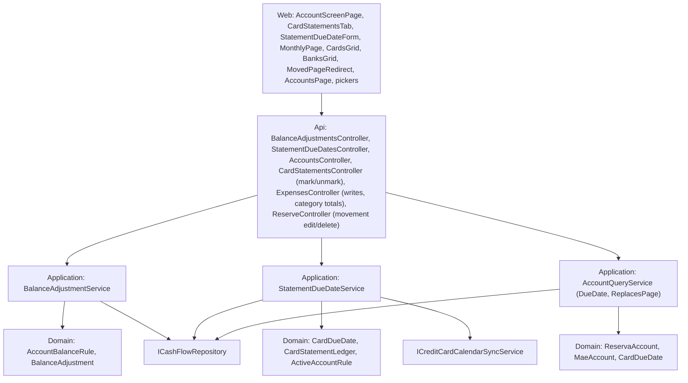

# Technical Specification: Consolidated Navigation and Retirement

Complexity: **complex**. Two moves the account screen still needs (balance adjustments on an account route, a per-statement due date with its calendar sync), the readers of `/banks` and `/credit-cards` moved to `/accounts`, a server rule for old links, Monthly reduced to an overview, then the retirement of four pages, Monthly's entry tabs and every endpoint only they used, with parity's after side moved onto the replacement routes PR by PR. No data-file change: the file stays V5.

**Strict no-comments policy** in all code, XML docs included (CLAUDE.md). Existing doc comments on lines a PR rewrites are deleted, not reworded. No new packages.

## 1. Technical Overview

**What.**
- **Adjustments route (1a):** `POST accounts/{accountId}/adjustments`, `PUT …/adjustments/{adjustmentId}`, `DELETE …/adjustments/{adjustmentId}` replace the three `banks/{id}/adjustments` writes. `BalanceAdjustmentService` works out the current balance with `AccountBalanceRule` itself and stops depending on `IBankService`.
- **Due date per statement (1b, 1c):** `PUT accounts/{accountId}/statements/{year}/{month}/due-date` sets or clears one statement's due date and triggers the calendar sync on every save. Clearing clears only that statement; setting still clears the later statements' dates. The card's Statements tab gets a "Due date" action on every row that isn't paid, including a month with no stored statement yet (the current month before its first charge), which the route creates as `PUT credit-cards` does today.
- **Readers off `/banks` and `/credit-cards` (1d):** the account screen's form options, the statement payer list, Mensais, Integrations and Investment accounts read `GET accounts`. `AccountDTO` gains `DueDate` (a card's current due date).
- **Old links (1e):** `AccountDTO` gains `ReplacesPage` (`"reserva"` / `"controle-mae"`), set by the existing Domain rules `ReservaAccount.Find` / `MaeAccount.Find` (first account with the capability in file order, active or not). One `MovedPageRedirect` component serves `/admin/cashflow/reserve-buckets` now, `/cashflow/controle-mae` (3a) and `/cashflow/reserva` (3b); with no target it lands on Accounts with "That page moved to the account screen."
- **Monthly overview (2):** Summary (category totals, income totals and tithe with the carry-forward checkbox, banks grid, read-only cards grid) and All transactions. The Bank expenses, Credit card expenses, Income and Bank balance adjustment tabs go. Each bank and card row links to its account screen at the viewed month. CashFlow lands on Accounts; the CashFlow menu takes the PRD order.
- **Retirements (3a–3g):** Controle Mãe, Reserva, Admin Banks with `/banks`, Admin Credit cards with `/credit-cards`, `/transfers`, `card-statements/{y}/{m}`, and Monthly's expense reads (§5 lists every route). Each PR removes its page, menu entry, client methods, type aliases, services and tests, adds its redirect, and moves parity's after side onto the replacement route (§3 "Parity").
- **Close (4):** E2E smoke journeys on the account screen, the test seed with one account per template, docs, example data, the full screen checklist and the final parity run.

**Why.** F08, F10 and F12 put every per-account task on the account screen; the old pages now duplicate it. Two tasks still live only on old pages (Reconcile through `/banks/.../adjustments`, due dates on Admin Credit cards and Monthly's Card tab), and five readers still read `/banks` or `/credit-cards`, so they move first.

**Delivery.** Four stages (user, Q10), **14 PRs**: the 8 non-test code file limit splits the PRD's "about 10" (§3 "PR size", where each split is named). Every PR leaves `main` deployable and ends with a parity run against `p60-deployed-f12` expecting 0 differences. Deploy only after stage 4.

| Stage | PR | Content | Web |
|---|---|---|---|
| **1 — Moves** | **1a** | Adjustments account route; account screen Reconcile and adjustment edit/delete use it | Client paths only |
| | **1b** | Per-statement due-date route, calendar sync, F07 clear rule replaced on the new route | None (generated `openapi.ts` only) |
| | **1c** | "Due date" action and form on the Statements tab | Card screen |
| | **1d** | Form options, payer list, Mensais, Integrations, Investment accounts read `/accounts`; `AccountDTO.DueDate`; `BankOption` type | Pickers |
| | **1e** | `AccountDTO.ReplacesPage`; `MovedPageRedirect`; reserve-buckets redirect follows file order; Accounts page notice | Redirect, Accounts page |
| **2 — Overview** | **2** | Monthly overview with row links; CashFlow lands on Accounts; menu order; add-expense E2E moves to the account screen | Monthly, sidebar |
| **3 — Retire** | **3a** | Controle Mãe: page, hook, `controle-mae` routes, `ControleMaeService`; redirect; parity `current/mae` | Menu, redirect |
| | **3b** | Reserva page, hook, split and withdrawal forms; redirect | Menu, redirect |
| | **3c** | Reserva API: `reserve` routes except movements PUT/DELETE, `reserve-buckets`, `ReserveBucketService`, `GetReservaPots`; parity `pots` and `current/pots` | Client only |
| | **3d** | Admin Banks, `/banks`, `BankService`, `GET banks/{id}/adjustments`; parity `banks` | Menu, redirect |
| | **3e** | Admin Credit cards page; the expense form's credit-card list | Menu, redirect, expense form |
| | **3f** | `/credit-cards`, `CreditCardService`, F07's clear-all rule; `/transfers`; `card-statements/{y}/{m}`; parity `cards` | Client only |
| | **3g** | `expenses/month/{y}/{m}` and `…/unpaid-card-charges`; parity `cards/unpaidChargesTotal` | Client only |
| **4 — Close** | **4** | E2E journeys, seed, docs, example data, fixed-name test, checklist, final parity, PRD ticks | E2E only |

**Compatibility between PRs.**
- From 1a Monthly's Bank tab writes adjustments through the new route too (it shares `useBalanceAdjustmentForm` and the client methods); its list still reads `GET banks/{id}/adjustments` until stage 2 removes the tab and 3d removes the route.
- From 1b both due-date paths work: the Statements tab (1c) with the per-statement rule, and `PUT credit-cards` (Admin Credit cards until 3e, Monthly's Card tab until 2) with F07's rule, which 3f deletes.
- From 1d the forms' bank lists come from `/accounts`, ordered by name (PRD §6: `/banks` readers keep file order only until F13). Monthly (until 2) and Reserva (until 3b) still pass `BankDto[]` from `/banks`, which `BankOption` accepts.
- Each page's API stays until the PR that retires it (3c after 3b, 3d after 1a, 1d, 2 and 3b, 3e after 1b and 1c, 3f after 1d, 2 and 3e, 3g after 2), so the latest PR can always be reverted on its own and leaves a working app.

**Scope.**

*Included:*
- Everything in PRD F13 Capabilities, Experience, Error Handling and Section 9 F13, plus the cross-feature criterion that names F13 (§7).
- *Input contracts (Consumes):*
  - **F08:** statement payment transfers, `card-statements/{id}/mark-paid` / `unmark-paid`, the card screen and its Statements tab (`CardStatementsTab`, `useCardStatements`, `GET accounts/{id}/statements`).
  - **F10:** linked deposits and withdrawals (`accounts/{potsId}/deposits`, `…/withdrawals`, `accounts/operations/{id}`), the Pots tab (`accounts/{id}/pots/{y}/{m}`), `reserve/movements` PUT/DELETE.
  - **F12:** the Settlement screen, `accounts/{id}/settlement-entries`, `accounts/{id}/settlements`, `AccountDetailDTO.CurrentBalances`.
  - **F04, F14, F16:** `accounts/groups/default/summary/{y}/{m}`, `accounts/groups/by-template/{y}/{m}`, `accounts/transactions/{y}/{m}`.
- *Output:* the final navigation and the account-scoped API; nothing later consumes it.

*Excluded:*
- A reimbursement transaction type; the F10–F12 UI clean-up list, except items inside files F13 deletes.
- Carrying over Controle Mãe's list from a chosen date and its all-time totals row, and the Reserva page's split-percentage warning, "Total split" rows and all-time movement list (PRD, user Q4/Q5).
- Removing `ReservaAccount` and `MaeAccount` from the Domain: `ReplacesPage` (1e) and `CashFlowSpreadsheetImport` keep using them.
- Removing `withdrawalExpenseCategories.ts`: `usePotWithdrawalForm` uses it; its pot-name category default is a form default, not a join between balances, accounts and a category (§3 "Fixed-name lookups").
- A data-file version change (§6).

## 2. Architecture Impact

**Layers and direction** (design.md's four questions):
1. **Where it belongs:** the CashFlow bounded context.
   - **Domain:** `CardDueDate` (per-statement set and clear, 1b; `ClearSupersededBy` removed, 3f).
   - **Application:** `BalanceAdjustmentService` (1a, 3d), `StatementDueDateService` (new, 1b), `AccountQueryService` (`AccountDTO.DueDate`, `ReplacesPage`), and the removal of `ControleMaeService`, `ReserveBucketService`, `BankService`, `CreditCardService`, `TransferService` and the retired parts of `ReserveService`, `CardStatementService`, `ExpenseService`.
   - **Infrastructure:** `CashFlowJsonRepository.GetReservaPots` removed (3c).
   - **Api:** `BalanceAdjustmentsController`, `StatementDueDatesController` (new); retired controllers and actions.
   - **Web:** account screen, Monthly, navigation, redirects, pickers. **Scripts:** parity.
2. **Which layers, in which direction:** Domain ← Application ← Infrastructure/Api, plus the web app over the API. No PR adds a dependency; most remove one.
3. **What keeps Domain free of Infrastructure:** `ICashFlowRepository` (Application) as today; the calendar sync is reached through `ICreditCardCalendarSyncService` (Application); the Domain has no clock, so "the Statements tab's months" (through the current month) is worked out in the service with `TimeProvider`.
4. **Which SOLID principles it leans on:**
   - **SRP:** `StatementDueDateService` owns due-date writes; `CardDueDate` owns the rule; `AccountQueryService` stays the read side; `BalanceAdjustmentService` owns adjustments without borrowing `BankService`'s balance.
   - **OCP:** pickers filter by capability (`CanPayBills`, `HasStatements`), never the template name; the redirect rule comes from capability-based Domain rules, so a new template needs no redirect code.
   - **ISP:** `IBankService`, `ICreditCardService`, `ITransferService`, `IControleMaeService`, `IReserveBucketService` go; `IReserveService`, `ICardStatementService`, `IExpenseService` keep only what the account screen uses.
   - **DIP:** services reach data only through `ICashFlowRepository` and the calendar through its interface; the web reaches the API only through `apiClient`.



## 3. Technical Decisions

| Decision | Chosen | Rejected | Why |
|---|---|---|---|
| **Adjustments route** (user Q1; 1a) | New `Financial.Api/Controllers/BalanceAdjustmentsController.cs`, `[Route("accounts")]` like `SettlementController`: `POST {accountId:guid}/adjustments` → 201, `PUT {accountId:guid}/adjustments/{adjustmentId:guid}` → 200, `DELETE {accountId:guid}/adjustments/{adjustmentId:guid}` → 204; null body → 400. The three `banks/{id}/adjustments` writes are removed in the same PR; `GET banks/{id}/adjustments` stays for Monthly's Bank tab until 3d. | Keep both route families until 3d | A moved route with two addresses invites drift; no caller is left on the old writes after 1a. |
| **Adjustment DTOs** (1a) | `BalanceAdjustmentCreateDTO`, `…UpdateDTO`, `BalanceAdjustmentDTO` unchanged, `bankId` / `bankName` included. | Rename to `accountId` / `accountName` | A wire rename touches every adjustment row reader for no behaviour; the account route already names the account. |
| **Adjustment balance** (1a) | `BalanceAdjustmentService` drops `IBankService`: current balance = `AccountBalanceRule.Balance(account, date, records)` over `AccountTransactionReader.Read(_repository)` minus the edited adjustment. The account is found in `GetAccounts()` (404 "Account"); `BalanceAdjustment.Create` keeps refusing an account without `CanReconcile`. No new active-account rule (moved, not changed). `IBankService.GetBankBalanceAsOf` and its implementation are deleted. | Keep calling `BankService` | User Q1; `BankService` leaves in 3d. Pot and Settlement transactions contribute 0 to a bank, so the balance equals `GetBankBalanceAsOf`'s. |
| **Due-date route** (user Q3; 1b) | `PUT accounts/{accountId:guid}/statements/{year:int}/{month:int}/due-date`, body `StatementDueDateUpdateDTO { DueDate: DateOnly? }` (null clears) → **204**. New `Financial.Api/Controllers/StatementDueDatesController.cs` (`[Route("accounts")]`). | Key by statement id | A month without a stored statement has no id (the Statements tab already lists it with `id` null). |
| **Due-date service** (1b) | New `IStatementDueDateService` / `StatementDueDateService` (Application, singleton in `AddFinancialCashFlowApplication`), `SetDueDateAsync(accountId, year, month, StatementDueDateUpdateDTO)`, the span/log pattern of every service (`StartServiceSpan("CashFlow", nameof(StatementDueDateService), "SetDueDate", "CardStatement")`). Order: account by id (404 "Account"); `CardAccountRule.EnsureIsCard` ("Barclays is not a card account."); `ActiveAccountRule.EnsureUsable(null, card)` ("Amex is inactive."); the month must be a row of `CardStatementLedger.For(card, …, today.Year, today.Month)`, i.e. a row the Statements tab lists (else 404 "Card statement"); a Paid row → 400 "The October 2026 statement is paid, so its due date can't change."; then save and `ICreditCardCalendarSyncService.TriggerSync(card.Id)` on every successful save, set or clear. | Put it in `CardStatementService` | `CreditCardCalendarSyncService` depends on `ICardStatementService`; injecting the sync there would make a cycle. |
| **Due-date rule** (user Q3; 1b) | `CardDueDate.SetOn(Account card, IEnumerable<CardStatement> statements, CardStatement statement, DateOnly dueDate)`: refuses a date outside the statement's month ("The due date must be in October 2026.", month name invariant), clears the due date of the card's statements after that month, sets the date. `CardDueDate.EnsureDueDateAllowed(row, dueDate)` makes the paid and in-month refusals before the save starts, so a refused request creates nothing. Setting creates the statement when missing (`CardStatementCreation.EnsureFor`, as `PUT credit-cards` does). Clearing calls `statement.SetDueDate(null)` on that statement only, and is a no-op (still 204, still syncs) when no statement is stored for the month. `CardDueDate.For` is unchanged. | Allow any date | Every reader maps the card's latest date to the statement of the date's own month (calendar amount, banner paid check, `PUT credit-cards`); a date in another month would pair it with the wrong statement. |
| **F07 clear-all rule** (user Q3; 1b, 3f) | `CardDueDate.ClearSupersededBy` (clear every statement on null) stays only for `PUT credit-cards` and is deleted with it in 3f. | Change it in 1b | Admin Credit cards and Monthly's Card tab keep their behaviour until they retire; the Statements tab never uses it. |
| **Due-date action** (user Q3; 1c) | On `CardStatementsTab`, every row whose status is not Paid (Unpaid and Nothing due, stored or not) gets a "Due date" button (`aria-label` "Set the October 2026 due date") beside Pay, only when `canAct`. It opens an inline `StatementDueDateForm` above the grid (same panel as Pay; one form open at a time): title "October 2026 due date", Field "Due date" (`type="date"`, `min`/`max` the statement month's first and last day, pre-filled with the row's date), Save ("Save due date"), Cancel, then "Clear due date" set apart from them (only when the row has a date). Toasts "Due date saved" / "Due date cleared"; the statements reload and focus returns to the Statements heading. A card with no rows (no charges ever) shows "No statements yet" and no action. Inactive card note: "This card is inactive, so its statements can't be paid, unmarked or given a due date here." | A date cell edited in place | An inline form gives labels, validation and the saving state the docs/ui form rules ask for; the grid stays read-only. |
| **Due-date form states** (1c) | **Validation:** empty date on Save → "Enter a due date."; outside the month → "The due date must be in October 2026." (focus to the field). **Saving:** fieldset disabled, spinner on the button. **Server error:** `MessageBar` in the form, value kept; network → `NETWORK_SAVE_ERROR`. **Unsaved changes:** the form joins the screen's discard prompt (`guardChange`, as the Pay form). **Disabled:** inactive card → no button. | — | Mandatory state design. |
| **`BankOption`** (1d) | Hand-written in `types.ts` above the aliases: `export type BankOption = Pick<AccountDto, 'id' \| 'name' \| 'isActive' \| 'roundUpEnabled'>`. Every form and hook that takes banks switches its type from `BankDto` to `BankOption` (one repeated change); `BankDto` and `AccountDto` both satisfy it. 3d deletes the `BankDto` alias and sweeps the test fixtures typed `BankDto` to `BankOption` (one repeated change). | Pass `AccountDto[]` everywhere | Monthly and Reserva keep passing `BankDto[]` until they retire; a structural type lets both coexist without a cast. |
| **Bank lists** (1d) | `useAccountFormOptions`, `useCardStatements` (payers) and `useMensais` read `apiClient.getAccounts()` and keep the accounts with capability `CanPayBills` (every Bank-template account today), inactive ones included (the forms already keep only active ones plus the edited record's own, `selectableBanks`). Order: the server's, by name. | Filter by `templateName` | PRD §6: code checks capabilities, never the template. |
| **Card due date for Integrations** (1d) | `AccountDTO.DueDate` (`DateOnly?`): `CardDueDate.For(account, statements)` for accounts with `HasStatements`, else null. `useCalendarSyncStatuses` lists accounts with `HasStatements`, active, with `dueDate` (as today's filter on `nextInvoiceDueDate`). | Add name and due date to `CreditCardCalendarSyncStatusDTO` | That endpoint lists only cards with a recorded status; the page needs the card list. |
| **Investment accounts** (1d) | `InvestmentAccountsPage` takes the cards from its existing `useAccounts()` list (`HasStatements`); `InvestmentAccountFormDialog.creditCards` becomes `AccountDto[]`; its active-or-current filter stays. | Keep `useCreditCards` | Its only remaining reader would be Admin Credit cards. |
| **Old-link target** (user Q7; 1e) | `AccountDTO.ReplacesPage` (`string?`): `"reserva"` on the account `ReservaAccount.Find(GetAccounts())` returns, `"controle-mae"` on `MaeAccount.Find`'s, else null. Both rules pick the first account with the capability (`HasPots`, `HasParticipants`) in file order, active or not, as the old pages did. `GET accounts` stays ordered by name. | A `GET accounts/moved-page-targets` endpoint | Same rule, but a new endpoint is three more files (interface, controller, client) in a PR family already at the limit. |
| **Redirect component** (1e, 3a, 3b) | `pages/MovedPageRedirect.tsx({ page, tab? })` reads `useAccounts()`: loading → `LoadingState`; failed → `ErrorState` with `ACCOUNTS_LOAD_ERROR` and Retry; the account whose `replacesPage === page` → `<Navigate replace to="/cashflow/accounts/{id}[?tab=…]">`; none → `<Navigate replace to="/cashflow/accounts" state={{ movedNotice: true }}>`. `REDIRECT_ROUTES`: `admin/cashflow/reserve-buckets` → `page="reserva" tab="pots"` (1e, replaces `ReserveBucketsRedirect.tsx`), `cashflow/controle-mae` → `page="controle-mae"` (3a), `cashflow/reserva` → `page="reserva" tab="pots"` (3b). | One redirect component per page | One rule, one place. |
| **Moved notice** (1e) | `AccountsPage` shows an info `MessageBar` "That page moved to the account screen." when `location.state.movedNotice` is set; it has no dismiss and goes on the next navigation. | A query parameter | Router state doesn't survive a reload, so the notice doesn't stick to a bookmark. |
| **Admin redirects** (user Q7; 3d, 3e) | `admin/cashflow/banks` and `admin/cashflow/credit-cards` → `<Navigate replace to="/admin/cashflow/accounts" />` in `REDIRECT_ROUTES`, no notice. | The moved notice | Admin → Accounts is the replacement page itself, not a fallback. |
| **Menus** (user Q10; 2, 3a, 3b, 3d, 3e) | Each retirement PR removes its own menu entry together with its page route (`routes.test.ts` requires every `PAGE_ROUTES` entry in `NAV_TREE` and back, so the page and its entry must leave together). Stage 2 lands CashFlow on Accounts and orders the remaining CashFlow entries as the PRD: Accounts, Monthly, Annual Summary, Mensais, Investment Snapshots, then Reserva and Controle Mae until 3b and 3a remove them. Labels keep their current wording. | Remove all menu entries in stage 2 | A page with a route but no entry fails `routes.test.ts`, and a page reachable only by URL for weeks helps no one. |
| **Landing** (PRD; 2) | `RootRedirect`: stored domain `cashflow` → `/cashflow/accounts`. | — | PRD Experience. |
| **Monthly overview** (user Q6; 2) | `MonthlyPage`: month picker and two tabs, Summary (default) and All transactions. Summary keeps `CategoryTotalsGrid`, `CardsGrid`, `BanksGrid`, `IncomingGrid` (tithe and the carry-forward checkbox). `useMonthly` fetches only `getCategoryTotalsByMonth`, `getDefaultGroupSummary`, `getTitheSummaryByMonth`, and keeps the carry-forward toggle; everything else (expenses, unpaid charges, card statements, banks, income sources, categories, incomes, mark/unmark, deletes) goes. | Keep the old tabs read-only | User Q6: entry lives only on the account screen. |
| **Cards grid** (user Q6; 2) | Read-only; rows are the summary's card members (`member.statement` set): Card (link), Outstanding (period) = `statement.outstandingTotal`, Accumulated outstanding = `totalOwed` (`formatOwedOrCredit`), Status (Paid / Unpaid / "Nothing due"), footer from `currencyTotals.cardOutstandingTotal`. Props `cardStatements`, `banks`, `markPaidSources`, `creditCards`, `onUpdateCreditCard` and the management columns go. Sort and the card filter stay. | Keep reading `card-statements/{y}/{m}` and `/credit-cards` | Both retire (3f); the summary already carries the same figures (parity maps them since F07/F14). |
| **Row links** (user Q6; 2) | `BanksGrid` and `CardsGrid` render the account name as a link to `/cashflow/accounts/{id}?month=YYYY-MM` (the viewed month), as the Accounts page does. | Card links to the Statements tab | One link shape for both grids; the card screen's month view shows that statement. |
| **Expense form card list** (3e) | `useExpenseForm`, `ExpenseForm`, `expenseDefaults.computeDefaultInvoiceMonth` and `useAccountActionForms` drop the `creditCards` parameter (`NO_CREDIT_CARDS`): after stage 2 no caller passes a card, so the invoice-month default is already the date-derived one. | Retype it to an account list | Dead once Monthly's forms go; removing it is what lets `CreditCardDto` go in 3f. |
| **Client methods and types** (every retirement) | An `apiClient` method and its `types.ts` aliases leave with the route they call, not with the page. | With the page | Keeps each page PR web-only and each route PR self-contained (3b/3c, 3e/3f). |
| **Earlier features' tests** (every retirement) | A test of F02–F16 that reads or writes a retired route moves onto the replacement route and keeps its `AC` trait when its criterion still holds; it is deleted only when the criterion was that route's own shape (F02-10's `/banks`/`/transfers` shapes, F11's "controle-mae keeps its shapes" cases). Each PR body lists both groups. | Delete every such test | Most of them prove a rule (migration totals, statement maths) that outlives the route. |
| **Retired-route test** (AC 05; 3a–3g) | New `Tests/Financial.Api.Tests/Acceptance/RetiredRoutesAcceptanceTests.cs`; each retirement PR adds its routes to a theory asserting **404** (`MapFallback("/api/{**path}")` answers unknown API paths), and a second theory asserts the routes the account screen keeps still answer (2xx or 400 on an empty body). | One test per controller file | One file proves the whole list at the end. |
| **Fixed-name lookups** (AC 06; 4) | New `Tests/Financial.Architecture.Tests/FixedNameLookupTests.cs`: no production source file (`ProductionSourceFiles()`, plus `Financial.Web/src` outside tests) contains `Category.ReservaName` or `RESERVA_CATEGORY_NAME`. Bank-name joins were removed in F04 (bank balances matched by id); 4's PR body records the grep for `.bank ===` / `bankName ===` joins in `Financial.Web/src`. The tools' private `ReservaName` constants (migration steps that must find the old name) are not `Category.ReservaName`. | Grep only | A test keeps them out after F13. |
| **Parity side switch** (user Q2; 3a) | `Get-ParityReport` gains `-RetiredRoutes`, which `Invoke-Parity.ps1` passes for the before side only (`p60-deployed-f12` still serves every route). Each retirement PR moves its route's collector behind it and gives the after side a collector on the replacement, mapped to the before key in `figure-map.json` (§3 "Parity mapping"). | Separate scripts per side | One report builder keeps both sides comparable. |
| **Parity mapping** (user Q2) | See the table after this one. | — | — |
| **Parity: Mãe fallback** (3a) | `Add-ParitySettlementFigures` loses its `controle-mae/entries/from/0001-01-01` fallback and `Get-ParityMaeBalancesByMonth`: every baseline from `p60-deployed-f11` serves the Settlement group, so both sides read `accounts/groups/by-template`. | Keep it before-only | Dead on both sides since F11's deploy. |
| **Parity: pots** (3c) | Both the before side's `pots/<bucket>/balance` and the after side's `potsTab/<pot>/balance` are emitted only when not zero (`pots/total` and `potsTab/total` always). | Keep zeros on the before side | The after side can no longer tell which pots ever had a movement (that list came from `reserve/movements`). Dropping zeros on both sides loses nothing: a pot whose balance differs is non-zero on at least one side and shows as a difference. |
| **Parity: card warning** (3f) | The `cards/<card>/warning` figure goes from both sides: `CardStatementDTO` has had no warning since F08, so it is always null. | Emit null from the replacement | A figure that can't differ only costs a mapping. |
| **Screen checklist** (2, 3a–3e, 4) | Rows whose after side was a retiring page read that page on the before side (5291) and the replacement on the after side (5292) from the PR that retires it; new rows N1–N6 (§7). | — | The checklist keeps comparing the same values. |
| **Seed** (user Q8; 4) | `Tests/Financial.Api.Tests/TestData/data-cashflow.test.json` (V5) gains a "Amex" card account (`CreditCard`, GBP) with two charges in October 2026 (category Mercado, `CreditCardCharge`) and a stored unpaid October 2026 statement, and a "Mãe" Settlement account (BRL + GBP, other participant "Mãe") with two entries leaving a non-zero balance. | Seed through the API in global setup | The E2E environment starts from a file (`web-e2e` action). |
| **E2E** (user Q8; 2, 4) | `add-expense.spec.ts` moves to the account screen in **2** (it opens Monthly's Bank expenses tab, which 2 removes, so the `web-e2e` job would fail otherwise): Accounts → Barclays → Add expense; the three cases stay. **4** adds `@smoke` journeys, each leaving the seed as it found it so CI retries and local reruns start equal: `pay-card-statement.spec.ts` (Amex → Statements → Pay October 2026 → Barclays → Paid "from Barclays"; then Unmark), `pots-deposit.spec.ts` (Reserva → Deposit with no bank, description `e2e-<runId>` → the row and the Pots tab total; then delete the operation), `settle.spec.ts` (Mãe → Settle → Save settlement → "Both totals become zero." → "Settled"; then delete the entry). | Leave add-expense on Monthly until 4 | CI would fail from 2 to 4. |
| **Example data** (PRD; 4) | `data/data-cashflow.example.json` (V5, today only Mãe) gains one account per template: "Current account" (Bank), "Credit card" (CreditCard), "Savings" (Pots, one pot at 100 %, with a "Savings" category it needs), keeping Mãe. | Leave it | PRD: example data describes the account model. |
| **Docs** (PRD; 1b, 4) | 1b: README "Calendar integration" says the sync runs when a statement's due date is set or cleared on the card's Statements tab. 4: `context.md` CashFlow features (accounts and templates, Monthly overview, no Reserva/Controle Mãe pages), README CashFlow sections, `docs/ui/react.md` and `docs/ui/current-state-audit.md` references to retired pages, the design doc's status line ("implemented by P60 F01–F16"). Dated compliance audits under `docs/ui/compliance-audit/` stay as written (history). | — | — |
| **PR size** | Non-test code files per PR in §4 (DTOs, DI registration, the snapshot and generated `openapi.ts` listed but not counted; deleted files not counted, user Q9). Every PR is at most 8. 1d, 3d and 3f carry one repeated change each (type rename or typed-fixture sweep) that the design rule exempts. Totals above about 15 come from earlier features' tests moving off a retired route (3a, 3c, 3d, 3f, 3g); fallback for any of them: split into (i) tests and parity moved to the replacement routes while the old route still exists, then (ii) the removal. | 10 PRs | 8-file limit; merging 1b+1c, 3b+3c, 3e+3f or 3f+3g gives 11–12 non-test files each and needs the user's overage approval. |
| **Rollback** | No data-file change; any PR reverts on its own (§1 "Compatibility"). | — | — |

**Parity mapping per retired route** (before side: the route on `p60-deployed-f12`, behind `-RetiredRoutes`; after side: the replacement):

| Retired route (PR) | Before figures | After-side replacement | `figure-map.json` |
|---|---|---|---|
| `controle-mae/entries/totals` (3a) | `current/mae/totalBrl`, `/totalGbp` | `current/maeAccount/totalBrl`, `/totalGbp` = the BRL and GBP `currentBalances` of `accounts/{id}/{y}/{m}` (current month) for the account with `replacesPage` `controle-mae` | `current/maeAccount/totalBrl` → `current/mae/totalBrl`; `current/maeAccount/totalGbp` → `current/mae/totalGbp` |
| `controle-mae/entries/from/{date}` (3a) | none (fallback only) | none (fallback removed on both sides) | — |
| `reserve/movements` GET (3c) | `{m}/pots/<bucket>/balance` (non-zero), `{m}/pots/total` | existing `potsTab` from `accounts/{id}/pots/{y}/{m}`, now for the account with `replacesPage` `reserva`, non-zero pots only | existing F10 mappings |
| `reserve/balances` (3c) | `current/pots/<bucket>/balance` (every Reserva pot) | `current/potsTab/<pot>/balance` = every pot of `accounts/{reservaId}/pots/{y}/{m}` at the run's last month (the range ends at or after the last record) | `current/potsTab/*/balance` → `current/pots/*/balance` |
| `reserve-buckets`, `…/split-status`, `income-split`, `withdrawals` (3c) | none | — | — |
| `banks` (3d) | the bank list behind `{m}/banks/<bank>/roundUpTotal`, `{m}/monthly/bankTotalsSum`, `/roundUpTotalsSum` | `accounts` (`templateName` `Bank`) for the per-bank figures; the sums come from the existing `summary` and `templateGroups` mappings (F04, F14) | existing |
| `banks/month/{y}/{m}/balances` (3d) | `{m}/banks/<bank>/balance` | existing `account/<bank>/balance` (F05) | existing |
| `expenses/month/{y}/{m}` (3d on the after side, route removed in 3g) | `{m}/banks/<bank>/roundUpTotal` | `{m}/account/<bank>/roundUpTotal` = Σ `roundUp` of `accounts/{id}/transactions/{y}/{m}` for every Bank account | `{month}/account/*/roundUpTotal` → `{month}/banks/*/roundUpTotal` |
| `card-statements/{y}/{m}` (3f) | `{m}/cards/<card>/outstandingTotal`, `/accumulatedOutstandingTotal`, `/isPaid` (stored statements); `{m}/monthly/cardOutstandingTotal` | `{m}/cardStatement/<card>/outstandingTotal` (`viewedStatement.outstandingTotal`), `/accumulatedOutstandingTotal` (`totalOwed`), `/isPaid` (`viewedStatement.isPaid`) from `accounts/{id}/{y}/{m}` for every card account every month, when `viewedStatement.id` is set; the fill step fills `cardStatement/…` on the after side for active cards without a stored statement; the sum from the existing `summary/totals/GBP/cardOutstandingTotal` mapping | three `{month}/cardStatement/*/<field>` → `{month}/cards/*/<field>` |
| `expenses/month/{y}/{m}/unpaid-card-charges` (3g) | `{m}/cards/unpaidChargesTotal` | `{m}/monthTransactions/unpaidCardChargesTotal` = Σ `transaction.expense.value` of `accounts/transactions/{y}/{m}` rows whose `expense.creditCardId` is set and `expense.paymentStatus` is `CreditCardCharge` | `{month}/monthTransactions/unpaidCardChargesTotal` → `{month}/cards/unpaidChargesTotal` |
| `/credit-cards`, `/transfers`, `banks/{id}/adjustments`, `opening-balance` | none (parity never read them) | — | — |

**Choices made by the spec writer** (open for the user's review):
1. 14 PRs (1a–1e, 2, 3a–3g, 4) instead of about 10; the merges that would need overage approval are named in "PR size".
2. The old `banks/{id}/adjustments` writes go in 1a, not 3d; the new route answers 201/200/204 as the other account routes, where `/banks` answered 200/200/200.
3. Adjustment DTOs keep `bankId` / `bankName`; no active-account rule is added to the moved routes.
4. Due-date route keyed by year and month, body `{ dueDate }`, null clears, 204; its own controller and service.
5. A due date must fall in its statement's month; a paid statement's date can't change; the month must be one the Statements tab lists.
6. The "Due date" action sits on every row that isn't Paid (Unpaid and Nothing due), stored or not, so the current month before its first charge is covered; a card with no charges at all has no rows and no action.
7. Clearing a month with no stored statement is a 204 no-op that still triggers the sync.
8. `PUT credit-cards` keeps F07's clear-all rule until 3f deletes it.
9. Due-date form: inline panel, "Save due date" / "Clear due date" / Cancel, date limited to the month, toasts "Due date saved" / "Due date cleared".
10. `BankOption` structural type; the `BankDto` rename in production code is one repeated change in 1d, the test-fixture sweep one repeated change in 3d.
11. Bank pickers filter by `CanPayBills` and become name-ordered.
12. `AccountDTO.DueDate` feeds Integrations; Investment accounts derive its cards from `useAccounts`.
13. `AccountDTO.ReplacesPage` carries the old-link rule instead of a new endpoint; one `MovedPageRedirect`; the reserve-buckets redirect now follows file order, inactive accounts included.
14. The moved notice travels in router state; admin redirects carry no notice.
15. Menu entries leave with their pages; stage 2 reorders the rest to the PRD order, labels unchanged.
16. Monthly's cards grid lists the default group's card members (active, or inactive and still owing or with records that month).
17. Bank and card rows link to `?month=` only (no tab).
18. The expense form's credit-card list is removed in 3e.
19. Client methods and type aliases leave with their routes.
20. Earlier features' AC tests move onto replacement routes, keeping their traits, unless they tested the retired shape.
21. `RetiredRoutesAcceptanceTests` and `FixedNameLookupTests` as the AC 05 and AC 06 proofs.
22. Parity: `-RetiredRoutes` switch; Mãe fallback removed; zero pot balances dropped on both sides; the card warning figure dropped; new after-side families `maeAccount`, `current/potsTab`, `account/…/roundUpTotal`, `cardStatement`, `monthTransactions/unpaidCardChargesTotal`.
23. `add-expense.spec.ts` moves in 2; each new E2E journey undoes its own change.
24. Seed card "Amex" with an unpaid October 2026 statement; seed "Mãe" with two entries.
25. Example data gains one account per template plus the category the Pots account needs.
26. `ReservaAccount` and `MaeAccount` stay in the Domain; `withdrawalExpenseCategories.ts` stays.
27. `GET incomes/month/{y}/{m}` stays with the rest of `/incomes` (`useOperationRoute` reads it).
28. `banks/{id}/opening-balance` and `transfers/bank/{id}` retire with their controllers (no caller).

## 4. Component Overview

All paths are relative to the repo root. Existing patterns: account-scoped controllers with `[Route("accounts")]` (`SettlementController`, `PotsController`); `ArgumentException` → 400 and `KeyNotFoundException` (`FirstOrThrow`) → 404 in `DomainExceptionMappingMiddleware`; the span/log telemetry shape; DTO mapping in the owning service; acceptance tests deriving from `ApiEndpointTests` with `TestClock` and `FakeCreditCardCalendarSyncService`; inline account-screen forms as hook + component (`usePayCardStatementForm` pattern inside `useCardStatements`).

**Domain (`Financial.CashFlow.Domain`)**

| File | New/Modified | PR | Key responsibilities |
|---|---|---|---|
| `Rules/CardDueDate.cs` | Modified | 1b, 3f | `SetOn` (1b); `ClearSupersededBy` deleted (3f) |

**Application (`Financial.CashFlow.Application`)**

| File | New/Modified/Deleted | PR | Key responsibilities |
|---|---|---|---|
| `Services/BalanceAdjustmentService.cs`, `Interfaces/IBalanceAdjustmentService.cs` | Modified | 1a, 3d | Own balance, `accountId` parameters (1a); `GetAdjustmentsByBank` deleted (3d) |
| `Services/BankService.cs`, `Interfaces/IBankService.cs` | Modified, Deleted | 1a, 3d | `GetBankBalanceAsOf` deleted (1a); both deleted (3d) |
| `Interfaces/IStatementDueDateService.cs`, `Services/StatementDueDateService.cs` | New | 1b | §3 "Due-date service" |
| `DTOs/StatementDueDateUpdateDTO.cs` | New | 1b | `DueDate` (`DateOnly?`) |
| `DependencyInjection/CashFlowApplicationServiceCollectionExtensions.cs` | Modified | 1b, 3a, 3c, 3d, 3f | Registers `IStatementDueDateService`; drops each retired service |
| `Services/AccountQueryService.cs`, `DTOs/AccountDTO.cs` | Modified | 1d, 1e | `DueDate` (1d); `ReplacesPage` (1e) |
| `Services/ControleMaeService.cs`, `Interfaces/IControleMaeService.cs`, `DTOs/MaeLedgerEntryCreateDTO.cs`, `MaeLedgerEntryDTO.cs`, `MaeLedgerEntryValuesUpdateDTO.cs`, `MaeLedgerTotalsDTO.cs` | Deleted | 3a | — |
| `Services/ReserveService.cs`, `Interfaces/IReserveService.cs` | Modified | 3c | Keep `UpdateMovementAsync` / `DeleteMovementAsync`; a pot is resolved among the pots of the account owning the movement (was `GetReservaPots`) |
| `Services/ReserveBucketService.cs`, `Interfaces/IReserveBucketService.cs`, `Services/ReserveSplitRule.cs`, `DTOs/IncomeSplitRequestDTO.cs`, `IncomeSplitResultDTO.cs`, `BucketSplitAmountDTO.cs`, `WithdrawalRequestDTO.cs`, `ReserveBucketBalanceDTO.cs`, `ReserveBucketDTO.cs`, `ReserveSplitStatusDTO.cs` | Deleted | 3c | And any type only they use |
| `Interfaces/ICashFlowRepository.cs` | Modified | 3c | `GetReservaPots` deleted |
| `DTOs/BankDTO.cs`, `BankCreateDTO.cs`, `BankUpdateDTO.cs`, `BankBalanceDTO.cs`, `BankOpeningBalanceUpdateDTO.cs` | Deleted | 3d | — |
| `Services/CreditCardService.cs`, `Interfaces/ICreditCardService.cs`, `DTOs/CreditCardDTO.cs`, `CreditCardCreateDTO.cs`, `CreditCardUpdateDTO.cs`, `Services/TransferService.cs`, `Interfaces/ITransferService.cs`, `DTOs/TransferDTO.cs`, `TransferCreateDTO.cs`, `TransferUpdateDTO.cs` | Deleted | 3f | — |
| `Services/CardStatementService.cs`, `Interfaces/ICardStatementService.cs` | Modified | 3f | `GetStatementsForMonth` deleted |
| `Services/ExpenseService.cs`, `Interfaces/IExpenseService.cs` | Modified | 3g | `GetExpensesByMonth`, `GetUnpaidCardChargesByMonth` deleted |

**Infrastructure (`Financial.CashFlow.Infrastructure`)**

| File | Modified | PR | Key responsibilities |
|---|---|---|---|
| `Repositories/CashFlowJsonRepository.cs` | Modified | 3c | `GetReservaPots` deleted |

**Api (`Financial.Api`)**

| File | New/Modified/Deleted | PR | Key responsibilities |
|---|---|---|---|
| `Controllers/BalanceAdjustmentsController.cs` | New | 1a | §5 |
| `Controllers/BanksController.cs` | Modified, Deleted | 1a, 3d | Three adjustment writes removed (1a); deleted (3d) |
| `Controllers/StatementDueDatesController.cs` | New | 1b | §5 |
| `Controllers/ControleMaeController.cs` | Deleted | 3a | — |
| `Controllers/ReserveController.cs` | Modified | 3c | Keeps `PUT`/`DELETE movements/{id}` |
| `Controllers/ReserveBucketsController.cs` | Deleted | 3c | — |
| `Controllers/CreditCardsController.cs`, `TransfersController.cs` | Deleted | 3f | — |
| `Controllers/CardStatementsController.cs` | Modified | 3f | Keeps mark-paid, unmark-paid |
| `Controllers/ExpensesController.cs` | Modified | 3g | Keeps writes, move-to-statement, category totals |
| `Tests/Financial.Api.Tests/Contract/openapi-v1.snapshot.json`, `Financial.Web/src/api/generated/openapi.ts` | Regenerated | 1a, 1b, 1d, 1e, 3a, 3c, 3d, 3f, 3g | Not counted |

**Web (`Financial.Web/src`)**

| File | New/Modified/Deleted | PR | Key responsibilities |
|---|---|---|---|
| `api/financialApiClient.ts` | Modified | 1a, 1c, 3a, 3c, 3d, 3f, 3g | Adjustment paths (1a); `setStatementDueDate` (1c); retired methods leave with their routes |
| `api/types.ts` | Modified | 1c, 1d, 3a, 3c, 3d, 3f | `StatementDueDateUpdateDto` (1c); `BankOption` (1d); retired aliases leave with their schemas |
| `hooks/useStatementDueDateForm.ts`, `components/StatementDueDateForm.tsx` | New | 1c | §3 "Due-date action", "Due-date form states" |
| `components/CardStatementsTab.tsx`, `hooks/useCardStatements.ts`, `pages/AccountScreenPage.tsx` | Modified | 1c, 1d, 3e | Due date button, form, `refresh`, discard guard (1c); payers from `/accounts` (1d); `NO_CREDIT_CARDS` removed (3e) |
| `hooks/useAccountFormOptions.ts`, `hooks/useMensais.ts`, `hooks/useCalendarSyncStatuses.ts`, `pages/InvestmentAccountsPage.tsx`, `components/InvestmentAccountFormDialog.tsx` | Modified | 1d | §3 "Bank lists", "Card due date for Integrations", "Investment accounts" |
| `components/BalanceAdjustmentForm.tsx`, `BillExpenseFields.tsx`, `ExpenseForm.tsx`, `FundedFromSection.tsx`, `FundingLinesField.tsx`, `IncomeForm.tsx`, `PotDepositForm.tsx`, `PotWithdrawalForm.tsx`, `UkExpensePromptDialog.tsx`, `hooks/useBalanceAdjustmentForm.ts`, `useExpenseForm.ts`, `useIncomeForm.ts` | Modified | 1d | `BankDto` → `BankOption` (one repeated change) |
| `pages/MovedPageRedirect.tsx` | New | 1e | §3 "Redirect component" |
| `pages/ReserveBucketsRedirect.tsx` | Deleted | 1e | Replaced by `MovedPageRedirect` |
| `navigation/routes.tsx`, `navigation/lazyPages.tsx` | Modified | 1e, 3a, 3b, 3d, 3e | Redirect routes; retired pages leave |
| `pages/AccountsPage.tsx` | Modified | 1e | Moved notice |
| `pages/MonthlyPage.tsx`, `pages/MonthlyPage.css`, `hooks/useMonthly.ts`, `components/CardsGrid.tsx`, `components/BanksGrid.tsx` | Modified | 2 | §3 "Monthly overview", "Cards grid", "Row links" |
| `hooks/mapTransferErrorToField.ts` | Modified | 2 | Keeps only `TransferFormField`; its mapper went with `useTransferForm` |
| `pages/RootRedirect.tsx`, `navigation/navTree.ts` | Modified | 2, 3a, 3b, 3d, 3e | Landing (2); menu order (2); entries leave with their pages |
| `components/BankOperationsSection.tsx/.css`, `hooks/useBankOperations.ts`, `hooks/useTransferForm.ts`, `components/ExpensesSection.tsx/.css`, `components/IncomeSection.tsx/.css` | Deleted | 2 | Monthly-only |
| `pages/ControleMaePage.tsx/.css`, `hooks/useControleMae.ts` | Deleted | 3a | — |
| `pages/ReservaPage.tsx/.css`, `hooks/useReserva.ts`, `components/IncomeSplitForm.tsx/.css`, `components/WithdrawalForm.tsx` | Deleted | 3b | `EditMovementForm` stays (account screen) |
| `pages/BanksPage.tsx`, `hooks/useBanks.ts`, `components/BankFormDialog.tsx` | Deleted | 3d | — |
| `pages/CreditCardsPage.tsx`, `hooks/useCreditCards.ts`, `components/CreditCardFormDialog.tsx` | Deleted | 3e | — |
| `components/ExpenseForm.tsx`, `hooks/useExpenseForm.ts`, `utils/expenseDefaults.ts`, `hooks/useAccountActionForms.ts` | Modified | 3e | §3 "Expense form card list" |

**Parity, tests data and docs**

| File | PR | Change |
|---|---|---|
| `scripts/parity/Parity.psm1` | 3a, 3c, 3d, 3f, 3g | §3 "Parity mapping" |
| `scripts/parity/Invoke-Parity.ps1` | 3a | `-RetiredRoutes` for the before side |
| `scripts/parity/figure-map.json`, `scripts/parity/README.md` | 3a, 3c, 3d, 3f, 3g | Mappings; figure catalogue |
| `scripts/parity/screen-checklist.md` | 1c, 2, 3a, 3b, 3d, 3e, 4 | §7 |
| `Financial.Web/tests/e2e/*.spec.ts` | 2, 4 | §3 "E2E" |
| `Tests/Financial.Api.Tests/TestData/data-cashflow.test.json` | 4 | §3 "Seed" |
| `data/data-cashflow.example.json`, `context.md`, `README.md`, `docs/ui/react.md`, `docs/ui/current-state-audit.md`, `docs/pending/cashflow-accounts-generalization.md` | 1b (README), 4 | §3 "Docs", "Example data" |
| `docs/prd/P60-…/prd-cashflow-accounts-generalization.md` | 4 | F13 and cross-feature ticks (own commit) |

**Files per PR** (non-test code counted; listed after "+" are excluded or test/doc files; deleted files not counted):
- **1a (7):** `BalanceAdjustmentsController.cs`, `BanksController.cs`, `BalanceAdjustmentService.cs`, `IBalanceAdjustmentService.cs`, `BankService.cs`, `IBankService.cs`, `financialApiClient.ts` + snapshot, `openapi.ts`, `BalanceAdjustmentsEndpointsTests`, `BalanceAdjustmentServiceTests`, `BankServiceTests`, `BanksEndpointsTests`, `InactiveAccountRecordsAcceptanceTests`, `ThrowingApiHost`, `financialApiClient.test.ts`: 14 plus the two generated files.
- **1b (4):** `CardDueDate.cs`, `IStatementDueDateService.cs`, `StatementDueDateService.cs`, `StatementDueDatesController.cs` + `StatementDueDateUpdateDTO.cs`, DI, README, snapshot, `openapi.ts`, `CardDueDateTests`, `StatementDueDateServiceTests` (new), `StatementDueDateAcceptanceTests` (new): about 12.
- **1c (7):** `useStatementDueDateForm.ts`, `StatementDueDateForm.tsx`, `CardStatementsTab.tsx`, `useCardStatements.ts`, `AccountScreenPage.tsx`, `financialApiClient.ts`, `types.ts` + `useStatementDueDateForm.test.ts`, `useCardStatements.test.ts`, `CardStatementsTab.test.tsx`, `AccountScreenPage.test.tsx`, `financialApiClient.test.ts`, `screen-checklist.md`: about 13.
- **1d (8 + 12 repeated):** `types.ts`, `useAccountFormOptions.ts`, `useCardStatements.ts`, `useMensais.ts`, `useCalendarSyncStatuses.ts`, `InvestmentAccountsPage.tsx`, `InvestmentAccountFormDialog.tsx`, `AccountQueryService.cs`; the 12 `BankDto` → `BankOption` files + `AccountDTO.cs`, snapshot, `openapi.ts`, `AccountQueryServiceTests`, `AccountEndpointsAcceptanceTests` (`dueDate`), `useAccountFormOptions.test.ts`, `useCardStatements.test.ts`, `useMensais.test.ts`, `useCalendarSyncStatuses.test.ts`, `InvestmentAccountsPage.test.tsx`, `InvestmentAccountFormDialog.test.tsx`: about 32 (sweep exempt). Fallback: 1d-i (`BankOption` + rename sweep, no behaviour) and 1d-ii (the readers, 8).
- **1e (5):** `AccountQueryService.cs`, `MovedPageRedirect.tsx`, `routes.tsx`, `lazyPages.tsx`, `AccountsPage.tsx` + `AccountDTO.cs`, snapshot, `openapi.ts`, `AccountQueryServiceTests`, `NavigationRetirementAcceptanceTests` (new), `MovedPageRedirect.test.tsx` (new), `routes.test.ts`, `AccountsPage.test.tsx`: about 13.
- **2 (8):** `MonthlyPage.tsx`, `MonthlyPage.css`, `useMonthly.ts`, `CardsGrid.tsx`, `BanksGrid.tsx`, `mapTransferErrorToField.ts`, `RootRedirect.tsx`, `navTree.ts` + `MonthlyPage.test.tsx`, `useMonthly.test.ts`, `CardsGrid.test.tsx`, `BanksGrid.test.tsx`, `RootRedirect.test.tsx`, `Sidebar.test.tsx`, `add-expense.spec.ts`, `screen-checklist.md`: about 16.
- **3a (7):** `financialApiClient.ts`, `types.ts`, `navTree.ts`, `routes.tsx`, `lazyPages.tsx`, `Parity.psm1`, `Invoke-Parity.ps1` + DI, snapshot, `openapi.ts`, `figure-map.json`, parity README, `Parity.test.ps1`, `RetiredRoutesAcceptanceTests` (new), `SettlementTemplateAcceptanceTests`, `FxRateProviderCompositionAcceptanceTests`, `routes.test.ts`, `SidebarFlyout.test.tsx`, `financialApiClient.test.ts`, `screen-checklist.md`: about 20.
- **3b (3):** `navTree.ts`, `routes.tsx`, `lazyPages.tsx` + `routes.test.ts`, `Sidebar.test.tsx`, `MovedPageRedirect.test.tsx`, `screen-checklist.md`: about 7.
- **3c (8):** `ReserveController.cs`, `ReserveService.cs`, `IReserveService.cs`, `ICashFlowRepository.cs`, `CashFlowJsonRepository.cs`, `financialApiClient.ts`, `types.ts`, `Parity.psm1` + DI, snapshot, `openapi.ts`, `figure-map.json`, parity README, `Parity.test.ps1`, `RetiredRoutesAcceptanceTests`, `ReserveServiceTests`, `ReserveEndpointsTests`, `LinkedPotOperationsAcceptanceTests`, `PotsTemplateAcceptanceTests`, `InactiveAccountRecordsAcceptanceTests`, `IncomesEndpointsTests`, `InvestmentSnapshotsEndpointsTests`, `DomainExceptionLoggingTests`, `StubCashFlowRepository`, `SyncStatusCashFlowRepositoryStub`, `CashFlowJsonRepositoryTests`, `CashFlowJsonRepositoryConcurrencyTests`, `FailedSaveRollbackTests`, `financialApiClient.test.ts`: about 32 (fallback split in "PR size").
- **3d (8):** `BalanceAdjustmentService.cs`, `IBalanceAdjustmentService.cs`, `financialApiClient.ts`, `types.ts`, `navTree.ts`, `routes.tsx`, `lazyPages.tsx`, `Parity.psm1` + DI, snapshot, `openapi.ts`, `figure-map.json`, parity README, `Parity.test.ps1`, `RetiredRoutesAcceptanceTests`, `AccountModelBankMigrationAcceptanceTests`, `DefaultAccountGroupSummaryAcceptanceTests`, `GenericAccountTransferAcceptanceTests`, `BalanceAdjustmentsEndpointsTests`, `BalanceAdjustmentServiceTests`, `SpaFallbackTests`, `ObservabilityBackendUnreachableTests`, `ThrowingApiHost` (a throwing `IAccountQueryService` on `GET accounts`) with `ExceptionMappingTests` and `ProductionErrorBoundaryTests`, `DomainExceptionLoggingTests`, `ConstructorGuardTests`, `AccountTemplateReadRuleTests` (allow-list loses `BankService`), `routes.test.ts`, `financialApiClient.test.ts`, plus the `BankDto` typed-fixture sweep (one repeated change, about 15 web test files): about 45.
- **3e (8):** `navTree.ts`, `routes.tsx`, `lazyPages.tsx`, `ExpenseForm.tsx`, `useExpenseForm.ts`, `expenseDefaults.ts`, `useAccountActionForms.ts`, `AccountScreenPage.tsx` + `routes.test.ts`, `Sidebar.test.tsx`, `ExpenseForm.test.tsx`, `useExpenseForm.test.ts`, `expenseDefaults.test.ts`, `useAccountActionForms.test.ts`, `AccountScreenPage.test.tsx`, `screen-checklist.md`: about 16.
- **3f (7):** `CardDueDate.cs`, `CardStatementsController.cs`, `CardStatementService.cs`, `ICardStatementService.cs`, `financialApiClient.ts`, `types.ts`, `Parity.psm1` + DI, snapshot, `openapi.ts`, `figure-map.json`, parity README, `Parity.test.ps1`, `RetiredRoutesAcceptanceTests`, `CardDueDateTests`, `CardStatementServiceTests`, `CardStatementsEndpointsTests`, `CreditCardDueDateEventSyncAcceptanceTests`, `CardRefundsAndCreditAcceptanceTests`, `CreditCardTemplateAcceptanceTests`, `InactiveAccountRecordsAcceptanceTests`, `InvestmentSnapshotsEndpointsTests`, `AccountModelBankMigrationAcceptanceTests`, `GenericAccountTransferAcceptanceTests`, `ExpenseEndpointsTests`, `StubCashFlowRepository`, `financialApiClient.test.ts`, plus the remaining `CreditCardDto` typed fixtures: about 30.
- **3g (5):** `ExpensesController.cs`, `ExpenseService.cs`, `IExpenseService.cs`, `financialApiClient.ts`, `Parity.psm1` + snapshot, `openapi.ts`, `figure-map.json`, parity README, `Parity.test.ps1`, `RetiredRoutesAcceptanceTests`, `AccountModelBankMigrationAcceptanceTests`, `CreditCardTemplateAcceptanceTests`, `PotsTemplateAcceptanceTests`, `StatementPaymentAcceptanceTests`, `ExpenseEndpointsTests`, `MensaisEndpointsTests`, `ExpenseServiceTests`, `financialApiClient.test.ts`: about 20.
- **4 (0):** `pay-card-statement.spec.ts`, `pots-deposit.spec.ts`, `settle.spec.ts` (new), `data-cashflow.test.json`, `AccountModelBankMigrationAcceptanceTests` (example data: one account per template), `FixedNameLookupTests` (new), `data-cashflow.example.json`, `context.md`, `README.md`, `docs/ui/react.md`, `docs/ui/current-state-audit.md`, the design doc, `screen-checklist.md`, the PRD: about 14.

## 5. API Contracts

No authentication (single-user app, as every route). Base path `/api/v1/financial`. Amounts are JSON numbers.

**`POST accounts/{accountId}/adjustments`** (1a) → **201** `BalanceAdjustmentDTO`. Body `BalanceAdjustmentCreateDTO` (unchanged):

```json
{ "date": "2026-11-07", "targetBalance": 1234.56, "note": "Statement" }
```

```json
{ "id": "…a1", "date": "2026-11-07", "bankId": "…b1", "bankName": "Barclays", "targetBalance": 1234.56, "delta": -12.30, "note": "Statement" }
```

**`PUT accounts/{accountId}/adjustments/{adjustmentId}`** (1a) → **200** `BalanceAdjustmentDTO`, body `BalanceAdjustmentUpdateDTO` (same fields). **`DELETE accounts/{accountId}/adjustments/{adjustmentId}`** (1a) → **204**.

| Case | HTTP | Message |
|---|---|---|
| Unknown account | 404 | Account '…' was not found. |
| Adjustment unknown or of another account | 404 | Balance adjustment '…' was not found. |
| Account without `CanReconcile` | 400 | Account 'Amex' cannot be reconciled. |
| Invalid target balance | 400 | `BalanceAdjustment`'s existing message |
| Null body | 400 | — |

**`PUT accounts/{accountId}/statements/{year}/{month}/due-date`** (1b) → **204**.

| Field | Type | Required | Validation |
|---|---|---|---|
| `dueDate` | `date?` | Yes (null clears) | In the statement's month |

```json
{ "dueDate": "2026-10-25" }
```

| Case | HTTP | Message |
|---|---|---|
| Unknown account | 404 | Account '…' was not found. |
| Not a card | 400 | Barclays is not a card account. |
| Inactive card | 400 | Amex is inactive. |
| Month not listed on the Statements tab | 404 | Card statement '2026-12' was not found. |
| Paid statement | 400 | The October 2026 statement is paid, so its due date can't change. |
| Date outside the month | 400 | The due date must be in October 2026. |
| Null body | 400 | — |

**`GET accounts`** gains (1d, 1e), both optional and nullable:

```json
{ "id": "…c1", "name": "Amex", "templateName": "CreditCard", "dueDate": "2026-10-25", "replacesPage": null, "…": "…" }
{ "id": "…p1", "name": "Reserva", "templateName": "Pots", "dueDate": null, "replacesPage": "reserva", "…": "…" }
{ "id": "…m1", "name": "Mãe", "templateName": "Settlement", "dueDate": null, "replacesPage": "controle-mae", "…": "…" }
```

**Removed routes** (each returns 404 afterwards; `RetiredRoutesAcceptanceTests`):

| PR | Routes |
|---|---|
| 1a | `POST banks/{id}/adjustments`, `PUT banks/{id}/adjustments/{adjustmentId}`, `DELETE banks/{id}/adjustments/{adjustmentId}` (moved) |
| 3a | `POST controle-mae/entries`, `GET controle-mae/entries/from/{fromDate}`, `GET controle-mae/entries/totals`, `PUT controle-mae/entries/{id}/values`, `DELETE controle-mae/entries/{id}` |
| 3c | `POST reserve/income-split`, `POST reserve/withdrawals`, `GET reserve/balances`, `GET reserve/movements`, `GET reserve-buckets`, `GET reserve-buckets/split-status` |
| 3d | `GET banks`, `POST banks`, `PUT banks/{id}`, `DELETE banks/{id}`, `PUT banks/{id}/opening-balance`, `GET banks/month/{y}/{m}/balances`, `GET banks/{id}/adjustments` |
| 3f | `GET credit-cards`, `POST credit-cards`, `PUT credit-cards/{id}`, `DELETE credit-cards/{id}`, `POST transfers`, `PUT transfers/{id}`, `DELETE transfers/{id}`, `GET transfers/month/{y}/{m}`, `GET transfers/bank/{id}`, `GET card-statements/{y}/{m}` |
| 3g | `GET expenses/month/{y}/{m}`, `GET expenses/month/{y}/{m}/unpaid-card-charges` |

**Kept** (user Q1): `POST expenses`, `PUT`/`DELETE expenses/{id}`, `POST expenses/{id}/move-to-statement`, `GET expenses/month/{y}/{m}/category-totals`, `POST card-statements/{id}/mark-paid`, `POST …/unmark-paid`, `PUT`/`DELETE reserve/movements/{id}`, every `incomes` route (including `GET incomes/month/{y}/{m}`), `tithe`, `payments-due`, `integrations/calendar/*`, every `accounts/*` route.

The snapshot and `openapi.ts` are regenerated in 1a, 1b, 1d, 1e, 3a, 3c, 3d, 3f and 3g.

## 6. Data Model

No change: the file stays **V5** (confirmed: the per-statement due date is the existing `CardStatement.DueDate`; `AccountDTO.DueDate` and `ReplacesPage` are computed, never stored). `migrate`, the version guard and the import are untouched.

**Business rules:**
- **Card due date** (F07, unchanged reader): the due date of the card's latest statement that has one (`CardDueDate.For`); the calendar sync, the payments-due banner and `AccountDTO.DueDate` read it.
- **Per-statement write** (1b): a statement's date lies in its own month; setting it clears the card's later statements' dates; clearing touches only that statement.
- **Old-link target** (1e): the first account with `HasPots` (Reserva) / `HasParticipants` (Mãe) in file order, active or not.
- **Pickers** (1d): accounts with `CanPayBills`, by name.

## 7. Testing Strategy

Following the `testing-guide-Financial` skill:
- **Unit:** Domain, Application services, web components, hooks and helpers.
- **Integration:** the API host through acceptance tests (`TestClock` in November 2026, `FakeCreditCardCalendarSyncService`, inline V5 seeds), the OpenAPI contract test, the architecture tests, `Parity.test.ps1`.
- **E2E:** Playwright `@smoke` specs in the `web-e2e` job on the seed file.
- **AC tracing:** `[Trait("AC", "P60-F13-consolidated-navigation-and-retirement-NN")]` (web: `[AC P60-F13-consolidated-navigation-and-retirement-NN]` in the test name), numbered 01–10 in PRD order.
- **Conventions:** every class carries `[Trait("Category", …)]`; names follow `Method_Condition_Result`; shared doubles only in `Tests/Financial.TestUtilities`; no wall-clock reads; every new case has a negative path.

| Test file | Type | PR | Coverage goal |
|---|---|---|---|
| `Tests/Financial.Api.Tests/BalanceAdjustmentsEndpointsTests.cs` | Integration | 1a, 3d | The account routes, codes 201/200/204, every row of §5's adjustment errors; the edited adjustment is left out of its own balance (1a); `GET banks/{id}/adjustments` cases deleted (3d) |
| `Tests/Financial.CashFlow.Application.Tests/Services/BalanceAdjustmentServiceTests.cs` | Unit | 1a, 3d | Delta from `AccountBalanceRule` without `IBankService`; unknown account; account without `CanReconcile` |
| `Tests/Financial.CashFlow.Domain.Tests/Rules/CardDueDateTests.cs` | Unit | 1b, 3f | `SetOn` sets, clears later dates, leaves earlier ones, refuses a date outside the month; `ClearSupersededBy` cases deleted (3f) |
| `Tests/Financial.CashFlow.Application.Tests/Services/StatementDueDateServiceTests.cs` (new) | Unit | 1b | Set on a stored statement; set on a listed month with no statement creates it; clear one leaves the others; clear with nothing stored is a no-op; every refusal; `TriggerSync` once per save, set or clear, never on a refusal; span success and failure |
| `Tests/Financial.Api.Tests/Acceptance/StatementDueDateAcceptanceTests.cs` (new) | Integration (AC) | 1b | AC 03 (below), §5's due-date errors, `GET accounts/{id}/statements` shows the dates afterwards (`GET accounts` gains `dueDate` in 1d, pinned there by `AccountEndpointsAcceptanceTests`) |
| `…/hooks/__tests__/useStatementDueDateForm.test.ts` (new), `…/components/__tests__/CardStatementsTab.test.tsx` (the form's rendering, limits, button order and saving state) | Unit | 1c | Button on Unpaid and Nothing due rows, stored or not, never on Paid or when inactive; month limits; validation messages and focus; saving disables; server and network errors keep the value; Clear only with a date; toasts; discard prompt |
| `…/hooks/__tests__/useAccountFormOptions.test.ts`, `useCardStatements.test.ts`, `useMensais.test.ts`, `useCalendarSyncStatuses.test.ts`, `…/pages/__tests__/InvestmentAccountsPage.test.tsx` | Unit | 1d | Each reads `getAccounts`, keeps `CanPayBills` (or `HasStatements`) accounts including inactive ones, never calls `getBanks` / `getCreditCards`; Integrations lists active cards with a `dueDate` |
| `Tests/Financial.CashFlow.Application.Tests/Services/AccountQueryServiceTests.cs` | Unit | 1d, 1e | `DueDate` for a card (latest dated statement), null otherwise; `ReplacesPage` on the first `HasPots` and first `HasParticipants` account in file order, inactive included, a second one null |
| `Tests/Financial.Api.Tests/Acceptance/NavigationRetirementAcceptanceTests.cs` (new) | Integration (AC) | 1e | `GET accounts` carries `replacesPage` per the rule with two Pots and two Settlement accounts in non-alphabetical file order |
| `…/pages/__tests__/MovedPageRedirect.test.tsx` (new) | Unit | 1e, 3a, 3b | Loading, error with Retry, target found (with and without tab), none → Accounts with the notice |
| `…/pages/__tests__/AccountsPage.test.tsx` | Unit | 1e | Notice shown only with `movedNotice` state |
| `…/navigation/__tests__/routes.test.ts` | Unit | 1e, 3a, 3b, 3d, 3e | `REDIRECT_ROUTES` grows per PR; retired paths are absent from `PAGE_ROUTES` and `NAV_TREE` |
| `…/pages/__tests__/MonthlyPage.test.tsx`, `…/hooks/__tests__/useMonthly.test.ts`, `…/components/__tests__/CardsGrid.test.tsx`, `BanksGrid.test.tsx` | Unit | 2 | Two tabs only; no entry button or form; the three fetches only; links with the viewed month; cards grid has no Mark paid, Unmark, due date or Active; carry-forward toggle still works |
| `…/pages/__tests__/RootRedirect.test.tsx`, `…/components/__tests__/Sidebar.test.tsx`, `SidebarFlyout.test.tsx` | Unit | 2, 3a, 3b, 3d, 3e | CashFlow lands on Accounts; menu entries per PR, final lists as the PRD |
| `Financial.Web/tests/e2e/add-expense.spec.ts` | E2E | 2 | The three cases on the account screen |
| `Tests/Financial.Api.Tests/Acceptance/RetiredRoutesAcceptanceTests.cs` (new) | Integration (AC) | 3a, 3c, 3d, 3f, 3g | Each retired route 404; each kept route still answers |
| `scripts/parity/Parity.test.ps1` | Script | 3a, 3c, 3d, 3f, 3g | Each new collector on fake responses; `-RetiredRoutes` reads old routes only on the before side; the new mappings resolve; non-zero pot rule; fill on the `cardStatement` prefix |
| Earlier features' tests listed per PR in §4 | Unit, Integration | 3a–3g | Moved onto replacement routes, traits kept (§3 "Earlier features' tests") |
| `Tests/Financial.Architecture.Tests/AccountTemplateReadRuleTests.cs` | Integration | 3d | Allow-list = `Account`, `AccountJsonConverter` |
| `…/components/__tests__/ExpenseForm.test.tsx`, `…/hooks/__tests__/useExpenseForm.test.ts`, `…/utils/__tests__/expenseDefaults.test.ts` | Unit | 3e | Invoice month defaults from the date without a card list |
| `Financial.Web/tests/e2e/pay-card-statement.spec.ts`, `pots-deposit.spec.ts`, `settle.spec.ts` (new) | E2E | 4 | §3 "E2E" |
| `Tests/Financial.Architecture.Tests/FixedNameLookupTests.cs` (new) | Unit | 4 | §3 "Fixed-name lookups", with a planted-violation case |
| `Tests/Financial.Api.Tests/Acceptance/AccountModelBankMigrationAcceptanceTests.cs` | Integration | 3d, 3f, 3g, 4 | Moved onto `/accounts` routes (3d, 3f, 3g); seed and example data are V5 and hold one account per template (4) |

**Acceptance criteria (PRD Section 9, F13):**

| AC | Criterion (short) | Test | PR |
|---|---|---|---|
| 01 | CashFlow lands on Accounts; menus match the F13 lists | `RootRedirect.test.tsx` "[AC …-01] lands CashFlow on Accounts" (2); `Sidebar.test.tsx` "[AC …-01] shows the F13 CashFlow and Admin CashFlow menus" (3e, when the last entry leaves) | 2, 3e |
| 02 | Monthly is only the overview; bank and card rows link to the account screen at the viewed month | `MonthlyPage.test.tsx` "[AC …-02] shows Summary and All transactions with no entry forms"; `CardsGrid.test.tsx` and `BanksGrid.test.tsx` "[AC …-02] links each row to its account screen at the viewed month" | 2 |
| 03 | Due date set and cleared on the Statements tab; clearing one leaves the others; calendar sync on each save | `StatementDueDateAcceptanceTests.SetAndClear_OneStatement_LeavesTheOthersAndSyncsTheCalendarEachTime`, `…Set_MonthWithoutAStatement_CreatesItWithTheDate` (1b); `CardStatementsTab.test.tsx` "[AC …-03] sets and clears a statement's due date" (1c) | 1b, 1c |
| 04 | Reserva, Controle Mãe, Admin Banks and Admin Credit cards removed; old routes redirect | `routes.test.ts` "[AC …-04] redirects every retired page address" (3e); `MovedPageRedirect.test.tsx` "[AC …-04] …" cases (1e, 3a, 3b); `NavigationRetirementAcceptanceTests.Accounts_ReplacesPage_FirstPotsAndSettlementInFileOrder` (1e) | 1e, 3a, 3b, 3d, 3e |
| 05 | Endpoints only those pages used are removed; routes the account screen uses stay; snapshot and types updated | `RetiredRoutesAcceptanceTests.RetiredRoute_Returns404`, `…KeptRoute_StillAnswers` (3a–3g); `OpenApiContractTests`; `openapiFreshness.test.ts` | 3a, 3c, 3d, 3f, 3g |
| 06 | No `Category.ReservaName`, `RESERVA_CATEGORY_NAME` or bank-name joins | `FixedNameLookupTests.Production_Source_Has_No_Fixed_Name_Lookups` (4); PR 4 grep note | 4 |
| 07 | E2E smoke journeys pass in `web-e2e` | `add-expense.spec.ts` (2), `pay-card-statement.spec.ts`, `pots-deposit.spec.ts`, `settle.spec.ts` "[AC …-07] …" (4) | 2, 4 |
| 08 | `context.md`, README, example data and `docs/ui/` describe the account model | `AccountModelBankMigrationAcceptanceTests.ExampleData_HasOneAccountPerTemplate` "[AC …-08]" (4); doc review | 4 |
| 09 | Final parity run with the full chain: 0 differences, full screen checklist ticked | Definition of Done of PR 4 | 4 |
| 10 | `/simplify`; architecture-reviewer and ui-reviewer | Definition of Done, every PR | all |

**Cross-feature criterion** (ticked in PR 4): **After F13, every task that F08, F10 and F12 moved onto the account screen is no longer reachable from a retired page, and the old links redirect to it:** `routes.test.ts` (no retired page in `PAGE_ROUTES` or `NAV_TREE`; their addresses in `REDIRECT_ROUTES`), `RetiredRoutesAcceptanceTests` (their write routes 404), the E2E journeys (pay a statement, deposit into pots, settle on the account screen), checklist rows N4.

**Screen checklist rows** (`screen-checklist.md`):
- **Rewritten:** Monthly "Unpaid card charges" reads each card's Transactions tab for that statement month on the after side, and "Card statements" the card's Statements tab (2); Reserva rows read the Reserva Pots and Transactions tabs (3b); Controle Mãe rows read the Mãe header and Transactions (3a). Rows B2, C1, C2, P1, P2, S1, S4, S5 and T2 compare with the retired page on the before side (5291) from the PR that retires it.
- **N1 (1c, after copy only):** Amex → Statements → Due date on October 2026 → 25 Oct → the column and Settings → Integrations show it; Clear due date on November 2026 leaves October's (M1).
- **N2 (2):** with CashFlow last used, opening `/` lands on Accounts; Monthly shows Summary and All transactions only, with the before side's Summary figures; each bank and card name opens its account screen at the viewed month (M1, M3).
- **N3 (2, 3e):** CashFlow menu: Accounts, Monthly, Annual Summary, Mensais, Investment Snapshots; Admin CashFlow: Accounts, Categories, Income Sources, Investment Accounts, Recurring Bills (final in 3e).
- **N4 (1e, 3a, 3b, 3d, 3e):** `/cashflow/controle-mae` opens Mãe; `/cashflow/reserva` and `/admin/cashflow/reserve-buckets` open Reserva's Pots tab; `/admin/cashflow/banks` and `/admin/cashflow/credit-cards` open Admin → Accounts.
- **N5 (2):** at 320 px Monthly's grids stack with no horizontal page scroll; Tab reaches the month picker, tabs, sort buttons, filters and every row link with visible focus.
- **N6 (1c):** at 320 px the Statements tab with the due-date form open has no horizontal page scroll; Tab reaches Due date, the field, Save due date, Cancel and Clear due date.

**Proved by the Definition of Done**, for each PR:
- `dotnet build --configuration Release` and `dotnet test`;
- `npm run build` and `npm test` when the web changed (and when `openapi.ts` was regenerated);
- the snapshot and `openapi.ts` regenerated where §5 says;
- `scripts/parity/Invoke-Parity.ps1 -Step All -LiveCopy "E:\dev\projetos\financial\data\data-cashflow.json"` against `p60-deployed-f12`, expecting `Parity OK: 0 differences` with the SHA-256 unchanged; the figure count changes only in 3a (Mãe fallback gone), 3c (zero pots), 3f (card warning) and where a new after-side family adds keys; `Parity.test.ps1` when the parity scripts changed;
- `/simplify` and the architecture-reviewer, plus the ui-reviewer for 1c, 1d, 1e, 2, 3a, 3b, 3d, 3e; the screen is looked at in a browser on the dev data (`data/dev/data-cashflow.json`) for 1c, 1e, 2;
- PR 4: the final parity run on a fresh Google Drive download the user saves first, and the full screen checklist ticked.
