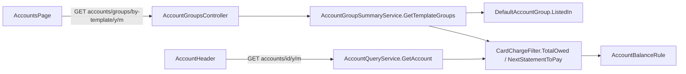

# Technical Specification: Accounts Page by Template and Card Totals

Complexity: **medium**. It adds one read endpoint and two card figures, changes one web page and the card header, and extends the parity report. No data file change.

**Strict no-comments policy** in all code, XML docs included (CLAUDE.md). Existing doc comments on lines a stage rewrites are deleted, not reworded.

## 1. Technical Overview

**What.**
- The Accounts page shows one grid per template (Banks, Credit cards, Pots; Settlement joins in F11), replacing F09's "Default group" and "Other accounts" sections.
- Each card shows its **next statement to pay** (the oldest statement month that still has an unpaid charge) and its **total owed** (every unpaid charge, whatever its date).
- The card screen header adds "Total owed now" next to the month-end "Owed at end of <month>".
- The server groups the accounts: a new `GET accounts/groups/by-template/{year}/{month}` returns the grids in order with their rows and per-currency totals. The page makes one request instead of three, and F09's `GET accounts/groups/other/{year}/{month}` is removed.

**Why.** The page is easier to scan by kind of account, and a card's month-end owed balance hides both what is due next and what is owed overall.

**Delivery.** Five PRs, each within the PR size rule (8 non-test code files, about 15 files in total; generated `openapi.ts` excluded). Each leaves `main` deployable and ends with a parity run against `p60-deployed-f09`. The user's split was four PRs (2026-10-30); counting files moved the next statement out of the endpoint PR, so the endpoint stays within 8 files.

| Stage | Content | Web |
|---|---|---|
| **1 — Total owed on the card screen** | `CardChargeFilter.TotalOwed`; `AccountDetailDTO.TotalOwed`; header "Total owed now"; parity maps it | Card screen header |
| **2 — Grouped endpoint** | `GET accounts/groups/by-template/{y}/{m}`: groups in template order, members with `IsActive` and `TotalOwed`, per-currency totals | None |
| **3 — Next statement** | `CardChargeFilter.NextStatementToPay`; member `NextStatement`; parity figures for the grouped endpoint | None |
| **4 — Accounts page** | The page reads the grouped endpoint and shows one grid per template | Accounts page |
| **5 — Retire Other accounts; ticks** | Remove `GET accounts/groups/other`, its client method and parity figure; PRD ticks | None |

**Scope.**

*Included:*
- Everything in PRD F14 Capabilities, Experience, Error Handling and Section 9 F14.
- *Input contracts (Consumes):*
  - F05: the Accounts page and the account screen header;
  - F07: card accounts and their month-end owed balance (`AccountBalanceRule`);
  - F08: stored statements and their paid status (`CardChargeFilter`);
  - F09: Pots accounts and the Other accounts endpoint (retired in stage 5).
- *Output contracts (Provides):*
  - the grouped endpoint and the page's grids per template (F10 makes the Pots rows links; F11 adds the Settlement grid);
  - each card's next statement and total owed, on the Accounts page and the card screen.

*Excluded:*
- A month picker on the Accounts page (user, 2026-10-30).
- Any change to Monthly, its summary figures or the default group's membership.
- Links from Pots rows (F10).
- Showing a card in credit differently from today (an F07 follow-up).

## 2. Architecture Impact

**Layers and direction** (design.md's four questions):
1. **Where it belongs:** the CashFlow bounded context.
   - **Domain:** the total owed and next statement rules (`CardChargeFilter`), the listing rule for every template (`DefaultAccountGroup`), the template order (`Account.TemplateOrder`).
   - **Application:** `AccountGroupSummaryService` builds the groups; `AccountQueryService` fills the header's total owed.
   - **Presentation:** `AccountGroupsController`, the Accounts page and the card header.
2. **Dependencies:** unchanged direction. No new package.
3. **Template reads:** only `Account` reads its template (`AccountTemplateReadRuleTests` allow-list unchanged). The group order comes from `Account.TemplateOrder`, the template's position in `AccountTemplates.Available`, and the group key from `Account.TemplateName`. No code compares template names; card behaviour keys off `Capability.HasStatements`.
4. **Data file:** unchanged (V4). Nothing is stored; both card figures are computed on read.



## 3. Technical Decisions

| Decision | Chosen approach | Alternative considered | Trade-off |
|---|---|---|---|
| **Who groups** (user, 2026-10-30) | The server returns the groups in order, already filtered, with their totals. The web maps a template name only to its heading, columns, footer label and whether rows link. | The web groups the three existing lists | One request, and order, membership and totals stay in one tested place. |
| **Route** | `GET accounts/groups/by-template/{year:int}/{month:int}` on `AccountGroupsController`. A month outside 1–12 → 400 through `DateTime.DaysInMonth` (as the other group routes). | `accounts/by-template` on `AccountsController` | Same controller as the summary and the route it replaces. |
| **Membership** | Unchanged rule: active accounts, plus an inactive one with a non-zero month-end balance or a record that month. `DefaultAccountGroup.ListedIn(accounts, year, month, records)` applies it to every template; `MembersFor` and (until stage 5) `OthersFor` filter its result by `JoinsDefaultGroup`. | A new rule class | The rule already lives there; one predicate for all three callers. |
| **Group order** | `Account.TemplateOrder` = the template's index in `AccountTemplates.Available` (Bank, CreditCard, Pots; F11 appends Settlement). Groups ordered by it, members by name (ordinal, ignore case, stable). A template with no listed account has no group. | Order list in the web | The template table is already the single list of templates. |
| **Total owed** | `CardChargeFilter.TotalOwed(card, records)` = `-AccountBalanceRule.Balance(card, DateOnly.MaxValue, records)`: every unpaid charge, paid statements and payments netted, whatever the date. `CardStatementService.AccumulatedOutstandingTotal` calls it. Positive when owed. Null on DTOs for accounts without `HasStatements`. | Sum of unpaid charges | Same figure as Monthly's accumulated outstanding, so parity compares it directly. |
| **Next statement** (user, 2026-10-30) | `CardChargeFilter.NextStatementToPay(expenses, statements, card)` = the earliest (year, month) of the card's charges that are unpaid (`CreditCardCharge` status on a statement that is not paid), with `OutstandingTotal` for that month; null when there is none. Empty unpaid statements and fully paid months are skipped. Only stored or charged months count; it never depends on the viewed month. | The oldest stored unpaid statement | Live data holds about 53 empty unpaid statements, which would show old £0.00 months. |
| **Member DTO** | `AccountGroupMemberDTO` gains `IsActive` (required), `TotalOwed` (`decimal?`) and `NextStatement` (`AccountNextStatementDTO?`). Both endpoints fill all three (the summary too, additive). `Balance` stays the signed month-end balance. | A separate member DTO for the grouped endpoint | One member shape; the page drops its `GET accounts` call for `IsActive`. |
| **Group totals** | `AccountTemplateGroupDTO.Totals`: one `AccountTemplateGroupTotalDTO { Currency, Total }` per currency, in first-member order. `Total` = sum of members' `TotalOwed ?? Balance`, so a card group totals what is owed and the others their month-end balances. | Reuse `CurrencyTotalDTO` | Its card fields mean the statement month's outstanding, not total owed. |
| **Card header** | `AccountDetailDTO.TotalOwed` (`decimal?`, null without `HasStatements`). The header keeps "Owed at end of <Month yyyy>" (long month, as today) and adds "Total owed now" with `TotalOwed` and the currency, only when it is not null. Same busy and inactive behaviour as the balance. | Short month in the header | The header already uses the long month; the PRD Experience line is corrected. |
| **Web grids** | `useAccountTemplateGroups(year, month)` replaces `useDefaultGroupAccounts` (one request). `accountTemplateGrid(templateName)` in `utils/accountTemplateLabel.ts` returns heading, footer label, columns kind and `linksRows`: Bank → "Banks", "Bank total", balance, links; CreditCard → "Credit cards", "Total owed", card, links; Pots → "Pots", "Pots total", balance, no links; any other → its template label, "Total", balance, no links. `accountTemplateLabel` gains Pots. | Columns from the server | Presentation stays in the web; an unknown template still renders. |
| **Card columns** | Account (link, Inactive badge), Currency, Next statement (`"Oct 2026 · 512.30"` via `formatMonthYear` and `formatN2`, or "—"), Total owed (`formatN2`, right-aligned). Balance and Template columns go. Footer per currency: "<label> <currency>" and `formatN2(total)`. | — | — |
| **Page states** | One loading state, one error ("Unable to load the accounts") with Try again for the whole page, as today. No groups at all → "No accounts this month". The subtitle "Balances at end of <Month yyyy>" stays. | Per-grid states | One request, so one state. |
| **Parity** | Stage 1: `{month}/cardAccount/<name>/totalOwed` for each active card in every month → `{month}/cards/*/accumulatedOutstandingTotal` (not negated); the card balance figure stays current-month only. Stage 3: `{month}/templateGroups/Bank/members/<name>/balance` → `banks/*/balance`; `{month}/templateGroups/Bank/totals/GBP` → `monthly/bankTotalsSum`; `{month}/templateGroups/CreditCard/members/<name>/totalOwed` → `cards/*/accumulatedOutstandingTotal`; `{month}/templateGroups/Pots/totals/GBP` → `pots/total`. Stage 5 removes `otherAccounts/potsTotal` and its mapping. The next statement, the card group total and Pots member balances have no baseline figure and are covered by tests. | Map the next statement to a month's `outstandingTotal` | The mapping format is static; the next statement's month varies per card. |
| **PR size** | Stage 2 is exactly 8 code files; stage 3 carries the grouped endpoint's parity figures to keep it there. | Four PRs | The user's four-PR split counted 10–12 files for the endpoint PR. |

## 4. Component Overview

All paths are relative to the repo root.

**Domain (`Financial.CashFlow.Domain`)**

| File | New/Modified | Stage | Key responsibilities |
|---|---|---|---|
| `Rules/CardChargeFilter.cs` | Modified | 1, 3 | `TotalOwed(card, records)` (1); `NextStatementToPay(expenses, statements, card)` returning `CardStatementMonth?` (3) |
| `Rules/CardStatementMonth.cs` | New | 3 | `sealed record CardStatementMonth(int Year, int Month, decimal OutstandingTotal)` |
| `Rules/DefaultAccountGroup.cs` | Modified | 2, 5 | `ListedIn` for every template; `MembersFor`/`OthersFor` filter it (2); `OthersFor` removed (5) |
| `Entities/Account.cs` | Modified | 2 | `TemplateOrder` |

**Application (`Financial.CashFlow.Application`)**

| File | New/Modified | Stage | Key responsibilities |
|---|---|---|---|
| `DTOs/AccountDetailDTO.cs` | Modified | 1 | `TotalOwed` |
| `Services/AccountQueryService.cs` | Modified | 1 | Fills `TotalOwed` for `HasStatements` |
| `Services/CardStatementService.cs` | Modified | 1 | Accumulated outstanding through `CardChargeFilter.TotalOwed` |
| `DTOs/AccountGroupMemberDTO.cs` | Modified | 2, 3 | `IsActive`, `TotalOwed` (2); `NextStatement` (3) |
| `DTOs/AccountTemplateGroupDTO.cs` | New | 2 | `TemplateName`, `Members`, `Totals` |
| `DTOs/AccountTemplateGroupTotalDTO.cs` | New | 2 | `Currency`, `Total` |
| `DTOs/AccountNextStatementDTO.cs` | New | 3 | `Year`, `Month`, `OutstandingTotal` |
| `Interfaces/IAccountGroupSummaryService.cs` | Modified | 2, 5 | `GetTemplateGroups(year, month)` (2); `GetOtherAccounts` removed (5) |
| `Services/AccountGroupSummaryService.cs` | Modified | 2, 3, 5 | Builds groups and totals (2); `NextStatement` (3); `GetOtherAccounts` removed (5) |

**Presentation**

| File | New/Modified | Stage | Key responsibilities |
|---|---|---|---|
| `Financial.Api/Controllers/AccountGroupsController.cs` | Modified | 2, 5 | `GET by-template/{year}/{month}` (2); `GET other/{year}/{month}` removed (5) |
| `Financial.Web/src/components/AccountHeader.tsx` | Modified | 1 | "Total owed now" |
| `Financial.Web/src/api/financialApiClient.ts`, `src/api/types.ts` | Modified | 4, 5 | `getAccountTemplateGroups` and its type aliases (4); `getOtherAccounts` removed (5) |
| `Financial.Web/src/hooks/useAccountTemplateGroups.ts` | New | 4 | One request; replaces `useDefaultGroupAccounts.ts` (deleted) |
| `Financial.Web/src/utils/accountTemplateLabel.ts` | Modified | 4 | Pots label; `accountTemplateGrid` |
| `Financial.Web/src/pages/AccountsPage.tsx` (+ `.css` if needed) | Modified | 4 | One grid per group |
| `Financial.Web/src/api/generated/openapi.ts` | Regenerated | 1, 2, 3, 5 | Not counted |

**Scripts**

| File | Stage | Change |
|---|---|---|
| `scripts/parity/Parity.psm1` | 1, 3, 5 | Card detail fetched every month for `totalOwed` (1); `Add-ParityTemplateGroupFigures` (3); `Add-ParityOtherAccountsFigures` removed (5) |
| `scripts/parity/figure-map.json` | 1, 3, 5 | The mappings in §3 "Parity" |

**Files per stage (non-test code, generated `openapi.ts` excluded):**
- 1: 7 (`CardChargeFilter`, `CardStatementService`, `AccountDetailDTO`, `AccountQueryService`, `AccountHeader.tsx`, `Parity.psm1`, `figure-map.json`).
- 2: 8 (`Account`, `DefaultAccountGroup`, `AccountGroupMemberDTO`, `AccountTemplateGroupDTO`, `AccountTemplateGroupTotalDTO`, `IAccountGroupSummaryService`, `AccountGroupSummaryService`, `AccountGroupsController`).
- 3: 7 (`CardChargeFilter`, `CardStatementMonth`, `AccountNextStatementDTO`, `AccountGroupMemberDTO`, `AccountGroupSummaryService`, `Parity.psm1`, `figure-map.json`).
- 4: 5–6 (`financialApiClient.ts`, `types.ts`, `useAccountTemplateGroups.ts`, `useDefaultGroupAccounts.ts` deleted, `accountTemplateLabel.ts`, `AccountsPage.tsx`).
- 5: 7 (`DefaultAccountGroup`, `IAccountGroupSummaryService`, `AccountGroupSummaryService`, `AccountGroupsController`, `financialApiClient.ts`, `Parity.psm1`, `figure-map.json`) plus the PRD.

## 5. API Contracts

**Stage 1 — `GET accounts/{id}/{year}/{month}`** gains `totalOwed`:

```json
{ "id": "…", "name": "BA Amex", "templateName": "CreditCard", "currency": "GBP", "isActive": true,
  "year": 2026, "month": 9, "balance": -154.04, "balanceIsOwed": true, "hasStatements": true,
  "totalOwed": 740.12, "allowedActions": ["AddCharge"] }
```

A bank or Pots account returns `"totalOwed": null`.

**Stages 2–3 — `GET accounts/groups/by-template/2026/10`** → 200:

```json
[
  { "templateName": "Bank",
    "members": [ { "accountId": "…", "name": "Barclays", "templateName": "Bank", "currency": "GBP", "isActive": true,
                   "balance": 1234.56, "roundUpTotal": 3.20, "statement": null, "balanceIsOwed": false,
                   "totalOwed": null, "nextStatement": null } ],
    "totals": [ { "currency": "GBP", "total": 1234.56 } ] },
  { "templateName": "CreditCard",
    "members": [ { "accountId": "…", "name": "BA Amex", "templateName": "CreditCard", "currency": "GBP", "isActive": true,
                   "balance": -740.12, "roundUpTotal": null, "statement": { "outstandingTotal": 228.00, "isPaid": false },
                   "balanceIsOwed": true, "totalOwed": 740.12,
                   "nextStatement": { "year": 2026, "month": 10, "outstandingTotal": 512.30 } } ],
    "totals": [ { "currency": "GBP", "total": 740.12 } ] },
  { "templateName": "Pots",
    "members": [ { "accountId": "…", "name": "Reserva", "templateName": "Pots", "currency": "GBP", "isActive": true,
                   "balance": 704.08, "roundUpTotal": null, "statement": null, "balanceIsOwed": false,
                   "totalOwed": null, "nextStatement": null } ],
    "totals": [ { "currency": "GBP", "total": 704.08 } ] }
]
```

- `nextStatement` arrives in stage 3; a card with no unpaid charge returns `null`.
- No listed account at all → `[]`.
- Month outside 1–12 → 400.
- `GET accounts/groups/default/summary/{y}/{m}` members gain the same three fields (additive).

**Stage 5:** `GET accounts/groups/other/{year}/{month}` is removed (404 from routing).

## 6. Data Model

No change. The file stays at V4, and `migrate`, the version guard and the spreadsheet import are untouched.

## 7. Testing Strategy

Following the `testing-guide-Financial` skill:
- **Unit:** Domain, Application and web components and hooks.
- **Integration:** the API host through the acceptance tests; the architecture test.
- **AC tracing:** one tagged test per PRD F14 bullet, `[Trait("AC", "P60-F14-accounts-page-by-template-and-card-totals-NN")]` (web: the AC id in the test name), numbered 01–05 in PRD order.
- **Conventions:** every class carries `[Trait("Category", …)]`, names follow `Method_Condition_Result`, shared doubles live only in `Tests/Financial.TestUtilities`.

| Test file | Type | Stage | Coverage goal |
|---|---|---|---|
| `Domain.Tests/Rules/CardChargeFilterTests.cs` | Unit | 1, 3 | `TotalOwed`: later-dated charges count; paid statement and legacy settled don't; card in credit is negative. `NextStatementToPay`: oldest month with an unpaid charge; empty unpaid statement skipped; paid month skipped; none → null; independent of any month argument |
| `Application.Tests/Services/AccountQueryServiceTests.cs` | Unit | 1 | `TotalOwed` for a card in two different months is equal; null for a bank |
| `Application.Tests/Services/CardStatementServiceTests.cs` | Unit | 1 | Accumulated outstanding unchanged |
| `Domain.Tests/Rules/DefaultAccountGroupTests.cs`, `Entities/AccountTests.cs` | Unit | 2 | `ListedIn` covers every template with the same membership; `TemplateOrder` follows `AccountTemplates.Available` |
| `Application.Tests/Services/AccountGroupSummaryServiceTests.cs` | Unit | 2, 3, 5 | Group order; empty template omitted; members by name; inactive with balance listed, without dropped; totals per currency (card group = total owed); `IsActive`; `NextStatement` (3); `GetOtherAccounts` tests replaced by the Pots group (5) |
| `Api.Tests/Acceptance/AccountsByTemplateAcceptanceTests.cs` | Integration (AC) | 1–3, 5 | The AC table below; 400 for month 13; the other route gone (5) |
| `Api.Tests/Acceptance/PotsTemplateAcceptanceTests.cs` | Integration | 5 | `OtherAccounts_*` tests move to the Pots group, keeping their F09 AC trait |
| `Financial.Web` `AccountHeader.test.tsx` | Unit | 1 | "Total owed now" for a card; absent for a bank; month change keeps it |
| `Financial.Web` `useAccountTemplateGroups.test.ts`, `AccountsPage.test.tsx`, `accountTemplateLabel.test.ts` | Unit | 4 | One request; order; headings; card columns and "—"; footers; Inactive badge; Bank and card links with `?month=`; Pots plain text; unknown template renders; loading, error + Try again, empty |
| `scripts/parity/Parity.test.ps1` | Self-test | 1, 3, 5 | New figures emitted and mapped; other-accounts response removed |

**Acceptance criteria (PRD Section 9, F14):**

| # | Criterion | Test | Stage |
|---|---|---|---|
| 01 | One grid per template in order Banks, Credit cards, Pots; no grid without listed accounts; members by name with the Inactive badge and per-currency footer | `AccountsByTemplateAcceptanceTests.TemplateGroups_Month_ReturnsGroupsInTemplateOrderWithoutEmptyOnes`; `AccountsPage.test.tsx` "P60-F14-01 …" | 2, 4 |
| 02 | Each card row shows its next statement (oldest month with an unpaid charge; "—" when none) and total owed | `AccountsByTemplateAcceptanceTests.TemplateGroups_Card_ReturnsNextStatementAndTotalOwed`; `AccountsPage.test.tsx` "P60-F14-02 …" | 3, 4 |
| 03 | Card header shows "Owed at end of <month>" and "Total owed now"; changing month changes only the first | `AccountsByTemplateAcceptanceTests.AccountDetail_CardInTwoMonths_KeepsTotalOwed`; `AccountHeader.test.tsx` "P60-F14-03 …" | 1 |
| 04 | Bank and card rows open the account screen; Pots rows are plain text | `AccountsPage.test.tsx` "P60-F14-04 …" | 4 |
| 05 | Parity 0 differences with the new card figures mapped; `/simplify`; architecture-reviewer and ui-reviewer | Definition of Done, every stage | 1–5 |

**Cross-feature criteria:** none names F14 alone. F09's "Other accounts" acceptance tests keep passing on the Pots group (stage 5).

**Proved by the Definition of Done.** Each stage runs:
- `dotnet build --configuration Release` and `dotnet test`;
- `npm run build` and `npm test` when the web changed; the OpenAPI snapshot and `openapi.ts` regenerated when the contract changed (stages 1, 2, 3, 5), with additions only except stage 5's removal;
- the parity run on `data/data-cashflow.json` against `p60-deployed-f09`, expecting 0 differences, with the source's SHA-256 unchanged;
- `/simplify` and the architecture-reviewer, plus the ui-reviewer for stages 1 and 4.
