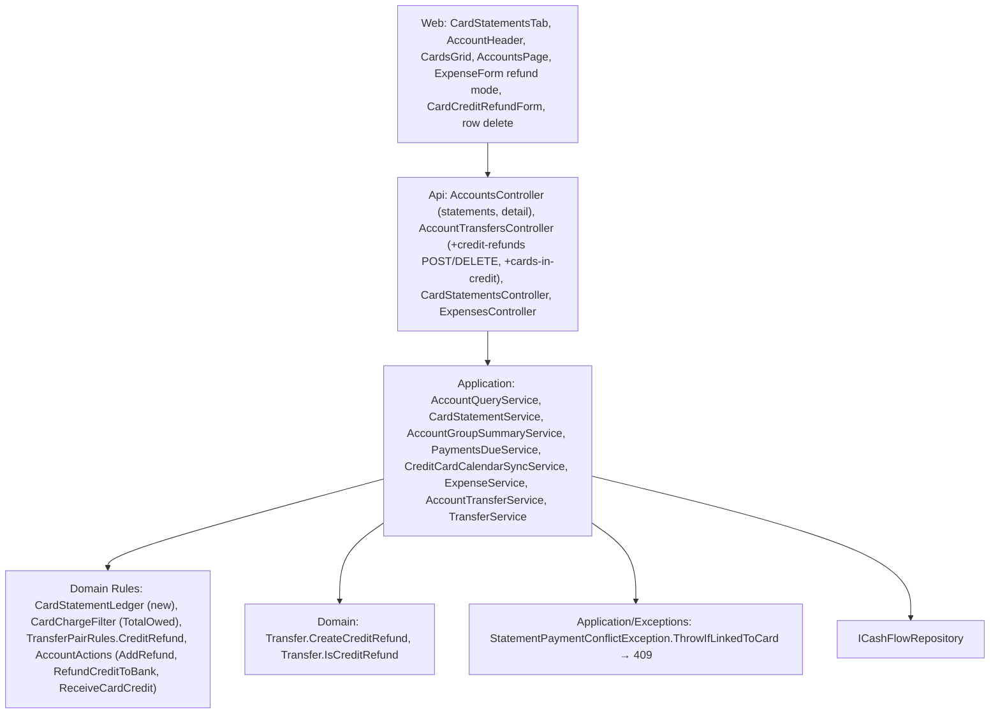

# Technical Specification: Card Refunds and Credit

Complexity: **complex**. It adds one Domain rule that every card figure reads, a refund mode on the expense form, a new transfer kind with its own routes and forms on both sides, and changes the card header, the Statements tab, Monthly's Card tab, the Accounts page, the due banner and the calendar.

**Strict no-comments policy** in all code, XML docs included (CLAUDE.md). Existing doc comments on lines a stage rewrites are deleted, not reworded.

## 1. Technical Overview

**What.**
- **Statement ledger:** one Domain rule walks a card's statement months oldest first and gives each month its total, credit carried in, amount to pay, status (Unpaid, Paid, Nothing due) and credit carried out. Every reader of "what is due on a card" uses it: Pay and its nothing-to-pay check, the Statements tab, the card header, Monthly's Card tab, the summary, F14's next statement, the bank side's payable statements, the due banner and the calendar.
- **Statements tab:** every month from the card's first month with a charge to the current month (and later months with charges), derived on read, with Credit in, To pay and the new statuses. Pay only when there is something to pay, for exactly that amount.
- **Card header:** the first figure becomes the viewed month's statement (amount to pay with its status) and the second "Total owed" or "Credit x". Bank headers are unchanged.
- **Add refund:** a card action that saves a negative card charge from a positive amount, shown in the card's grid as a "Refund" with a positive amount.
- **Refund credit to bank:** one transfer card → bank through a new pair rule, from the card ("Refund credit to bank") and from the bank ("Receive card credit"), read-only on both screens, deletable from its rows, refused on the transfer routes.

**Why.** Real cards met refunds after their statement was paid, refunds larger than a statement, issuers paying credit back to the bank, and empty months. Today a statement whose charges net below zero still reads Unpaid, its credit never reaches the next statement, and there is no way to record the issuer's payment back to the bank. The card header also repeats the same figure twice, because its month-end owed balance counts by purchase date (user, 2026-11-05: BA Amex shows 3,394.25 in both).

**Delivery.**
- Six stages (user, 2026-11-05). Stages 4 and 6 are each two PRs (backend, then web), because neither fits the PR size rule as one; every other stage is one PR.
- Each PR leaves `main` deployable and ends with a parity run against `p60-deployed-f10` showing only the differences §7 lists (0 in stage 1, the same 4 from stage 2).
- No data-file change: the file stays V4. A refund is a card charge with a negative value; a credit refund is an ordinary transfer recognised by its source account's capability.
- Deploy only after stage 6.

| Stage | Content | Web |
|---|---|---|
| **1 — Credit rule, Statements tab and card header** | `CardStatementLedger`. Pay and the bank side's payable statements use its amount to pay. `GET accounts/{id}/statements` lists every month with Credit in, To pay, status and credit carried. `AccountDetailDTO.ViewedStatement` | Statements tab columns and statuses; card header figures |
| **2 — Nothing due elsewhere** | Monthly's card statements, the summary, F14's next statement, the due banner and the calendar read the ledger. The old outstanding helpers on `CardChargeFilter` go | Monthly's Card tab status; Accounts page "Credit x" |
| **3 — Add refund** | `AddRefund` action; a future date refused on a negative card charge; card rows of negative charges get the kind `CardRefund` | Refund mode of the expense form (add and edit) |
| **4 — Refund credit to bank** | **4a:** `TransferPairRules.CreditRefund`, `Transfer.CreateCreditRefund`, `IsCreditRefund`; the ledger counts credit refunds; `POST accounts/credit-refunds`; 409 on the transfer routes; hidden from `/transfers` lists. **4b:** `RefundCreditToBank` action; read-only "Card credit refund" rows on card and bank | **4b:** card-side form |
| **5 — Delete a credit refund** | `DELETE accounts/credit-refunds/{id}` | Delete on the rows of both screens |
| **6 — Receive card credit; ticks** | **6a:** `ReceiveCardCredit` action; `GET accounts/cards-in-credit`. **6b:** PRD Section 9 F15 ticks in their own commit | **6b:** bank-side form |

**Scope.**

*Included:*
- Everything in PRD F15 Capabilities, Experience, Error Handling and Section 9, including the card-header capability and criterion this spec adds to the PRD (§3 "Card header").
- *Input contracts (Consumes):*
  - **F05:** the account screen shell and its action forms (`useAccountActionForms`, the discard prompt, the toaster, `AccountTransactionsGrid`, `useAccountRowDelete`).
  - **F07:** card accounts and card charges (`Expense` with `CreditCard`, `ChargeDate`, `InvoiceDate`).
  - **F08:** stored statements (`CardStatement` with `PaymentTransferId`), statement payments as linked transfers, `CardStatementsTab`, `TransferPairRules.StatementPayment`, `StatementPaymentConflictException`, the paid-statement locks.
  - **F14:** `CardChargeFilter.TotalOwed`, `AccountGroupMemberDTO.NextStatement`, the card header's total owed.
- *Output contracts (Provides, used by F13 and F16):*
  - card refunds as negative charges with the row kind `CardRefund`;
  - the statement ledger (amount to pay, credit carried, Nothing due) behind every card figure;
  - credit refunds as transfers with the row kind `CardCreditRefund`;
  - settled £0 statements on the card screen, Monthly's Card tab, the Accounts page and the due reminders.

*Excluded:*
- Partial payments, and paying more than the amount to pay.
- Editing a credit refund (delete and re-enter instead).
- A stored refund record type or a stored credit figure.
- Non-GBP cards beyond what the currency checks already cover.
- Moving due-date editing onto the card screen (F13).

## 2. Architecture Impact

**Layers and direction** (design.md's four questions):

1. **Where it belongs:** the CashFlow bounded context.
   - **Domain:** the statement ledger, the credit refund pair rule and transfer factory, the new account actions.
   - **Application:** the readers that switch to the ledger, the refund date check, the credit refund write, delete and listing, the row kinds.
   - **Api:** three routes on `AccountTransfersController`.
   - **Web:** the Statements tab, the card header, the refund mode, the credit refund form, row delete.
2. **Which layers, in which direction:** Domain ← Application ← Api, plus the web app over the API. No Infrastructure change and no new package.
3. **What keeps Domain free of Infrastructure:** `ICashFlowRepository` (Application), as in F02. The ledger takes plain collections of entities.
4. **Which SOLID principles it leans on:**
   - **SRP:** `CardStatementLedger` alone owns "what is due on which statement and what credit carries"; `CardChargeFilter` keeps "which charges are paid" and the card balance.
   - **OCP:** the credit refund is a third `TransferPairRules` set built from capabilities; `Default` and `StatementPayment` are unchanged.
   - **DIP:** services reach data only through `ICashFlowRepository`.



## 3. Technical Decisions

| Decision | Chosen approach | Alternative considered | Trade-off |
|---|---|---|---|
| **Ledger** (user, Q1) | New `Financial.CashFlow.Domain/Rules/CardStatementLedger.cs` holds the record `CardStatementLedgerMonth` and the static `CardStatementLedger` (one file, as `PotDeposit.cs` holds `PotFundingLine`).<br>`For(card, expenses, statements, transfers, throughYear, throughMonth)` returns one row per month, oldest first, from the card's first month with a charge (from stage 4, or a credit refund) to the later of the through month and the last month with a charge or credit refund; an empty list when the card has neither.<br>Per month:<br>• **Total:** every charge of the card with that invoice month (refunds negative, legacy settled charges included) plus, from stage 4, the card's credit refunds dated in that month (positive).<br>• **Charges counted:** the same, without legacy settled charges (they were paid by a bank and never touched the card). Settled charges only exist on legacy paid statements, so the two differ only there.<br>• **Credit in:** the previous month's credit carried (0 for the first).<br>• **Legacy paid** (stored, paid, no transfer): amount to pay 0, status Paid, credit carried = credit in, paid amount = its settled charges.<br>• **Paid by transfer:** amount to pay 0, status Paid, paid amount = the linked transfer's amount (0 if the transfer is missing), credit carried = max(0, credit in + paid amount − charges counted).<br>• **Not paid** (stored unpaid or no stored statement): due = charges counted − credit in. Due > 0 → Unpaid, amount to pay = due, credit carried 0. Due ≤ 0 → Nothing due, amount to pay 0, credit carried = −due.<br>The record carries `Year`, `Month`, `Statement` (`CardStatement?`), `Total`, `CreditIn`, `AmountToPay`, `CreditCarried`, `PaidAmount` (`decimal?`), `Status` and `IsUnpaid`.<br>`MonthOf(…, year, month)` returns that month's row (null before the first month); `NextToPay(…)` returns the oldest Unpaid row. | Store the amount to pay and credit on `CardStatement` | User: nothing stored, derived on read. One walk replaces every per-month outstanding sum, so every screen agrees. |
| **Status values** | `CardStatementLedgerStatus` enum (`Unpaid`, `Paid`, `NothingDue`) in the same file; DTOs carry it as a string. | Two booleans | Three exclusive states read better than two flags. |
| **Through month** | The Statements tab and payable statements use today's month (`TimeProvider.GetLocalToday()`; `AccountQueryService` gains `TimeProvider`). The header uses the viewed month, so a future viewed month still gets a row (Nothing due with the credit carried). | Always today | A future month would have no row. |
| **Statements list** (user, Q3; stage 1) | `GET accounts/{id}/statements` returns the ledger rows newest first. `AccountStatementDTO`:<br>• `Id` becomes `Guid?`: the stored statement's id, null for a month with no stored statement;<br>• `Total`, `CreditIn`, `CreditCarried` (new), `Status` (new, string);<br>• `OutstandingTotal` now means the amount to pay from the ledger (never below 0; 0 when paid or Nothing due);<br>• `PaidAmount` (new, `decimal?`), and `IsPaid`, `DueDate`, `PaidOn`, `PaidFromAccountName` as F08.<br>Stored statements with no charges before the first month or after the last listed month are not listed. F08 hid only the unpaid ones, so a paid statement with no charges outside that range also leaves the list and can't be unmarked from it; the 2026-11-05 data has no paid statement without charges. | Keep stored statements only | User: every month. |
| **Statement created when paid?** (user, Q3) | Not needed. A month with an amount to pay above 0 always has a stored statement: its charges created it on write (F07 create-on-charge, F08 move and backfill), and from stage 4 a credit refund is refused if it would raise any amount to pay (§3 "Credit refund"). So a row without an id is always Nothing due, Pay always has a statement id, and the GET stays read-only. If a row without an id ever read Unpaid it would show no Pay. | Create the statement inside Pay through a card-and-month route | Keeps F08's "reads never write" and its pay route; no new route. |
| **Pay** (user, Q1; stage 1) | `MarkStatementPaidAsync` takes the amount from `CardStatementLedger.MonthOf` for the statement's card and month. Order as F08: 409 already paid; payer resolved; then status Nothing due (amount to pay 0) → 400 "There is nothing to pay on this statement."; date; one save. The transfer amount is exactly the amount to pay, so the credit is used. | Pay the charges total | Matches the real card. |
| **Statements tab** (user, Q3; stage 1) | Columns: Month, Total, Credit in (`formatN2`, "—" when 0), To pay (`OutstandingTotal`), Due date, Status, Actions; every column sorts (Status by status, then paid date). Status text: "Unpaid"; "Paid 412.00 on 12 Nov 2026 from Barclays", the amount paid because credit can make it differ from Total (user, 2026-11-05); "Nothing due"; "Nothing due · 35.00 credit carried" when `CreditCarried` > 0. Row key is year and month. Pay shows only on Unpaid rows with an id (primary, F08 form, read-only Amount = To pay); F08's disabled "Nothing to pay" button goes. Unmark stays on paid rows, now primary as the action-button rule requires. The actions cell has no stacked-layout label, so a row with no action shows no empty "Actions:". Viewed-month highlight, inactive-card message and states as F08; the empty state "No statements yet" now means the card has no charge at all. | Keep the disabled Pay | PRD: Nothing due has no Pay. |
| **Card header** (user, Q7; stage 1; PRD write-back) | `AccountDetailDTO.ViewedStatement` (`AccountStatementDTO?`, new): the ledger row of the viewed month for a card (through the viewed month); null for accounts without `HasStatements` or a month before the card's first. `Balance` and `TotalOwed` are unchanged, so parity's `cardAccount/*/balance` and `totalOwed` don't move.<br>On a card `AccountHeader` shows:<br>• **first figure**, label "<Month yyyy> statement": Unpaid → To pay, status line "Unpaid"; Paid → `PaidAmount`, "Paid 12 Nov 2026" ("Paid" when no date); Nothing due or no row → 0.00, "Nothing due" or "Nothing due · 35.00 credit carried";<br>• **second figure**, label "Total owed": `TotalOwed` with the currency, or "Credit 35.00 GBP" when `TotalOwed` < 0.<br>The two figures align at the top, so their labels share a line and their values share a line, with the status line alone below (user, 2026-11-05).<br>Banks keep "Balance at end of <Month yyyy>". The status line is text, so nothing relies on colour. | Keep the month-end owed balance | User-found bug: by purchase date it equals the total owed. |
| **Total owed and credit** (user, Q1, Q5) | "Total owed" stays F14's `TotalOwed` (−card balance at `DateOnly.MaxValue`): every unpaid amount netted with refunds, payments and credit refunds. The card's credit is −`TotalOwed` when `TotalOwed` < 0; it is the refund-to-bank limit. `utils/owedBalance.ts` gains one formatter (`formatOwedOrCredit`) used by the header, the Accounts page and Monthly's accumulated cell, plus `statementStatusText` and `nothingDueText`, which the Statements tab and the header share. | Sum of Unpaid amounts | Parity maps `totalOwed` to Monthly's accumulated outstanding; it must not move. |
| **Monthly's Card tab** (stage 2) | `GetStatementsForMonth` returns stored statements as today, with `OutstandingTotal` from the ledger. `CardsGrid` derives the status: Paid when `isPaid`; Unpaid when outstanding > 0; otherwise "Nothing due" with no Mark paid control. A card with no stored statement that month reads 0.00 / — / Nothing due. The accumulated cell uses `formatOwedOrCredit`. `CardStatementDTO` is unchanged. | Add a status to `CardStatementDTO` | Monthly retires in F13; the rule needs no new field. |
| **Summary and next statement** (stage 2) | `AccountGroupSummaryService`: the card member's `Statement.OutstandingTotal` is the viewed month's amount to pay and `IsPaid` its stored paid status (`CardChargeFilter.IsStatementPaid`, so a paid statement with no charges stays paid); `NextStatement` is `CardStatementLedger.NextToPay` (year, month and its amount to pay), null when no month is Unpaid. `CardChargeFilter.NextStatementToPay`, `UnpaidChargesFor`, both `OutstandingTotal` overloads and `CardStatementMonth.cs` are deleted (no caller left). | Keep the old helpers | One rule. |
| **Accounts page** (stage 2) | The card grid's Total owed cell and the Credit cards footer use `formatOwedOrCredit` ("Credit 35.00"); Next statement shows the ledger's next month. The footer sums every card's total owed, so credit on one card nets against what another owes; its label becomes "Net owed" (user, 2026-11-05: a footer reading "Total owed GBP: Credit x" hid money owed on other cards). Other grids unchanged. | — | — |
| **Due banner** (stage 2) | `PaymentsDueService.GetCreditCardPaymentsDue` keeps a card only when the ledger row of its due date's month is Unpaid (it skipped only paid statements). | — | PRD: no banner for Nothing due. |
| **Calendar** (stage 2) | `ICardStatementService.GetOutstandingTotalForPeriod` becomes `GetAmountDueForPeriod(creditCardId, year, month)` returning `decimal?`: null for an unknown card or a Nothing-due month, otherwise the amount to pay (0 when paid). `CreditCardCalendarSyncService` removes the card's event when it is null, as for a card without a due date; the title uses the amount. The "(no charges posted to this invoice yet)" description line goes: a month without charges is Nothing due, so it has no event, which supersedes P45 F02 criterion 05 (noted on that criterion; its test now carries this feature's tag). `TriggerSyncIfInvoiceSynced` fires when the changed invoice month is the due date's month or earlier, since an earlier month's credit carries into it. `GetSyncStatuses` also reports an active dated card with nothing due as `Synced` while connected, since it has no event to prove it after a restart and would otherwise read "still syncing". | Keep an event for Nothing due | PRD: no calendar reminder. |
| **Add refund** (user, Q2; stage 3) | `AccountAction.AddRefund`, allowed for active accounts with `HasStatements`, after `AddCharge`. It opens `ExpenseForm` in refund mode: title "New Refund" / "Edit Refund", Amount (positive), Date, Description, Category, Statement month (defaults to the date's month, editable as Add charge), counts-as-tithe when the category is a tithe category. Saved through `POST /expenses` / `PUT /expenses/{id}` with `value` = −amount and `creditCardId` = the card; F08's paid-statement lock applies ("This charge's statement is paid; unmark it first."). Toasts "Refund added" / "Refund updated"; keep-open after Save as Add charge.<br>Refund mode is entered from Add refund and from Edit on a negative charge on the card screen (`lockedCard` set and value < 0); the amount shows positive. Monthly keeps signed values. | A refund route with a positive amount | Reuses the create path, its statement creation and locks; no new record type. |
| **Refund validation** (user, Q2) | Form: Amount required and > 0 → "Amount must be greater than zero."; Date required and not after today → "Date must not be in the future." (input `max` = today); the default date is F05's viewed-month rule capped at today. Server: `ExpenseService` add and update refuse a card charge with a negative value dated after today with 400 "Date must not be in the future." (`ExpenseService` gains `TimeProvider`). A 0 value keeps the existing 400 "Value must not be zero.". | Server-side amount check | Over `/expenses` the server sees a signed value and cannot tell a refund amount from a charge. |
| **Refund rows** (user, Q2; stage 3) | `AccountQueryService` gives a card charge with a negative value the kind `CardRefund` (Amount = −value, so positive). Web: kind label "Refund", noun "refund"; Edit, Delete and Move to a later statement on unpaid refunds as on charges. | Label in the web from the amount | F16 reads the kind. |
| **Credit refund pair and factory** (user, Q5; stage 4a) | `TransferPairRules.CreditRefund` = [(`ReceivesPayments`, `CanReceiveTransfers`)], used only by `Transfer.CreateCreditRefund(date, card, bank, amount, note, today)`: pair checked; the bank active (`ActiveAccountRule`), the card need not be; same currency, else 400 "The receiving account must be in the card's currency (GBP)."; amount > 0; date not in the future; note ≤ 200. `Transfer.IsCreditRefund` = `SourceAccount.Has(ReceivesPayments)`. No stored link. | A link field on the transfer | Only this factory can create a transfer out of a `ReceivesPayments` account. |
| **Credit refund** (user, Q5; stage 4a) | `POST accounts/credit-refunds` with `AccountTransferCreateDTO` (`sourceAccountId` = card, `destinationAccountId` = bank, `amount`, `date`, optional `note`; `destinationAmount` must be null) → `AccountTransferService.AddCreditRefundAsync`. Order: accounts resolved (existing messages); factory checks; credit = −`TotalOwed`; amount above the credit → 400 "The card's credit is 35.00 GBP." (`N2`, invariant culture, the card's currency); then the ledger guard: with the refund added, no month's amount to pay may rise and the last row's credit carried must fall by exactly the amount, else 400 "On that date the card had less credit than this refund; choose a later date." (`CardStatementLedger.RefundKeepsAmountsToPay`). One save. Response: `AccountTransferDTO`. | The card balance only | The guard stops a back-dated refund from leaving a statement owing or a paid statement absorbing it. |
| **Credit refunds on transfer routes** (user, Q4; stage 4a) | `StatementPaymentConflictException.ThrowIfStatementPayment` becomes `ThrowIfLinkedToCard`: a statement payment keeps F08's message; a credit refund → 409 "This transfer refunds card credit; delete it from the card or bank screen instead." Both transfer services call it on PUT and DELETE. `TransferService` leaves credit refunds out of `GET transfers/month/{y}/{m}` and `GET transfers/bank/{id}`. | A second exception type | Same 409 mapping, one guard. |
| **Credit refund rows** (user, Q5; stage 4b) | `AccountQueryService` maps a credit refund as kind `CardCreditRefund` on both accounts: bank Amount +amount, card Amount −amount; Counterpart the other account; Description the note, else "<card name> credit refund"; `CanEdit` false; `Transfer` filled. Web label "Card credit refund", noun "credit refund". Between 4a and 4b a credit refund can only come from the API; until 4b it lists as a transfer row whose edit returns 409. | — | — |
| **Refund credit to bank** (user, Q5; stage 4b) | `AccountAction.RefundCreditToBank`: `AccountActions.AllowedFor(account, isInCredit)` gains the flag (default false); the rule is `HasStatements` and in credit; `AccountQueryService` passes `TotalOwed < 0` for cards. Form `CardCreditRefundForm` + `useCardCreditRefundForm`, card mode: From (the card, locked text), To bank (required; from `GET accounts`: active, `CanReceiveTransfers`, the card's currency), Amount (defaults to the credit; > 0; at most the credit, "The card's credit is 35.00 GBP."), Date (today, not in the future). Title and submit "Refund credit to bank"; toast "Credit refunded"; focus returns to the action button; the screen reloads, so the header shows the new credit. | Reuse the transfer form | Different fields and limits; mirrors F08's pay form. |
| **Delete a credit refund** (user, Q4; stage 5) | `DELETE accounts/credit-refunds/{id}` → `AccountTransferService.DeleteCreditRefundAsync`: unknown id → 404; not a credit refund → 400 "This transfer is not a card credit refund."; otherwise delete in one save and trigger the card's calendar sync (`ICreditCardCalendarSyncService.TriggerSync`, injected into `AccountTransferService`; no cycle). Creating a credit refund never changes an amount to pay (the guard), so it triggers nothing. Web: a `CardCreditRefund` row shows one Delete button (`aria-label` "Delete credit refund") when the screen's account is active (`AccountTransactionsGrid` prop `canDeleteCreditRefunds`, from `AccountScreenPage`); `ConfirmDeleteDialog` "Delete this credit refund? The card's credit returns."; toast "Credit refund deleted"; failures keep the dialog with the message. The server does not check which screen called it. | Edit as well | User: delete and re-enter. |
| **Receive card credit** (user, Q5; stage 6) | `AccountAction.ReceiveCardCredit`, allowed for active accounts with `CanReceiveTransfers`. `GET accounts/cards-in-credit` returns every card (inactive included) with credit > 0: `{ accountId, name, currency, isActive, credit }`, by name. The same form in bank mode: To (the bank, locked text), Card (cards in that list in the bank's currency, "BA Amex · Credit 35.00", "(inactive)" appended), Amount (— until a card is chosen, then defaults to and is capped at its credit), Date. Title and submit "Receive card credit"; toast "Card credit received". It posts the same `POST accounts/credit-refunds`. Empty list → hint "No card in GBP has credit to refund." and submit disabled. | Offer the action only when some card is in credit | Same as F08's Pay card statement. |
| **PR size** | Non-test code files per PR (generated `openapi.ts` excluded): 1 → 10, 2 → 11, 3 → 9, 4a → 8, 4b → 9, 5 → 8, 6a → 6, 6b → 5. Overages of one file in 3 and 4b, of two in 1 and of three in 2 are named here (user, 2026-11-05: stage 1 is also 24 files in total, 6 of its tests only adding the new required DTO fields); §4 lists the files. | More PRs | User: six stages; a further split would ship half a form. |
| **Rollback** | An F14-era build loads the file (no new fields). It shows a credit refund as an ordinary editable transfer and its Pay would pay the old outstanding; check credit refunds by hand after a rollback. | A version bump | Named for the deploy notes. |

**Choices made by the spec writer** (open after the interview; for the user's review):
- The ledger's arithmetic leaves out legacy settled charges; the Total column still shows them.
- A paid statement whose linked transfer is missing counts as a payment of 0 (F08's 409 guards make it unreachable).
- No guard for one rare ordering: adding a charge to an earlier Nothing-due month whose credit a later paid statement already used leaves that shortfall uncarried (max(0, …)); Total owed still counts it.
- A credit refund is also refused when it would raise any amount to pay, with 400 "On that date the card had less credit than this refund; choose a later date."
- Because of that guard no Pay-time statement creation is needed: rows without a stored statement are always Nothing due.
- `AccountStatementDTO.OutstandingTotal` keeps its name and now means To pay; `Id` becomes nullable (the only non-additive contract change).
- The header's statement comes from `AccountDetailDTO.ViewedStatement`; a month before the card's first reads 0.00 "Nothing due".
- The header's second figure keeps the label "Total owed" and reads "Credit 35.00 GBP" when in credit; Total owed stays the net card balance.
- Monthly's Card tab derives "Nothing due" from unpaid with 0 outstanding; `CardStatementDTO` is unchanged.
- `GetOutstandingTotalForPeriod` becomes `GetAmountDueForPeriod` and the "(no charges posted yet)" calendar line is removed.
- `TriggerSyncIfInvoiceSynced` also fires for charges in months before the due month.
- Refunds travel over `/expenses` as negative values; "Amount must be greater than zero." is a form check, not a server 400.
- The server refuses a future date on any negative card charge, Monthly's included.
- Refund mode applies only on the card screen; refund rows get the kind `CardRefund` and can be moved like charges.
- The refund's default date is the viewed-month rule capped at today.
- The credit refund route reuses `AccountTransferCreateDTO` (`POST accounts/credit-refunds`) and lives in `AccountTransferService`; a note is accepted but the forms send none.
- Credit refund rows read "<card name> credit refund" unless a note is given.
- The 409 helper is renamed `ThrowIfLinkedToCard`; the exception class keeps its name.
- The card-side bank list comes from `GET accounts` filtered in the web.
- `AccountActions.AllowedFor` takes an `isInCredit` flag for `RefundCreditToBank`.
- "Receive card credit" is offered on every active bank, with an empty-list hint.
- Delete on credit refund rows is a web rule (screen account active); the server allows it either way and triggers the card's calendar sync.
- The Move form's "(new)" marker shows on every month with no stored statement, listed or not, as F08 did (user, 2026-11-05, reversing this spec's first choice).
- Stages 4 and 6 are two PRs each.

## 4. Component Overview

All paths are relative to the repo root. Existing patterns: entities with private setters and static factories; `ArgumentException` → 400; conflict exceptions → 409 in `DomainExceptionMappingMiddleware`; the span/log telemetry pattern in every service; acceptance tests in `Api.Tests/Acceptance`; one hook per form under `src/hooks`; the F05 form area, discard prompt and toaster.

**Domain (`Financial.CashFlow.Domain`)**

| File | New/Modified | Stage | Key responsibilities |
|---|---|---|---|
| `Rules/CardStatementLedger.cs` | New, Modified | 1, 4a | **1:** `CardStatementLedgerMonth`, `CardStatementLedgerStatus`, `For`, `MonthOf`, `NextToPay`. **4a:** credit refunds counted in their date's month; `RefundKeepsAmountsToPay` |
| `Rules/CardChargeFilter.cs` | Modified | 2 | `UnpaidChargesFor`, `OutstandingTotal` (both), `NextStatementToPay` removed |
| `Rules/CardStatementMonth.cs` | Deleted | 2 | No caller left |
| `Enums/AccountAction.cs`, `Rules/AccountActions.cs` | Modified | 3, 4b, 6a | **3:** `AddRefund`. **4b:** `RefundCreditToBank`, `isInCredit` flag. **6a:** `ReceiveCardCredit` |
| `Entities/Transactions/Transfer.cs` | Modified | 4a | `CreateCreditRefund`, `IsCreditRefund` |
| `Rules/TransferPairRules.cs` | Modified | 4a | `CreditRefund` set |

**Application (`Financial.CashFlow.Application`)**

| File | New/Modified | Stage | Key responsibilities |
|---|---|---|---|
| `Services/CardStatementService.cs` | Modified | 1, 2 | **1:** Pay amount and nothing-to-pay from the ledger. **2:** Monthly outstanding from the ledger; `GetAmountDueForPeriod` |
| `Interfaces/ICardStatementService.cs` | Modified | 2 | `GetAmountDueForPeriod` replaces `GetOutstandingTotalForPeriod` |
| `Services/AccountQueryService.cs` | Modified | 1, 3, 4b | **1:** `TimeProvider`; statements and payable statements from the ledger; `ViewedStatement`. **3:** `CardRefund` kind. **4b:** `CardCreditRefund` rows; `AllowedFor(account, isInCredit)` |
| `DTOs/AccountStatementDTO.cs` | Modified | 1 | Nullable `Id`; `CreditIn`, `CreditCarried`, `Status`, `PaidAmount`; `OutstandingTotal` = To pay |
| `DTOs/AccountDetailDTO.cs` | Modified | 1 | `ViewedStatement` |
| `Services/AccountGroupSummaryService.cs` | Modified | 2 | Card member statement and next statement from the ledger |
| `Services/PaymentsDueService.cs` | Modified | 2 | Card shown only when its due month is Unpaid |
| `Services/CreditCardCalendarSyncService.cs` | Modified | 2 | Event removed when nothing is due; title from the amount due; earlier-month trigger |
| `Services/ExpenseService.cs` | Modified | 3 | `TimeProvider`; future date refused on a negative card charge |
| `Exceptions/StatementPaymentConflictException.cs` | Modified | 4a | `ThrowIfLinkedToCard` with the credit refund message |
| `Services/TransferService.cs` | Modified | 4a | Credit refunds left out of the lists; calls `ThrowIfLinkedToCard` |
| `Services/AccountTransferService.cs`, `Interfaces/IAccountTransferService.cs` | Modified | 4a, 5, 6a | **4a:** `AddCreditRefundAsync`; `ThrowIfLinkedToCard`. **5:** `DeleteCreditRefundAsync`, calendar trigger. **6a:** `GetCardsInCredit` |
| `DTOs/CardCreditDTO.cs` | New | 6a | `AccountId`, `Name`, `Currency`, `IsActive`, `Credit` |

**Api (`Financial.Api`)**

| File | New/Modified | Stage | Key responsibilities |
|---|---|---|---|
| `Controllers/AccountTransfersController.cs` | Modified | 4a, 5, 6a | `POST credit-refunds` (4a); `DELETE credit-refunds/{id:guid}` (5); `GET cards-in-credit` (6a); 409 response attributes on the transfer PUT and DELETE stay |
| `Tests/Financial.Api.Tests/Contract/openapi-v1.snapshot.json`, `Financial.Web/src/api/generated/openapi.ts` | Regenerated | 1, 4a, 5, 6a | Each contract change; not counted |

**Web (`Financial.Web/src`)**

| File | New/Modified | Stage | Key responsibilities |
|---|---|---|---|
| `components/CardStatementsTab.tsx` | Modified | 1 | New columns and statuses; Pay only on Unpaid rows with an id; row key by month |
| `hooks/useCardStatements.ts` | Modified | 1 | Pay form takes a statement with an id |
| `hooks/useMoveChargeForm.ts` | Modified | 1 | "(new)" on a listed month with a null id |
| `components/AccountHeader.tsx` | Modified | 1 | Card figures "<Month yyyy> statement" and "Total owed" / "Credit" |
| `utils/owedBalance.ts` | Modified | 1 | `formatOwedOrCredit`, `statementStatusText`, `nothingDueText`, `UNPAID_STATEMENT_STATUS` |
| `components/CardsGrid.tsx` | Modified | 2 | "Nothing due" status, no Mark paid; accumulated "Credit x" |
| `pages/AccountsPage.tsx`, `utils/accountTemplateLabel.ts` | Modified | 2 | Card Total owed cell and footer through `formatOwedOrCredit`; footer label "Net owed" |
| `components/accountActions.ts` | Modified | 3, 4b, 5, 6b | **3:** `AddRefund` label "Add refund"; `CardRefund` label and noun; move allowed on refunds. **4b:** `RefundCreditToBank` "Refund credit to bank"; `CardCreditRefund` label and noun. **5:** credit refund delete confirmation and message. **6b:** `ReceiveCardCredit` "Receive card credit" |
| `hooks/useAccountActionForms.ts` | Modified | 3, 4b, 6b | Openers and active-action mapping for the new actions; refund toasts |
| `hooks/useExpenseForm.ts`, `components/ExpenseForm.tsx` | Modified | 3 | Refund mode (sign, labels, validation, default date, title) |
| `pages/AccountScreenPage.tsx` | Modified | 3, 4b, 5 | Refund flag to `ExpenseForm` (3); credit refund form (4b); `canDeleteCreditRefunds` (5) |
| `components/CardCreditRefundForm.tsx`, `hooks/useCardCreditRefundForm.ts` | New, Modified | 4b, 6b | Card mode (4b); bank mode with the card list (6b) |
| `api/financialApiClient.ts` | Modified | 4b, 5, 6b | `createCardCreditRefund`, `deleteCardCreditRefund`, `getCardsInCredit` |
| `hooks/useAccountRowDelete.ts`, `components/AccountTransactionsGrid.tsx` | Modified | 5 | Delete routed by kind; Delete-only cell on credit refund rows |

**Parity (`scripts/parity`)**

| File | Stage | Change |
|---|---|---|
| `screen-checklist.md` | 1, 2 | **1:** card screen row C5 (header statement figure). **2:** the Card statements row reads "Nothing due" for a month with no statement on the after side |

**Files per PR (non-test code; generated `openapi.ts` excluded):**
- **1 (10):** `CardStatementLedger.cs`, `CardStatementService.cs`, `AccountQueryService.cs`, `AccountStatementDTO.cs`, `AccountDetailDTO.cs`, `CardStatementsTab.tsx`, `useCardStatements.ts`, `useMoveChargeForm.ts`, `AccountHeader.tsx`, `owedBalance.ts`.
- **2 (11):** `CardStatementService.cs`, `ICardStatementService.cs`, `CreditCardCalendarSyncService.cs`, `ICreditCardCalendarSyncService.cs` (a stale doc comment deleted), `PaymentsDueService.cs`, `AccountGroupSummaryService.cs`, `CardChargeFilter.cs`, `CardStatementMonth.cs` (deleted), `CardsGrid.tsx`, `AccountsPage.tsx`, `accountTemplateLabel.ts`. 24 files in total (user, 2026-11-05).
- **3 (9):** `AccountAction.cs`, `AccountActions.cs`, `ExpenseService.cs`, `AccountQueryService.cs`, `accountActions.ts`, `useAccountActionForms.ts`, `useExpenseForm.ts`, `ExpenseForm.tsx`, `AccountScreenPage.tsx`.
- **4a (8):** `Transfer.cs`, `TransferPairRules.cs`, `CardStatementLedger.cs`, `StatementPaymentConflictException.cs`, `TransferService.cs`, `AccountTransferService.cs`, `IAccountTransferService.cs`, `AccountTransfersController.cs`.
- **4b (9):** `AccountAction.cs`, `AccountActions.cs`, `AccountQueryService.cs`, `accountActions.ts`, `useAccountActionForms.ts`, `CardCreditRefundForm.tsx`, `useCardCreditRefundForm.ts`, `financialApiClient.ts`, `AccountScreenPage.tsx`.
- **5 (8):** `AccountTransferService.cs`, `IAccountTransferService.cs`, `AccountTransfersController.cs`, `financialApiClient.ts`, `useAccountRowDelete.ts`, `accountActions.ts`, `AccountTransactionsGrid.tsx`, `AccountScreenPage.tsx`.
- **6a (6):** `AccountAction.cs`, `AccountActions.cs`, `AccountTransferService.cs`, `IAccountTransferService.cs`, `CardCreditDTO.cs`, `AccountTransfersController.cs`.
- **6b (5):** `accountActions.ts`, `useAccountActionForms.ts`, `useCardCreditRefundForm.ts`, `CardCreditRefundForm.tsx`, `financialApiClient.ts`; plus the PRD ticks.

## 5. API Contracts

**Behaviour changes on existing routes:**

| Route | Before | After |
|---|---|---|
| `GET accounts/{id}/statements` | Stored statements with charges or paid | Every ledger month, newest first, with the new fields (stage 1) |
| `GET accounts/{id}/{y}/{m}` | — | Gains `viewedStatement` (stage 1); `allowedActions` gains `AddRefund` (3), `RefundCreditToBank` on a card in credit (4b), `ReceiveCardCredit` on active banks (6a) |
| `POST card-statements/{id}/mark-paid` | Pays the unpaid charges' total | Pays the ledger's amount to pay; 400 "There is nothing to pay on this statement." when Nothing due (stage 1) |
| `GET accounts/payable-statements` | Unpaid statements with outstanding > 0 | Ledger months that are Unpaid, `total` = amount to pay (stage 1) |
| `GET card-statements/{y}/{m}` | `outstandingTotal` = unpaid charges | `outstandingTotal` = amount to pay (stage 2) |
| `GET accounts/groups/default/summary/{y}/{m}`, `GET accounts/groups/by-template/{y}/{m}` | Card statement and next statement from unpaid charges | From the ledger (stage 2) |
| `POST/PUT expenses` | — | A card charge with a negative value dated after today → 400 "Date must not be in the future." (stage 3) |
| `GET accounts/{id}/transactions/{y}/{m}` | Negative charges as `CardCharge`; card → bank transfers impossible | Kind `CardRefund` for negative card charges (3); `CardCreditRefund` rows on card and bank (4b) |
| `GET transfers/month/{y}/{m}`, `GET transfers/bank/{id}` | Without statement payments | Also without credit refunds (stage 4a) |
| `PUT/DELETE transfers/{id}`, `PUT/DELETE accounts/transfers/{id}` | 409 for a statement payment | Also 409 "This transfer refunds card credit; delete it from the card or bank screen instead." for a credit refund (stage 4a) |

`GET accounts/{id}/statements` (stage 1), a card with a £60.00 refund against £25.00 of October charges and nothing in November:

```json
[
  { "id": null, "year": 2026, "month": 11, "total": 0.00, "creditIn": 35.00, "outstandingTotal": 0.00, "creditCarried": 35.00,
    "status": "NothingDue", "isPaid": false, "dueDate": null, "paidOn": null, "paidAmount": null, "paidFromAccountName": null },
  { "id": "…9a", "year": 2026, "month": 10, "total": -35.00, "creditIn": 0.00, "outstandingTotal": 0.00, "creditCarried": 35.00,
    "status": "NothingDue", "isPaid": false, "dueDate": "2026-10-28", "paidOn": null, "paidAmount": null, "paidFromAccountName": null },
  { "id": "…99", "year": 2026, "month": 9, "total": 512.30, "creditIn": 0.00, "outstandingTotal": 0.00, "creditCarried": 0.00,
    "status": "Paid", "isPaid": true, "dueDate": "2026-09-28", "paidOn": "2026-09-27", "paidAmount": 512.30, "paidFromAccountName": "Barclays" }
]
```

`GET accounts/{id}/2026/11` for a card (stage 1) adds:

```json
{ "balance": -3394.25, "totalOwed": 3394.25,
  "viewedStatement": { "id": "…9c", "year": 2026, "month": 11, "total": 3012.31, "creditIn": 0.00, "outstandingTotal": 3012.31, "creditCarried": 0.00,
                       "status": "Unpaid", "isPaid": false, "dueDate": "2026-11-28", "paidOn": null, "paidAmount": null, "paidFromAccountName": null } }
```

A bank returns `"viewedStatement": null`.

A refund row on the card (stage 3):

```json
{ "id": "…e1", "kind": "CardRefund", "date": "2026-11-03", "description": "Shoes returned", "categoryName": "Clothing", "amount": 40.00, "canEdit": true, "expense": { "value": -40.00, "creditCardId": "…501", "invoiceDate": "2026-11-01", "…": "…" } }
```

**`POST accounts/credit-refunds`** (stage 4a):

| Field | Type | Required | Validation |
|---|---|---|---|
| `sourceAccountId` | `uuid` | Yes | a card (`ReceivesPayments`), active or not |
| `destinationAccountId` | `uuid` | Yes | active, `CanReceiveTransfers`, the card's currency |
| `amount` | `decimal` | Yes | > 0 and ≤ the card's credit |
| `date` | `date` | Yes | not after today; the ledger guard |
| `destinationAmount` | `decimal?` | No | must be null |
| `note` | `string?` | No | ≤ 200 characters |

```json
{ "date": "2026-11-05", "sourceAccountId": "…501", "destinationAccountId": "…01", "amount": 35.00 }
```

200 with the `AccountTransferDTO`:

```json
{ "id": "…t7", "date": "2026-11-05", "sourceAccountId": "…501", "sourceAccountName": "BA Amex", "sourceCurrency": "GBP",
  "destinationAccountId": "…01", "destinationAccountName": "Barclays", "destinationCurrency": "GBP", "amount": 35.00, "destinationAmount": 35.00, "note": null }
```

The bank's row (stage 4b; the card's row reads the same with `"amount": -35.00` and `"counterpart": "Barclays"`):

```json
{ "id": "…t7", "kind": "CardCreditRefund", "date": "2026-11-05", "description": "BA Amex credit refund", "counterpart": "BA Amex", "amount": 35.00, "canEdit": false, "transfer": { "…": "…" } }
```

**`DELETE accounts/credit-refunds/{id}`** (stage 5) → 204.

**`GET accounts/cards-in-credit`** (stage 6a) → 200:

```json
[ { "accountId": "…501", "name": "BA Amex", "currency": "GBP", "isActive": true, "credit": 35.00 } ]
```

**Errors:**

| Case | HTTP | Message |
|---|---|---|
| Pay a Nothing-due statement | 400 | "There is nothing to pay on this statement." |
| Refund or charge into a paid statement | 400 | "This charge's statement is paid; unmark it first." |
| Negative card charge dated after today | 400 | "Date must not be in the future." |
| Credit refund above the credit | 400 | "The card's credit is 35.00 GBP." |
| Credit refund raising an amount to pay | 400 | "On that date the card had less credit than this refund; choose a later date." |
| Credit refund to another currency | 400 | "The receiving account must be in the card's currency (GBP)." |
| Credit refund between accounts the pair rule refuses | 400 | "Transfers from <card> to <account> are not allowed." |
| Credit refund to an inactive bank | 400 | "<bank> is inactive." |
| Credit refund amount ≤ 0 | 400 | "Transfer amount must be greater than zero." |
| Edit or delete a credit refund through a transfer route | 409 | "This transfer refunds card credit; delete it from the card or bank screen instead." |
| Delete a transfer that isn't a credit refund through the credit refund route | 400 | "This transfer is not a card credit refund." |
| Delete an unknown credit refund | 404 | as the other routes |

Every snapshot change is additive except `AccountStatementDTO.id` becoming nullable (stage 1) and the calendar method rename (not on the API).

## 6. Data Model

No change. The file stays V4; `migrate`, the version guard and the spreadsheet import are untouched.

- **Refund:** an ordinary record in `Expenses` with `CreditCardId`, a negative `Value`, `ChargeDate` = its date and `InvoiceDate` = its statement month.
- **Credit refund:** an ordinary record in `Transfers` from the card to the bank:

```json
{ "Id": "…t7", "Date": "2026-11-05", "SourceAccountId": "…501", "DestinationAccountId": "…01", "Amount": 35.00 }
```

- **Derived, never stored:** amount to pay, credit in, credit carried, Nothing due, the months without a stored statement.

**Invariants:**
- A transfer out of a `ReceivesPayments` account exists only through `Transfer.CreateCreditRefund`, so it is a credit refund.
- Every month whose amount to pay is above 0 has a stored statement.
- Adding a credit refund changes no month's amount to pay; it only lowers the credit carried.

## 7. Testing Strategy

Following the `testing-guide-Financial` skill:
- **Unit:** Domain, Application, and web components and hooks.
- **Integration:** the API host through the acceptance tests; the OpenAPI contract test.
- **AC tracing:** one or more tagged tests per PRD F15 bullet, `[Trait("AC", "P60-F15-card-refunds-and-credit-NN")]` (web: `[AC P60-F15-card-refunds-and-credit-NN]` in the test name), numbered 01–08 in PRD order after this spec's write-back.
- **Conventions:** every class carries `[Trait("Category", …)]`; names follow `Method_Condition_Result`; shared doubles only in `Tests/Financial.TestUtilities`; no wall-clock reads (a fixed `TimeProvider`).

| Test file | Type | Stage | Coverage goal |
|---|---|---|---|
| `Domain.Tests/Rules/CardStatementLedgerTests.cs` | Unit | 1, 4a | **1:** first month and through month; months without charges are Nothing due; a refund above its month's charges carries credit that lowers the next month and keeps carrying while larger; Unpaid carries nothing; paid by transfer carries max(0, credit in + payment − charges); legacy paid carries credit in unchanged and ignores settled charges; a missing payment transfer counts as 0; `MonthOf` before the first month is null; `NextToPay` skips Paid and Nothing due. **4a:** a credit refund counts in its date's month; `RefundKeepsAmountsToPay` true for a refund within the carried credit, false when it raises an amount to pay or a paid month absorbs it |
| `Domain.Tests/Rules/CardChargeFilterTests.cs` | Unit | 2, 4a | Tests for the removed helpers deleted; `TotalOwed` with a refund (2) and with a credit refund (4a) |
| `Domain.Tests/Entities/TransferTests.cs`, `Rules/TransferPairRulesTests.cs` | Unit | 4a | `CreateCreditRefund` rules and messages; `IsCreditRefund`; `Default` and `StatementPayment` refuse card → bank; `CreditRefund` allows only `ReceivesPayments` → `CanReceiveTransfers` |
| `Domain.Tests/Rules/AccountActionsTests.cs` | Unit | 3, 4b, 6a | `AddRefund` on active cards; `RefundCreditToBank` only when in credit; `ReceiveCardCredit` on active banks; none on inactive accounts. F07's `CreditCardTemplateAcceptanceTests` AC 04 and F08's card action list updated |
| `Application.Tests/Services/CardStatementServiceTests.cs` | Unit | 1, 2 | **1:** Pay writes the amount to pay (credit used); Nothing due → 400, nothing saved. **2:** Monthly outstanding from the ledger; `GetAmountDueForPeriod` null for Nothing due and unknown card |
| `Application.Tests/Services/AccountQueryServiceTests.cs` | Unit | 1, 3, 4b | **1:** every month listed with ids only on stored statements; header row through the viewed month; `Balance` unchanged; payable statements from the ledger. **3:** `CardRefund` kind with a positive amount. **4b:** `CardCreditRefund` rows on both accounts, read-only; `RefundCreditToBank` only in credit |
| `Application.Tests/Services/AccountGroupSummaryServiceTests.cs` | Unit | 2 | Next statement skips Nothing due and uses carried credit; member statement from the ledger |
| `Application.Tests/Services/PaymentsDueServiceTests.cs` | Unit | 2 | No banner for a Nothing-due due month; banner for Unpaid |
| `Application.Tests/Services/CreditCardCalendarSyncServiceTests.cs` | Unit | 2 | Event removed for Nothing due; created once a charge makes it Unpaid; earlier-month trigger |
| `Application.Tests/Services/ExpenseServiceTests.cs` | Unit | 3 | Future-dated negative card charge → 400 on add and update; today passes; positive charges unaffected |
| `Application.Tests/Services/AccountTransferServiceTests.cs`, `TransferServiceTests.cs` | Unit | 4a, 5, 6a | **4a:** credit refund written; above credit → 400 with the figure; ledger guard → 400; inactive card allowed; PUT and DELETE → 409; lists exclude credit refunds. **5:** delete restores the credit; non-refund → 400; unknown → 404; calendar triggered. **6a:** cards in credit, inactive included, by name |
| `Api.Tests/Acceptance/CardRefundsAndCreditAcceptanceTests.cs` | Integration (AC) | 1–6a | The AC table below |
| `Financial.Web` `CardStatementsTab.test.tsx`, `useCardStatements.test.ts`, `AccountHeader.test.tsx`, `owedBalance.test.ts` | Unit | 1 | Columns, "—" credit in, statuses, Pay only on Unpaid rows with an id, Pay amount = To pay; loading, empty, error, pay states as F08; header figures for Unpaid, Paid, Nothing due with credit, no row; "Credit" figure; bank header unchanged |
| `Financial.Web` `CardsGrid.test.tsx`, `AccountsPage.test.tsx` | Unit | 2 | "Nothing due" with no Mark paid, missing statement row; Total owed "Credit 35.00" cell; "Net owed" footer |
| `Financial.Web` `useExpenseForm.test.ts`, `ExpenseForm.test.tsx`, `accountActions.test.ts`, `useAccountActionForms.test.ts`, `AccountScreenPage.test.tsx`, `AccountTransactionsGrid.test.tsx` | Unit | 3 | Refund mode: title, positive amount sent negative, validation messages and focus, date `max`, default date capped, edit of a refund shows the amount positive, paid-statement lock text, keep-open, discard prompt; "Refund" label; move on refunds |
| `Financial.Web` `useCardCreditRefundForm.test.ts`, `CardCreditRefundForm.test.tsx`, `AccountScreenPage.test.tsx`, `accountActions.test.ts` | Unit | 4b, 6b | Card mode (4b) and bank mode (6b): lists, defaults, cap message, states (loading, load error, empty, validation, server error, saving, success, dirty); "Card credit refund" label |
| `Financial.Web` `useAccountRowDelete.test.ts`, `AccountTransactionsGrid.test.tsx`, `AccountScreenPage.test.tsx` | Unit | 5 | Delete-only cell on credit refund rows of an active screen account; none when inactive; confirmation text; the delete route |

**Acceptance criteria (PRD Section 9, F15, after the write-back):**

| AC | Criterion (short) | Test | Stage |
|---|---|---|---|
| 01 | Add refund saves a negative charge on its statement; owed and the category's spend in that statement month drop | `CardRefundsAndCreditAcceptanceTests.AddRefund_SavesNegativeCharge_LowersOwedAndCategorySpendInStatementMonth`; `useExpenseForm.test.ts` "[AC …-01] …" | 3 |
| 02 | A statement at or below £0 is Nothing due, no Pay, no banner or calendar reminder; a charge above £0 makes it Unpaid | `…StatementAtOrBelowZero_IsNothingDueAndNotPayable_UntilAChargeRaisesIt` (1); `PaymentsDueServiceTests` and `CreditCardCalendarSyncServiceTests` tagged 02 (2); `CardStatementsTab.test.tsx` "[AC …-02] …" | 1, 2 |
| 03 | Statements tab lists every month from the first to the current, empty months £0 Nothing due | `…AccountStatements_ListEveryMonthFromFirstChargeToCurrent_EmptyMonthsNothingDue`; `CardStatementsTab.test.tsx` "[AC …-03] …" | 1 |
| 04 | Credit lowers the next statement's amount to pay and keeps carrying while larger | `…Credit_LowersNextAmountToPay_AndCarriesWhileLarger` (negative charges through `POST /expenses`); `CardStatementLedgerTests` | 1 |
| 05 | Refund credit to bank writes one card → bank transfer, lowers the credit, shows on both accounts, capped at the credit, refused on the transfer routes | `…CreditRefund_WritesOneTransfer_LowersCredit_CappedAtCredit_TransferRoutesReturn409` (4a); `…CreditRefund_ShowsOnCardAndBankAsReadOnlyRows` (4b); `…DeleteCreditRefund_RestoresCredit` (5); `…ReceiveCardCredit_ListsCardsInCredit_AndWritesTheSameTransfer` (6a); `useCardCreditRefundForm.test.ts` "[AC …-05] …" (4b, 6b) | 4a–6b |
| 06 | F14's next statement and total owed account for refunds and credit; a card in credit shows "Credit £x" | `…TemplateGroups_Card_NextStatementSkipsNothingDue_TotalOwedNetsCredit`; `AccountsPage.test.tsx` "[AC …-06] …" | 2 |
| 07 | Card header shows "<Month yyyy> statement" with its status and "Total owed" or "Credit £x"; bank headers unchanged | `…AccountDetail_Card_ReturnsViewedStatementFromTheLedger_AndKeepsBalance`; `AccountHeader.test.tsx` "[AC …-07] …" | 1 |
| 08 | Parity 0 differences; `/simplify`; architecture-reviewer and ui-reviewer | Definition of Done, every PR | 1–6b |

**Card screen checklist row** (added to `screen-checklist.md` in stage 1, after side only):
- **C5:** the card header's "<Month yyyy> statement" figure equals the Statements tab's To pay (or paid amount) for the viewed month, and "Total owed" equals Monthly's accumulated outstanding.

**Cross-feature criteria checked in F15:**
- **F05's shell hosts the new card and bank actions with no change to its allowed-actions rendering:** `AccountScreenPage.test.tsx` (`AddRefund`, `RefundCreditToBank`, `ReceiveCardCredit` render through `formActionsOf`).
- **Card balances come from the shared calculation:** `AccountBalanceRuleTests` with a refund and a credit refund (card and bank).

**UI states** (each new form and changed view, reviewed with `docs/ui/review-checklist.md`):
- **Statements tab:** loading skeleton, empty "No statements yet", load error with Try again, Nothing due rows with no action, Pay form states as F08, inactive card message; viewed month highlighted and scrolled into view; at 320 px the rows stack as cards with no page scroll.
- **Card header:** busy state as today; figures as text with labels; the status line under the statement figure, at body size because it says whether the figure is owed; wraps at narrow widths.
- **Refund mode:** initial (empty amount, capped date, statement month from the date), validation (messages above, focus on the first invalid field), server error (message bar, form kept), saving (fieldset disabled, "Saving..."), success (toast, keep-open on add, focus on Description), disabled (no action on an inactive card), unsaved changes (discard prompt), paid-statement locks as F08.
- **Credit refund form, both modes:** initial (defaults), loading lists (selects focusable with `aria-busy`, submit disabled), load error with Try again, empty-list hint with submit disabled, validation and focus, server error kept in the form with the list reloaded, saving, success (toast, focus to the action button), unsaved changes (choosing an account or changing amount or date makes it dirty).
- **Delete:** confirmation dialog with busy and error states; focus returns to the Transactions heading when the row leaves the list.
- **Keyboard:** every action is a button reachable by Tab; Delete has an accessible name; Pay appears only where it acts.

**Proved by the Definition of Done**, for each PR:
- `dotnet build --configuration Release` and `dotnet test`;
- `npm run build` and `npm test` when the web changed; the OpenAPI snapshot and `openapi.ts` regenerated when the contract changed (1, 4a, 5, 6a; stage 2 changes only what existing fields mean, so its regeneration shows no diff);
- `scripts/parity/Invoke-Parity.ps1 -Step All -LiveCopy "E:\dev\projetos\financial\data\data-cashflow.json"` against `p60-deployed-f10`, expecting `Parity OK: 0 differences` in stage 1 and, from stage 2, exactly the 4 intended differences below, with the file's SHA-256 unchanged (the 2026-11-05 download starts `d83852d4`). The live data has one statement below £0: one card's November 2026 statement holds only a refund. From stage 2 it is Nothing due, so for 2026-11 `cards/<that card>/outstandingTotal` and `summary/cardMembers/<that card>/outstandingTotal` read 0, and `monthly/cardOutstandingTotal` and `summary/totals/GBP/cardOutstandingTotal` no longer subtract it (user, 2026-11-05). Every later F15 stage expects these same 4 against `p60-deployed-f10`. Every other existing figure (`cards/*/outstandingTotal`, `isPaid`, `summary/cardMembers/*`, `summary/totals/GBP/cardOutstandingTotal`, `monthly/cardOutstandingTotal`, `templateGroups/CreditCard/members/*/totalOwed`, `cardAccount/*/balance`, `totalOwed`, categories) is unchanged; no figure is added;
- `/simplify` and the architecture-reviewer, plus the ui-reviewer for every PR that changes the web (1, 2, 3, 4b, 5, 6b).
