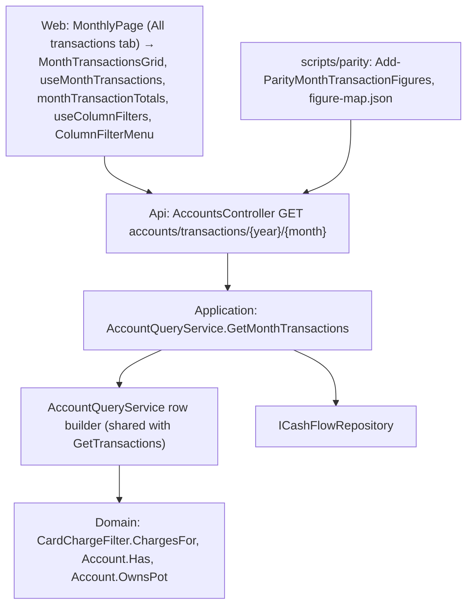

# Technical Specification: Month Transactions View

Complexity: **medium**. One read route that lists a month's rows across every account, built from the account screens' own row logic, a parity figure family that proves the grid's spend per category equals Category totals, and a Monthly tab with filters, a footer and every grid state. No Domain change, no data-file change.

**Strict no-comments policy** in all code, XML docs included (CLAUDE.md). Existing doc comments on lines a stage rewrites are deleted, not reworded.

## 1. Technical Overview

**What.**
- **Month rows route:** `GET accounts/transactions/{year}/{month}` returns the picked month's rows of every account (any template, active or inactive), each with its account's id, name, currency and active flag and the account screen's own row (`AccountTransactionDTO`). The rows come from the same builder as `GET accounts/{id}/transactions/{y}/{m}`, run once over one read of the records. An old settled card charge appears once, on its card in its statement month.
- **Parity family `monthTransactions`:** for every month, the grid's spend per category, mapped to the existing `{month}/categories/*/total` figure. Expected: 0 differences.
- **All transactions tab:** Monthly's second tab. Columns Date, Account, Type, Description, Category, Amount; newest first; sortable; filters Category, Account and Type; a footer with the row count, the total per currency and, with a Category filter on, Spend; Clear filters; links to the account screen; an Actions column whose Edit opens each row where it is edited and whose Delete runs in place (fix/all-transactions-row-icons, 2026-11-12); loading, empty month, no match and load error states.

**Why.** F13 makes Monthly a read-only overview and retires its Bank expenses and Credit Card expenses tabs, the only place that lists a month's spending across accounts with a category filter. Today that means opening every account screen. The grid must agree with Category totals to the penny, so it uses the category totals' month rule (statement month for card charges, own date for the rest) and parity checks it every month.

**Delivery.**
- Two stages (user, Q5), one PR each. Each PR leaves `main` deployable and ends with a parity run against `p60-deployed-f15` showing 0 differences.
- No data-file change: the file stays V4.
- Deploy only after stage 2.

| Stage | Backend and parity | Web |
|---|---|---|
| **1 — Month rows route and parity figure** | `AccountQueryService.GetMonthTransactions` over a shared per-account row builder; `MonthTransactionDTO`; `GET accounts/transactions/{year}/{month}`; the `monthTransactions` figure family and its figure-map entry | None (generated `openapi.ts` only) |
| **2 — All transactions tab; ticks** | None | `MonthTransactionsGrid`, `useMonthTransactions`, the Monthly tab, `clearFilters` on `useColumnFilters`; PRD Section 9 F16 ticks in their own commit |

Stage 1 is not disconnected scaffolding: parity reads the new route in every after-side run.

**Scope.**

*Included:*
- Everything in PRD F16 Capabilities, Experience, Error Handling and Section 9.
- *Input contracts (Consumes):*
  - **F05:** `AccountQueryService.GetTransactions` and its row builder, `AccountTransactionDTO`, the account screen route `/cashflow/accounts/{id}?month=yyyy-MM&tab=…`.
  - **F08:** card charges by statement month (`CardChargeFilter.ChargesFor`) and `CardPayment` rows.
  - **F10:** `PotTransaction` rows, `AccountTransactionOperationDTO` and `operationPath`, which opens the operation's edit form through `useOperationRoute`.
  - **F15:** `CardRefund` and `CardCreditRefund` rows.
- *Output contract (Provides, kept by F13):* the All transactions grid on Monthly and `GET accounts/transactions/{year}/{month}`, which Settlement rows (F11, F12) join through the shared row builder with no change here.

*Excluded:*
- Any row action (edit, delete, move) in the grid; entry stays on the account screen and Monthly's existing tabs until F13.
- A round-up column: Amount excludes round-up, as Category totals do.
- Currency conversion: totals are per currency.
- Pagination: the live data has at most about 300 rows in a month.
- Keeping filters when the month changes or the tab is left.

## 2. Architecture Impact

**Layers and direction** (design.md's four questions):

1. **Where it belongs:** the CashFlow bounded context.
   - **Application:** the month view in `AccountQueryService` and `MonthTransactionDTO`.
   - **Api:** one route on `AccountsController`.
   - **Web:** the Monthly tab, its hook, grid and totals helper.
   - **Parity scripts:** one figure family and one mapping.
2. **Which layers, in which direction:** Application ← Api, plus the web app over the API. No Domain or Infrastructure change and no new package.
3. **What keeps Domain free of Infrastructure:** `ICashFlowRepository` (Application), as in F02. The month view uses the Domain rules the account screens already use (`CardChargeFilter.ChargesFor`, `Account.Has`, `Account.OwnsPot`).
4. **Which SOLID principles it leans on:**
   - **SRP:** one private builder in `AccountQueryService` owns "which rows an account shows in a month"; the account screen and the month view both call it. `MonthTransactionsGrid` renders and filters; `monthTransactionTotals` sums.
   - **OCP:** the month view iterates every account and asks the builder for its rows, so a new template's rows (Settlement in F11) appear with no change to the month view.
   - **DIP:** the service reaches data only through `ICashFlowRepository`; the web reaches the API only through `apiClient`.



## 3. Technical Decisions

| Decision | Chosen approach | Alternative considered | Trade-off |
|---|---|---|---|
| **One route** (user, Q5; stage 1) | `GET accounts/transactions/{year:int}/{month:int}` on `AccountsController`, action `GetMonthTransactions`, calling `IAccountQueryService.GetMonthTransactions(year, month)`. It mirrors the per-account route without the id; `{id:guid}` routes cannot match `transactions`. | `expenses/month/{y}/{m}/…` or a new controller | Lives beside the per-account route it extends. |
| **Row shape** (stage 1) | New `MonthTransactionDTO`: `AccountId` (`Guid`), `AccountName`, `AccountCurrency` (string), `AccountIsActive` (bool), `Transaction` (`AccountTransactionDTO`, the row exactly as the account screen gets it). All `required`. | Copy the 18 row fields into a flat DTO | No duplicated mapping; the web reads `row.transaction.amount`. |
| **Shared row builder** (user, Q5; stage 1) | `AccountRows` and `CardRows` become one private builder taking the account, the month's records (already filtered to the month), all expenses, all statements, year and month: a card (`HasStatements`) gets the month's non-expense records plus `CardChargeFilter.ChargesFor` by statement month; any other account gets the month's records it owns, as today. `GetTransactions` calls it for one account; `GetMonthTransactions` reads `AccountTransactionReader.Read`, expenses and statements once, filters the records to the month once, and calls the builder for every account. No row mapping is copied. | A new row-builder class | One file fewer and the builder stays private; the service grows by one public method. |
| **Old settled card charges** (user, Q1; stage 1) | The month view passes the builder the month's records without card-tagged expenses (`Expense` with `CreditCard` set). On a bank those are exactly the legacy settled charges (both `PaymentSourceAccount` and `CreditCard` set; 56 in the 2026-11-05 data), so they leave the bank side only; the card still lists them from `ChargesFor` by statement month. `GetTransactions` is unchanged, so the bank screen still shows them. | Show both copies | Category totals count each charge once, by statement month; the grid must too. |
| **Which accounts** (stage 1) | Every account in the file, any template, active or inactive, in name order (ordinal, ignoring case); an account with no rows that month adds none. | Active only | PRD: inactive accounts' rows still show, marked Inactive. |
| **Row order** (stage 1) | Newest `Transaction.Date` first, then account name, then the account's own order. The web sorts again with `DATE_DESC_SORT`. | — | Stable for parity and tests. |
| **Month rule** (user, 2026-11-04) | Unchanged builder rules: card charges and refunds by statement month with the purchase date shown (`ChargeDate ?? Date`); every other record by its own date. Only expense-type rows carry `CategoryName`. So, per category, −Σ `Amount` of the grid's rows = Σ `Value` of the expenses whose `ReportingDate` is in the month = the Category totals figure. Round-up is in `RoundUp`, not `Amount`, as Category totals leave it out. | — | The proof is the parity family below. |
| **Parity family** (user, Q4; stage 1) | `Add-ParityMonthTransactionFigures` in `Parity.psm1`, called from `Add-ParityMonthFigures` inside the `$Accounts` block, so after side only (the baseline has no route). It fetches `accounts/transactions/{y}/{m}` and emits `{month}/monthTransactions/categories/<category>/spend` = −Σ `transaction.amount` of the rows with that `categoryName`, for every category on a grid row **and** every category the `categories` family already emitted for that month (0 when the grid has no row for it). New `figure-map.json` entry: `{ "after": "{month}/monthTransactions/categories/*/spend", "before": "{month}/categories/*/total", "negate": false, "reason": "F16 All transactions spend per category" }`. | Negate the Amount sum | Spend is positive for spending, the sign Category totals use, so no negation. |
| **Comparing a figure with no before side** (stage 1) | The baseline report has no `monthTransactions` key. The mapping renames each new key to the baseline's `{month}/categories/<name>/total`, and compare checks it there exactly (a mapping never lets a value differ). A category on a grid row that Category totals lack shows as `(missing)`; a category Category totals list but the grid lacks reads 0 against its total. The after side's own `categories` keys map to the same baseline keys, so both are checked against one figure. Category totals sum every currency together, and so does the family. | Emit only grid categories | Then a category the grid dropped would pass unnoticed. |
| **Tab and loading** (user, Q3; stage 2) | `MONTHLY_TABS` gains `{ id: 'transactions', label: 'All transactions' }` second, after Summary. `useMonthTransactions(year, month)` uses `useAsyncResource` (initially loading) inside a small tab component that mounts only while the tab is open and is keyed by year and month: it fetches when the tab opens, refetches when Monthly's month changes (with no frame of the previous month's rows), and unmounts when the tab closes, so reopening fetches fresh rows after edits on other tabs. `useMonthly` is unchanged. The tab's content renders outside Monthly's own loading and error gate, so it works while Monthly's load is pending or failed, and its own failure leaves the other tabs as they are. | Load with Monthly's `Promise.all` | User: load only when opened. |
| **Columns** (PRD; stage 2) | Date (`formatShortDateUtc`, purchase date on card rows), Account (name as a link, an outline informative `Badge` "Inactive" after it when `accountIsActive` is false, as on the Accounts page), Type (`kindLabel`), Description (`TruncatedText`), Category (`TruncatedText`, empty when none), Amount (`formatSignedN2` plus the currency, `data-table__col--numeric`, right-aligned). Every column sorts (`useSortableRows`, default `DATE_DESC_SORT`). Row key `${accountId}-${kind}-${id}`, since a card payment or credit refund has the same kind and id on both sides. Fluent `Table` with `data-table` in a `monthly-page__table-scroll` wrapper, `aria-label` "All transactions". | Reuse `AccountTransactionsGrid` | It has row actions, a round-up column and one-account links. |
| **Filters** (user, 2026-11-05; stage 2) | `useColumnFilters` with accessors `category` (`categoryName`), `account` (`accountName`), `kind` (`kindLabel(kind)`), each with a `ColumnFilterMenu` in its `SortableColumnHeader` (labels "Category", "Account", "Type"). A row without a category has no Category value, so a Category filter shows only expense-type rows. `useColumnFilters` gains `clearFilters()`, which empties every selection. The grid is keyed by year and month, so a month change starts with no filter. | A separate filter bar | Same menus as Monthly's expense tabs, which F13 retires. |
| **Footer** (user, Q2; stage 2) | Below the grid when it has rows, `monthly-page__section-total` style, values in `<strong>`: "`n` rows · Total `−412.37` GBP" with one Total per currency present (currencies in code order), then, when the Category filter is on, one "Spend `412.37` GBP" per currency (Spend = −Total, `formatN2`). With any filter on, the count reads "`n` of `m` rows" so the figures read as a filtered subtotal (Totals rule). `monthTransactionTotals(rows)` sums in pence (each amount × 100, rounded) per currency, so the shown figure cannot drift from Category totals by float error. "1 row" in the singular. | One total converted to GBP | User: per currency, no conversion. |
| **Clear filters** (user; stage 2) | A primary, standard-size "Clear filters" button above the grid, left, shown whenever a filter is on (so also in the no-match state). It calls `clearFilters()` and moves focus to the Category filter button. | A link in the message row | Action-button rule; one control, not two. |
| **Links** (PRD; stage 2) | The Account cell links to `/cashflow/accounts/{accountId}?month=yyyy-MM&tab=transactions` for the row's month (a Pots account opens on Transactions, not its default Pots tab; a card's default tab is Transactions; a bank has no tabs and ignores it). Descriptions are plain text (`Deposit from an income` when an operation's description is blank). A row with `operation` opens through its Edit icon at `operationPath(operation, accountId)`, which opens the operation's edit form as on the account screen; the row icons replaced the original Description link (user request 2026-11-11, fix/all-transactions-row-icons). | Statement links as on the account grid | PRD asks for the account screen and the operation only. |
| **States** (PRD; stage 2) | **Initial:** nothing fetched until the tab opens. **Loading:** headers stay, the body shows a `Skeleton` (`aria-label` "Loading transactions"), no footer. **Empty month:** "No transactions in October 2026" (`formatLongMonthYear`), no footer, no filters to clear. **No filter match:** "No rows match the current filters" (no full stop, as the other grids) with Clear filters above. **Load error:** `ErrorState` "Unable to load the transactions" with Try again (`retry`), in the tab only. **Deleting:** the row's Delete shows a spinner and reads "Deleting …"; every other Delete is blocked with "Another delete is in progress.". **Delete error:** kept in the confirm dialog. **Success:** a toast ("Expense deleted", "Deposit deleted" …), a silent month refresh and focus on the nearest row control. **Disabled:** an Edit or Delete that cannot run here stays focusable with its reason as a tooltip. **Validation, unsaved changes:** none, edits happen where the row lives (fix/all-transactions-row-icons, 2026-11-12). | — | Mandatory state design. |
| **Narrow layout and keyboard** (stage 2; user, 2026-11-06) | `DataTableCell` labels, so `data-table.css` stacks each row below 600 px and the grid adds no horizontal scroll; the grid scrolls inside its own container above that. Sort and filters are wide-screen only, as on every grid: the shared `data-table.css` hides the header row below 600 px (follow-up, with Monthly's tab strip overflowing 320 px). On wide screens sort buttons, filter triggers (`aria-label` "Filter by Category" etc.), links and Clear filters are reachable by Tab with Fluent's visible focus. The Inactive badge is text, so nothing relies on colour. | — | — |
| **PR size** | Non-test code files (generated `openapi.ts` and the regenerated snapshot excluded): stage 1 → 6, about 11 in total; stage 2 → 7, about 15 in total. §4 lists them. | — | Both within the limit; no split needed. |
| **Rollback** | No data change: rolling back to an F15 build loses only the tab and the route. | — | — |

**Choices made by the spec writer** (open after the interview; for the user's review):
- The route is `GET accounts/transactions/{year}/{month}` on `AccountsController`.
- Each row nests the account screen's `AccountTransactionDTO` under `transaction`, beside `accountId`, `accountName`, `accountCurrency` and `accountIsActive`, instead of a flat copy of its fields.
- The shared row builder stays private in `AccountQueryService` (no new class).
- Old settled charges are dropped from the bank side by leaving card-tagged expenses out of the month's records; no flag on the builder.
- Rows order newest first, then by account name.
- The parity family is named `monthTransactions`, emits spend (not negated) and also emits 0 for every category Category totals list that the grid lacks.
- The tab id is `transactions`; the tab refetches every time it is opened and works while Monthly's own load is pending or failed.
- Amount shows its currency code ("−45.20 GBP"); dates use the app's grid format (dd/MM/yyyy), not "28 Oct".
- No round-up column; Amount and the totals exclude round-up, as Category totals do.
- With a filter on, the footer count reads "12 of 230 rows"; unfiltered "230 rows".
- Spend shows only while the Category filter is on, one per currency, and is −Total of the filtered rows.
- Totals are summed in pence.
- Filters reset when the month changes or the tab is left.
- One Clear filters button above the grid; after clearing, focus goes to the Category filter button.
- Every account link carries `&tab=transactions`; card payment rows get no statement link.
- No pagination.

## 4. Component Overview

All paths are relative to the repo root. Existing patterns: the span/log telemetry shape in every public service method; `ArgumentException` → 400 in `DomainExceptionMappingMiddleware`; acceptance tests in `Tests/Financial.Api.Tests/Acceptance` deriving from `ApiEndpointTests`; `useAsyncResource` for fetch state; `TotalsGrid`'s footer style; the grid primitives in `components/grid`.

**Application (`Financial.CashFlow.Application`)**

| File | New/Modified | Stage | Key responsibilities |
|---|---|---|---|
| `Services/AccountQueryService.cs` | Modified | 1 | `GetMonthTransactions(year, month)`; one shared private row builder for `GetTransactions` and the month view; `AccountRows`, `CardRows`, `RecordsDatedIn` and `CardChargeRows` folded into it |
| `Interfaces/IAccountQueryService.cs` | Modified | 1 | `IReadOnlyList<MonthTransactionDTO> GetMonthTransactions(int year, int month)` |
| `DTOs/MonthTransactionDTO.cs` | New | 1 | `AccountId`, `AccountName`, `AccountCurrency`, `AccountIsActive`, `Transaction` |

**Api (`Financial.Api`)**

| File | New/Modified | Stage | Key responsibilities |
|---|---|---|---|
| `Controllers/AccountsController.cs` | Modified | 1 | `GET transactions/{year:int}/{month:int}` → 200 list, 400 |
| `Tests/Financial.Api.Tests/Contract/openapi-v1.snapshot.json`, `Financial.Web/src/api/generated/openapi.ts` | Regenerated | 1 | The new path and schema; not counted |

**Web (`Financial.Web/src`)**

| File | New/Modified | Stage | Key responsibilities |
|---|---|---|---|
| `components/MonthTransactionsGrid.tsx` | New | 2 | Columns, sorting, the three filters, Clear filters, footer, links, Inactive badge, loading / empty / no match / error states |
| `hooks/useMonthTransactions.ts` | New | 2 | Fetch on mount (the tab component), refetch on month change, retry; `MONTH_TRANSACTIONS_LOAD_ERROR` |
| `utils/monthTransactionTotals.ts` | New | 2 | Per-currency Total and Spend of a row list, summed in pence |
| `pages/MonthlyPage.tsx` | Modified | 2 | "All transactions" tab second; a tab component keyed by month calls the hook and renders the grid outside Monthly's loading and error gate |
| `hooks/useColumnFilters.ts` | Modified | 2 | `clearFilters()` |
| `api/financialApiClient.ts` | Modified | 2 | `getMonthTransactions(year, month)` → `/accounts/transactions/{year}/{month}` |
| `api/types.ts` | Modified | 2 | `export type MonthTransactionDto = Schema<'MonthTransactionDTO'>` |

**Parity (`scripts/parity`)**

| File | Stage | Change |
|---|---|---|
| `Parity.psm1` | 1 | `Add-ParityMonthTransactionFigures`, called after side only |
| `figure-map.json` | 1 | The `monthTransactions` → `categories` mapping |
| `Parity.test.ps1` | 1 | `monthTransactions` in `$figureFamilies`; fixture responses for `accounts/transactions/2026/8` and `/9`; the cases in §7 |
| `README.md` | 1 | Catalogue row for `monthTransactions` |
| `screen-checklist.md` | 2 | Rows T1–T3 (§7) |

**Files per PR (non-test code; generated `openapi.ts` and the snapshot excluded):**
- **1 (6):** `AccountQueryService.cs`, `IAccountQueryService.cs`, `MonthTransactionDTO.cs`, `AccountsController.cs`, `Parity.psm1`, `figure-map.json`. With `AccountQueryServiceTests.cs`, `MonthTransactionsViewAcceptanceTests.cs`, `Parity.test.ps1`, the parity README and the snapshot: about 11 in total.
- **2 (7):** `MonthTransactionsGrid.tsx`, `useMonthTransactions.ts`, `monthTransactionTotals.ts`, `MonthlyPage.tsx`, `useColumnFilters.ts`, `financialApiClient.ts`, `types.ts`. With six test files, `screen-checklist.md` and the PRD ticks: about 15 in total.

## 5. API Contracts

**`GET /api/v1/financial/accounts/transactions/{year}/{month}`** (stage 1). No authentication (single-user app, as every route).

| Parameter | Type | Required | Validation |
|---|---|---|---|
| `year` | `int` (path) | Yes | 1–9999 |
| `month` | `int` (path) | Yes | 1–12 |

**Response 200:** an array of `MonthTransactionDTO`, newest first.

| Field | Type | Description |
|---|---|---|
| `accountId` | `uuid` | The account the row belongs to |
| `accountName` | `string` | Its name |
| `accountCurrency` | `string` | Its currency code; `transaction.amount` is in it |
| `accountIsActive` | `bool` | False for an inactive account |
| `transaction` | `AccountTransactionDTO` | The row as `GET accounts/{id}/transactions/{y}/{m}` returns it: `id`, `kind`, `date`, `description`, `categoryName`, `counterpart`, `amount` (signed for that account, spending negative), `roundUp`, `canEdit`, `statement`, `operation`, `expense`, `income`, `transfer`, `adjustment`, `movement` |

October 2026 (nested records shortened):

```json
[
  { "accountId": "…01", "accountName": "Barclays", "accountCurrency": "GBP", "accountIsActive": true,
    "transaction": { "id": "…e7", "kind": "Expense", "date": "2026-10-28", "description": "Tesco", "categoryName": "Groceries",
                     "counterpart": null, "amount": -45.20, "roundUp": -0.80, "canEdit": true, "expense": { "…": "…" } } },
  { "accountId": "…01", "accountName": "Barclays", "accountCurrency": "GBP", "accountIsActive": true,
    "transaction": { "id": "…e9", "kind": "Expense", "date": "2026-10-10", "description": "Deposit to Reserva", "categoryName": "Reserva",
                     "amount": -90.00, "canEdit": false,
                     "operation": { "operationId": "…o1", "potsAccountId": "…09", "year": 2026, "month": 10, "incomeId": null },
                     "expense": { "…": "…" } } },
  { "accountId": "…09", "accountName": "Reserva", "accountCurrency": "GBP", "accountIsActive": true,
    "transaction": { "id": "…p3", "kind": "PotTransaction", "date": "2026-10-10", "description": "October savings", "counterpart": "Casa",
                     "amount": 90.00, "canEdit": false,
                     "operation": { "operationId": "…o1", "potsAccountId": "…09", "year": 2026, "month": 10, "incomeId": null },
                     "movement": { "…": "…" } } },
  { "accountId": "…05", "accountName": "BA Amex", "accountCurrency": "GBP", "accountIsActive": true,
    "transaction": { "id": "…c2", "kind": "CardCharge", "date": "2026-10-02", "description": "Amazon", "categoryName": "Clothing",
                     "counterpart": null, "amount": -39.99, "canEdit": true, "expense": { "invoiceDate": "2026-10-01", "…": "…" } } }
]
```

A month with no rows returns `[]`.

**Errors:**

| Case | HTTP | Message |
|---|---|---|
| Month outside 1–12 or year outside 1–9999 | 400 | The `DateOnly` argument message, as the per-account route today |

No 404: the route takes no id. The snapshot change is additive (one path, one schema).

## 6. Data Model

No change. The file stays V4; `migrate`, the version guard and the spreadsheet import are untouched. The route reads `Accounts`, `Expenses`, `Incomes`, `Transfers`, `BalanceAdjustments`, `ReserveMovements` (pot transactions) and `CardStatements`.

**Invariants the grid relies on** (true in the 2026-11-05 data):
- Every expense has a payment source or a card (`Expense.Create` refuses neither; 0 without both).
- Every card-tagged expense has an `InvoiceDate` (set on create; 0 without), so its `ReportingDate` is its statement month and `ChargesFor` finds it there.
- A bank's card-tagged expenses are exactly the legacy settled charges; charges paid since F08 have no payment source.

## 7. Testing Strategy

Following the `testing-guide-Financial` skill:
- **Unit:** Application service, web components, hooks and helpers.
- **Integration:** the API host through the acceptance tests; the OpenAPI contract test.
- **AC tracing:** one or more tagged tests per PRD F16 bullet, `[Trait("AC", "P60-F16-month-transactions-view-NN")]` (web: `[AC P60-F16-month-transactions-view-NN]` in the test name), numbered 01–05 in PRD order.
- **Conventions:** every class carries `[Trait("Category", …)]`; names follow `Method_Condition_Result`; shared doubles only in `Tests/Financial.TestUtilities`; no wall-clock reads (a fixed `TimeProvider`); every new case includes a negative path.

| Test file | Type | Stage | Coverage goal |
|---|---|---|---|
| `Tests/Financial.CashFlow.Application.Tests/Services/AccountQueryServiceTests.cs` | Unit | 1 | `GetMonthTransactions_EveryAccount_ListsItsRowsWithItsAccount` (id, name, currency, active flag); `GetMonthTransactions_EqualsEachAccountsTransactions_WithoutTheBankCopyOfSettledCharges`; `GetMonthTransactions_SettledCardCharge_ListedOnceOnItsCardInItsStatementMonth`; `GetMonthTransactions_TransferCardPaymentAndCreditRefund_ShowOnceOnEachSide`; `GetMonthTransactions_PotDeposit_ListsBankExpensesAndOneRowPerPot`; `GetMonthTransactions_InactiveAccount_IsListedAndFlagged`; `GetMonthTransactions_SameDate_OrdersByAccountName`; `GetMonthTransactions_EmptyMonth_ReturnsEmpty`; `GetMonthTransactions_InvalidMonth_ThrowsArgumentOutOfRangeAndFailsTheSpan`; span success. Every existing `GetTransactions_*` test passes unchanged |
| `Tests/Financial.Api.Tests/Acceptance/MonthTransactionsViewAcceptanceTests.cs` | Integration (AC) | 1 | The AC table below, plus `MonthTransactions_InvalidMonth_Returns400` |
| `Tests/Financial.Api.Tests/Contract/OpenApiContractTests.cs` (snapshot) | Contract | 1 | The new path and `MonthTransactionDTO` |
| `scripts/parity/Parity.test.ps1` | Script self-test | 1 | `monthTransactions` in every month's report, after side only (absent without `-IncludeAccounts`); spend per category is −Σ amount of the rows with that category and ignores rows without one; a category in `categories` with no grid row is emitted as 0; the figure map makes a matching spend pass, a different spend a difference, a grid-only category `(missing)` and a 0 spend against a non-zero total a difference |
| `Financial.Web/src/components/__tests__/MonthTransactionsGrid.test.tsx` | Unit | 2 | Columns in order with labels for the stacked layout; Amount signed with currency and right-aligned; newest first and every column sorts; Inactive badge; each filter narrows the rows and a Category filter drops rows without a category; footer count, Total per currency, "n of m rows" when filtered, Spend only with the Category filter; Clear filters shows only when filtered, clears all and focuses the Category filter button; empty month message; no-match message; loading skeleton; error with Try again calling retry; account link with month and `&tab=transactions`; descriptions plain text; Edit opens each row where it lives (operation rows at `operationPath`) and Delete runs in place; both sides of a card payment render (distinct keys) |
| `Financial.Web/src/hooks/__tests__/useMonthTransactions.test.ts` | Unit | 2 | Loading at first, then one request for the month; refetch on month change; error message and retry (the closed tab's no-request rule is tested on `MonthlyPage`) |
| `Financial.Web/src/utils/__tests__/monthTransactionTotals.test.ts` | Unit | 2 | Per-currency totals in code order; pence summing (0.1 + 0.2 style values exact); Spend = −Total; empty list |
| `Financial.Web/src/hooks/__tests__/useColumnFilters.test.ts` | Unit | 2 | `clearFilters` empties every column's selection and restores all rows |
| `Financial.Web/src/pages/__tests__/MonthlyPage.test.tsx` | Unit | 2 | "All transactions" is the second tab; no month-transactions request until it is opened; the tab renders while Monthly's own load is pending or failed; its load error leaves Summary working; a month change reloads and clears the filters; reopening reloads |
| `Financial.Web/src/api/__tests__/financialApiClient.test.ts` | Unit | 2 | `getMonthTransactions` requests `/accounts/transactions/2026/10` |

**Acceptance criteria (PRD Section 9, F16):**

| AC | Criterion (short) | Test | Stage |
|---|---|---|---|
| 01 | The tab lists every account's rows for the month as the account screens show them; card charges and refunds by statement month, the rest by date; an old settled charge once, on its card | `MonthTransactionsViewAcceptanceTests.MonthTransactions_ListEveryAccountsRowsAsTheAccountScreens_SettledChargeOnceOnItsCard` (1); `MonthTransactionsGrid.test.tsx` "[AC …-01] lists every account's rows with account, type, category and signed amount" (2) | 1, 2 |
| 02 | Category, account and type filters narrow the rows; the footer shows the count and total per currency; filtered to one category, Spend equals Category totals | `…MonthTransactions_SpendPerCategory_EqualsCategoryTotals` (1); `MonthTransactionsGrid.test.tsx` "[AC …-02] filters by category, account and type, with count, total per currency and Spend" (2); `monthTransactionTotals.test.ts` tagged 02 | 1, 2 |
| 03 | Each row links to its account screen at that month; a linked deposit or withdrawal row opens its operation | `…MonthTransactions_RowsCarryTheirAccountAndOperation` (1); `MonthTransactionsGrid.test.tsx` "[AC …-03] links the account and keeps every description plain text" and "[AC …-03] opens a pot operation where it lives and a statement payment on its Statements tab" (2) | 1, 2 |
| 04 | Loading, empty month, no filter match and load error states, keyboard use and narrow layout pass the review checklist (narrow: rows stack and the grid adds no horizontal scroll; sort and filters are wide-screen only, as on every grid) | `MonthTransactionsGrid.test.tsx` and `MonthlyPage.test.tsx` "[AC …-04] …"; screen checklist T3; ui-reviewer | 2 |
| 05 | Parity 0 differences including the new per-category spend for every month; `/simplify`; architecture-reviewer and ui-reviewer | `Parity.test.ps1` cases; the parity run; Definition of Done, both PRs | 1, 2 |

The acceptance seed (stage 1, `TestClock` fixed in November 2026) holds: a bank with an expense and a round-up; a card with a charge bought in September on the October statement, a refund, a legacy settled charge (payment source and card both set) on a paid legacy statement and a statement payment transfer; an ordinary transfer between two banks; a Pots account with a linked deposit funded by the bank; an inactive bank with one expense; and an income. AC 01 compares the route with the union of `GET accounts/{id}/transactions/2026/10` for each account, minus the bank's copy of the settled charge. AC 02 compares, for every category, −Σ `amount` with `GET expenses/month/2026/10/category-totals`.

**Cross-feature criterion touched:** "The parity commands and report from F01 run unchanged at the end of every later feature, extended only through the report and figure map" — stage 1 extends parity only through a report family and a figure-map entry. Its box is ticked only when every feature it names has shipped (F13).

**Screen checklist rows** (added to `screen-checklist.md` in stage 2, after side only):
- **T1:** Monthly → All transactions filtered to one category: Spend equals that category's Category totals figure (M1, M2, M3).
- **T2:** filtered to one account, the rows equal that account screen's Transactions tab for the month, except a bank's old settled card charges, which appear only on their card (M1, M3).
- **T3:** at 320 px wide the rows stack and the grid adds no horizontal scroll; sort and filters are wide-screen only, as on every grid; on a wide screen Tab reaches every sort button, filter, link and Clear filters with visible focus (M1).

**UI states** (reviewed with `docs/ui/review-checklist.md`): as §3 "States" — initial, loading skeleton, empty month, no match with Clear filters, load error with Try again; deleting, delete error, success and disabled row actions; no validation or unsaved-changes state, edits happening where the row lives. Filtered figures read "n of m rows"; totals are bold values with labels.

**Proved by the Definition of Done**, for each PR:
- `dotnet build --configuration Release` and `dotnet test`;
- `npm run build` and `npm test` when the web changed (stage 2; stage 1 only regenerates `openapi.ts`, which `openapiFreshness.test.ts` checks);
- the OpenAPI snapshot and `openapi.ts` regenerated in stage 1;
- `pwsh scripts/parity/Parity.test.ps1` passing (stage 1 adds the family; stage 2 reruns it);
- `scripts/parity/Invoke-Parity.ps1 -Step All -LiveCopy "E:\dev\projetos\financial\data\data-cashflow.json"` against `p60-deployed-f15`, expecting `Parity OK: 0 differences`, with the file's SHA-256 unchanged (the 2026-11-05 download starts `d83852d4`). Stage 1 reports more figures than the F15 run by the new family's keys (one per category per month, 120 months), every one mapped to its Category totals figure; stage 2 expects the same count;
- `/simplify` and the architecture-reviewer, plus the ui-reviewer for stage 2.
