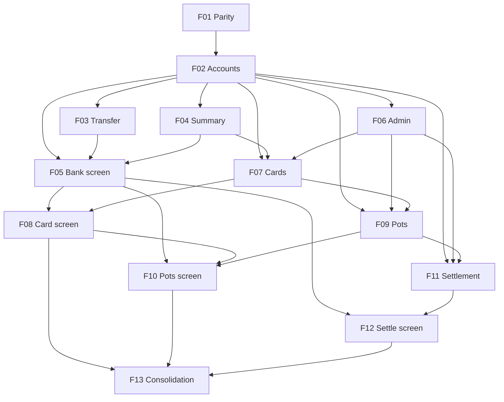

# CashFlow Accounts Generalization

## 1. Executive Summary

CashFlow Accounts Generalization replaces the separate Bank, Credit Card, Reserva and Controle Mãe concepts in the CashFlow bounded context with one generic **Account** model. Each account is a named instance of a built-in **template** (Bank, Credit card, Pots, Settlement), and what it can do is decided only by the template's **capabilities**. Every account's balance comes from one shared calculation, moving money between accounts is one generic transfer, and an operation that touches several accounts writes **linked transactions** in one save. The design was agreed in `docs/pending/cashflow-accounts-generalization.md` (2026-10-08 to 2026-10-17); this PRD fixes its scope, slices and acceptance criteria and records every place where verifying it against the code and the live data changed a statement in that document.

The product is the single-user, self-hosted Financial tool. Its React front end (`Financial.Web`, the only front end since ADR-002) gains an **account-centred UI**: the user picks one account and does everything for it from one screen — pay a card statement from the card, transfer or pay a recurring bill from a bank, deposit to or withdraw from the Reserva pots, add an entry or settle with Mãe — instead of today's tasks spread across Monthly, Reserva, Controle Mãe and the card statement section. Overview screens about time or the whole household (Monthly summary, annual summary, Mensais, investment snapshots) stay.

The core value is one place per account, a new account from an existing template with no code, multiple Pots and Settlement accounts (the user's son's GBP account is expected soon), and a server-side summary in place of browser arithmetic — all while every balance, total and summary on the user's real data stays exactly as it is today. Nothing is deployed until all stages are done; each stage proves parity by running its data migration chain on a fresh copy of the live data file and comparing a full figures report before and after.

**Stages.** The design document's five slices are delivered as five stages of 13 features:

| Stage | Design doc slice | Features |
|---|---|---|
| 1 — Accounts and banks | F01 | F01 Parity toolkit, F02 Account model and Bank migration, F03 Generic transfer, F04 Default group summary, F05 Bank account screen, F06 Admin accounts page |
| 2 — Credit cards | F02 | F07 Credit card template and migration, F08 Statement payment and card screen |
| 3 — Pots | F03 | F09 Pots template and Reserva migration, F10 Linked deposit, withdrawal and Pots screen |
| 4 — Settlement | F04 | F11 Settlement template and Mãe migration, F12 Settlement screen |
| 5 — Consolidation | F05 | F13 Consolidated navigation and retirement |

## 2. Problem and Opportunity

### The Problem

**Tasks for one account are spread across pages and levels**
- Paying a card statement happens in a section of Monthly, depositing into the pots on the Reserva page plus a manual "Reserva" expense on Monthly, and settling with Mãe on Controle Mãe.
- A Reserva deposit needs 2 separate entries today: the pot credit, then a hand-typed "Reserva" expense on the sending bank; forgetting the second understates the category total and overstates the bank balance.
- Monthly fires 12 + one-per-bank API calls (15 with today's 3 banks) and computes bank totals, card outstanding, category totals sum and income totals in the browser.

**Four balance calculations and name-based joins**
- Bank, card, pot and Mãe balances are computed by 4 different pieces of code (`BankService.ComputeBalance`, `CardStatementService`, `ReserveService` / `ReserveBucketAsOfDateResolver`, `ControleMaeService.GetTotals`).
- Bank balances are matched to banks by **name string** in the browser (`useMonthly.ts`), and category totals are grouped by category name on the server.
- The "Reserva" category is found by its exact name in the server (`Category.ReservaName`) and in the web (`withdrawalExpenseCategories.ts`); renaming it breaks withdrawals via bank.
- The card/period charge filter is copied 4 times across `CardStatementService` and `InvestmentSnapshotService`, and the copies differ (the snapshot copy includes paid charges).

**Single fixed instances**
- Mãe and Reserva are hard-wired single instances; a second Settlement account (the user's son, GBP only) cannot be created.
- A second set of pots cannot exist; the snapshot source "sum of reserve buckets" adds every bucket there is.

**Writes and records that hide what happened**
- Paying a statement rewrites every charge (re-points it to the bank and re-dates it to today) instead of recording a payment.
- Card statements are created inside a GET request.
- Deleting a manual pot deposit finds its siblings by matching date and description text.

### The Opportunity

- **One account screen** per account with only the actions its capabilities allow (served by the API) puts every task for that account in one place; actions that span two accounts can be started from either.
- **Linked operations** write all transactions of one action in one save (a deposit writes its bank expense(s) and pot credits together; a statement payment is one bank → card transfer), so nothing is typed twice and editing or deleting the operation changes all its parts.
- **One balance calculation and Id-based references** remove the 4 calculations, the name joins and the fixed-name Reserva lookup; a Pots account carries its own category setting.
- **Templates and capabilities** make a new bank, card, Pots or Settlement account a data entry in Admin → Accounts, with no code.
- **One server-side summary query** for the default account group replaces the browser arithmetic on Monthly.
- **A parity toolkit** proves, on the user's real data, that every figure is unchanged at every stage.

## 3. Target Audience

### Primary Users

**Household finance owner (single user)**
- Records daily expenses, incomes, card charges, transfers, Reserva deposits and withdrawals and Mãe entries across UK banks (Barclays, Chase, Trading 212 cash), 5 credit cards (2 Barclays, Chase, BA Amex, PayPal) and a BRL/GBP running balance with their mother.
- Wants each account's tasks in one place, and wants to add a new account (e.g. a GBP Settlement account with their son) without waiting for code.
- Relies on the balances, category totals, tithe and annual summaries being exactly right; brings copies of the live data file to validate each stage before the single deploy.

## 4. Objectives

### Product Objectives

1. **Preserve** every figure the user sees today, on the real data, through the whole migration chain.
2. **Enable** a new account from any built-in template with no code change.
3. **Centralise** every per-account task on one account screen.
4. **Unify** balance computation and account references into one calculation and Id-based links.
5. **Replace** browser-side summary arithmetic with one server-side summary query.

### Success Metrics

| Objective | Metric | Measurement condition |
|---|---|---|
| Preserve figures | 0 differences in the figures report, for every month in the data | Parity run on the latest live copy with the full V1 → V5 chain, before the single deploy |
| Preserve figures | 0 differences at the end of each of the 13 features | Parity run on the latest live copy available when the feature finishes |
| No-code accounts | 4 of 4 templates create a working account through Admin → Accounts with 0 code changes | Manual check after F11: create one account per template, see it in the account list and use one action on it |
| Centralise tasks | 14 of 14 per-account tasks reachable from the account screen (bank: add expense, add income, transfer, pay recurring bill, reconcile; card: add charge, pay statement, move charge, unmark paid; Pots: deposit, withdraw, manage pots; Settlement: add entry, settle) | Task checklist ticked before F13 retires the old pages |
| Unify | 4 old balance calculations deleted; 0 template-name checks in production code | Code review at F12; architecture test green |
| Unify | 0 name-string joins between balances, accounts and the Reserva category | Grep at F13 of `useMonthly.ts`, `withdrawalExpenseCategories.ts`, `Category.ReservaName` (all removed) |
| Server summary | Monthly summary area served by 1 call; 0 browser-side sums of balances, outstanding, category totals or income totals | F04 code review and network panel check |

## 5. User Stories

### F01. Parity Toolkit
- As the user, I want to give a copy of my live `data-cashflow.json` to one command and get a report of every figure from today's released version, so that I have a baseline to compare against
- As the user, I want one command that migrates a second copy and exports the same report from the feature branch, so that I can compare like with like
- As the user, I want a compare command that lists every figure that differs and fails when any does, so that a difference cannot go unnoticed
- As the user, I want a short screen checklist and both versions running side by side, so that I can confirm the screens show the same values
- As the system, I want the toolkit to refuse the live data file and the live port 8080, so that a parity run can never change the live system

### F02. Account Model and Bank Migration
- As the system, I want banks to become accounts made from the Bank template, keeping their Ids, so that every existing reference keeps working
- As the system, I want one balance calculation for every account, honouring the bank's balance start date, so that balances stay exactly as today
- As the user, I want a `migrate` command that upgrades a copy of my data file to the new format, so that I can validate each stage and run the same command at deploy
- As the system, I want the API to refuse to start on a data file older than it expects, so that a deploy that forgot to migrate fails clearly instead of misreading data
- As the user, I want today's Monthly, bank and transfer screens to keep working unchanged, so that nothing breaks while the new screens are built

### F03. Generic Account-to-Account Transfer
- As the user, I want to transfer between any two accounts the pair rules allow, so that one mechanism covers every move between accounts
- As the user, I want to record both amounts when the accounts have different currencies, so that each side shows its real value
- As the user, I want to start a transfer from the sending or the receiving account, so that I can record it from wherever I am

### F04. Default Account Group and Summary Query
- As the user, I want the default group to reproduce today's main figures (banks and cards), so that Monthly shows the same numbers from one server call
- As the user, I want group totals per currency, never silently converted, so that totals are unambiguous
- As the user, I want a new bank or card to join the default group automatically, so that I never have to maintain the group by hand

### F05. Bank Account Screen
- As the user, I want an Accounts page listing my accounts with their balances, so that I can open any account from one place
- As the user, I want to switch accounts with a picker on the account screen, so that I move between accounts without leaving it
- As the user, I want a bank's header to show its name, template and balance for the selected month, so that I see where it stands
- As the user, I want every transaction that touched the bank in the month in one list, so that I can review it without visiting other pages
- As the user, I want to add an expense or income, transfer, pay a recurring bill or reconcile from the bank's screen, so that the bank's tasks are in one place
- As the user, I want to edit and delete the bank's transactions from the list, so that I can correct mistakes where I see them

### F06. Admin Accounts Page
- As the user, I want to create an account by choosing a template, name and currency, so that a new account needs no code
- As the user, I want to edit an account's name and template-specific settings, and deactivate or delete it, so that I can maintain my accounts in one admin page

### F07. Credit Card Template and Card Migration
- As the system, I want credit cards to become accounts made from the Credit card template, keeping their Ids, so that charges, statements, snapshot sources and calendar events keep working
- As the system, I want one charge filter for a card and statement month that keeps today's paid/unpaid behaviour per use, so that statements and snapshot suggestions stay identical
- As the user, I want my cards to appear in the default group like today, so that the main figures are unchanged

### F08. Statement Payment and Card Screen
- As the user, I want paying a statement to record one bank → card payment for the statement total, so that my charges keep their own dates and categories
- As the user, I want to pay a statement from the card or from the bank, so that I can do it from wherever I am
- As the user, I want the card's Statements tab to show each statement's total and status, so that I know what is owed and what is paid
- As the user, I want to move an unpaid charge to a later statement from the card screen, so that Pay-in-4 and late postings land in the right month
- As the user, I want to unmark a statement I paid by mistake, so that I can fix a payment from the wrong bank
- As the user, I want the bank to show one "card payment" line that opens the statement, so that the bank list stays readable

### F09. Pots Template and Reserva Migration
- As the system, I want the Reserva buckets to become pots inside a "Reserva" Pots account, keeping their Ids, so that all movements and balances stay identical
- As the user, I want each Pots account to have its own category setting, so that renaming the "Reserva" category never breaks deposits or withdrawals
- As the user, I want the investment snapshot "pots total" source to name a specific Pots account, so that a second Pots account does not change my snapshot suggestions

### F10. Linked Deposit, Withdrawal and Pots Screen
- As the user, I want an income marked split-to-reserve to write the pot credits and the bank expense in one save, so that I no longer type the "Reserva" expense by hand
- As the user, I want to fund a deposit from one or more banks, or from outside CashFlow with no bank, so that the record matches where the money came from
- As the user, I want editing or deleting the income to update or remove its whole deposit, so that the records never drift apart
- As the user, I want to withdraw from a pot, optionally through a bank, from the Pots account or from the bank, so that the bank-side expenses are written with it
- As the user, I want to see each pot's balance and the account total on the Pots tab, so that I know what is set aside
- As the user, I want to manage pots (add, rename, change split, deactivate) in one save that must total 100%, so that the split stays valid

### F11. Settlement Template and Mãe Migration
- As the system, I want Controle Mãe to become a Settlement account with participants and BRL + GBP, keeping both totals exactly, so that the running balance is unchanged
- As the user, I want each entry to say who paid, explicitly, so that the balance does not depend on remembering a sign convention
- As the user, I want to create a GBP-only Settlement account for my son from Admin → Accounts, so that a second settlement needs no code

### F12. Settlement Screen
- As the user, I want the Settlement header to show the balance in each of its currencies and who owes whom, so that the debt is clear
- As the user, I want to add an entry choosing who paid and, when the account has two currencies, the currency, so that conversion uses that day's rate as today
- As the user, I want a Settle action that pre-fills an entry zeroing every total in one go, so that a settlement leaves no leftover pennies

### F13. Consolidated Navigation and Retirement
- As the user, I want Accounts to be the CashFlow entry point and Monthly to become an overview, so that entry happens only on the account screen
- As the user, I want the old Reserva, Controle Mãe and per-type admin pages removed once the account screen covers them, so that each task has exactly one place
- As the user, I want old links to land on the matching account screen, so that bookmarks still work
- As the system, I want the E2E journeys, `context.md`, README and example data updated, so that the documentation and tests describe the new model

## 6. Functionalities

Rules that apply to every feature:

- **DDD placement.** Everything lives in the CashFlow bounded context; the Investment context is untouched. Domain owns `Account`, templates, capabilities, value objects, the balance rule, the transfer pair rules and the linked-operation rules (pure, no I/O). Application owns use cases and DTOs. Infrastructure owns JSON persistence and the migration steps. `Financial.Api` exposes controllers only. Domain never references Infrastructure; the repository interface stays declared in Application (`ICashFlowRepository`). *Why:* the CLAUDE.md architecture invariants, enforced by the architecture-reviewer agent.
- **Capabilities are the only thing code checks.** Services, validation and the allowed-actions API ask "does this account have `CanPayBills`?", never "is this a Bank?". *Why:* a new template made of existing capabilities then needs no behaviour code.
- **Definition of Done for every feature:** (1) the parity check passes with 0 differences on the latest live copy, (2) `/simplify` has been run on the feature's diff and its findings applied or explicitly declined, (3) tests follow the `testing-guide-Financial` skill — Unit per capability rule and handler, Integration (`ApiEndpointTests`) for endpoints and AC-traced tests tagged `[Trait("AC", "P60-Fxx-...")]`, negative paths at every layer, (4) the architecture-reviewer agent has reviewed it, and the ui-reviewer agent for features with UI, (5) a changed API updates the OpenAPI snapshot and `Financial.Web/src/api/generated/openapi.ts`, (6) every PR stays within 8 non-test code files unless it is one change repeated, (7) no code comments beyond genuine non-obvious WHYs.
- **Testing capabilities** (design doc, unchanged): each capability is its own unit tested against a minimal test account with only that capability; the balance calculation is tested once; linked operations and transfer pair rules have contract tests every capability plugs into; one combination test per built-in template; an architecture test forbids template-name checks.
- **Forward-only migrations.** Each step makes the data correct for the new model from now on; past records keep working as they are today and are not rebuilt.
- **No deploy between stages.** The live system keeps running today's version until F13 is done and the final parity run on the latest live copy passes.

### F01. Parity Toolkit

**Provides:**
- Parity commands (baseline, migrate, after, compare, all), the figures report format and the screen checklist (used by F02; every later feature runs them through the Definition of Done)

**Capabilities:**
- Lives in `scripts/parity/` as PowerShell (like `scripts/deploy.ps1`); no production code. *Why:* the design doc allows scripts, the report must read what the screens read (the API), and a script adds nothing to deploy.
- One entry point `scripts/parity/Invoke-Parity.ps1 -Step Baseline|Migrate|After|Compare|All -LiveCopy <path>`; `All` runs the 4 steps in order. Each run gets a fresh work folder `%TEMP%\financial-parity\<yyyyMMdd-HHmmss>\`.
- **Baseline:** git tag `p60-baseline` is created on `main` when F01 starts (today's released behaviour). The step checks the tag out in a temp git worktree, builds `Financial.Api` in Release, copies the live copy to `before\data-cashflow.json`, starts the API with `CashFlow__Repository__Provider=LocalJson`, `CashFlow__DataJsonFile=<that copy>` and the Investment file pointed at a temp copy of `data/data-investment.example.json`, on port 5291, and exports `before-report.json`.
- **Migrate:** copies the live copy to `after\data-cashflow.json` and runs the migration chain (`migrate` command, from F02 on) on it. In F01 the step is a plain copy, because no migration exists yet.
- **After:** builds the current working tree and runs it against the migrated copy on port 5292, exporting `after-report.json`.
- **Compare:** compares both reports key by key; amounts are compared as exact decimals; prints `path | before | after` for every difference and exits with code 1 if there is at least one.
- **Safety:** refuses a `-LiveCopy` that resolves to `data/data-cashflow.json`; records the SHA-256 of the live copy before and after the run and fails if it changed; refuses port 8080 and any port already in use (checked with `Get-NetTCPConnection`); stops both API processes and removes the worktree at the end, also on failure.
- **Figures report** (sorted keys, one JSON file), for every month from the first month with any record up to the later of the current month and the last month with any record (future card invoices and snapshots are included; the current month is fixed once per run):
  - each bank's balance (`banks/month/{y}/{m}/balances`) and round-up total;
  - each card's statement total, outstanding and paid status (`card-statements/{y}/{m}`), unpaid card charges total;
  - category totals per category (`expenses/month/{y}/{m}/category-totals`);
  - income totals per income source (net and gross) and total incoming (`incomes/month/{y}/{m}`);
  - tithe summary (`tithe/month/{y}/{m}`);
  - investment snapshot suggestions (`investment-snapshots/{y}/{m}/suggestions`);
  - Monthly's browser-computed figures (bank totals sum, card outstanding total, category totals sum), computed by the script from the same endpoint responses exactly as `useMonthly.ts` does, so F04's server summary can be compared to them;
  - each pot's balance and the pots total at month end, from `reserve/movements` (the API has no as-of balance endpoint);
  - current pot balances (`reserve/balances`), Mãe BRL and GBP totals (`controle-mae/entries/totals`);
  - per year: annual category totals, historic summary averages and investment annual result (`annual-summary/{y}/...`).
- **Mapping:** when a feature changes where a figure comes from (e.g. F04's summary, F07's card balance), it adds a mapping entry in `scripts/parity/figure-map.json` (after-path → before-path, optional sign flip) and extends the report; the compare uses the mapping. A mapping never allows a value to differ.
- **Writes during GET:** today the first tithe read saves the tithe start month and card statement GETs create statements. Both reports are taken from fresh copies of the same input, so these writes happen identically; the report records whether each copy changed during the read as information.
- **Screen checklist:** `scripts/parity/screen-checklist.md` lists page, month and value to compare (Monthly, card statements, Reserva, Controle Mãe, Annual summary, Investment snapshots); `-Step All -KeepRunning` also builds each version's web app into its API and leaves both running on 5291 and 5292 for the check; runs without it build the API only. Each UI feature adds its account-screen rows.
- `scripts/parity/README.md` documents the commands, the figure catalogue (figure → endpoint) and how to extend it.

**Experience:**
- The user runs `.\scripts\parity\Invoke-Parity.ps1 -Step All -LiveCopy D:\copies\data-cashflow-2026-10-20.json`.
- Progress lines name each step (`[1/4] Baseline: building p60-baseline…`, `[2/4] Migrate…`, `[3/4] After…`, `[4/4] Compare…`).
- Success ends with `Parity OK: 0 differences in 1,234 figures across 117 months` and exit code 0.
- Failure lists each difference (`2026-09 / banks / Barclays / balance | 130.83 | 131.83`) and ends with `Parity FAILED: 1 difference`, exit code 1, and keeps the work folder for inspection.

**Error Handling:**
- Live file passed: `Refusing to run on the live data file data/data-cashflow.json. Pass a copy.` — nothing runs.
- Port busy or 8080: `Port 5291 is in use (or is the live port 8080). Free it or pass -BeforePort/-AfterPort.` — nothing runs.
- Build or start failure: the step prints the build/API output path, stops any started process, removes the worktree and exits 1.
- Live copy changed during the run (hash differs): `The input copy changed during the run; results discarded.` exit 1.
- Missing baseline tag: `Tag p60-baseline not found. Create it on main before the first run.` exit 1.

### F02. Account Model and Bank Migration

**Consumes:**
- F01: parity commands and figures report

**Provides:**
- `Account` aggregate with template, currency, active flag and capability check; Bank template; account references on expenses, incomes, transfers and balance adjustments (used by F03, F04, F06, F07)
- Shared balance calculation per account and currency up to a date (used by F03, F04, F05, F07, F09, F11)
- Versioned `migrate` command and the API version guard (used by F07, F09, F11)
- Template-name architecture test (used by F07, F09, F11)

**Capabilities:**
- **`Account` aggregate (Domain):** `Id`, `Name`, `Template`, `Currency`, `IsActive`, plus capability-specific value objects. Capability check `account.Has(Capability.X)` reads the template's fixed capability set every time; the account stores which template it was made from, not its own capability list. *Why:* a template change in code applies at once to every account made from it (design doc).
- **Templates in code:** a table of named, fixed capability sets. **Bank** = `HasOpeningBalance`, `ReceivesIncome`, `HasCategories`, `CanSendTransfers`, `CanReceiveTransfers`, `CanReconcile`, `CanPayBills`, `SupportsRoundUp`. Credit card, Pots and Settlement templates are added by F07, F09, F11.
- **Value objects:** `OpeningBalance` (amount ≥ 0, start date) behind `HasOpeningBalance`; `RoundUpSetting` (enabled yes/no) behind `SupportsRoundUp`. No inheritance tree, no type switches.
- **Banks become accounts with the same Ids.** Expense (payment source), Income (bank), Transfer (source, destination) and BalanceAdjustment (bank) keep their own entities; their bank reference becomes an account reference. *Why:* a small migration (no record is rewritten except its reference), category reporting untouched, parity easy to keep. Rejected: one generic Transaction table (rewrites ~14,000 expenses; effectively double-entry, which the design rejected).
- **One balance calculation (Domain rule, pure):** balance(account, currency, as of D) = opening amount + the sum of every record's signed contribution to that account dated from the balance start date up to D; an account without `HasOpeningBalance` counts every record up to D. Each record type declares its own contribution (expense −(value + round-up) on its payment-source account, income +net, transfer −amount on source / +amount on destination, adjustment +delta). *Why it keeps a start date (deviation from the design doc):* the doc said the opening balance becomes the first transaction and the date window disappears, but the live data has about 14,185 bank records dated before the banks' 2026-09-01 opening date (Barclays 10,375, Chase 2,457, Trading 212 1,353) that count in category totals and history but not in balances; dropping the window would change every bank balance. The window survives as one rule inside the one calculation, not as a bank special case.
- `BankService.ComputeBalance` is replaced by the shared calculation; the other 3 calculations are replaced by F07, F09, F11.
- **Migration step V1 → V2** (Infrastructure, in `Tools/CashFlowSpreadsheetImport`): `Banks` → `Accounts` with template Bank, currency GBP (all 3 banks are UK), `IsActive` true, opening balance and start date and round-up setting copied; record references hold the same Ids; `Version` becomes 2. Idempotent: a V2 file is left unchanged.
- **`migrate` command:** `CashFlowSpreadsheetImport migrate --input <path> --output <path>` runs every step the file still needs, in order, with no spreadsheet, and always writes a separate output file; reuses `LiveDataFileGuard` (refuses `data/data-cashflow.json` as input or output, with no override) and `MigrationBackup`. *Why:* explicit and repeatable, reuses the existing guard, backup and `Version` field; restarting the app never migrates. *Why no migrate-on-load (unlike Investment's `InvestmentDataMigrations`):* these steps restructure the data, and each one must pass a parity run on a copy before the live file changes. *Why no live-file override:* production reads the file from Google Drive, so the deploy downloads it, migrates the download to a new file and uploads that; the repo's local file is never the migration target.
- **Spreadsheet import keeps working:** the import (`CashFlowSpreadsheetImport` without `migrate`) builds the domain model and saves it through `CashFlowSerializerAdapter`, so it always writes the current version. Its bank step creates Bank-template accounts directly, and a fresh import loads under the version guard. *Why:* a day-one reset from the Google spreadsheet must stay possible; the V1 → V2 step is only for files written before F02.
- **Version guard:** `CashFlowSerializerAdapter` knows the current version; loading a file with a lower `Version` stops the API at startup with `data-cashflow.json is version 1; this build needs version 2. Run the migrate command first.` A higher version is refused the same way.
- **Compatibility boundary:** `/banks` (including `opening-balance`, `balances`, `adjustments`), `/transfers` and `/expenses` keep their routes and DTO shapes, served by Account-backed services, so Monthly, the Admin Banks page and every existing screen work unchanged until F13. `RecurringBillPaymentExpenseDTO.PaymentSourceBankId` now carries an account Id (same value).
- **Test and example data:** `Tests/Financial.Api.Tests/TestData/data-cashflow.test.json` and `data/data-cashflow.example.json` are migrated to V2 in the same feature (the version guard would otherwise refuse them).
- **Architecture test:** a test in `Tests/Financial.Architecture.Tests` fails if any production type outside an allow-list (the template table, the migration steps, the DTO mapper that shows the template name) depends on the template type, which is its own type for this reason. It uses ArchUnitNET (`TngTech.ArchUnitNET`), referenced by the test project only; every library call sits in one adapter class behind a narrow interface, so replacing the library touches one file. *Why:* the existing architecture tests only check project references; reading compiled type dependencies is sturdier than scanning source text. ArchUnitNET over NetArchTest: NetArchTest.Rules has had no release since 2021 and its eNhancedEdition fork has a single maintainer, while ArchUnitNET is actively released.

**Experience:**
- No visible change: every screen shows the same values. The only new user-facing step is the `migrate` command, documented in `scripts/parity/README.md` and README's deploy section.

**Error Handling:**
- API started on a V1 file: startup fails with the version message above; nothing is read or written.
- `migrate` given `data/data-cashflow.json` as input or output: `Refusing to migrate the live data file. Pass a copy.` exit 1, nothing written.
- Migration failure mid-way: the output file is not written; the backup and input are untouched; exit 1 with the step name.
- A record referencing an unknown bank Id during migration: migration stops with `Expense <id> references unknown bank <id>` and writes nothing.
- Deleting a bank account that has records: 409 `EntityInUse`, as today.

### F03. Generic Account-to-Account Transfer

**Consumes:**
- F02: account model and references, shared balance calculation

**Provides:**
- Transfer operation and transfer pair rules (allowed source → destination by capability) (used by F05)

**Capabilities:**
- A transfer moves money from a source account with `CanSendTransfers` to a destination account the **pair rules** allow; it has no category. In this stage the only pair is `CanSendTransfers` → `CanReceiveTransfers` (bank → bank, as today). F08 adds bank → card for statement payments only.
- Fields: date (not in the future), source account, destination account (different from source), amount > 0 in the source currency, destination amount > 0 in the destination currency (required and editable only when the currencies differ; equal to the amount otherwise), optional FX rate shown as destination amount ÷ amount, note (optional, up to 200 characters).
- Stored as one Transfer record contributing −amount to the source and +destination amount to the destination. Existing transfers migrate unchanged (destination amount = amount).
- The pair rules are a Domain table with their own contract tests; a newly allowed pair is one entry plus a test, and the destination list in the UI follows it with no front-end change.
- New endpoints under `accounts`: `POST accounts/transfers`, `PUT accounts/transfers/{id}`, `DELETE accounts/transfers/{id}`, `GET accounts/{id}/transfer-destinations`, `GET accounts/{id}/transfer-sources`. `/transfers` keeps working (same records) until F13.
- Can be started from either side: from the sending account ("Transfer to…", destination list from `transfer-destinations`) or the receiving account ("Transfer from…", source list from `transfer-sources`). *Why:* the user decided that actions spanning accounts start from both accounts.

**Experience:**
- API in this feature; the account screen form arrives in F05. Monthly's existing transfer form keeps working.

**Error Handling:**
- Pair not allowed (e.g. card → bank): 400 `Transfers from <source> to <destination> are not allowed.` nothing saved.
- Same account on both sides: 400 `Source and destination must be different accounts.`
- Different currencies without a destination amount: 400 `Enter the amount received in <currency>.`
- Inactive destination or source: 400 `<account> is inactive.`
- Save failure: nothing persisted (single save).

### F04. Default Account Group and Summary Query

**Consumes:**
- F02: account model, shared balance calculation

**Provides:**
- Default account group (ordered members) and the group summary for a month (used by F05, F07)

**Capabilities:**
- **AccountGroup** (Domain): `Id`, `Name`, `IsDefault`, ordered member account Ids. One default group, "Main", is created by migration step V2 with the banks in today's file order. A new account from a template that joins the default group (Bank now, Credit card from F07) is appended automatically on creation; Pots and Settlement accounts never join it. Group management screens are out of scope.
- **Summary query** `GET accounts/groups/{id}/summary/{year}/{month}` returns:
  - members, in order: account Id, name, template name, currency, balance at month end (same as today's `banks/month/{y}/{m}/balances`), the month's round-up total for accounts with `SupportsRoundUp`, and from F07 the card's outstanding and statement status;
  - totals per currency (bank balances sum, card outstanding sum), never converted;
  - Monthly's totals: category totals sum, income totals per income source (net, gross or empty), total incoming.
- **Monthly** switches its summary area (bank totals, card outstanding, category totals sum, income totals) to this one call; the browser no longer sums anything, and bank balances are matched by account Id, not name. Lists (expenses, incomes) and reference data keep their own endpoints. *Why:* removes the client-side arithmetic and name joins the design calls out without building one page-shaped endpoint.
- Parity: the report gains the summary figures, mapped to the script-computed Monthly figures from F01; they must match exactly.

**Experience:**
- Monthly looks and behaves the same; the summary area loads from one request with the page's existing loading, error (with Retry) and empty states.

### F05. Bank Account Screen

**Consumes:**
- F02: shared balance calculation
- F03: transfer operation and pair rules
- F04: default account group and the group summary for a month

**Provides:**
- Account screen shell — accounts list, picker, header, tabs, month selector, transactions grid, allowed-actions rendering and inline action area (used by F08, F10, F12)

**Capabilities:**
- **Accounts page** `/cashflow/accounts` (new CashFlow menu entry above Monthly): the default group's members with balance per row and totals per currency (from F04), then "Other accounts" (Pots and Settlement, from F09/F11) with their balances; each row opens the account screen.
- **Account screen** `/cashflow/accounts/:accountId?month=YYYY-MM`:
  - **Picker** (Fluent `Combobox`) listing active accounts grouped by template; changing it keeps the selected month.
  - **Header:** name, template name, balance at the end of the selected month (current month: today's balance as on Monthly), currency.
  - **Tabs** (Fluent `TabList`): Transactions (default) plus template tabs added later (Statements, Pots).
  - **Month selector:** one month at a time, as on Monthly; defaults to the current month.
  - **Transactions grid:** every record that touched the account in the month — expenses (with round-up shown in its own column), incomes, transfers in and out (counterpart account named), balance adjustments; later card payments (F08) and pot deposit/withdrawal expenses (F10). Columns: Date, Description, Type, Category (empty where none), Counterpart, Amount (signed, right-aligned). Row actions: Edit, Delete (trailing, per the grid row-action standard).
- **Account endpoint:** `GET accounts/{id}` returns name, template name, currency, active, balance for a month, and **allowed actions** derived from the capabilities; `GET accounts/{id}/transactions/{year}/{month}` returns the grid rows. The front end renders only the actions the API returns. *Why:* the rule "what can a bank do" stays in the back end (as PR #1014 did for Mensais) and future clients get it for free.
- **Bank actions:** Add expense, Add income, Transfer to…, Transfer from…, Pay recurring bill, Reconcile.
  - Add expense / Add income / Reconcile reuse `ExpenseForm`, `IncomeForm`, `BalanceAdjustmentForm` with the bank pre-selected and locked.
  - Transfer to / from use the F03 endpoints and the destination or source list from the API.
  - **Pay recurring bill:** lists all unpaid UK recurring bills (a bill has no fixed bank), the user picks one and confirms the expense fields (pre-filled from the bill), and the app calls the existing `POST mensais/{id}/paid` with this bank as the payment source. Mensais keeps paying by due date with its own bank choice. `POST mensais/{id}/status` with Paid is left as it is.
- **Inline forms, not dialogs:** each action opens one inline form between the header/actions row and the grid; only one form is open at a time; opening another asks to discard unsaved changes. Dialogs only for confirmations (delete). *Why:* Fluent v9 says modal dialogs should be used very sparingly and never nested (a delete or overdraft confirmation inside a dialog form would nest); the project's component-selection guide and ADR-003 put short, repeated entry inline next to the totals and grid it changes. No new ADR needed.
- **Narrow screens:** browser first; the layout meets the existing UI rules at narrow widths (header and actions stack, grid scrolls inside its container), with no mobile-specific design.
- The old pages (Monthly entry sections, Reserva, Controle Mãe) stay reachable until F13.

**Experience:**
- Accounts page → click "Barclays" → account screen opens on Transactions for the current month; header shows "Barclays · Bank · £1,234.56".
- Click "Add expense": the inline form opens above the grid with Date (today), Description, Category, Value, Round-up (only when the account's round-up is on), Counts as tithe; Save adds the row, refreshes header balance and grid, keeps the form open for the next entry with the last date (as Monthly does); Cancel closes it.
- States: loading skeleton for header and grid; empty grid "No transactions in October 2026"; validation messages inline per field; server error as a MessageBar above the form keeping the entered values; saving disables the form and shows a spinner on Save; success toast "Expense added"; unsaved-changes prompt when switching account, month, tab or action with a dirty form.
- Keyboard: picker, tabs, actions and grid row actions reachable by Tab with visible focus; the inline form receives focus on its first field when opened and returns it to the action button when closed.

**Error Handling:**
- Account not found (bad link): "This account does not exist." with a link to the Accounts page.
- Save rejected (400): field messages from the server shown inline; nothing changes in the grid.
- Pay recurring bill on a bill already Paid (409/400 from Mensais): "This bill is already paid." and the bill list refreshes.
- Network failure on save: MessageBar "Could not save. Check the connection and try again." values kept.
- Delete confirmation dialog: "Delete this expense? This cannot be undone." Cancel / Delete.

### F06. Admin Accounts Page

**Consumes:**
- F02: account model and Bank template

**Provides:**
- Account create/edit/deactivate flow per template (used by F07, F09, F11)

**Capabilities:**
- New page Admin → **Accounts** (`/admin/cashflow/accounts`): grid with Name, Template, Currency, Active, and row actions Edit, Delete.
- **New account** (Fluent `Dialog`, allowed for admin CRUD by ADR-006): Template (only templates available so far), Name (required, up to 60 characters, unique across all accounts, case-insensitive), Currency (GBP or BRL; Settlement picks one or both from F11), then the template's fields — Bank: opening balance (≥ 0), balance start date, round-up enabled.
- **Edit:** name, active, template fields; template and currency are read-only once the account has any record.
- **Delete:** only when the account has no records; otherwise 409 and the message suggests deactivating. **Deactivate:** the account disappears from pickers, destination lists and new-entry forms; its history, balance and figures stay unchanged.
- Admin Banks keeps working (same accounts) until F13. Each later stage adds its template to this page: Credit card (F07), Pots (F09), Settlement (F11). *Why:* one generic place matches the model, so a new template needs no new admin page.

**Experience:**
- "New account" opens the dialog with Template first; the template's fields appear below it once chosen; Save closes the dialog, shows "Account created" and the account appears in the grid, in the Accounts page and (for a bank) in the default group.
- States: loading, empty ("No accounts yet"), validation inline, server error MessageBar inside the dialog, saving spinner, unsaved-changes prompt on close.

**Error Handling:**
- Duplicate name: 409 `An account named "Barclays" already exists.` shown under Name.
- Delete of an account with records: 409 "Barclays has transactions and cannot be deleted. Deactivate it instead."
- Changing template or currency on an account with records: 400 (the fields are read-only in the UI).
- Save failure: nothing persisted; dialog stays open with values.

### F07. Credit Card Template and Card Migration

**Consumes:**
- F02: `Account` aggregate and account references, shared balance calculation, versioned `migrate` command and version guard, template-name architecture test
- F04: default account group (cards join it)
- F06: account create/edit flow

**Provides:**
- Credit card accounts with card terms, card charge references and the single charge filter (used by F08)
- Migration step V2 → V3, which the V3 → V4 step follows in the chain (used by F09)

**Capabilities:**
- **Credit card template** = `HasStatements`, `HasCategories`, `ReceivesPayments`. *Deviation from the design doc:* the doc also listed `CanPayBills` for cards; recurring bills are paid only from a bank today (`POST mensais/{id}/paid` takes a bank) and the card action list has no "pay bill", so the capability is left out.
- **Value object** `CardTerms` (next invoice due date) behind `HasStatements`.
- **Migration step V2 → V3:** `CreditCards` → accounts with template Credit card, same Ids, currency GBP, `IsActive` and due date copied; `Expense.CreditCard`, `CardStatement.CreditCard` and `InvestmentAccount.CreditCard` reference the card account; cards appended to the default group in file order; any (card, month) that has charges but no statement record gets one, paid when all its charges are already settled to a bank, unpaid otherwise; `Version` 3.
- **Card balance** through the shared calculation: unpaid charges contribute −value to the card; charges settled the old way (re-pointed to a bank) contribute to the bank as today; F08 payments contribute +amount. Shown as "owed" (positive) in the UI. Parity maps the card balance (negated) to today's accumulated outstanding.
- **One charge filter** (Domain rule): charges of a card for a statement month, with a parameter for whether paid charges count. Statements use unpaid only; snapshot suggestions keep paid + unpaid. *Why (deviation):* the doc called the copies duplicates, but they differ; merging them must keep both behaviours or the snapshot suggestions change.
- `CardStatementService` outstanding logic is replaced by the shared calculation and the filter (second of the 4 calculations removed).
- Calendar due-date sync, the payments-due banner and the Admin Credit cards page keep working against card accounts (same Ids); `/credit-cards` endpoints keep their shapes until F13.
- Admin → Accounts gains the Credit card template (fields: next invoice due date, active).
- Test and example data migrated to V3.
- The spreadsheet import creates the cards as Credit card accounts directly and its output loads under the version guard (the F02 import rule).

**Experience:**
- No visible change on existing screens; the Accounts page lists cards with their owed balance; card accounts open on the account screen with Transactions only until F08.

**Error Handling:**
- A charge referencing an unknown card during migration: migration stops naming the record; nothing written.
- Calendar sync failure after migration: same error states as today (sync status Error) — no new behaviour.

### F08. Statement Payment and Card Screen

**Consumes:**
- F05: account screen shell
- F07: card accounts, card charge references, charge filter

**Provides:**
- Statement payments as linked transfers, card payment transactions on banks, and the card screen (Statements tab, pay, move charge, unmark) (used by F13)
- Linked transactions: the operation id and the edit/delete-all-in-one-save contract (used by F10)

**Capabilities:**
- **Linked transactions:** records written by one operation carry the same operation id; editing or deleting the operation edits or deletes all of them in one save. The statement payment is the first operation to use it; F10's deposits and withdrawals reuse it. *Why here and not in F02:* no F02 operation writes more than one record (a transfer is one record that contributes to two accounts), so the contract arrives with its first user.
- **Paying a statement** = one transfer bank → card (new pair rule `CanPayBills`-holding bank → `ReceivesPayments` account, allowed only through this action) for the statement's total, with no category, linked to the statement; the statement becomes paid. Paid in full in one payment; no partial payments (as today).
- Payment date defaults to today, editable, not in the future. Charges keep their own date, category and statement month.
- **Category reporting unchanged:** an unpaid charge counts in its statement month; once paid it counts on the payment's date, read from the linked payment instead of rewriting the charge (`Expense.ReportingDate`). Category totals and tithe land in the same months as today.
- **Pay from both sides:** from the card (Statements tab → Pay on an unpaid statement → choose bank) and from the bank ("Pay card statement" → choose card → choose unpaid statement). *Why:* user decision, actions spanning accounts start from both.
- **Unmark paid, two paths:** a statement paid through a transfer → the linked transfer is deleted and the statement is unpaid; a statement paid before V3 (charges re-pointed, no transfer) → today's reversal (bank cleared, date back to charge date). *Why:* keeps the undo for both new and the 60 legacy statements, as the forward-only rule promises.
- **Statements created on write:** a statement record is created when a charge lands in its month, a charge is moved to it, or it is paid; reads never write and treat a missing statement as unpaid with no charges. *Why:* removes a write inside a GET (design doc weak spot) and makes parity reads side-effect free. Snapshot and tithe GET writes are unchanged.
- **Card screen:** Statements tab (one row per month with charges: month, total, status, Pay / Unmark actions); actions Add charge (ExpenseForm with the card pre-selected), Move to a later statement (row action on an unpaid charge; target month later than the current one and unpaid), Pay statement.
- **Bank screen:** one "Card payment" row per payment (Counterpart = card, Amount −total); selecting it opens the card's Statements tab on that month.
- `card-statements/{id}/mark-paid` and `unmark-paid` keep their routes until F13, now writing/deleting the transfer.

**Experience:**
- Card screen → Statements → "October 2026 · £512.30 · Unpaid · Pay" → inline form with Bank (required), Date (today), Amount (read-only £512.30) → Save → status "Paid", card balance owed drops by £512.30, the bank gains a "Card payment −£512.30" row.
- States as in F05, plus: Pay disabled with tooltip "Nothing to pay" on a £0.00 statement.

**Error Handling:**
- Paying an already paid statement: 409 "This statement is already paid." list refreshes.
- Paying a statement with no charges: 400 "There is nothing to pay on this statement."
- Moving a charge to a paid or earlier statement: 400 "Charges can only move to a later, unpaid statement."
- Unmark when the linked transfer cannot be found: 409 "The payment for this statement was changed elsewhere. Reload and try again." nothing changed.
- Save failure: transfer and statement status saved together or not at all.

### F09. Pots Template and Reserva Migration

**Consumes:**
- F02: shared balance calculation, versioned `migrate` command, template-name architecture test
- F06: account create/edit flow
- F07: migration step V2 → V3 (the V3 → V4 step follows it in the chain)

**Provides:**
- Pots accounts with pots, split percentages and category setting (used by F10)
- Migration step V3 → V4, which the V4 → V5 step follows in the chain (used by F11)

**Capabilities:**
- **Pots template** = `HasPots`, `ReceivesIncomeSplit`, `CanWithdraw`. Several Pots accounts allowed.
- **Pots inside the Pots account aggregate:** a pot is an entity (Id, name, split %, active) owned by its Pots account; pot movements reference the pot. *Deviation from the design doc's wording, not its behaviour:* the doc described pots as child Accounts with a parent; owning them inside the aggregate lets the account guard "active split percentages total 100" and "negative only with confirmation" itself, and pots never appear on their own in pickers or groups. Pot balance = sum of its movements; Pots account balance = sum of its pots (third calculation removed: `ReserveService` / `ReserveBucketAsOfDateResolver`).
- **Category setting** on each Pots account (Id of a category); deposits and withdrawals write their bank expenses in the category the account has at that moment; a change applies from the next operation; past expenses keep theirs. Replaces `Category.ReservaName` in the server **and** `RESERVA_CATEGORY_NAME` in the web (`withdrawalExpenseCategories.ts`). *Why (deviation):* the doc named only the server lookup; the web has the same name dependency.
- **Migration step V3 → V4:** creates Pots account "Reserva" (new Id, GBP, category = the category named "Reserva", looked up once by name in the migration only); `ReserveBuckets` become its pots with the same Ids, names, split % and active flags; movements keep their pot Id; investment snapshot source "sum of reserve buckets" becomes "Pots account total" naming Reserva; `Version` 4.
- **Snapshot source:** investment accounts with the pots source name a Pots account; Admin investment accounts offers "Pots account total" plus the account. *Why (deviation):* today the source adds every bucket; with a second Pots account it would silently include it.
- Admin → Accounts gains the Pots template (fields: category). Pots themselves are managed from the Pots screen (F10).
- `reserve` and `reserve-buckets` endpoints keep their shapes (against Reserva) until F13.
- Test and example data migrated to V4.
- The spreadsheet import creates the Reserva Pots account with its pots directly and its output loads under the version guard (the F02 import rule).

**Experience:**
- No visible change on Reserva or Monthly; the Accounts page lists "Reserva" under Other accounts with its total.

**Error Handling:**
- Migration finds no category named "Reserva": stops with `No category named "Reserva" to assign to the Reserva Pots account.` nothing written.
- Creating a Pots account without a category: 400 "Choose the category for this account's bank expenses."
- Deleting the category used by a Pots account: 409 `EntityInUse`, as for other references.

### F10. Linked Deposit, Withdrawal and Pots Screen

**Consumes:**
- F05: account screen shell
- F08: linked transactions (operation id, edit/delete all in one save)
- F09: Pots accounts, pots, split percentages, category setting

**Provides:**
- Linked deposit and withdrawal operations, the pot expense rows on banks, and the Pots screen (used by F13)

**Capabilities:**
- **Deposit (linked, new):** one operation writes the funding bank expense(s) in the Pots account's category and the pot credits, split once across the active pots by percentage (rounding residual to the pot with the largest percentage, as today), in one save.
  - **From an income marked split-to-reserve** (only for income sources with auto-split, as today): amount = 90% of net (`round(net − 10%, 2)`, as today) and date = the income's date, neither editable. A bank is required for an income that splits; an income without a split keeps the bank optional.
  - **Funding lines:** by default one line from the income's bank for the full amount; the user can split it into up to 5 lines on different banks (e.g. Barclays £85 + Trading 212 cash £5); lines must add up exactly to the deposit amount. Splitting the pots once, not per line, avoids per-pot rounding differences.
  - **Manual deposit** (no income): the user chooses amount (> 0), date (not in the future) and description; funding lines 0 to 5. With **no lines** (money from outside CashFlow, e.g. an investment) only the pots are credited and no bank expense is written, so it does not count in the category total.
  - Editing the income recalculates the deposit, the pot split and a single default line; hand-split lines that no longer add up are rejected and the user adjusts them. Deleting the income deletes the whole deposit.
  - Funding expense description: "Deposit to <Pots account>" plus the income source name when from an income; counts-as-tithe off; no round-up.
- **Withdrawal (linked):** pot −X; with a bank, also bank expense −X in the Pots account's category and +X in the chosen real category (default: the category named like the pot, as today; excluded: inactive, investment and the Pots account's own category). The bank nets to zero and the category total stays deposits − withdrawals. Without a bank, only the pot changes. A pot goes negative only with confirmation (409, as today).
- **Both sides:** income with split from the bank (Add income) or from the Pots account (Deposit from income: the same income form with the bank chosen there); withdraw via bank from the Pots account (Withdraw) or from the bank (Withdraw from pots → choose Pots account and pot).
- **Legacy records** (forward-only): old deposits, withdrawal pairs and manual deposits stay unlinked and keep today's edit/delete behaviour, including deleting a manual deposit by date + description; new ones use the operation link.
- **Pots screen:** Pots tab (each pot: name, split %, balance; account total); actions Deposit, Withdraw, Manage pots.
- **Manage pots** (Dialog, admin CRUD per ADR-006): add, rename, change split, deactivate; all pots saved together; active split percentages must total exactly 100.00. *Deviation:* today the 100% rule is a warning because buckets are edited one at a time; saving them together makes the rule enforceable, and the live data already satisfies it (4 active × 25%).
- **Bank screen:** deposit and withdrawal expense rows appear like other expenses; their row opens the operation (Edit/Delete apply to the whole operation).

**Experience:**
- Pots screen → Deposit → inline form: Source (From an income / Manual), Amount (read-only for an income), Date, Description, Funding lines (Bank + Amount, "Add line", "No bank — money from outside CashFlow"), live preview of the pot split; Save → toast "Deposit saved", pots and total refresh.
- Withdraw → Pot, Date, Description, Amount, Through bank (optional), Category (shown when a bank is chosen); overdraft → confirmation dialog "This takes Ariana below zero (−£12.40). Continue?".
- States as in F05; a funding-line mismatch shows "Lines add up to £88.00; the deposit is £90.00." under the lines and disables Save.

**Error Handling:**
- Funding lines not adding up: 400 "Funding lines must add up to £90.00." nothing saved.
- Split-to-reserve income without a bank: 400 "Choose the bank this income landed in."
- Pot overdraft without confirmation: 409, nothing saved; with confirmation, saved.
- Manage pots total ≠ 100: 400 "Active pots must total 100% (now 95%)." nothing saved.
- Save failure: all parts of the deposit or withdrawal saved together or none.

### F11. Settlement Template and Mãe Migration

**Consumes:**
- F02: shared balance calculation, versioned `migrate` command, template-name architecture test
- F06: account create/edit flow
- F09: migration step V3 → V4 (the V4 → V5 step follows it in the chain)

**Provides:**
- Settlement accounts with participants, currencies and entries with "paid by" (used by F12)

**Capabilities:**
- **Settlement template** = `HasParticipants`, `MultiCurrency`, `CanSettle`. Each account lists its currencies (Mãe: BRL + GBP; son: GBP) and 2 participants (the user and the other person), no categories, no bank link.
- **Entry:** date (not in the future), description (required), note (optional), paid by (a participant, explicit), currency (asked only when the account has 2 currencies), amount > 0. Multi-currency accounts store the original amount plus the converted value in the other currency at the entry date's historical rate (existing exchange-rate provider), as today; if no rate is found, the converted value stays empty, as today. Single-currency accounts store only the amount.
- **Balance** through the shared calculation, per currency: entries paid by the user add, entries paid by the other participant subtract (fourth calculation removed: `ControleMaeService.GetTotals`). One debt shown in both currencies.
- **Migration step V4 → V5:** creates Settlement account "Mãe" (BRL + GBP, participants: the user and Mãe); the 36 entries move into it with "paid by" from their sign — **positive = the user paid for Mãe**, negative = Mãe paid for the user (user's answer) — and amounts stored as positive values; empty converted values stay empty; `Version` 5. The BRL and GBP totals must stay exactly as they are. *Deviation:* the doc said the totals are currently zero; the live totals are R$167.88 / £7.94 (Mãe owes the user), and 22 of the 36 entries have no converted value, so history is not one debt in both currencies — the migration keeps both figures exactly.
- **Son account:** created from Admin → Accounts (Settlement, GBP only, participants); no migration.
- Admin → Accounts gains the Settlement template (fields: currencies, other participant's name).
- `controle-mae` endpoints keep their shapes (against Mãe) until F13.
- Test and example data migrated to V5.
- The spreadsheet import creates the Mãe Settlement account with its entries directly and its output loads under the version guard (the F02 import rule).

**Experience:**
- No visible change on Controle Mãe; the Accounts page lists "Mãe" under Other accounts with "Mãe owes you R$167.88 / £7.94".

**Error Handling:**
- Migration total mismatch (BRL or GBP total after ≠ before): migration stops and writes nothing.
- Settlement account with a currency outside GBP/BRL: 400 "Currency must be GBP or BRL."
- Entry dated in the future: 400 "The entry date cannot be in the future."

### F12. Settlement Screen

**Consumes:**
- F05: account screen shell
- F11: Settlement accounts, participants, currencies, entries

**Provides:**
- Settlement screen with entries, balance per currency and Settle (used by F13)

**Capabilities:**
- **Header:** balance in each currency and the direction ("Mãe owes you R$167.88 / £7.94", "You owe Samuel £15.00", or "Settled").
- **Transactions:** entries with Date, Description, Paid by, original amount and currency, BRL value, GBP value (multi-currency), Note; row actions Edit (description, note, values, as today) and Delete.
- **Add entry:** inline form (Date, Description, Paid by, Currency when 2, Amount, Note); the converted value is computed on save.
- **Settle** (at any time): the user picks the currency the money moved in; the form is pre-filled with paid by = the participant who owes, amount = the outstanding balance in that currency, and the other currency's value = its outstanding balance, so both totals reach zero in one entry; the implied rate is shown; both values stay editable. Single-currency accounts pre-fill the one amount. Confirmation dialog: "Save this settlement? Both totals become zero." — or, if edited so they do not, "This leaves R$3.20 / £0.00 outstanding."

**Experience:**
- Mãe screen → Settle → Currency BRL → pre-filled "Paid by: Mãe · R$167.88 · £7.94 · implied rate 21.14" → Save → confirm → header "Settled".
- States as in F05.

**Error Handling:**
- Settle on a settled account: action disabled with "Nothing to settle."
- Exchange-rate provider failure when adding an ordinary entry: the entry saves with the converted value empty (as today) and a warning "No exchange rate found for 2026-10-17; the GBP value is empty."
- Save failure: nothing persisted; values kept.

### F13. Consolidated Navigation and Retirement

**Consumes:**
- F08: statement payments, card payment transactions and the card screen (replaces the card statement section)
- F10: linked deposit and withdrawal operations and the Pots screen (replaces the Reserva page)
- F12: Settlement screen with entries, balance per currency and Settle (replaces Controle Mãe)

**Capabilities:**
- **Navigation:** CashFlow menu = Accounts (the CashFlow entry point), Monthly, Annual summary, Mensais, Investment snapshots. Admin CashFlow menu = Accounts, Categories, Income sources, Investment accounts, Recurring bills.
- **Monthly becomes an overview:** month picker, default group summary (F04), category totals, income totals per source, tithe — all read-only. All entry (expense, income, transfer, reconcile, card statements) lives on the account screen.
- **Retired:** Reserva page, Controle Mãe page, Monthly's entry and bank/card sections, Admin Banks, Admin Credit cards, Admin Reserve buckets, and the API endpoints only they used (exact list fixed by grep in the spec; the OpenAPI snapshot and generated types updated). Old routes redirect: `/cashflow/reserva` → the Reserva account screen, `/cashflow/controle-mae` → the Mãe account screen, admin routes → Admin → Accounts.
- **Removed code (design doc's list):** the 4 old balance calculations (already replaced), name-string joins, the fixed-name Reserva lookups, the duplicated card filter, client-side summary maths, single-instance Mãe/Reserva code, and the per-type pages.
- **E2E journeys** (Playwright, `Financial.Web/tests/e2e`): add-expense moves to the account screen; new smoke journeys: pay a card statement, deposit into pots from a manual deposit, settle a Settlement account. Test seed data contains one account per template.
- **Docs:** `context.md`, README, `data/data-cashflow.example.json`, `docs/ui/` references to retired pages, and the design document's status updated.
- **Final parity run** on the latest live copy with the full V1 → V5 chain is the go-ahead for the single deploy (download `data-cashflow.json` from Google Drive and keep it as the backup, `migrate --input <download> --output <new>`, upload `<new>` to Drive, then `scripts/deploy.ps1`, run by the user).

**Experience:**
- Opening CashFlow lands on Accounts; Monthly shows the overview with a link per account row to its account screen; bookmarks to retired pages land on the matching account screen.

**Error Handling:**
- Redirect target account missing (e.g. Reserva deleted): the redirect lands on the Accounts page with "That page moved to the account screen."
- Deploy run on an un-migrated file: the F02 version guard stops the API with its message.

## 7. Out of Scope

- **Card features:** partial payments, interest, fees, carry-over between statements and proper instalment purchases (Pay in 4 stays as 4 charges moved to their months).
- **Group features:** group management screens (create, edit, reorder groups) and group settlements (shared trip expenses across several people and currencies).
- **Templates:** user-defined templates and per-account capability lists.
- **Recurring bills:** remembering the bank and category used for a bill; changing `POST mensais/{id}/status` to refuse Paid.
- **Records history:** rebuilding past records into the new model (old paid charges stay bank expenses on their payment date; old deposits, withdrawal pairs and transfers stay unlinked).
- **Other contexts and controls:** the Investment bounded context, investment accounts as accounts, income sources, categories and recurring bills as accounts, Tithe as an account; lazy writes in the tithe and investment snapshot GETs.
- **Client and platform:** Web UI telemetry, a mobile or React Native client, mobile-specific layouts, a second front end.
- **Parity automation:** running the parity check in CI or as Playwright tests; parity uses scripts and a manual checklist.
- **Deployment:** deploying any stage before F13 and the final parity run.
- **Currencies:** currencies other than GBP and BRL; automatic conversion of group totals across currencies.
- **Warnings:** a warning when the Reserva total exceeds the Trading 212 snapshot.

## 8. Dependency Graph

### Part 1: Dependency Table

| # | Feature | Priority | Dependencies |
|---|---------|----------|--------------|
| F01 | Parity Toolkit | 1 | None |
| F02 | Account Model and Bank Migration | 1 | F01 |
| F03 | Generic Account-to-Account Transfer | 1 | F02 |
| F04 | Default Account Group and Summary Query | 1 | F02 |
| F05 | Bank Account Screen | 1 | F02, F03, F04 |
| F06 | Admin Accounts Page | 1 | F02 |
| F07 | Credit Card Template and Card Migration | 1 | F02, F04, F06 |
| F08 | Statement Payment and Card Screen | 1 | F05, F07 |
| F09 | Pots Template and Reserva Migration | 1 | F02, F06, F07 |
| F10 | Linked Deposit, Withdrawal and Pots Screen | 1 | F05, F08, F09 |
| F11 | Settlement Template and Mãe Migration | 1 | F02, F06, F09 |
| F12 | Settlement Screen | 1 | F05, F11 |
| F13 | Consolidated Navigation and Retirement | 1 | F08, F10, F12 |

F07 → F09 → F11 is a real ordering: their migration steps are sequential versions (V3, V4, V5) of one chain.

### Part 2: Foundation Features
These features set up shared project infrastructure. In a greenfield project they must be implemented sequentially before or alongside any feature that depends on them:
- **F01 Parity Toolkit** — the figures report, compare and screen checklist every later feature's Definition of Done runs
- **F02 Account Model and Bank Migration** — the `Account` aggregate, templates and capabilities, the shared balance calculation, the versioned `migrate` command, the version guard and the template-name architecture test every later feature builds on

### Part 3: Execution Waves
Features within the same wave can be built in parallel. A wave starts only after every feature in earlier waves is complete.

**Note:** When the "Foundation Features" part is present, foundation features cannot run in parallel in a greenfield project even if they appear together in a wave — they share scaffolding files and must be implemented sequentially until the base is in place.

- **Wave 1**: F01
- **Wave 2**: F02
- **Wave 3**: F03, F04, F06
- **Wave 4**: F05, F07
- **Wave 5**: F08, F09
- **Wave 6**: F10, F11
- **Wave 7**: F12
- **Wave 8**: F13

### Part 4: Priority levels
- **1** = Essential — product does not work without it
- **2** = Important — significant value addition
- **3** = Desirable — incremental improvement

### Part 5: Diagram

## 9. Acceptance Criteria

### F01. Parity Toolkit
- [x] Tag `p60-baseline` exists on the `main` commit where F01 starts
- [x] `Invoke-Parity.ps1 -Step All -LiveCopy <copy>` runs Baseline, Migrate, After and Compare and ends with 0 differences when the working tree has no behaviour change
- [x] Changing one figure in the after copy by hand makes Compare print that figure's path, before and after values and exit with code 1
- [x] The report contains every figure family listed in F01 Capabilities for every month from the first month with a record to the later of the current month and the last month with a record
- [x] Passing `data/data-cashflow.json` as `-LiveCopy` is refused before anything runs
- [x] Port 8080 or a busy port is refused before anything runs
- [x] The live copy's SHA-256 is identical before and after a run
- [x] Both API processes are stopped and the temp worktree removed after success and after a failed build
- [x] `scripts/parity/README.md` and `screen-checklist.md` exist and describe every command and figure

### F02. Account Model and Bank Migration
- [ ] `migrate` upgrades a V1 copy of the live data to V2: 3 bank accounts with the same Ids, names, opening balances, start dates and round-up settings; `Version` = 2
- [ ] Running `migrate` on a V2 file leaves it byte-for-byte unchanged
- [ ] `migrate` refuses `data/data-cashflow.json` as input or output and writes nothing
- [ ] A fresh spreadsheet import writes the current version with the banks as Bank-template accounts (same names and opening balances as before F02), and the API starts on it
- [ ] The API refuses to start on a V1 file with the version message; it starts on a V2 file
- [ ] The shared balance calculation returns the same balance as today for every bank and month, including months before the 2026-09-01 start date (opening amount only)
- [ ] Records dated before the balance start date still count in category totals and history
- [ ] A Unit test per Bank capability runs against a minimal account with only that capability; one combination test covers the Bank template
- [ ] The architecture test fails when a production type outside the allow-list depends on the template type, and passes on the feature's code; only its adapter class references ArchUnitNET
- [ ] `/banks`, `/transfers` and `/expenses` return the same shapes and values as before (OpenAPI diff limited to intended additions)
- [ ] Test seed and example data are V2 and the full test suite passes
- [ ] Parity run on the latest live copy: 0 differences; `/simplify` run; architecture-reviewer passed

### F03. Generic Account-to-Account Transfer
- [ ] A bank → bank transfer through `POST accounts/transfers` lowers the source and raises the destination balance by the amount on its date
- [ ] Card, Pots or Settlement as source or destination is rejected with 400 and nothing saved
- [ ] Same account on both sides is rejected with 400
- [ ] Different currencies without a destination amount are rejected with 400; with it, each side moves by its own amount
- [ ] `transfer-destinations` for a bank lists the other active banks only; `transfer-sources` the same for the receiving side
- [ ] Existing transfers keep their amounts; `/transfers` returns the same data as before
- [ ] Contract tests cover the pair rules table; adding a pair in a test changes the destination list with no other code change
- [ ] Parity: 0 differences; `/simplify` run; architecture-reviewer passed

### F04. Default Account Group and Summary Query
- [ ] Migration creates one default group "Main" with the 3 banks in file order
- [ ] Creating a bank appends it to the default group; creating a Pots or Settlement account (from F09/F11) does not
- [ ] The summary for any month returns each member's balance and round-up total equal to today's values
- [ ] Totals are per currency; no figure in a different currency is added into another
- [ ] Category totals sum, income totals per source and total incoming equal the values Monthly computes today
- [ ] Monthly's summary area loads from one summary request and performs no client-side sums; bank rows match by account Id
- [ ] Monthly's summary area shows loading, error with Retry and empty states
- [ ] Parity: summary figures mapped to the F01 browser-computed figures, 0 differences; `/simplify` run; architecture-reviewer and ui-reviewer passed

### F05. Bank Account Screen
- [ ] The Accounts page lists the default group members with balances and per-currency totals; selecting one opens its account screen
- [ ] The picker switches account and keeps the selected month
- [ ] The header shows name, template, currency and the month-end balance equal to Monthly's value
- [ ] The Transactions grid lists every expense, income, transfer and adjustment of the account in the month, amounts signed and right-aligned
- [ ] The rendered actions are exactly the API's allowed actions for the account; a bank shows Add expense, Add income, Transfer to, Transfer from, Pay recurring bill, Reconcile
- [ ] Each action opens one inline form above the grid; opening another with unsaved changes asks to discard
- [ ] Add expense saves, refreshes header and grid, and keeps the form open with the last date
- [ ] Pay recurring bill lists all unpaid UK bills and pays the chosen one through `POST mensais/{id}/paid` with this bank; the bill shows Paid on Mensais
- [ ] Edit and Delete on a row work; Delete asks for confirmation
- [ ] Loading, empty, validation, server error, saving, success and unsaved-changes states behave as specified
- [ ] Keyboard-only use reaches every control with visible focus; focus moves into an opened form and back to its action button on close
- [ ] At 320 px width the layout has no horizontal page scroll and meets `docs/ui/review-checklist.md`
- [ ] Old pages still work unchanged
- [ ] Parity: 0 differences and screen checklist rows for the bank screen ticked; `/simplify` run; architecture-reviewer and ui-reviewer passed

### F06. Admin Accounts Page
- [ ] Creating a Bank account with name, currency, opening balance, start date and round-up makes it appear in Admin → Accounts, the Accounts page and the default group, with no code change
- [ ] A duplicate name (any case) is rejected with 409 shown under Name
- [ ] Template and currency are read-only for an account with records; the API rejects a change with 400
- [ ] Deleting an account with records returns 409 with the deactivate suggestion; deleting an unused account removes it
- [ ] A deactivated account disappears from pickers, destination lists and new-entry forms while its history and figures stay unchanged
- [ ] Dialog states (loading, validation, server error, saving, unsaved changes) behave as specified and pass the review checklist
- [ ] Parity: 0 differences; `/simplify` run; architecture-reviewer and ui-reviewer passed

### F07. Credit Card Template and Card Migration
- [ ] `migrate` upgrades V2 to V3: 5 card accounts with the same Ids, active flags and due dates; charges, statements and investment accounts reference them; cards appended to the default group
- [ ] Missing statements for months with charges are created, paid only when all their charges are settled
- [ ] Statement totals, outstanding and paid status are identical to today for every card and month
- [ ] Snapshot suggestions for card sources are identical (paid + unpaid charges of the month)
- [ ] The default group summary includes each card's outstanding and status; card balance shown as owed
- [ ] Calendar due-date sync and the payments-due banner work against card accounts
- [ ] Creating a card in Admin → Accounts needs no code and adds it to the default group
- [ ] `/credit-cards` and `/card-statements` return the same shapes and values
- [ ] A fresh spreadsheet import writes the cards as Credit card accounts and the API starts on it
- [ ] Parity: 0 differences (card balance mapped, negated, to accumulated outstanding); `/simplify` run; architecture-reviewer passed

### F08. Statement Payment and Card Screen
- [ ] Paying a statement writes one bank → card transfer for its total, linked to the statement, with no category; charges keep their date, category and statement month
- [ ] After payment the card's owed balance drops by the total and the bank shows one "Card payment" row that opens the statement
- [ ] Category totals and tithe count paid charges on the payment date, in the same months as today's re-dating
- [ ] Paying from the bank ("Pay card statement") produces the same records as paying from the card
- [ ] Paying an already paid or empty statement is rejected and nothing is saved
- [ ] Unmark on a transfer-paid statement deletes the transfer and sets it unpaid; on a legacy paid statement it restores today's reversal
- [ ] Moving an unpaid charge to a later unpaid statement works; to a paid or earlier one returns 400
- [ ] Card statement GETs write nothing to the data file
- [ ] Card screen states, keyboard use and narrow layout pass the review checklist
- [ ] Paying a statement writes the transfer and the statement status with one operation id; unmarking deletes everything with that id in one save
- [ ] Parity: 0 differences and card screen checklist rows ticked; `/simplify` run; architecture-reviewer and ui-reviewer passed

### F09. Pots Template and Reserva Migration
- [ ] `migrate` upgrades V3 to V4: Pots account "Reserva" with 5 pots keeping the bucket Ids, names, split % and active flags; category = "Reserva"; movements unchanged
- [ ] Each pot balance and the Reserva total are identical to today for every month
- [ ] The snapshot source names the Reserva Pots account and its suggestions are identical
- [ ] Renaming the "Reserva" category does not break deposits or withdrawals (no name lookup remains in server or web)
- [ ] Creating a second Pots account in Admin → Accounts needs no code and does not change Reserva's figures or snapshot suggestions
- [ ] A fresh spreadsheet import writes the Reserva Pots account with its pots and the API starts on it
- [ ] Parity: 0 differences; `/simplify` run; architecture-reviewer passed

### F10. Linked Deposit, Withdrawal and Pots Screen
- [ ] Saving a split-to-reserve income writes the income, the pot credits (90% of net, split by percentage) and one bank expense in the Pots account's category, in one save
- [ ] Hand-split funding lines (up to 5) that add up are saved as one expense per bank; lines that do not add up are rejected with 400
- [ ] A manual deposit with no funding lines credits the pots and writes no bank expense
- [ ] Editing the income recalculates the deposit; deleting it removes every linked record
- [ ] A withdrawal through a bank writes pot −X, bank −X in the Pots account's category and +X in the chosen category, linked; without a bank only the pot changes
- [ ] A pot overdraft needs confirmation (409 without it)
- [ ] Deposit and withdrawal can be started from both the bank and the Pots account and produce the same records
- [ ] Legacy deposits and withdrawals keep today's edit and delete behaviour
- [ ] Manage pots saves all pots together and rejects active splits that do not total 100.00
- [ ] Pots screen states, keyboard use and narrow layout pass the review checklist
- [ ] Parity: 0 differences and Pots screen checklist rows ticked; `/simplify` run; architecture-reviewer and ui-reviewer passed

### F11. Settlement Template and Mãe Migration
- [ ] `migrate` upgrades V4 to V5: Settlement account "Mãe" (BRL + GBP, 2 participants) with the 36 entries; positive entries paid by the user, negative by Mãe; amounts stored positive
- [ ] The Mãe BRL and GBP totals are exactly R$167.88 / £7.94 (or the live copy's totals) before and after
- [ ] Entries without a converted value keep it empty
- [ ] A new entry stores who paid, the original amount and, on a 2-currency account, the converted value at the entry date's rate
- [ ] Creating a GBP-only son account in Admin → Accounts needs no code and asks no currency per entry
- [ ] `controle-mae` endpoints return the same shapes and values
- [ ] A fresh spreadsheet import writes the Mãe Settlement account with its entries and the API starts on it
- [ ] Parity: 0 differences; `/simplify` run; architecture-reviewer passed

### F12. Settlement Screen
- [ ] The header shows the balance in each currency with its direction (owes you / you owe / settled)
- [ ] Add entry asks for currency only on a 2-currency account and saves with the converted value
- [ ] Settle pre-fills paid by, amount and other-currency value so both totals become zero after saving, showing the implied rate
- [ ] Editing a Settle value so totals do not reach zero shows the leftover in the confirmation
- [ ] Settle is disabled on a settled account
- [ ] Settlement screen states, keyboard use and narrow layout pass the review checklist
- [ ] Parity: 0 differences and Settlement screen checklist rows ticked; `/simplify` run; architecture-reviewer and ui-reviewer passed

### F13. Consolidated Navigation and Retirement
- [ ] Opening CashFlow lands on Accounts; the menus match the F13 lists
- [ ] Monthly shows only the overview (group summary, category totals, income totals, tithe) with no entry forms
- [ ] Reserva, Controle Mãe, Admin Banks, Admin Credit cards and Admin Reserve buckets pages are removed; their old routes redirect as specified
- [ ] The API endpoints only those pages used are removed; the OpenAPI snapshot and generated types are updated
- [ ] No production code contains `Category.ReservaName`, `RESERVA_CATEGORY_NAME` or bank-name joins
- [ ] The E2E smoke journeys (add expense on the account screen, pay a card statement, manual pots deposit, settle) pass in the `web-e2e` job
- [ ] `context.md`, README, example data and `docs/ui/` describe the account model
- [ ] Final parity run on the latest live copy with the full V1 → V5 chain: 0 differences and the full screen checklist ticked
- [ ] `/simplify` run; architecture-reviewer and ui-reviewer passed

### Cross-Feature Integration
- [ ] The parity commands and report from F01 run unchanged at the end of every later feature, extended only through the report and figure map
- [ ] Bank accounts and references created by F02 are the ones F03 transfers between, F04 summarises, F06 edits and F07 extends
- [ ] The shared balance calculation from F02 gives the balances shown by F04's summary and F05's header for the same account and month
- [ ] Records written by F03's transfer appear in F05's Transactions grid for both accounts and move both balances
- [ ] The `migrate` command from F02 runs the F07, F09 and F11 steps in one chain from V1 on a fresh live copy, and refuses to skip a step
- [ ] Card (F07), pot and Pots account (F09) and Settlement (F11) balances come from the F02 shared balance calculation; no other balance code remains
- [ ] The F02 architecture test passes with the Credit card, Pots and Settlement templates added by F07, F09 and F11
- [ ] The default group from F04 appears on F05's Accounts page and includes F07's cards after migration
- [ ] An account created through F06 appears in F05's picker and Accounts page; F07, F09 and F11 accounts are created through the same dialog
- [ ] F05's account screen shell hosts F08's Statements tab, F10's Pots tab and F12's Settlement header with no change to the shell's allowed-actions rendering
- [ ] F07's card accounts and charge filter give the statement totals F08 pays
- [ ] F09's Pots account category is the category F10's deposit and withdrawal expenses are written in
- [ ] F10's deposits and withdrawals use F08's operation id: editing or deleting one edits or deletes all its records in one save
- [ ] The V4 → V5 step from F11 runs only after F09's V3 → V4 step, which runs only after F07's V2 → V3 step
- [ ] F11's participants and currencies drive F12's paid-by choice, currency prompt and Settle pre-fill
- [ ] After F13, every task that F08, F10 and F12 moved onto the account screen is no longer reachable from a retired page, and the old links redirect to it
