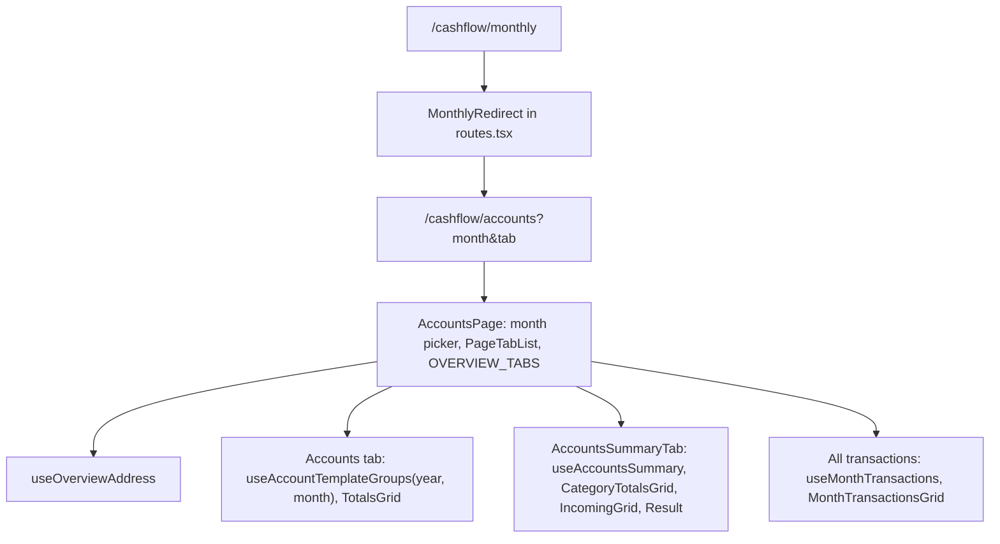

# Technical Specification: Accounts Overview Tabs and Monthly Fold

Complexity: **simple**. Web only: a month picker and a tab list on the Accounts page, a reduced Summary tab with a Result line, the All transactions tab moved from Monthly, and Monthly retired behind a redirect. No API, Domain or data-file change.

**Strict no-comments policy** in all code, XML docs and JSDoc included (CLAUDE.md). Existing doc comments on lines a stage rewrites are deleted, not reworded.

## 1. Technical Overview

**What.**
- **Month and tab in the address:** `/cashflow/accounts?month=yyyy-MM&tab=…`, read and written by one hook. A missing or malformed month means the current month; a missing or unknown tab means Accounts. Changes replace the history entry.
- **Accounts tab:** the by-template grids of today's Accounts page for the chosen month.
- **Summary tab:** Category totals, Income by source (the existing `IncomingGrid`, still with the tithe lines and the carry-forward checkbox until F03), then a Result line.
- **All transactions tab:** P60 F16's `MonthTransactionsGrid`, moved from Monthly unchanged.
- **Monthly retired:** `MonthlyPage`, `BanksGrid`, `CardsGrid` and `useMonthly` deleted; the Monthly menu item removed; `/cashflow/monthly` redirects to `/cashflow/accounts?tab=summary`, carrying `month`.

**Why.** Accounts and Monthly both show bank and card balances; Monthly is the only place with a month picker. One page with a month in the address removes the duplicate and keeps every view bookmarkable. F02 and F03 add the Income and Tithe tabs to this shell.

**Delivery.** Two PRs, each deployable on its own, each ending with a parity run showing 0 differences.

| Stage | Web |
|---|---|
| **1a — Month picker on Accounts** | `useOverviewAddress` (month only), Accounts page month picker and heading for the chosen month; `MonthlyPage.css` renamed `AccountsOverview.css`; `useBalanceAdjustmentForm` stops importing `BankTotal` from `useMonthly` |
| **1b — Tabs, Summary, Monthly fold; F01 ticks** | Tab list (Accounts, Summary, All transactions); `AccountsSummaryTab` with the Result line; `useAccountsSummary` (from `useMonthly`, without banks and cards); redirect and menu; Monthly, `BanksGrid`, `CardsGrid` deleted; `context.md` and `screen-checklist.md`; PRD F01 ticks in their own commit |

**Scope.**

*Included:* everything in PRD F01 Capabilities, Experience and Section 9.

*Output contracts (Provides):*
- **To F02 and F03:** `OVERVIEW_TABS` in `AccountsPage.tsx` (the fixed order Accounts · Summary · Income · Tithe · All transactions; F01 lists three), `useOverviewAddress(validTabs)` and the rule that a tab's component mounts only while selected, keyed by month.
- **To F03:** `AccountsSummaryTab` passing the tithe props to `IncomingGrid`, and `useAccountsSummary`'s carry-forward state.
- **To F02:** the All transactions tab rendering `MonthTransactionsGrid`.

*Excluded:* any API change; renaming the `monthly-page__*` CSS classes shared by `TotalsGrid`, `SectionTotals`, `IncomingGrid` and `MonthTransactionsGrid` (a follow-up sweep); a Result per currency (Category totals and Total incoming are single sums today).

## 2. Architecture Impact

1. **Where it belongs:** CashFlow presentation, `Financial.Web` only.
2. **Layers and direction:** Web over the existing API; no backend change.
3. **What keeps Domain free of Infrastructure:** untouched; the web reaches data only through `apiClient`.
4. **SOLID:** **SRP** — `useOverviewAddress` owns the address, `useAccountsSummary` the Summary data, `AccountsSummaryTab` its rendering, `monthResult` the subtraction; **OCP** — a new tab is one entry in `OVERVIEW_TABS` plus its component, with no change to the address hook.

## 3. Technical Decisions

| Decision | Chosen approach | Alternative considered | Trade-off |
|---|---|---|---|
| **Address hook** (1a, tab in 1b) | New `hooks/useOverviewAddress.ts` over `useSearchParams`: returns `year`, `month`, `monthInputValue`, `setMonthInputValue`, and from 1b `tab` and `setTab`. 1b's signature takes the valid tab ids (`useOverviewAddress(validTabs)`) and falls back to the first. Parsing uses `parseMonthInputValue`; a malformed month is ignored (current month shown, address left as typed). Every write uses `{ replace: true }` and keeps the other parameter. | Local state as Monthly (`useMonthSelection`) | Reload, back and bookmarks keep the view; the account screen already reads `month` and `tab` from its address the same way (`useAccountScreen`). |
| **Month picker** (1a) | A Fluent `Field label="Month"` with `Input type="month"`, as on the account header (`AccountHeader.tsx`), above the tabs. Heading "Balances at end of {formatLongMonthYear}" stays on the Accounts tab. | Monthly's plain `<input>` | Fluent component; same look as the account screen. |
| **Accounts tab** (1a) | `useAccountTemplateGroups(year, month)` with the address month; row links keep `?month=` of the chosen month. | — | The query already takes a month. |
| **Tabs** (1b) | `OVERVIEW_TABS` constant in `AccountsPage.tsx`: `accounts` "Accounts", `summary` "Summary", `transactions` "All transactions"; `PageTabList aria-label="Accounts views"`. Each tab's content is its own component rendered only when selected and keyed `${year}-${month}`, so it fetches on open and on a month change and never shows a previous month's figures. The moved-page notice stays above the tabs. | Fetch every tab up front | PRD: only the open tab loads. |
| **Summary data** (1b) | `useMonthly.ts` renamed `useAccountsSummary.ts`: same `Promise.all` of category totals, default group summary and tithe, same carry-forward update; `bankTotals`, `cardMembers` and `currencyTotals` removed; `result` added. | A new hook beside `useMonthly` | One hook, history kept by the rename. |
| **Result** (1b) | `monthResult(totalIncoming, categoryTotalsSum)` in `utils/monthResult.ts`, summed in pence (`toPence`) so the line can't drift by float error; returns `{ value, label }` with label "Surplus" (> 0), "Deficit" (< 0), "Balanced" (0). Rendered by `AccountsSummaryTab` under Income by source as `SectionTotals` item "Result" with the value (`formatSignedN2`) and the label word in text. | A backend field on the default group summary | No API change in F01; both inputs are server figures, only their difference is computed. |
| **Summary layout** (1b) | Two-column row (`monthly-page__grids-row`): Category totals, Income by source; Result below both. Empty sections show the grids' existing empty messages. Load error: `ErrorState` "Unable to load the summary." with Try again, inside the tab. | — | Reuses the existing grids and CSS. |
| **CSS** (1a) | `pages/MonthlyPage.css` renamed `pages/AccountsOverview.css`, imported by `MonthlyPage` (until 1b) and `AccountsPage`; class names unchanged. | Rename the classes now | Renaming touches four shared components; a follow-up. |
| **Bank balance type** (1a) | `useBalanceAdjustmentForm` declares its own `BankBalance` shape (`bankId`, `bank`, `balance`) instead of `Pick<BankTotal, …>` from `useMonthly`. | Keep the import | 1b can then delete the bank grids and their type. |
| **Redirect** (1b) | `REDIRECT_ROUTES` gains `cashflow/monthly` → a `MonthlyRedirect` function component in `routes.tsx` that reads `month` from the address and renders `<Navigate replace to="/cashflow/accounts?tab=summary[&month=…]" />`. `PAGE_ROUTES` and `NAV_TREE` lose Monthly; `lazyPages.tsx` loses `MonthlyPage`. | `MovedPageRedirect` | No moved notice needed: the content is the same. |
| **Parity screen checklist** (1b) | Rows whose Page is "Monthly" read "Monthly (before) / Accounts → Accounts or Summary tab (after)"; B1 reads "Accounts tab's Barclays balance"; the tithe row's after side reads "Accounts → Summary (Tithe tab once F03 ships)", so F03 needs no checklist change. | — | The before build still has Monthly. |
| **PR size** | 1a: 5 non-test code files, about 8 in total. 1b: 8 non-test code files (deleted and renamed-only test files not counted), about 17 in total with 7 test files, `context.md`, `screen-checklist.md` and the PRD ticks. | Move `monthResult` into `AccountsSummaryTab` | 1b is at the code limit and just over 15 in total because the ticks and two docs ride in the last PR; the reviewer reads the docs and ticks in seconds. |
| **Rollback** | Web only; rolling back restores Monthly. | — | — |

**Choices made by the spec writer** (for review):
- The address hook is new (`useOverviewAddress`), not an extension of `useMonthSelection`; history writes replace.
- A malformed `month` shows the current month and leaves the address unchanged.
- The month picker uses the account header's Fluent `Input type="month"`.
- `useMonthly` is renamed `useAccountsSummary`; `BanksGrid`, `CardsGrid`, `MonthlyPage` and their tests are deleted.
- Result is computed client-side in pence from two server figures; label words Surplus/Deficit/Balanced.
- The tab list's accessible name is "Accounts views"; tab ids `accounts`, `summary`, `transactions` (F02 `income`, F03 `tithe`).
- The `monthly-page__*` class names stay; renaming them is a follow-up.
- The redirect is a component inside `routes.tsx` (no new file).

## 4. Component Overview

**Web (`Financial.Web/src`):**

| File | New/Modified | Stage | Key responsibilities |
|---|---|---|---|
| `hooks/useOverviewAddress.ts` | New (1a), Modified (1b) | 1a, 1b | Month from `?month=` (1a); tab from `?tab=` against valid ids (1b); replace-writes keeping the other parameter |
| `pages/AccountsPage.tsx` | Modified | 1a, 1b | Month picker; Accounts tab for the chosen month (1a); `OVERVIEW_TABS`, `PageTabList`, per-tab components keyed by month, All transactions tab moved from Monthly (1b) |
| `pages/AccountsOverview.css` | Renamed from `MonthlyPage.css` | 1a | Same classes; page header layout for the picker |
| `pages/MonthlyPage.tsx` | Modified (1a), Deleted (1b) | 1a, 1b | CSS import path (1a) |
| `hooks/useBalanceAdjustmentForm.ts` | Modified | 1a | Own `BankBalance` type |
| `components/AccountsSummaryTab.tsx` | New | 1b | Category totals, Income by source (with tithe props until F03), Result; loading, error, empty |
| `hooks/useAccountsSummary.ts` | Renamed from `useMonthly.ts` | 1b | Summary fetch and carry-forward update; no bank or card data; `result` |
| `utils/monthResult.ts` | New | 1b | Result value and label in pence |
| `navigation/routes.tsx` | Modified | 1b | Monthly page route removed; `MonthlyRedirect` |
| `navigation/navTree.ts` | Modified | 1b | Monthly item removed |
| `navigation/lazyPages.tsx` | Modified | 1b | `MonthlyPage` removed |
| `components/BanksGrid.tsx`, `components/CardsGrid.tsx` | Deleted | 1b | Unused after Monthly goes |

1b non-test code count: `AccountsPage.tsx`, `useOverviewAddress.ts`, `AccountsSummaryTab.tsx`, `useAccountsSummary.ts`, `monthResult.ts`, `routes.tsx`, `navTree.ts`, `lazyPages.tsx` = 8.

**Docs:** `context.md` (Accounts page description, Monthly entry removed; 1b), `scripts/parity/screen-checklist.md` (1b), PRD Section 9 F01 ticks (1b, own commit).

## 5. API Contracts

No change. The tabs read existing routes: `GET accounts/groups/by-template/{y}/{m}` (Accounts), `GET expenses/month/{y}/{m}/category-totals`, `GET accounts/groups/default/summary/{y}/{m}`, `GET tithe/month/{y}/{m}`, `PUT tithe/month/{y}/{m}/carry-forward` (Summary), `GET accounts/transactions/{y}/{m}` (All transactions).

## 6. Data Model

No change; the data file version is unchanged and no `migrate` step exists for P61.

## 7. Testing Strategy

Following the `testing-guide-Financial` skill: Vitest unit tests for hooks, helpers, components and the page; AC tags `[AC P61-F01-accounts-overview-tabs-and-monthly-fold-NN]` in test names, numbered in PRD Section 9 order; no wall-clock reads (fixed fake timers / mocked `currentYearMonth`); every new case includes a negative path.

| Test file | Stage | Cases |
|---|---|---|
| `hooks/__tests__/useOverviewAddress.test.ts` | 1a, 1b | Current month when missing or malformed; reads `2026-09`; setting the month keeps `tab` and replaces history; tab falls back to the first valid id when missing or unknown; setting the tab keeps `month` |
| `pages/__tests__/AccountsPage.test.tsx` | 1a, 1b | Picker defaults to the current month; changing it reloads the groups for that month, updates the heading and row links (1a); tabs in order with Accounts selected; only the open tab requests data; a month change reloads the open tab and keeps it; error in one tab leaves the others selectable; keyboard arrows move between tabs (1b) |
| `components/__tests__/AccountsSummaryTab.test.tsx` | 1b | Category totals, Income by source with Total incoming, Result with Surplus / Deficit / Balanced; no bank or card grid; tithe lines and carry-forward checkbox present; loading, empty and error with Try again |
| `hooks/__tests__/useAccountsSummary.test.ts` | 1b | Renamed from `useMonthly.test.ts`; bank and card cases removed; `result` |
| `utils/__tests__/monthResult.test.ts` | 1b | Pence exactness, sign, the three labels |
| `navigation/__tests__/routes.test.ts` | 1b | `/cashflow/monthly` → `/cashflow/accounts?tab=summary`; with `?month=2026-09` carries it; no page route for Monthly |
| `components/__tests__/Sidebar.test.tsx` | 1b | CashFlow menu without Monthly |
| `pages/__tests__/MonthlyPage.test.tsx`, `BanksGrid.test.tsx`, `CardsGrid.test.tsx`, `useMonthly.test.ts` | 1b | Deleted with their components (All transactions cases move to `AccountsPage.test.tsx`) |

**Acceptance criteria map** (PRD Section 9 F01):

| AC | Criterion (short) | Test |
|---|---|---|
| 01 | Month picker, tab order, address and fallbacks | `useOverviewAddress.test.ts` "[AC …-01] …"; `AccountsPage.test.tsx` "[AC …-01] shows the month picker and the tabs in order" |
| 02 | Accounts tab for the chosen month, heading, links | `AccountsPage.test.tsx` "[AC …-02] shows the groups, heading and links for the chosen month" |
| 03 | Summary contents, Result, no bank or card grid, tithe kept until F03 | `AccountsSummaryTab.test.tsx` "[AC …-03] …"; `monthResult.test.ts` tagged 03 |
| 04 | All transactions as F16's tab | `AccountsPage.test.tsx` "[AC …-04] renders All transactions with F16's grid"; `MonthTransactionsGrid.test.tsx` unchanged |
| 05 | Only the open tab loads; month change reloads it | `AccountsPage.test.tsx` "[AC …-05] …" |
| 06 | Monthly gone, redirect, no in-app links | `routes.test.ts` "[AC …-06] …"; `Sidebar.test.tsx` "[AC …-06] …"; DoD grep for `cashflow/monthly` in `Financial.Web/src` (only the redirect) |
| 07 | States, keyboard, Result not colour-only, narrow width | `AccountsSummaryTab.test.tsx` and `AccountsPage.test.tsx` "[AC …-07] …"; ui-reviewer; browser check at 320 px |
| 08 | Parity 0 differences; no API or data-file change | Definition of Done: parity run; `OpenApiContractTests` unchanged |

**Definition of Done** (each PR): `npm run lint`, `npm run build`, `npm test`; `dotnet test` (unchanged backend); `scripts/parity/Invoke-Parity.ps1 -Step All -LiveCopy "E:\dev\projetos\financial\data\data-cashflow.json"` against `p60-deployed-f13` with `Parity OK: 0 differences` and the file's SHA-256 unchanged; `/simplify`; architecture-reviewer and ui-reviewer (`docs/ui/review-checklist.md` for every touched view); a browser look at the Accounts page on the dev data (1b).

**UI states:** initial (Accounts tab, current month), loading (per tab; picker and tabs usable), empty (per grid message; Result 0.00 "Balanced"), load error (per tab, Try again), carry-forward saving/error (unchanged), no validation, success or unsaved-changes state (read-only page apart from the checkbox).
