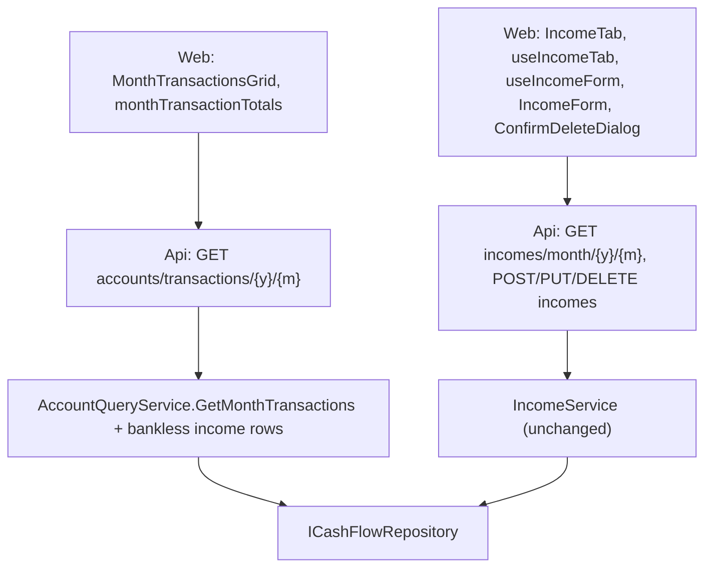

# Technical Specification: Income Tab and Bankless Income

Complexity: **medium**. The month-transactions query gains a row per income with no bank (an API shape change: the account fields of a month row and a row's currency become optional), the All transactions grid shows them as "No bank", and the Accounts page gains an Income tab that lists, adds, edits and deletes the month's incomes with the existing income form, its Bank field unlocked and defaulting to "No bank". No Domain or data-file change.

**Strict no-comments policy** in all code, XML docs and JSDoc included (CLAUDE.md). Existing doc comments on lines a stage rewrites are deleted, not reworded.

## 1. Technical Overview

**What.**
- **Bankless rows in the month view:** `AccountQueryService.GetMonthTransactions` adds one row per income of the month whose `Account` is null: `kind` Income, `amount` = net value, `currency` null, `categoryName` null, `counterpart` = source name, `income` = the `IncomeDTO`, `canEdit` true; its `MonthTransactionDTO` has `accountId`, `accountName` and `accountCurrency` null and `accountIsActive` true.
- **All transactions grid:** Account cell "No bank" and the Description both plain text, no link (controller decision 2026-11-12: grids use the app's row icons, not description links; an edit/delete icon column for All transactions follows in its own PR after 2a), Account filter value "No bank", footer "Total (no bank) +127.30" beside the per-currency totals (controller decision 2026-11-12, from the 2a review).
- **Income tab:** list of `GET incomes/month/{y}/{m}` with Date, Source, Bank, Description, Gross, Net and row icons; Source and Bank filters; footer count and Total net; New income, Edit and Delete with the account screen's form and confirmation dialog.
- **Bank optional:** the income form, unlocked, lists active accounts with the `ReceivesIncome` capability plus "— No bank —", and starts on "— No bank —" on this tab.

**Why.** The model and the create route already accept an income without a bank, but the only form is on the bank's screen with the bank locked, and the month view builds rows per account, so such an income can't be entered and is missing from All transactions.

**Delivery.** Two PRs, each deployable, each ending with a parity run showing 0 differences.

| Stage | Backend | Web |
|---|---|---|
| **2a — Bankless incomes in the month view** | `GetMonthTransactions` bankless rows; `MonthTransactionDTO` account fields and `AccountTransactionDTO.Currency` optional; OpenAPI snapshot | Generated types; `MonthTransactionsGrid` "No bank"; `monthTransactionTotals` "No bank" bucket; `AccountTransactionsGrid` settlement Amount via `formatAmount` |
| **2b — Income tab; F02 ticks** | None | `IncomeTab`, `useIncomeTab`, `useIncomeForm` no-bank default, `formSettings`, Accounts page tab; `context.md`; PRD F02 ticks in their own commit |

**Scope.**

*Included:* everything in PRD F02 Capabilities, Experience, Error Handling and Section 9.

*Input contracts (Consumes):*
- **F01:** `OVERVIEW_TABS`, `useOverviewAddress(validTabs)`, per-tab components keyed by month (`AccountsPage.tsx`).
- **F01:** the All transactions tab rendering `MonthTransactionsGrid`.

*Output contract (Provides, to F03):* incomes with no bank, persisted through the existing `POST/PUT incomes`, counted by `TitheService.ComputeBaseBalance` (it sums every income of the month) and by the default group summary's income totals.

*Excluded:* a currency on incomes; splitting a bankless income into pots (refused by `PotDeposit.BuildFromIncome`, "Choose the bank this income landed in."); changes to the account screen's income entry; pagination (a month has at most about 15 incomes).

## 2. Architecture Impact

1. **Where it belongs:** CashFlow. Application (`AccountQueryService`, two DTOs), Api (snapshot only, no controller change), Web.
2. **Layers and direction:** Application ← Api, Web over the API. No Domain or Infrastructure change.
3. **What keeps Domain free of Infrastructure:** `ICashFlowRepository` (Application), as today; `Income.Account` is already optional in Domain, and the JSON converter already maps `AccountId` as a present, nullable key.
4. **SOLID:** **SRP** — the month view's bankless rows are one private method beside the per-account builder; `IncomeTab` renders, `useIncomeTab` loads and mutates. **OCP** — the income form gains a setting, not a fork. **LSP** — a bankless month row is a `MonthTransactionDTO` like any other; consumers branch only on the null account.



## 3. Technical Decisions

| Decision | Chosen approach | Alternative considered | Trade-off |
|---|---|---|---|
| **Bankless rows** (2a) | In `GetMonthTransactions`, after the per-account rows, the month's records that are `Income { Account: null }` come from a private `BanklessRowsOf(MonthRecords)` through the shared `ToMonthRow(Account?, …)`, so they carry null account fields; the combined list orders by date descending as today (bankless rows after account rows of the same date). The per-account `GetTransactions` is unchanged. | A pseudo "No bank" account | No fake account in data or DTOs. |
| **Optional account fields** (2a) | `MonthTransactionDTO.AccountId` `Guid?`, `AccountName` `string?`, `AccountCurrency` `string?`; `AccountTransactionDTO.Currency` `string?` (null only on bankless rows). All four stay `required`: the key is always written, null on a bankless row, so the generated types read `string | null`, not optional. Snapshot and `openapi.ts` regenerated. | `Currency = ""` | Honest wire shape: a bankless income has no currency. |
| **Account screen currency** (2a) | `AccountTransactionsGrid`'s settlement Amount, the only place it reads `row.currency`, formats with the existing `formatAmount(value, row.currency)` (a plain number when null, which never happens on an account screen), so the type change compiles with no visible change and the grid needs no new prop. | `row.currency ?? accountCurrency`; non-null assertion | A Settlement account has several currencies, so its primary currency would be a wrong fallback; no new prop on a grid another PR is changing. |
| **Grid "No bank"** (2a) | `MonthTransactionsGrid`: `NO_BANK = 'No bank'`; account accessor `row.accountName ?? NO_BANK` (so the filter offers it); Account cell plain text for a null account; Description of a bankless row is plain text, no link (controller decision 2026-11-12: grids use the app's row icons, not description links; an edit/delete icon column for All transactions follows in its own PR after 2a); row key uses `row.accountId ?? NO_BANK`. | Link the Account cell to the Income tab | The Account cell links to accounts only. |
| **Footer** (2a) | `monthTransactionTotals` groups a null currency under `NO_BANK`; the grid renders it after the currency totals as "Total (no bank) +127.30" (no currency code; label `currency ? 'Total' : 'Total (no bank)'`, controller decision 2026-11-12). Spend is unaffected: bankless rows carry no category. | Fold into GBP | Would mix currencies. |
| **Parity** (2a) | No new figure. The current side's per-account figures filter rows by `accountId`, the month spend family by `categoryName` and the unpaid-charge family by `expense`, so bankless rows add nothing; a `Parity.test.ps1` case pins it. | A bankless figure family | No before-side counterpart. |
| **Income tab data** (2b) | New `hooks/useIncomeTab.ts(year, month)`: `useAsyncResource` over `Promise.all` of `getIncomesByMonth`, `getIncomeSources` and `getAccounts`; banks = `accountsWith(accounts, 'ReceivesIncome')`; wires `useIncomeForm(sources, banks, onSaved, { viewedMonth, noBankByDefault: true })` and `useConfirmedDelete(deleteIncome, …)`; `refresh` after save or delete. | Reuse `useAccountFormOptions` | Its banks are `CanPayBills` accounts; income needs `ReceivesIncome`. |
| **No-bank default** (2b) | `AccountFormSettings.noBankByDefault?: boolean`; `useIncomeForm.defaultBank()` returns `''` when set, ignoring the stored bank. Edit keeps the income's bank (or `''`). The date follows `getCreateFormDate` with the viewed month (last used date in that month, else today for the current month, else the month's last day), as on the account screen; the PRD's "1st of the chosen month" wording is aligned in this PR. | Remember the last bank | User: default No bank. |
| **Grid** (2b) | `components/IncomeTab.tsx`: Fluent `Table` with `data-table`, `DataTableCell` labels, `useSortableRows` (default `DATE_DESC_SORT`), `useColumnFilters` on Source (`incomeSourceName`) and Bank (`bankName ?? 'No bank'`), `ColumnFilterMenu` in `SortableColumnHeader`, `FilteredRowsNotice`; Gross `formatN2OrDash`, Net `formatN2`, both `data-table__col--numeric`; `RowActionsCell` with `itemName` "income {dd/MM/yyyy} {source}". Footer: "`n` incomes · Total net `x`" ("1 income"; "`n` of `m` incomes" when filtered), summed in pence. | Reuse `AccountTransactionsGrid` | Different columns; one-account links. |
| **Form and delete** (2b) | "New income" (primary) above the grid opens `IncomeForm` with no `lockedBank`; Edit opens it pre-filled; Delete opens `ConfirmDeleteDialog` "Delete this income? This can't be undone." Success toasts via `useSuccessToast`: "Income added.", "Income updated.", "Income deleted.". Unsaved changes: the form's existing discard prompt. | — | Same components as the account screen. |
| **404** (2b) | On a save or delete error where `isNotFound(err)`, close the form or dialog, refresh the list and show `MessageBar intent="warning"` "This income no longer exists; the list was refreshed." | Generic error | PRD Error Handling. |
| **Tab** (2b) | `OVERVIEW_TABS` gains `income` "Income" between Summary and All transactions; `IncomeTab` mounts only while selected, keyed by month. | — | F01 contract. |
| **No Income-tab link** (2a) | A bankless row has no link in All transactions; editing it from that grid comes with the row-icon column PR, and from the Income tab in 2b. | Description link to `?tab=income` (the spec's first choice) | Row actions stay on icons across the app's grids. |
| **PR size** | 2a: 6 non-test code files plus the regenerated snapshot and `openapi.ts`; 7 test files (the API test base and factory gain a saved-file read for the round-trip check; no `AccountTransactionsGrid` test change); the spec, plan and PRD for the 2026-11-12 decision; 16 in total, generated excluded. 2b: 5 non-test code files, 4 test files, `context.md` and the PRD (wording fix and ticks), 11 in total. | — | Within the limit. |
| **Rollback** | 2a's DTO change is additive in meaning (fields become optional); rolling back hides bankless rows again. Bankless incomes saved through 2b stay valid in the file and in totals. | — | — |

**Choices made by the spec writer** (for review):
- A bankless month row has null account fields and a null currency, not a pseudo account; `AccountTransactionDTO.Currency` becomes optional.
- In All transactions a bankless row's Account ("No bank") and Description are plain text; no link (superseded by the controller decision of 2026-11-12, see "No Income-tab link").
- The footer shows a separate "No bank" total without a currency code.
- No parity figure for bankless incomes; a parity self-test case pins that they don't change existing figures.
- The Income tab's bank list is active `ReceivesIncome` accounts (plus the income's own inactive bank when editing, as `selectableBanks` keeps it).
- New income always starts on "— No bank —" on this tab; the stored bank default is not used there.
- New income's date follows the account screen's rule; the PRD's "1st of the month" text is changed to match.
- Footer counts incomes and sums Net in pence; filters on Source and Bank only.
- 404 on edit or delete refreshes the list with a warning bar.

## 4. Component Overview

**Application (`Financial.CashFlow.Application`):**

| File | New/Modified | Stage | Key responsibilities |
|---|---|---|---|
| `Services/AccountQueryService.cs` | Modified | 2a | Bankless income rows in `GetMonthTransactions`; `BanklessRowsOf`; `ToMonthRow` and `ToRow(Income, …)` take a nullable account |
| `DTOs/MonthTransactionDTO.cs` | Modified | 2a | Optional `AccountId`, `AccountName`, `AccountCurrency` |
| `DTOs/AccountTransactionDTO.cs` | Modified | 2a | Optional `Currency` |

**Api:** `Tests/Financial.Api.Tests/Contract/openapi-v1.snapshot.json` regenerated (2a).

**Web (`Financial.Web/src`):**

| File | New/Modified | Stage | Key responsibilities |
|---|---|---|---|
| `api/generated/openapi.ts` | Regenerated | 2a | Optional fields |
| `components/MonthTransactionsGrid.tsx` | Modified | 2a | "No bank" cell, filter value, plain Description, row key, footer line |
| `utils/monthTransactionTotals.ts` | Modified | 2a | Null currency → `NO_BANK` bucket, listed last |
| `components/AccountTransactionsGrid.tsx` | Modified | 2a | Settlement Amount through `formatAmount` |
| `components/IncomeTab.tsx` | New | 2b | Grid, filters, footer, New income, form, delete dialog, states |
| `hooks/useIncomeTab.ts` | New | 2b | Load incomes, sources and receiving accounts; form and delete wiring; 404 refresh |
| `hooks/useIncomeForm.ts` | Modified | 2b | `noBankByDefault` |
| `hooks/formSettings.ts` | Modified | 2b | `noBankByDefault?: boolean` |
| `pages/AccountsPage.tsx` | Modified | 2b | Income tab entry |

**Scripts:** `scripts/parity/Parity.test.ps1` (2a): a fixture month row with null `accountId` and an Income transaction leaves every family's figures unchanged.

**Docs:** `context.md` (Income tab, bankless income; 2b); PRD F02 Capabilities date wording (2b); PRD Section 9 F02 ticks (2b, own commit).

## 5. API Contracts

**`GET accounts/transactions/{year}/{month}`** — unchanged path and errors (400 for an invalid month). Row shape change:

| Field | Type | Change |
|---|---|---|
| `accountId` | `uuid \| null` | null for an income with no bank |
| `accountName` | `string \| null` | null for an income with no bank |
| `accountCurrency` | `string \| null` | null for an income with no bank |
| `accountIsActive` | `bool` | true for an income with no bank |
| `transaction.currency` | `string \| null` | null for an income with no bank (also on `GET accounts/{id}/transactions/{y}/{m}`'s schema, never null there) |

```json
{
  "accountId": null,
  "accountName": null,
  "accountCurrency": null,
  "accountIsActive": true,
  "transaction": {
    "id": "6f1c…",
    "kind": "Income",
    "date": "2026-10-15",
    "description": "XP dividends",
    "categoryName": null,
    "counterpart": "DividendoJuros",
    "amount": 85.20,
    "currency": null,
    "roundUp": null,
    "canEdit": true,
    "income": { "id": "6f1c…", "date": "2026-10-15", "incomeSourceId": "…", "incomeSourceName": "DividendoJuros", "grossValue": null, "netValue": 85.20, "bankId": null, "bankName": null, "description": "XP dividends", "potsAccountId": null, "hasLinkedDeposit": false, "fundingLines": [] }
  }
}
```

**Income routes** — unchanged: `GET incomes/month/{y}/{m}`, `POST incomes` and `PUT incomes/{id}` with `bankId` omitted or null for no bank, `DELETE incomes/{id}`.

| Case | HTTP | Message |
|---|---|---|
| Net value negative | 400 | "Net value cannot be negative." |
| Source missing | 400 | "Income source is required." |
| Pots split with no bank | 400 | "Choose the bank this income landed in." |
| Bank cannot receive income | 400 | "Account '…' cannot receive income." |
| Unknown id on PUT or DELETE | 404 | — (web: "This income no longer exists; the list was refreshed.") |

## 6. Data Model

No change; the file version is unchanged. `Income.AccountId` is already written for every income as a present key that may be null (`CashFlowTypeInfoResolver`: required key, nullable value), so a bankless income round-trips with no migration.

## 7. Testing Strategy

Following the `testing-guide-Financial` skill: xUnit + FluentAssertions with `[Trait("Category", …)]` and `[Trait("AC", "P61-F02-income-tab-and-bankless-income-NN")]`; Vitest with `[AC P61-F02-income-tab-and-bankless-income-NN]` in names; fixed `TimeProvider`/`TestClock`; shared doubles only in `Tests/Financial.TestUtilities`; each case with a negative path.

| Test file | Type | Stage | Cases |
|---|---|---|---|
| `Tests/Financial.CashFlow.Application.Tests/Services/AccountQueryServiceTests.cs` | Unit | 2a | `GetMonthTransactions_BanklessIncome_ListedOnceWithNoAccountAndNoCurrency`; `GetMonthTransactions_BankIncome_ListedOnlyOnItsBank`; `GetMonthTransactions_BanklessIncomeOtherMonth_NotListed`; `GetTransactions_Account_NeverListsBanklessIncome` |
| `Tests/Financial.Api.Tests/Acceptance/BanklessIncomeAcceptanceTests.cs` | Integration (AC) | 2a | `CreateIncome_NoBank_CountsInTotalsAndTitheAndMovesNoBalance`; `UpdateIncome_BankToNoBankAndBack_MovesTheBalanceOnlyWhileBanked`; `CreateIncome_NoBankWithPotsSplit_Returns400`; `MonthTransactions_BanklessIncome_OnceAsNoBankWithoutCategory_SpendUnchanged`; `GetIncomesByMonth_CountEqualsTotalIncomingSources` |
| `Tests/Financial.Api.Tests/Contract/OpenApiContractTests.cs` (snapshot) | Contract | 2a | Optional fields |
| `scripts/parity/Parity.test.ps1` | Script self-test | 2a | Bankless row changes no figure |
| `components/__tests__/MonthTransactionsGrid.test.tsx` | Unit | 2a | "No bank" cell and Description without links; Account filter "No bank"; footer "No bank" line; Spend unchanged |
| `utils/__tests__/monthTransactionTotals.test.ts` | Unit | 2a | Null currency bucket listed last; pence |
| `components/__tests__/IncomeTab.test.tsx` | Unit | 2b | Columns, "No bank", sorting, filters, footer and "n of m"; New income defaults to No bank and saves with no `bankId`; bank income; edit bank ↔ No bank; delete with confirmation; validation messages; 404 warning and refresh; loading, empty with New income, error with Try again; row icon names |
| `hooks/__tests__/useIncomeTab.test.ts` | Unit | 2b | One load per month; banks are `ReceivesIncome` accounts; refresh after save and delete; 404 path |
| `hooks/__tests__/useIncomeForm.test.ts` | Unit | 2b | `noBankByDefault` ignores the stored bank; edit keeps the income's bank |
| `pages/__tests__/AccountsPage.test.tsx` | Unit | 2b | Income is the third tab and loads only when open |

**Acceptance criteria map** (PRD Section 9 F02):

| AC | Criterion (short) | Test | Stage |
|---|---|---|---|
| 01 | Income tab lists every income; count and Total net match | `BanklessIncomeAcceptanceTests.GetIncomesByMonth_CountEqualsTotalIncomingSources`; `IncomeTab.test.tsx` "[AC …-01] …" | 2a, 2b |
| 02 | New income with No bank: no balance moves, totals and tithe base rise | `…CreateIncome_NoBank_CountsInTotalsAndTitheAndMovesNoBalance`; `IncomeTab.test.tsx` "[AC …-02] …" | 2a, 2b |
| 03 | Bank income from the Income tab as from the account screen | `IncomeTab.test.tsx` "[AC …-03] …"; existing `IncomeServiceTests` | 2b |
| 04 | Edit bank ↔ No bank; delete with confirmation (and linked deposit) | `…UpdateIncome_BankToNoBankAndBack_MovesTheBalanceOnlyWhileBanked`; `IncomeTab.test.tsx` "[AC …-04] …"; existing linked-deposit delete tests | 2a, 2b |
| 05 | No pots split without a bank | `…CreateIncome_NoBankWithPotsSplit_Returns400`; `IncomeTab.test.tsx` "[AC …-05] …" | 2a, 2b |
| 06 | Validation, 404, failure messages; nothing persisted | `IncomeTab.test.tsx` and `useIncomeTab.test.ts` "[AC …-06] …" | 2b |
| 07 | All transactions: bankless rows, filter, footer, no link, Spend unchanged | `…MonthTransactions_BanklessIncome_OnceAsNoBankWithoutCategory_SpendUnchanged`; `AccountQueryServiceTests` bankless cases; `MonthTransactionsGrid.test.tsx` "[AC …-07] …" | 2a |
| 08 | Snapshot and generated types regenerated | `OpenApiContractTests`; `openapiFreshness.test.ts` | 2a |
| 09 | States, row icon names, keyboard | `IncomeTab.test.tsx` "[AC …-09] …"; ui-reviewer | 2b |
| 10 | No version change; bankless round-trip; parity 0 | `BanklessIncomeAcceptanceTests` (save, reload, same JSON key with null); `Parity.test.ps1`; parity run | 2a, 2b |

**Definition of Done** (each PR): `dotnet build --configuration Release`, `dotnet test`; `npm run lint`, `npm run build`, `npm test`; snapshot and `openapi.ts` regenerated (2a); `pwsh scripts/parity/Parity.test.ps1`; `Invoke-Parity.ps1 -Step All -LiveCopy …` against `p60-deployed-f13` with 0 differences, same figure count as F01, SHA-256 unchanged; `/simplify`; architecture-reviewer; ui-reviewer (2a grid change, 2b tab); a browser look at the Income tab on the dev data (2b).

**UI states (2b):** initial (tab closed, nothing fetched), loading (skeleton; New income enabled), empty ("No income in October 2026." with New income), validation (inline, focus to first invalid field), saving (Save busy and disabled, fields kept), server error (above the buttons, values kept), success (toast, list refreshed), unsaved changes (discard prompt), disabled (row icons hidden while a save or delete is in flight), load error (`ErrorState` "Unable to load the incomes." with Try again).
