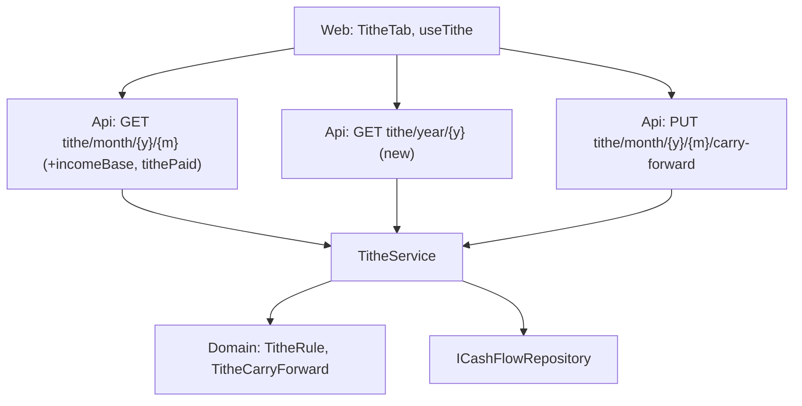

# Technical Specification: Tithe Tab and History

Complexity: **simple**. The month tithe response gains the income base and the tithe paid, a new read route returns the 12 months of a year, and the Accounts page gains a Tithe tab with the month detail, the carry-forward checkbox (moved from Summary) and a history table. No Domain or data-file change.

**Strict no-comments policy** in all code, XML docs and JSDoc included (CLAUDE.md). Existing doc comments on lines a stage rewrites are deleted, not reworded.

## 1. Technical Overview

**What.**
- **Month response:** `TitheSummaryDTO` gains `IncomeBase` (Σ net value of the month's incomes, bank or no bank) and `TithePaid` (Σ value of the month's expenses with `Category.IsTithe && CountsAsTithe`, by `ReportingDate`), the two inputs `ComputeBaseBalance` already computes.
- **Year route:** `GET tithe/year/{year}` → 12 items, January to December, each `{ year, month, summary }` with `summary` exactly what `GET tithe/month/{year}/{month}` returns.
- **Tithe tab:** detail (Income base, Tithe, Tithe paid, Carry-in with its source month, Balance), the carry-forward checkbox, and a history table for the chosen month's year with a totals footer; clicking a month selects it.
- **Summary trimmed:** the tithe lines and the checkbox leave Summary and `IncomingGrid`.
- **E2E smoke journey:** add a bankless income on the Income tab and check the Tithe tab's base and tithe.

**Why.** The tithe is shown as two lines with no base, no paid figure and no history; the user wants a place to see it (PRD F03).

**Delivery.** Two PRs, each deployable, each ending with a parity run showing 0 differences.

| Stage | Backend | Web |
|---|---|---|
| **3a — Tithe year route** | `TitheSummaryDTO` fields; `TitheMonthDTO`; `ITitheService.GetTitheYearAsync`; `TitheService`; `TitheController` route; snapshot | Generated types; `TitheMonthDto` alias; `apiClient.getTitheYear` |
| **3b — Tithe tab; F03 and cross-feature ticks** | None | `TitheTab`, `useTithe`, Summary and `IncomingGrid` without tithe, Accounts page tab; E2E journey and seed source; `context.md`; PRD ticks in their own commit |

**Scope.**

*Included:* everything in PRD F03 Capabilities, Experience, Error Handling and Section 9, and the Cross-Feature Integration block.

*Input contracts (Consumes):*
- **F01:** `OVERVIEW_TABS`, `useOverviewAddress` (its `setMonthInputValue` for month selection from the history), per-tab mounting; `useAccountsSummary`'s carry-forward logic and `IncomingGrid`'s tithe lines, which move here.
- **F02:** bankless incomes in the month's income base (no code dependency: `ComputeBaseBalance` sums every income), and the Income tab used by the E2E journey.

*Excluded:* changing the tithe rule or the tithe-category rule; currency conversion of the base; a separate year picker; editing tithe expenses from the tab.

## 2. Architecture Impact

1. **Where it belongs:** CashFlow. Application (`TitheService`, DTOs, interface), Api (`TitheController`), Web.
2. **Layers and direction:** Application ← Api, Web over the API. No Domain or Infrastructure change; `TitheRule` (Domain) still computes 10%.
3. **What keeps Domain free of Infrastructure:** `ICashFlowRepository` (Application) as today.
4. **SOLID:** **SRP** — one private calculation returns the month's base, tithe, paid and balance for both routes; `TitheTab` renders, `useTithe` loads and updates. **ISP** — `ITitheService` gains one method; existing callers are unaffected.



## 3. Technical Decisions

| Decision | Chosen approach | Alternative considered | Trade-off |
|---|---|---|---|
| **Month figures** (3a) | `ComputeBaseBalance` becomes a private calculation returning base, tithe and paid (a private record); `Resolve` fills `IncomeBase`, `TithePaid`, `CalculatedTithe`, `TitheBalance`, `CarryForward`. Values and rules unchanged. | Compute base and paid in the web | Server owns the tithe maths. |
| **Year route** (3a) | `GET tithe/year/{year:int}` → `IReadOnlyList<TitheMonthDTO>`; `TitheMonthDTO` = `Year`, `Month`, `Summary` (`TitheSummaryDTO`). `GetTitheYearAsync` resolves the anchor once (`ResolveAnchorAsync`, which may record it on first use, as the month route does) and calls `Resolve(year, m, anchor)` for m = 1…12. Year outside 1–9999 → `ArgumentOutOfRangeException` → 400 by `DomainExceptionMappingMiddleware`. | Flat items repeating the summary fields | Reuses the month shape; each item provably equals the month route. |
| **Cost** (3a) | `Resolve` recurses back only to the anchor month (2026 in the live data), so 12 calls stay small; no caching. | A single forward pass | Simplest code that is equal by construction. |
| **Parity** (3a) | No new figure; `Add-ParityTitheFigures` reads `calculatedTithe`, `titheBalance` and `carryForward`, which are unchanged; the new fields are additive. | A year figure family | No before-side counterpart; AC tests pin equality with the month route. |
| **Client** (3a) | `apiClient.getTitheYear(year)` → `/tithe/year/{year}`; `export type TitheMonthDto = Schema<'TitheMonthDTO'>`. | Add in 3b | Keeps 3b within the size limit; covered by `financialApiClient.test.ts`. |
| **Tab data** (3b) | New `hooks/useTithe.ts(year, month)`: two `useAsyncResource` loads, the month detail and the year history, so one failing leaves the other usable; `updateCarryForwardInclusion(included)` moved from `useAccountsSummary` (same updating flag and error keyed by month), refreshing both on success. A 400 from the carry-forward route shows "There is no balance to carry into this month." and refreshes; any other failure shows "Couldn't update the carry-forward. Try again."; the checkbox reads the server's `included`, so it stays as it was on failure. | Keep the update in `useAccountsSummary` | The checkbox now lives only on this tab. |
| **Detail** (3b) | `components/TitheTab.tsx`, top: `SectionTotals` items Income base, Tithe, Tithe paid, Carry-in ("120.00 from September 2026", or "0.00"), Balance (`formatN2` plus "owed" when positive, "in credit" when negative, nothing at 0). Under Income base, "No income this month." when the base is 0 and the month has no income. The Fluent `Checkbox` "Include September 2026's balance of 120.00" shows only with a carry-in, disabled with a `Spinner` while updating, error in a `MessageBar intent="error"`. | Reuse `IncomingGrid` | The detail is a different shape. |
| **History** (3b) | Fluent `Table` with `data-table`, `<caption>` "Tithe by month, {year}", columns Month, Income base, Tithe, Tithe paid, Carry-in, Included (Yes / No / —), Balance, numbers right-aligned, `DataTableCell` labels so rows stack under 600 px. The chosen month's row has `aria-current="date"` and bold text. Month cells are buttons (`appearance="transparent"`, accessible name "Show October 2026") calling `setMonthInputValue`. Footer row "Total" with Income base, Tithe and Tithe paid summed in pence. | Sortable grid | Twelve fixed rows in calendar order. |
| **Summary trimmed** (3b) | `useAccountsSummary` drops the tithe fetch and carry-forward; `AccountsSummaryTab` and `IncomingGrid` drop the tithe props and lines. | — | PRD. |
| **Tab** (3b) | `OVERVIEW_TABS` gains `tithe` "Tithe" between Income and All transactions; `TitheTab` mounts only while selected, keyed by month. | — | F01 contract. |
| **E2E** (3b) | `Financial.Web/tests/e2e/bankless-income-tithe.spec.ts` `@smoke`: open `/cashflow/accounts?month=2026-10&tab=tithe` and read Income base and Tithe; Income tab → New income, Bank "— No bank —", Source "DividendoJuros", Net 100.00, Date 2026-10-20, Save; Tithe tab → base +100.00 and tithe +10.00 (relative, so reruns pass). The test seed (`Tests/Financial.Api.Tests/TestData/data-cashflow.test.json`) gains an `IncomeSources` array with one active source "DividendoJuros", group `DividendoJuros`. | Seed an income instead | The journey proves entry and tithe together. |
| **Screen checklist** | F01 1b already names the Tithe tab in the tithe row's after side; 3b doesn't change the checklist. | — | — |
| **PR size** | 3a: 7 non-test code files plus the snapshot and `openapi.ts`, 7 test files (the 3 below plus 4 existing web tests whose `TitheSummaryDto` fixtures need the two new required fields: `AccountsSummaryTab`, `IncomingGrid`, `useAccountsSummary`, `AccountsPage`), 14 in total with generated files excluded. 3b: 6 non-test code files, 6 unit test files, the E2E spec, the seed, `context.md` and the PRD ticks, 16 in total. | Split 3b | The extra file is the PRD ticks commit, which the last PR must carry. |
| **Rollback** | Read-only additions plus a moved checkbox; rolling back restores the tithe lines on Summary. | — | — |

**Choices made by the spec writer** (for review):
- The year route is `GET tithe/year/{year}`, items nested as `{ year, month, summary }`.
- No caching; 12 calls to the existing resolver.
- The client call and type alias ship in 3a with the route.
- Detail and history load separately so one error doesn't hide the other.
- A carry-forward 400 is shown as "There is no balance to carry into this month."; other failures "Couldn't update the carry-forward. Try again."
- Balance reads "owed" when positive and "in credit" when negative.
- History is not sortable; month cells are buttons that select the month; the current row is `aria-current="date"`.
- The E2E seed gains one "DividendoJuros" income source; the journey checks relative changes.

## 4. Component Overview

**Application (`Financial.CashFlow.Application`):**

| File | New/Modified | Stage | Key responsibilities |
|---|---|---|---|
| `DTOs/TitheSummaryDTO.cs` | Modified | 3a | `IncomeBase`, `TithePaid` |
| `DTOs/TitheMonthDTO.cs` | New | 3a | `Year`, `Month`, `Summary` |
| `Interfaces/ITitheService.cs` | Modified | 3a | `Task<IReadOnlyList<TitheMonthDTO>> GetTitheYearAsync(int year)` |
| `Services/TitheService.cs` | Modified | 3a | Month figures record; year method with span and logging as the other methods |

**Api:** `Controllers/TitheController.cs` (3a): `GET year/{year:int}` → 200 list, 400. Snapshot regenerated.

**Web (`Financial.Web/src`):**

| File | New/Modified | Stage | Key responsibilities |
|---|---|---|---|
| `api/generated/openapi.ts` | Regenerated | 3a | New schema and path |
| `api/types.ts` | Modified | 3a | `TitheMonthDto` alias |
| `api/financialApiClient.ts` | Modified | 3a | `getTitheYear` |
| `components/TitheTab.tsx` | New | 3b | Detail, checkbox, history, states |
| `hooks/useTithe.ts` | New | 3b | Detail and history loads, carry-forward update and messages |
| `hooks/useAccountsSummary.ts` | Modified | 3b | No tithe |
| `components/AccountsSummaryTab.tsx` | Modified | 3b | No tithe props |
| `components/IncomingGrid.tsx` | Modified | 3b | No tithe lines or checkbox |
| `pages/AccountsPage.tsx` | Modified | 3b | Tithe tab entry |

**Tests and data:** `Financial.Web/tests/e2e/bankless-income-tithe.spec.ts` (3b); `Tests/Financial.Api.Tests/TestData/data-cashflow.test.json` income source (3b).

**Docs:** `context.md` (Tithe tab; 3b); PRD Section 9 F03 and Cross-Feature ticks (3b, own commit).

## 5. API Contracts

**`GET tithe/month/{year}/{month}`** — additive fields:

| Field | Type | Description |
|---|---|---|
| `incomeBase` | `decimal` | Σ net value of the month's incomes |
| `tithePaid` | `decimal` | Σ value of the month's tithe expenses that count as tithe |
| `calculatedTithe`, `titheBalance`, `carryForward` | — | Unchanged |

**`GET tithe/year/{year}`** — new.

| Parameter | Type | Required | Validation |
|---|---|---|---|
| `year` | `int` (path) | Yes | 1–9999 |

```json
[
  { "year": 2026, "month": 1, "summary": { "incomeBase": 3900.00, "calculatedTithe": 390.00, "tithePaid": 390.00, "titheBalance": 0.00, "carryForward": null } },
  { "year": 2026, "month": 10, "summary": { "incomeBase": 4227.30, "calculatedTithe": 422.73, "tithePaid": 400.00, "titheBalance": 142.73, "carryForward": { "amount": 120.00, "included": true, "fromYear": 2026, "fromMonth": 9 } } }
]
```
(12 items in the real response.)

| Case | HTTP | Message |
|---|---|---|
| Year outside 1–9999 | 400 | The `ArgumentOutOfRangeException` message |

**`PUT tithe/month/{year}/{month}/carry-forward`** — unchanged (400 "No carry-forward is available for yyyy-MM." when there is none).

## 6. Data Model

No change; the file version is unchanged. Only `TitheCarryForward` decisions and the anchor date are stored, as today; every figure is derived.

## 7. Testing Strategy

Following the `testing-guide-Financial` skill: xUnit + FluentAssertions with `[Trait("AC", "P61-F03-tithe-tab-and-history-NN")]` and `[Trait("Category", …)]`; Vitest `[AC P61-F03-tithe-tab-and-history-NN]`; Playwright `@smoke`; fixed `TimeProvider`/`TestClock`; each case with a negative path.

| Test file | Type | Stage | Cases |
|---|---|---|---|
| `Tests/Financial.CashFlow.Application.Tests/Services/TitheServiceTests.cs` | Unit | 3a | `GetTitheSummary_ReturnsIncomeBaseAndTithePaid`; `GetTitheSummary_BanklessIncome_InIncomeBase`; `GetTitheYear_TwelveMonths_EachEqualsTheMonthSummary`; `GetTitheYear_CarryChainsAcrossMonths`; `GetTitheYear_JanuaryCarriesInThePreviousDecember`; `GetTitheSummary_EmptyMonth_ReturnsZeroBaseAndPaid`; `GetTitheYear_InvalidYear_ThrowsAndFailsTheSpan` |
| `Tests/Financial.Api.Tests/Acceptance/TitheViewAcceptanceTests.cs` | Integration (AC) | 3a | `TitheMonth_ReturnsBaseTithePaidCarryInAndBalance`; `TitheYear_ReturnsTwelveItemsEqualToTheMonthRoute`; `TitheYear_InvalidYear_Returns400`; `TitheYear_AfterCarryForwardUpdate_NextMonthChanges`; `TitheMonth_BanklessIncome_RaisesBaseAndTithe` |
| `Tests/Financial.Api.Tests/Contract/OpenApiContractTests.cs` (snapshot) | Contract | 3a | New path and fields |
| `api/__tests__/financialApiClient.test.ts` | Unit | 3a | `getTitheYear` requests `/tithe/year/2026` |
| `components/__tests__/TitheTab.test.tsx` | Unit | 3b | Detail figures and texts; checkbox shown only with carry-in, busy while updating, error message; history 12 rows, current row marked, footer totals, month button selects; separate errors; loading; empty month; caption and headers |
| `hooks/__tests__/useTithe.test.ts` | Unit | 3b | Two loads per month; update refreshes both; 400 and other-failure messages; failure keyed to the month |
| `hooks/__tests__/useAccountsSummary.test.ts`, `components/__tests__/AccountsSummaryTab.test.tsx`, `components/__tests__/IncomingGrid.test.tsx` | Unit | 3b | No tithe request, lines or checkbox |
| `pages/__tests__/AccountsPage.test.tsx` | Unit | 3b | Tithe is the fourth tab; full tab order; loads only when open |
| `tests/e2e/bankless-income-tithe.spec.ts` | E2E | 3b | The journey in §3 |

**Acceptance criteria map** (PRD Section 9 F03):

| AC | Criterion (short) | Test | Stage |
|---|---|---|---|
| 01 | Detail figures match the month calculation | `TitheViewAcceptanceTests.TitheMonth_ReturnsBaseTithePaidCarryInAndBalance`; `TitheTab.test.tsx` "[AC …-01] …" | 3a, 3b |
| 02 | Checkbox on the Tithe tab; hidden without carry-in; failure reverts with message | `…TitheYear_AfterCarryForwardUpdate_NextMonthChanges`; `TitheTab.test.tsx` and `useTithe.test.ts` "[AC …-02] …" | 3a, 3b |
| 03 | History 12 rows equal to each month, current marked, totals, month selects | `TitheTab.test.tsx` "[AC …-03] …" | 3b |
| 04 | Year route 12 items equal to the month route; new month fields; snapshot and types | `…TitheYear_ReturnsTwelveItemsEqualToTheMonthRoute`; `TitheServiceTests.GetTitheYear_TwelveMonths_EachEqualsTheMonthSummary`; `OpenApiContractTests`; `openapiFreshness.test.ts` | 3a |
| 05 | Summary without tithe | `AccountsSummaryTab.test.tsx` "[AC …-05] …" | 3b |
| 06 | States, captioned table, Balance not colour-only | `TitheTab.test.tsx` "[AC …-06] …"; ui-reviewer | 3b |
| 07 | E2E journey passes in `web-e2e` | `bankless-income-tithe.spec.ts` "[AC …-07] …" | 3b |
| 08 | Docs updated; parity 0 | `context.md` review; parity run (DoD) | 3b |

**Cross-Feature Integration map:**

| Criterion (short) | Test |
|---|---|
| Income and Tithe tabs in the F01 order, F01's month and address, load only when open | `AccountsPage.test.tsx` "[AC P61-cross-01] shows Accounts, Summary, Income, Tithe and All transactions in order" |
| Bankless income appears in All transactions | `BanklessIncomeAcceptanceTests.MonthTransactions_BanklessIncome_OnceAsNoBankWithoutCategory_SpendUnchanged` (F02 2a) |
| Bankless income raises the Tithe base, tithe and history row | `TitheViewAcceptanceTests.TitheMonth_BanklessIncome_RaisesBaseAndTithe`; `bankless-income-tithe.spec.ts` |
| Carry-forward reachable at every point | `AccountsSummaryTab.test.tsx` (F01 1b: present) and `TitheTab.test.tsx` + `AccountsSummaryTab.test.tsx` (3b: moved) |
| Parity 0 differences after every feature, no version change | Definition of Done parity runs in 1a, 1b, 2a, 2b, 3a, 3b |

**Definition of Done** (each PR): `dotnet build --configuration Release`, `dotnet test`; `npm run lint`, `npm run build`, `npm test`; snapshot and `openapi.ts` regenerated (3a); `Invoke-Parity.ps1 -Step All -LiveCopy …` against `p60-deployed-f13` with 0 differences, same figure count, SHA-256 unchanged; the `web-e2e` job green (3b); `/simplify`; architecture-reviewer; ui-reviewer (3b); a browser look at the Tithe tab on the dev data (3b).

**UI states (3b):** initial (tab closed, nothing fetched), loading (detail and history skeletons), empty month (0.00 figures, no checkbox, "No income this month."), load error (detail and history each with Try again), saving (checkbox disabled with spinner), success (figures and history refreshed), server error (message beside the checkbox); no validation or unsaved-changes state (a checkbox only).
