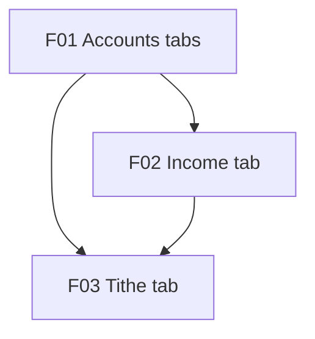

# Accounts Overview with Income and Tithe

## 1. Executive Summary

Accounts Overview with Income and Tithe folds CashFlow's Monthly page into the Accounts page and gives income and tithe their own places. The Accounts page gains a month picker and five tabs: **Accounts** (today's balances per template group, now for the chosen month), **Summary** (category totals, income by source and a Result line), **Income** (every income of the month, with or without a bank, and "New income"), **Tithe** (the month's tithe detail and a history table for the year) and **All transactions** (P60 F16's grid, now including incomes with no bank). The Monthly menu item goes and `/cashflow/monthly` redirects to the Summary tab.

It is for the single user of this self-hosted tool, who records household cash flow across UK and Brazilian banks and pays a 10% tithe on the month's income. Two requests from 2026-11-11 drive it: "Add income without a bank like the dividendos juros, just for tithe calculation, have a place to see the incomes, a place to see the tithe", and "I don't like to have these two, Accounts and Monthly — can they be merged? Maybe all under Accounts and then have tabs. The summary can be reduced as most of it exists in Accounts (bank and credit card), but still Category and Income and the total of these two."

P61 builds on P60 (`docs/prd/P60-prd-cashflow-accounts-generalization/prd-cashflow-accounts-generalization.md`). It supersedes P60 F13's "Monthly becomes an overview" (Monthly stays a separate page with month picker, group summary, category totals, income totals, tithe, banks and cards grids and All transactions) and moves P60 F16's All transactions grid from Monthly to Accounts unchanged apart from bankless incomes. The domain already allows an income with no account (`Income.Account` is optional, the income create request's bank is optional, "omit when the income never lands in a tracked bank"); what is missing is a place to enter, see and total such incomes, and a place to see the tithe. No new persisted data is introduced: the data file stays at its current version.

## 2. Problem and Opportunity

### The Problem

**Two overlapping overview pages**
- Accounts (balances per template group, fixed to the current month) and Monthly (month picker, banks grid, cards grid, category totals, income totals, tithe, All transactions) both show bank and card balances; the user reads the same balances in two places.
- Accounts has no month picker, so a past month's balances are only reachable through Monthly's grids.
- Two menu entries for one "where does my month stand" question cost a navigation decision every visit.

**Income outside a tracked bank has nowhere to go**
- Dividends and interest (Dividendo/Juros) received in a broker or an untracked account count toward the tithe but never land in a tracked bank.
- The only income form in the app is on a bank's account screen, with the bank locked, so a bankless income can't be entered even though the model and API allow it.
- The income form's "— No bank —" option exists but is never reachable.

**No place to see the month's incomes**
- Incomes appear only per bank (each account screen's Transactions grid) or as totals per source (Monthly's Income totals); there is no list of the month's incomes across banks.
- All transactions (P60 F16) builds its rows per account, so an income with no bank is silently missing from it.

**Tithe is a few lines, not a view**
- Monthly shows only "Calculated tithe", "Tithe balance" and the carry-forward checkbox under Income totals; the income base and the tithe already paid are not shown.
- There is no history: checking how the balance carried through the year means opening each month in turn (12 visits for one year).

### The Opportunity

- **One overview page:** Accounts gets a month picker and tabs; Monthly's unique content (category totals, income by source, All transactions) becomes the Summary and All transactions tabs, and its bank and card grids go because the Accounts tab shows them.
- **Bankless income entry:** an Income tab with "New income" whose Bank field offers "No bank", using the existing income rules; bank incomes can still be entered from the account screen.
- **A list of incomes:** the Income tab lists every income of the month with edit and delete; All transactions lists bankless incomes too.
- **A tithe view:** a Tithe tab with the month's income base, tithe, tithe paid, carry-in, balance and the carry-forward checkbox, plus a 12-row history for the year from one new read query.

## 3. Target Audience

### Primary Users

**Household finance owner (single user)**
- Records every bank and card movement and every income each month, in GBP and BRL, and checks the month's position (spend per category, income, result) at least weekly.
- Receives Dividendo/Juros income in places the app doesn't track as accounts and wants it counted only for the tithe.
- Pays a 10% tithe on net income and needs to see what is owed, what was paid and what carried over from the previous month.

## 4. Objectives

### Product Objectives

1. **Merge** Accounts and Monthly into one Accounts page with a month picker and the tabs Accounts, Summary, Income, Tithe and All transactions.
2. **Enable** entering, editing and deleting an income with no bank, counted in the tithe base and in income totals.
3. **List** every income of a month in one place, and every transaction of a month, bankless incomes included, in All transactions.
4. **Show** the month's tithe detail and a 12-month history for the year.
5. **Preserve** every figure the parity toolkit reads, with no data file version change.

### Success Metrics

1. CashFlow menu has no Monthly item; `/cashflow/monthly` (with or without `?month=`) lands on Accounts → Summary for the same month in 1 navigation; 0 broken in-app links to `/cashflow/monthly` (grep).
2. A bankless income is saved in 1 form submit from the Income tab; the month's tithe base and Total income rise by exactly its net value; 0 changes to any bank balance.
3. For any month, the Income tab's row count equals `GET /incomes/month/{y}/{m}`'s count, and All transactions' Income rows equal that count (bank incomes once, on their bank; bankless incomes once, with "No bank").
4. For each of the 12 months of a year, the Tithe history row equals the Tithe tab's month detail for that month (5 figures each, 0 differences), shown in 1 request.
5. Parity run on the latest live copy after each feature: 0 differences; the data file version is unchanged (no `migrate` step).

## 5. User Stories

### F01. Accounts Overview Tabs and Monthly Fold
- As the user, I want a month picker on Accounts so that I can see any month's balances per template group.
- As the user, I want Accounts, Summary and All transactions as tabs on one page so that I don't switch between Accounts and Monthly.
- As the user, I want the Summary tab to show category totals, income by source and a Result line (total income − total expenses) so that I see the month's position at a glance without repeated bank and card grids.
- As the user, I want the chosen month and tab in the address so that a reload, back button or bookmark returns to the same view.
- As the user, I want my old Monthly bookmark to open Accounts → Summary for the same month so that nothing I saved breaks.
- As the user, I want the Monthly menu item gone so that there is one overview entry point.

### F02. Income Tab and Bankless Income
- As the user, I want an Income tab listing every income of the chosen month, with or without a bank, so that I see all my income in one list.
- As the user, I want to add an income with "No bank" so that a dividend or interest received outside a tracked bank counts toward the tithe without changing any bank balance.
- As the user, I want to add a bank income from the Income tab too so that I can enter any income from one place.
- As the user, I want to edit or delete any income from its row with the app's row icons so that I correct mistakes where I see them.
- As the user, I want All transactions to include incomes with no bank so that the month's list of transactions is complete.

### F03. Tithe Tab and History
- As the user, I want a Tithe tab showing the month's income base, tithe (10%), tithe paid, carry-in and balance so that I know what I still owe and why.
- As the user, I want the carry-forward checkbox on the Tithe tab so that I decide there whether last month's balance carries into this one.
- As the user, I want a history table with one row per month of the year, with the same columns, so that I follow the balance across the year without opening each month.
- As the system, I want one read query returning the tithe of every month of a year so that the history loads in one request and matches the month query exactly.

## 6. Functionalities

### F01. Accounts Overview Tabs and Monthly Fold

**Provides:**
- The Accounts page shell: month picker, tab list (Accounts, Summary, All transactions; Income and Tithe added by F02 and F03 at their fixed positions), the chosen month and tab in the address, and the rule that only the open tab loads its data (used by F02, F03)
- The Summary tab's income-by-source section and the tithe lines kept on Summary until F03 (used by F03)
- The All transactions tab hosting P60 F16's grid (used by F02)

**Capabilities:**
- **Page:** `/cashflow/accounts` keeps its path and stays the CashFlow landing page. It gains a month picker (the same month input Monthly uses, label "Month", default the current month) and a tab list in this fixed order: Accounts · Summary · Income · Tithe · All transactions. F01 ships Accounts, Summary and All transactions; F02 adds Income and F03 adds Tithe in their positions (user decision 2026-11-11).
- **Address:** the month and tab are query parameters, `?month=YYYY-MM&tab=accounts|summary|income|tithe|transactions`. A missing or malformed month falls back to the current month; a missing or unknown tab falls back to Accounts. Changing the month keeps the tab; changing the tab keeps the month; both replace the address entry so the back button leaves the page rather than stepping through every click.
- **Lazy loading:** each tab loads its data only when open, and reloads when the month changes while it is open.
- **Accounts tab:** today's balances per template group (P60 F14's Accounts page content), for the chosen month: the heading reads "Balances at end of October 2026" for the picked month, each account link opens the account screen at that month (as today for the current month), and every column (balance, round-up, the card's Next statement) is computed for the chosen month by the existing by-template query.
- **Summary tab:** Category totals (the existing grid and its total) and Income by source (Source, Gross, Net, the "Total incoming" line), followed by a **Result** line: total income (net) − total expenses (the Category totals sum), shown signed with the word "Surplus" or "Deficit" next to it (0.00 shows "Balanced"). The bank and card grids leave Summary because the Accounts tab shows them (user decision 2026-11-11). Until F03 ships, the tithe lines ("Calculated tithe", "Tithe balance") and the carry-forward checkbox stay on Summary under Income by source, so the checkbox is never unreachable; F03 removes them.
- **All transactions tab:** P60 F16's grid, columns, filters, footer, row links and states moved unchanged from Monthly.
- **Monthly retired:** the Monthly page and its menu item are removed; `/cashflow/monthly` redirects to `/cashflow/accounts?tab=summary`, carrying `?month=` when present. Every in-app link to Monthly (found by grep in the spec) points at the Accounts page with the matching tab.
- **Figures and routes:** no API route changes. Summary reads the same queries Monthly reads today (category totals, default group summary's income totals, tithe); the Accounts tab reads the by-template groups query for the chosen month. Every figure shown equals what Monthly or Accounts shows today for the same month.
- **Delivery:** 2 PRs, web only: (1a) month picker and address on Accounts, Accounts tab for the chosen month; (1b) tab list with Summary (Result line) and All transactions, Monthly removed, redirect and menu change. Deleted files don't count toward the PR size limit.

**Experience:**
- CashFlow → Accounts opens October 2026 (the current month) on the Accounts tab: "Balances at end of October 2026", groups Bank, Credit card, Pots, Settlement as today.
- Pick September 2026 → the heading reads "Balances at end of September 2026", balances are September's; the address shows `?month=2026-09&tab=accounts`.
- Select Summary → Category totals ("Groceries 412.37 … Total 2,840.10"), Income by source ("Salary 4,100.00 · Dividendo/Juros 85.20 · Total incoming 4,185.20"), then "Result 1,345.10 Surplus".
- Open an old bookmark `/cashflow/monthly` → Accounts, Summary tab, current month; the menu shows Accounts, Annual summary, Mensais, Investment snapshots (no Monthly).
- States per tab: loading (the tab's grids show the app's loading state, the picker and tabs stay usable), empty (Accounts: "No accounts this month."; Summary: "No expenses this month." and "No income this month." per section, Result still shown as 0.00 "Balanced"), load error (the app's error state with "Retry", scoped to the open tab, other tabs still selectable). No saving or unsaved-changes state on Accounts or Summary except the carry-forward checkbox, which keeps today's updating and error behaviour.
- Accessibility: the tab list uses the app's `PageTabList` (arrow keys move between tabs, Enter/Space selects, visible focus); the month input has a visible label; the Result's meaning is in the word, not only the colour; numeric columns right-aligned; at narrow width the grids stack as today and the page adds no horizontal scroll.

### F02. Income Tab and Bankless Income

**Consumes:**
- F01: the Accounts page shell (month picker, tab list, address, lazy loading)
- F01: the All transactions tab hosting P60 F16's grid

**Provides:**
- Incomes with no bank, counted in the month's income totals and tithe base (used by F03)

**Capabilities:**
- **Income tab** (third, between Summary and Tithe): lists every income of the chosen month from `GET /incomes/month/{y}/{m}`, bank or no bank. Columns: Date, Source, Bank ("No bank" when none), Description, Gross ("—" when empty), Net (right-aligned), and a row-actions column with the app's Edit and Delete row icons. Newest first; sortable by every column; Source and Bank filters with the column filter menus the grids already use. Footer: row count and "Total net" (the same figure as Summary's "Total incoming" when unfiltered).
- **New income:** a "New income" button opens the income form already used on the account screen, with the Bank field unlocked: active accounts that can receive income, plus "— No bank —" (the default is No bank; user decision 2026-11-11). Fields and rules are the account screen's: Date (default: the last date used for an income when it falls in the chosen month, otherwise today for the current or a later month and the last day of an earlier month, as on the account screen), Source (active sources), Gross (optional), Net (required, not negative), Description (optional), and, for a source that splits to pots, the pots split. A bankless income can't be split into pots: choosing a bank is required before the split is offered, and the server's existing rule refuses it ("Choose the bank this income landed in.").
- **No bank effect:** a bankless income moves no balance; it counts in the month's income by source, "Total incoming", the Result line and the tithe base (the tithe base already sums every income's net value); the Annual summary's income rows already count it by source.
- **Edit and delete:** Edit opens the same form pre-filled; a bank can be changed to No bank or the reverse. Delete asks for confirmation ("Delete this income? This can't be undone.") and, for an income with a linked pots deposit, deletes the deposit with it as the account screen does today. An income on an inactive bank keeps that bank when edited, as the existing active-account rule allows. Bank incomes stay editable from the account screen too (user decision 2026-11-11).
- **All transactions includes bankless incomes:** the month-transactions query adds one row per bankless income of the month, Type "Income", Account "No bank", no category, amount positive. Its account id, name and currency are empty on the wire (an API shape change: the OpenAPI snapshot and generated types are regenerated). The Account filter offers "No bank"; the footer lists the bankless incomes' total on its own "Total (no bank)" line next to the per-currency totals (decision 2026-11-12), since a bankless income has no currency; a bankless row has no link: its Account and Description are plain text, and editing it from All transactions comes with the grid's row icons (decision 2026-11-12). Category filters and Spend are unchanged because the rows carry no category.
- **Data file:** no new field. An income's `AccountId` is already written as a present key whose value may be null, which the loader accepts; the version stays as it is.
- **Delivery:** 2 PRs: (2a) month-transactions query includes bankless incomes, API shape and generated types, All transactions grid's "No bank" account, filter and footer line; (2b) Income tab with list, New income, edit and delete.

**Experience:**
- Accounts → October 2026 → Income: "28 Oct · Salary · Barclays · — · 4,500.00 · 4,100.00", "15 Oct · Dividendo/Juros · No bank · XP dividends · — · 85.20" … footer "6 incomes · Total net 4,185.20".
- New income → Bank "— No bank —", Source Dividendo/Juros, Net 42.10, Date 30 Oct → Save → the form closes, the row appears, the footer total becomes 4,227.30, a success toast "Income added."; Summary's Total incoming and Tithe's income base both show 4,227.30; Barclays' balance unchanged.
- All transactions → "15 Oct · No bank · Income · XP dividends · — · +85.20"; Account filter "No bank" shows only bankless incomes; footer "… · Total (no bank) +127.30".
- States: loading (grid loading state, "New income" enabled), empty ("No income this month." with "New income" still offered), load error (error state with Retry), saving (Save shows progress and is disabled, form fields kept), validation (inline field messages, focus moves to the first invalid field), server error (message above the form's buttons, values kept), success (toast, list refreshed), unsaved changes (closing a form with edits asks "Discard changes?"), disabled (Edit and Delete hidden while a save is in flight).
- Accessibility: every row icon has an accessible name ("Edit income 15 Oct Dividendo/Juros", "Delete income …"); the form is keyboard operable with visible focus; "No bank" is text, not an icon.

**Error Handling:**
- Net value negative or empty: inline "Net value is required." / "Net value cannot be negative."; nothing sent (server's existing 400 "Net value cannot be negative." if it gets through).
- Source missing or inactive: inline "Choose a source."; server's existing 400 "Income source is required.".
- Pots split with No bank: the split isn't offered; a request that reaches the server gets the existing 400 "Choose the bank this income landed in." shown above the buttons.
- Income deleted or changed elsewhere (404 on edit or delete): "This income no longer exists; the list was refreshed." and the list reloads; nothing else changes.
- Save or delete failure (network or 5xx): "Couldn't save the income. Try again." / "Couldn't delete the income. Try again."; nothing persisted, form values kept, the row stays.

### F03. Tithe Tab and History

**Consumes:**
- F01: the Accounts page shell (month picker, tab list, address, lazy loading) and the Summary tab's tithe lines and carry-forward checkbox, which move here
- F02: incomes with no bank in the month's income base

**Capabilities:**
- **Tithe tab** (fourth, between Income and All transactions). **Month detail** for the chosen month: Income base (sum of the month's incomes' net values, bank or no bank), Tithe (10% of the base, the existing tithe rule), Tithe paid (the month's expenses in the tithe category that count as tithe, by reporting month), Carry-in (the previous month's positive balance, derived, with "from September 2026"), Balance (Tithe − Tithe paid + Carry-in when included), and the carry-forward checkbox "Include September 2026's balance of 120.00", moved from Summary with today's behaviour (only the decision is persisted). When there is no carry-in the checkbox isn't shown and Carry-in reads 0.00.
- **History:** a table below the detail, one row per month from January to December of the chosen month's year, columns Month, Income base, Tithe, Tithe paid, Carry-in, Included (Yes/No/—), Balance. Each row equals the month detail for that month (same calculation). The chosen month's row is marked as current (bold and "aria-current"), and a footer totals Income base, Tithe and Tithe paid for the year. Clicking a month in the Month column selects that month on the page. Months after the current month show their (zero or partial) figures like any other month.
- **API:** the month tithe response gains `incomeBase` and `tithePaid` (additive), and a new read route returns the 12 months of a year in one response, each item the same shape as the month response plus year and month. The OpenAPI snapshot and generated types are regenerated. No new persisted data: carry-in stays derived and only the Included decision is stored (P60 tithe carry-forward rule).
- **Summary loses the tithe lines:** "Calculated tithe", "Tithe balance" and the carry-forward checkbox leave Summary; Summary keeps Category totals, Income by source and Result (user decision 2026-11-11).
- **E2E:** a smoke journey adds a bankless income on the Income tab and checks the Tithe tab's income base and tithe rise by its net value and 10% of it, against the test seed data.
- **Delivery:** 2 PRs: (3a) month response fields and the year route with acceptance tests; (3b) Tithe tab, Summary trimmed, E2E journey, docs.

**Experience:**
- Accounts → October 2026 → Tithe: "Income base 4,227.30 · Tithe 422.73 · Tithe paid 400.00 · Carry-in 120.00 from September 2026 · Balance 142.73", checkbox "Include September 2026's balance of 120.00" ticked.
- Untick → the checkbox shows progress and is disabled; Balance becomes 22.73; November's row in the history changes its Carry-in accordingly; on failure the checkbox returns to ticked with "Couldn't update the carry-forward. Try again." next to it.
- History: "Jan 2026 · 3,900.00 · 390.00 · 390.00 · 0.00 · — · 0.00" … "Oct 2026 · 4,227.30 · 422.73 · 400.00 · 120.00 · Yes · 142.73" (current) … footer "Total 46,120.50 · 4,612.05 · 4,350.00".
- States: loading (detail and table each show the loading state), empty month (all figures 0.00, no checkbox, "No income this month." under Income base), load error (error state with Retry for the detail and for the history separately), saving (checkbox progress), success (figures refresh).
- Accessibility: the history is a table with a caption ("Tithe by month, 2026") and column headers; the current row is announced; figures right-aligned; Balance shows its sign and "owed"/"in credit" in text, not only colour; the checkbox has its visible label as its name.

**Error Handling:**
- Carry-forward update fails (network or 5xx): the checkbox reverts, "Couldn't update the carry-forward. Try again." shown; nothing persisted.
- Carry-forward for a month with no carry-in (the existing route's 400): "There is no balance to carry into this month." shown, and the tab refreshes, hiding the checkbox.
- Year history fails to load while the month detail loads: the detail stays usable; the history shows its own error state with Retry.

## 7. Out of Scope

**Domain and calculation**
- Changing the tithe rule (10%), the tithe-category rule, or what counts as tithe paid.
- Currency conversion in the tithe base or totals: the base keeps summing net values as today, whatever the bank's currency; a bankless income carries no currency.
- A currency field on incomes.
- Splitting a bankless income into pots.

**Pages and navigation**
- Changes to the account screen (its Income entry stays as it is), Annual summary, Mensais or Investment snapshots.
- Retiring the default group summary route or any other route parity reads.
- A year picker separate from the month picker on the Tithe tab.
- Editing tithe expenses from the Tithe tab (they stay expenses on their account).

**Data**
- Any data file version change or migration step.
- Importing historical dividends or interest.

## 8. Dependency Graph

### Part 1: Dependency Table

| # | Feature | Priority | Dependencies |
|---|---------|----------|--------------|
| F01 | Accounts Overview Tabs and Monthly Fold | 1 | None |
| F02 | Income Tab and Bankless Income | 1 | F01 |
| F03 | Tithe Tab and History | 1 | F01, F02 |

F01 goes first because the Income and Tithe tabs live on the Accounts page; building them on Monthly first would mean building them twice. F03 follows F02 so the Tithe tab's income base and its E2E journey can rely on bankless income entry. Each PR (1a, 1b, 2a, 2b, 3a, 3b) leaves `main` deployable on its own: the carry-forward checkbox stays on Summary until 3b moves it to the Tithe tab, and 2a's bankless rows appear in All transactions before the Income tab exists without breaking anything. A deploy is allowed after each feature's last PR; no `migrate` step is needed.

### Part 3: Execution Waves
Features within the same wave can be built in parallel. A wave starts only after every feature in earlier waves is complete.

- **Wave 1**: F01
- **Wave 2**: F02
- **Wave 3**: F03

### Part 4: Priority levels
- **1** = Essential — product does not work without it
- **2** = Important — significant value addition
- **3** = Desirable — incremental improvement

### Part 5: Diagram

## 9. Acceptance Criteria

Every criterion is traced by tests named with the project's AC-tracing convention (`[AC P61-F0n-<slug>-NN]`). Every PR runs `/simplify` and passes architecture-reviewer and, for UI changes, ui-reviewer against `docs/ui/review-checklist.md`.

### F01. Accounts Overview Tabs and Monthly Fold
- [x] Accounts has a month picker defaulting to the current month and the tabs Accounts, Summary and All transactions in that order; the month and tab are in the address, a malformed month falls back to the current month and an unknown tab to Accounts
- [x] The Accounts tab shows the by-template groups for the chosen month, with "Balances at end of <month>", and each account link opens its account screen at that month
- [x] Summary shows Category totals, Income by source with Total incoming, and Result = Total incoming − Category totals sum with "Surplus", "Deficit" or "Balanced"; it shows no bank or card grid; the tithe lines and the carry-forward checkbox stay until F03
- [x] All transactions on Accounts behaves as P60 F16's tab did on Monthly (columns, filters, footer, links, states)
- [x] Only the open tab loads its data; changing the month reloads the open tab and keeps it selected
- [x] The Monthly page and menu item are gone; `/cashflow/monthly` redirects to Accounts → Summary, keeping `?month=`; no in-app link points to `/cashflow/monthly`
- [x] Loading, empty, load-error (with Retry, scoped to the tab) states pass the review checklist; tabs and month picker are keyboard operable with visible focus; the Result's meaning is not colour-only; no horizontal scroll at narrow width
- [x] Parity on the latest live copy: 0 differences; no API route or data file change

### F02. Income Tab and Bankless Income
- [ ] The Income tab lists every income of the chosen month (bank and no bank) with Date, Source, Bank ("No bank"), Description, Gross, Net and row icons; its count equals `GET /incomes/month/{y}/{m}`'s and its Total net equals Summary's Total incoming
- [ ] New income with "— No bank —" saves an income with no account: no account balance changes, and the month's Total incoming, Result and tithe base rise by its net value
- [ ] New income with a bank from the Income tab saves exactly as from the account screen, and the income appears on that bank's Transactions grid
- [ ] Edit changes any field, including bank to No bank and back; Delete asks for confirmation and removes the income (and its linked pots deposit, if any)
- [ ] A bankless income can't be split into pots: the split isn't offered without a bank, and the server refuses it with "Choose the bank this income landed in."
- [ ] Validation (net empty or negative, no source), 404 on a stale row, and save or delete failure each show the specified message and persist nothing
- [ ] All transactions lists each bankless income once with Type Income, Account "No bank", no category, with no link; the Account filter offers "No bank"; the footer shows a "Total (no bank)" total; category Spend figures are unchanged
- [ ] The OpenAPI snapshot and generated types are regenerated for the month-transaction row's optional account fields; `openapiFreshness.test.ts` and `OpenApiContractTests` pass
- [ ] Saving, validation, server-error, success, empty, loading and unsaved-changes states pass the review checklist; row icons have accessible names; the form is keyboard operable
- [ ] The data file version is unchanged and a file with bankless incomes loads and saves unchanged; parity on the latest live copy: 0 differences

### F03. Tithe Tab and History
- [ ] The Tithe tab shows, for the chosen month, Income base, Tithe (10%), Tithe paid, Carry-in with its source month, and Balance, matching the existing month tithe calculation
- [ ] The carry-forward checkbox works on the Tithe tab as it did on Monthly (persists only the decision, refreshes Balance and the history); it is hidden when there is no carry-in; a failed update reverts it with the specified message
- [ ] The history shows 12 rows (January to December of the chosen month's year), each equal to that month's detail; the current month is marked; the footer totals Income base, Tithe and Tithe paid; clicking a month selects it
- [ ] The year route returns 12 items in one request, each equal to the month route for that month; the month route gains `incomeBase` and `tithePaid`; the OpenAPI snapshot and generated types are regenerated
- [ ] Summary no longer shows tithe lines or the checkbox
- [ ] Loading, empty-month, separate detail and history error states pass the review checklist; the history is a captioned table; Balance's meaning is not colour-only
- [ ] The E2E smoke journey (add a bankless income on Income, check the Tithe tab's base and tithe) passes in the `web-e2e` job
- [ ] `context.md`, README and `docs/ui/` references to the Monthly page describe the Accounts tabs; parity on the latest live copy: 0 differences

### Cross-Feature Integration
- [ ] The Income tab (F02) and Tithe tab (F03) appear in the F01 tab list in the fixed order Accounts · Summary · Income · Tithe · All transactions, use F01's month picker and address, and load only when open
- [ ] A bankless income saved on the Income tab (F02) appears in All transactions on the same Accounts page (F01) for its month
- [ ] A bankless income saved on the Income tab (F02) raises the Tithe tab's (F03) Income base by its net value and Tithe by 10% of it for its month, and the same month's history row
- [ ] The carry-forward checkbox is reachable at every point: on Summary (F01) until F03 ships, then only on the Tithe tab (F03)
- [ ] After every feature, every figure the parity toolkit reads (incomes, tithe, category totals, default group summary, by-template groups, month transactions, account figures) shows 0 differences on the latest live copy, with no data file version change
