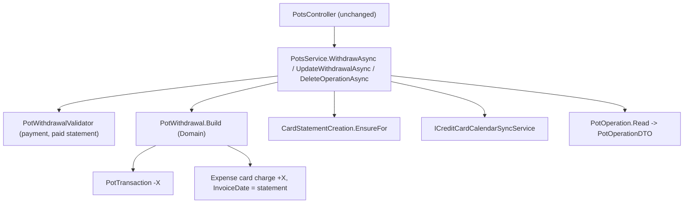

# Spec: Card-Paid Pot Withdrawal

**Complexity:** simple (no new endpoint; two DTOs and one domain rule extended; no data file version change)

## 1. Technical Overview

**What:** Extend the existing linked pot withdrawal (`POST/PUT /api/v1/financial/pots/{potsId}/withdrawals`, P60 F10) so the user can pay it by credit card. A card-paid withdrawal writes, under one operation id, the pot movement −X on the expense date and an unpaid card charge +X in the chosen category on the chosen statement month. No bank record is written. `PotOperationDTO` reports the card, the statement month and the investment withdrawal status (`Pending` or `Done`). The statement-paid rules lock the operation: once the statement is paid, only description and category can change, and delete is rejected.

**Why:** today `PotWithdrawal.Build` only knows "no bank" and "through bank", so a card-paid pot expense is recorded as two unlinked records. Reusing the F10 operation link makes edit and delete atomic and lets F02 find the charge when the statement is paid.

**Scope:**

*Included*
- Domain: card payment in `PotWithdrawal.Build`; statement-not-before-expense rule; operation read-out of card, statement and investment withdrawal status.
- Application: request and response DTO fields, validation (bank/card exclusive, card resolution, paid statement, statement defaults), statement-paid locks on update and delete, in-place description/category edit on a paid statement, `CardStatementCreation` and calendar sync for the charge.
- API: no new route; OpenAPI snapshot and the web's generated types regenerated.
- Input contracts (PRD Consumes): none.
- Output contracts (PRD Provides, used by F02 and F03): card-paid withdrawal operations with operation id, Pots account, pot, amount, expense date, description, category, card, statement year/month and investment withdrawal status, read through `PotOperation.Read` and `GET /pots/operations/{operationId}`.

*Excluded*
- Every web form and view change, including showing the status (F03, per the user's 2026-11-21 scope decision). Today's Withdraw form keeps sending no card and keeps working.
- Writing or removing the Pots-category −X at statement payment (F02); in F01 a card operation is always `Pending`.
- Nothing-due settlement (F04).

## 2. Architecture Impact

| Component | Path | Change |
|---|---|---|
| Withdrawal rule | `Financial.CashFlow.Domain/Rules/PotWithdrawal.cs` | Card branch; statement-month rule |
| Card payment value | `Financial.CashFlow.Domain/Rules/PotWithdrawalCard.cs` | New record: card + statement month |
| Operation read-out | `Financial.CashFlow.Domain/Rules/PotOperation.cs` | Card, statement month, investment withdrawal status; in-place detail update |
| Request DTO | `Financial.CashFlow.Application/DTOs/PotWithdrawalRequestDTO.cs` | Card and statement fields |
| Operation DTO | `Financial.CashFlow.Application/DTOs/PotOperationDTO.cs` | Card, statement, status fields |
| Validator | `Financial.CashFlow.Application/Validation/PotWithdrawalValidator.cs` | Payment resolution, paid-statement checks |
| Service | `Financial.CashFlow.Application/Services/PotsService.cs` | Locks, in-place edit, statement creation, calendar sync |
| Contract | `Tests/Financial.Api.Tests/Contract/openapi-v1.snapshot.json`, `Financial.Web/src/api/generated/openapi.ts` | Regenerated |



## 3. Technical Decisions

| Decision | Chosen Approach | Alternative Considered | Trade-off |
|---|---|---|---|
| Request shape | Extend `PotWithdrawalRequestDTO` with `CreditCardId`, `StatementYear`, `StatementMonth` (ints, as `MoveChargeToStatementDTO`) | A separate `/card-withdrawals` route | One route and one form contract for all three payment choices; bank and card exclusivity is validated rather than typed |
| Statement default | Omitted year and month → the month of `Date` (as `Expense.Create`'s `invoiceDate ?? date`) | Required fields | The server and a future client agree on the default; F03 still sends the picked month explicitly |
| Domain input | New record `PotWithdrawalCard(Account Card, DateOnly StatementMonth)` passed to `Build` as an optional argument beside `bank` | Two more loose parameters | `Build` already has 9 parameters; the record keeps card and statement together and makes "bank and card" unrepresentable inside the domain call |
| Where the rules live | Statement-not-before-expense in Domain (`PotWithdrawal`); paid-statement checks in Application (needs `CardStatement` records), as `ExpenseService` does today | All in Application | Matches the existing split: pure rules in Domain, repository-backed checks in Application |
| Edit after the statement is paid | In place: the operation's pot movement and expenses keep their ids; only description and category change | Today's remove-and-rebuild | Rebuilding would re-create the charge with a new id under a paid statement and, from F02, drop the bank −X; in-place keeps both stable |
| Lock detection | The operation is locked when its card charge is on a paid statement (`CardChargeFilter.IsOnPaidStatement`) | A stored flag | Derived, so unmark paid unlocks it with no extra write ("derive, don't store") |
| Investment withdrawal status | Derived on read: card operation with a negative expense in the Pots account's category → `Done`, otherwise `Pending`; null for non-card operations | Stored status | Nothing to keep in sync; F02 and F04 only add or remove that expense |
| Calendar sync | Trigger `ICreditCardCalendarSyncService.TriggerSyncIfInvoiceSynced` for the old and new statement after a save, as `ExpenseService` does for charges | Skip | A pot charge changes the statement total like any other charge |

## 4. Component Overview

**Backend**

| File Path | New/Modified | Purpose | Key Responsibilities |
|---|---|---|---|
| `Financial.CashFlow.Domain/Rules/PotWithdrawalCard.cs` | New | Card payment value | Holds the card account and the first-of-month statement date |
| `Financial.CashFlow.Domain/Rules/PotWithdrawal.cs` | Modified | Build the withdrawal | Card branch: require category, reject statement before the expense month ("The statement can't be before the expense date."), write pot −X and `Expense.Create(date, description, X, category, paymentSourceAccount: null, creditCard: card, invoiceDate: statement, operationId)`; bank branch unchanged |
| `Financial.CashFlow.Domain/Rules/PotOperation.cs` | Modified | Operation read-out | `CreditCard` and `StatementMonth` from the chosen (+X) expense; `InvestmentWithdrawalStatus` (`Pending`/`Done`/null); `UpdateDetails(description, category)` renames every record and re-categorises the chosen expense in place |
| `Financial.CashFlow.Application/DTOs/PotWithdrawalRequestDTO.cs` | Modified | Request | Adds `CreditCardId`, `StatementYear`, `StatementMonth` |
| `Financial.CashFlow.Application/DTOs/PotOperationDTO.cs` | Modified | Response | Adds `CreditCardId`, `StatementYear`, `StatementMonth`, `InvestmentWithdrawal` |
| `Financial.CashFlow.Application/Validation/PotWithdrawalValidator.cs` | Modified | Request validation | Resolves none / bank / card; bank and card exclusive; statement fields only with a card; valid month; target statement unpaid |
| `Financial.CashFlow.Application/Services/PotsService.cs` | Modified | Use cases | Card create; update with locks or in-place edit; delete lock; `CardStatementCreation.EnsureFor` inside the save; calendar sync after it |

**Docs**

| File Path | New/Modified | Purpose |
|---|---|---|
| `context.md` | Modified | One paragraph: a pot withdrawal can be paid by card; investment withdrawal stays pending until F02 |

**Database:** none. The card charge uses existing optional fields (`CreditCard`, `InvoiceDate`, `ChargeDate`, `OperationId`); the data file version does not change.

### Rules in detail

- **Payment resolution** (validator, in this order):
  1. `BankId` and `CreditCardId` both set → 400 "Choose a bank or a credit card, not both."
  2. `StatementYear` or `StatementMonth` set without `CreditCardId` → 400 "A statement month is only used when paying by card."
  3. Only one of `StatementYear`/`StatementMonth` set, or an invalid month → 400 "The statement month is not a valid month." (the `ExpenseService` message).
  4. `CreditCardId` set and `CategoryId` missing → 400 "Category is required when a credit card is selected."
  5. `CategoryId` set with neither bank nor card → 400 "A bank or credit card is required when an expense category is given." (replaces today's bank-only wording).
  6. Card id unknown → 400 "Credit card '<id>' is not recognized."; not a card or inactive → today's `Expense.Create` messages.
  7. Category: `ResolveActiveCategory` + `PotWithdrawal.EnsureUsableCategory`, as the bank path.
  8. Target statement paid → 400 "This statement is already paid; choose a later month."
- **Overdraft:** unchanged (`EnsureWithinBalance`, 409 without `Confirmed`).
- **Update, operation not locked:** today's remove-and-rebuild, for any payment choice (switching card ↔ bank ↔ none included).
- **Update, operation locked** (its card charge is on a paid statement): the request must keep `PotId`, `Amount`, `Date`, `CreditCardId` and the statement month (omitted counts as the current one) and send no `BankId`; any difference → 400 "Unmark the statement paid to change this.". Otherwise `PotOperation.UpdateDetails` applies the new description and category in place (category checked as at create).
- **Delete, operation locked:** 400 "Unmark the statement paid before deleting this withdrawal."; otherwise today's delete.
- **Single records:** unchanged; `ExpenseService` update/delete and the pot-transaction paths already return F10's 409 for any record with an operation id.
- **Move charge:** unchanged; `MoveToStatementAsync` keeps the operation id, and the operation reads its new statement month.

## 5. API Contracts

No new endpoint. Changed bodies of the existing routes:

**`POST /api/v1/financial/pots/{potsId}/withdrawals`** (201) and **`PUT /api/v1/financial/pots/{potsId}/withdrawals/{operationId}`** (200)

| Field | Type | Required | Validation | Description |
|---|---|---|---|---|
| `potId` | uuid | Yes | pot of this Pots account | Unchanged |
| `amount` | number | Yes | > 0 | Unchanged |
| `date` | date | Yes | not in the future | Expense date; the pot moves on it |
| `description` | string | Yes | non-blank, length limit | Unchanged |
| `bankId` | uuid | No | exclusive with `creditCardId` | Unchanged |
| `creditCardId` | uuid | No | active card account | **New** |
| `statementYear` | int | No | with `statementMonth`, only with a card | **New**; default the year of `date` |
| `statementMonth` | int | No | 1–12, not before `date`'s month, statement unpaid | **New**; default the month of `date` |
| `categoryId` | uuid | With bank or card | active, usable | Unchanged rule, now also for a card |
| `confirmed` | bool | No | | Unchanged |

```json
{
  "potId": "6f1c2d1e-1b7a-4c55-9a51-2a6e3b8f0a11",
  "amount": 120.00,
  "date": "2027-03-14",
  "description": "Flights to Lisbon",
  "creditCardId": "0a8e7f52-3d41-4f0b-8c2e-9b5d61e4a7c3",
  "statementYear": 2027,
  "statementMonth": 3,
  "categoryId": "c2b7a9e4-5f13-4a8d-b0e6-7d1f3c9a2b58"
}
```

**Response `PotOperationDTO`** (also `GET /api/v1/financial/pots/operations/{operationId}`)

| Field | Type | Description |
|---|---|---|
| existing fields | | Unchanged; `bankId` null for a card operation |
| `creditCardId` | uuid? | **New**; set for a card operation |
| `statementYear` | int? | **New**; the charge's current statement year |
| `statementMonth` | int? | **New**; the charge's current statement month |
| `investmentWithdrawal` | string? | **New**; `"Pending"` or `"Done"` for a card operation, null otherwise |

```json
{
  "operationId": "9d3e1a77-2c4b-4f8e-a6d1-5b0c7e2f9a34",
  "kind": "Withdrawal",
  "potsAccountId": "1e5b9c3a-7d2f-4a61-8b04-c3e9f1a7d256",
  "date": "2027-03-14",
  "description": "Flights to Lisbon",
  "amount": 120.00,
  "into": null,
  "potId": "6f1c2d1e-1b7a-4c55-9a51-2a6e3b8f0a11",
  "fundingLines": [],
  "bankId": null,
  "categoryId": "c2b7a9e4-5f13-4a8d-b0e6-7d1f3c9a2b58",
  "incomeId": null,
  "creditCardId": "0a8e7f52-3d41-4f0b-8c2e-9b5d61e4a7c3",
  "statementYear": 2027,
  "statementMonth": 3,
  "investmentWithdrawal": "Pending"
}
```

**`DELETE /api/v1/financial/pots/operations/{operationId}`**: adds the locked case.

**Errors**

| Case | HTTP | Message |
|---|---|---|
| Bank and card both given | 400 | "Choose a bank or a credit card, not both." |
| Statement without card | 400 | "A statement month is only used when paying by card." |
| Invalid or half statement month | 400 | "The statement month is not a valid month." |
| Card without category | 400 | "Category is required when a credit card is selected." |
| Unknown card | 400 | "Credit card '<id>' is not recognized." |
| Inactive card / not a card | 400 | Existing `Expense.Create` messages |
| Statement paid | 400 | "This statement is already paid; choose a later month." |
| Statement before expense month | 400 | "The statement can't be before the expense date." |
| Locked field changed | 400 | "Unmark the statement paid to change this." |
| Delete while locked | 400 | "Unmark the statement paid before deleting this withdrawal." |
| Overdraft not confirmed | 409 | Existing overdraft problem |
| Single record edit/delete | 409 | F10 message (unchanged) |

## 6. Data Model

No schema change. A card-paid withdrawal stores:

| Record | Fields set |
|---|---|
| `PotTransaction` | `Pot`, `Amount = −X`, `Date = expense date`, `Description`, `OperationId` |
| `Expense` (card charge) | `Date = ChargeDate = expense date`, `Value = +X`, `Category`, `CreditCard`, `PaymentSourceAccount = null`, `InvoiceDate = statement month (1st)`, `CountsAsTithe = true`, `OperationId` |
| `CardStatement` | Created by `CardStatementCreation.EnsureFor` when the card has none for that month |

The charge's `ReportingDate` is its `InvoiceDate`, so category totals and tithe count it in the statement month with no reporting change.

## 7. Testing Strategy

| Test File | Type | Target |
|---|---|---|
| `Tests/Financial.CashFlow.Domain.Tests/Rules/PotWithdrawalTests.cs` | Unit | Card branch of `Build` |
| `Tests/Financial.CashFlow.Domain.Tests/Rules/PotOperationTests.cs` | Unit | Card read-out, status, `UpdateDetails` |
| `Tests/Financial.CashFlow.Application.Tests/Services/PotsServiceTests.cs` | Unit | Validation, locks, statement creation, calendar sync |
| `Tests/Financial.Api.Tests/Acceptance/CardPaidPotWithdrawalAcceptanceTests.cs` | Integration (new) | PRD acceptance criteria through the API |
| `Tests/Financial.Api.Tests/Contract/OpenApiContractTests.cs` | Contract | Regenerated snapshot |
| `Financial.Web/src/api/generated/__tests__/openapiFreshness.test.ts` | Contract | Regenerated web types |

**Domain**

| Test | Assertions |
|---|---|
| `Build_WithCard_WritesPotMovementAndCardChargeLinked` | pot −X on date; one expense +X, card set, no payment source, `InvoiceDate` = statement, same operation id |
| `Build_WithCard_StatementBeforeExpenseMonth_Throws` | message "The statement can't be before the expense date." |
| `Build_WithCard_StatementLaterThanExpenseMonth_Allowed` | `InvoiceDate` = later month |
| `Build_WithCard_NoCategory_Throws` | category required |
| `Read_CardOperation_ExposesCardStatementAndPending` | `CreditCard`, `StatementMonth`, status `Pending`, `Bank` null |
| `Read_CardOperationWithPotsCategoryNegativeExpense_IsDone` | status `Done` |
| `Read_BankOrNoBankOperation_HasNoInvestmentStatus` | status null |
| `UpdateDetails_ChangesDescriptionAndCategoryKeepingIds` | ids unchanged; every record renamed; +X re-categorised |

**Application (`PotsServiceTests`)**

| Test | Assertions |
|---|---|
| `Withdraw_BankAndCard_Rejected` | 400 message, nothing saved |
| `Withdraw_StatementWithoutCard_Rejected` | 400 message |
| `Withdraw_HalfOrInvalidStatementMonth_Rejected` | 400 message |
| `Withdraw_CardWithoutCategory_Rejected` | 400 message |
| `Withdraw_UnknownOrInactiveCard_Rejected` | 400 messages |
| `Withdraw_PaidStatement_Rejected` | 400 "This statement is already paid; choose a later month." |
| `Withdraw_CardNoStatement_DefaultsToExpenseMonth` | `InvoiceDate` = first of `date`'s month |
| `Withdraw_Card_CreatesStatementAndTriggersCalendarSync` | statement exists; sync called for card and month |
| `UpdateWithdrawal_Unlocked_SwitchesCardToBankAndBack` | records rebuilt each time |
| `UpdateWithdrawal_Locked_LockedFieldChanged_Rejected` | 400 per field (pot, amount, date, card, statement, bank) |
| `UpdateWithdrawal_Locked_DescriptionAndCategory_UpdatedInPlace` | same ids; new description and category |
| `DeleteOperation_Locked_Rejected` | 400 message, records kept |

**Acceptance (`CardPaidPotWithdrawalAcceptanceTests`)**, each `[Trait("AC", "<id>")]`

| Test | AC |
|---|---|
| `CardWithdrawal_WritesPotMovementAndCardCharge_NoBankRecord` | P62-F01-card-paid-pot-withdrawal-01 |
| `CardWithdrawal_StatementDefaultsAndRejectsPaidOrEarlierMonth` | -02 |
| `CardWithdrawal_RejectsInactiveCardExcludedCategoryAndUnconfirmedOverdraft` | -03 |
| `CardWithdrawal_CountsInStatementMonthForCategoriesTitheAndAmountToPay` | -04 (category summary, tithe and card statement ledger for month M, nothing in the expense month when it differs) |
| `CardWithdrawal_Unpaid_EditSwitchDeleteAndMoveKeepLink` | -05 |
| `CardWithdrawal_PaidStatement_LocksFieldsAndDeleteButAllowsDescriptionAndCategory` | -06 (statement marked paid through the card statement API) |
| `CardWithdrawal_SingleRecordEditOrDelete_Returns409` | -07 |
| `CardWithdrawal_ReadsPending_FailedSaveWritesNothing_DataVersionUnchanged` | -08 |

**Integration with later features:** PRD Cross-Feature criteria P62-CF-cross-feature-01 and -02 are F02/F03 criteria; F01 provides their input. `CardWithdrawal_WritesPotMovementAndCardCharge_NoBankRecord` also asserts the DTO carries operation id, amount, category, card and statement month that F02 reads, and that `GET /pots/operations/{id}` returns the same shape F03 will read.

## Assumptions and decisions

- F01 is backend only; F03 owns every web change (user, 2026-11-21).
- The server defaults the statement month to the expense date's month when omitted (spec-writer recommendation, matches `Expense.Create`).
- Today's "A bank is required when an expense category is given." becomes "A bank or credit card is required when an expense category is given." (no test or web code asserts the old text today).
- The charge counts toward tithe (`CountsAsTithe = true`), as the bank withdrawal's +X does (PRD F01 Capabilities).
- `Done` is derived from a negative expense in the Pots account's category inside the operation; F02 and F04 will write exactly that record.
