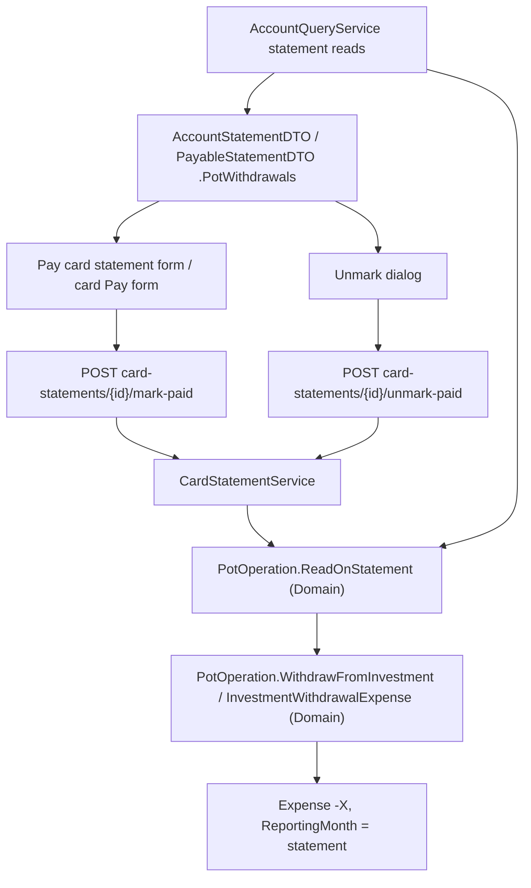

# Spec: Investment Withdrawal on Statement Payment

**Complexity:** medium (no new route; statement payment and reversal extended; one optional persisted field; two read DTOs and two web forms touched)

## 1. Technical Overview

**What:** When a card statement is marked paid from bank B on date D, the same save writes, for every card-paid pot withdrawal charge on that statement (P62 F01), a bank expense of −X in the Pots account's category on B dated D, linked to the withdrawal's operation id and reported in the statement month. Unmarking the statement paid removes those expenses with the payment transfer. The statement reads list the pot withdrawals on each statement, and the web's two Pay forms and the Unmark dialog say what will be taken or removed.

**Why:** F01 left the investment side `Pending`; this is the moment the money leaves the investment. Writing it in the payment's own save keeps the bank balance right on every day and the two category sides in one month.

**Scope:**

*Included*
- Domain: optional `Expense.ReportingMonth` that `ReportingDate` prefers; `PotOperation` builds and recognises its investment withdrawal.
- Application: mark paid writes the −X records, unmark paid removes them, both in the existing single save; a shared statement reader reused by F04; `PotOperationDTO` reports the investment withdrawal's bank and date; statement DTOs list pot withdrawals.
- Infrastructure: the new field is left out of the data file when empty.
- Web: the pot-withdrawal lines in the bank screen's Pay card statement form, the card screen's Pay form and the Unmark dialog.
- Input contracts (PRD Consumes from F01): card-paid withdrawal operations (operation id, Pots account, amount, chosen category, card, statement month, description) read with `PotOperation.Read`.
- Output contracts (PRD Provides): the write and removal keyed by statement (used by F04); investment withdrawal status `Done` with bank and payment date on `PotOperationDTO` (used by F03).

*Excluded*
- Nothing-due settlement (F04).
- Withdraw form and row changes (F03).
- Legacy settled statements: they cannot hold card-paid withdrawals (F01 rejects paid statements), so the legacy reversal is unchanged.

## 2. Architecture Impact



## 3. Technical Decisions

| Decision | Chosen Approach | Alternative Considered | Trade-off |
|---|---|---|---|
| Reporting month of the −X | Store an optional `ReportingMonth` (first of month) on `Expense`; `ReportingDate` returns it when set (user, 2026-11-21) | Derive it in each report from the operation's card charge | One field, left out of the file when empty, and every report (Summary, annual, historic, tithe, category averages) follows without change; deriving would touch about 5 services |
| Who builds the −X | `PotOperation.WithdrawFromInvestment(bank, date)`: amount, description, Pots category, operation id and statement month all come from the operation | Build it in `CardStatementService` | The rule stays with the entity that owns the operation's records (implementation.md §Domain rules) |
| How the −X is recognised | In a card operation, the expense with a payment source (the charge never has one) | Match on the Pots category | The Pots account's category can change after payment (F09); the shape cannot. `InvestmentWithdrawal` (F01's `Done`) uses the same predicate |
| Shared statement reader | `PotOperation.ReadOnStatement(card, year, month, …)` in Domain, next to `PotOperation.Read`; the services write each `WithdrawFromInvestment` and delete each `InvestmentWithdrawalExpense` inline | An Application helper class wrapping the write and removal | The only reusable piece is the lookup (F02 statement reads and F04 settle use it too); the write and removal are one-liners, so a wrapper was indirection (simplify review, 2026-11-21) |
| Pots account without a category | 400 "Set a category on <Pots account> first." before anything is saved | Skip that charge | PRD F02 Error Handling: nothing is saved |
| Web wording | A note under Amount in both Pay forms ("Also takes £120.00 from Reserva (Investimento) on Barclays."; "on the paying bank" until a bank is chosen), and one more sentence in the Unmark dialog | A second confirmation dialog | Paying has no confirmation step today; a note informs without adding a step |
| Statement reads | `PotWithdrawals` list on `AccountStatementDTO` and `PayableStatementDTO` (operation id, Pots account name, pot name, amount) | A separate endpoint per statement | The forms already hold the statement; no extra request |

## 4. Component Overview

**Backend**

| File Path | New/Modified | Purpose | Key Responsibilities |
|---|---|---|---|
| `Financial.CashFlow.Domain/Entities/Transactions/Expense.cs` | Modified | Reporting month | Optional `ReportingMonth` (stored as first of month), set only through `Expense.Create`'s new optional argument; `ReportingDate` prefers it |
| `Financial.CashFlow.Domain/Rules/PotOperation.cs` | Modified | Investment withdrawal | `WithdrawFromInvestment(Account bank, DateOnly date)` returns the −X expense (throws "Set a category on <Pots account> first." when the Pots account has none); `InvestmentWithdrawalExpense` (the card operation's expense with a payment source, or null); `InvestmentWithdrawal` derived from it |
| `Financial.CashFlow.Infrastructure/Persistence/CashFlowTypeInfoResolver.cs` | Modified | Persistence | `Expense.ReportingMonth` added to the properties omitted when null |
| `Financial.CashFlow.Domain/Rules/PotOperation.cs` (`ReadOnStatement`) | Modified | Statement reader | The card-paid withdrawal operations whose charge is on a card's statement month |
| `Financial.CashFlow.Application/Services/CardStatementService.cs` | Modified | Mark/unmark paid | Mark paid: build the −X records before the save (so a missing category fails first), add them in the same `ApplyAndSaveAsync` as the transfer; unmark paid (transfer reversal): remove them in the same save |
| `Financial.CashFlow.Application/DTOs/PotOperationDTO.cs` | Modified | Response | Adds `InvestmentWithdrawalBankId`, `InvestmentWithdrawalDate` |
| `Financial.CashFlow.Application/Services/PotsService.cs` | Modified | Response mapping | Fills the two new fields from `InvestmentWithdrawalExpense` |
| `Financial.CashFlow.Application/DTOs/StatementPotWithdrawalDTO.cs` | New | Read model | `OperationId`, `PotsAccountName`, `PotName`, `Amount` |
| `Financial.CashFlow.Application/DTOs/AccountStatementDTO.cs` | Modified | Card statements read | Adds `PotWithdrawals` |
| `Financial.CashFlow.Application/DTOs/PayableStatementDTO.cs` | Modified | Payable statements read | Adds `PotWithdrawals` |
| `Financial.CashFlow.Application/Services/AccountQueryService.cs` | Modified | Statement reads | Fills `PotWithdrawals` through `PotOperation.ReadOnStatement` |

**Frontend**

| File Path | New/Modified | Purpose | Key Responsibilities |
|---|---|---|---|
| `Financial.Web/src/components/StatementPotWithdrawalsNote.tsx` | New | Shared note | One line per pot withdrawal: "Also takes £120.00 from Reserva (Investimento) on Barclays."; renders nothing for an empty list |
| `Financial.Web/src/components/PayCardStatementForm.tsx` | Modified | Bank screen Pay form | Note under Amount for the chosen statement, naming the locked bank |
| `Financial.Web/src/components/CardStatementsTab.tsx` | Modified | Card screen Pay form and Unmark | Note in the Pay form (chosen bank or "the paying bank"); Unmark message adds "This also removes 1 investment withdrawal." / "…N investment withdrawals." |
| `Tests/Financial.Api.Tests/Contract/openapi-v1.snapshot.json`, `Financial.Web/src/api/generated/openapi.ts` | Modified | Contract | Regenerated in each stage that changes a DTO |

**Docs:** `context.md` (the card-paid withdrawal paragraph: the investment withdrawal now happens at statement payment).

### Rules in detail

- **Which charges:** expenses with an operation id whose `CreditCard` is the statement's card and whose `InvoiceDate` is the statement month, whose operation reads as a withdrawal with a card (`PotOperation.CreditCard` set).
- **Mark paid** (`MarkStatementPaidAsync`, after today's checks): read the operations; build `operation.WithdrawFromInvestment(bank, paymentDate)` for each; then one `ApplyAndSaveAsync` adds the transfer, marks the statement paid and adds every −X. The full X is written even when card credit lowered the amount to pay.
- **−X record:** `Date` = payment date; `Description` = the withdrawal's description; `Value` = −X; `Category` = the Pots account's category at that moment; `PaymentSourceAccount` = the paying bank; `CreditCard` null; `OperationId` = the withdrawal's; `ReportingMonth` = the statement month; `CountsAsTithe` true (as the bank withdrawal's −X).
- **Unmark paid** (transfer reversal): one save deletes the transfer, marks the statement unpaid and deletes each operation's investment withdrawal expense. Operations return to `Pending`.
- **Balances:** the −X adds X to the paying bank on the payment date (`Expense.ContributionTo`, unchanged); the bank screen and All transactions list it by its date (`ListingDate`, unchanged).
- **Locks:** unchanged from F01; once paid, `Relabel` also renames the −X and keeps its category.
- **Single records:** the −X carries the operation id, so `ExpenseService` already returns F10's 409 for it.

## 5. API Contracts

No new route.

**`POST /api/v1/financial/card-statements/{id}/mark-paid`** — request unchanged. New failure:

| Case | HTTP | Message |
|---|---|---|
| A pot charge's Pots account has no category | 400 | "Set a category on <Pots account> first." |

**`POST /api/v1/financial/card-statements/{id}/unmark-paid`** — unchanged contract; also removes the −X records.

**`GET /api/v1/financial/pots/operations/{operationId}` (and the withdrawal routes)** — `PotOperationDTO` adds:

| Field | Type | Description |
|---|---|---|
| `investmentWithdrawalBankId` | uuid? | The paying bank, once `Done` |
| `investmentWithdrawalDate` | date? | The payment date, once `Done` |

**`GET /api/v1/financial/accounts/{id}/statements`** (`AccountStatementDTO`) and **`GET /api/v1/financial/accounts/payable-statements`** (`PayableStatementDTO`) add:

| Field | Type | Description |
|---|---|---|
| `potWithdrawals` | array | One item per card-paid pot withdrawal on the statement; empty when none |
| `potWithdrawals[].operationId` | uuid | The withdrawal |
| `potWithdrawals[].potsAccountName` | string | e.g. "Reserva" |
| `potWithdrawals[].potName` | string | e.g. "Investimento" |
| `potWithdrawals[].amount` | number | X, positive |

```json
{
  "id": "4b0f…",
  "creditCardId": "0a8e…",
  "creditCardName": "Amex",
  "year": 2027,
  "month": 3,
  "total": 412.30,
  "currency": "GBP",
  "potWithdrawals": [
    { "operationId": "9d3e…", "potsAccountName": "Reserva", "potName": "Investimento", "amount": 120.00 }
  ]
}
```

## 6. Data Model

| Record | Field | Type | Stored | Notes |
|---|---|---|---|---|
| `Expense` | `ReportingMonth` | date (1st of month) | Only when set | Left out when null; the data file version does not change |

No migration: existing records have no value and report as today.

## 7. Testing Strategy

| Test File | Type | Target |
|---|---|---|
| `Tests/Financial.CashFlow.Domain.Tests/Entities/ExpenseTests.cs` | Unit | `ReportingMonth` and `ReportingDate` |
| `Tests/Financial.CashFlow.Domain.Tests/Rules/PotOperationTests.cs` | Unit | `WithdrawFromInvestment`, `InvestmentWithdrawalExpense`, status |
| `Tests/Financial.CashFlow.Application.Tests/Services/CardStatementServiceTests.cs` | Unit | Mark/unmark with pot charges, missing category, failed span |
| `Tests/Financial.CashFlow.Infrastructure.Tests/Persistence/CashFlowTypeInfoResolverTests.cs` | Integration | `ReportingMonth` written when set, omitted when null, read back |
| `Tests/Financial.Api.Tests/Acceptance/InvestmentWithdrawalOnStatementPaymentAcceptanceTests.cs` | Integration (new) | PRD criteria |
| `Financial.Web/src/components/__tests__/StatementPotWithdrawalsNote.test.tsx` | Unit | Lines, bank fallback, empty list |
| `Financial.Web/src/components/__tests__/PayCardStatementForm.test.tsx`, `CardStatementsTab.test.tsx` | Unit | Note shown for the chosen statement; Unmark message count |

**Domain**

| Test | Assertions |
|---|---|
| `ReportingDate_WithReportingMonth_ReturnsIt` | bank expense dated 3 Apr with March reporting month reports 1 Mar |
| `ReportingDate_WithoutReportingMonth_IsUnchanged` | bank → `Date`; card → `InvoiceDate` |
| `WithdrawFromInvestment_WritesMinusXOnTheBankInThePotsCategory` | value, date, bank, category, operation id, reporting month, description |
| `WithdrawFromInvestment_PotsAccountWithoutCategory_Throws` | message |
| `InvestmentWithdrawal_DoneOnceTheExpenseExists_EvenAfterThePotsCategoryChanges` | status `Done`; recognised by shape |

**Application (`CardStatementServiceTests`)**

| Test | Assertions |
|---|---|
| `MarkStatementPaid_WithPotCharges_WritesOneMinusXEachInTheSameSave` | transfer + 2 −X, one save |
| `MarkStatementPaid_CreditLowersAmountToPay_StillWritesFullX` | transfer amount < X; −X = X |
| `MarkStatementPaid_PotsAccountWithoutCategory_ThrowsAndSavesNothing` | 400 message; no transfer; failed span |
| `UnmarkStatementPaid_RemovesTheTransferAndEveryMinusX` | records gone; statement unpaid |
| `MarkStatementPaid_NoPotCharges_IsUnchanged` | only the transfer |

**Acceptance**, each `[Trait("AC", "<id>")]`

| Test | AC |
|---|---|
| `MarkPaid_WritesMinusXPerPotChargeOnThePayingBank` | P62-F02-investment-withdrawal-on-statement-payment-01 |
| `MarkPaid_CardCreditCoversPart_WritesFullX` | -02 |
| `MarchStatementPaidInApril_BothSidesInMarch_BankMovesOnPaymentDay` | -03 |
| `UnmarkPaid_RemovesTransferAndMinusX_OperationPendingAgain` | -04 |
| `MarkPaid_PotsAccountWithoutCategory_Returns400AndSavesNothing` | -05 |
| `StatementReads_ListPotWithdrawals` (API) + the web tests above | -06 |
| `PaidOperation_ReadsDoneWithBankAndDate` | P62-CF-cross-feature-01 (F01 values used for the −X) |

P62-CF-cross-feature-03 (F03 shows `Done` with bank and date) is F03's; this stage provides the fields it reads.

## Assumptions and decisions

- `ReportingMonth` is stored (user, 2026-11-21).
- F02 includes the web confirmation lines (user, 2026-11-21); there is no Pay confirmation dialog today, so the lines are a note in both Pay forms.
- The −X counts toward tithe like any expense (`CountsAsTithe` true); it only matters if the Pots category is a tithe category.
- Two stages and two PRs (size target): 2a backend write/remove, 2b statement reads and web.
