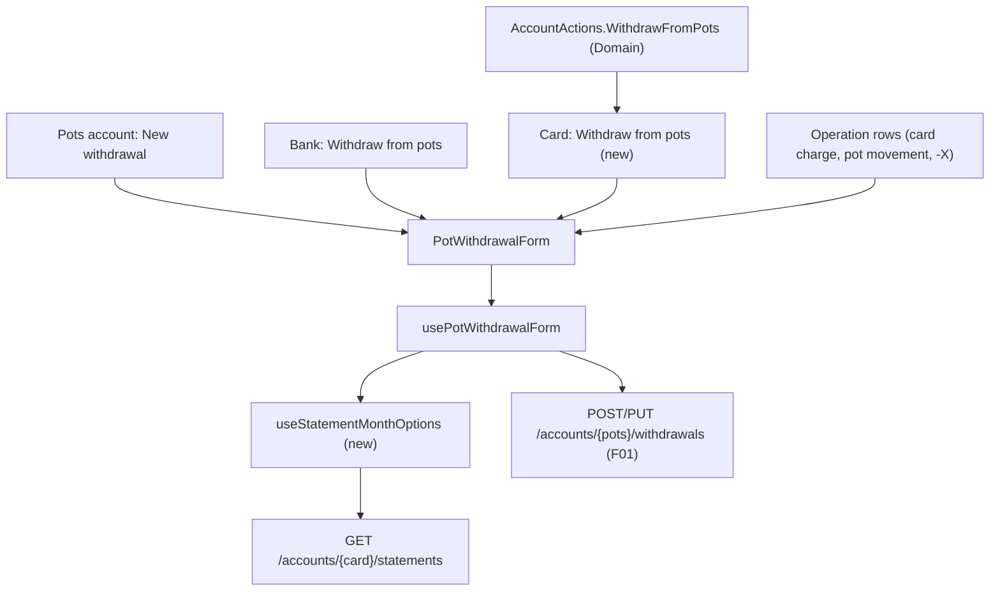

# Spec: Withdraw Forms on Pots Account and Card

**Complexity:** simple (one domain rule widened; the existing Withdraw form gains a payment choice, a card path and a locked edit; no API or DTO change)

## 1. Technical Overview

**What:** The web Withdraw form (`PotWithdrawalForm` + `usePotWithdrawalForm`) learns to pay by credit card through the API F01 shipped. On the Pots account it gets "Paid with: None / Bank / Credit card"; on a card account a new "Withdraw from pots" action opens the same form with the card locked. A card-paid withdrawal picks its statement from a short list of unpaid months, shows its investment withdrawal status when edited (F01/F02), and, once its statement is paid, locks every field the server locks.

**Why:** F01 and F02 made card-paid withdrawals work end to end but only through the API; this is the user-facing entry point (PRD F03).

**Scope:**

*Included*
- Domain: `AccountActions` offers `WithdrawFromPots` on card accounts too.
- Web: "Paid with" radio group; card picker; statement month select; card-screen entry with the card locked; investment withdrawal status line; locked edit and disabled delete when the statement is paid; all form states.
- Input contracts (PRD Consumes): F01's `PotOperationDTO` (`creditCardId`, `statementYear`, `statementMonth`, `investmentWithdrawal`) and request fields; F02's `investmentWithdrawalBankId`, `investmentWithdrawalDate`; card statements read (`GET /accounts/{id}/statements`, `isPaid`).

*Excluded*
- Nothing-due settlement (F04).
- Row navigation: card-charge rows, pot movements and the −X bank rows already open their operation (`AccountQueryService.OperationLink`, F10), so they need no change.
- Any API or DTO change.

## 2. Architecture Impact

## 3. Technical Decisions

| Decision | Chosen Approach | Alternative Considered | Trade-off |
|---|---|---|---|
| Statement picker | Select of the expense date's month and the next 3 months, leaving out months whose statement the card has paid; an edited operation's current month is always listed (user, 2026-11-21) | Free month input | No path to a paid or earlier statement from the form; months more than 3 ahead need the Move charge action |
| Paid edit | When `investmentWithdrawal` is `Done`, Pot, Date, Amount, Paid with, Card and Statement render as read-only values with "Unmark the statement paid to change these."; Description and Category stay editable; Delete is disabled with the same reason (user, 2026-11-21) | Leave editable and rely on the 400 | Matches F01's server locks, so the form never offers a change the server refuses |
| Card-screen action | Reuse `AccountAction.WithdrawFromPots`, allowed for `CanPayBills` **or** `HasStatements`; the web opens it with the screen's bank or card locked, by the account's capability | A new `WithdrawFromPotsByCard` action | One action and label ("Withdraw from pots") for both screens, as the PRD names it |
| Payment choice | Fluent `RadioGroup` (horizontal, reflows to vertical when narrow) "Paid with": None, Bank, Credit card; default None; edit opens on the operation's choice | Extend the bank Select with card options | The PRD names the three choices; a radio shows them at once and keeps bank and card pickers separate |
| Statement list source | New hook `useStatementMonthOptions(cardId, date, currentMonth)` reading `apiClient.getAccountStatements(cardId)` | A new endpoint | The read exists and already returns `isPaid` per month |
| Status line | Read-only text on an edited card operation: "Investment withdrawal: Pending — taken when the November 2026 statement is paid" or "Investment withdrawal: Done — Barclays, 21 Nov 2026" | Badge with colour | Text only, so meaning is not carried by colour |

## 4. Component Overview

**Backend**

| File Path | New/Modified | Purpose | Key Responsibilities |
|---|---|---|---|
| `Financial.CashFlow.Domain/Rules/AccountActions.cs` | Modified | Allowed actions | `WithdrawFromPots` when the account `CanPayBills` or `HasStatements` |

**Frontend**

| File Path | New/Modified | Purpose | Key Responsibilities |
|---|---|---|---|
| `Financial.Web/src/hooks/useStatementMonthOptions.ts` | New | Statement choices | Loads the card's statements; returns the expense month and the next 3 months minus paid ones (plus the current value on edit); loading and error with retry |
| `Financial.Web/src/hooks/usePotWithdrawalForm.ts` | Modified | Form model | Values gain `paidWith` (`none`/`bank`/`card`), `creditCardId`, `statementMonth` (`yyyy-MM`); `openFromCard(cardId)`; edit maps the operation's card fields; validation per choice; request maps to `bankId` or `creditCardId` + `statementYear/Month`; `isLocked` from `investmentWithdrawal === 'Done'`; switching "Paid with" keeps Pot, Date, Description, Amount and clears the other choice's fields |
| `Financial.Web/src/components/PotWithdrawalForm.tsx` | Modified | Form view | Paid with radio (Pots account and edit), card Select (active cards only; Credit card disabled with hint "No active credit card." when none), Statement Select, Category for bank or card; locked card shown with `LockedValue`; status line; locked fields as `LockedValue` with the reason |
| `Financial.Web/src/hooks/useAccountActionForms.ts` | Modified | Action wiring | `WithdrawFromPots` opens from the card when the screen account has statements, else from the bank |
| `Financial.Web/src/pages/AccountScreenPage.tsx` | Modified | Screen wiring | Passes the screen's card as `lockedCard`; Delete disabled with the paid reason when the form is locked |

**Docs:** `context.md` — the card-paid paragraph says the Withdraw forms offer the card.

### Rules in detail

- **Validation (client, before save):** Pot, Date, Description, Amount as today; Paid with = Bank → Bank and Category required ("Category is required when a bank is selected."); Paid with = Credit card → Card required ("Choose a card."), Statement required ("Choose a statement."), Category required ("Category is required when a credit card is selected."). The server stays the authority (F01 messages shown in the form's error alert).
- **Statement options:** from the first of the date's month, the next 4 months; a month is left out when the card's statements read has that month with `isPaid`; label "November 2026"; default the date's month if offered, otherwise the first offered month. Changing the date or card re-selects the default unless the user picked a month.
- **Locked edit:** read-only values are formatted as on the screens (pot name, `21 Nov 2026`, `£120.00`, "Credit card", card name, "November 2026"); the request still sends the unchanged values so the server accepts it.
- **States:** initial (opened from Pots account: None; from card: card locked, statement default); loading (pots and statements load, Save disabled, selects `aria-busy`); validation (inline per field, first invalid focused); server error (alert, values kept); saving (fieldset disabled, Saving…); success (form closes, screen refreshes, toast "Withdrawal saved" as today); unsaved changes (existing discard prompt covers the new fields); statements load error (ErrorState with Try again under the Statement field); disabled Credit card radio with hint when there are no active cards.

## 5. API Contracts

No change. The form uses F01's request fields (`creditCardId`, `statementYear`, `statementMonth`) and response fields (`creditCardId`, `statementYear`, `statementMonth`, `investmentWithdrawal`) and F02's `investmentWithdrawalBankId`, `investmentWithdrawalDate`; statement choices use `GET /api/v1/financial/accounts/{cardId}/statements` (`year`, `month`, `isPaid`).

## 6. Data Model

None.

## 7. Testing Strategy

| Test File | Type | Target |
|---|---|---|
| `Tests/Financial.CashFlow.Domain.Tests/Rules/AccountActionsTests.cs` | Unit | Card accounts allow `WithdrawFromPots` |
| `Financial.Web/src/hooks/__tests__/useStatementMonthOptions.test.ts` | Unit | Window, paid months removed, current value kept, loading/error/retry |
| `Financial.Web/src/hooks/__tests__/usePotWithdrawalForm.test.ts` | Unit | Paid with switching, request mapping, validation per choice, openFromCard, edit mapping, locked |
| `Financial.Web/src/components/__tests__/PotWithdrawalForm.test.tsx` | Unit | Radio, card and statement fields, disabled Credit card hint, status line, locked view |
| `Financial.Web/src/pages/__tests__/AccountScreenPage.test.tsx` | Page | Card screen action, locked delete |

**Acceptance (each tagged `[AC <id>]`)**

| Test | AC |
|---|---|
| `PotWithdrawalForm.test.tsx` "Paid with shows Bank, or Card and Statement, and Category; switching keeps the shared fields" | P62-F03-withdraw-forms-on-pots-account-and-card-01 |
| `AccountScreenPage.test.tsx` "Withdraw from pots on a card sends the same request as the Pots account, card locked" | -02 |
| `useStatementMonthOptions.test.ts` "leaves out paid months" + `PotWithdrawalForm.test.tsx` "no active card disables Credit card with its hint" | -03 |
| `AccountScreenPage.test.tsx` "card charge, pot movement and −X rows open the operation; locked edit and delete" | -04 |
| `PotWithdrawalForm.test.tsx` / `AccountScreenPage.test.tsx` states, keyboard and narrow layout + review checklist | -05 |
| `AccountScreenPage.test.tsx` "a withdrawal saved from the Pots account and from the card send identical requests" | P62-CF-cross-feature-02 |
| `PotWithdrawalForm.test.tsx` "status reads Done with bank and date, Pending again after unmark" | P62-CF-cross-feature-03 |

## Assumptions and decisions

- Statement window: the expense month plus 3 (user, 2026-11-21).
- Locked edit when `investmentWithdrawal` is `Done` (user, 2026-11-21); F04's settled statements also read `Done`, so they lock the same way.
- `WithdrawFromPots` reuses one action for bank and card screens (spec-writer recommendation).
- From the bank screen the form stays as today (bank locked, no Paid with choice).
- Browser check on a dev data copy is part of the UI completion rule.

## Implementation notes (deviations)

- Field order follows `docs/ui/forms-data-and-visualisations.md` "Default field order" (UI review): Pots account (when opened from a bank or card), Date, Pot, Paid with, Bank or Card + Statement, Category, Description, Amount. The previous form put Pot before Date.
- On a paid statement the record's own values (Date, Pot, Paid with, Card, Statement, Amount) render as `ReadOnlyInput` fields ("Read-only values"); `LockedValue` stays for the fixed context (the bank or card the form was opened from). The note reads "Its card statement is paid. Unmark the statement to change it." (the app's existing wording), and Delete stays focusable but inert with the tooltip "Unmark the statement to delete this withdrawal." (`PotFormFooter.deleteBlockedReason`).
- The statement-month window lives in `utils/statementMonths.ts` (`statementMonthOptions`, built on `unpaidStatementMonths`), which `useMoveChargeForm` now shares; the hook reuses `STATEMENTS_LOAD_ERROR` from `useCardStatements`.
- The form model exposes `isPaymentLocked` (opened from a bank or card) and `isStatementPaidLocked` (investment withdrawal `Done`) instead of `isBankLocked`.
