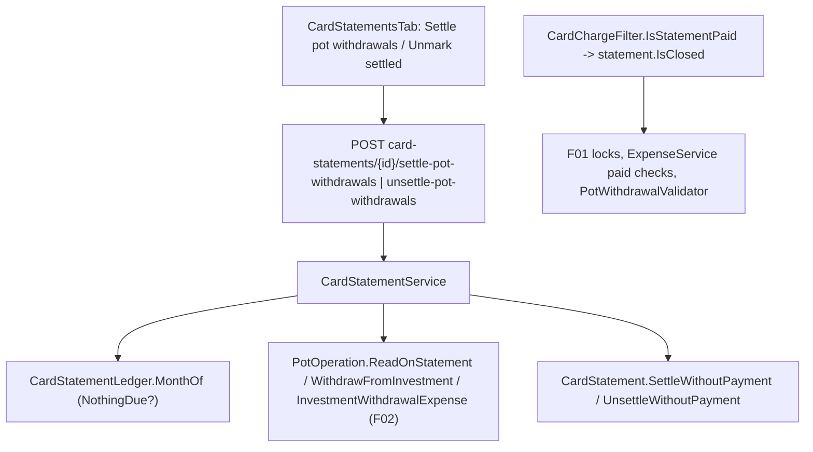

# Spec: Settle a Nothing-Due Statement

**Complexity:** medium (one optional persisted field; two new endpoints; the paid-statement rule widened; a new form on the card Statements tab)

## 1. Technical Overview

**What:** A card statement that card credit fully covers ("Nothing due") cannot be marked paid, so the investment withdrawals of its card-paid pot charges (F02) would never be written. F04 lets the user settle such a statement: choose a bank and a date, and the app writes the same −X records F02 writes at payment, marks the statement settled, and writes no card payment. "Unmark settled" removes them.

**Why:** Without it a pot charge on a credit-covered statement stays `Pending` forever and the Pots category never nets out (PRD F04).

**Scope:**

*Included*
- Domain: `CardStatement.SettledOn` (optional date), `SettleWithoutPayment(date)` / `UnsettleWithoutPayment()`, `IsClosed` (paid or settled); the paid-statement rule (`CardChargeFilter.IsStatementPaid`) uses `IsClosed`.
- Application: `SettlePotWithdrawalsAsync` and `UnsettlePotWithdrawalsAsync` on `CardStatementService`; statement reads report `settledOn`.
- API: `POST card-statements/{id}/settle-pot-withdrawals`, `POST card-statements/{id}/unsettle-pot-withdrawals`.
- Infrastructure: `SettledOn` left out of the data file when empty.
- Web: on the card Statements tab, "Settle pot withdrawals" (form: Bank, Date, the lines and their total) and "Unmark settled" (confirmation); status "Settled — pot withdrawals only".
- Input contract (PRD Consumes F02): `PotOperation.ReadOnStatement`, `PotOperation.WithdrawFromInvestment(bank, date)` and `InvestmentWithdrawalExpense` — the same write and removal F02 uses at payment.

*Excluded*
- Settling a statement that has an amount to pay (that is Mark paid).
- Partial settlement or several banks.

## 2. Architecture Impact



## 3. Technical Decisions

| Decision | Chosen Approach | Alternative Considered | Trade-off |
|---|---|---|---|
| How "settled" is stored | New optional `CardStatement.SettledOn` (date the user picked); `IsPaid` stays false | Set `IsPaid` with no transfer | `IsPaid` without a transfer is the legacy "settled charges" shape: `CardStatementLedger` would show it Paid and stop carrying the leftover credit forward. A separate field leaves the ledger's credit arithmetic untouched |
| Stored vs derived | Stored marker (the PRD says so) | Derive "settled" from all pot charges being `Done` | A derived rule would need every paid-statement check to read expenses too; the marker is one fact the user created |
| Paid-statement rule | `CardStatement.IsClosed => IsPaid \|\| SettledOn is not null`; `CardChargeFilter.IsStatementPaid` checks `IsClosed` | Add a second check at each call site | One place: F01's locks (`PotOperation.IsOnPaidStatement`), F01's paid-statement rejection, `ExpenseService`'s add/move/edit refusals and the transactions grid all treat a settled statement as paid, as the PRD requires |
| Where the rule lives | `SettleWithoutPayment` on `CardStatement` (rejects when already paid or settled); the "nothing due" and "has a pending pot withdrawal" checks in the service, which already reads the ledger | All in the service | Entity guards its own state; the ledger is an Application read today (mark paid does the same) |
| Bank and date of a settlement | Kept on the −X records (as F02); the statement stores only `SettledOn` | Store the bank on the statement | The operation already reports `investmentWithdrawalBankId/Date`; no duplicate |
| Mark paid on a settled statement | Rejected: 409 "This statement is settled; unmark it first." | Allow | A settled statement has nothing to pay; the rule keeps the two states exclusive |
| Two stages | 4a backend (domain, service, API, contract); 4b web | One PR | Keeps each PR near the size target |

## 4. Component Overview

**Backend (stage 4a)**

| File Path | New/Modified | Purpose | Key Responsibilities |
|---|---|---|---|
| `Financial.CashFlow.Domain/Entities/CardStatement.cs` | Modified | State | `SettledOn`; `IsClosed`; `SettleWithoutPayment(date)` (throws when paid or already settled); `UnsettleWithoutPayment()` (throws when not settled) |
| `Financial.CashFlow.Domain/Rules/CardChargeFilter.cs` | Modified | Paid rule | `IsStatementPaid` uses `IsClosed` |
| `Financial.CashFlow.Infrastructure/Persistence/CashFlowTypeInfoResolver.cs` | Modified | Persistence | `CardStatement.SettledOn` omitted when null; `IsClosed` never written |
| `Financial.CashFlow.Application/Services/CardStatementService.cs` | Modified | Use cases | `SettlePotWithdrawalsAsync(id, request)`, `UnsettlePotWithdrawalsAsync(id)`; mark paid rejects a settled statement |
| `Financial.CashFlow.Application/Interfaces/ICardStatementService.cs` | Modified | Contract | The two methods |
| `Financial.CashFlow.Application/DTOs/SettlePotWithdrawalsDTO.cs` | New | Request | `PaymentSourceBankId`, `Date` (optional, default today) |
| `Financial.CashFlow.Application/DTOs/CardStatementDTO.cs`, `AccountStatementDTO.cs` | Modified | Responses | `SettledOn` |
| `Financial.CashFlow.Application/Services/AccountQueryService.cs` | Modified | Statement read | Fills `SettledOn` |
| `Financial.Api/Controllers/CardStatementsController.cs` | Modified | Routes | `settle-pot-withdrawals`, `unsettle-pot-withdrawals` with XML docs (they feed OpenAPI) |

**Frontend (stage 4b)**

| File Path | New/Modified | Purpose | Key Responsibilities |
|---|---|---|---|
| `Financial.Web/src/api/financialApiClient.ts`, `src/api/types.ts` | Modified | Client | `settlePotWithdrawals(id, request)`, `unsettlePotWithdrawals(id)`; type alias |
| `Financial.Web/src/hooks/useCardStatements.ts` | Modified | State | Settle form (bank, date, saving, errors) and unsettle confirmation, mirroring pay/unmark |
| `Financial.Web/src/components/SettlePotWithdrawalsForm.tsx` | New | Form | Inline panel like the Pay form: Bank, Date, the `StatementPotWithdrawalsNote` lines and a bold total; Save "Settle pot withdrawals" |
| `Financial.Web/src/components/CardStatementsTab.tsx` | Modified | Rows | Row action "Settle pot withdrawals" on a Nothing due row with pot withdrawals and no `settledOn`; status "Settled — pot withdrawals only" and "Unmark settled" on a settled row |

**Docs:** `context.md` (the card-paid paragraph gains the settlement).

### Rules in detail

- **Settle** (`POST /card-statements/{id}/settle-pot-withdrawals`):
  1. Statement not found → 404.
  2. Already paid or settled → 409 "This statement is already paid or settled.".
  3. Ledger month not `NothingDue` → 409 "This statement now has an amount to pay; mark it paid instead.".
  4. No card-paid pot withdrawal on it (`ReadOnStatement` empty) → 400 "This statement has no pot withdrawals to settle.".
  5. Bank unknown / cannot pay → 400 (today's mark-paid messages); date in the future → 400 (today's `TransactionDateRule` message).
  6. Build each operation's `WithdrawFromInvestment(bank, date)` before saving (a Pots account with no category → 400 "Set a category on <Pots account> first.").
  7. One `ApplyAndSaveAsync`: add every −X, `statement.SettleWithoutPayment(date)`.
- **Unsettle** (`POST /card-statements/{id}/unsettle-pot-withdrawals`): not settled → 409 "This statement is not settled."; otherwise one save deletes each operation's investment withdrawal expense and clears `SettledOn`.
- **Card balance:** no transfer is written; amount to pay, credit in and credit carried are unchanged (ledger untouched).
- **After settling:** new charges, moves and edits onto the statement get today's paid-statement refusals; the pot withdrawals read `Done` and lock (F01/F03).
- **Reporting:** the −X records carry `ReportingMonth` = the statement month, exactly as F02.

## 5. API Contracts

**`POST /api/v1/financial/card-statements/{id}/settle-pot-withdrawals`** → 200 `CardStatementDTO`

| Field | Type | Required | Validation | Description |
|---|---|---|---|---|
| `paymentSourceBankId` | uuid | Yes | an account that can pay | Bank the investment withdrawals land on |
| `date` | date | No | not in the future | Default today |

```json
{ "paymentSourceBankId": "5db5c88d-4ffb-4392-a966-333f8ac77dd1", "date": "2026-11-21" }
```

**`POST /api/v1/financial/card-statements/{id}/unsettle-pot-withdrawals`** → 200 `CardStatementDTO`

**Responses:** `CardStatementDTO` and `AccountStatementDTO` add `settledOn` (date?, null unless settled).

**Errors**

| Case | HTTP | Message |
|---|---|---|
| Unknown statement | 404 | Existing not-found problem |
| Already paid or settled | 409 | "This statement is already paid or settled." |
| Has an amount to pay | 409 | "This statement now has an amount to pay; mark it paid instead." |
| No pot withdrawals | 400 | "This statement has no pot withdrawals to settle." |
| Pots account without category | 400 | "Set a category on <Pots account> first." |
| Future date / unknown bank | 400 | Existing messages |
| Unsettle when not settled | 409 | "This statement is not settled." |
| Mark paid on a settled statement | 409 | "This statement is settled; unmark it first." |

## 6. Data Model

| Record | Field | Type | Stored | Notes |
|---|---|---|---|---|
| `CardStatement` | `SettledOn` | date | Only when set | Omitted when null; no data file version change |

## 7. Testing Strategy

| Test File | Type | Target |
|---|---|---|
| `Tests/Financial.CashFlow.Domain.Tests/Entities/CardStatementTests.cs` | Unit | Settle/unsettle guards, `IsClosed` |
| `Tests/Financial.CashFlow.Domain.Tests/Rules/CardChargeFilterTests.cs` | Unit | A settled statement counts as paid |
| `Tests/Financial.CashFlow.Application.Tests/Services/CardStatementServiceTests.cs` | Unit | Every rule in §4, one save, failed spans |
| `Tests/Financial.CashFlow.Infrastructure.Tests/Persistence/CashFlowDataConverterTests.cs` | Integration | `SettledOn` round-trip, omitted when null |
| `Tests/Financial.Api.Tests/Acceptance/SettleNothingDueStatementAcceptanceTests.cs` | Integration (new) | PRD criteria |
| `Financial.Web/src/components/__tests__/SettlePotWithdrawalsForm.test.tsx`, `CardStatementsTab.test.tsx`, `src/hooks/__tests__/useCardStatements.test.ts` | Unit | Action visibility, form, states, unsettle |

**Acceptance**

| Test | AC |
|---|---|
| `CardStatementsTab.test.tsx` "[AC …-01] offers Settle pot withdrawals only on a Nothing due statement with pending pot withdrawals" | P62-F04-settle-a-nothing-due-statement-01 |
| `Settle_WritesMinusXOnTheChosenBankAndDate_NoTransfer_CreditUnchanged` | -02 |
| `Unsettle_RemovesMinusX_StatementNothingDueAgain` | -03 |
| `Settled_RejectsNewCharges_AmountToPay409_FutureDate400` | -04 |
| `Settle_WritesRecordsLikeStatementPayment` (category, operation id, reporting month) | P62-CF-cross-feature-04 |

## Assumptions and decisions

- Settlement is stored as `SettledOn`, not `IsPaid` (ledger credit stays right); a settled statement is "closed" for every paid-statement rule (spec-writer decision, PRD F04 Capabilities).
- Two stages, two PRs (size target): 4a backend + contract, 4b web.
- The settle form mirrors the Pay form (inline panel, Bank then Date), and reuses `StatementPotWithdrawalsNote` for the lines.
