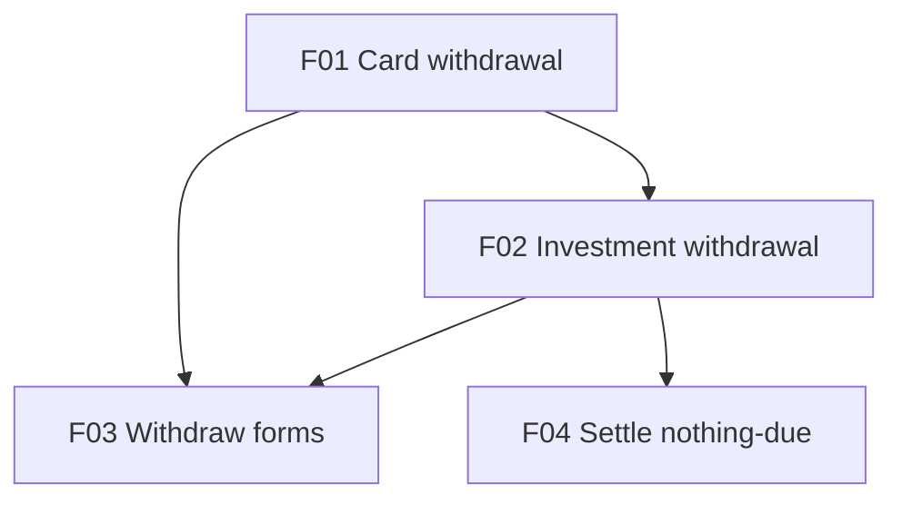

# Pot Withdrawal by Credit Card

## 1. Executive Summary

Pot Withdrawal by Credit Card lets a Pots account withdrawal be paid with a credit card instead of a bank. Some expenses that the user funds from a pot (for example a holiday or a car repair kept in the Reserva) are bought on a credit card. The money leaves the pot the day the expense is made, but it only leaves the investment that backs the pots when the card statement holding that charge is paid. Today the withdrawal form offers "Through bank" only, so a card-paid pot expense has to be recorded by hand as an unlinked pot movement plus a card charge, and the investment side is adjusted later from memory.

It is for the single user of this self-hosted tool, who records household cash flow across UK banks and credit cards and keeps savings in Pots accounts (P60 F09/F10). The withdrawal becomes one linked operation: the pot goes down by X on the expense date, a card charge of +X in the chosen category lands on the statement month/year the user picks, and when that statement is paid from a bank the app writes the matching −X in the Pots account's category on that bank on the payment date. Category totals follow the credit card rule: both the +X and the −X count in the statement month.

P62 builds on P60 (`docs/prd/P60-prd-cashflow-accounts-generalization/prd-cashflow-accounts-generalization.md`): F08 (card statements paid by one bank→card transfer, unmark paid removes it), F10 (linked deposit and withdrawal operations sharing one operation id) and the 2026-10-25 decision that every card charge counts in its statement month for category totals and tithe. Today's no-bank and through-bank withdrawals are unchanged. New link fields are optional and left out of the data file when empty, so the data file stays at its current version.

## 2. Problem and Opportunity

### The Problem

**Card-paid pot expenses cannot be recorded as a withdrawal**
- The Withdraw form (`PotWithdrawalForm.tsx`) offers no bank or one bank; a credit card is not a choice
- The user records the pot movement and the card charge separately, so the two are not linked: editing or deleting one leaves the other behind
- The F10 409 rule ("This expense belongs to a pot deposit or withdrawal") does not protect these hand-made pairs

**The investment withdrawal happens at the wrong time or not at all**
- A through-bank withdrawal writes bank −X in the Pots account's category on the expense date, but for a card expense the money only leaves the investment when the statement is paid, typically 2–6 weeks later
- Recording it on the expense date makes the paying bank's balance wrong for that whole period
- Forgetting it leaves the Pots category total overstated (deposits − withdrawals misses X)

**Category totals split across months**
- A card charge counts in its statement month; a hand-entered investment withdrawal on the payment date often lands in the following month
- The chosen category shows +X in month M while the Pots category shows −X in month M+1, so neither month's Summary is right

**A statement covered by card credit has no payment to hang the withdrawal on**
- A statement whose charges are fully covered by card credit (a refund) has nothing to pay and cannot be marked paid (`"There is nothing to pay on this statement."`)
- A pot charge on such a statement has no moment at which the investment withdrawal could be recorded

### The Opportunity

- **Linked card withdrawal** (F01): one operation writes the pot −X and the card charge +X on a chosen statement month, linked by one operation id, so edit and delete act on both together.
- **Investment withdrawal on statement payment** (F02): marking the statement paid from a bank writes the −X in the Pots account's category on that bank on the payment date; unmarking removes it. The bank balance is right on every day.
- **Statement-month reporting** (F01, F02): the +X and the −X both count in the statement month, so each month's Summary nets the withdrawal as a bank withdrawal does today.
- **Settle a nothing-due statement** (F04): the user picks a bank and a date to record the investment withdrawals of a fully credit-covered statement, without a card payment.
- **Both entry points** (F03): the Pots account's Withdraw form gets "Paid with" (none / bank / credit card) and the card screen gets "Withdraw from pots", writing the same records.

## 3. Target Audience

### Primary Users

**Household finance keeper (single user)**
- Funds planned spending (holidays, repairs, gifts) from pots and often pays it with one of 5 credit cards
- Pays each card statement from a UK bank once a month and wants bank balances right on every day
- Reads Summary category totals per month and expects a pot-funded expense to net out in the month it is reported

## 4. Objectives

### Product Objectives

1. **Record** a card-paid pot withdrawal as one linked operation from either the Pots account or the card
2. **Withdraw** from the investment exactly when the statement holding the charge is paid, on the paying bank
3. **Report** both sides of the withdrawal in the statement month
4. **Cover** statements with nothing to pay, so no pot charge is left without its investment withdrawal

### Success Metrics

| Objective | Metric | Measurement |
|---|---|---|
| Record | 1 save writes pot −X and card +X with the same operation id; 0 hand-made pairs needed | Acceptance tests on the withdrawal service and the Withdraw form |
| Withdraw | 1 Pots-category −X expense per pot charge exists after mark paid, 0 after unmark paid; it is on the paying bank with the payment date | Acceptance tests on mark/unmark statement paid |
| Report | For a statement month M paid in M+1, the Summary of M shows +X in the chosen category and −X in the Pots category; M+1 shows neither | Summary acceptance test across the month boundary |
| Cover | 100% of pot charges on a settled nothing-due statement get their −X; 0 card payment transfers written | Acceptance test on settle nothing-due |

## 5. User Stories

### F01. Card-Paid Pot Withdrawal
- As the user, I want to withdraw from a pot paid with a credit card so that the pot goes down on the day I spend
- As the user, I want to choose the statement month/year of the charge so that it lands on the right statement, defaulting to the month of the expense date
- As the user, I want the pot movement and the card charge linked so that editing or deleting the withdrawal changes both
- As the user, I want the charge to count in its statement month in category totals so that it follows the credit card rule
- As the user, I want to see that the investment withdrawal is pending until the statement is paid so that I know the investment has not moved yet
- As the user, I want to move the charge to a later unpaid statement so that the pending investment withdrawal follows it

### F02. Investment Withdrawal on Statement Payment
- As the system, I want marking a statement paid to write −X in the Pots account's category on the paying bank for each pot charge on it so that the investment withdrawal happens when the money leaves
- As the user, I want unmarking the statement paid to remove those expenses so that the operation returns to pending
- As the user, I want that −X to count in the statement month so that the Pots category and the chosen category net in the same month
- As the user, I want the amount, date, pot, card and statement locked once the statement is paid so that the paid statement stays consistent

### F03. Withdraw Forms on Pots Account and Card
- As the user, I want a "Paid with" choice on the Pots account's Withdraw form so that I pick none, a bank or a credit card
- As the user, I want "Withdraw from pots" on the card screen so that I can start the withdrawal from the card, as I can from a bank
- As the user, I want the card charge row and the pot movement row to open the operation so that I edit it in one place

### F04. Settle a Nothing-Due Statement
- As the user, I want to settle a statement that has nothing to pay by choosing a bank and a date so that its pot charges get their investment withdrawal
- As the user, I want to undo that settlement so that I can correct the bank or date

## 6. Functionalities

### F01. Card-Paid Pot Withdrawal

**Provides:**
- Card-paid withdrawal operations: operation id, Pots account, pot, amount X, expense date, description, chosen category, card, statement month/year, investment withdrawal status (pending / done) (used by F02, F03)

**Capabilities:**
- **Records at save (linked, one operation id):** pot movement −X on the expense date; card charge +X in the chosen category on the chosen card, charge date = expense date, statement month = the chosen month/year. No bank record is written. *Why:* the money leaves the pot when the expense is made; it leaves the investment only when the statement is paid (F02).
- **Statement month/year:** required when paying by card; defaults to the month of the expense date; month 1–12, year 4 digits. The statement must not be paid (400 "This statement is already paid; choose a later month."), and must not be earlier than the month of the expense date (400 "The statement can't be before the expense date.").
- **Card:** an active account with the credit card template; an inactive card is rejected (400, today's message).
- **Category:** the same rules as a through-bank withdrawal: required; default the category named like the pot; inactive, investment and any account's category are rejected on the server and the web.
- **Amount and date:** amount > 0 with 2 decimals; date not in the future (today's `TransactionDateRule`). A pot overdraft needs confirmation (409 without it, as today).
- **Tithe:** the +X charge counts toward tithe as a through-bank withdrawal's +X does today (statement month, `ReportingDate`).
- **Category totals:** the +X counts in its statement month, like every card charge; it adds to the card's amount to pay for that statement.
- **Investment withdrawal status:** "Pending" while the statement is unpaid; "Done" once F02 or F04 wrote the −X. Derived from the records, not stored.
- **Edit before the statement is paid:** every field is editable, including switching "Paid with" to none or a bank (the card charge is removed and today's records are written) and from none or a bank to a card. Moving the charge to a later unpaid statement uses today's Move charge rule and keeps the operation link.
- **Edit after the statement is paid:** amount, date, pot, card and statement are locked (400 "Unmark the statement paid to change this."); description and category stay editable and apply to every record of the operation.
- **Delete:** allowed while the statement is unpaid (removes pot movement and charge); once paid, 400 "Unmark the statement paid before deleting this withdrawal."
- **Single records:** editing or deleting the card charge or pot movement on its own returns today's F10 409 ("This expense belongs to a pot deposit or withdrawal; edit it from the Pots account.").
- **Data:** the card charge carries the operation id (field already optional); no new required field; the data file version does not change.

**Experience:**
- The operation's detail (opened from any of its rows) shows Pot, Date, Description, Amount, Category, Card, Statement (e.g. "Mar 2027") and "Investment withdrawal: Pending — taken when the Mar 2027 statement is paid" or "Investment withdrawal: Done — Barclays, 4 Apr 2027".
- The card screen lists the charge under its statement like any charge; the Pots account's Transactions tab lists the movement; both open the operation.

**Error Handling:**
- Paid statement chosen: 400 "This statement is already paid; choose a later month."; the form keeps every value and focuses the statement field.
- Statement before the expense month: 400 "The statement can't be before the expense date."
- Pot overdraft without confirmation: 409 and the confirmation dialog "This takes <pot> below zero (−£12.40). Continue?".
- Save failure: pot movement and card charge saved together or not at all; the form shows "Couldn't save the withdrawal. Try again." and keeps its values.
- Locked field changed after payment: 400 "Unmark the statement paid to change this."

### F02. Investment Withdrawal on Statement Payment

**Consumes:**
- F01: card-paid withdrawal operations (operation id, Pots account, amount X, chosen category, card, statement month/year, description)

**Provides:**
- The investment withdrawal write and its removal, keyed by statement (used by F04)
- Investment withdrawal status done, with bank and payment date (used by F03)

**Capabilities:**
- **Mark statement paid:** in the same save as today's bank→card payment transfer, for each card-paid withdrawal charge on that statement, write a bank expense of −X in the Pots account's category (the category the Pots account has at that moment, as F10) on the paying bank, dated the payment date, description = the withdrawal's description, carrying the withdrawal's operation id.
- **Full X always:** the −X is the full charge amount even when card credit covers part of the statement's amount to pay.
- **Several charges:** each pot charge on the statement gets its own −X expense, linked to its own operation.
- **Reporting month:** the −X counts in the statement month (not the payment date's month) for category totals, the summary's category sum and the annual and historic summaries. The bank balance takes it on the payment date.
- **Unmark statement paid:** removes the payment transfer (as today) and every −X written for that statement, in one save; the operations return to Pending.
- **No Pots category set:** if the Pots account has no category at payment time, marking the statement paid fails with 400 "Set a category on <Pots account> first." and nothing is saved.
- **Legacy settled statements** (paid before F08 by settling charges) cannot hold card-paid withdrawals, because a paid statement is rejected at entry (F01).

**Experience:**
- Mark paid on the card screen is unchanged; its confirmation adds one line per pot charge: "Also takes £120.00 from Reserva (Holiday) on Barclays."
- On the bank screen the −X appears as an expense row in the Pots category; it opens the operation (Edit/Delete as F01's paid rules).
- Unmark paid's confirmation adds "This also removes 1 investment withdrawal."

**Error Handling:**
- Pots account has no category: 400 "Set a category on <Pots account> first."; neither the transfer nor any −X is saved.
- Save failure: transfer, statement status and every −X saved together or not at all; "Couldn't mark the statement paid. Try again."
- Unmark failure: nothing is removed; "Couldn't unmark the statement. Try again."
- Direct edit or delete of a −X expense: 409, F10's message.

### F03. Withdraw Forms on Pots Account and Card

**Consumes:**
- F01: card-paid withdrawal operations and their investment withdrawal status
- F02: investment withdrawal status done, with bank and payment date

**Capabilities:**
- **Pots account → Withdraw:** fields Pot, Date, Description, Amount, Paid with (radio: None, Bank, Credit card; default None), then Bank (when Bank), or Card and Statement month (month picker, default the expense date's month, paid statements not offered) (when Credit card), and Category (when Bank or Credit card). Switching "Paid with" keeps Pot, Date, Description and Amount.
- **Card screen → Withdraw from pots:** a card action next to Add charge; fields Pots account (only active Pots accounts; preselected when there is one), Pot, Date, Description, Amount, Statement month, Category; the card is locked to the screen's card. Saves the same records as the Pots account form.
- **Rows:** the card charge, the pot movement and the −X bank expense each open the operation; Edit and Delete apply to the whole operation and follow F01's locks.
- **Inactive cards** are not offered; when there are no active cards, the Credit card option is disabled with the hint "No active credit card."

**Experience:**
- States: loading (the form's lists load, Save disabled), validation (inline per field, the first invalid field focused on Save), saving (Save shows progress and is disabled), success (dialog closes, the screen refreshes, toast "Withdrawal saved"), server error (message in the dialog, values kept), unsaved changes (closing with edits asks "Discard changes?").
- The operation detail shows the investment withdrawal status from F01/F02 in text, not only by colour.
- Keyboard operable, visible focus, labelled controls; no horizontal scroll at narrow width; Fluent 2 components only.

### F04. Settle a Nothing-Due Statement

**Consumes:**
- F02: the investment withdrawal write and its removal, keyed by statement

**Capabilities:**
- **When offered:** on a statement whose status is Nothing due and that holds at least one card-paid withdrawal charge with a pending investment withdrawal.
- **Settle:** choose a bank (accounts that can pay) and a date (not in the future; default today). Writes, in one save, F02's −X for each pot charge on that statement on the chosen bank and date, and marks the statement settled without a card payment transfer.
- **Card balance:** no card payment is written, so card credit, amount to pay and credit carried are unchanged.
- **Undo:** "Unmark settled" removes every −X written for that statement and returns it to Nothing due.
- **Later charges:** a settled statement counts as paid for F01's rule, so new charges cannot be added to it.
- **Data:** a settled-with-nothing-due statement is stored as an optional marker on the statement (left out when empty); the data file version does not change.

**Experience:**
- The statement row shows "Nothing due" and the action "Settle pot withdrawals"; the dialog lists each pot charge with its amount and the total ("Takes £180.00 from Reserva on the chosen bank.").
- After settling, the row shows "Settled — pot withdrawals only" and "Unmark settled".

**Error Handling:**
- Statement no longer nothing due (a charge was added): 409 "This statement now has an amount to pay; mark it paid instead."
- Pots account has no category: 400 "Set a category on <Pots account> first."
- Future date: 400 today's future-date message.
- Save failure: all −X and the marker saved together or not at all; "Couldn't settle the statement. Try again."

## 7. Out of Scope

**Existing records**
- Converting hand-made card pot pairs recorded before P62 into linked operations; they stay as they are
- Changing today's no-bank and through-bank withdrawals

**Payments and cards**
- Partial statement payments or paying one statement from several banks
- Investment withdrawal on a different bank from the one that pays the statement
- Card-paid pot deposits (only withdrawals)

**Investment side**
- Any change in the Investment bounded context or to investment snapshots; the "investment" here is the Pots account's category expense, as in F10

**Reporting**
- Counting the −X by payment date anywhere in category totals

## 8. Dependency Graph

### Part 1: Dependency Table

| # | Feature | Priority | Dependencies |
|---|---------|----------|--------------|
| F01 | Card-Paid Pot Withdrawal | 1 | None |
| F02 | Investment Withdrawal on Statement Payment | 1 | F01 |
| F03 | Withdraw Forms on Pots Account and Card | 1 | F01, F02 |
| F04 | Settle a Nothing-Due Statement | 2 | F02 |

### Part 3: Execution Waves
Features within the same wave can be built in parallel. A wave starts only after every feature in earlier waves is complete.

- **Wave 1**: F01
- **Wave 2**: F02
- **Wave 3**: F03, F04

### Part 4: Priority levels
- **1** = Essential — product does not work without it
- **2** = Important — significant value addition
- **3** = Desirable — incremental improvement

### Part 5: Diagram

## 9. Acceptance Criteria

### F01. Card-Paid Pot Withdrawal
- [x] **P62-F01-card-paid-pot-withdrawal-01** A withdrawal paid by card writes pot −X on the expense date and a card charge +X in the chosen category on the chosen statement month, both with one operation id, and no bank record
- [x] **P62-F01-card-paid-pot-withdrawal-02** The statement month defaults to the expense date's month; a paid statement or a month before the expense date is rejected with 400 and its message
- [x] **P62-F01-card-paid-pot-withdrawal-03** An inactive card and an excluded category (inactive, investment, any account's category) are rejected; an overdraft returns 409 without confirmation
- [x] **P62-F01-card-paid-pot-withdrawal-04** The +X counts in its statement month in category totals and tithe, and adds to that statement's amount to pay
- [x] **P62-F01-card-paid-pot-withdrawal-05** Before the statement is paid every field can be edited, including switching to none or a bank and back, and delete removes both records; moving the charge to a later unpaid statement keeps the link
- [x] **P62-F01-card-paid-pot-withdrawal-06** After the statement is paid, changing amount, date, pot, card or statement and deleting return 400; description and category changes apply to every record
- [x] **P62-F01-card-paid-pot-withdrawal-07** Editing or deleting the card charge or pot movement on its own returns F10's 409
- [x] **P62-F01-card-paid-pot-withdrawal-08** The operation shows "Investment withdrawal: Pending" until its statement is paid; a failed save writes nothing; the data file version is unchanged

### F02. Investment Withdrawal on Statement Payment
- [x] **P62-F02-investment-withdrawal-on-statement-payment-01** Marking a statement paid from bank B on date D writes, in the same save as the payment transfer, −X in the Pots account's category on B dated D with the withdrawal's operation id, one per pot charge
- [x] **P62-F02-investment-withdrawal-on-statement-payment-02** The −X is the full charge amount even when card credit reduces the amount to pay
- [x] **P62-F02-investment-withdrawal-on-statement-payment-03** A statement for month M paid in M+1: M's category totals show +X in the chosen category and −X in the Pots category; M+1 shows neither; bank B's balance changes on D
- [x] **P62-F02-investment-withdrawal-on-statement-payment-04** Unmarking the statement paid removes the transfer and every −X in one save, and the operation returns to Pending
- [x] **P62-F02-investment-withdrawal-on-statement-payment-05** With no category on the Pots account, marking paid returns 400 and saves nothing
- [x] **P62-F02-investment-withdrawal-on-statement-payment-06** The mark-paid and unmark-paid confirmations list the investment withdrawals they add or remove

### F03. Withdraw Forms on Pots Account and Card
- [x] **P62-F03-withdraw-forms-on-pots-account-and-card-01** The Pots account's Withdraw form has "Paid with" (None, Bank, Credit card; default None) showing Bank, or Card and Statement month, and Category as chosen; switching keeps Pot, Date, Description and Amount
- [x] **P62-F03-withdraw-forms-on-pots-account-and-card-02** The card screen's "Withdraw from pots" saves the same records as the Pots account form, with the card locked to the screen's card
- [x] **P62-F03-withdraw-forms-on-pots-account-and-card-03** Paid statements and inactive cards are not offered; with no active card the Credit card option is disabled with "No active credit card."
- [x] **P62-F03-withdraw-forms-on-pots-account-and-card-04** The card charge, pot movement and −X bank expense rows each open the operation, whose Edit and Delete follow F01's locks
- [x] **P62-F03-withdraw-forms-on-pots-account-and-card-05** Loading, validation, saving, success, server-error and unsaved-changes states, keyboard use, visible focus and narrow layout pass the review checklist

### F04. Settle a Nothing-Due Statement
- [x] **P62-F04-settle-a-nothing-due-statement-01** "Settle pot withdrawals" appears only on a Nothing due statement holding a pending card-paid withdrawal charge
- [x] **P62-F04-settle-a-nothing-due-statement-02** Settling with bank B and date D writes each charge's −X on B dated D and marks the statement settled, with no card payment transfer and no change to the card's credit or amount to pay
- [x] **P62-F04-settle-a-nothing-due-statement-03** "Unmark settled" removes every −X and returns the statement to Nothing due
- [x] **P62-F04-settle-a-nothing-due-statement-04** A settled statement rejects new charges; a statement that now has an amount to pay returns 409; a future date returns 400

### Cross-Feature Integration
- [x] **P62-CF-cross-feature-01** The operation id, amount, category, card and statement month written by F01 are the ones F02 uses for the −X when the statement is paid
- [x] **P62-CF-cross-feature-02** A withdrawal saved from F03's Pots account form and one saved from the card screen produce identical F01 records and are both picked up by F02
- [x] **P62-CF-cross-feature-03** F03's operation detail shows "Done" with F02's bank and payment date after mark paid, and "Pending" again after unmark
- [x] **P62-CF-cross-feature-04** F04 writes −X records indistinguishable from F02's (category, operation id, statement-month reporting) and removes them through the same rule
