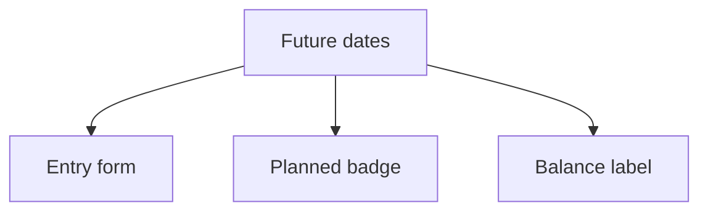

# Planned Entries in Single-Currency Settlement Accounts

## 1. Executive Summary

Planned Entries lets a Settlement account (P60 F11/F12, the `HasParticipants` capability) take entries dated after today, so the user can record what is going to be paid between them and the other participant before the date arrives. A typical case: after opening a Settlement account with Samuel, the user adds the amounts planned for the coming months up front instead of waiting for each month to come.

It applies only to Settlement accounts that use **one currency**. A multi-currency Settlement account (for example Mãe, BRL + GBP) keeps refusing future dates, because every entry there gets its converted value from the historical exchange rate on its date, and no rate exists for a date that has not happened yet.

A planned entry is an ordinary Settlement entry with a later date. It counts in the account's current balance and in the Settle amount from the moment it is saved, so the balance shows where the account is heading. The Settle action can also be dated in the future. In the entries list each future-dated row carries a "Planned" badge until its date arrives. Planned entries are edited and deleted exactly like any other entry. Entries dated today or earlier behave exactly as they do today. No new field is stored: "planned" is derived from the date, and the data file version does not change.

## 2. Problem and Opportunity

### The Problem

**Planned amounts can't be recorded ahead of time**
- Every Settlement entry and every Settle is refused with "Date must not be in the future." (`TransactionDateRule.EnsureNotInFuture` in `SettlementTransaction.Create`/`Update`)
- The web form caps the date field at today (`SettlementEntryForm.tsx`, `max={todayIsoDate()}`)
- An arrangement agreed for the next 6–12 months has to be remembered and typed in month by month, on or after each date

**The account doesn't show where it is heading**
- With only past entries the balance shows what is owed now, not what will be owed once the agreed amounts are paid
- Settling up ahead of an agreed date means working the projected balance out by hand

**The restriction can't simply be removed**
- In a multi-currency Settlement account each entry's converted value comes from the exchange rate on its date
- A future date has no rate, so the converted value would be empty and the balance in the second currency would be wrong

### The Opportunity

- **Record ahead:** future dates are allowed for entries and Settle when the account has one currency, so a whole plan is entered in one sitting.
- **Projected balance:** planned entries count in the current balance and the Settle amount straight away, which already matches how the balance is calculated (`AccountBalanceRule.CurrentBalances` sums every entry with no end date).
- **Safe for currencies:** the multi-currency case keeps today's rule, and an account's currencies are already locked once it has any transaction ("Template and currency can't change once the account has transactions."), so a single-currency account with planned entries can never become multi-currency.
- **Visible:** a "Planned" badge marks each future-dated row, so a plan is never mistaken for something that already happened.

## 3. Target Audience

### Primary Users

**Household finance owner (single user)**
- Shares costs or makes regular payments with one other person per Settlement account (a family member such as Samuel or Mãe)
- Agrees amounts for future months and wants them on record when agreed
- Needs to tell at a glance which entries already happened and which are still planned

## 4. Objectives

### Product Objectives
- **Allow** future-dated entries and Settle in single-currency Settlement accounts
- **Keep** the multi-currency Settlement rule and every other account's date rules unchanged
- **Mark** future-dated Settlement entries as planned in the entries list
- **Document** for later features that Settlement balances include planned entries

### Success Metrics

| Objective | Metric | Measurement |
|---|---|---|
| Allow | 100% of create, update and Settle requests dated after today on a single-currency Settlement account succeed (201/200) | Domain, Application and API acceptance tests |
| Keep | 100% of the existing future-date refusals for multi-currency Settlement accounts, transfers, pot movements, statements and expenses still return 400 with today's message | Existing tests kept green, plus a multi-currency case per operation |
| Mark | Every row dated after today on a Settlement account shows the "Planned" badge; 0 rows dated today or earlier show it | Web component tests with a fixed clock |
| Document | The rule is in this PRD and in the "Settlement accounts" entry of `context.md` | Review of the final PR |

## 5. User Stories

### F01. Future Dates in Single-Currency Settlement Accounts
- As the user, I want to add a Settlement entry dated after today when the account has one currency so that I can record planned amounts in advance
- As the user, I want to change an entry's date to a future date so that I can move a planned payment when the plan changes
- As the user, I want to settle with a future date so that I can record a planned settlement
- As the user, I want the current balance and the Settle amount to include planned entries so that I see where the account is heading
- As the user, I want a multi-currency Settlement account to keep refusing future dates so that no entry is saved without an exchange rate

### F02. Future Dates in the Settlement Entry Form
- As the user, I want the date picker of a single-currency Settlement account to accept dates after today in New entry, Edit entry and Settle so that I can pick a planned date
- As the user, I want the date picker of a multi-currency Settlement account to stay capped at today so that the form tells me the rule before I save
- As the user, I want the saved message to name the month an entry went to when it is not the month I am viewing so that I know where to find it

### F03. Planned Badge in the Settlement Entries List
- As the user, I want each future-dated row in the Settlement entries list to show "Planned" so that I can tell plans from things that already happened
- As the user, I want the badge to disappear on the entry's date without any action from me so that a plan becomes a completed entry by itself
- As the user, I want to edit and delete planned entries exactly like other entries so that I can change the plan
- As the user, I want planned Settlement entries to show "Planned" on the Accounts page's All transactions tab too so that the same entry reads the same everywhere

### F04. Planned Label on the Settlement Balance
- As the user, I want the Settlement header to say when its balance includes planned entries so that I don't read a projected figure as what is owed today

## 6. Functionalities

### F01. Future Dates in Single-Currency Settlement Accounts

**Provides:**
- Settlement entries and settlements dated after today on single-currency accounts, returned by the existing entries and account-detail endpoints with their date (used by F02, F03)

**Capabilities:**
- **Single-currency rule:** an account is single-currency when `Account.Currencies` has exactly 1 currency. This covers every Settlement account without the multi-currency capability, and a multi-currency-capable Settlement account set up with 1 currency.
- **Create entry:** a date after today is accepted on a single-currency Settlement account. On an account with 2 or more currencies it is refused with today's 400 "Date must not be in the future.", before any exchange rate is asked for.
- **Update entry:** the same rule for the new date; moving a planned entry to another future date, to today or to a past date is allowed; on a multi-currency account a future date is refused and nothing changes.
- **Settle:** the same rule for the Settle date. The Settle amount and the "nothing to settle" check use the current balance, which includes planned entries.
- **No upper limit:** any date after today is accepted (the date type's own range only).
- **Balance:** `AccountBalanceRule.CurrentBalances` is unchanged and keeps counting every entry regardless of date. Balances as of a given date (for example month views) keep counting only entries up to that date, so a planned entry appears in those views from its own date.
- **Other rules unchanged:** description required, amount > 0 with 2 decimals, the account must be an active Settlement account, the currency must be one the account uses, a single-currency entry has no converted value.
- **Other account types unchanged:** transfers, pot deposits and withdrawals, card statements and refunds keep `TransactionDateRule.EnsureNotInFuture`.
- **Data:** no new field; "planned" is derived from the date compared with the host's local today; the data file version does not change; the API request and response shapes do not change (the OpenAPI snapshot stays as it is).

**Experience:**
- The API returns 201 for a planned entry or settlement and 200 for an updated one, with the same body as for a dated-today entry.
- The account header's balance and "who owes whom" text include planned entries as soon as they are saved.

**Error Handling:**
- Future date on a multi-currency account (create, update or Settle): 400 "Date must not be in the future."; nothing is saved and no exchange rate is requested.
- Save failure after validation: nothing is written, today's error response is returned and the form keeps its values.
- Update of a missing entry or an entry on another account: today's 404.
- Settle with nothing to settle (current balance including planned entries is 0): today's 400 reason.

### F02. Future Dates in the Settlement Entry Form

**Consumes:**
- F01: acceptance of future dates on single-currency Settlement accounts

**Capabilities:**
- `SettlementEntryForm` (used for New entry, Edit entry and Settle) sets the date input's `max` to today only when the account has 2 or more currencies; with one currency there is no `max`.
- `useSettlementEntryForm` client-side validation shows "Date must not be in the future." for a future date only when the account has 2 or more currencies.
- The form's other fields, defaults (date defaults to today), validation and saving behaviour are unchanged.

**Experience:**
- Single-currency account: the user picks any date in the picker. A saved entry dated in the viewed month appears in the list with the "Planned" badge (F03). An entry saved, edited or settled into another month does not appear in the viewed month's list, so the saved message names that month: "Entry added to December 2026", "Entry updated in January 2027", "Settlement saved in December 2026". In the viewed month the messages stay "Entry added", "Entry updated" and "Settlement saved".
- Multi-currency account: the picker stops at today; a typed future date shows the inline error on the date field, focus moves to it and Save sends nothing.
- A server 400 is shown as the form's save error, as today, and the entered values are kept.

### F03. Planned Badge in the Settlement Entries List

**Consumes:**
- F01: Settlement entries with their dates

**Capabilities:**
- A row is planned when its date is after the local today (`todayIsoDate()`), worked out when the list renders.
- Applies to Settlement entry rows: in a Settlement account's entries list and on the Accounts page's All transactions tab. Other rows and other accounts' grids are unchanged.
- The badge is a Fluent `Badge` with the visible text "Planned", so the meaning is not carried by colour alone; screen readers read "Planned" with the row.
- Planned rows sort with every other row by date, as today; no separate section and no separate total.
- Edit and delete on a planned row are the same row actions, dialogs and confirmations as on any other row.

**Experience:**
- The badge sits at the end of the row's Description cell, after the description, which truncates to make room; rows keep one height in both grids, whose columns share the width equally.
- After midnight on the entry's date, the next render of the list shows the row without the badge; no save or action is needed.
- Deleting a planned entry uses today's delete confirmation; the balance updates as it does for any entry.

### F04. Planned Label on the Settlement Balance

**Consumes:**
- F01: Settlement entries with their dates

**Capabilities:**
- The account detail response says whether the account has any Settlement entry dated after the host's local today (`hasPlannedEntries`); this is an API shape change, so the OpenAPI snapshot and the generated web types are regenerated.
- The header label above the Settlement balance reads "Balance (includes planned)" while that is true, and "Current balance" otherwise. The figure itself is unchanged (F01).
- Other account types keep their header unchanged.

**Experience:**
- Adding the first planned entry, or deleting or moving the last one into the past, updates the label with the next account reload, as the balance already does.

## 7. Out of Scope

**Currencies**
- Future dates in multi-currency Settlement accounts, including estimated or later-filled exchange rates
- Adding a second currency to an account that already has entries (already locked by the account setup rule)

**Balances and reporting**
- A separate "planned" total or a split between today's balance and the projected balance
- Excluding planned entries from the current balance or the Settle amount
- Planned or future-dated records in any account type other than Settlement

**Automation**
- Recurring or repeating planned entries generated from a schedule
- Reminders or notifications when a planned date arrives
- Turning a planned entry into a completed one by hand (it becomes completed by its date alone)

## 8. Dependency Graph

| # | Feature | Priority | Dependencies |
|---|---------|----------|--------------|
| F01 | Future Dates in Single-Currency Settlement Accounts | 1 | None |
| F02 | Future Dates in the Settlement Entry Form | 1 | F01 |
| F03 | Planned Badge in the Settlement Entries List | 2 | F01 |
| F04 | Planned Label on the Settlement Balance | 2 | F01 |

### Execution Waves
Features within the same wave can be built in parallel. A wave starts only after every feature in earlier waves is complete.

- **Wave 1**: F01
- **Wave 2**: F02, F03, F04

### Priority levels
- **1** = Essential — product does not work without it
- **2** = Important — significant value addition
- **3** = Desirable — incremental improvement

## 9. Acceptance Criteria

### F01. Future Dates in Single-Currency Settlement Accounts
- [x] **P63-F01-settlement-future-dates-01** Creating an entry dated tomorrow on a single-currency Settlement account returns 201 and the entry is saved with that date
- [x] **P63-F01-settlement-future-dates-02** Creating an entry dated tomorrow on a multi-currency Settlement account returns 400 "Date must not be in the future." and no exchange rate is requested
- [x] **P63-F01-settlement-future-dates-03** Updating an entry to a future date on a single-currency account returns 200; on a multi-currency account it returns 400 and the entry is unchanged
- [x] **P63-F01-settlement-future-dates-04** Settling with a future date on a single-currency account returns 201; on a multi-currency account it returns 400 "Date must not be in the future."
- [x] **P63-F01-settlement-future-dates-05** The account's current balance includes a planned entry immediately after it is saved
- [x] **P63-F01-settlement-future-dates-06** The Settle amount and the "nothing to settle" check use the balance that includes planned entries
- [x] **P63-F01-settlement-future-dates-07** A balance as of today (for example a month view of the current month) does not include an entry dated next month
- [x] **P63-F01-settlement-future-dates-08** Transfers, pot deposits and withdrawals, card statements and card refunds still refuse future dates with today's message
- [x] **P63-F01-settlement-future-dates-09** The OpenAPI snapshot is unchanged and the data file version is unchanged
- [x] **P63-F01-settlement-future-dates-10** The "Settlement accounts" entry in `context.md` states that single-currency Settlement accounts accept future dates and that planned entries count in the current balance

### F02. Future Dates in the Settlement Entry Form
- [x] **P63-F02-settlement-entry-form-dates-01** On a single-currency Settlement account the date input in New entry, Edit entry and Settle has no `max` and a future date saves
- [x] **P63-F02-settlement-entry-form-dates-02** On a multi-currency Settlement account the date input has `max` set to today and a typed future date shows "Date must not be in the future." on the field without sending a request
- [x] **P63-F02-settlement-entry-form-dates-03** A server 400 on save is shown as the form's error and the entered values are kept
- [x] **P63-F02-settlement-entry-form-dates-04** Saving, editing or settling into a month other than the viewed one names that month in the saved message; within the viewed month the message is unchanged

### F03. Planned Badge in the Settlement Entries List
- [x] **P63-F03-settlement-planned-badge-01** A Settlement entry dated after today shows a "Planned" badge with visible text; an entry dated today or earlier shows none
- [x] **P63-F03-settlement-planned-badge-02** With the clock moved to the entry's date, the same entry renders without the badge
- [x] **P63-F03-settlement-planned-badge-03** A planned entry can be edited and deleted with the same row actions as any other entry
- [x] **P63-F03-settlement-planned-badge-04** Grids of non-Settlement accounts show no "Planned" badge, including for future-dated expenses
- [x] **P63-F03-settlement-planned-badge-05** The badge passes the `docs/ui/review-checklist.md` items for the entries list (text not colour alone, accessible name, zoom)
- [x] **P63-F03-settlement-planned-badge-06** On the Accounts page's All transactions tab a Settlement entry dated after today shows the same "Planned" badge; other rows show none

### F04. Planned Label on the Settlement Balance
- [x] **P63-F04-settlement-balance-label-01** The account detail of a Settlement account with an entry dated after today returns `hasPlannedEntries` true; with none it returns false
- [x] **P63-F04-settlement-balance-label-02** The Settlement header reads "Balance (includes planned)" when `hasPlannedEntries` is true and "Current balance" when false
- [x] **P63-F04-settlement-balance-label-03** The OpenAPI snapshot and the generated web types include the new field, and their freshness tests pass

### Cross-Feature Integration
- [x] **P63-CF-cross-feature-01** A planned entry saved through the form (F02) is accepted by the API (F01) and appears in the list with the "Planned" badge (F03)
- [x] **P63-CF-cross-feature-02** A planned entry returned by the entries endpoint (F01) renders with the badge (F03) and opens in Edit entry with its future date accepted (F02)
