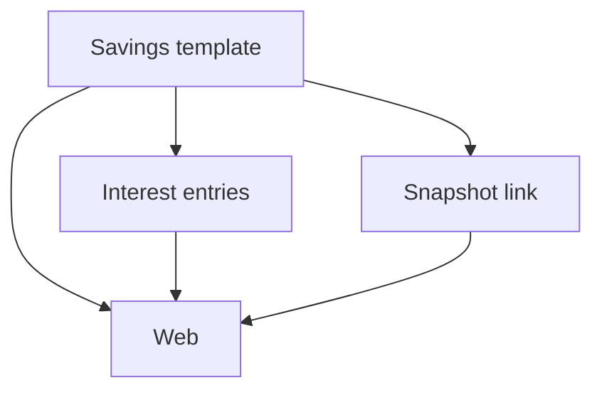

# Savings Accounts

## 1. Executive Summary

Savings Accounts adds a fifth account template, **Savings**, next to Bank, Credit card, Pots and Settlement (P60). A Savings account holds money that earns interest: it stores its interest rate, with the history of every rate change, and when interest is paid. Each interest payment the user actually receives is recorded on the account as an income, so it grows the balance and counts in the month's income, Result and tithe base like any other income.

A Savings account has a **kind**, which decides how interest is paid and whether it is taxed:

| Kind | Interest paid | Tax-free | Example |
|---|---|---|---|
| Standard | Monthly, on a day of the month | No | Chase Save, Blue Rewards Saver |
| Daily interest | Every day | No | A cash account whose money sits in bank bonds |
| Cash ISA | Monthly, on a day of the month | Yes | A Cash ISA |

The kind is the extension point: a future savings product that differs only in how interest is paid or taxed is a new kind, not a new template. Finally, a Savings account can feed an Investment Snapshot account, so the monthly net-worth snapshot can be filled from its balance, as credit cards and the Pots account already can (P44).

This PRD is the first of three planned together. Cashback for bank accounts (P65) and round-up destinations (P66) build on it and have their own PRDs.

## 2. Problem and Opportunity

### The Problem

**Savings have no home in CashFlow**
- The only templates are Bank, Credit card, Pots and Settlement (`AccountTemplates`)
- A savings account set up as a Bank account carries categories, bill payments and round-up it never uses, and has nowhere to keep its rate or payment day
- Chase Save and Blue Rewards Saver are tracked only as Investment Snapshot accounts, with each month's value typed in by hand

**Interest is invisible**
- Nothing records what rate an account pays, when it changed, or when interest arrives
- Interest received is not in the month's income, so the Result and the tithe base miss it

**Tax treatment is not recorded**
- A Cash ISA's interest is not taxed and a standard account's is; nothing in the app says which is which

### The Opportunity

- **One template, several kinds:** the template-and-capability model (P60) already decides what an account can do; a Savings template with an `EarnsInterest` capability, and a kind for the payment schedule and tax flag, adds savings without new account machinery.
- **Interest as income:** an interest payment is an `Income` on the Savings account with the account's interest income source, so the Income tab, Summary, Result and tithe pick it up with no new rules.
- **Snapshot from the balance:** the snapshot suggestion that already reads a Pots account's balance (`InvestmentSnapshotService`) can read a Savings account's balance the same way.

## 3. Target Audience

### Primary Users

**Household finance owner (single user)**
- Keeps money in several UK savings accounts and a Cash ISA alongside the everyday bank accounts
- Moves money between the bank accounts and the savings accounts and wants every balance right
- Wants to see what each account pays and when, and to know which interest is tax-free
- Fills the monthly Investment Snapshot and wants savings values suggested, not retyped

## 4. Objectives

### Product Objectives
- **Add** a Savings template with the Standard, Daily interest and Cash ISA kinds
- **Record** each account's interest rate history and payment schedule
- **Count** interest received as income on the Savings account
- **Link** a Savings account to an Investment Snapshot account
- **Keep** every existing template and its behaviour unchanged

### Success Metrics

| Objective | Metric | Measurement |
|---|---|---|
| Add | A Savings account of each kind can be created, edited and deactivated through the API and Admin → Accounts | Domain, Application, API and web tests |
| Record | The account's current rate is the latest rate in effect on the host's local today for 100% of the tested rate histories | Domain tests with a fixed clock |
| Count | An interest entry appears in the Income tab, the Summary's income, the Result and the tithe base of its month | Application tests |
| Link | A snapshot account linked to a Savings account suggests that account's balance at the end of the previous month | Application tests |
| Keep | Every existing test for Bank, Credit card, Pots and Settlement accounts stays green | Full test suite |

## 5. User Stories

### F01. Savings Template and Interest Settings
- As the user, I want to create a Savings account and choose its kind so that it is set up for how its interest is paid and taxed
- As the user, I want to record the rate the account pays and the date it took effect so that I can see the current rate
- As the user, I want to add a new rate when the bank changes it, keeping the old ones, so that I know what the account paid before
- As the user, I want a Standard or Cash ISA account to store the day of the month interest is paid so that I know when to expect it
- As the user, I want to move money into and out of a Savings account by transfer and to adjust its balance so that its balance matches the bank's

### F02. Interest Entries
- As the user, I want to record each interest payment I receive on a Savings account so that its balance grows by the interest
- As the user, I want interest to count as income for its month so that the Summary, Result and tithe include it
- As the user, I want to edit and delete an interest entry like any income so that I can correct mistakes

### F03. Savings Balance in Investment Snapshots
- As the user, I want to link an Investment Snapshot account to a Savings account so that the snapshot suggests its balance
- As the user, I want the suggestion to use the balance at the end of the previous month so that it matches how the Pots account is suggested

### F04. Savings Accounts in the Web App
- As the user, I want Admin → Accounts to show the Savings settings when I pick the Savings template so that I can set the kind, rates, payment day and interest income source
- As the user, I want the account screen to show the current rate, when interest is paid and whether it is tax-free so that I see the account's terms at a glance
- As the user, I want an "Add interest" action on a Savings account so that recording interest is one short form
- As the user, I want Admin → Investment accounts to offer "Savings account balance" as a source so that I can link a snapshot account to a Savings account

## 6. Functionalities

### F01. Savings Template and Interest Settings

**Provides:**
- The `Savings` template, the `EarnsInterest` capability and the Savings settings on the account create, update and detail endpoints (used by F02, F03, F04)

**Capabilities:**
- **Template:** `Savings`, GBP only, does not join the default account group. Capabilities: `HasOpeningBalance`, `ReceivesIncome`, `CanSendTransfers`, `CanReceiveTransfers`, `CanReconcile` and the new `EarnsInterest`. It has no categories, so it can't pay expenses or bills and has no round-up.
- **Kind:** required on a Savings account, one of `Standard`, `DailyInterest`, `CashIsa`. Tax-free is derived from the kind (true only for `CashIsa`) and never stored. The kind can be changed at any time, also when the account has transactions; the rates and interest entries are kept.
- **Payment schedule:** derived from the kind. `Standard` and `CashIsa` are paid monthly and store a required payment day from 1 to 31; in a shorter month the day is the month's last day (as the Payment Due Banner treats a recurring bill's due day, P42). `DailyInterest` is paid daily and stores no payment day; a payment day sent for it is refused.
- **Rate history:** a list of rates, each an annual rate in percent (from 0 to 100, at most 2 decimal places) with the date it takes effect. At least one rate is required. Two rates can't take effect on the same date. A rate may take effect in the future (a change the bank has announced). Rates can be added, changed and removed while at least one remains.
- **Current rate:** the rate with the latest effective date on or before the host's local today; when every rate is in the future, there is no current rate and the account shows the earliest upcoming one as upcoming.
- **Interest income source:** required on a Savings account, an active income source chosen by the user (for example "Interest"). It is what F02 records interest against.
- **Other templates:** a Savings setting sent for a non-Savings account is refused; changing an account to or from Savings follows today's rule (only while the account has no transactions).
- **Data:** the Savings settings are new optional fields on the account in `data-cashflow.json`; accounts without them load unchanged. Whether the data file version changes is decided in the spec. The API shape changes, so the OpenAPI snapshot and the generated web types are regenerated.

**Experience:**
- The account detail returns the kind, tax-free flag, payment schedule and day, the full rate history ordered by effective date, the current rate and its effective date, any upcoming rate, and the interest income source.
- Transfers to and from a Savings account, its opening balance and balance adjustments behave exactly as for a Bank account.

**Error Handling:**
- Missing kind, missing rate, rate outside 0–100 or with more than 2 decimal places, two rates on one date, missing or out-of-range payment day for a monthly kind, a payment day for `DailyInterest`, or a missing or inactive interest income source: 400 with a message naming the field; nothing is saved.
- Removing the last rate: 400 "A savings account needs at least one rate."; nothing changes.
- Savings settings on a non-Savings account: 400; nothing is saved.

### F02. Interest Entries

**Consumes:**
- F01: Savings accounts that receive income and their interest income source

**Capabilities:**
- An interest entry is an `Income` whose account is a Savings account and whose source is that account's interest income source; it is created, edited and deleted through the existing income endpoints. No new transaction type and no new endpoint.
- Amount: the interest actually received, net value only (no gross); amount > 0 with at most 2 decimal places. Date: any date the income rules already accept.
- It raises the Savings account's balance from its date, and counts in its month's Income tab, Summary income, Result and tithe base, as every income does.
- Interest is never generated or estimated by the app. A `DailyInterest` account can record one entry per day or one entry for a period, as the user prefers.
- An income from another source can also be paid into a Savings account (for example a bonus); it is shown as an ordinary income, not as interest.

**Experience:**
- In the account's transactions, an income whose source is the account's interest income source shows as "Interest".

**Error Handling:**
- The existing income validation applies unchanged (missing source, negative value, inactive account: 400, nothing saved).

### F03. Savings Balance in Investment Snapshots

**Consumes:**
- F01: Savings accounts and their balances

**Capabilities:**
- A new Investment account source, `SavingsAccountBalance`, which requires a Savings account; any other source refuses a Savings account, as the Pots source already refuses a missing Pots account.
- The snapshot suggestion for month M is the Savings account's balance at the end of month M − 1, the date the Pots source already uses (`PotAsOfDateResolver.LastDayOfPriorMonth`), described as "{account} balance — as of {MMM yyyy}".
- Linking to an inactive Savings account follows `ActiveAccountRule` as the Pots source does.

**Error Handling:**
- `SavingsAccountBalance` without a Savings account, or with an account of another template: 400; nothing is saved.

### F04. Savings Accounts in the Web App

**Consumes:**
- F01, F02, F03

**Capabilities:**
- **Admin → Accounts:** picking the Savings template shows Kind, Payment day (only for Standard and Cash ISA), Interest income source and a Rates editor (rows of rate % and effective date, Add rate, Remove rate disabled on the last row). Changing the kind to Daily interest hides Payment day and drops its value.
- **Accounts tab:** Savings accounts form their own "Savings" group, in template order after the existing groups.
- **Account screen header:** current rate ("4.50% since 1 Sep 2026"), any upcoming rate ("3.75% from 1 Jan 2027"), the schedule ("Interest paid monthly on day 5" or "Interest paid daily") and a "Tax-free" badge for Cash ISA, with visible text so the meaning does not depend on colour.
- **Add interest:** an action on a Savings account opening the income form with the account and the interest income source filled in and locked; the user enters date and amount (date defaults to today).
- **Admin → Investment accounts:** the source picker offers "Savings account balance" with a Savings account picker.
- Every new form follows `docs/rules/ui.md` and `docs/ui/review-checklist.md`: labels, keyboard operation, visible focus, inline validation with focus on the first invalid field, saving and server-error states, and the unsaved-changes guard the account dialog already has.

**Experience:**
- After a save the header and balance refresh as they do for other accounts; an "Interest" row appears in the account's transactions and the Income tab.

## 7. Out of Scope

**Interest**
- Calculating, estimating or auto-generating interest from the rate and balance
- Reminders when an interest payment is due
- AER versus gross rate, bonus rates, notice periods and withdrawal limits

**Tax**
- Personal Savings Allowance tracking or any tax calculation on taxable interest
- ISA allowance tracking (yearly subscription limit)

**Other features**
- Cashback for bank accounts (P65) and round-up destinations (P66). P66 adds a fourth kind, **Round-up saver** (Chase's round-up account): it earns interest at its own rate, accepts only round-ups and its own interest (no transfers in, no other income), and its balance is moved once a year to a Standard account
- Converting an existing Bank account that already has transactions into a Savings account (today's template lock stays); such an account is replaced by a new Savings account with an opening balance
- Currencies other than GBP for Savings accounts

## 8. Dependency Graph

| # | Feature | Priority | Dependencies |
|---|---------|----------|--------------|
| F01 | Savings Template and Interest Settings | 1 | None |
| F02 | Interest Entries | 1 | F01 |
| F03 | Savings Balance in Investment Snapshots | 2 | F01 |
| F04 | Savings Accounts in the Web App | 1 | F01, F02, F03 |

### Execution Waves
Features within the same wave can be built in parallel. A wave starts only after every feature in earlier waves is complete.

- **Wave 1**: F01
- **Wave 2**: F02, F03
- **Wave 3**: F04

### Planned pull requests
1. This PRD.
2. Backend: F01, F02 and F03.
3. Web: F04.

If the backend or web PR goes over the PR size limit in `docs/rules/design.md`, the spec splits it and every part still leaves `main` deployable.

### Priority levels
- **1** = Essential — product does not work without it
- **2** = Important — significant value addition
- **3** = Desirable — incremental improvement

## 9. Acceptance Criteria

### F01. Savings Template and Interest Settings
- [ ] **P64-F01-savings-template-01** Creating a GBP Savings account of each kind with one rate, an interest income source and (for Standard and Cash ISA) a payment day returns 201; the account detail returns the kind, tax-free flag, schedule, rates and current rate
- [ ] **P64-F01-savings-template-02** A Savings account in a currency other than GBP is refused with 400
- [ ] **P64-F01-savings-template-03** Tax-free is true for Cash ISA and false for Standard and Daily interest
- [ ] **P64-F01-savings-template-04** A monthly kind without a payment day, or with a day outside 1–31, is refused; Daily interest with a payment day is refused
- [ ] **P64-F01-savings-template-05** A missing rate, a rate outside 0–100 or with more than 2 decimal places, and two rates on the same date are each refused with 400 naming the field
- [ ] **P64-F01-savings-template-06** The current rate is the latest rate effective on or before today; a future rate is returned as upcoming and becomes current on its date (fixed clock)
- [ ] **P64-F01-savings-template-07** Removing the last rate returns 400 "A savings account needs at least one rate." and the account is unchanged
- [ ] **P64-F01-savings-template-08** A missing or inactive interest income source is refused with 400
- [ ] **P64-F01-savings-template-09** The kind can change on an account with transactions, and its rates and entries are kept
- [ ] **P64-F01-savings-template-10** A Savings account accepts transfers in and out, an opening balance and a balance adjustment, and refuses an expense or bill payment
- [ ] **P64-F01-savings-template-11** Savings settings sent for a non-Savings account are refused with 400
- [ ] **P64-F01-savings-template-12** A data file with no Savings accounts loads and saves unchanged; a Savings account survives a save-load round trip with all its settings
- [ ] **P64-F01-savings-template-13** The OpenAPI snapshot and the generated web types include the Savings fields and their freshness tests pass

### F02. Interest Entries
- [ ] **P64-F02-interest-entries-01** An income on a Savings account with its interest income source raises the account's balance from its date
- [ ] **P64-F02-interest-entries-02** That income appears in its month's Income tab, Summary income, Result and tithe base
- [ ] **P64-F02-interest-entries-03** It can be edited and deleted through the income endpoints, and the balance follows
- [ ] **P64-F02-interest-entries-04** In the account's transactions it is labelled "Interest"; an income from another source on the same account is not

### F03. Savings Balance in Investment Snapshots
- [ ] **P64-F03-savings-snapshot-01** An Investment account with source `SavingsAccountBalance` and a Savings account saves; without a Savings account, or with an account of another template, it returns 400
- [ ] **P64-F03-savings-snapshot-02** The suggestion for month M is the Savings account's balance at the end of month M − 1, described as "{account} balance — as of {MMM yyyy}"
- [ ] **P64-F03-savings-snapshot-03** Credit card and Pots suggestions are unchanged

### F04. Savings Accounts in the Web App
- [ ] **P64-F04-savings-web-01** Admin → Accounts shows Kind, Payment day, Interest income source and Rates for the Savings template only; Payment day is hidden for Daily interest
- [ ] **P64-F04-savings-web-02** The Rates editor adds and removes rows, Remove is disabled on the last row, and invalid rates show inline errors with focus on the first invalid field
- [ ] **P64-F04-savings-web-03** The Accounts tab shows a "Savings" group
- [ ] **P64-F04-savings-web-04** The account screen header shows the current rate with its date, any upcoming rate, the schedule, and a "Tax-free" badge with visible text for Cash ISA only
- [ ] **P64-F04-savings-web-05** "Add interest" opens the income form with the account and interest income source locked, and a saved entry shows as "Interest" in the account's transactions
- [ ] **P64-F04-savings-web-06** Admin → Investment accounts offers "Savings account balance" with a Savings account picker
- [ ] **P64-F04-savings-web-07** Every touched view passes `docs/ui/review-checklist.md`

### Cross-Feature Integration
- [ ] **P64-CF-cross-feature-01** A Savings account created in the web app (F04, F01) receives interest through Add interest (F02), and the snapshot linked to it (F03) suggests the balance including that interest from the following month
- [ ] **P64-CF-cross-feature-02** A rate added in the web app with a future date shows as upcoming in the header and as current from its date (F01, F04)
