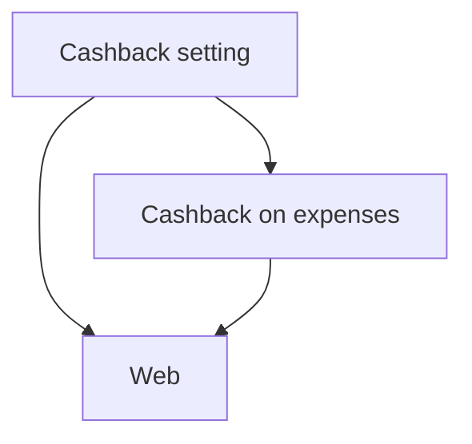

# Bank Cashback

## 1. Executive Summary

Bank Cashback adds cashback as an optional setting on Bank accounts. It is not a new account type: some debit cards pay a share of what is spent back to the user, and the bank account that pays the expense is the one that earns it.

| Bank | Rate | Where the cashback goes |
|---|---|---|
| Chase | 2% on eligible spending, mainly food and transport | A temporary balance the user later moves by hand to a standard savings account |
| Trading 212 | 1.5%, with fewer restrictions; eligibility is hard to know in advance and the credit can take time | The same temporary bucket round-ups go to, which is then invested automatically |

The app records cashback the way it already records round-up (P13). A Bank account with cashback switched on stores one current rate. Each expense paid from that bank gets a Cashback amount, pre-filled with rate × value, which the user can change or clear when a purchase isn't eligible. Cashback is shown per expense and as a monthly total for each bank on the Accounts tab. It is a reward on spending, not income, so it doesn't count in income, the Result or the tithe base. It also doesn't change the bank's balance.

This PRD is the second of three planned together. Savings accounts (P64) came first. Round-up destinations (P66) come next: P66 moves round-up and cashback from the bank that earned them to where the money actually goes, such as Chase's round-up saver or Trading 212's bucket.

## 2. Problem and Opportunity

### The Problem

**Cashback earned is invisible**
- Nothing records that a purchase earned cashback, or how much
- At the end of the month the user can't see how much cashback each card earned, or check it against what the bank paid

**The rules differ per bank**
- Chase pays 2% and Trading 212 pays 1.5%, and not every purchase is eligible, so a fixed calculation over all spending would be wrong

### The Opportunity

- **Round-up already shows the way:** a Bank account carries a round-up setting (`RoundUpSetting`), each expense paid from it stores a `RoundUpAmount`, the account's transactions show a Round-up column, and the Accounts tab totals round-up per bank for the month (`AccountGroupSummaryService`). Cashback follows the same path with a rate and an amount per expense.
- **A capability, not a type:** the template-and-capability model (P60) lets the Bank template gain a `SupportsCashback` capability without a new account type.

## 3. Target Audience

### Primary Users

**Household finance owner (single user)**
- Pays day-to-day spending with Chase and Trading 212 debit cards that pay cashback
- Wants to see what each card earned in a month and match it against the bank's app
- Knows which purchases were eligible better than any rule the app could apply

## 4. Objectives

### Product Objectives
- **Enable** cashback with a rate on any Bank account
- **Record** the cashback each expense paid from that bank earned
- **Show** cashback per expense and per bank per month
- **Keep** income, the Result, the tithe base, balances and every existing template unchanged

### Success Metrics

| Objective | Metric | Measurement |
|---|---|---|
| Enable | A Bank account can switch cashback on with a rate, change the rate and switch it off through the API and Admin → Accounts | Domain, Application, API and web tests |
| Record | An expense paid from a cashback bank saves the cashback sent; the suggestion equals rate × value rounded down to the penny in 100% of tested values | Domain and Application tests |
| Show | The Accounts tab's cashback for a bank and month equals the sum of its expenses' cashback | Application tests |
| Keep | Income, Result, tithe and balance tests stay green; every existing test stays green | Full test suite |

## 5. User Stories

### F01. Cashback Setting on Bank Accounts
- As the user, I want to switch cashback on for a bank account and set its rate so that the app knows the card pays cashback
- As the user, I want to change the rate when the bank changes it so that new suggestions use the new rate
- As the user, I want to switch cashback off so that new expenses from that bank stop offering it

### F02. Cashback on Expenses
- As the user, I want an expense paid from a cashback bank to carry the cashback it earned so that I know what each purchase paid back
- As the user, I want the amount suggested from the rate so that I rarely type it
- As the user, I want to change or clear the amount so that an ineligible purchase or a different credited amount is recorded correctly
- As the user, I want each bank's monthly cashback total on the Accounts tab so that I can match it against the bank's app

### F03. Cashback in the Web App
- As the user, I want Admin → Accounts to show a Cashback switch and rate on Bank accounts so that I can set them up
- As the user, I want a Cashback field on the expense form when the paying bank has cashback so that I record it as I enter the expense
- As the user, I want a Cashback column in the bank's transactions and on the Accounts tab so that I can see it at a glance

## 6. Functionalities

### F01. Cashback Setting on Bank Accounts

**Provides:**
- The `SupportsCashback` capability on the Bank template, and the cashback setting on the account create, update and detail endpoints (used by F02, F03)

**Capabilities:**
- **Capability:** the Bank template gains `SupportsCashback`. No other template has it.
- **Setting:** a Bank account carries a cashback setting: on or off and, when on, a rate in percent (more than 0, at most 100, at most 2 decimal places). When cashback is off, no rate is stored.
- **Required, like round-up:** creating or updating a Bank account must say whether cashback is on, just as it must say whether round-up is on. An account saved before this feature loads with cashback off.
- **One current rate:** there is no rate history. Changing the rate affects only the suggestions for expenses entered later. Expenses already saved keep their stored cashback.
- Switching cashback on or off, or changing the rate, is allowed at any time, also on an account with transactions. Switching it off keeps the cashback already stored on past expenses.
- **Data:** the setting is a new optional field on the account in `data-cashflow.json`. Accounts without it load with cashback off. The spec decides whether the data file version changes. The API shape changes, so the OpenAPI snapshot and the generated web types are regenerated.

**Error Handling:**
- A Bank account without the cashback on/off flag, cashback on without a rate, or a rate outside the range or with more than 2 decimal places: 400 with a message naming the field; nothing is saved.
- A cashback setting sent for an account whose template isn't Bank: 400; nothing is saved.

### F02. Cashback on Expenses

**Consumes:**
- F01: Bank accounts with cashback on

**Capabilities:**
- **Amount:** an expense paid from a bank account stores an optional cashback amount: 0 or more, at most the expense's value, with at most 2 decimal places. It is created, edited and returned through the existing expense endpoints. There are no new endpoints.
- **Only from a cashback bank:** a cashback amount is accepted only when the expense's payment source is a Bank account with cashback on at the time of saving. An edit that leaves an existing amount unchanged is accepted even after cashback is switched off, so old expenses stay editable.
- **Suggestion:** the expense detail returns a suggested cashback of rate × value, rounded down to the penny, while the payment bank has cashback on. Like the round-up suggestion, it is only a suggestion; the stored amount is what counts.
- **Balances:** cashback doesn't change the bank's balance, or any other account's. Until P66, it stays recorded on the bank that earned it.
- **Not income:** cashback is not counted in the Income tab, Summary income, the Result or the tithe base. Category totals still count the full expense value.
- **Account transactions:** each expense row on the bank's transactions returns its cashback amount (positive), next to the existing round-up.
- **Accounts tab:** each Bank account with `SupportsCashback` returns its cashback total for the month: the sum of the cashback on its expenses dated in that month. Each currency's footer total gains a cashback total, as it already has a round-up total.
- **Locked expenses:** the cashback amount follows the same lock as the round-up amount (`Expense.ChangesLockedFields`).
- Expenses paid by credit card, pot withdrawals by card (P62) and bill payments don't take cashback in this PRD.

**Error Handling:**
- A cashback amount below 0, above the expense's value or with more than 2 decimal places: 400 "Cashback must be between 0 and the expense value, with at most 2 decimal places."; nothing is saved.
- A new cashback amount on an expense whose payment source isn't a Bank account with cashback on: 400 "Cashback only applies to an expense paid from a bank with cashback on."; nothing is saved.

### F03. Cashback in the Web App

**Consumes:**
- F01, F02

**Capabilities:**
- **Admin → Accounts:** for the Bank template, a "Cashback" switch next to the existing "Round-up" switch, and a "Cashback rate (%)" field shown only while the switch is on. Switching it off hides the rate and drops its value.
- **Expense form:** when the payment bank has cashback on, a "Cashback" field appears next to Round-up. On a new expense it is pre-filled with the suggestion and follows changes to the value until the user edits it. Clearing it saves no cashback. It is hidden for card payments and settled expenses, as Round-up is.
- **Bank transactions:** a "Cashback" column next to Round-up on banks with `SupportsCashback`.
- **Accounts tab:** a "Cashback" column next to Round-up in the Bank group, with the group's footer total.
- Every touched view follows `docs/rules/ui.md` and `docs/ui/review-checklist.md`: labels, keyboard operation, visible focus, inline validation with focus on the first invalid field, numbers right-aligned, and saving and server-error states.

**Experience:**
- After saving an expense with cashback, the bank's transactions and the Accounts tab show the amount, and the bank's balance doesn't change because of it.

## 7. Out of Scope

**Where cashback goes**
- Moving cashback out of the bank that earned it, into a savings account or an investment bucket: P66 (round-up destinations) handles both round-up and cashback
- A running "cashback balance" to date per bank; P66 replaces it with the destination account's balance

**Cashback rules**
- Eligibility by category, merchant or amount, and per-bank rule sets
- Cashback caps, promotional rates and rate history
- Checking the recorded cashback against what the bank actually credited

**Other**
- Cashback on credit card charges, pot withdrawals by card, bill payments and refunds
- Treating cashback as income or as a reduction of category spending

## 8. Dependency Graph

| # | Feature | Priority | Dependencies |
|---|---------|----------|--------------|
| F01 | Cashback Setting on Bank Accounts | 1 | None |
| F02 | Cashback on Expenses | 1 | F01 |
| F03 | Cashback in the Web App | 1 | F01, F02 |

### Execution Waves
Features in the same wave can be built in parallel. A wave starts only once every feature in the earlier waves is complete.

- **Wave 1**: F01
- **Wave 2**: F02
- **Wave 3**: F03

### Planned pull requests
1. This PRD.
2. Backend: F01 and F02.
3. Web: F03.

If the backend or web PR goes over the PR size limit in `docs/rules/design.md`, the spec splits it, and every part still leaves `main` deployable.

### Priority levels
- **1** = Essential — the product doesn't work without it
- **2** = Important — adds significant value
- **3** = Desirable — an incremental improvement

## 9. Acceptance Criteria

### F01. Cashback Setting on Bank Accounts
- [ ] **P65-F01-cashback-setting-01** Creating a Bank account with cashback on and a rate returns 201, and the account detail returns the flag and rate; with cashback off, no rate is returned
- [ ] **P65-F01-cashback-setting-02** A Bank account without the cashback flag, with cashback on but no rate, or with a rate outside the range or with more than 2 decimal places is refused with 400 naming the field
- [ ] **P65-F01-cashback-setting-03** A cashback setting on an account whose template isn't Bank is refused with 400
- [ ] **P65-F01-cashback-setting-04** The rate can be changed and cashback switched off on an account with transactions, and the stored cashback on its expenses is kept
- [ ] **P65-F01-cashback-setting-05** A data file with no cashback settings loads with cashback off on every Bank account and saves unchanged otherwise; a cashback setting survives a save-load round trip
- [ ] **P65-F01-cashback-setting-06** The OpenAPI snapshot and the generated web types include the cashback fields, and their freshness tests pass

### F02. Cashback on Expenses
- [ ] **P65-F02-cashback-expenses-01** An expense paid from a bank with cashback on saves and returns its cashback amount, and the expense detail returns rate × value rounded down to the penny as the suggestion
- [ ] **P65-F02-cashback-expenses-02** A cashback amount below 0, above the expense value or with more than 2 decimal places is refused with 400
- [ ] **P65-F02-cashback-expenses-03** A new cashback amount on an expense paid by card, or from a bank with cashback off, is refused with 400; an unchanged amount on an older expense still saves after cashback is switched off
- [ ] **P65-F02-cashback-expenses-04** Cashback doesn't change any account's balance, and isn't in the Income tab, Summary income, the Result or the tithe base
- [ ] **P65-F02-cashback-expenses-05** The bank's transactions return each expense's cashback, and the Accounts tab returns each cashback bank's monthly total and the currency footer total
- [ ] **P65-F02-cashback-expenses-06** Round-up amounts, suggestions and totals are unchanged

### F03. Cashback in the Web App
- [ ] **P65-F03-cashback-web-01** Admin → Accounts shows the Cashback switch for Bank accounts only, and the rate field only while it is on
- [ ] **P65-F03-cashback-web-02** The expense form shows Cashback only for an unsettled expense paid from a cashback bank, pre-filled with the suggestion until the user edits it
- [ ] **P65-F03-cashback-web-03** Invalid cashback or rate values show inline errors, with focus on the first invalid field
- [ ] **P65-F03-cashback-web-04** The bank's transactions and the Accounts tab show a right-aligned Cashback column, and the Accounts tab footer shows its total
- [ ] **P65-F03-cashback-web-05** Every touched view passes `docs/ui/review-checklist.md`

### Cross-Feature Integration
- [ ] **P65-CF-cross-feature-01** A Bank account set to 2% cashback in the web app (F03, F01) gets an expense of 12.50 with the suggested 0.25 (F02), which shows in its transactions and in the month's Accounts tab total, while its balance and the month's income are unchanged
