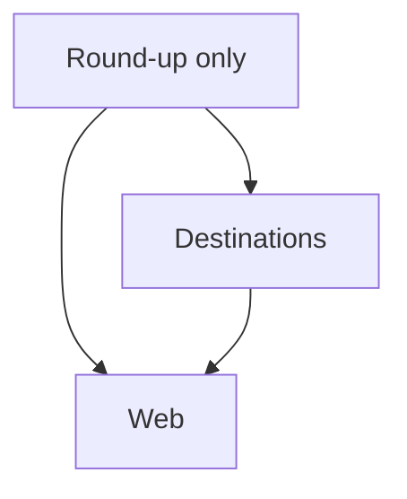

# Round-up Destinations

## 1. Executive Summary

Round-up Destinations makes round-ups and cashback land somewhere. Today a bank's round-up (P13) is taken off the bank's balance and then disappears. Cashback (P65) is recorded on each expense but stays on the bank that earned it.

A Bank account now says where its round-ups go and where its cashback goes. Each destination is one of three:

| Destination | Meaning | Example |
|---|---|---|
| None (default) | As today: round-up leaves the bank and isn't tracked further; cashback is only recorded | Any bank not set up yet |
| A Savings account | The money is added to that account's balance automatically | Chase round-ups → the Chase round-up saver; Chase cashback → a small Chase cashback saver |
| Invested automatically | The money leaves cash flow and is invested by the provider; no account holds it | Trading 212 round-ups and cashback |

A destination account's balance is **derived** from the bank's expenses. Nothing extra is recorded: each round-up or cashback amount on an expense paid from the bank also counts in the destination's balance from the expense's date.

Savings accounts (P64) gain one setting, **Round-up only**. A round-up-only account accepts no transfers in and no income other than its own interest. It can still send transfers out, for example when the user moves its balance to Chase Save once a year. Only a round-up-only account can be a round-up destination.

This is the last of the three PRDs planned together, after Savings accounts (P64) and Bank cashback (P65).

## 2. Problem and Opportunity

### The Problem

**Round-ups vanish**
- `Expense.ContributionTo` takes the round-up off the bank, but no account receives it. The Chase round-up saver, which really holds that money, has no balance in the app.

**Cashback has nowhere to go**
- P65 records each expense's cashback, but the money isn't in any balance. Chase's cashback sits in a temporary balance until the user moves it to savings, and Trading 212's is invested automatically.

**The round-up saver's rules aren't enforced**
- Chase's round-up account accepts only round-ups (and pays interest on them), but nothing stops a transfer or income being recorded into it by mistake.

### The Opportunity

- **Derived, not stored:** the expense already holds the round-up and cashback amounts and the paying bank. A destination setting on the bank is enough to put them in the right balance, with no new transactions to keep in step.
- **One more Savings setting:** P64 built Savings accounts from settings so a new behaviour needs only a new setting. "Round-up only" is that setting.

## 3. Target Audience

### Primary Users

**Household finance owner (single user)**
- Uses Chase, whose round-ups go to a round-up saver and whose cashback is moved by hand to savings
- Uses Trading 212, whose round-ups and cashback are invested automatically
- Wants every balance in the app to match the bank's app, with no extra data entry

## 4. Objectives

### Product Objectives
- **Route** each bank's round-ups and cashback to None, a Savings account or Invested automatically
- **Derive** destination balances from the expenses, with no extra entries
- **Protect** a round-up-only account from money it can't receive
- **Keep** existing balances, totals and snapshots unchanged for banks without a destination

### Success Metrics

| Objective | Metric | Measurement |
|---|---|---|
| Route | A Bank account's round-up and cashback destinations can each be set to None, a Savings account or Invested automatically, and changed | Domain, Application, API and web tests |
| Derive | A destination's balance on any date equals its own transactions plus the routed round-ups or cashback dated on or before it, from its balance start date | Domain and Application tests with fixed dates |
| Protect | A transfer in, or a non-interest income, into a round-up-only account is refused in 100% of tested cases | Domain and API tests |
| Keep | Every existing balance, Accounts tab and snapshot test stays green | Full test suite |

## 5. User Stories

### F01. Round-up Only Savings Accounts
- As the user, I want to mark a Savings account as round-up only so that the app knows it can only receive round-ups and its interest
- As the user, I want a transfer in or a non-interest income into it refused so that its balance can't be wrong by mistake
- As the user, I want to move its balance out with a normal transfer so that the yearly move to Chase Save is recorded

### F02. Round-up and Cashback Destinations
- As the user, I want to say where a bank's round-ups go so that the round-up saver's balance includes them
- As the user, I want to say where a bank's cashback goes so that Chase cashback builds up in a savings account and Trading 212 cashback shows as invested
- As the user, I want the destination's transactions to show each routed round-up or cashback so that I can match its balance against the bank's app
- As the user, I want the round-ups and cashback from before the destination account existed left out so that its opening balance stays right

### F03. Destinations in the Web App
- As the user, I want Admin → Accounts to show a Round-up only switch on Savings accounts and the two destination pickers on Bank accounts so that I can set them up
- As the user, I want the bank's header to say where its round-ups and cashback go so that I see it at a glance
- As the user, I want the destination account's transactions to list the routed amounts so that its balance is explained

## 6. Functionalities

### F01. Round-up Only Savings Accounts

**Provides:**
- The Round-up only setting on Savings accounts (used by F02, F03)

**Capabilities:**
- **Setting:** a Savings account has a required yes/no **Round-up only** setting. Accounts saved before this feature load with it off. Like the other Savings settings, it is set through the existing Savings terms on the account create, update and detail endpoints.
- **What it blocks:** while it's on, the account refuses a transfer in (as the destination of any transfer, including card credit refunds) and an income from a source outside the Dividendo/Juros group. Its own interest (P64 F02) is still allowed, as are transfers out, balance adjustments and its opening balance.
- **Allowed actions:** a round-up-only account doesn't offer Transfer from or Add income. It still offers Add interest, Transfer to and Adjust balance.
- **Switching it on:** this is refused while the account already has transfers in or non-interest income, with a message saying so. Switching it off is always allowed.
- **Data:** a new field inside the Savings terms in `data-cashflow.json`. The spec decides whether the data file version changes. The OpenAPI snapshot and the generated web types are regenerated.

**Error Handling:**
- A transfer into a round-up-only account: 400 "{account} only receives round-ups."; nothing is saved.
- A non-interest income into it: 400 "{account} only receives round-ups and its interest."; nothing is saved.
- Switching it on while the account has such money in: 400 "{account} already has money in that isn't a round-up or interest."; nothing changes.

### F02. Round-up and Cashback Destinations

**Consumes:**
- F01: round-up-only Savings accounts
- P65: cashback on expenses

**Provides:**
- The round-up and cashback destinations on Bank accounts, and destination balances and rows (used by F03)

**Capabilities:**
- **Settings:** a Bank account (`SupportsRoundUp`) has a round-up destination and a Bank account (`SupportsCashback`) has a cashback destination. Each is one of three: **None** (the default, and what every existing bank loads with), **a Savings account**, or **Invested automatically**. They are set through the account create, update and detail endpoints, and leaving them out of an update keeps the current setting, as P65 did for cashback.
- **Which accounts can be a destination:**
  - A round-up destination must be an active, round-up-only Savings account (F01).
  - A cashback destination must be an active Savings account that isn't round-up only.
  - An account can be the destination of several banks.
  - A destination can't be deactivated or deleted while a bank points at it. The message names the bank.
- **Derived balance:**
  - A destination Savings account's balance includes every round-up (or cashback) on an expense paid from a bank that points at it.
  - Each amount counts from the expense's date, if that date is on or after the destination's balance start date.
  - Changing a bank's destination moves all of that bank's routed amounts to the new destination (or to None) from then on. There is no per-date history of destinations.
- **Rows on the destination:** the destination's transactions list each routed amount as a read-only row, with:
  - kind `RoundUp` or `Cashback`;
  - the expense's date and description;
  - the paying bank as the counterpart;
  - a positive amount.

  These rows are edited through the expense itself.
- **Invested automatically:** the money isn't in any balance (round-up leaves the bank as today, and cashback was never in it). The Accounts tab's Bank group shows the month's round-up and cashback as before, so the invested totals stay visible there.
- **Bank side:** nothing changes for the paying bank. Its balance still loses the round-up, and cashback still isn't in it.
- **Snapshots:** an Investment Snapshot account linked to a destination Savings account (P64 F03) includes the derived amounts in its suggested balance.

**Error Handling:**
- A round-up destination that isn't an active round-up-only Savings account, or a cashback destination that isn't an active Savings account without round-up only: 400 naming the field; nothing is saved.
- A destination set on a bank with round-up (or cashback) off: allowed. It applies only to amounts that exist.
- Deactivating or deleting a destination: 400 "{account} receives {bank}'s round-ups." (or cashback); nothing changes.

### F03. Destinations in the Web App

**Consumes:**
- F01, F02

**Capabilities:**
- **Admin → Accounts, Savings template:** a **Round-up only** switch next to Tax-free.
- **Admin → Accounts, Bank template:**
  - A **Round-ups go to** picker below the Round-up switch, with the options None, Invested automatically, and the active round-up-only Savings accounts.
  - A **Cashback goes to** picker below the cashback rate, with the options None, Invested automatically, and the active Savings accounts that aren't round-up only.
  - Each picker is shown while its switch is on.
- **Bank header:** a line such as "Round-ups go to Chase round-up saver · Cashback is invested automatically". It is shown only for destinations other than None.
- **Destination account:**
  - Its transactions show the routed rows as "Round-up" or "Cashback", with the bank in Counterpart.
  - They have no Edit or Delete button. Instead, a hint says to change them on the expense.
- **Round-up-only account screen:** the account doesn't offer Transfer from or Add income (from F01). Its header says "Round-up only".
- Every touched view follows `docs/rules/ui.md` and `docs/ui/review-checklist.md`.

## 7. Out of Scope

- A dated history of destinations (changing a destination moves all of that bank's routed amounts)
- Routing round-ups or cashback from card charges, pot withdrawals or bill payments
- Recording what Trading 212 actually invests (holdings stay in the Investment context)
- Moving money out of a destination automatically (the yearly move to Chase Save is a normal transfer)
- Interest calculation on the round-up saver (interest is still recorded by hand, P64)

## 8. Dependency Graph

| # | Feature | Priority | Dependencies |
|---|---------|----------|--------------|
| F01 | Round-up Only Savings Accounts | 1 | P64 |
| F02 | Round-up and Cashback Destinations | 1 | F01, P65 |
| F03 | Destinations in the Web App | 1 | F01, F02 |

### Execution Waves
- **Wave 1**: F01
- **Wave 2**: F02
- **Wave 3**: F03

### Planned pull requests
1. This PRD.
2. Backend: F01 and F02.
3. Web: F03.

If the backend or web PR goes over the PR size limit in `docs/rules/design.md`, the spec splits it, and every part still leaves `main` deployable.

### Priority levels
- **1** = Essential — the product doesn't work without it
- **2** = Important — adds significant value
- **3** = Desirable — an incremental improvement

## 9. Acceptance Criteria

### F01. Round-up Only Savings Accounts
- [x] **P66-F01-roundup-only-01** A Savings account can be created and updated with Round-up only on or off, and the account detail returns it; accounts saved before this feature load with it off
- [x] **P66-F01-roundup-only-02** A transfer into a round-up-only account is refused with 400 "{account} only receives round-ups."
- [x] **P66-F01-roundup-only-03** A non-interest income into it is refused with 400, while interest from a Dividendo/Juros source, transfers out and balance adjustments are allowed
- [x] **P66-F01-roundup-only-04** Its allowed actions exclude Transfer from and Add income and include Add interest, Transfer to and Reconcile
- [x] **P66-F01-roundup-only-05** Switching Round-up only on is refused while the account has transfers in or non-interest income; switching it off is always allowed
- [x] **P66-F01-roundup-only-06** The OpenAPI snapshot and the generated web types include the setting, and their freshness tests pass

### F02. Round-up and Cashback Destinations
- [x] **P66-F02-destinations-01** A Bank account's round-up and cashback destinations can each be set to None, a Savings account or Invested automatically, and an update without them keeps them; existing banks load with None
- [x] **P66-F02-destinations-02** A round-up destination that isn't an active round-up-only Savings account, or a cashback destination that is round-up only, inactive or not Savings, is refused with 400
- [x] **P66-F02-destinations-03** A destination's balance includes the round-ups (or cashback) of expenses paid from the pointing banks, from each expense's date, ignoring amounts dated before its balance start date; the paying bank's balance is unchanged
- [x] **P66-F02-destinations-04** The destination's transactions list each routed amount as a read-only RoundUp or Cashback row with the expense's date and description and the bank as counterpart
- [x] **P66-F02-destinations-05** Changing a bank's destination moves its routed amounts to the new destination; setting None removes them from every balance
- [x] **P66-F02-destinations-06** Deactivating or deleting a destination a bank points at is refused with 400 naming the bank
- [x] **P66-F02-destinations-07** An Investment Snapshot linked to a destination Savings account suggests its balance including the routed amounts

### F03. Destinations in the Web App
- [ ] **P66-F03-destinations-web-01** Admin → Accounts shows Round-up only for Savings accounts, and the Round-ups go to / Cashback goes to pickers for Bank accounts while their switches are on, offering only valid destinations
- [ ] **P66-F03-destinations-web-02** The bank header names its destinations other than None
- [ ] **P66-F03-destinations-web-03** A destination account lists the routed rows as Round-up or Cashback, without Edit or Delete
- [ ] **P66-F03-destinations-web-04** A round-up-only account doesn't offer Transfer from or Add income and says "Round-up only" in its header
- [ ] **P66-F03-destinations-web-05** Every touched view passes `docs/ui/review-checklist.md`

### Cross-Feature Integration
- [ ] **P66-CF-cross-feature-01** A round-up-only Savings account set up in the web app as Chase's round-up destination (F03, F01, F02) shows a balance that grows with each Chase expense's round-up, takes its interest, refuses a transfer in, and sends its balance to Chase Save by transfer
- [ ] **P66-CF-cross-feature-02** A bank whose cashback goes to a Savings account and whose round-ups are invested automatically shows the cashback in that account's balance and leaves the round-ups out of every balance (F02, P65)
