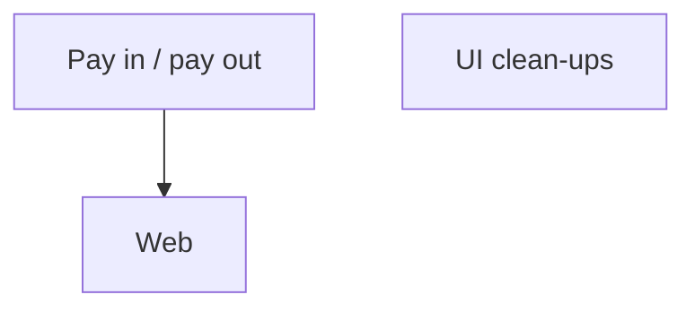

# Pay In and Pay Out

## 1. Executive Summary

Pay In and Pay Out lets the user record money that enters or leaves a Bank or Savings account from **outside the app's accounts**, without calling it income or an expense.

Today an account's money can only move by:
- **Transfer**, which needs an account the app tracks on the other side;
- **Income**, which counts in the Summary, the Result and the tithe base;
- **Expense**, which counts in category spending;
- **Adjust balance**, which resets the balance to a figure without saying what came in or went out.

None of these fits money such as:
- Chase cashback moved from Chase's own cashback pot (which the app doesn't track) into Chase Save, whenever the user decides;
- someone sending the user money that isn't income;
- money sent out to someone that isn't spending.

**Pay in** and **Pay out** record exactly that: a dated amount with a description that raises or lowers the account's balance and counts nowhere else.

The PRD also covers two older UI issues found during P66's review (F03):
- On the Accounts tab, a bank with round-up off shows 0.00 for round-up instead of the missing-value mark.
- The expense form doesn't move focus to an invalid field when a save is refused.

## 2. Problem and Opportunity

### The Problem

**Money from outside can't be recorded honestly**
- Cashback that Chase keeps in its own pot reaches Chase Save only when the user moves it. The pot isn't an account in the app (P66's cashback destination doesn't fit, because the timing is the user's), so the move has no source account to transfer from.
- Money someone sends the user is neither income nor a transfer.
- Recording these as income inflates income and tithe. Adjusting the balance loses what the money was.

**Two known UI issues on touched screens**
- A bank with round-up off shows 0.00, the same as a round-up bank that rounded nothing up (`docs/ui/forms-data-and-visualisations.md`: absent values use the missing-value mark).
- The expense form only focuses its error alert, not the first invalid field (`forms-data-and-visualisations.md`: focus the first error).

### The Opportunity

- **One small transaction type:** a dated, described amount on one account, in or out. It joins the account's balance through the existing `ContributionTo` path, as balance adjustments do, and touches no income or category rules.
- **Fix the two issues while those screens are open:** the Cashback column (P65) already uses the missing-value rule; Round-up only needs the same backend and web change.

## 3. Target Audience

### Primary Users

**Household finance owner (single user)**
- Moves Chase cashback into Chase Save at times they choose
- Sometimes receives or sends money that isn't income, spending or a transfer between their own accounts
- Wants every balance to match the bank's app without distorting income, spending or tithe

## 4. Objectives

### Product Objectives
- **Record** money in and out of Bank and Savings accounts from outside the app's accounts
- **Keep** income, the Result, the tithe base and category spending unchanged by it
- **Fix** the Accounts tab round-up display and the expense form's error focus

### Success Metrics

| Objective | Metric | Measurement |
|---|---|---|
| Record | A pay-in and a pay-out can be created, edited and deleted on a Bank and a Savings account, and the balance follows from its date | Domain, Application, API and web tests |
| Keep | Income, Summary, Result, tithe and category totals are unchanged by pay-ins and pay-outs in 100% of tested months | Application tests |
| Fix | A bank with round-up off shows the missing-value mark; an invalid expense field gets focus | Web tests and a browser check |

## 5. User Stories

### F01. Pay In and Pay Out
- As the user, I want to record money paid into an account from outside so that its balance matches the bank
- As the user, I want to record money paid out of an account to outside so that its balance matches the bank
- As the user, I want each one to carry a description so that I know later what it was
- As the user, I want them kept out of income, spending and tithe so that those figures stay right
- As the user, I want to edit and delete them like other entries so that I can correct mistakes

### F02. Pay In and Pay Out in the Web App
- As the user, I want **Pay in** and **Pay out** actions on Bank and Savings accounts so that recording one is a short form
- As the user, I want them listed in the account's transactions and in All transactions so that I can see them with everything else

### F03. UI Clean-ups
- As the user, I want a bank with round-up off to show no round-up figure so that I can tell it apart from a round-up bank that rounded nothing up
- As the user, I want the cursor on the first wrong field when an expense can't be saved so that I can fix it straight away

## 6. Functionalities

### F01. Pay In and Pay Out

**Provides:**
- The pay-in and pay-out entries and their endpoints (used by F02)

**Capabilities:**
- **Entry:** a new entry on one account with:
  - a direction, **In** or **Out**;
  - a date;
  - an amount, more than 0 with at most 2 decimal places, in the account's currency;
  - a required description, up to the length existing descriptions allow.
- **Which accounts:**
  - Bank and Savings accounts can take both.
  - A Round-up only Savings account (P66) refuses a pay-in, because it only receives round-ups and its interest. It can take a pay-out.
  - Other templates, inactive accounts and accounts in another currency are refused, as for other entries.
- **Balance:** a pay-in raises the account's balance from its date, and a pay-out lowers it. Balances, the Accounts tab and snapshot suggestions (P44, P64) all follow, because they already read every entry's contribution.
- **Counts nowhere else:**
  - It is not income: it's left out of the Income tab, Summary income, the Result and the tithe base.
  - It is not an expense: it's left out of category totals and spending.
- **Allowed actions:** Bank and Savings accounts gain `PayIn` and `PayOut` actions. A Round-up only account gets `PayOut` only.
- **Rows:**
  - The account's transactions and the All transactions list show each entry with kind `PayIn` or `PayOut`, its date, description, and a signed amount (+ in, − out).
  - It is editable and deletable from either list, like a balance adjustment.
- **Endpoints:** create, update and delete, plus the account's existing transaction and month lists. There's no separate list endpoint.
- **Data:** a new optional collection in `data-cashflow.json`. A file without it loads unchanged. The spec decides the collection's shape and whether the data file version changes. The OpenAPI snapshot and the generated web types are regenerated.

**Error Handling:**
- An amount of 0 or less, or with more than 2 decimal places: 400 "Enter an amount above 0 with at most 2 decimal places."
- A missing description: 400 "Enter a description."
- A pay-in to a Round-up only account: 400 "{account} only receives round-ups." (the P66 message).
- An account that isn't a Bank or Savings account, or is inactive: 400 naming the account.

Nothing is saved in any of these cases.

### F02. Pay In and Pay Out in the Web App

**Consumes:**
- F01

**Capabilities:**
- **Actions:** **Pay in** and **Pay out** buttons on Bank and Savings account screens, shown as the server allows. A Round-up only account shows Pay out only.
- **Form:**
  - Date (default today, or the viewed month as other forms do), Amount, and Description.
  - The account is locked.
  - The form title and Save button follow the action: "Pay in" / "Add pay-in" and "Pay out" / "Add pay-out", and "Edit pay-in" / "Edit pay-out" when editing.
  - Inline validation with focus on the first invalid field, a saving state, the server error, and the unsaved-changes guard the other account forms use.
  - The toast says "Pay-in added", "Pay-out added", "Pay-in updated" and so on.
- **Rows:**
  - The kind label is "Pay in" or "Pay out", with the signed amount right-aligned.
  - Edit opens the form; Delete asks "Delete this pay-in?" (or pay-out).
  - The All transactions list shows the same rows with the same labels.
- Every touched view follows `docs/rules/ui.md` and `docs/ui/review-checklist.md`.

### F03. UI Clean-ups

**Capabilities:**
- **Round-up on the Accounts tab:**
  - A Bank account's monthly round-up total is returned only when its round-up is on, or when that month's expenses carry round-up.
  - Otherwise it is null, and the Bank group's Round-up cell shows the missing-value mark ("None"), as the Cashback column does since P65.
  - The currency footer total is unchanged.
- **Expense form focus:**
  - When a save is refused because of field errors, focus moves to the first invalid field. When there are several, it moves to the shared field-error summary, using the `useFieldErrorSummary` pattern the dialogs already use.
  - This covers Round-up and Cashback as well as the other fields.

## 7. Out of Scope

- Linking a pay-in or pay-out to a person or a counterparty list
- Categories on pay-ins and pay-outs, or counting them in category reports
- Recurring pay-ins or pay-outs
- Pay in and pay out on Credit card, Pots and Settlement accounts
- Turning existing income or adjustments into pay-ins

## 8. Dependency Graph

| # | Feature | Priority | Dependencies |
|---|---------|----------|--------------|
| F01 | Pay In and Pay Out | 1 | None |
| F02 | Pay In and Pay Out in the Web App | 1 | F01 |
| F03 | UI Clean-ups | 2 | None |

### Execution Waves
- **Wave 1**: F01, F03
- **Wave 2**: F02

### Planned pull requests
1. This PRD.
2. Backend: F01, plus F03's round-up total rule.
3. Web: F02, plus F03's Round-up cell and expense form focus.

If the backend or web PR goes over the PR size limit in `docs/rules/design.md`, the spec splits it, and every part still leaves `main` deployable.

### Priority levels
- **1** = Essential — the product doesn't work without it
- **2** = Important — adds significant value
- **3** = Desirable — an incremental improvement

## 9. Acceptance Criteria

### F01. Pay In and Pay Out
- [ ] **P67-F01-pay-in-out-01** A pay-in and a pay-out can be created, edited and deleted on a Bank and on a Savings account, and the account's balance follows from each one's date
- [ ] **P67-F01-pay-in-out-02** An amount of 0 or less or with more than 2 decimal places, or a missing description, is refused with 400
- [ ] **P67-F01-pay-in-out-03** A pay-in to a Round-up only account is refused with 400 "{account} only receives round-ups.", and a pay-out from it is allowed
- [ ] **P67-F01-pay-in-out-04** A pay-in or pay-out on a Credit card, Pots or Settlement account, or on an inactive account, is refused with 400
- [ ] **P67-F01-pay-in-out-05** Pay-ins and pay-outs leave the Income tab, Summary income, the Result, the tithe base and category totals unchanged
- [ ] **P67-F01-pay-in-out-06** Bank and Savings accounts allow PayIn and PayOut; a Round-up only account allows PayOut only
- [ ] **P67-F01-pay-in-out-07** The account's transactions and the All transactions list return each entry as a PayIn or PayOut row with its date, description and signed amount
- [ ] **P67-F01-pay-in-out-08** A data file without pay-ins loads and saves unchanged; a pay-in survives a save-load round trip; the OpenAPI snapshot and generated web types include the new endpoints and their freshness tests pass

### F02. Pay In and Pay Out in the Web App
- [ ] **P67-F02-pay-in-out-web-01** Bank and Savings account screens show Pay in and Pay out as the server allows, and a Round-up only account shows Pay out only
- [ ] **P67-F02-pay-in-out-web-02** The form takes date, amount and description with the account locked, validates inline with focus on the first invalid field, and saves with the matching title, button and toast
- [ ] **P67-F02-pay-in-out-web-03** The rows show "Pay in" or "Pay out" with a right-aligned signed amount, and can be edited and deleted from the account's transactions and All transactions
- [ ] **P67-F02-pay-in-out-web-04** Every touched view passes `docs/ui/review-checklist.md`

### F03. UI Clean-ups
- [ ] **P67-F03-ui-cleanups-01** On the Accounts tab, a bank with round-up off and no round-ups that month shows the missing-value mark in the Round-up column, and a round-up bank shows its total
- [ ] **P67-F03-ui-cleanups-02** When an expense can't be saved because of field errors, focus moves to the first invalid field, or to the error summary when several fields are invalid

### Cross-Feature Integration
- [ ] **P67-CF-cross-feature-01** A pay-in of Chase cashback into Chase Save, recorded from the web app (F02, F01), raises Chase Save's balance and its snapshot suggestion from the following month, while the month's income and tithe stay the same
