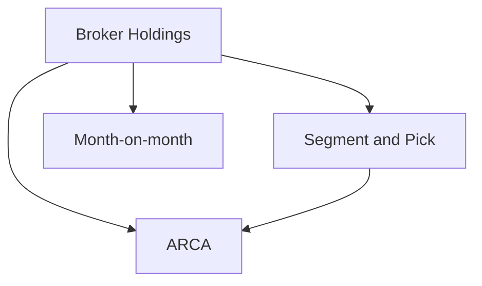

# Broker Holdings and ARCA

## 1. Executive Summary

Broker Holdings and ARCA bring the per-asset totals the user keeps in two spreadsheet tabs into the app: a "Totals" tab for Trading 212 and a "Totals com cotação" tab for XPI. Both list every holding of a broker with what was invested, what it is worth, the profit, the credits received and the yield, with subtotals per group. Today the user rebuilds them by hand, including typing every asset's price on the first day of each month.

The app already calculates most of these figures, but only one portfolio at a time, on the portfolio's **Holdings** tab. The broker's **Summary** tab shows totals and pie charts, not a per-asset table. This PRD adds:
- a **Holdings tab on every broker**, grouping all active holdings by portfolio, with subtotals, shares by invested and by market value, and the yield columns the spreadsheets use;
- an optional **Segment** (for example Logistics, Paper, Banks) and **Pick source** (Recommended or My choice) on assets, with grouping by segment inside each portfolio;
- **month-on-month values**: each holding's value on the 1st of last month and of this month, and the change, taken from saved prices instead of typed by hand;
- an **ARCA allocation** for brokers whose portfolios are assigned an ARCA bucket (today only XPI): an ARCA section with A, R, C and Pension, a separate Reserve fund, and the grand total of both.

Everything is generic. No screen is tied to a broker's name. A broker without segments or ARCA buckets shows the plain grouped table, which covers the Trading 212 tab. A broker that has them, like XPI, gets the richer layout.

## 2. Problem and Opportunity

### The Problem

**No per-asset view across a broker**
- Holdings shows one portfolio at a time. Trading 212 spreads five holdings over three portfolios (ETF, ETF ISA, ETF SIPP), and XPI spreads about 20 over five, so the user can't compare them side by side.
- The broker Summary has totals and pies but no row per asset.
- The user keeps two spreadsheet tabs alive to get this view.

**Missing figures the spreadsheets rely on**
- Shares are shown only by market value. The spreadsheets also show the share of the invested amount. The Trading 212 tab even computed it with the wrong formula.
- The profit is shown as a percentage but not as an amount.
- There is no credits yield on cost: total credits as % of invested, the average per month held, or the yearly rate (APR).
- The last credit is shown as a % of the invested amount, not of the current market value.

**No grouping by what the asset is**
- FIIs are compared by segment (Logistics, Paper, Urban, FOF, Shopping, Office) and shares by sector (Banks). The app has only the broad asset class (Equity, RealEstate…), which puts all of them in one bucket.
- The user also notes whether each FII came from their analysis service (Recommended) or was their own choice. That lives only in the spreadsheet.

**Manual monthly routine**
- On the 1st of each month the user types each asset's price into the spreadsheet and copies last month's price beside it to see the change. For the XPI tab that is about 20 values a month.
- The app already saves prices whenever it fetches them, so the data needed for this exists but isn't used.

**ARCA allocation kept by hand**
- XPI's holdings follow the ARCA method: A (shares and businesses), R (real estate), C (cash and fixed income), plus Pension, with the Reserve fund (3–12 months of expenses) kept apart. The international A is deliberately left to the other brokers.
- The split and each bucket's % are summed by hand in the spreadsheet.

### The Opportunity

- **Broker Holdings tab** gives one table per broker, built from the same per-asset calculations the portfolio Holdings tab already uses, grouped by portfolio with subtotals.
- **New derived columns** cover the missing figures without storing anything new.
- **Segment and Pick source** are two small optional asset properties that unlock grouping by segment and the "my/r" annotation.
- **Month-on-month values** read the saved price history, so a price fetch on the 1st before the market opens replaces the manual typing.
- **An ARCA bucket on each portfolio** reproduces the XPI split exactly, because XPI's portfolios already line up one-to-one with the buckets.

## 3. Target Audience

### Primary Users

**Self-directed investor with Brazilian and UK brokers**
- Holds FIIs, shares, funds, Tesouro Direto bonds and a pension fund at one Brazilian broker in BRL, and ETFs at UK brokers in GBP.
- Reviews allocation and yield monthly, usually on the 1st before the market opens, and decides what to buy next from shares and yields.
- Keeps the international allocation at the UK brokers on purpose, so the Brazilian broker's ARCA has no international bucket.

## 4. Objectives

### Product Objectives

1. **Replace** the Trading 212 "Totals" spreadsheet tab with the broker Holdings tab.
2. **Replace** the XPI "Totais com cotação" spreadsheet tab, including segment grouping, the my/r annotation and the ARCA split.
3. **Remove** the manual typing of month-start prices for listed assets.
4. **Show** each ARCA bucket's share of the ARCA total and the grand total including the Reserve fund on one screen.

### Success Metrics

1. Every figure in the Trading 212 tab has a column on the broker Holdings tab with the same value to 2 decimal places, apart from "Valor médio %", where the app's share-of-invested figure replaces the spreadsheet's incorrect formula. Measured by comparing the two on the same day.
2. Every kept figure in the XPI tab (all except the cells the user marked as leftovers) is shown on the broker Holdings or Summary tab with the same value to 2 decimal places when both use the same prices. Measured on the 1st of a month.
3. Month-start values are filled for 100% of listed XPI assets after one price fetch on the 1st, with no value typed by hand. Measured on the first 1st of the month after release.
4. The ARCA panel's bucket % values add up to 100.00% (±0.01) and the grand total equals the ARCA total plus the Reserve fund to the cent.

## 5. User Stories

### F01. Broker Holdings
- As an investor, I want a Holdings tab on a broker so that I can see every active holding of that broker in one table.
- As an investor, I want holdings grouped by portfolio with a subtotal row each so that I can compare the portfolios.
- As an investor, I want each holding's share of its group and of the broker, by invested amount and by market value, so that I can see what weighs most on cost and on current value.
- As an investor, I want the profit as an amount as well as a percentage so that I know how much money is up or down.
- As an investor, I want credits as % of invested, the average monthly yield and the APR so that I can compare income-paying assets fairly.
- As an investor, I want the last credit as a % of the current market value so that I can see today's yield.
- As an investor, I want sorting to work inside each group so that the subtotals stay meaningful.
- As an investor, I want a pie of all the broker's assets on the broker Summary so that I can see the whole broker's allocation in one chart.

### F02. Asset Segment and Pick Source
- As an investor, I want to give a share or real-estate fund a segment so that I can group my FIIs by Logistics, Paper and so on, and my shares by sector.
- As an investor, I want the segment field to suggest segments I've already used so that the same segment isn't typed two ways.
- As an investor, I want to mark an asset as Recommended or My choice so that I remember why I hold it.
- As an investor, I want a portfolio's holdings grouped by segment with segment subtotals so that I can see how much of my real-estate money is in each segment.
- As an investor, I want a pie by segment on the broker Summary so that I can see the segment split at a glance.

### F03. Month-on-Month Values
- As an investor, I want each holding's value on the 1st of last month and of this month so that I no longer copy prices by hand.
- As an investor, I want the change between the two as a percentage so that I can see the month's move at a glance.
- As an investor, I want to know which saved price each value came from so that I can trust it is the month-start close.

### F04. ARCA Allocation
- As an investor, I want to assign each portfolio to an ARCA bucket so that the app knows how my holdings map to ARCA.
- As an investor, I want the broker Holdings table arranged into an ARCA section, a Reserve fund section and a grand total so that it matches how I manage that broker.
- As an investor, I want each holding's and each bucket's share of the ARCA total so that the Reserve fund doesn't distort the allocation.
- As an investor, I want an ARCA panel on the broker Summary listing the Reserve fund, each bucket's value and %, the ARCA total and the grand total so that I can review the split in one place.

## 6. Functionalities

### F01. Broker Holdings

**Provides:**
- Per-holding rows with invested amount, market value, credits and the portfolio each belongs to, plus the group and subtotal layout and the "share of base" column (used by F02, F03, F04)

**Capabilities:**
- **Where:** a "Holdings" tab on a broker node of the investment tree, placed between Summary and Transactions. It shows only in the **Active** scope; in the Historic scope the broker tabs are unchanged.
- **Rows:** every asset with a quantity above zero in the broker's active portfolios. Assets with zero quantity are not listed.
- **Groups:** one group per portfolio, portfolios in alphabetical order, each starting with a header row (the portfolio name) and ending with a subtotal row. A broker total row closes the table.
- **Columns, in this order** (group headings in brackets):
  - Asset name, First purchase (date of the first buy), Quantity
  - [Invested] Invested, % of group, % of broker
  - [Market] Current price, Current value, % of group, % of broker
  - [Profit] Profit %, Profit amount, Profit % with credits
  - [Credits] Total credits, Credits % of invested, Monthly yield, APR
  - [Last credit] Amount, Month, % of market value
- **Definitions:**
  - Invested = cost of the units held (the figure the portfolio Holdings tab already shows as "Total invested" in the Active scope).
  - % of group = the row's invested (or current value) ÷ its group's total × 100. When a group has a single holding, the column shows "—" instead of 100%.
  - % of broker = the row's invested (or current value) ÷ the broker total × 100. F04 replaces this base with the ARCA total for brokers that use ARCA.
  - Profit amount = current value − invested. Profit % and Profit % with credits keep their current calculations.
  - Credits % of invested = total credits ÷ invested × 100.
  - Months held = (current year × 12 + current month) − (first purchase year × 12 + first purchase month), with a minimum of 1. For a first purchase in June 2021 viewed in November 2026, months held = 65.
  - Monthly yield = Credits % of invested ÷ months held.
  - APR = Monthly yield × 12.
  - Last credit amount and month keep their current calculations (credits of the most recent month that had any).
  - Last credit % of market value = last credit amount ÷ current value × 100.
- **Subtotal and broker total rows** show: invested, current value, both "% of broker" shares, profit amount, profit % = (value − invested) ÷ invested, total credits, credits % of invested, last credit amount (sum), last credit % of market value = sum of last credits ÷ sum of values, and profit % with credits = (value + credits − invested) ÷ invested. Per-asset-only columns (price, quantity, months-based yields, last credit month) are blank on these rows.
- **Holdings that can't be valued** show the missing-value mark in every market column. Subtotals and the broker total then sum only the valued holdings and carry the existing notice: "N of M holdings could not be valued; the total is incomplete."
- **Sorting:** every column header sorts. Rows are sorted **within** their group; groups and subtotal rows keep their position.
- **Currency:** amounts are shown in each asset's recorded currency, the same rule the portfolio Holdings tab and the broker Summary tiles use today. No conversion is added.
- **Portfolio Holdings tab:** in the Active scope it gains the same new columns (both shares, profit amount, credits %, monthly yield, APR, last credit % of market value). "% of broker" is shown there as "% of portfolio". The Historic scope keeps today's columns.
- **Broker Summary:** an "All assets" pie, sized by invested amount, is added above the existing "Portfolio breakdown" pie, one slice per asset, labelled with the asset name and %.

**Experience:**
- Selecting a broker opens Summary as today. Choosing Holdings shows a loading skeleton, then the table.
- The asset name column stays fixed while the table scrolls sideways. Numeric columns are right-aligned. Negative profits use the existing negative style plus a minus sign, never colour alone.
- Group header and subtotal rows are visually distinct (bold, top border) and are announced as row headers to screen readers.
- Empty state: "This broker has no active holdings."
- Error state: the existing error panel with Retry.
- The table is reachable and sortable with the keyboard, with visible focus on header buttons.

### F02. Asset Segment and Pick Source

**Consumes:**
- F01: per-holding rows with their portfolio, the group and subtotal layout

**Provides:**
- Segment of each holding and segment subtotals inside each portfolio (used by F04)

**Capabilities:**
- **Segment** is an optional asset property:
  - Free text, trimmed, 1–40 characters.
  - Offered only when the asset's class is Equity or RealEstate. ETFs, funds, bonds and every other class have no segment.
  - When an asset's class is changed to one without segments, the segment is removed on save. The form says so beside the Class field before saving.
  - Segments are grouped ignoring case and surrounding spaces. The name shown for a group is the spelling of its first holding in alphabetical order.
- **Pick source** is an optional asset property for any class, with two values: "Recommended" (from an analysis service) or "My choice". Empty means not set.
- Both are edited in the asset dialog (Admin → Assets and anywhere that dialog opens): Segment is a combobox listing every segment already used by any asset, in alphabetical order, and accepting new text; Pick source is a dropdown with "Not set", "Recommended" and "My choice".
- Both are stored on the asset in `data-investment.json`. Missing values load as "not set", so existing data files load unchanged and need no migration.
- **Holdings grouping:** inside a portfolio that has at least one holding with a segment, holdings are grouped by segment in alphabetical order, with holdings without a segment last under "No segment". Each segment has a subtotal row showing the same figures as a portfolio subtotal, plus the segment's share of its portfolio by invested and by market value. A portfolio with no segmented holdings keeps the flat list from F01.
- "% of group" on a holding row stays relative to the **portfolio**, not the segment.
- A "Pick" column after Asset name shows "Recommended", "My choice" or the missing-value mark, and is sortable.
- **Broker Summary:** a "By segment" pie, sized by invested amount, shown only when at least one holding of the broker has a segment. Holdings without a segment form a "No segment" slice.

**Experience:**
- In the asset dialog the Segment combobox sits under Class. Typing filters the suggestions; pressing Enter or leaving the field keeps typed text as a new segment.
- When Class is set to a class without segments, the Segment field is hidden and, if it had a value, the text "The segment will be removed when you save" appears under Class.
- Save, cancel, unsaved-changes and validation behave as the dialog does today. Invalid input focuses the field and shows the message under it.

**Error Handling:**
- Segment longer than 40 characters: "Segment must be 40 characters or fewer." Save is refused and focus moves to Segment.
- Segment made only of spaces is saved as no segment, without an error.
- Unknown Pick source value sent to the API: 400 with "Pick source must be Recommended or MyChoice."; the dialog shows the server message in its error alert and keeps the entered values.
- Save fails because storage is unavailable: the dialog stays open with the existing save-error alert and the values entered, so nothing is lost.

### F03. Month-on-Month Values

**Consumes:**
- F01: per-holding rows with their quantity, the group and subtotal layout

**Capabilities:**
- Three columns are added after the Market group, under the heading [Month]:
  - **Start of last month** (header shows the date, for example "1 Oct")
  - **Start of this month** (for example "1 Nov")
  - **Change %**
- **Month-start price** of an asset for a given 1st = its saved price with the latest date that is on or before that 1st **and** no more than 7 days before it. The 7-day window covers weekends and holidays. If no saved price falls in that window, the cell shows the missing-value mark with the tooltip "No saved price between 25 Oct and 1 Nov".
- **Value shown:**
  - Assets valued by market price: current quantity × month-start price.
  - Assets valued by a recorded total value (provider value or manual valuation): the recorded value itself.
- **Change %** = (start of this month − start of last month) ÷ start of last month × 100, shown only when both values exist.
- Subtotal and total rows sum each month-start column over holdings that have both values and show the change % of those sums. When any holding in the group lacks either value, the subtotal is marked with "*" and the tooltip "Excludes N holdings without both month-start prices".
- The tooltip on every value cell shows the unit price used and the date it was saved (for example "R$ 105.38 saved 1 Nov").
- Prices are read from the price history the app already saves on every automatic fetch and every manual entry. Nothing new is fetched or stored. A fetch on the 1st before the market opens saves the previous trading day's close under the 1st, which is the value this feature expects.

**Experience:**
- The columns appear for every broker as soon as the price history covers the dates. Before that they show the missing-value mark.
- Change % uses the same positive and negative styling as Profit %, with the sign always shown.
- On the 1st, after the user fetches prices, reopening Holdings shows the new "Start of this month" values without further steps. The previous month's figures move into "Start of last month" automatically.

### F04. ARCA Allocation

**Consumes:**
- F01: per-holding rows with invested amount, market value and portfolio, the group and subtotal layout, and the "share of base" column
- F02: segment of each holding and segment subtotals inside each portfolio

**Capabilities:**
- **ARCA bucket** is an optional portfolio property with these values:
  - "A – Shares and businesses"
  - "R – Real estate"
  - "C – Cash and fixed income"
  - "Pension"
  - "Reserve fund"

  There is no international bucket. Several portfolios may share a bucket.
- It is edited in Admin → Portfolios (create and edit dialogs) as a dropdown with "Not in ARCA" first. It is stored on the portfolio in `data-investment.json`; missing values load as "Not in ARCA", with no migration.
- **ARCA layout of the broker Holdings tab**, used when at least one of the broker's portfolios has a bucket. The table has three sections:
  1. **ARCA:** portfolios with A, R, C or Pension, ordered A, R, C, Pension, then by portfolio name. Each portfolio header shows its bucket label. Segment grouping from F02 applies inside each portfolio. Each portfolio subtotal shows its share of the ARCA total. An "ARCA total" row closes the section.
  2. **Reserve fund:** portfolios with "Reserve fund", with a subtotal row.
  3. **Not in ARCA:** portfolios without a bucket, with a subtotal row. Omitted when empty.

  A "Grand total" row closes the table, summing all three sections.
- **Share base:** for a broker using ARCA, the "% of broker" columns become "% of ARCA" and divide by the ARCA total (A + R + C + Pension). Rows in the Reserve fund and Not in ARCA sections show "—" in these columns. "% of group" keeps working in every section.
- Brokers without any bucket keep the F01 layout and the broker-total base.
- **ARCA panel** on the broker Summary, shown only for brokers using ARCA, as a table with these rows:
  - "Reserve fund (3–12 months of expenses)": current value.
  - One row per bucket that has at least one portfolio, in A, R, C, Pension order: current value and % of ARCA total.
  - "ARCA total": current value and 100.00%.
  - "Grand total (ARCA + Reserve fund)": current value.

  Values are market values. When any holding can't be valued, the panel shows the incomplete-total notice used elsewhere and its figures cover the valued holdings only.

**Experience:**
- In the portfolio dialog, the "ARCA bucket" dropdown sits under the portfolio name. Changing it and saving updates the broker Holdings and Summary the next time they load.
- The ARCA panel appears above the pie charts on the broker Summary. It is a real table with column headers (Bucket, Current value, % of ARCA), so screen readers read it as data.
- Section rows ("ARCA", "Reserve fund", "Not in ARCA") are headings inside the Holdings table and are visually stronger than portfolio headers.

**Error Handling:**
- Unknown bucket value sent to the API: 400 with "ARCA bucket must be one of Shares, RealEstate, Cash, Pension, ReserveFund or empty."; the dialog keeps the entered values and shows the message.
- Save fails because storage is unavailable: the portfolio dialog stays open with the existing save-error alert; nothing already saved changes.
- Every portfolio's bucket removed: the broker falls back to the F01 layout and the ARCA panel disappears, with no error.
- ARCA total is zero (for example only unvalued holdings in ARCA): "% of ARCA" shows "—" everywhere and the panel shows "No valued holdings in ARCA."

## 7. Out of Scope

**ARCA beyond one broker**
- An international bucket, and an ARCA split across several brokers or on the Dashboard.
- Converting other brokers' holdings into BRL for ARCA.
- Per-asset ARCA bucket overrides. The bucket lives on the portfolio only.
- Target percentages per bucket, rebalancing suggestions, and comparing the Reserve fund against CashFlow expenses. The "3–12 months of expenses" text is a label only, since the Investment context can't read CashFlow data.

**Holdings scope**
- A broker Holdings tab in the Historic scope.
- Converting mixed-currency rows to the reporting currency inside the Holdings table.
- Exporting the table to a spreadsheet or CSV.

**Prices**
- Asking a price provider for a historical close when no saved price falls in the 7-day window.
- Scheduling an automatic price fetch on the 1st of each month.

**Spreadsheet leftovers**
- The "Saldo" and "Renda Fixa" balancing cells, and the loose quota count cell, which the user confirmed are leftovers.
- Reproducing the Trading 212 tab's incorrect "Valor médio %" formula.
- Target or ceiling prices per asset.

## 8. Dependency Graph

### Part 1: Dependency Table

| # | Feature | Priority | Dependencies |
|---|---------|----------|--------------|
| F01 | Broker Holdings | 1 | None |
| F02 | Asset Segment and Pick Source | 2 | F01 |
| F03 | Month-on-Month Values | 2 | F01 |
| F04 | ARCA Allocation | 1 | F01, F02 |

### Part 3: Execution Waves

Features within the same wave can be built in parallel. A wave starts only after every feature in earlier waves is complete.

- **Wave 1**: F01
- **Wave 2**: F02, F03
- **Wave 3**: F04

### Part 4: Priority Levels

- **1** = Essential — product does not work without it
- **2** = Important — significant value addition
- **3** = Desirable — incremental improvement

### Part 5: Mermaid Diagram

## 9. Acceptance Criteria

### F01. Broker Holdings
- [x] Selecting a broker in the Active scope shows a Holdings tab between Summary and Transactions; in the Historic scope it is not shown.
- [x] The table lists every asset with quantity above zero in the broker's active portfolios and no asset with zero quantity.
- [x] Holdings are grouped by portfolio in alphabetical order, each group with a header row and a subtotal row, and the table ends with a broker total row.
- [x] For a holding with invested 1,000.00 in a group with invested 4,000.00 and a broker with invested 10,000.00, "% of group" (Invested) shows 25.00% and "% of broker" (Invested) shows 10.00%; the Market columns follow the same rule with current values.
- [x] A group with a single holding shows "—" in both "% of group" columns.
- [x] A holding with invested 2,000.00 and current value 1,800.00 shows Profit amount -200.00 and Profit % -10.00%.
- [x] A holding first bought in June 2021 with credits 50.00% of invested, viewed in November 2026, shows Credits % 50.00%, Monthly yield 0.77% (50.00 ÷ 65) and APR 9.23%.
- [x] A holding first bought in the current month shows months held as 1.
- [x] A holding with last credit 20.00 and current value 2,000.00 shows Last credit % of market value 1.00%.
- [x] Subtotal rows show profit % = (value − invested) ÷ invested and profit % with credits = (value + credits − invested) ÷ invested over the group's sums, and leave the per-asset-only columns blank.
- [x] When one of 5 holdings has no price, its market cells show the missing-value mark and the subtotal and total carry "1 of 5 holdings could not be valued; the total is incomplete."
- [x] Sorting by any column reorders rows only within their group; group headers and subtotal rows don't move.
- [x] The portfolio Holdings tab in the Active scope shows the new columns, with "% of portfolio" in place of "% of broker"; the Historic scope shows today's columns unchanged.
- [x] The broker Summary shows an "All assets" pie sized by invested amount above "Portfolio breakdown".
- [x] A broker with no active holdings shows "This broker has no active holdings."; a failed load shows the error panel with Retry, and Retry reloads the table.
- [x] The asset name column stays visible while scrolling sideways, numeric columns are right-aligned, and negative values carry a minus sign.

### F02. Asset Segment and Pick Source
- [x] The asset dialog shows Segment only when Class is Equity or RealEstate.
- [x] The Segment combobox lists every segment already used by any asset, alphabetically, and accepts a new value.
- [x] Saving a 41-character segment is refused with "Segment must be 40 characters or fewer." and focus moves to Segment.
- [x] Saving a segment of only spaces stores no segment.
- [x] Changing Class from RealEstate to ETF on an asset with a segment shows "The segment will be removed when you save", and after saving the asset has no segment.
- [x] Pick source offers "Not set", "Recommended" and "My choice", and the saved value appears in the Holdings "Pick" column.
- [x] An existing data file without segment or pick source loads with both shown as not set.
- [x] Two holdings with segments "Logistics" and " logistics " fall in one segment group.
- [x] Inside a portfolio with segmented holdings, holdings are grouped by segment alphabetically with "No segment" last, each segment with a subtotal showing its share of the portfolio by invested and by market value.
- [x] A holding's "% of group" stays relative to its portfolio when segment groups are shown.
- [x] A portfolio with no segmented holdings shows the flat F01 list.
- [x] The broker Summary shows a "By segment" pie only when at least one of its holdings has a segment.
- [x] An API request with an unknown pick source returns 400 with "Pick source must be Recommended or MyChoice." and the dialog keeps the entered values.

### F03. Month-on-Month Values
- [x] In November the column headers read "1 Oct" and "1 Nov".
- [x] With saved prices dated 30 Oct (10.00) and 1 Nov (11.00), the 1 Nov value uses 11.00.
- [x] With saved prices dated 30 Oct (10.00) and 2 Nov (11.00) and none on 1 Nov, the 1 Nov value uses 10.00.
- [x] With the latest saved price before 1 Nov dated 20 Oct, the 1 Nov cell shows the missing-value mark with "No saved price between 25 Oct and 1 Nov".
- [x] A market-priced holding of 100 units with month-start prices 10.00 and 11.00 shows 1,000.00, 1,100.00 and Change % +10.00%.
- [x] A holding valued by recorded total value shows the recorded values themselves, not multiplied by quantity.
- [x] Each value cell's tooltip shows the unit price used and the date it was saved.
- [x] A subtotal excluding a holding without a month-start price is marked "*" with "Excludes 1 holdings without both month-start prices".
- [x] No price is fetched or saved by opening the Holdings tab.

### F04. ARCA Allocation
- [ ] The portfolio create and edit dialogs offer an "ARCA bucket" dropdown with "Not in ARCA", "A – Shares and businesses", "R – Real estate", "C – Cash and fixed income", "Pension" and "Reserve fund", and the saved value persists after the API restarts.
- [ ] An existing data file without buckets loads with every portfolio "Not in ARCA", and every broker keeps the F01 layout.
- [ ] For a broker with buckets, the Holdings table shows the ARCA section (portfolios ordered A, R, C, Pension), an "ARCA total" row, the Reserve fund section, the Not in ARCA section only when it has portfolios, and a "Grand total" row.
- [ ] With A 200.00, R 300.00, C 100.00, Pension 400.00 and Reserve fund 250.00 (current values), the ARCA total is 1,000.00, R's share is 30.00%, and the Grand total is 1,250.00.
- [ ] In a broker using ARCA, the share columns read "% of ARCA", divide by the ARCA total, and show "—" for Reserve fund and Not in ARCA rows.
- [ ] Segment groups from F02 still appear inside ARCA portfolios.
- [ ] The broker Summary shows the ARCA panel only for brokers using ARCA, with the Reserve fund row, one row per assigned bucket in A, R, C, Pension order with value and %, the ARCA total at 100.00% and the Grand total.
- [ ] A bucket with no portfolio is not listed in the panel.
- [ ] The panel's bucket percentages add up to 100.00% (±0.01).
- [ ] When the ARCA total is zero, "% of ARCA" shows "—" and the panel shows "No valued holdings in ARCA."
- [ ] Removing every portfolio's bucket returns the broker to the F01 layout and removes the panel.
- [ ] An API request with an unknown bucket returns 400 with "ARCA bucket must be one of Shares, RealEstate, Cash, Pension, ReserveFund or empty." and the dialog keeps the entered values.

### Cross-Feature Integration
- [x] Segment groups (F02) are built from the same per-holding rows and portfolio groups as the broker Holdings table (F01), and segment subtotals add up to their portfolio's subtotal.
- [x] Month-start columns (F03) use the current quantity of each F01 row, and their subtotals sit on the same subtotal rows as F01's.
- [ ] ARCA sections (F04) are made of F01's portfolio groups; the ARCA total equals the sum of the ARCA portfolios' F01 subtotals, and the "% of ARCA" column replaces F01's "% of broker" for the same rows.
- [ ] Inside ARCA portfolios, the segment groups and subtotals from F02 appear unchanged.
