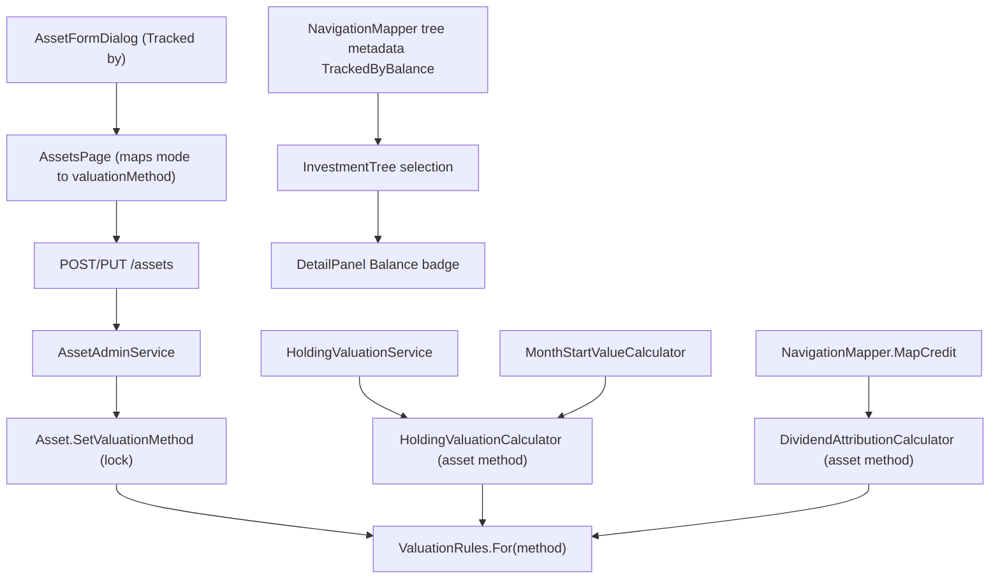

# Spec: Balance-Tracked Holding Option

**Complexity:** medium (three layers plus Web, two existing endpoints reshaped, no data file change). Three PRs, each a vertical slice: (1) valuation reads the asset's method, (2) the "Tracked by" choice and its lock, (3) the "Balance" tag in the asset header.

## 1. Technical Overview

**What:** Every holding gets a tracking mode, **Quantity and price** or **Balance**, derived from the existing `Asset.ValuationMethod`: `ProviderValue` and `Manual` are Balance, every other value (`Unspecified`, `MarketPrice`, `BondQuote`) is Quantity and price. The asset form gets a "Tracked by" choice that sets the method, the mode is locked once the holding has any transaction, credit, corporate action or saved price, and the asset header shows a "Balance" tag. Valuation stops reading the copy of the method stored on each `AssetPriceSnapshot` and reads the asset's method instead.

**Why:** Today the method is settable only through the API (`AssetsPage.tsx` always sends `valuationMethod: null`), and three Domain rules (`HoldingValuationCalculator.ValueAt`, `MonthStartValueCalculator` through it, `DividendAttributionCalculator`) decide "total or per unit" from `price.ValuationMethod`, a copy taken when the snapshot was written. With two sources of truth, a method change would reinterpret old snapshots one way and new ones another. One authority (the asset) plus a lock that forbids a mode change while any history exists means a snapshot's meaning can never change after it is recorded. F02, F03, F04 and F05 build on this mode.

**Scope:**

*Included*
- `ValuationRules` (Domain): the valuation policy chosen by the asset's method, `ValuationRules.For(ValuationMethod)`, with a per-unit and a position-total implementation. It is the one place that says how a method reads a snapshot (`ValueAt`, `ValueOfPortion`, `ValueWithoutPrice`, `AllowsZeroPrice`, `FetchesAutomatically`, `ManualEntrySource`, `IsBalance`). F03 adds value and status on a date to the same policy, and F02 gates on it.
- `HoldingValuationCalculator`, `MonthStartValueCalculator`, `DividendAttributionCalculator`, `AssetPriceSnapshot.ValidatePrice`, `AssetPriceLookupService` and `AssetPriceHistoryService` take the asset's policy (`Asset.ValuationRules`) instead of branching on a method.
- `Asset.IsTrackedByBalance`, `Asset.HasRecords`, and the lock enforced in `Asset.SetValuationMethod`.
- `AssetAdminDTO.IsTrackedByBalance` and `AssetAdminDTO.HasRecords`; the `TrackedByBalance` tree metadata key (no `AssetNodeDTO` field).
- Asset form "Tracked by" radio group (create and edit), read-only when locked; "Balance" badge in the `DetailPanel` header.
- OpenAPI snapshot and generated web types regenerated in PR 2 only.

*Excluded (other features)*
- Rejecting Buy, Sell, credits and corporate actions on a balance-tracked holding, and the Deposit/Withdrawal types themselves: F02 (it owns the "This holding is tracked by balance…" message).
- Balance entries, "Balance history" tab, 35-day staleness: F03.
- Summary/Holdings "Not applicable" fields, balance current value and totals: F04.
- Converting an existing holding with history to Balance: F05. Its tool needs its own Domain conversion path, because the F01 lock refuses a mode change on a holding with transactions.

*Deferred (follow-up candidate, not in P69)*
- Removing `AssetPriceSnapshot.ValuationMethod` from the stored JSON and from `AssetPriceSnapshotDTO`. After PR 1 nothing reads it for valuation; dropping it is a data-shape and wire change with no user-visible benefit inside P69.

## 2. Before you design (docs/rules/design.md)

1. **Where it belongs:** Investment bounded context. The mode is a property of `Asset` (Domain); the lock is an invariant of `Asset` (enforced in `SetValuationMethod`, the only setter that could violate it); how a method reads a snapshot is a valuation policy with several call sites, so it lives in `Domain/Rules/ValuationRules.cs` and the asset exposes its own (`Asset.ValuationRules`). `AssetAdminService` (Application) only carries the request field through and maps the derived flags to the DTO.
2. **Layers touched, in direction:** PR 1 Domain → Application. PR 2 Domain → Application → API contract → Web. PR 3 Application → Web (tree metadata only, no contract change). Infrastructure is untouched: `ValuationMethod` is already persisted on the asset.
3. **What keeps Domain free of Infrastructure:** nothing new crosses a boundary. `AssetAdminService` keeps using `IInvestmentRepository` (declared in Application) and `ApplyAndSaveAsync`, whose rollback already discards a half-applied change when the delegate throws.
4. **SOLID:** Single responsibility: how each method reads a snapshot exists once (`ValuationRules`), the lock exists once (`Asset.SetValuationMethod`). Open/closed: the request contract is unchanged (`valuationMethod` stays an optional field), so existing callers and stored data keep working; new DTO fields are additive. Dependency inversion: unchanged repository abstraction.

## 3. Architecture Impact



## 4. Technical Decisions

| Decision | Chosen Approach | Alternative Considered | Trade-off |
|---|---|---|---|
| Where "total or per unit" is decided | One `ValuationRules` per method (`PerUnit`, `PositionTotal`), taken from `Asset.ValuationRules` and passed to the calculators | An `IsBalance` check at each call site | The PRD (F03/F04) asks for one valuation policy; building it here means F03 adds value/status on a date to it instead of reshaping the same signatures a second time |
| How the mode is stored | Derived from `Asset.ValuationMethod` (`ProviderValue`/`Manual` = Balance) | A new `TrackingMode` field on `Asset` | No data change and no second field that could disagree with the method; the cost is that "mode" is a projection, not a stored value |
| Request contract | Reuse the existing optional `valuationMethod` on `AssetAdminCreateDTO` / `AssetAdminUpdateDTO`; the web sends `ProviderValue` for Balance, `Unspecified` for Quantity and price, and `null` when the mode did not change | A new `trackingMode` request field | No request-shape change; `null` keeps today's "preserve" behaviour, so editing a `Manual` holding never silently rewrites it to `ProviderValue` |
| What the lock compares | The mode (`IsBalance(old) != IsBalance(new)`), not the raw method | Lock every method change | A same-mode change (`MarketPrice` → `Unspecified`, `Manual` → `ProviderValue`) never changes how a snapshot is read, so it stays allowed, as today |
| Where the lock lives | `Asset.SetValuationMethod`, throwing `InvestmentRuleViolationException` (409 via `DomainExceptionMappingMiddleware`) | A check in `AssetAdminService` | The invariant sits on the entity that owns it; any future caller is covered |
| What counts as history | `Asset.HasRecords`: any transaction, credit, corporate action or price snapshot | Transactions only | Matches the PRD; named and shaped like CashFlow's `AccountDTO.HasRecords` so the form copies `AccountFormDialog`'s lock |
| How the web learns lock and mode | Server-derived `AssetAdminDTO.IsTrackedByBalance` and `HasRecords` | Web recomputes from `valuationMethod` and counts | One copy of the rule; the admin list does not carry credit/price counts |
| Header tag source | New tree metadata key `TrackedByBalance` written from the asset, carried into `SelectedNode.isTrackedByBalance` like `assetClass` | A typed `AssetNodeDTO` field as well, or read it from the asset-details request | The web reads only metadata (as for `GlobalAssetClass`, `PositionType`), so no wire field and no contract regeneration in PR 3 |
| Locked control | `ReadOnlyInput` showing the current mode, with the locked hint (pattern: `AccountFormDialog` Template lock) | A disabled `RadioGroup` (PRD wording) | `docs/ui/forms-data-and-visualisations.md` forbids disabled inputs for read-only values because keyboard and screen-reader users skip them; the read-only field stays focusable and its hint is announced |
| Snapshot's own method copy | Kept in storage and in `AssetPriceSnapshotDTO`, no longer read for valuation | Remove it now | Avoids a data-shape and wire change in P69 (see Deferred) |

## 5. Component Overview

### PR 1: valuation reads the asset's policy

| File Path | New/Modified | Purpose | Key Responsibilities |
|---|---|---|---|
| `Financial.Investment.Domain/Rules/ValuationRules.cs` | New | One rule set per method | Abstract `ValuationRules` with `For(ValuationMethod)` returning `PerUnit` (Unspecified, MarketPrice, BondQuote) or `PositionTotal` (ProviderValue, Manual); members `IsBalance`, `ValueAt(quantity, snapshot)`, `ValueOfPortion(shares, held, snapshot)`, `ValueWithoutPrice(quantity)` (PerUnit: 0 when quantity is 0, else unavailable; PositionTotal: always unavailable), `AllowsZeroPrice`, `FetchesAutomatically` (false for PositionTotal), `ManualEntrySource` (PositionTotal: `PriceSource.ProviderValuation`; PerUnit: `PriceSource.Manual`) |
| `Financial.Investment.Domain/Entities/Asset.cs` | Modified | Expose the policy | `ValuationRules => ValuationRules.For(ValuationMethod)` |
| `Financial.Investment.Domain/Rules/HoldingValuationCalculator.cs` | Modified | Value from the policy | `Calculate(quantity, averagePrice, price, policy, valuationDate)` and `ValueAt(quantity, price, policy)` delegate to the policy; `price.ValuationMethod` is no longer read |
| `Financial.Investment.Domain/Rules/MonthStartValueCalculator.cs` | Modified | Month-start value | Uses `asset.ValuationRules` |
| `Financial.Investment.Domain/Rules/DividendAttributionCalculator.cs` | Modified | Dividend yield on market | `Calculate(credit, transactions, priceOnDate, policy)`; uses `policy.ValueOfPortion` |
| `Financial.Investment.Domain/Entities/AssetPriceSnapshot.cs` | Modified | Zero-price rule | `ValidatePrice` uses `ValuationRules.For(method).AllowsZeroPrice` (behaviour unchanged; the method passed in is already the asset's, from `Asset.SetPrice`) |
| `Financial.Investment.Application/Services/HoldingValuationService.cs` | Modified | Caller | Passes `asset.ValuationRules` |
| `Financial.Investment.Application/Services/NavigationMapper.cs` | Modified | Caller | `MapCredit` passes `asset.ValuationRules` |

8 non-test code files, plus the PRD §9 F01 AC ids (docs commit). No contract change. The Application price services move to PR 2 to keep this PR at 8 files.

### PR 2: "Tracked by" choice and lock

| File Path | New/Modified | Purpose | Key Responsibilities |
|---|---|---|---|
| `Financial.Investment.Domain/Entities/Asset.cs` | Modified | Mode and lock | `IsTrackedByBalance => ValuationRules.IsBalance`; `HasRecords` (any transaction, credit, corporate action or price snapshot, using the private lists' counts); `SetValuationMethod` throws `InvestmentRuleViolationException(TrackingModeLockedMessage)` when the mode changes and `HasRecords` is true; `public const string TrackingModeLockedMessage = "This holding now has transactions or prices, so how it is tracked can't be changed."` |
| `Financial.Investment.Application/DTOs/AssetAdminDTO.cs` | Modified | Read contract | `bool IsTrackedByBalance`, `bool HasRecords` |
| `Financial.Investment.Application/Services/AssetAdminService.cs` | Modified | Mapping | `ToDto` maps the two flags; create/update logic unchanged (the Domain guard does the work inside `ApplyAndSaveAsync`, so a rejection rolls back the rename and every other field) |
| `Financial.Investment.Application/Services/AssetPriceLookupService.cs` | Modified | No fetch for Balance | The "ProviderValue or Manual: no automatic fetch" branch becomes `!asset.ValuationRules.FetchesAutomatically` |
| `Financial.Investment.Application/Services/AssetPriceHistoryService.cs` | Modified | Manual entry source | `SetPriceAsync` uses `asset.ValuationRules.ManualEntrySource`, so a `Manual` holding now records `ProviderValuation` like a `ProviderValue` one (PRD F03) |
| `Financial.Web/src/utils/trackingMode.ts` | New | Web mapping | `TrackingMode = 'quantity' \| 'balance'`, `TRACKING_MODE_LABELS` ("Quantity and price", "Balance"), `initialTrackingMode(asset)`, `valuationMethodForCreate(mode)` (`'ProviderValue'` or `null`), `valuationMethodForUpdate(initial, chosen)` (`null` when unchanged, else `'ProviderValue'` / `'Unspecified'`) |
| `Financial.Web/src/components/AssetFormDialog.tsx` | Modified | "Tracked by" field | `trackingMode` in `AssetFormValues` and in the dirty check; `RadioGroup` when `hasRecords` is false, `ReadOnlyInput` + locked hint when true (as `AccountFormDialog` does with `isLocked = account?.hasRecords === true`) |
| `Financial.Web/src/pages/AssetsPage.tsx` | Modified | Request mapping | Sends `valuationMethod` from `utils/trackingMode` on create and update instead of the hard-coded `null`; the two stale comments about "no form field yet" go |

8 non-test code files, plus the regenerated `Tests/Financial.Api.Tests/Contract/openapi-v1.snapshot.json` and `Financial.Web/src/api/generated/openapi.ts`, the PRD wording fixes (docs commit, including the lock message now naming "transactions or prices"), and `context.md`. Regenerate with `UPDATE_OPENAPI_SNAPSHOT=1 dotnet test Tests/Financial.Api.Tests --filter "FullyQualifiedName~OpenApiContractTests"`. Merge order in wave 1: F06 PR 1 first, then this PR rebases and regenerates both generated files rather than hand-merging them.

### PR 3: "Balance" tag in the asset header

| File Path | New/Modified | Purpose | Key Responsibilities |
|---|---|---|---|
| `Financial.Investment.Application/DTOs/NavigationMetadataKeys.cs` | Modified | Metadata key | `TrackedByBalance = "TrackedByBalance"` |
| `Financial.Investment.Application/Services/NavigationMapper.cs` | Modified | Tree mapping | `BuildAssetTreeNode` writes the metadata key from the asset's `IsTrackedByBalance` (passed alongside the `AssetNodeDTO`, not added to it) |
| `Financial.Web/src/utils/treeNodeMetadata.ts` | Modified | Metadata read | `getMetaBoolean(metadata, key)` (false unless the value is `true`) |
| `Financial.Web/src/api/types.ts` | Modified | Selection type | `SelectedNode.isTrackedByBalance?: boolean` (hand-written section) |
| `Financial.Web/src/components/InvestmentTree.tsx` | Modified | Selection | `buildAssetSelection` sets `isTrackedByBalance` from `TrackedByBalance` |
| `Financial.Web/src/components/DetailPanel.tsx` | Modified | Header | `Badge appearance="outline" color="informative"` reading "Balance" in the title row, after the position-type status, only when `isAsset && selectedNode.isTrackedByBalance` |

6 non-test code files. No contract change and no regeneration (tree metadata is a free-form object).

## 6. API Contracts

No new endpoint. Two existing requests keep their shape; three response schemas gain derived, read-only fields.

**`POST /api/v1/financial/assets`** and **`PUT /api/v1/financial/assets/{brokerName}/{portfolioName}/{assetName}?scope=`**

| Field | Type | Required | Validation | Description |
|---|---|---|---|---|
| `valuationMethod` | `ValuationMethod \| null` | No | enum | Create: `null` → `Unspecified`. Update: `null` keeps the current method. A value whose mode differs from the current one is rejected while the asset has history |

Request example (create, Balance):
```json
{
  "brokerName": "XPI",
  "portfolioName": "Previdência",
  "name": "Grão ARCA",
  "isin": "",
  "exchange": "",
  "ticker": "",
  "country": "BR",
  "localTypeCode": "",
  "class": "Pension",
  "valuationMethod": "ProviderValue",
  "incomePolicy": null,
  "segment": null,
  "pickSource": null
}
```

**Response `AssetAdminDTO`** (create, update, `GET /assets`) adds:

| Field | Type | Description |
|---|---|---|
| `isTrackedByBalance` | `boolean` | `valuationMethod` is `ProviderValue` or `Manual` |
| `hasRecords` | `boolean` | Any transaction, credit, corporate action or saved price (the mode is then locked) |

```json
{
  "name": "Grão ARCA",
  "brokerName": "XPI",
  "portfolioName": "Previdência",
  "brokerStatus": "Active",
  "class": "Pension",
  "valuationMethod": "ProviderValue",
  "isTrackedByBalance": true,
  "hasRecords": false,
  "quantity": 0
}
```

**Navigation tree** (PR 3): the asset `TreeNodeDTO.metadata` gains `"TrackedByBalance": true|false` (free-form object, no schema change). `AssetNodeDTO` is unchanged.

**Errors**

| Case | HTTP Status | Detail |
|---|---|---|
| Mode change on an asset with any transaction, credit, corporate action or saved price | 409 | "This holding now has transactions or prices, so how it is tracked can't be changed." (no `code` extension) |
| Storage failure | 503 (existing `TransientStorageException` mapping) | Existing message; web shows the existing fallback |

OpenAPI (PR 2 only): regenerate with `UPDATE_OPENAPI_SNAPSHOT=1 dotnet test Tests/Financial.Api.Tests --filter "FullyQualifiedName~OpenApiContractTests"`, then `cd Financial.Web && npm run generate-api-types`, commit both, and update every `AssetAdminDto` test fixture `tsc -b` flags.

## 7. Data Model

No change. `Asset.ValuationMethod` is already persisted; `AssetPriceSnapshot.ValuationMethod` stays in the JSON, written as today, and is not read for valuation. A read-only count on the live data file (2026-11-27) found no snapshot whose stored method differs from its asset's, so PR 1 changes no value currently shown; the implementer repeats the check on a temp copy before merging PR 1.

## 8. Rules in detail

- **Mode:** Balance ⇔ `ValuationMethod` ∈ {`ProviderValue`, `Manual`}. Everything else is Quantity and price.
- **No snapshot:** `Calculate` asks `policy.ValueWithoutPrice(quantity)`. PerUnit keeps today's rule (quantity 0 → value 0, Current; otherwise unavailable). PositionTotal is always unavailable (value null, `MarketStatus.Unavailable`), because F02's deposits are cash-only and a balance holding's quantity is always 0. F04 changes only the PositionTotal policy to "No balance recorded".
- **Reading a snapshot:** `policy.ValueAt(quantity, price)` = `price.Price` for PositionTotal, `quantity × price.Price` for PerUnit. Same in month-start values. Dividend market value on date: `policy.ValueOfPortion(shares, held, price)` = `price.Price × shares ÷ held` for PositionTotal, `shares × price.Price` for PerUnit.
- **Lock:** `SetValuationMethod(next)`: if `IsBalance(next) != IsTrackedByBalance` and `HasRecords` → `InvestmentRuleViolationException(TrackingModeLockedMessage)`. Otherwise sets the method. Applies to active and historic assets.
- **Create:** a new asset has no history, so any method is accepted. Available for every country, class and broker; P68 class, segment and pick-source rules unchanged.
- **Update with `valuationMethod: null`** never trips the lock (the method does not change), so every existing client and every edit that leaves the mode alone keeps working on holdings with history.

## 9. Web

**User task:** choose how a new holding is tracked; see, and where allowed change, how an existing one is tracked.

- **Field order:** … Class, Segment (when shown), **Tracked by**, Pick source. It sits with the other classification fields.
- **Changeable (create, or edit where `hasRecords` is false):** `Field label="Tracked by"` wrapping a vertical `RadioGroup` with "Quantity and price" (default on create) and "Balance". Field hint: "For holdings whose broker shows only a balance, such as pension plans. You record deposits, withdrawals and the balance." The `Field` gives the group its accessible name; arrow keys move between options; Fluent's focus ring is the visible focus.
- **Locked (edit where `hasRecords` is true):** `Field label="Tracked by"` with `ReadOnlyInput` showing "Balance" or "Quantity and price", hint "Can't change how this holding is tracked because it has transactions or prices. Remove them first." (focusable, announced).
- **Initial value on edit:** `asset.isTrackedByBalance ? 'balance' : 'quantity'`.
- **Request:** create sends `ProviderValue` for Balance and `null` for Quantity and price; update sends `null` unless the mode changed, then `ProviderValue` or `Unspecified`.
- **States:** initial and dirty check include `trackingMode`; saving, server error and "Discard changes?" reuse `EntityFormDialog` / `useDialogSubmit` unchanged; no loading or empty state of its own.
- **Lock conflict (409):** handled like every other 409: the summary error shows the server detail and every input is kept. No special recovery path; the Domain lock stays authoritative. After a failed save the page refetches the asset list (existing behaviour on save errors, or added if missing), so reopening the dialog shows the field locked.
- **Storage or other failure:** the existing fallback "The asset could not be saved." (PRD's "Couldn't save the asset" names this existing message), inputs kept, mode kept.
- **Header (PR 3):** "Balance" outline informative `Badge` after the position status; text, not colour, carries the meaning. Not shown for Quantity and price holdings or non-asset nodes.
- **Responsive / zoom:** the radio group is vertical, so it wraps cleanly in the dialog at narrow widths and 200% zoom; the badge wraps with the title row like the existing status.

## 10. Error Handling

| Case | Behaviour |
|---|---|
| Mode change sent for a holding that gained history after the form opened | 409 with `TrackingModeLockedMessage`; `ApplyAndSaveAsync` restores the in-memory document, so no field (name, ISIN, segment…) is saved; dialog stays open with the server message and the inputs kept |
| Same-mode method change on a holding with history (API only) | Accepted, as today |
| Storage failure | Existing 503 mapping and rollback; dialog keeps the input |

## 11. Testing Strategy

| Test File | Test Type | Target |
|---|---|---|
| `Tests/Financial.Investment.Domain.Tests/Rules/ValuationRulesTests.cs` (new, PR 1) | Unit | `For` per enum value and each policy member |
| `Tests/Financial.Investment.Domain.Tests/Domain/HoldingValuationCalculatorTests.cs` (PR 1) | Unit | Asset method decides total vs per unit, whatever the snapshot's copy says |
| `Tests/Financial.Investment.Domain.Tests/Domain/MonthStartValueCalculatorTests.cs` (PR 1) | Unit | Month-start value follows the asset method |
| `Tests/Financial.Investment.Domain.Tests/Domain/DividendAttributionCalculatorTests.cs` (PR 1) | Unit | Pro-rating follows the asset method |
| `Tests/Financial.Investment.Application.Tests/Services/HoldingValuationServiceTests.cs` (PR 1) | Unit | Service passes the asset method |
| `Tests/Financial.Investment.Domain.Tests/Domain/AssetTests.cs` (PR 2) | Unit | Mode, `HasRecords`, lock per history kind, same-mode change allowed |
| `Tests/Financial.Investment.Application.Tests/Services/AssetAdminServiceTests.cs` (PR 2) | Unit | DTO flags; rejection marks the span failed and saves nothing |
| `Tests/Financial.Api.Tests/Acceptance/BalanceTrackedHoldingOptionAcceptanceTests.cs` (new, PR 2) | Integration | AC-01..04, 06 through the real host |
| `Financial.Web/src/utils/__tests__/trackingMode.test.ts` (new, PR 2) | Unit | Mapping helpers |
| `Financial.Web/src/components/__tests__/AssetFormDialog.test.tsx` (PR 2) | Unit | Field, lock, accessibility |
| `Financial.Web/src/pages/__tests__/AssetsPage.test.tsx` (PR 2) | Unit | Request `valuationMethod` on create/update |
| `Tests/Financial.Investment.Application.Tests/Services/NavigationMapperTests.cs` (PR 3) | Unit | `IsTrackedByBalance` and metadata key |
| `Financial.Web/src/utils/__tests__/treeNodeMetadata.test.ts`, `src/components/__tests__/InvestmentTree.test.tsx`, `src/components/__tests__/DetailPanel.test.tsx` (PR 3) | Unit | Flag carried into the selection; badge shown only for Balance |

**Key functions**

| Test Function | Description | Assertions |
|---|---|---|
| `For_ProviderValueAndManual_ArePositionTotal` / `For_OtherMethods_ArePerUnit` (theory) | Classification | Policy type and `IsBalance` per value |
| `PositionTotal_ManualEntrySource_IsProviderValuation` / `PositionTotal_FetchesAutomatically_IsFalse` | Policy | Literal values; PerUnit opposites |
| `Calculate_BalanceAsset_ReadsSnapshotAsTotal_EvenWhenSnapshotSaysMarketPrice` | Authority | Qty 10, snapshot 5000 stored as MarketPrice, asset ProviderValue → market value 5000 |
| `Calculate_QuantityAsset_ReadsSnapshotPerUnit_EvenWhenSnapshotSaysProviderValue` | Authority | Qty 10, snapshot 8 stored as ProviderValue, asset MarketPrice → 80 |
| `Calculate_ManualAsset_ZeroSnapshot_IsZeroValue` | Boundary | Value 0, not unavailable |
| `Calculate_BalanceAsset_NoSnapshot_IsUnavailable` | Boundary | Quantity 0, no price, ProviderValue → value null, `MarketStatus.Unavailable` (a Quantity and price asset with quantity 0 still gets 0, Current) |
| `MonthStart_BalanceAsset_UsesSnapshotTotal` | Month start | Value = snapshot price, not qty × price |
| `Attribution_BalanceAsset_ProRatesSnapshot` / `Attribution_QuantityAsset_MultipliesPerShare` | Dividend | Literal market values |
| `GetValuation_PassesTheAssetsMethod` | Service | Balance asset with mismatched snapshot → total |
| `IsTrackedByBalance_FollowsValuationMethod` (theory) | Entity | Per method |
| `HasRecords_NoHistory_IsFalse`; `…_WithATransaction/ACredit/ACorporateAction/APrice_IsTrue` | Entity | Each history kind on its own |
| `SetValuationMethod_ModeChangeWithHistory_Throws` | Lock | `InvestmentRuleViolationException` with `TrackingModeLockedMessage`; method unchanged |
| `SetValuationMethod_SameModeWithHistory_IsAllowed` | Lock | `MarketPrice` → `Unspecified`, `Manual` → `ProviderValue` both succeed |
| `SetValuationMethod_ModeChangeWithoutHistory_Changes` | Lock | Both directions |
| `UpdateAsset_ModeChangeWithHistory_ThrowsAndSavesNothing` | Service | Throws; `_tracer.ShouldHaveFailedSpan<InvestmentRuleViolationException>("Investment.AssetAdminService.UpdateAsset")`; reloaded asset keeps old name and method |
| `GetAssets_MapsTrackingFlags` | Service | Both flags per asset |
| `MapAsset_BalanceAsset_SetsTrackedByBalanceMetadata` | Mapper | Metadata `TrackedByBalance` true; false for Unspecified |
| `trackingMode` helpers | Web util | `valuationMethodForUpdate('balance','balance')` → `null`; `('quantity','balance')` → `'ProviderValue'`; `('balance','quantity')` → `'Unspecified'`; create mapping |
| "offers Tracked by with Quantity and price selected on a new asset" | Form | `getByRole('radiogroup', { name: 'Tracked by' })`, checked option, hint text |
| "shows Balance on an existing ProviderValue or Manual holding" | Form | Selected option from `isTrackedByBalance` |
| "shows the mode read-only with the locked hint when the holding has history" | Form | No radiogroup; `ReadOnlyInput` value; hint text |
| "keeps the chosen mode after a storage failure" | Form | 503 → mode and inputs kept, fallback error |
| "moves between options with the arrow keys" | Form | `userEvent.keyboard('{ArrowDown}')` changes the checked radio |
| "sends ProviderValue when creating a Balance holding" / "sends null when the mode is unchanged" / "sends Unspecified when switching to Quantity and price" | Page | `createAsset`/`updateAsset` mock arguments |
| "shows the Balance badge only for a balance-tracked asset" | DetailPanel | Badge text present/absent |

**Acceptance (AC ids to add to PRD §9 F01, `P69-F01-balance-tracked-holding-option-{SS}`)**

| Test | AC |
|---|---|
| `CreateAsset_TrackedByBalance_IsStoredAsProviderValue` | -01 |
| `CreateAsset_WithoutAChoice_IsQuantityAndPrice_AndExistingAssetsAreUnchanged` | -02 |
| `ProviderValueAndManualAssets_AreReportedAsBalance` | -03 |
| `AssetWithATransactionCreditCorporateActionOrPrice_CannotChangeTrackingMode` + form test "shows the mode read-only with the locked hint…" | -04 |
| `HoldingValuationServiceTests.GetValuation_PassesTheAssetsMethod` tagged `[Trait("AC","P69-F01-balance-tracked-holding-option-05")]`, plus the one-off temp-copy data count recorded in PR 1's body | -05 |
| `UpdateAsset_ModeChangeAfterATransaction_Returns409AndSavesNothing` | -06 |
| `DetailPanel.test.tsx` "[AC …-07] shows the Balance badge only for a balance-tracked asset" + `MapAsset_BalanceAsset_SetsTrackedByBalanceMetadata` | -07 |
| `AssetFormDialog.test.tsx` "[AC …-08] Tracked by is a named radio group operable with the keyboard"; visible focus checked in the browser pass | -08 |

**Browser pass (PRs 2 and 3, `docs/rules/ui.md` completion requirement):** run the worktree's own API and SPA on the dev data copy and check the asset form (create, edit, locked) and the header badge at normal width, narrow width and 200% zoom, keyboard only, including the visible focus ring on the radio group (AC -08), then the full `docs/ui/review-checklist.md` and the `ui-reviewer` agent.

**Cross-feature criteria:** the F01 side of the cross-feature bullets (Balance holding takes Deposits/Withdrawals, shows Balance history, is valued by F04 rules) is exercised by F02, F03 and F04's tests; F01 provides `Asset.IsTrackedByBalance` for them.

## 12. Assumptions and Decisions (Batch Mode, auto-accepted)

Each was not answered by the PRD and was resolved by the Auto-Accept Policy row "Technical decisions with a clear recommendation" unless noted.

1. **Mode is derived, not stored**, from `ValuationMethod` (`ProviderValue`/`Manual` = Balance), per the PRD mapping and the project's derive-don't-store preference.
2. **Request reuses `valuationMethod`**; web sends `ProviderValue` (Balance), `Unspecified` (Quantity and price) or `null` (unchanged). Choosing Balance always writes `ProviderValue`, never `Manual`.
3. **Lock compares modes, not methods**; same-mode method changes stay allowed through the API.
4. **Lock lives in `Asset.SetValuationMethod`** and raises `InvestmentRuleViolationException` (409, no problem code).
5. **Server-derived flags** `isTrackedByBalance` / `hasRecords` on `AssetAdminDTO` (wire change, snapshot regenerated). `HasRecords` mirrors CashFlow's `AccountDTO.HasRecords` naming and polarity.
6. **Locked presentation is `ReadOnlyInput` + hint**, not a disabled radio group (project UI rule over PRD wording). The PRD Experience line and AC -04 wording ("disabled") are updated in PR 2's docs commit to "shown read-only".
7. **"Balance" tag placement:** the header has no asset-class text today, so the badge goes after the position-type status in the `DetailPanel` title row; PRD wording "next to the asset class" updated in PR 3's docs commit.
8. **Header flag travels through tree metadata only** (`TrackedByBalance`), with no `AssetNodeDTO` field; after a drag-and-drop move the selection is rebuilt without metadata, so the badge (like the position status today) reappears on the next tree selection.
9. **Field position:** "Tracked by" after Class/Segment, before Pick source; vertical radio group; hint always visible when changeable.
10. **Conflict handling on the web:** a lock 409 is shown like any other 409 (single-user app; it only happens if history is added in another tab while the dialog is open).
11. **Save fallback text** stays the existing "The asset could not be saved."; the PRD's quoted "Couldn't save the asset" is corrected to it in the docs commit.
12. **Enforcing "Balance accepts only Deposit/Withdrawal"** is left to F02, which introduces those types and owns the rejection message. Until F02 ships, a Balance holding behaves as a `ProviderValue` holding does today.
13. **Snapshot's stored method copy is kept** (storage and DTO) and only stops being read; removal is a follow-up candidate.
14. **AC ids** `P69-F01-balance-tracked-holding-option-01` … `-08` are added to PRD §9 F01 in PR 1's docs commit (PR 1 carries the first AC-tracing test of P69, for -05), in bullet order.
15. **PR split** into three vertical slices to stay within 8 non-test code files each (Auto-Accept: project PR size rule).
16. **Valuation policy built in F01** rather than F03: F01 already rewires every call site to the asset's method, so the policy the PRD asks for in F03/F04 is introduced here and F03 only extends it (value and status on a date). Chosen after the simplify review.
