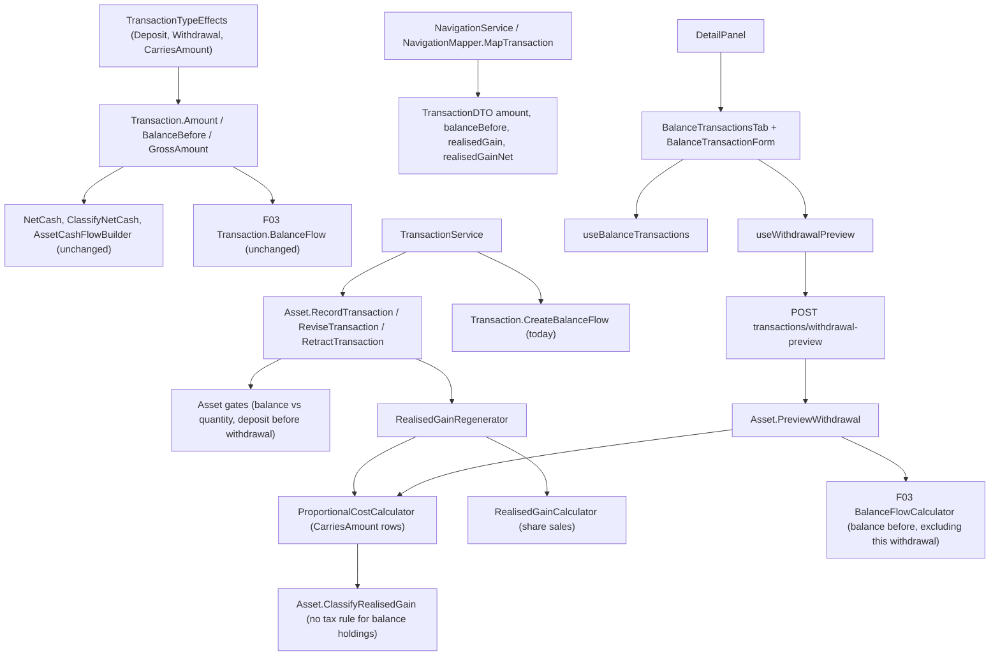

# Spec: Deposits and Withdrawals

**Complexity:** medium. It touches Domain, Application, the API contract and Web, adds one read endpoint, and adds two optional fields to the stored transaction with no migration step. It ships as five PRs, each within the PR size rule: (1) the Deposit and Withdrawal types with proportional cost in Domain, (2) the transaction API carrying amounts and realised gains, (3) the balance Transactions tab, (4) the withdrawal preview endpoint, (5) the pre-fill and live preview in the form.

**Read §13 first: its review amendments supersede earlier sections.**

**Builds on (specified, not yet built).** Each item must be on `main` before the PR that uses it starts. Where this spec names an F01 or F03 member, it is that spec's contract. If the built code differs, follow the built code and record the difference in the PR's docs commit.
- **F01** (`../P69-F01-balance-tracked-holding-option/spec.md`): `Asset.IsTrackedByBalance` and `Asset.ValuationRules` (F01 PR 2) before **PR 1**. `SelectedNode.isTrackedByBalance` from the tree metadata (F01 PR 3) before **PR 3**.
- **F03** (`../P69-F03-balance-entries/spec.md`, **§13 is binding**): `Transaction.BalanceFlow` derived from `CashEffect` (Out → +amount, In → −amount), `DatedBalanceFlow`, `BalanceFlowCalculator.FlowsOf` / `NetBetween`, `Asset.BalanceFlows`, `ValuationRules.ValueOn` and the 35-day `StatusOn` (F03 PR 1) before **PR 1**. `AssetDetailsDTO.IsTrackedByBalance` and `AssetPriceSnapshotDTO.netFlowsSincePrevious` (F03 PR 2) before **PR 2**. The "Balance history" tab label in `DetailPanel.tsx` (F03 PR 3) before **PR 3**, because both PRs edit that file.

## 1. Technical Overview

**What:** A balance-tracked holding (F01) gets two transaction types that carry an amount and no units. A **Deposit** is new money the investor adds: date, amount and fees. A **Withdrawal** is money moved out to a bank, another holding or a redemption: date, gross amount, IR withheld and the balance just before it. Withdrawals realise a gain under **proportional cost**: the cost removed is the invested amount before the withdrawal × amount ÷ balance before, rounded to 2 decimals, and the realised gain is the amount minus that cost. The records are the existing `RealisedGain` records, written by the existing regeneration, so a backdated or edited flow recalculates every later withdrawal. A full withdrawal (amount = balance before) closes the position, and a later deposit reopens it. The web shows a balance-mode Transactions tab with an amount-only form. A withdrawal's "Balance before" is pre-filled from F03's balance on its date, and the form shows a live preview of the cost removed and the realised gain, gross and net of IR.

**Why:** Today a cash-only type (`CapitalCall`, `ReturnOfCapital`) must have quantity 0 and unit price 0, so its gross amount is always 0 and its money can only travel in `Fees` (`Transaction.ValidateQuantity` / `ValidateUnitPrice`). The PRD's idea of reusing `NetCash`, `ClassifyNetCash` and `AssetCashFlowBuilder` "unchanged" therefore needs an amount to be stored somewhere. F03 §13 item 2 gives that decision to F02 and rules out the `Quantity = 1` workaround. F02 adds one nullable `Amount` (and a nullable `BalanceBefore`) to `Transaction` and makes the private gross amount read it. With that change, `NetCash`, the totals, the XIRR flows and F03's `BalanceFlow` all work without further edits.

**Scope:**

*Included*
- `Transaction.TransactionType.Deposit` and `.Withdrawal`. In `TransactionTypeEffects` they are `(None, Out)` and `(None, In)` with a new `CarriesAmount` flag, plus derived `RealisesGain` and `ReducesPosition`.
- `Transaction.Amount` and `Transaction.BalanceBefore` (stored, nullable), `Transaction.CreateBalanceFlow` (validation, not-in-the-future rule), and the gross amount reading `Amount`.
- `ProportionalCostCalculator` (Domain rule): the replay, the cost-removed formula and the realised-gain record of a withdrawal.
- `RealisedGainRegenerator` and `Asset.RecordTransaction` choosing the per-row calculator by type. Balance holdings' realised gains are classified with no tax rule.
- Same-date order: deposits before withdrawals, then entry order (`TransactionReplayOrder`).
- Gates on `Asset`: a balance holding rejects every other transaction type, credits and corporate actions, and a quantity holding rejects deposits and withdrawals. A change that would leave a withdrawal with no deposit on or before it is rejected.
- `Asset.RemainingInvested` and `Asset.PositionType` for balance holdings (Flat once invested is 0). `Investments.ArchiveAsset` reads the position type.
- API: `amount` and `balanceBefore` on transaction create and update; `amount`, `balanceBefore`, `realisedGain` and `realisedGainNet` on `TransactionDTO`; new `POST /transactions/withdrawal-preview`.
- Web: the balance Transactions tab (form, grid, dialogs, toasts), hiding the Credits and Corporate actions tabs for balance holdings, and the Realised gains tab showing "—" for quantity and "Proportional cost" as the method.
- The end-to-end tests F03 left to F02: current value, month-start subtraction and the history's net-flows column with real deposits and withdrawals (F03 §11 note), plus `BalanceFlow_DepositOfOneThousand_IsOneThousand` and the matching withdrawal test (F03 §13 item 2).

*Excluded (other features)*
- The Summary tab layout, "Not applicable" fields, current value with deposits since the entry, invested / unrealised gain / result % / XIRR display, and aggregation into portfolio, broker, dashboard, ARCA and month-start totals: F04. F02 provides `Asset.RemainingInvested`, the realised-gain records and the per-withdrawal figures. See §12 items 3 and 4 for the two F04 issues found here.
- Converting Inco and Grão: F05. It writes Deposits through its own Domain path (F01 spec, Excluded), not through the gates added here.
- Balance entries and balance on a date: F03.

## 2. Before you design (docs/rules/design.md)

1. **Where it belongs:** Investment bounded context. Which types carry an amount is a property of the type (`TransactionTypeEffects`). The amount and its limits belong to the transaction (`Transaction`, enforced in its factory and constructor). Proportional cost is a stateless algorithm with its own test class (`Domain/Rules/ProportionalCostCalculator.cs`), used by both realised-gain paths and by the preview. The "balance holdings take only deposits and withdrawals" and "every withdrawal has a deposit before it" invariants belong to `Asset`, the entity whose methods could break them. Application only maps DTOs, passes `today` and runs the mutation inside `ApplyAndSaveAsync`.
2. **Layers touched, in direction:** PR 1 Domain. PR 2 Domain (archive gate) → Application → API contract. PR 3 Web only. PR 4 Domain → Application → API. PR 5 Web only. Infrastructure has no code change: the two new `Transaction` properties are persisted by `InvestmentTypeInfoResolver`'s existing private-setter wiring.
3. **What keeps Domain free of Infrastructure:** nothing new crosses a boundary. Mutations use `AssetMutationHelper.ExecuteAssetMutationAsync` / `ExecuteParsedMutationAsync` over `IInvestmentRepository` (declared in Application). Its `ApplyAndSaveAsync` rollback restores the in-memory document when a Domain rule throws or the save fails. The preview reads through the same repository interface.
4. **SOLID:** Open/closed: the two types are two rows in the effects table plus one flag, and every consumer (`NetCash`, totals, XIRR flows, F03's `BalanceFlow`, replay order, realised-gain gate) reads the table. Single responsibility: the proportional rule exists once (`ProportionalCostCalculator`), and the realised-gain record for a share sale stays in `RealisedGainCalculator`. Liskov: a withdrawal's `RealisedGain` is an ordinary record (one synthetic lot), so the realised-gain views, tax classification, supersede/replace bookkeeping and `RefreshRealisedCapitalGain` treat it like a sale's.

## 3. Architecture Impact



## 4. Technical Decisions

| Decision | Chosen | Rejected | Why |
|---|---|---|---|
| Where the amount is stored | New nullable `Transaction.Amount`, set only for types with `CarriesAmount`; the private `GrossAmount` becomes `Amount ?? UnitPrice × Quantity` | `Quantity = 1`, `UnitPrice = amount` (F03's first draft); carrying the amount in `Fees` as `CapitalCall` does | F03 §13 item 2 rules out the unit workaround. Fees already mean fees on a deposit. With the nullable field, "no amount" is null for every existing row, and `NetCash`, the totals, the XIRR flows and `BalanceFlow` need no change |
| How a type says it carries an amount | `TransactionTypeEffect(QuantityEffect Quantity, CashEffect Cash, bool CarriesAmount = false)`, true for Deposit and Withdrawal, with derived `RealisesGain` and `ReducesPosition` | A separate `BalanceEffect` enum (rejected by F03 §13 item 1); a hard-coded `{Deposit, Withdrawal}` set in each consumer | Direction stays on `CashEffect` as F03 §13 requires. One flag says "money without units", and it gives both the gate (a balance holding takes exactly these types) and the realised-gain choice. The eight existing rows are unchanged because the flag defaults to false |
| Where the balance before is stored | New nullable `Transaction.BalanceBefore`, Withdrawal only | Writing a balance entry with the withdrawal | PRD: a withdrawal stores its balance before and nothing else. The balance after it comes from F03's balance on a date |
| Factory and "not in the future" | `Transaction.CreateBalanceFlow(id, date, type, amount, fees, withheld, balanceBefore, currency, fxRateSnapshot, DateOnly today)`. `Create` / `CreateWithId` gain optional `amount` and `balanceBefore` (default null), so the constructor rejects an amount on a share type and a missing amount on a balance type | A future-date check in `TransactionService` | Domain takes an as-of argument, as `Asset.SetPrice` does with `today` (`docs/rules/implementation.md` §Tests 8). Existing callers of `Create` (tools, tests, importers) stay unchanged |
| Proportional cost rule | `ProportionalCostCalculator` (static, Domain/Rules): `Replay`, `CostRemoved`, `RealisedGainFor`, and in PR 4 `InvestedBefore` | A branch inside `RealisedGainCalculator` | It is a stateless algorithm with its own test class and three callers (regenerator, `Asset.RecordTransaction`, preview), so it qualifies for `Rules/` under the implementation rules. `RealisedGainCalculator` stays about lots |
| Which calculator a row uses | By the transaction's type: `effect.CarriesAmount` → proportional, otherwise lots | By the asset's `ValuationRules` (F01) | A balance holding holds only amount types (the gate), so the type answers the same question without passing the policy into the regenerator. The PRD's "per-row calculator for balance holdings" holds either way |
| Shape of a withdrawal's `RealisedGain` | `Method = AverageCost`, one synthetic lot `(SourceTransactionId: null, Quantity: 1, UnitCost: costRemoved)`, `QuantitySold = 0`, `Proceeds = NetCash` (amount − IR) | A new `CostBasisMethod.ProportionalCost`; a lot of `(fraction, investedBefore)` | A new method value is a wire enum change, a broker could select it through `SetCostBasisMethodRequestDTO`, and `RealisedGainCalculator` would need a guard. Proportional cost is average cost applied to value, so `AverageCost` is accurate. A fraction lot would give an unrounded cost basis, but the PRD rounds the cost removed to 2 decimals. The lot is internal: no view shows lots (searched `Financial.Web/src`) |
| Gross vs net on the record | `GainLoss` = amount − IR − cost (net), as for share sales (`Proceeds = NetCash`). Gross = `GainLoss + Withheld` is mapped into `TransactionDTO.RealisedGain` | Storing gross as `Proceeds` | All records keep the same meaning for tax classification and `RealisedGainLossSharesOnly`. The web gets both figures from the server, so it does no arithmetic |
| "Unclassified" for tax (P51) | `Asset.ClassifyRealisedGain` (internal) calls `TaxClassificationCalculator.CalculateUnclassifiedRealisedGain(record, createdAt)` for balance holdings: category `CapitalGain`, status `Incomplete`, no rule, even when a matching rule exists | Letting `FindApplicableTaxRule` match a BR capital-gain rule | PRD Out of Scope: "Applying P51 tax rules to balance-tracked withdrawals". `Incomplete` with no rule is the state every realised gain has today (the live data has 0 tax rules), so no view changes |
| Same-date order | `TransactionReplayOrder.IsDecrease` reads `effect.ReducesPosition` (quantity Decrease, or a Withdrawal), so `Sort`, `IsInOrder` and `CorporateActionReplay.RankWithinDate` all put withdrawals after same-date deposits; entry order breaks the remaining ties (stable sort) | A general cash-direction tie-break for every type | A general rule would reorder existing same-date pairs (TransferOut before Sell, Buy before ReturnOfCapital) and could change FIFO lots. Scoped to withdrawals, it changes nothing for existing data |
| Position open or closed | `Asset.RemainingInvested` (`decimal?`, null for quantity holdings) = the replay's invested amount. `PositionType` for a balance holding is Long when it is > 0, Flat otherwise | Quantity-based (always Flat, because balance holdings have quantity 0) | PRD: a full withdrawal looks like a fully sold holding and a later deposit reopens it. Derived from the stored flows, not stored itself |
| Preview endpoint | `POST /transactions/withdrawal-preview` with a body, read-only | A GET with 9 query scalars; computing the cost on the web | `docs/rules/implementation.md` says a dedicated POST is the right shape past about 5–6 scalars, and the GET's cacheability is given up on purpose. Doing the cost on the web would put the business rule in Presentation |
| Pre-fill source | The same preview response: `balanceOnDate` and `balanceEntryDate`, from F03's latest entry on or before the date plus `NetBetween` over the flows **excluding** the withdrawal being edited | `ValuationRules.ValueOn` as is | `ValueOn` reads every flow on the asset, including this withdrawal's own. PRD: "excluding this withdrawal". F03's Excluded section anticipated this composition (`GetPriceAsOf` + `NetBetween`) |
| Web structure | A separate `BalanceTransactionsTab` + `BalanceTransactionForm` + `useBalanceTransactions`, chosen by `DetailPanel` from `selectedNode.isTrackedByBalance` | A balance mode inside `TransactionsTab.tsx` (593 lines) and `useTransactions.ts` (594 lines) | The two forms share nothing but the date field. Keeping them apart avoids branching in both files, and avoids conflicts with F08, which edits the Buy form in the same wave |
| Form presentation | Inline form panel above the grid (the existing transaction pattern), with `DiscardChangesDialog` on Cancel and a success toast | A dialog (PRD wording) | Matches every other investment entry form in the Detail panel (`TransactionsTab`, `PriceHistoryTab` after F03). The PRD's "dialog" wording is aligned in PR 3's docs commit |

## 5. Component Overview

### PR 1: Deposit and Withdrawal types with proportional cost (Domain)

| File Path | New/Modified | Purpose | Key Responsibilities |
|---|---|---|---|
| `Financial.Investment.Domain/Rules/TransactionTypeEffects.cs` | Modified | Types | `TransactionTypeEffect(QuantityEffect Quantity, CashEffect Cash, bool CarriesAmount = false)` with `bool RealisesGain => (Quantity == QuantityEffect.Decrease && Cash != CashEffect.None) \|\| (CarriesAmount && Cash == CashEffect.In)` and `bool ReducesPosition => Quantity == QuantityEffect.Decrease \|\| (CarriesAmount && Cash == CashEffect.In)`; rows `Deposit => new(None, Out, CarriesAmount: true)`, `Withdrawal => new(None, In, CarriesAmount: true)`. The existing doc comment is not extended |
| `Financial.Investment.Domain/Entities/Transaction.cs` | Modified | Amount storage and rules | Enum gains `Deposit, Withdrawal` (appended, so the stored names of the other values are unchanged). `decimal? Amount`, `decimal? BalanceBefore` (private set). `GrossAmount => Amount ?? UnitPrice * Quantity`. Constructor validation per §8. `CreateBalanceFlow(…, DateOnly today)`. `Create` / `CreateWithId` gain optional `decimal? amount = null, decimal? balanceBefore = null`. Message constants as `public const string` |
| `Financial.Investment.Domain/Rules/TransactionReplayOrder.cs` | Modified | Same-date order | `IsDecrease(t) => TransactionTypeEffects.For(t.Type).ReducesPosition` |
| `Financial.Investment.Domain/Rules/ProportionalCostCalculator.cs` | New | Proportional cost | `record WithdrawalCost(decimal InvestedBefore, decimal CostRemoved)`; `record ProportionalCostLedger(decimal Invested, IReadOnlyDictionary<Guid, WithdrawalCost> Withdrawals, Transaction? FirstWithdrawalWithoutDeposit)`; `Replay(IEnumerable<Transaction>)`; `CostRemoved(investedBefore, amount, balanceBefore)`; `RealisedGainFor(Transaction withdrawal, IEnumerable<Transaction> preceding, DateTimeOffset createdAt)` (§8) |
| `Financial.Investment.Domain/Rules/RealisedGainRegenerator.cs` | Modified | Per-row calculator | Gate `effect.RealisesGain`; `effect.CarriesAmount ? ProportionalCostCalculator.RealisedGainFor(transaction, preceding, createdAt) : RealisedGainCalculator.Calculate(…)`; `Commit` classifies through `plan.Asset.ClassifyRealisedGain(record, investments, createdAt)` |
| `Financial.Investment.Domain/Rules/TaxClassificationCalculator.cs` | Modified | No rule | `CalculateUnclassifiedRealisedGain(RealisedGain record, DateTimeOffset createdAt)`: jurisdiction from currency, `EventCategory.CapitalGain`, `CalculationStatus.Incomplete`, rule id null |
| `Financial.Investment.Domain/Entities/Asset.cs` | Modified | Gates, gains, position | `TrackedByBalanceMessage`, `TrackedByQuantityMessage` (consts); `EnsureAccepts(Transaction)` in `RecordTransaction` and `ReviseTransaction`; `EnsureTrackedByQuantity()` in `AddCredit`, `UpdateCredit`, `RecordCorporateAction`; `EnsureEveryWithdrawalHasADeposit(candidate, subjectId)` in Record/Revise/Retract (balance holdings only); `RecordTransaction` uses `effect.RealisesGain` and picks the calculator as the regenerator does; `internal TaxClassification ClassifyRealisedGain(…)`; `decimal? RemainingInvested`; `PositionType` per §8 |

7 non-test code files, plus the PRD §9 F02 AC ids and the cross-feature ids `P69-CF-cross-feature-01` and `-03` (docs commit). No contract change: `TransactionCreateDTO.Type` is a string, so the new type names reach the API without a schema change, and `GET /transactions/type-effects` lists ten types (the web's Buy/Sell form keeps its own list of eight). Because the enum grows here, PR 1 also updates the literal eight-type list in `Tests/Financial.Api.Tests/TransactionEndpointsTests.cs` (`GetTransactionTypeEffects_Returns200WithEveryType`) to ten, or PR 1's backend job fails. No data migration: missing `Amount` / `BalanceBefore` load as null (§7). Deployable on its own. No holding in the live data is balance-tracked (a read-only count on 2026-11-27 found 0 assets with `ProviderValue` or `Manual`), so no shown value changes.

### PR 2: transaction API carries amounts and realised gains

| File Path | New/Modified | Purpose | Key Responsibilities |
|---|---|---|---|
| `Financial.Investment.Application/DTOs/TransactionCreateDTO.cs` | Modified | Request | `decimal? Amount`, `decimal? BalanceBefore` |
| `Financial.Investment.Application/DTOs/TransactionUpdateDTO.cs` | Modified | Request | Same two fields |
| `Financial.Investment.Application/DTOs/TransactionDTO.cs` | Modified | Response | `decimal? Amount`, `decimal? BalanceBefore`, `decimal? RealisedGain` (gross), `decimal? RealisedGainNet`; no doc comments |
| `Financial.Investment.Application/Services/TransactionService.cs` | Modified | Factory choice | Add and update: `TransactionTypeEffects.For(type).CarriesAmount ? Transaction.CreateBalanceFlow(id, request.Date, type, request.Amount ?? 0, request.Fees, request.Withheld, request.BalanceBefore, currency, fx, _timeProvider.GetLocalToday()) : Transaction.Create/CreateWithId(…, amount: request.Amount, balanceBefore: request.BalanceBefore)`. Spans and rollback unchanged |
| `Financial.Investment.Application/Services/NavigationMapper.cs` | Modified | Mapping | `MapTransaction(Transaction transaction, RealisedGain? activeRecord)`: `Amount`, `BalanceBefore`; for a withdrawal with an active record, `RealisedGainNet = record.GainLoss`, `RealisedGain = record.GainLoss + transaction.Withheld`; null otherwise |
| `Financial.Investment.Application/Services/NavigationService.cs` | Modified | Details | Builds the active-record lookup by `TransactionId` once per asset and passes each transaction's record to the mapper |
| `Financial.Investment.Domain/Entities/Investments.cs` | Modified | Archive gate | `ArchiveAsset` refuses when `asset.PositionType != PositionType.Flat`; message for a balance holding "\"{name}\" still has money invested. Only a fully closed asset can be archived into Historic Investments." (quantity message unchanged) |

7 non-test code files, plus the regenerated `Tests/Financial.Api.Tests/Contract/openapi-v1.snapshot.json` and `Financial.Web/src/api/generated/openapi.ts`. Regenerate with `UPDATE_OPENAPI_SNAPSHOT=1 dotnet test Tests/Financial.Api.Tests --filter "FullyQualifiedName~OpenApiContractTests"`, then `cd Financial.Web && npm run generate-api-types`. The new properties are not `required`, so no web fixture breaks; run `npm run build` to confirm.

### PR 3: balance Transactions tab (Web)

| File Path | New/Modified | Purpose | Key Responsibilities |
|---|---|---|---|
| `Financial.Web/src/utils/balanceTransactions.ts` | New | Copy and rules | `BALANCE_TRANSACTION_TYPES` (`Deposit`, `Withdrawal`, labels), all strings of §9, `validateBalanceTransaction(values, today)` returning field errors (§9), `MAX_AMOUNT = 1_000_000_000` |
| `Financial.Web/src/hooks/useBalanceTransactions.ts` | New | State | Loads asset details as `useTransactions` does (selection guard, retry); inline form state via `inlineFormSlice` (type, date, amount, fees, withheld, balance before); touched fields for on-blur validation; dirty check against the opened values; save (`addTransaction` / `updateTransaction` with `amount` / `balanceBefore`), success toast via `useSuccessToast`, fallback text; delete via the existing endpoint |
| `Financial.Web/src/components/BalanceTransactionForm.tsx` | New | Form | Type `RadioGroup`, fields per type, hints, `Field validationMessage`, `useFormErrorFocus`, primary submit with `SAVING_LABEL`, Cancel through `useDiscardPrompt` + `DiscardChangesDialog`, `ActionErrorAlert` |
| `Financial.Web/src/components/BalanceTransactionsTab.tsx` | New | Tab | `LoadingState` / `ErrorState`; toolbar "New transaction"; form; `EmptyState`; sortable grid (§9); `ConfirmDeleteDialog` with the PRD messages; delete error; focus recovery as `TransactionsTab` does |
| `Financial.Web/src/components/BalanceTransactionsTab.css` | New | Layout | Grid wrapper `overflow-x: auto`, numeric column widths |
| `Financial.Web/src/components/DetailPanel.tsx` | Modified | Mode | For an asset with `selectedNode.isTrackedByBalance`, the Transactions tab renders the lazy `BalanceTransactionsTab`, and the Credits and Corporate actions tabs are not offered |
| `Financial.Web/src/components/RealisedGainsTab.tsx` | Modified | Realised gains | When `selectedNode.isTrackedByBalance`: Quantity cell `<MissingValue label="Not applicable, tracked by balance" />`, Method "Proportional cost" |

7 non-test code files, plus `Financial.Web/stryker.components.config.json` (the two new components) and the PRD wording alignment (docs commit, §12 item 9). No contract change.

### PR 4: withdrawal preview endpoint

| File Path | New/Modified | Purpose | Key Responsibilities |
|---|---|---|---|
| `Financial.Investment.Domain/ValueObjects/WithdrawalPreview.cs` | New | Result | `record WithdrawalPreview(decimal? BalanceOnDate, DateOnly? BalanceEntryDate, decimal InvestedBefore, decimal? CostRemoved, decimal? RealisedGain, decimal? RealisedGainNet)` |
| `Financial.Investment.Domain/Rules/ProportionalCostCalculator.cs` | Modified | Position of a withdrawal | `InvestedBefore(IReadOnlyList<Transaction> transactions, DateOnly date, Guid? withdrawalId)` (§8) |
| `Financial.Investment.Domain/Entities/Asset.cs` | Modified | Preview | `PreviewWithdrawal(DateOnly date, Guid? withdrawalId, decimal? amount, decimal? withheld, decimal? balanceBefore)`: throws `InvestmentRuleViolationException(TrackedByQuantityMessage)` on a quantity holding; balance before from F03 (§8); figures only for valid inputs |
| `Financial.Investment.Application/DTOs/WithdrawalPreviewDTOs.cs` | New | Contract | `WithdrawalPreviewRequestDTO` (broker, portfolio, asset, `Scope?`, `Id?`, `Date`, `Amount?`, `Withheld?`, `BalanceBefore?`) and `WithdrawalPreviewDTO` (the six fields), as `AssetPriceDTOs.cs` holds a request/response pair |
| `Financial.Investment.Application/Interfaces/ITransactionQueryService.cs` | Modified | Seam | `WithdrawalPreviewDTO? PreviewWithdrawal(WithdrawalPreviewRequestDTO request)` |
| `Financial.Investment.Application/Services/TransactionService.cs` | Modified | Use case | Span `PreviewWithdrawal`; null for an invalid context or unknown asset (controller → 400, as the mutations do); maps the Domain record |
| `Financial.Api/Controllers/TransactionsController.cs` | Modified | Endpoint | `[HttpPost("withdrawal-preview")]` with `///` summary/param/returns (they feed the OpenAPI descriptions, the one allowed doc-comment case) |

7 non-test code files, plus the regenerated snapshot and generated web types (same commands as PR 2).

### PR 5: pre-fill and live preview (Web)

| File Path | New/Modified | Purpose | Key Responsibilities |
|---|---|---|---|
| `Financial.Web/src/api/financialApiClient.ts` | Modified | Client | `previewWithdrawal(request)` → `POST /transactions/withdrawal-preview` |
| `Financial.Web/src/api/types.ts` | Modified | Aliases | `WithdrawalPreviewRequestDto`, `WithdrawalPreviewDto` |
| `Financial.Web/src/hooks/useWithdrawalPreview.ts` | New | Preview state | Debounced (`PREVIEW_DEBOUNCE_MS = 300`) request when the withdrawal's date, amount, IR withheld or balance before change; drops stale responses; exposes `preview`, `isLoading`, `error` |
| `Financial.Web/src/hooks/useBalanceTransactions.ts` | Modified | Pre-fill | `balanceBeforeTouched`; applies `balanceOnDate` to the field until the user types in it (never on edit, where the stored value is shown); keeps `balanceEntryDate` for the hint |
| `Financial.Web/src/components/BalanceTransactionForm.tsx` | Modified | Hint and preview | Balance-before hint per state; preview line in an `aria-live="polite"` region (§9) |

5 non-test code files, plus `context.md` (deposits, withdrawals, proportional cost) and the PRD §9 F02 ticks in their own last commit (memory: ticks ride in the last PR).

## 6. API Contracts

### `POST /api/v1/financial/transactions` and `PUT /api/v1/financial/transactions` (existing, extended in PR 2)

| Field | Type | Required | Validation | Description |
|---|---|---|---|---|
| `type` | `string` | Yes | parsed enum | Adds `"Deposit"` and `"Withdrawal"` |
| `date` | `date-time` | Yes | Deposit/Withdrawal: not after host-local today | Flow date |
| `amount` | `number \| null` | Deposit/Withdrawal | > 0, ≤ 2 decimals, ≤ 1,000,000,000; must be null for other types | Deposit: new money. Withdrawal: gross amount out |
| `fees` | `number` | No | Deposit: ≥ 0, ≤ 2 decimals. Withdrawal: 0 | Deposit fees, added to invested |
| `withheld` | `number` | No | Withdrawal: ≥ 0, ≤ 2 decimals, < amount. Deposit: 0 | IR withheld |
| `balanceBefore` | `number \| null` | Withdrawal | ≥ amount, ≤ 2 decimals; must be null for other types | Balance just before the withdrawal |
| `quantity`, `unitPrice` | `number` | No | Deposit/Withdrawal: 0 (existing no-quantity-effect rule) | — |

```json
{
  "brokerName": "XPI",
  "portfolioName": "Previdência",
  "assetName": "Grão ARCA",
  "scope": null,
  "date": "2026-11-05T00:00:00",
  "type": "Withdrawal",
  "quantity": 0,
  "unitPrice": 0,
  "fees": 0,
  "withheld": 75.00,
  "amount": 3000.00,
  "balanceBefore": 12000.00,
  "specificLotAllocations": null
}
```

**Response `AssetDetailsDTO`** (existing). Each `transactions[]` item adds:

| Field | Type | Description |
|---|---|---|
| `amount` | `number \| null` | Deposit/Withdrawal amount; null for other types |
| `balanceBefore` | `number \| null` | Withdrawal only |
| `realisedGain` | `number \| null` | Withdrawal: amount − cost removed (gross); null otherwise |
| `realisedGainNet` | `number \| null` | Withdrawal: gross − IR withheld (= the record's `gainLoss`) |

```json
{
  "id": "6f1c…",
  "date": "2026-11-05T00:00:00",
  "type": "Withdrawal",
  "quantity": 0,
  "unitPrice": 0,
  "fees": 0,
  "withheld": 75.00,
  "netCash": 2925.00,
  "currency": "BRL",
  "fxRateSnapshot": null,
  "amount": 3000.00,
  "balanceBefore": 12000.00,
  "realisedGain": 500.00,
  "realisedGainNet": 425.00
}
```

The matching `realisedGains[]` item: `method: "AverageCost"`, `quantitySold: 0`, `proceeds: 2925.00`, `costBasis: 2500.00`, `gainLoss: 425.00`, `lotsConsumed: [{ "sourceTransactionId": null, "quantity": 1, "unitCost": 2500.00 }]`.

**Errors**

| Case | HTTP Status | Detail |
|---|---|---|
| Amount ≤ 0 or missing on a Deposit/Withdrawal | 400 | "Enter an amount greater than 0." |
| More than 2 decimals in amount, fees, IR withheld or balance before | 400 | "Amounts can have up to 2 decimals." |
| Amount above 1,000,000,000 | 400 | "Enter an amount of 1,000,000,000 or less." |
| Date after today | 400 | "Date can't be in the future." |
| IR withheld ≥ amount | 400 | "IR withheld must be less than the amount." |
| Balance before missing or < amount | 400 | "Balance before withdrawal must be at least the amount withdrawn." |
| IR withheld on a Deposit / fees on a Withdrawal | 400 | "A deposit has no IR withheld." / "A withdrawal has no fees." |
| `amount` or `balanceBefore` on another type | 400 | "Only deposits and withdrawals have an amount." / "Only a withdrawal has a balance before it." |
| Buy, Sell or any other share type on a balance holding (also credits and corporate actions on their endpoints) | 409 | "This holding is tracked by balance. Record a deposit or withdrawal instead." |
| Deposit/Withdrawal on a quantity holding | 409 | "Deposits and withdrawals are only for holdings tracked by balance." |
| New or edited withdrawal with no deposit on or before it | 409 | "There's no deposit on or before DD/MM/YYYY to withdraw from." |
| Edit or delete that leaves another withdrawal with no deposit before it | 409 | "The withdrawal on DD/MM/YYYY would have no deposit before it. Adjust that withdrawal first." |
| Storage failure | 503 | Existing `TransientStorageException` mapping; in-memory document restored by `ApplyAndSaveAsync` |

### `POST /api/v1/financial/transactions/withdrawal-preview` (new, PR 4)

Read-only; nothing is saved. POST because of its nine inputs (see §4).

| Field | Type | Required | Description |
|---|---|---|---|
| `brokerName`, `portfolioName`, `assetName` | `string` | Yes | Holding |
| `scope` | `string \| null` | No | As for the other transaction calls |
| `id` | `uuid \| null` | No | The withdrawal being edited (excluded from the balance before, keeps its entry position) |
| `date` | `date-time` | Yes | Withdrawal date |
| `amount`, `withheld`, `balanceBefore` | `number \| null` | No | Current form values; figures are returned only when amount > 0, balance before ≥ amount and 0 ≤ IR withheld < amount |

```json
{ "brokerName": "XPI", "portfolioName": "Previdência", "assetName": "Grão ARCA", "scope": null, "id": null, "date": "2026-11-05T00:00:00", "amount": 3000.00, "withheld": 75.00, "balanceBefore": 12000.00 }
```

**Response `WithdrawalPreviewDTO`**

| Field | Type | Description |
|---|---|---|
| `balanceOnDate` | `number \| null` | F03 balance on `date`, excluding this withdrawal; null with no entry on or before `date` |
| `balanceEntryDate` | `date \| null` | Date of the entry it starts from |
| `investedBefore` | `number` | Invested amount just before this withdrawal |
| `costRemoved`, `realisedGain`, `realisedGainNet` | `number \| null` | Null until the inputs are valid |

```json
{ "balanceOnDate": 12000.00, "balanceEntryDate": "2026-11-01", "investedBefore": 10000.00, "costRemoved": 2500.00, "realisedGain": 500.00, "realisedGainNet": 425.00 }
```

| Case | HTTP Status | Detail |
|---|---|---|
| Missing broker/portfolio/asset, or unknown holding | 400 | Empty body (existing `OkOrBadRequest`) |
| Quantity holding | 409 | "Deposits and withdrawals are only for holdings tracked by balance." |

OpenAPI: regenerate in PR 2 and PR 4 with the commands in §5 and commit both generated files.

## 7. Data Model

`data-investment.json`: each `Transaction` object gains two properties.

| Property | Type | Nullable | Default | Description |
|---|---|---|---|---|
| `Amount` | number | Yes | absent / `null` | Set for `Deposit` and `Withdrawal` only |
| `BalanceBefore` | number | Yes | absent / `null` | Set for `Withdrawal` only |
| `Type` | string enum | No | — | Gains `"Deposit"` and `"Withdrawal"` |

- No `InvestmentDataMigrations` step and no `CurrentVersion` change. A document written before F02 has neither property, and both load as null (as F06 does for `Cnpj`). The first save writes `"Amount": null, "BalanceBefore": null` on each existing row, as `"FxRateSnapshot": null` already is (943 transactions in the live file, read-only count 2026-11-27).
- Withdrawal realised gains are ordinary `RealisedGains` entries (§6) with a `TaxClassifications` entry of status `Incomplete` and no rule.
- `data/*.example.json` and `TestData/*.test.json` need no change. `InvestmentSerializerAdapterTests` pins the round trip.

## 8. Rules in detail

- **Amount types:** `CarriesAmount` ⇔ `Amount is not null`. For a type that carries an amount: quantity and unit price 0 (existing rule), `Amount` > 0, ≤ 2 decimals, ≤ `MaxAmount` (1,000,000,000). Deposit: `Withheld` = 0, `BalanceBefore` null, `Fees` ≥ 0 (existing floor), ≤ 2 decimals. Withdrawal: `Fees` = 0, 0 ≤ `Withheld` < `Amount`, `BalanceBefore` ≥ `Amount`, ≤ 2 decimals. For other types `Amount` and `BalanceBefore` are null. `CreateBalanceFlow` also requires `DateOnly.FromDateTime(date) ≤ today`.
- **Money:** `GrossAmount = Amount ?? UnitPrice × Quantity`. Deposit `NetCash = −(amount + fees)`, Withdrawal `NetCash = amount − IR`. F03's `BalanceFlow`: Deposit `+amount`, Withdrawal `−amount` (fees and IR never move the balance).
- **Replay order:** `TransactionReplayOrder.Sort` = by date, then position-reducing rows last (now including withdrawals), then entry order (stable). Same-date deposits always come before same-date withdrawals.
- **`ProportionalCostCalculator.Replay(transactions)`** walks the sorted rows with `invested = 0`. A Deposit adds `amount + fees` and marks "has a deposit". For a Withdrawal, `investedBefore = invested` and `cost = CostRemoved(investedBefore, amount, balanceBefore)`, then `invested −= cost`. The first withdrawal met with no deposit before it is recorded. Other types are ignored.
- **`CostRemoved(investedBefore, amount, balanceBefore)`:** `amount == balanceBefore` → `investedBefore` (a full withdrawal removes exactly what is invested). Otherwise `Math.Round(investedBefore × amount ÷ balanceBefore, 2, MidpointRounding.AwayFromZero)` (as `MoneyRounding.ToCents` in CashFlow). `investedBefore` = 0 → 0, so the whole amount is gain.
- **`RealisedGainFor(withdrawal, preceding, createdAt)`:** `investedBefore = Replay(preceding).Invested`; record as in §4 with `TaxYearCalculator.Calculate(date, currency)`. Realised gain gross = amount − cost; net = gross − IR = `GainLoss`.
- **Regeneration:** unchanged `RecordTransaction` / `ReviseTransaction` / `RetractTransaction` anchors. A flow dated on or before the latest active realised gain regenerates every realising row from that date in replay order, so a backdated deposit or an edited withdrawal recalculates every later withdrawal. A flow after the latest withdrawal takes the existing fast path.
- **Gates (`Asset`):** `EnsureAccepts(t)`: `effect.CarriesAmount != IsTrackedByBalance` → `InvestmentRuleViolationException(IsTrackedByBalance ? TrackedByBalanceMessage : TrackedByQuantityMessage)`. `AddCredit`, `UpdateCredit` and `RecordCorporateAction` on a balance holding → `TrackedByBalanceMessage`. Raw `AddTransaction` / `AddCredits` (loaders, tools, F05) stay ungated.
- **Deposit before every withdrawal:** for a balance holding, the candidate set (after add, edit or delete) is replayed. If `FirstWithdrawalWithoutDeposit` is set, the change is refused with the subject message when it is the transaction being saved, and with the "other withdrawal" message otherwise (dates `dd/MM/yyyy`, invariant culture). The check runs before any state change, like `EnsureNoUncoveredSale`.
- **Invested and position:** `RemainingInvested = IsTrackedByBalance ? Replay(Transactions).Invested : null`. `PositionType` for a balance holding: `RemainingInvested > 0` → Long, else Flat. Quantity holdings are unchanged.
- **Balance before (pre-fill, PR 4):** `entry = GetPriceAsOf(date)`. With no entry, `BalanceOnDate` and `BalanceEntryDate` are null. Otherwise the value is `entry.Price + BalanceFlowCalculator.NetBetween(BalanceFlowCalculator.FlowsOf(Transactions.Where(t => t.Id != withdrawalId)), entry.Date, date)`, and `BalanceEntryDate = entry.Date`.
- **`InvestedBefore(transactions, date, withdrawalId)` (PR 4):** `Replay` over the rows other than the withdrawal that are dated before `date`, plus the same-date deposits, plus the same-date withdrawals entered before it. A new withdrawal comes after every existing same-date withdrawal. An edited one keeps its index in `Transactions`.
- **Preview figures:** computed only when amount > 0, balance before ≥ amount and 0 ≤ IR withheld (null = 0) < amount, using `CostRemoved` and the same gross/net rules. Otherwise the three are null.

## 9. Web behaviour (docs/rules/ui.md)

**User task:** record money put into or taken out of a balance-tracked holding exactly as made, see the realised gain each withdrawal produced, and correct or delete an entry.

- **Context:** the Detail panel header (asset name, "Balance" badge from F01) stays visible. The tab label stays "Transactions". For a balance holding the tabs are Summary, Transactions, Balance history (F03) and Realised gains.
- **Toolbar:** primary "New transaction" (`AddRegular`), left-aligned, as today.
- **Form (inline panel):** title "New transaction" / "Edit deposit" / "Edit withdrawal". Fields in order:
  1. **Type**: `Field label="Type"` with a horizontal `RadioGroup`, "Deposit" (default) and "Withdrawal". Switching type keeps Date and Amount.
  2. **Date**: `type="date"`, required, default today.
  3. **Amount**: `type="number"`, `step="0.01"`, `min="0"`, required. Deposit hint: "Only new money you add. Reinvested payouts that stay in the balance aren't recorded." Withdrawal hint: "The gross amount taken out. If XP shows only the net amount received, enter it here with IR withheld 0."
  4. Deposit: **Fees** (optional, `step="0.01"`). Withdrawal: **IR withheld** (optional, `step="0.01"`), then **Balance before withdrawal** (required, `step="0.01"`).
  - Balance-before hint (PR 5): pre-filled → "From your balance on DD/MM/YYYY. Change it if XP shows a different balance just before this withdrawal." No entry → "No balance recorded before this date. Enter the balance just before the withdrawal." While loading → "Getting your balance on this date…". Lookup failed → "Couldn't get your balance for this date. Enter the balance just before the withdrawal." Typed or editing → "The balance XP showed just before this withdrawal."
  - Submit "Add deposit" / "Add withdrawal" / "Save" (`SAVING_LABEL` while saving), Cancel.
- **Validation (on blur and on submit; on submit focus moves to the first invalid field via `useFormErrorFocus`):** "Date is required.", "Date can't be in the future.", "Enter an amount greater than 0.", "Enter an amount with up to 2 decimals." (`hasAtMostTwoDecimals`), "Enter an amount of 1,000,000,000 or less.", "Enter fees of 0 or more.", "Enter IR withheld of 0 or more.", "IR withheld must be less than the amount.", "Enter the balance just before the withdrawal.", "Balance before withdrawal must be at least the amount withdrawn." Each message sits under its field (`Field validationMessage`, `validationState="error"`); the text carries the meaning, not colour. A 400 detail from the server goes to `ActionErrorAlert`.
- **Live preview (PR 5, withdrawal only):** under the fields, in an `aria-live="polite"` `Text`. Valid inputs → "Cost removed R$X · Realised gain R$Y (net R$Z)" with `formatAmount(value, asset.currency)`, signs on the gains. Incomplete → "Enter the amount and the balance before to see the realised gain." Loading → the previous line, plus "Updating…". Error → "Couldn't work out the realised gain. You can still save." Save is never blocked by the preview.
- **Saving / success / failure:** submit disabled while saving. Success closes the form, refreshes the grid from the response and shows the toast "Deposit saved" / "Withdrawal saved". A 503 or network failure keeps the form open with every input and shows "Couldn't save the transaction. Your entry is still in the form." A 409 shows the server detail. In every case the input is kept.
- **Unsaved changes:** Cancel on a form whose values differ from when it opened (a pre-fill alone does not make it dirty) opens `DiscardChangesDialog` ("Discard changes?"). A clean form closes at once.
- **Grid (`Table` + `.data-table`, newest first, `SortableColumnHeader`):** Date; Type ("Deposit" / "Withdrawal", text); Amount (right-aligned, `formatN2`); Fees / IR withheld (right-aligned, the deposit's fees or the withdrawal's IR); Balance before (right-aligned; deposits `<MissingValue label="Not applicable for a deposit" />`); Realised gain (right-aligned, `formatSignedN2`, deposits "—" as above); Net of IR (right-aligned, `formatSignedN2`, deposits "—"); row actions Edit / Delete (`RowActionsCell`, accessible names "Edit withdrawal 05/11/2026" style). Signs carry gain or loss; no colour-only meaning.
- **Empty state:** "No deposits or withdrawals yet. Add the money you've put into this holding."
- **Delete:** `ConfirmDeleteDialog` "Delete deposit" / "Delete withdrawal" with "Delete this deposit? Realised gains of later withdrawals will be recalculated." (or "withdrawal"), buttons "Delete" / "Cancel". A 409 (deposit needed by a withdrawal) or 503 shows under the grid with the server detail or `deleteFailedMessage('transaction')`. Focus returns to the toolbar button or the next row (`useRowFocusRecovery`).
- **Loading / error:** `LoadingState`; `ErrorState` "Unable to load transactions." with Retry.
- **Realised gains tab:** rows unchanged except Quantity "—" (accessible "Not applicable, tracked by balance") and Method "Proportional cost" for balance holdings.
- **Responsive / zoom:** form grid stacks (`useFormPanelStyles`). The grid scrolls horizontally in its own wrapper at narrow widths and 200% zoom. Rows stay one line high.

## 10. Error Handling

| Case | Behaviour |
|---|---|
| Buy, Sell, credit or corporate action sent to a balance holding (stale tab, API) | 409 `TrackedByBalanceMessage`; `ApplyAndSaveAsync` restores the document; nothing saved |
| Deposit/Withdrawal sent to a quantity holding | 409 `TrackedByQuantityMessage`; nothing saved |
| Edit or delete leaves a withdrawal without a deposit before it | 409 naming that withdrawal's date; nothing saved; form/grid keep their state |
| Validation failure on the server | 400 with the Domain message; form keeps its input |
| Storage failure on save or delete | 503; in-memory document restored; form stays open with input; delete shows the failure under the grid |
| Preview: unknown holding / quantity holding | 400 / 409; the form shows the preview error line and stays usable |
| Preview: network or 503 | Preview error line and pre-fill failure hint; Save still allowed |
| Regeneration throws while saving (should not happen for valid flows) | The existing catch in `Asset.RecordTransaction` / `ReviseTransaction` / `RetractTransaction` undoes the change, then 409/400 as raised |

## 11. Testing Strategy

| Test File | Test Type | Target |
|---|---|---|
| `Tests/Financial.Investment.Domain.Tests/Domain/TransactionTypeEffectsTests.cs` (PR 1) | Unit | New rows, `CarriesAmount`, `RealisesGain`, `ReducesPosition` per type |
| `Tests/Financial.Investment.Domain.Tests/Domain/TransactionTests.cs` (PR 1) | Unit | Amount rules, `NetCash`, `BalanceFlow` |
| `Tests/Financial.Investment.Domain.Tests/Domain/TransactionReplayOrderTests.cs` (PR 1) | Unit | Same-date deposits first; existing order unchanged |
| `Tests/Financial.Investment.Domain.Tests/Rules/ProportionalCostCalculatorTests.cs` (new, PR 1, PR 4) | Unit | Replay, rounding, full withdrawal, record shape, `InvestedBefore` |
| `Tests/Financial.Investment.Domain.Tests/Domain/RealisedGainRegeneratorTests.cs` (PR 1) | Unit | Backdated flows recalculate later withdrawals; classification |
| `Tests/Financial.Investment.Domain.Tests/Rules/TaxClassificationCalculatorTests.cs` (PR 1) | Unit | Unclassified record ignores a matching rule |
| `Tests/Financial.Investment.Domain.Tests/Domain/AssetTests.cs` (PR 1, PR 4) | Unit | Gates, deposit-before-withdrawal, position, preview |
| `Tests/Financial.Investment.Infrastructure.Tests/Persistence/InvestmentSerializerAdapterTests.cs` (PR 1) | Integration | Round trip of `Amount` / `BalanceBefore`; old document loads null |
| `Tests/Financial.Investment.Application.Tests/Services/TransactionServiceMutationTests.cs` (PR 2) | Unit | Factory choice, today, failed span on rejection |
| `Tests/Financial.Investment.Application.Tests/Services/NavigationMapperTests.cs` (PR 2) | Unit | Gross/net mapping, nulls for other types |
| `Tests/Financial.Investment.Domain.Tests/Domain/InvestmentsTests.cs` (PR 2) | Unit | Archive refused while invested |
| `Tests/Financial.Investment.Domain.Tests/Domain/MonthStartValueCalculatorTests.cs` (PR 2) | Unit | F03 month-start subtraction with a real deposit |
| `Tests/Financial.Api.Tests/TransactionEndpointsTests.cs` (PR 1) | Integration | Type-effects list has ten types (the existing literal list updated) |
| `Tests/Financial.Api.Tests/Acceptance/DepositsAndWithdrawalsAcceptanceTests.cs` (new, PR 2, PR 4) | Integration | PRD F02 and cross-feature criteria through the host |
| `Tests/Financial.Investment.Application.Tests/Services/TransactionServiceQueryTests.cs` (PR 4) | Unit | Preview mapping, null context, span |
| `Financial.Web/src/utils/__tests__/balanceTransactions.test.ts` (new, PR 3) | Unit | Every validation message and boundary |
| `Financial.Web/src/hooks/__tests__/useBalanceTransactions.test.ts` (new, PR 3, PR 5) | Unit | Load, save payloads, toast, fallback, dirty, delete, pre-fill |
| `Financial.Web/src/components/__tests__/BalanceTransactionsTab.test.tsx` (new, PR 3, PR 5) | Unit | Form per type, grid, dialogs, focus, preview line |
| `Financial.Web/src/components/__tests__/DetailPanel.test.tsx` (PR 3) | Unit | Tab set per mode |
| `Financial.Web/src/components/__tests__/RealisedGainsTab.test.tsx` (PR 3) | Unit | "—" quantity and method label for balance holdings |
| `Financial.Web/src/hooks/__tests__/useWithdrawalPreview.test.ts` (new, PR 5) | Unit | Debounce, stale response dropped, error |
| `Financial.Web/src/api/__tests__/financialApiClient.test.ts` (PR 5) | Unit | Verb, URL, body |

**Key functions**

| Test Function | Description | Assertions |
|---|---|---|
| `For_DepositAndWithdrawal_CarryAnAmountWithNoQuantityEffect` | Effects table | `(None, Out, true)`, `(None, In, true)`; every existing type `CarriesAmount` false |
| `RealisesGain_SaleRedemptionAndWithdrawal_AreTrue_OthersFalse` (theory) | Gate | Per type |
| `BalanceFlow_DepositOfOneThousand_IsOneThousand` / `BalanceFlow_WithdrawalOfThreeThousand_IsMinusThreeThousand` | F03 §13 item 2 | `1000` / `−3000`, fees and IR excluded |
| `NetCash_DepositWithFees_IsMinusAmountPlusFees` / `NetCash_WithdrawalWithIr_IsAmountMinusIr` | Money | `−1005`; `2925` |
| `CreateBalanceFlow_FutureDate_Throws` / `…_Today_IsAccepted` | Date | Message; today accepted |
| `CreateBalanceFlow_ThreeDecimals_Throws` / `…_AboveOneBillion_Throws` / `…_ZeroAmount_Throws` | Limits | Messages; 1,000,000,000 accepted |
| `CreateBalanceFlow_WithheldEqualToAmount_Throws` / `…_BalanceBeforeBelowAmount_Throws` / `…_BalanceBeforeEqualToAmount_IsAccepted` | Withdrawal | Boundaries both sides |
| `Create_BuyWithAnAmount_Throws` / `Create_DepositWithoutAnAmount_Throws` | Type/amount | Messages |
| `Sort_SameDateWithdrawalEnteredFirst_ComesAfterDeposit` | Order | Deposit then withdrawal |
| `Sort_ExistingSameDateTypes_KeepTheirOrder` | Regression | TransferOut/Sell and Buy/ReturnOfCapital pairs unchanged |
| `Replay_DepositWithFees_InvestsAmountPlusFees` | AC -03 | Invested `1005` |
| `Replay_InvestedTenThousand_BalanceTwelveThousand_WithdrawThree_RemovesTwentyFiveHundred` | AC -04 | Cost `2500`, invested after `7500` |
| `CostRemoved_RoundsAwayFromZeroToTwoDecimals` | Rounding | e.g. invested 100, amount 1, balance 3 → `33.33`; 0.005 case rounds up |
| `CostRemoved_FullWithdrawal_RemovesExactlyWhatIsInvested` | Full | `amount == balance` → invested, invested after `0` |
| `Replay_ZeroInvestedBefore_WholeAmountIsGain` | Edge | Cost `0` |
| `Replay_TwentyFlowSequence_InvestedMinusGainEqualsDepositsPlusFeesMinusWithdrawals` | PRD success metric 2 | ≥ 20 literal flows incl. partial, full and backdated; equality within 0.01 |
| `Replay_WithdrawalBeforeAnyDeposit_IsReportedAsWithoutDeposit` | Coverage | `FirstWithdrawalWithoutDeposit` |
| `RealisedGainFor_Withdrawal_IsAverageCostWithOneSyntheticLot` | Record | Method, lot `(null, 1, 2500)`, `QuantitySold 0`, `Proceeds 2925`, `GainLoss 425` |
| `RegenerateAsset_BackdatedDeposit_RecalculatesLaterWithdrawals` | AC -11 | Old records superseded, new cost literals |
| `CalculateUnclassifiedRealisedGain_IgnoresAMatchingRule` | AC -18 | Status `Incomplete`, rule null with a BR CapitalGain rule present |
| `RecordTransaction_BuyOnBalanceHolding_Throws` / `…_DepositOnQuantityHolding_Throws` / `AddCredit_OnBalanceHolding_Throws` / `RecordCorporateAction_OnBalanceHolding_Throws` | Gates | Messages; nothing changed |
| `RetractTransaction_OnlyDepositBeforeAWithdrawal_ThrowsNamingTheWithdrawal` | AC -13 | Message with `dd/MM/yyyy`; deposit still present |
| `RecordTransaction_WithdrawalBeforeAnyDeposit_ThrowsSubjectMessage` | Coverage | Subject message |
| `PositionType_FullWithdrawal_IsFlat_LaterDeposit_IsLong` | AC -06 | Flat, then Long |
| `RemainingInvested_QuantityHolding_IsNull` | Contract | null |
| `Deserialize_TransactionWithoutAmount_LoadsNull` / `Serialize_Withdrawal_RoundTripsAmountAndBalanceBefore` | Persistence | Temp file reload |
| `AddTransaction_Deposit_UsesLocalTodayForTheFutureRule` | Service | `TestClock` pinned; tomorrow → `ArgumentException`, `ShouldHaveFailedSpan<ArgumentException>("Investment.TransactionService.AddTransaction")` |
| `AddTransaction_BuyOnBalanceHolding_FailsSpanAndSavesNothing` | Service | 409 type, reloaded asset unchanged |
| `MapTransaction_Withdrawal_MapsGrossAndNet` / `…_Buy_LeavesBalanceFieldsNull` | Mapper | `500`, `425`; nulls |
| `ArchiveAsset_BalanceHoldingWithMoneyInvested_Throws` | Archive | Message |
| `MonthStart_BalanceAsset_DepositBetweenFirstAndEntry_IsSubtracted` | F03 end-to-end | Entry 12,000 on the 3rd, deposit 1,000 on the 2nd → 11,000 on the 1st |
| `GetTransactionTypeEffects_Returns200WithEveryType` (existing, PR 1) | Endpoint | Literal list of ten types |
| `PreviewWithdrawal_EditedWithdrawal_ExcludesItsOwnFlow` | Domain preview | Balance before = entry + other flows only |
| `PreviewWithdrawal_NoEntry_ReturnsNullBalance` / `…_IncompleteInputs_ReturnsNullFigures` | Preview | Nulls |
| `InvestedBefore_NewSameDateWithdrawal_ComesAfterExistingOnes` | Position | Literal invested |
| `PreviewWithdrawal_QuantityHolding_Throws` | Preview | Message |
| `validateBalanceTransaction` cases | Web util | Each message; 0.01 / 1,000,000,000 accepted; IR = amount rejected |
| "offers only Deposit and Withdrawal with no quantity or unit price" | Tab | Radio names; `queryByLabelText('Quantity')` null |
| "shows the reinvested-payouts hint under Amount for a deposit" | Tab | Hint text |
| "sends amount and balanceBefore when saving a withdrawal" | Hook | `addTransaction` mock argument |
| "shows Withdrawal saved and closes the form" | Hook/Tab | Toast via `withAppToaster`; form gone |
| "keeps the input and shows the save failure text on a 503" | Hook | State and message |
| "asks Discard changes? only when the form is dirty" | Tab | Dialog presence; pre-fill alone not dirty |
| "shows each inline message and focuses the first invalid field" | Tab | Messages, `aria-invalid`, focus handler |
| "asks before deleting a withdrawal with the recalculation warning" | Tab | Dialog text |
| "offers no Credits or Corporate actions tab for a balance holding" | DetailPanel | Tab names |
| "pre-fills the balance before until the user types and names the entry date" | Hook/Tab | Value follows date changes; stops after typing; hint text |
| "leaves balance before empty and required when there is no entry" | Tab | Empty value, hint, required message on submit |
| "shows cost removed and realised gain gross and net before saving" | Tab | Preview text from mocked response |
| "debounces preview requests and ignores a stale response" | Hook | One call per burst (fake timers); older response dropped |

**Acceptance (AC ids to add to PRD §9 F02, `P69-F02-deposits-and-withdrawals-{SS}`, in bullet order, PR 1 docs commit)**

`DepositsAndWithdrawalsAcceptanceTests` derives from `ApiEndpointTests` with `TestClock.At(2026-11-10 12:00 UTC)`. Each test creates its holding over HTTP: `POST /assets` with `valuationMethod: "ProviderValue"` (F01), then the F03 balance entries through `PUT /asset-prices`.

| Test | AC |
|---|---|
| `BalanceTransactionsTab.test.tsx` "[AC …-01] offers only Deposit and Withdrawal with no quantity or unit price" | -01 |
| `BalanceTransactionsTab.test.tsx` "[AC …-02] shows the reinvested-payouts hint" | -02 |
| `Deposit_WithFees_RaisesInvestedByAmountPlusFees` (total bought 1,005; a later full withdrawal of 1,100 realises 95) + `Replay_DepositWithFees_InvestsAmountPlusFees` | -03 |
| `Withdrawal_ProportionalCost_RemovesTwentyFiveHundredAndRealisesFiveHundred` | -04 |
| `Withdrawal_WithIrWithheld_ShowsGrossAndNetGain` (500 / 425) | -05 |
| `FullWithdrawal_ClosesThePosition_AndADepositReopensIt` (`positionType` Flat, then Long) | -06 |
| `Withdrawal_WritesNoBalanceEntry_AndTheNextDayBalanceIsBeforeMinusAmount` (snapshot count unchanged; `marketValue` 9,000 on 06/11 via F03's `ValueOn`) | -07 |
| `Preview_PrefillsTheBalanceOnTheDate_AndNamesTheEntryDate` (PR 4) + tab test "[AC …-08] pre-fills … and names the entry date" (PR 5) | -08 |
| `Preview_NoEntryBeforeTheDate_ReturnsNoBalance` (PR 4) + tab test "[AC …-09] leaves balance before empty and required" (PR 5) | -09 |
| `Preview_ReturnsCostRemovedAndGrossAndNetGain` (PR 4) + tab test "[AC …-10] shows cost removed and realised gain gross and net" (PR 5) | -10 |
| `BackdatedWithdrawal_RecalculatesLaterWithdrawalsInDateOrder` | -11 |
| `SameDateDepositAndWithdrawal_AppliesTheDepositFirst` (withdrawal entered first) | -12 |
| `DeletingTheOnlyEarlierDeposit_IsRejectedNamingTheWithdrawalDate_AndSavesNothing` | -13 |
| `BuySellAndCredit_OnBalanceHolding_AreRejected_AndSaveNothing` | -14 |
| `balanceTransactions.test.ts` "[AC …-15] …" + tab test "[AC …-15] shows each inline message and focuses the first invalid field" | -15 |
| `AddTransaction_StorageFails_LeavesHoldingUnchanged` (service, span failed, reload unchanged) + hook test "[AC …-16] keeps the input … on a 503" | -16 |
| Tab test "[AC …-17] asks Discard changes? only when the form is dirty" | -17 |
| `Withdrawal_AppearsInRealisedGains_Unclassified` (record in `realisedGains`, `costBasis` 2,500) + `CalculateUnclassifiedRealisedGain_IgnoresAMatchingRule` tagged -18 | -18 |

**Cross-feature criteria** (ids added in the PR 1 docs commit):
- `P69-CF-cross-feature-01` "A holding set to Balance (F01) accepts Deposits and Withdrawals (F02) and rejects Buys, and a holding set to Quantity and price shows the Buy/Sell form": `BalanceHolding_AcceptsDepositsAndRejectsBuys_QuantityHoldingRejectsDeposits` + `DetailPanel.test.tsx` "[AC P69-CF-cross-feature-01] renders the Buy/Sell form for a quantity holding and the deposit form for a balance holding".
- `P69-CF-cross-feature-03` "Balance before withdrawal (F02) is pre-filled from the balance on its date (F03)": `Preview_BalanceBefore_IsEntryPlusDepositsSince` (entry 12,000 on 01/11, deposit 1,000 on 03/11, withdrawal on 05/11 → 13,000, entry date 01/11).
- The F02 side of "Deposits, fees, withdrawals, IR withheld, remaining invested and realised gain recorded in F02 appear unchanged on the Summary tab and in the totals (F04)" is provided by `TransactionDTO`, the realised-gain records and `Asset.RemainingInvested`. F04's tests assert the displayed figures.
- F03 end-to-end left to F02: `BalanceHolding_CurrentValueIsEntryPlusDepositsSince` (12,000 + 1,000 = 13,000, through `GET` asset details) and `BalanceHistory_NetFlowsSincePrevious_CountsRealFlows` (`priceSnapshots[].netFlowsSincePrevious` = deposits − withdrawals between entries), both in the acceptance class (PR 2), plus the month-start Domain test above.

**Browser pass (PRs 3 and 5, `docs/rules/ui.md` completion requirement):** run the worktree's own API and SPA on a temp copy of the dev data (the dev API writes the real investment file; memory). Create a Balance holding (F01 form), add a balance entry (F03), then add, edit and delete deposits and withdrawals: a full withdrawal and a reopening deposit, a backdated deposit that changes a later gain, the pre-fill following the date, and the preview line. Check at normal width, narrow width and 200% zoom, keyboard only. Then go through every item in `docs/ui/review-checklist.md` for `BalanceTransactionsTab`, `BalanceTransactionForm`, `DetailPanel` and `RealisedGainsTab`, and run the `ui-reviewer` agent.

## 12. Assumptions and Decisions (Batch Mode, auto-accepted)

Each point is one the PRD did not settle, resolved by the Auto-Accept row "Technical decisions with a clear recommendation" unless noted. Items marked **conflict** differ from the PRD's wording or from an F0x spec and need the user's review.

1. **Conflict (PRD F02 Reuse: "like the existing `CapitalCall` and `ReturnOfCapital`, so `Transaction.NetCash` … work unchanged"):** a cash-only type cannot hold an amount today, because quantity and unit price must be 0 and `CapitalCall`'s money is entered as Fees. F02 adds a nullable stored `Amount` (and `BalanceBefore`) and points the private gross amount at it. After that, `NetCash`, the totals, the XIRR flows and F03's `BalanceFlow` do work unchanged. This also settles F03 §13 item 2 without the Quantity = 1 workaround.
2. **Resolved (F01 naming vs `docs/rules/implementation.md` §Domain rules):** the rules say "Domain contains no `*Service`, `*Policy` or `*Specification` classes". F01's per-method valuation rule was first named `ValuationPolicy`; the user chose on 2026-11-28 to rename it `ValuationRules` (`Financial.Investment.Domain/Rules/ValuationRules.cs`, next to `DividendValuationRules`) in every P69 spec, so no rule exception is needed. F02 adds no member to it (it uses only `Asset.IsTrackedByBalance`).
3. **For F04 (PRD F04 Capabilities):** "Realised gain = sum of the withdrawals' realised gains (gross)" and "Total sold = sum of withdrawal amounts" differ from what the existing machinery gives. `RealisedGain.GainLoss` and `Asset.RealisedGainLossSharesOnly` are net of IR (`Proceeds = NetCash`), and `AssetTotalsCalculator.ClassifyNetCash` counts a withdrawal at amount − IR. F02 keeps the existing record meaning and exposes gross and net per withdrawal on `TransactionDTO`. F04 decides whether its totals show gross (sum of `realisedGain`, sum of `amount`) or net.
4. **For F04 (open-position filters):** `PortfolioAssetSummaryService` (`a.Quantity > 0m`, two places) and `DataQualityReportService` (`Quantity != 0`) treat any holding with quantity 0 as closed, and a balance holding's quantity is always 0. F02 makes `Asset.PositionType` correct and fixes the archive gate, which F02's closing semantics own. The holdings filters are F04's aggregation work.
5. **"Unclassified" (PRD F02/Out of Scope)** is not a P51 status. It is taken as a `CapitalGain` classification with status `Incomplete` and no rule, whatever rules exist.
6. **Realised-gain record shape:** `AverageCost` and one synthetic lot `(null, 1, costRemoved)`, with `QuantitySold` 0. No `CostBasisMethod` value is added. The web shows "Proportional cost" and "—" for these rows from the holding's mode.
7. **Validation details the PRD omits:** fees, IR withheld and balance before also take at most 2 decimals. Balance before has no upper cap. A deposit cannot carry IR withheld, and a withdrawal cannot carry fees (API-only messages; the web never sends them). Rounding is to 2 decimals, midpoint away from zero. A full withdrawal is exactly amount = balance before.
8. **Pre-fill edge:** when the balance entry is dated on the withdrawal's own date, F03 reads it as the end of that day, so it may already reflect the withdrawal, and the pre-fill then shows the balance after it. The hint tells the investor to correct it. Same-date withdrawals entered after the one being edited are also counted in its balance before. Both are rare for a monthly entry.
9. **PRD Experience wording aligned in PR 3's docs commit (conflict, wording only):** "dialog" → the inline form panel the other investment forms use. "Add transaction" → the existing toolbar label "New transaction", with submits "Add deposit" / "Add withdrawal". The grid gains a "Net of IR" column next to "Realised gain", so each withdrawal shows both figures as the user story asks.
10. **On-blur validation** is implemented as the PRD asks, because this is a new form. F03 chose submit-only to keep its two modes consistent, and that reason does not apply here.
11. **Credits and Corporate actions tabs are hidden** for balance holdings, so the 409 can only be reached through the API or a stale tab. This is not in the PRD, and it is the matching UX for F01's "never accepts credits or corporate actions".
12. **No chart** on the balance Transactions tab. The "Net invested by month" chart stays on the quantity tab and the broker/portfolio views, where deposits and withdrawals already count through `netCash`.
13. **Preview is a POST with a body** (nine inputs), as `docs/rules/implementation.md` recommends. It is read-only, idempotent and never cached. Pre-fill and preview share one call, debounced 300 ms.
14. **"Not in the future"** uses host-local today (`TimeProvider.GetLocalToday()`), the same as balance entries.
15. **Same-date order** applies only to withdrawals (via `ReducesPosition`), so no existing same-date pair changes order. Entry order is the list order in `Transactions`, which an edit keeps.
16. **`RealisedGainBackfill`** (the version < 5 loader path) keeps its sale-only gate. Documents that old never contain Deposits or Withdrawals.
17. **AC ids and ticks:** `P69-F02-deposits-and-withdrawals-01` … `-18`, `P69-CF-cross-feature-01` and `-03` are added in PR 1's docs commit. The F02 boxes are ticked in PR 5's last commit.
18. **PR split (Auto-Accept: project PR size rule):** five PRs. PR 1 is Domain-only, a compatibility boundary exercised by its unit and persistence tests. It is deployable, and it changes nothing visible because no holding is balance-tracked yet. PR 4 is the preview backend, proven through the host before PR 5 uses it. Every PR keeps `main` deployable.
19. **Parallel wave-3 work:** F08 (Fund Purchases by Amount, `../P69-F08-fund-purchases-by-amount/spec.md`) shares these files with F02: `Asset.cs` (F02 PR 1/4, F08 PR 3), `NavigationService.cs` (F02 PR 2, F08 PR 1/3), `TransactionsController.cs` (F02 PR 4, F08 PR 4), `financialApiClient.ts` and `types.ts` (F02 PR 5, F08 PR 1/5), and the generated OpenAPI files. F08 does not touch `TransactionCreateDTO`, `TransactionService`, `Transaction.cs` or `DetailPanel.tsx`; F02 does not touch `TransactionsTab.tsx` or `useTransactions.ts`, which F08 edits. Whichever PR merges second rebases; the generated OpenAPI files are regenerated, never hand-merged. F08's Buy-form changes apply only to the quantity tab, because `DetailPanel` picks the tab from the asset's mode.

## 13. Review amendments (binding; they supersede any earlier section they contradict)

From `/code-review` and `/simplify` on 2026-11-27. Where an earlier table, rule or test name says otherwise, this section wins; the implementer updates the earlier wording in the PR that implements the item.

1. **One replay per save.** `ProportionalCostCalculator.Replay` runs once over the candidate set (after add, edit or delete). That one ledger answers the deposit-before-withdrawal check and supplies every withdrawal's `WithdrawalCost`. `RealisedGainFor(Transaction withdrawal, WithdrawalCost cost, DateTimeOffset createdAt)` takes the cost from `ledger.Withdrawals[withdrawal.Id]` instead of replaying `preceding` again.
2. **One calculator dispatch.** The "`CarriesAmount` → proportional, otherwise lots" choice and the classification through `Asset.ClassifyRealisedGain` live in one internal method of `RealisedGainRegenerator`, called by both the regenerator and `Asset.RecordTransaction`'s fast path. The fast path itself stays (removing it changes the existing share-sale path, out of scope).
3. **The preview reuses the replay order.** `Asset.PreviewWithdrawal` builds the candidate list the way `ReviseTransaction` does (the edited withdrawal replaced in place, or a new one appended), runs `Replay`, and reads `ledger.Withdrawals[candidate.Id]`. `ProportionalCostCalculator.InvestedBefore` and its test are dropped, so same-date order comes only from `TransactionReplayOrder.Sort` plus list order. `WithdrawalPreview` and `WithdrawalPreviewDTO` lose `investedBefore` (no consumer).
4. **Balance on a date goes through F03's one path** (F03 §13 item 3). PR 4 adds `Guid? excludingTransactionId = null` to `ValuationRules.ValueOn`; `PositionTotal` leaves that transaction's flow out of `Asset.BalanceFlows`. The pre-fill is `ValueOn(this, GetPriceAsOf(date), date, withdrawalId)`. No F02 code computes flows itself.
5. **One preview request per date change.** While the investor has not typed in Balance before, the web sends `balanceBefore: null`, and `PreviewWithdrawal` uses its own `balanceOnDate` as the balance before for the figures, so one response carries the pre-fill and the figures. Writing the pre-fill into the field does not trigger another request.
6. **The record states its method.** `CostBasisMethod` gains `ProportionalCost`; a withdrawal's record uses it (the one synthetic lot stays, because `RealisedGain` requires a lot). `Broker.SetCostBasisMethod` refuses it ("Proportional cost applies only to holdings tracked by balance."), and `RealisedGainCalculator` already throws on an unknown method. The web adds one `COST_BASIS_METHOD_LABELS` entry, "Proportional cost" (`utils/costBasisMethod.ts`; `COST_BASIS_METHODS`, the broker dialog's list, stays the three selectable methods), so the Realised gains tab's cell and sort read the stored method; the mode-based Method override in `RealisedGainsTab` is dropped (the Quantity "—" stays). PR 1 changes the enum; PR 2 regenerates the OpenAPI files and the web label.
7. **Remaining invested is a running total.** `Transactions.Apply` keeps an `InvestedAmount` for amount types the way it keeps `Quantity` and `AveragePrice` (Deposit adds amount + fees, Withdrawal subtracts `ProportionalCostCalculator.CostRemoved`), so `Asset.RemainingInvested` and `PositionType` are O(1) reads, not a replay per tree row.
8. **Open-position checks read `PositionType` in PR 2,** next to the archive gate: `PortfolioAssetSummaryService` (`Quantity > 0m`, two places → `PositionType == Long`) and `DataQualityReportService` (`Quantity != 0` → `PositionType != Flat`), so a balance holding with money in it does not drop out of broker holdings before F04. The invested amount reaching totals (`OpenPositionCostCalculator.CostOfUnitsHeld`) stays F04's work. §12 item 4 is narrowed accordingly.
9. **Shared money rounding.** `MoneyRounding.ToCents` moves from `Financial.CashFlow.Domain/Rules` to `Financial.Shared.Abstractions` in PR 1 (its CashFlow callers change only their `using`, an identical change exempt from the PR size rule). F02's rounding and every 2-decimal check (`ToCents(x) != x`) use it, as CashFlow does.
10. **`TransactionDTO` carries only the gross gain.** `realisedGainNet` is dropped: it equals the active record's `gainLoss`, already in `realisedGains[]` of the same response. The grid's "Net of IR" column reads that record by `transactionId`.
11. **Web reuse:**
    - The preview hook is `useAsyncResource` (stale responses ignored, `isLoading`, `error`, `retry`, `keepDataWhileLoading` for "Updating…") fed by a new shared `hooks/useDebouncedValue.ts`; F08's quota lookup uses the same pair.
    - Validation uses `positiveAmount`, `hasAtMostTwoDecimals`, `parseValidatedNumber(value, { max })` and `futureDateError` / `paymentDateError`, plus one new shared `amountError(value, { max })` in `utils/validators.ts` that F08 also uses. The date message is the existing "Date must not be in the future." (web and server).
    - Submit and Cancel use `FormSaveActions`; delete uses `usePendingDelete`; the dirty check uses `snapshotFields` / `hasChangedFields` (`inlineFormSlice`).
    - Date-only values (`balanceEntryDate`, row action names) use `formatShortDateUtc` (F03 §13 item 6).
    - Whichever of F02 PR 3/5 and F08 PR 1 merges first adds `useDebouncedValue` and `amountError`.
12. **Kept as specified after review:** storing `BalanceBefore` (what the investor typed; the PRD requires it); the preview endpoint (the rule stays in Domain); `realisedGain` gross on `TransactionDTO` (the web does no arithmetic); `RealisedGainBackfill`'s sale-only gate; the five-PR split.
