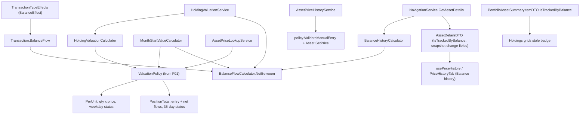

# Spec: Balance Entries

**Complexity:** medium (Domain, Application, API contract and Web; no new endpoint, two existing response schemas gain fields, no data file change). Four PRs, each a vertical slice: (1) balance on a date and the 35-day status in the valuation policy, (2) balance entries through the price-history API, (3) the "Balance history" tab, (4) the balance stale badge in the Summary and holdings grids.

**Built on F01 (specified, not yet built).** Every item marked "from F01" must exist on `main` before the PR that uses it starts: `ValuationPolicy` (`ValuationPolicy.For`, `PerUnit`, `PositionTotal`, `IsBalance`, `ValueAt`, `ValueWithoutPrice`, `AllowsZeroPrice`, `FetchesAutomatically`, `ManualEntrySource`), `Asset.ValuationPolicy`, `Asset.IsTrackedByBalance`, the reshaped `HoldingValuationCalculator.Calculate(quantity, averagePrice, price, policy, valuationDate)`, and `SelectedNode.isTrackedByBalance` (F01 PR 3). F03 PR 1 starts after F01 PR 2 merges (it touches `AssetPriceLookupService`, which F01 PR 2 changes); F03 PR 3 starts after F01 PR 3 merges.

## 1. Technical Overview

**What:** A balance-tracked holding (F01) records its value as dated **balance entries**: its existing price snapshots, written with source `ProviderValuation`, read as the whole position's worth at the end of their date. F03 adds the one rule that turns entries plus money moved into a value on any date (**balance on a date**), the 35-day **Current/Stale** status for balance holdings, the change columns of the history, and the web's "Balance history" presentation of the existing Price history tab, including its stale badge text.

**Why:** F01 makes the asset's method the only authority and reads a balance snapshot as a total, but a total read alone is wrong as soon as money moves after it: a deposit made after the latest entry would look like a loss. The PRD asks for balance on a date and status on a date to live once in the valuation policy, called by `HoldingValuationService` and `MonthStartValueCalculator`, so F02's pre-fill, F04's current value and F04's month-start value all use one rule. Reusing price snapshots keeps one storage, one editing path and one deletion path.

**Scope:**

*Included*
- `BalanceEffect` on `TransactionTypeEffect` (`None` for every existing type) and `Transaction.BalanceFlow`: the "money moved in or out of a balance" abstraction F02 plugs into (§8).
- `BalanceFlowCalculator` (Domain): signed net flows between an entry date and a date.
- `ValuationPolicy` (from F01) extended: `ValueAt` takes the net flows since the snapshot (PositionTotal adds them, PerUnit ignores them), `StatusOn(asOfDate, valuationDate)` (PerUnit: today's weekday rule; PositionTotal: 35 days), `ValidateManualEntry(price, note)` (PositionTotal: 2 decimals, note ≤ 100).
- `HoldingValuationCalculator`, `MonthStartValueCalculator`, `HoldingValuationService` and `AssetPriceLookupService` use the policy's value and status; no balance branch in any of them.
- `AssetPriceSnapshot.IsManual` covers `ProviderValuation` as well as `Manual`, so a balance entry can be edited and deleted through the existing endpoints and grid actions.
- `BalanceHistoryCalculator` (Domain) and three nullable fields on `AssetPriceSnapshotDTO`: change since the previous entry (amount, %), net flows since the previous entry.
- `AssetDetailsDTO.IsTrackedByBalance` (PR 2) and `PortfolioAssetSummaryItemDTO.IsTrackedByBalance` (PR 4).
- Web: "Balance history" tab label and content, Add/Edit balance form with Note, replace-on-same-date confirmation, discard prompt, success toast, delete confirmation and last-entry warning, empty state; "Balance as of DD/MM/YYYY (N days ago)" stale badge meaning on the Summary tab and both holdings grids.
- OpenAPI snapshot and generated web types regenerated in PR 2 and PR 4.

*Excluded (other features)*
- The Deposit and Withdrawal types, their amounts, and setting their `BalanceEffect`: F02 (§8 says exactly what it plugs in).
- "Balance before withdrawal" pre-fill, including excluding the withdrawal being edited: F02, composed from `Asset.GetPriceAsOf` + `BalanceFlowCalculator.NetBetween`.
- Summary tab layout for balance holdings, "Not applicable" quantity/price cells, the "has units" flag, the "Balance of DD/MM/YYYY plus R$X net deposits since" note, "No balance recorded" status: F04.
- Converting existing holdings' snapshots to balance entries: F05.

## 2. Before you design (docs/rules/design.md)

1. **Where it belongs:** Investment bounded context. How an asset's value and status are read on a date is a Domain valuation rule (`ValuationPolicy`, from F01, extended here); which transactions move a balance is a property of a transaction type (`TransactionTypeEffects`); the history's change figures are a Domain rule (`BalanceHistoryCalculator`). Application services only pass the asset's data in and map results to DTOs. Validation that depends on the tracking mode is the policy's (`ValidateManualEntry`), invoked by `AssetPriceHistoryService`.
2. **Layers touched, in direction:** PR 1 Domain → Application. PR 2 Domain → Application → API contract. PR 3 Web only. PR 4 Application → API contract → Web. Infrastructure is untouched: snapshots are already persisted with source and reference.
3. **What keeps Domain free of Infrastructure:** nothing new crosses a boundary. Entries are saved through `AssetMutationHelper.ExecuteAssetMutationAsync` over `IInvestmentRepository` (declared in Application); its `ApplyAndSaveAsync` rollback already restores the in-memory history when a save fails.
4. **SOLID:** Open/closed: a new balance-moving transaction type is added as one `BalanceEffect` value in the `TransactionTypeEffects` table, and a new valuation behaviour as one policy member, without editing the calculators. Single responsibility: balance on a date exists once (`PositionTotal.ValueAt` + `BalanceFlowCalculator`), status once (`StatusOn`). Liskov: callers treat `PerUnit` and `PositionTotal` identically; `PerUnit` ignores the flows argument, which is always 0 for a quantity holding.

## 3. Architecture Impact



## 4. Technical Decisions

| Decision | Chosen Approach | Alternative Considered | Trade-off |
|---|---|---|---|
| Where balance on a date lives | `PositionTotal.ValueAt(quantity, snapshot, netFlowsSinceSnapshot)` = snapshot price + net flows; callers pass `BalanceFlowCalculator.NetBetween(transactions, snapshot.Date, date)` | A separate `BalanceValuationCalculator` with `if (IsBalance)` in each caller | One policy, as the PRD asks; callers compute flows uniformly for every holding, which costs one pass over the transactions and is always 0 for quantity holdings |
| "Cash flows dated in a range" abstraction | `BalanceEffect { None, Increase, Decrease }` as a third, defaulted component of `TransactionTypeEffect`, and `Transaction.BalanceFlow` (+ gross amount, − gross amount, 0) | An `IBalanceFlowSource` interface, or F03 defining Deposit/Withdrawal | Uses the existing effects table, which every consumer already keys off; until F02 every flow is 0, so the rule is live and exercised by every valuation but changes no value |
| Direction of the flows sum | Signed: entry before the date adds flows in (entry, date]; entry after the date subtracts flows in (date, entry] | Two functions | One function serves current value (entry on or before) and month-start (P68's nearest entry, either side) |
| Status on a date | `ValuationPolicy.StatusOn(asOfDate, valuationDate)`; PositionTotal: Stale when `valuationDate − asOfDate > 35` days; PerUnit delegates to `MarketStatusCalculator.For` | A branch in `MarketStatusCalculator` | `MarketStatusCalculator` stays a pure weekday rule; the policy chooses the rule |
| Storage of entries | Existing price snapshots, source `ProviderValuation` (F01's `ManualEntrySource`), note in `SourceReference` | A new `BalanceEntry` entity | PRD requires reuse; no data-shape change |
| Editing and deleting entries | `AssetPriceSnapshot.IsManual` is true for `Manual` and `ProviderValuation` | A new `IsUserEntered` flag on the entity and DTO | No wire change; `ProviderValuation` is only ever written by the investor (no fetch runs for balance holdings), so "manual" is accurate; today no snapshot in the live data has that source (read-only count 2026-11-27) |
| Balance-only validation | `ValuationPolicy.ValidateManualEntry(price, note)` called by `AssetPriceHistoryService.SetPriceAsync`; PositionTotal: ≤ 2 decimals, note ≤ 100 characters; PerUnit: no extra rule | Checks in `AssetPriceSnapshot.Create` | Automatic sources can write longer references and more decimals, so the rule applies only to investor entries of balance holdings |
| Change columns | Server-computed by `BalanceHistoryCalculator` into three nullable `AssetPriceSnapshotDTO` fields, filled only for balance holdings | Web computes from entries and transactions | The web cannot tell which transactions move a balance without duplicating `BalanceEffect`; null keeps quantity holdings' wire output meaningful |
| Web flag for mode | `AssetDetailsDTO.IsTrackedByBalance` (PR 2) for the tab content and Summary; `PortfolioAssetSummaryItemDTO.IsTrackedByBalance` (PR 4) for the grids; tab label from `SelectedNode.isTrackedByBalance` (from F01) | Derive from `valuationMethod` on the web | One copy of the mode rule, like F01's `AssetAdminDTO` flag |
| Stale badge text | Existing `PriceBadge` with meaning "Balance as of DD/MM/YYYY (N days ago)", N computed on the web from `priceAsOfDate` and the local date | A server-built status string | Presentation stays in the web; the badge only shows when the server already said Stale |
| Same-date save | Web confirmation before an upsert onto an existing date (balance mode only); server keeps the existing upsert | A 409 from the server | Single-user app; the server upsert is unchanged for price mode and the confirmation is a UX guard |

## 5. Component Overview

### PR 1: balance on a date and the 35-day status

| File Path | New/Modified | Purpose | Key Responsibilities |
|---|---|---|---|
| `Financial.Investment.Domain/Rules/TransactionTypeEffects.cs` | Modified | Balance effect | `enum BalanceEffect { None, Increase, Decrease }`; `TransactionTypeEffect(QuantityEffect Quantity, CashEffect Cash, BalanceEffect Balance = BalanceEffect.None)`; the eight existing rows unchanged |
| `Financial.Investment.Domain/Entities/Transaction.cs` | Modified | Flow of one transaction | `BalanceFlow` = `+GrossAmount` for Increase, `−GrossAmount` for Decrease, `0` for None (fees and withheld excluded) |
| `Financial.Investment.Domain/Rules/BalanceFlowCalculator.cs` | New | Net flows | `record DatedBalanceFlow(DateOnly Date, decimal Amount)`; `FlowsOf(IEnumerable<Transaction>)` projects each transaction with a non-zero `BalanceFlow`; `NetBetween(IEnumerable<DatedBalanceFlow> flows, DateOnly entryDate, DateOnly date)`: `date ≥ entryDate` → Σ amounts with `entryDate < flow date ≤ date`; `date < entryDate` → −Σ with `date < flow date ≤ entryDate`; an overload taking `IEnumerable<Transaction>` composes the two (the form every caller uses) |
| `Financial.Investment.Domain/Rules/ValuationPolicy.cs` (from F01) | Modified | Value and status on a date | `ValueAt(quantity, snapshot, netFlowsSinceSnapshot)` replaces F01's two-argument form (PositionTotal: `snapshot.Price + netFlows`; PerUnit: `quantity × snapshot.Price`); `StatusOn(asOfDate, valuationDate)`; `public const int BalanceStaleAfterDays = 35` |
| `Financial.Investment.Domain/Rules/HoldingValuationCalculator.cs` | Modified | Uses the policy | `Calculate(quantity, averagePrice, price, netFlowsSincePrice, policy, valuationDate)`; market value from `policy.ValueAt`, status from `policy.StatusOn(price.Date, valuationDate)`; `ValueAt(quantity, price, netFlows, policy)` |
| `Financial.Investment.Domain/Rules/MonthStartValueCalculator.cs` | Modified | Month-start value | P68 nearest-entry selection unchanged; value = `policy.ValueAt(quantityInPriceBasis, price, BalanceFlowCalculator.NetBetween(asset.Transactions, price.Date, monthStart))`; the `quantity == 0 ? 0` shortcut goes (PerUnit gives 0 anyway; it would zero every balance holding, whose quantity is 0) |
| `Financial.Investment.Application/Services/HoldingValuationService.cs` | Modified | Current value | Passes `BalanceFlowCalculator.NetBetween(asset.Transactions, price.Date, today)` (0 when no price) and `asset.ValuationPolicy` |
| `Financial.Investment.Application/Services/AssetPriceLookupService.cs` | Modified | Price status | `BuildPriceFrom` takes the asset and uses `asset.ValuationPolicy.StatusOn(snapshot.Date, today)` instead of `MarketStatusCalculator.For` |

8 non-test code files, plus the PRD §9 F03 AC ids (docs commit). No contract change. `DataQualityReportService`'s stale count and `AllocationBreakdownBuilder` pick up the new status and value through `HoldingValuationService` without change.

### PR 2: balance entries through the price-history API

| File Path | New/Modified | Purpose | Key Responsibilities |
|---|---|---|---|
| `Financial.Investment.Domain/Entities/AssetPriceSnapshot.cs` | Modified | Editable entries | `IsManual => Source is PriceSource.Manual or PriceSource.ProviderValuation` |
| `Financial.Investment.Domain/Rules/ValuationPolicy.cs` | Modified | Entry rules | `ValidateManualEntry(decimal price, string? note)`: PositionTotal throws `ArgumentException` "Enter a balance with up to 2 decimals." / "Keep the note to 100 characters or fewer."; PerUnit does nothing |
| `Financial.Investment.Application/Services/AssetPriceHistoryService.cs` | Modified | Save | Trims the note (blank → null), calls `asset.ValuationPolicy.ValidateManualEntry` before `SetPrice`; the inline source comment goes (F01 already moved the source to `ManualEntrySource`) |
| `Financial.Investment.Domain/Rules/BalanceHistoryCalculator.cs` | New | Change figures | `For(IEnumerable<AssetPriceSnapshot> entries, IEnumerable<Transaction> transactions)` → `IReadOnlyDictionary<DateOnly, BalanceEntryChange>`; `record BalanceEntryChange(decimal Change, decimal? ChangePercent, decimal NetFlows)`; entries ordered by date; each entry after the first: `Change = value − previous value`, `ChangePercent = MonthStartValueCalculator.ChangePercent(previous, value)`, `NetFlows = BalanceFlowCalculator.NetBetween(transactions, previous.Date, entry.Date)` |
| `Financial.Investment.Application/DTOs/AssetPriceDTOs.cs` | Modified | Read contract | `AssetPriceSnapshotDTO`: `decimal? ChangeSincePrevious`, `decimal? ChangePercentSincePrevious`, `decimal? NetFlowsSincePrevious` |
| `Financial.Investment.Application/DTOs/AssetDetailsDTO.cs` | Modified | Read contract | `bool IsTrackedByBalance` |
| `Financial.Investment.Application/Services/NavigationMapper.cs` | Modified | Mapping | `MapPriceEntry(entry, BalanceEntryChange? change)` fills the three fields when a change is given |
| `Financial.Investment.Application/Services/NavigationService.cs` | Modified | Details | Computes `BalanceHistoryCalculator.For` only when `asset.IsTrackedByBalance` (from F01), passes each entry's change to the mapper, sets `IsTrackedByBalance` |

8 non-test code files, plus the regenerated `Tests/Financial.Api.Tests/Contract/openapi-v1.snapshot.json` and `Financial.Web/src/api/generated/openapi.ts`. Regenerate with `UPDATE_OPENAPI_SNAPSHOT=1 dotnet test Tests/Financial.Api.Tests --filter "FullyQualifiedName~OpenApiContractTests"`, then `cd Financial.Web && npm run generate-api-types`; fix every `AssetDetailsDto` / `AssetPriceSnapshotDto` web fixture `tsc -b` flags. In wave 2, if F07's DTO PR merges first, rebase and regenerate both files rather than hand-merging.

### PR 3: "Balance history" tab

| File Path | New/Modified | Purpose | Key Responsibilities |
|---|---|---|---|
| `Financial.Web/src/utils/balanceHistory.ts` | New | Mode copy and helpers | `HISTORY_COPY` per mode (tab title, add button, form titles, submit, value label, empty text, delete noun, save fallback); `validateHistoryEntry(mode, { date, value, note }, today)` returning field errors; `isReplacingAnotherEntry(entries, date, editingDate)` |
| `Financial.Web/src/hooks/usePriceHistory.ts` | Modified | State | `isTrackedByBalance` from the details result; `formNote`; opened-values snapshot and `isDirty` (`hasChangedFields`); validation through `validateHistoryEntry`; `pendingReplaceDate` with `confirmReplace` / `cancelReplace`; sends `sourceReference` (balance mode, trimmed, blank → null); `showSuccess('Balance saved')` on success in balance mode; balance-mode save fallback "Couldn't save the balance. Try again." |
| `Financial.Web/src/components/PriceHistoryTab.tsx` | Modified | Presentation | Copy from `HISTORY_COPY`; balance grid columns Date, Balance, Change, Change %, Net deposits/withdrawals, Note; Note field (`maxLength` 100) in the form; focus first invalid field on submit; `useDiscardPrompt` + `DiscardChangesDialog` on Cancel; `ConfirmDialog` for replace; delete message with the last-entry warning; empty state with "Add balance" button; chart title from copy |
| `Financial.Web/src/components/PriceHistoryTab.css` | Modified | Layout | Column widths for the extra numeric columns; wrapper scrolls horizontally inside the panel at narrow widths |
| `Financial.Web/src/components/DetailPanel.tsx` | Modified | Tab label | "Balance history" when `selectedNode.isTrackedByBalance` (from F01 PR 3), else "Price history" |

5 non-test code files. No contract change.

### PR 4: balance stale badge

| File Path | New/Modified | Purpose | Key Responsibilities |
|---|---|---|---|
| `Financial.Investment.Application/DTOs/PortfolioAssetSummaryItemDTO.cs` | Modified | Read contract | `bool IsTrackedByBalance` |
| `Financial.Investment.Application/Services/PortfolioAssetSummaryBuilder.cs` | Modified | Mapping | Carries `asset.IsTrackedByBalance` through `AssetComputedData` into the DTO |
| `Financial.Web/src/utils/priceStatus.ts` | Modified | Badge meaning | `staleMeaning({ isTrackedByBalance, priceAsOfDate }, today)`: balance → "Balance as of DD/MM/YYYY (N days ago)", else `STALE_PRICE_MEANING` |
| `Financial.Web/src/components/AssetSummaryTab.tsx` | Modified | Summary | Stale badge meaning from `staleMeaning(asset, today)` |
| `Financial.Web/src/components/PortfolioHoldingsTab.tsx` | Modified | Grid | Same, per row |
| `Financial.Web/src/components/BrokerHoldingsTab.tsx` | Modified | Grid | Same, per `h.asset` |

6 non-test code files, plus the regenerated snapshot and generated types (same commands as PR 2).

## 6. API Contracts

No new endpoint. `PUT /api/v1/financial/asset-prices` (`SetAssetPriceDTO`) and `DELETE /api/v1/financial/asset-prices` (`DeleteAssetPriceDTO`) keep their shape.

**Set a balance entry** (PUT, existing)

| Field | Type | Required | Validation | Description |
|---|---|---|---|---|
| `brokerName`, `portfolioName`, `assetName` | `string` | Yes | existing | Asset identity |
| `date` | `date` | Yes | not after today (existing Domain rule) | Entry date |
| `price` | `number` | Yes | balance: ≥ 0, ≤ 2 decimals; price: > 0 (existing) | The balance |
| `currency` | `string \| null` | No | existing | `null` from the web |
| `sourceReference` | `string \| null` | No | balance: ≤ 100 characters after trim | The note |

```json
{
  "brokerName": "XPI",
  "portfolioName": "Previdência",
  "assetName": "Grão ARCA",
  "date": "2026-11-01",
  "price": 12000.00,
  "currency": null,
  "sourceReference": "XP app 01/11"
}
```

**Response `AssetDetailsDTO`** (set, delete, `GET` asset details) adds `isTrackedByBalance`, and each `priceSnapshots[]` item adds three nullable fields:

| Field | Type | Description |
|---|---|---|
| `isTrackedByBalance` | `boolean` | Asset's mode (F01) |
| `priceSnapshots[].changeSincePrevious` | `number \| null` | Value − previous entry's value; null for the oldest entry and for quantity holdings |
| `priceSnapshots[].changePercentSincePrevious` | `number \| null` | Change ÷ previous value × 100; null also when the previous value is 0 |
| `priceSnapshots[].netFlowsSincePrevious` | `number \| null` | Net balance flows dated after the previous entry and on or before this one (0 until F02 ships) |

```json
{
  "name": "Grão ARCA",
  "isTrackedByBalance": true,
  "marketStatus": "Current",
  "priceAsOfDate": "2026-11-01",
  "priceSnapshots": [
    { "date": "2026-11-01", "price": 12000.00, "isManual": true, "source": "ProviderValuation", "sourceReference": "XP app 01/11", "changeSincePrevious": 450.00, "changePercentSincePrevious": 3.896, "netFlowsSincePrevious": 0 },
    { "date": "2026-10-01", "price": 11550.00, "isManual": true, "source": "ProviderValuation", "sourceReference": null, "changeSincePrevious": null, "changePercentSincePrevious": null, "netFlowsSincePrevious": null }
  ]
}
```

`isManual` is now true for `ProviderValuation` entries (value change, no shape change). **`PortfolioAssetSummaryItemDTO`** (PR 4) adds `isTrackedByBalance: boolean`; it reaches the portfolio holdings and broker holdings responses.

**Errors**

| Case | HTTP Status | Detail |
|---|---|---|
| Negative balance | 400 | "Price must not be negative." (existing Domain message; the web shows its own message first) |
| Date after today | 400 | "Price date cannot be in the future." (existing) |
| More than 2 decimals on a balance | 400 | "Enter a balance with up to 2 decimals." |
| Note over 100 characters | 400 | "Keep the note to 100 characters or fewer." |
| Storage failure | 503 | Existing `TransientStorageException` mapping; in-memory history restored by `ApplyAndSaveAsync` |

OpenAPI: regenerate in PR 2 and PR 4 with `UPDATE_OPENAPI_SNAPSHOT=1 dotnet test Tests/Financial.Api.Tests --filter "FullyQualifiedName~OpenApiContractTests"`, then `cd Financial.Web && npm run generate-api-types`, and commit both.

## 7. Data Model

No change. A balance entry is an `AssetPriceSnapshot` with `Price` = balance, `Source` = `ProviderValuation`, `SourceReference` = note, `ValuationMethod` = the asset's (stored copy, not read, per F01), `RetrievedAt` = save time. At most one per date is already enforced by `Asset.UpsertPriceEntry`.

## 8. Rules in detail

- **Balance flow of a transaction:** `TransactionTypeEffects.For(type).Balance` — `Increase` → `+GrossAmount`, `Decrease` → `−GrossAmount`, `None` → 0. Fees and IR withheld never change the balance (a deposit's fees are paid on top; a withdrawal's IR is part of the gross amount taken out).
- **What F02 plugs in:** (1) give its Deposit row `BalanceEffect.Increase` and its Withdrawal row `BalanceEffect.Decrease` in `TransactionTypeEffects`; (2) store each such transaction so that `GrossAmount` (`UnitPrice × Quantity`) equals the deposit amount or the withdrawal's gross amount, or change `Transaction.BalanceFlow` to read the amount where F02 stores it. Nothing in the calculators or services changes. Until then every flow is 0 and balance on a date equals the entry it starts from.
- **Net flows:** `NetBetween(tx, entryDate, date)` as in §5 PR 1. Transaction dates compare as `DateOnly.FromDateTime(tx.Date)`.
- **Balance on a date D** (current value): entry = `asset.GetPriceAsOf(D)` (latest on or before D). None → `policy.ValueWithoutPrice` (F01: unavailable for PositionTotal). Otherwise value = entry + `NetBetween(tx, entry.Date, D)`. An entry is the end of its date, so flows on the entry date are inside it and flows on D are counted.
- **Month-start value:** the P68 nearest entry within ±7 days; value = entry + `NetBetween(tx, entry.Date, monthStart)`, which subtracts flows in (1st, entry] when the entry is after the 1st. A deposit on the 2nd is never in the 1st's value; one on the 1st is.
- **Status:** PositionTotal `StatusOn(asOf, D)` = `D.DayNumber − asOf.DayNumber > 35` ? Stale : Current (35 days Current, 36 Stale). PerUnit unchanged (weekday rule). `asOf` is the entry date, not the date of a later flow.
- **No fetch:** unchanged from F01 (`FetchesAutomatically` false); `AssetPriceLookupService` returns the latest entry with the policy's status.
- **Entry validation (balance):** date required and not after today; value ≥ 0, ≤ 2 decimals; note ≤ 100 characters after trim, blank stored as null.
- **Change figures:** per entry after the oldest: change = value − previous value; % = change ÷ previous × 100, null when previous is 0; net flows = `NetBetween(tx, previous.Date, entry.Date)`. Quantity holdings get nulls.

## 9. Web

**User task:** record the balance XP shows for a balance-tracked holding, follow it entry by entry, correct a typo, and notice when the value shown is out of date.

- **Tab label:** "Balance history" for balance holdings, from `selectedNode.isTrackedByBalance` (no flash on load); content mode from `isTrackedByBalance` in the details response.
- **Toolbar:** primary "Add balance" (price mode keeps "New price"). Period filter unchanged.
- **Form (inline panel, as today):** title "New balance" / "Edit balance"; fields in order Date (default today in balance mode), Balance (`type="number"`, `step="0.01"`, `min="0"`), Note (optional, `maxLength` 100, hint "For example, XP app 01/11."). Submit "Add balance" / "Save", Cancel.
- **Validation (on submit, focus moves to the first invalid field):** "Date is required.", "Date can't be in the future.", "Enter a balance of 0 or more.", "Enter a balance with up to 2 decimals." (`hasAtMostTwoDecimals`). Messages under each field via `Field validationMessage`, not colour alone.
- **Replace:** saving on a date that already has another entry opens `ConfirmDialog` "Replace balance" with "A balance for DD/MM/YYYY already exists. Replace it?" and "Replace" / "Cancel". Cancel returns to the form with input kept.
- **Saving / success / error:** submit shows `SAVING_LABEL` and is disabled; success closes the form, refreshes the grid from the response and shows the toast "Balance saved"; failure keeps the form open with the input and shows "Couldn't save the balance. Try again." (or the server's 400 detail) in the form's `ActionErrorAlert`.
- **Unsaved changes:** Cancel on a dirty form (date, value or note changed from when it opened) opens `DiscardChangesDialog` ("Discard changes?"); clean form closes immediately. Applies to price mode too (retroactive UI rule).
- **Grid (balance mode), newest first:** Date; Balance (right-aligned, `formatN2`); Change (right-aligned, `formatSignedN2`, "—" for the oldest); Change % (right-aligned, `formatSignedPercentN2`, "—" when null); Net deposits/withdrawals (right-aligned, `formatSignedN2`, "—" for the oldest); Note (truncated with the full text as the cell title); row actions Edit / Delete (now available because `isManual` is true). Signs carry the direction, never colour alone. Sortable headers reuse `SortableColumnHeader`.
- **Empty state:** "No balance recorded yet. Add the balance XP shows to see this holding's value." with an "Add balance" button that opens the form.
- **Delete:** `ConfirmDeleteDialog` titled "Delete balance", message "Delete the balance of DD/MM/YYYY?"; when it is the only entry and the holding has transactions, the message adds "This holding will have no current value until you add a balance." Failure: existing delete-failure pattern with noun "balance".
- **Chart:** title "Balance history"; series name "Balance"; points and legend unchanged.
- **Stale badge (PR 4):** where `marketStatus === 'Stale'` and `isTrackedByBalance`, the existing `PriceBadge` keeps its abbreviation ("Stale" on Summary, "S" in grids) and its meaning (title and visually hidden text) reads "Balance as of DD/MM/YYYY (N days ago)", N = whole days from `priceAsOfDate` to today.
- **Loading / error:** existing `LoadingState` and `ErrorState` with retry; error fallback "Unable to load balance history." in balance mode.
- **Responsive / zoom:** the grid wrapper scrolls horizontally inside the left panel at narrow widths and 200% zoom; the form grid stacks as today.

## 10. Error Handling

| Case | Behaviour |
|---|---|
| Storage fails while saving | 503; `ApplyAndSaveAsync` restores the in-memory history; form stays open with input and "Couldn't save the balance. Try again." |
| Storage fails while deleting | 503; history unchanged; delete error shown under the grid with the existing delete-failure text for "balance" |
| Deleting the only entry of a holding with transactions | Allowed after the confirmation carrying the warning; current value becomes unavailable (F01's `ValueWithoutPrice`) |
| Server rejects decimals, note length, negative value or future date | 400 detail shown in the form; input kept |
| Automatic entry on a balance holding (legacy data) | Not editable or deletable, as today (`isManual` false) |

## 11. Testing Strategy

| Test File | Test Type | Target |
|---|---|---|
| `Tests/Financial.Investment.Domain.Tests/Domain/TransactionTypeEffectsTests.cs` (PR 1) | Unit | Every existing type has `BalanceEffect.None` |
| `Tests/Financial.Investment.Domain.Tests/Domain/TransactionTests.cs` (PR 1) | Unit | `BalanceFlow` is 0 for existing types |
| `Tests/Financial.Investment.Domain.Tests/Rules/BalanceFlowCalculatorTests.cs` (new, PR 1) | Unit | Signed range sums, boundaries |
| `Tests/Financial.Investment.Domain.Tests/Rules/ValuationPolicyTests.cs` (from F01; PR 1, PR 2) | Unit | `ValueAt` with flows, `StatusOn` 35/36, `ValidateManualEntry` |
| `Tests/Financial.Investment.Domain.Tests/Domain/HoldingValuationCalculatorTests.cs` (PR 1) | Unit | Balance value and status through the policy |
| `Tests/Financial.Investment.Domain.Tests/Domain/MonthStartValueCalculatorTests.cs` (PR 1) | Unit | Entry before / after the 1st, quantity-0 balance holding |
| `Tests/Financial.Investment.Application.Tests/Services/HoldingValuationServiceTests.cs` (PR 1) | Unit | Service passes flows and policy |
| `Tests/Financial.Investment.Infrastructure.Tests/Services/AssetPriceLookupServiceTests.cs` (PR 1) | Unit | Balance holding status uses 35 days; no fetch |
| `Tests/Financial.Investment.Domain.Tests/Domain/AssetPriceSnapshotTests.cs` (PR 2) | Unit | `IsManual` per source |
| `Tests/Financial.Investment.Domain.Tests/Rules/BalanceHistoryCalculatorTests.cs` (new, PR 2) | Unit | Change, %, net flows, oldest absent |
| `Tests/Financial.Investment.Infrastructure.Tests/Services/AssetPriceHistoryServiceTests.cs` (PR 2) | Unit | Source, note, validation, delete of a `ProviderValuation` entry, rollback on storage failure |
| `Tests/Financial.Investment.Application.Tests/Services/NavigationServiceTests.cs`, `NavigationMapperTests.cs` (PR 2) | Unit | Flag and change fields mapped; null for quantity holdings |
| `Tests/Financial.Api.Tests/Acceptance/BalanceEntriesAcceptanceTests.cs` (new, PR 2) | Integration | AC -02, -06, -07, -08, -09 through the real host |
| `Financial.Web/src/utils/__tests__/balanceHistory.test.ts` (new, PR 3) | Unit | Copy per mode, validation, replace detection |
| `Financial.Web/src/hooks/__tests__/usePriceHistory.test.ts` (PR 3) | Unit | Note sent, replace flow, dirty state, toast, fallbacks |
| `Financial.Web/src/components/__tests__/PriceHistoryTab.test.tsx` (PR 3) | Unit | Balance labels, columns, empty state, dialogs, focus |
| `Financial.Web/src/components/__tests__/DetailPanel.test.tsx` (PR 3) | Unit | Tab label per mode |
| `Tests/Financial.Investment.Application.Tests/Services/PortfolioAssetSummaryServiceTests.cs` (PR 4) | Unit | Flag mapped |
| `Financial.Web/src/utils/__tests__/priceStatus.test.ts` (new, PR 4), `AssetSummaryTab.test.tsx`, `PortfolioHoldingsTab.test.tsx`, `BrokerHoldingsTab.test.tsx` (PR 4) | Unit | Badge meaning text |

**Key functions**

| Test Function | Description | Assertions |
|---|---|---|
| `For_EveryExistingType_HasNoBalanceEffect` (theory) | Effects table | `Balance == BalanceEffect.None` |
| `NetBetween_DateAfterEntry_SumsFlowsAfterEntryUpToDate` | Range | Flows on the entry date excluded, on the date included |
| `NetBetween_DateBeforeEntry_SubtractsFlowsAfterDateUpToEntry` | Range | Negative of flows in (date, entry] |
| `NetBetween_SameDate_IsZero` | Boundary | 0 |
| `PositionTotal_ValueAt_AddsNetFlows` / `PerUnit_ValueAt_IgnoresNetFlows` | Policy | 12000 + 1000 = 13000; 10 × 8 = 80 |
| `PositionTotal_StatusOn_35DaysIsCurrent_36IsStale` | Staleness | Literal dates |
| `PerUnit_StatusOn_UsesWeekdayRule` | Staleness | Same as `MarketStatusCalculator.For` |
| `PositionTotal_ValidateManualEntry_RejectsThreeDecimals` / `…_RejectsNoteOver100` / `…_AcceptsZero` | Validation | Messages; 100 characters accepted |
| `Calculate_BalanceAsset_EntryPlusFlows_IsMarketValue` | Calculator | Value and `PriceAsOfDate` = entry date |
| `Calculate_BalanceAsset_Entry36DaysOld_IsStale` | Calculator | `MarketStatus.Stale` |
| `MonthStart_BalanceAsset_ZeroQuantity_UsesEntry` | Month start | Not 0 |
| `MonthStart_BalanceAsset_EntryAfterFirst_UsesThatEntry` / `…_EntryBeforeFirst_UsesThatEntry` | Month start | Value = entry with zero flows; the signed subtraction itself is pinned by the `NetBetween` tests (see note) |
| `GetValuation_BalanceAsset_PassesFlowsSinceEntry` | Service | Value = entry + flows; status from policy |
| `GetCurrentPrice_BalanceAsset_StaleAfter35Days_AndNeverFetches` | Lookup | Fetcher mock never called; status Stale at 36 days |
| `IsManual_ManualAndProviderValuation_AreTrue_OthersFalse` (theory) | Entity | Per source |
| `For_ThreeEntries_ComputesChangePercentAndNetFlows` / `For_PreviousZero_PercentIsNull` | History | Literal values; oldest absent |
| `SetPrice_BalanceAsset_SavesProviderValuationWithTrimmedNote` | Service | Source, reference "XP app 01/11" |
| `DeletePrice_BalanceEntry_RemovesIt` | Service | Entry gone |
| `SetPrice_StorageFails_LeavesHistoryUnchanged` | Service | Span failed, reloaded history unchanged |
| `GetAssetDetails_BalanceAsset_MapsFlagAndChanges` / `…_QuantityAsset_ChangesAreNull` | Navigation | Fields |
| "titles the tab Balance history for a balance holding" | DetailPanel | Tab name |
| "shows Add balance, the balance columns and the empty state" | Tab | Text, column headers, right-aligned class |
| "asks before replacing a balance on an existing date" | Tab | Dialog text; Cancel keeps input; Replace saves |
| "asks Discard changes? when cancelling a dirty form" | Tab | Dialog shown only when dirty |
| "rejects a negative balance and a future date and focuses the first invalid field" | Tab | Messages, `document.activeElement` |
| "warns when deleting the only balance of a holding with transactions" | Tab | Message text |
| "keeps the input and shows Couldn't save the balance on a 503" | Hook | State |
| "shows Balance saved after saving" | Hook | Toast via `withAppToaster` |
| `staleMeaning` | Util | "Balance as of 25/10/2026 (36 days ago)" with a fixed today; price meaning for quantity holdings |

Note on flows before F02: no production type has a balance effect yet, so tests that need non-zero flows call `BalanceFlowCalculator.NetBetween` with synthetic `DatedBalanceFlow` records, and `ValuationPolicy.ValueAt` / `HoldingValuationCalculator.Calculate` with the flows argument passed directly. F02 adds end-to-end tests with real Deposits and Withdrawals for the current value, the month-start subtraction and the history's net-flows column.

**Acceptance (AC ids to add to PRD §9 F03, `P69-F03-balance-entries-{SS}`, in bullet order)**

| Test | AC |
|---|---|
| `DetailPanel.test.tsx` "[AC …-01] titles the tab Balance history" + `PriceHistoryTab.test.tsx` "[AC …-01] shows Add balance" | -01 |
| `SetBalance_IsStoredAsProviderValuationWithNote` | -02 |
| `PriceHistoryTab.test.tsx` "[AC …-03] asks before replacing a balance on an existing date" | -03 |
| `GetAssetDetails_BalanceAsset_ReturnsChangesNewestFirst` + tab test "[AC …-04] shows the change columns right-aligned" | -04 |
| `PriceHistoryTab.test.tsx` "[AC …-05] shows the empty state with Add balance" | -05 |
| `PositionTotal_StatusOn_35DaysIsCurrent_36IsStale` tagged -06, `BalanceAsset_Entry36DaysOld_IsStaleInDetailsAndHoldings` (acceptance) and `priceStatus.test.ts` "[AC …-06] Balance as of … (36 days ago)" | -06 |
| `GetCurrentPrice_BalanceAsset_MakesNoFetch` (acceptance, fetcher spy) | -07 |
| `SetBalance_NegativeOrFutureDate_Returns400` + tab test "[AC …-08] rejects a negative balance and a future date" | -08 |
| `SetBalance_StorageFails_KeepsHistory` + hook test "[AC …-09] keeps the input on a 503" | -09 |

**Cross-feature criteria:** "A holding set to Balance (F01) shows the Balance history tab and the 35-day staleness rule (F03)" — `BalanceEntriesAcceptanceTests.BalanceHolding_ShowsBalanceHistoryAndThirtyFiveDayRule` (asset created with `valuationMethod: ProviderValue`, entry 36 days old → Stale; quantity holding with the same entry age uses the weekday rule) plus the DetailPanel label test. "F03's balance on a date and balance status drive the current value, the month-start value and the market status shown in F04, through one valuation policy" — the F03 side is `HoldingValuationServiceTests.GetValuation_BalanceAsset_PassesFlowsSinceEntry` and the month-start tests, all calling `ValuationPolicy`; F04 adds the displayed-figure tests.

**Browser pass (PRs 3 and 4, `docs/rules/ui.md` completion requirement):** run the worktree's own API and SPA on a copy of the dev data, create a Balance holding (F01 form), add, edit, replace, delete entries, check the empty state, the dialogs, the toast and the stale badge (entry backdated 40 days) at normal width, narrow width and 200% zoom, keyboard only; then the full `docs/ui/review-checklist.md` and the `ui-reviewer` agent.

## 12. Assumptions and Decisions (Batch Mode, auto-accepted)

Each was not answered by the PRD and was resolved by the Auto-Accept Policy row "Technical decisions with a clear recommendation" unless noted.

1. **Flow abstraction is `BalanceEffect` + `Transaction.BalanceFlow`**, defaulting to `None`/0 for every existing type, so balance on a date is live from PR 1 and F02 only sets two table rows (and, if it stores the amount differently, adjusts `BalanceFlow`). Fees and IR withheld never move the balance.
2. **F01's `ValuationPolicy.ValueAt` gains a net-flows argument** rather than a new parallel method; `HoldingValuationCalculator.Calculate` gains a `netFlowsSincePrice` argument. This reshapes F01 signatures once more, in F03 PR 1.
3. **An entry is the end of its date**: flows on the entry date are inside it, flows on the valuation date count. So a deposit on the 1st is in the 1st's month-start value (PRD only fixes that a deposit on the 2nd is not).
4. **35-day rule:** Stale when the whole-day difference is greater than 35, measured from the entry date (not the latest flow) to the valuation date each caller already uses (`HoldingValuationService`: UTC today; `AssetPriceLookupService`: local today). The two may differ by one day around midnight, as for market prices today.
5. **Month-start `UnitPrice`** for a balance holding is the raw entry value it started from (P68 DTO unchanged); F04 decides how it is shown.
6. **The `quantity == 0` shortcut in `MonthStartValueCalculator` is removed**; for PerUnit it changes nothing (0 × price), for PositionTotal it is required because balance holdings have quantity 0.
7. **`AssetPriceSnapshot.IsManual` covers `ProviderValuation`** so balance entries are editable and deletable with no wire change. Consequence: the existing "Manual" badges on the Summary price and the portfolio grid's current value appear for balance holdings; F04 owns that layout. No `ProviderValuation` snapshot exists in the live data today, so nothing else changes.
8. **Balance-only server validation** (2 decimals, note ≤ 100) lives in `ValuationPolicy.ValidateManualEntry`, called only for investor entries; automatic sources are untouched. Messages "Enter a balance with up to 2 decimals." and "Keep the note to 100 characters or fewer." are new (PRD names no message for these).
9. **Change columns are server-computed**, raw value differences (as the PRD lists them), with net flows in a separate column; % is null when the previous balance is 0. Quantity holdings get nulls so their wire output does not claim flows.
10. **Mode flags:** `IsTrackedByBalance` on `AssetDetailsDTO` (PR 2) and `PortfolioAssetSummaryItemDTO` (PR 4), mirroring F01's `AssetAdminDTO` flag. **Possible overlap with F04**, whose PRD text asks for a "has units" flag on the valuation DTOs: F04 should reuse `isTrackedByBalance` (has units = not tracked by balance) rather than add a second flag, or rename it in one place. F03 does not add `HasUnits` to the policy because nothing in F03 would consume it (vertical-slice rule); the PRD lists it under F03's policy.
11. **Copy not given by the PRD:** form titles "New balance" / "Edit balance", replace dialog "Replace balance" / "A balance for DD/MM/YYYY already exists. Replace it?" with "Replace", Note hint "For example, XP app 01/11.", load error "Unable to load balance history.", decimals message as in 8.
12. **PRD wording vs existing form (flag):** the PRD says the balance form "reuses the existing price form" for the "Balance saved" toast and "Discard changes?"; the existing price form has neither. F03 adds the discard prompt to both modes (retroactive UI rule) and the toast to balance mode only; price mode keeps no toast. Same-date replace confirmation is balance mode only; price mode keeps its silent upsert.
13. **Delete failure text (flag):** the PRD's "Couldn't save the balance. Try again." is used for save failures; delete failures use the existing delete-failure wording with noun "balance", because "save" is wrong for a delete. The PRD Error Handling line is aligned in PR 3's docs commit.
14. **"Add price" in the PRD** maps to today's toolbar button "New price" (and the form submit "Add price"); both become "Add balance" in balance mode.
15. **Default date** is today in balance mode (PRD); price mode keeps the remembered last date.
16. **Grid in balance mode drops the Source column** (every entry is "Provider valuation"); the note replaces it. The legend and chart markers stay.
17. **Stale badge** keeps the existing abbreviation and changes only its meaning text for balance holdings; N is computed on the web from `priceAsOfDate` and the local date. The Summary "status line" in the PRD is the existing badge on the "As of" field.
18. **Validation timing:** on submit, with focus on the first invalid field (existing inline price form validates on submit only; adding on-blur is left out to keep both modes consistent).
19. **PR split** into four slices to stay within 8 non-test code files each (project PR size rule). PR 1 and PR 2 are backend-only and safe to deploy alone: with no Deposit/Withdrawal type yet, values change only through the 35-day status of any existing `ProviderValue`/`Manual` holding (none in the live data today).
20. **AC ids** `P69-F03-balance-entries-01` … `-09` are added to PRD §9 F03 in PR 1's docs commit, in bullet order.
21. **`docs/rules/implementation.md` not loaded at design time**, per `docs/rules/design.md`; the implementer reads it (and the `testing-guide-Financial` skill) before coding.
