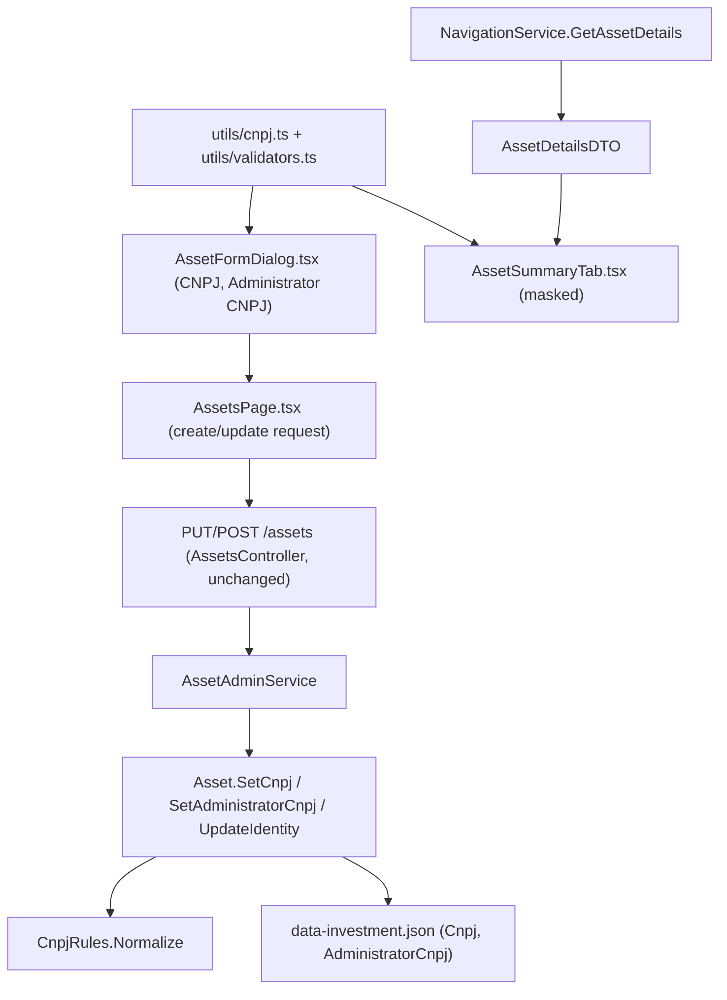

# Spec: Brazilian CNPJ Identifiers

**Complexity:** simple. It adds two optional identity fields to the asset, sharing one check-digit rule, and no new endpoint. It ships as two PRs: the backend contract (Domain, Application and the API snapshot with the regenerated web types), then the web form and the Summary tab.

## 1. Technical Overview

**What:** Two new optional asset identity fields, both for Brazilian holdings only:
- **CNPJ** for every asset with country BR. It is the CNPJ that identifies the holding in the Brazilian IR declaration (Bens e Direitos and income): the company for shares, the fund for FIIs, funds and ETFs, the issuer for fixed income, the insurer for a pension plan. For class Fund it is also the identifier the CVM price source matches (F07).
- **Administrator CNPJ** for assets with country BR and class Fund or RealEstate (FIIs). The declaration cites it in the asset description. Nothing else in P69 reads it.

Both are optional: a holding saves without them and they can be filled in later; a value is validated only when one is entered. The server accepts 14 digits with or without the `00.000.000/0000-00` mask, checks them with the standard CNPJ check-digit rule, and stores the 14 digits only. Both fields go into the asset admin create, update and read DTOs and into `AssetDetailsDTO`. The web asset form edits them under ISIN, and the asset Summary tab shows them masked, also under ISIN.

**Why:** The declaration needs the right CNPJ per holding (and, for funds and FIIs, the administrator's too), and F07/F08 need a fund's CNPJ to price it from CVM. All of them need stored identifiers that are already known to be valid, so a typo is caught when it is entered and never surfaces later in the declaration or as a pricing failure.

**Scope:**

*Included (PRD F06 Capabilities and Experience)*
- `Asset.Cnpj` and `Asset.AdministratorCnpj` (nullable strings of 14 digits), set through `Asset.SetCnpj` / `Asset.SetAdministratorCnpj`, and cleared by `UpdateIdentity` when the asset stops qualifying.
- `CnpjRules` (Domain rule): normalise, which strips the mask and checks the length, all-same digits and check digits. Used by both fields.
- `Cnpj` and `AdministratorCnpj` on `AssetAdminDTO`, `AssetAdminCreateDTO`, `AssetAdminUpdateDTO` and `AssetDetailsDTO`. The OpenAPI snapshot and the generated web types are regenerated.
- The two web form fields (helper text, inline error on blur and on submit, focus on submit), masked display in the form and on the Summary tab.

*Provides (to F07, F08)*
- `Asset.Cnpj`: 14 digits, or null when it is not set or not applicable. For a fund it is the fund's own CNPJ. `Cnpj` is the identifier, not the eligibility gate: whether a holding is priced from CVM (Quantity and price, BR, Fund, CNPJ set) is defined once in F07 and read by F08. `Asset.AcceptsCnpj(country)` and `Asset.AcceptsAdministratorCnpj(country, class)` only say whether each field applies.

*Excluded*
- Producing the IR declaration or its asset descriptions (PRD Out of Scope).
- The CVM price source, the masked source reference text and the CNPJ on the price request (F07). Buy-by-amount and quota recalculation (F08).
- Uniqueness: none, by PRD. Transactions are never touched.
- A CNPJ column in the Assets admin grid, and the alphanumeric CNPJ format (see Assumptions).

## 2. Before you design (docs/rules/design.md)

1. **Where it belongs:** the Investment bounded context. The CNPJs are part of what the asset *is*, so they live on the `Asset` entity in Domain, next to `ISIN`/`Segment`. The check-digit rule is a stateless algorithm shared by two fields, with its own Domain test class, and F07 reuses its digit stripping on the CVM CSV, so it goes in `Domain/Rules/` rather than inline on `Asset` (implementation.md §Domain rules).
2. **Layers touched:** Domain (`Asset`, `CnpjRules`) → Application (DTOs, `AssetAdminService`, `NavigationService` details mapping) → API contract (regenerated snapshot, no controller change) → Web (form, page wiring, Summary tab). Infrastructure is unchanged: the reflection-based `InvestmentTypeInfoResolver` already persists a new private-set property, as it does for `Segment`/`PickSource`.
3. **Domain stays free of Infrastructure:** nothing new crosses. `AssetAdminService` keeps using `IInvestmentRepository` (declared in Application) through `ApplyAndSaveAsync`.
4. **SOLID:** Single responsibility: the validity rule lives only in `CnpjRules`, `Asset` decides only whether each field applies to it, and the service only carries the fields through. Open/closed: the fields are optional on every DTO and in the data file, so existing callers and stored documents keep working with no data version bump.

## 3. Architecture Impact



## 4. Technical Decisions

| Decision | Chosen Approach | Alternative Considered | Trade-off |
|---|---|---|---|
| How a CNPJ is modelled | `string? Cnpj` and `string? AdministratorCnpj` on `Asset` holding the 14 digits, with the rule in a static `CnpjRules` | A `Cnpj` value-object record | A record would serialise as a nested object in the data file and on the wire, needing a custom converter in Infrastructure and the Api. The PRD stores 14 digits. Plain strings match `ISIN`/`Segment` and keep the data file flat |
| Where the rule lives | `Financial.Investment.Domain/Rules/CnpjRules.cs` | Inline on `Asset`; or Application `Validation/`, as `IsinValidator` is | A domain invariant of two stored values, shared, with its own tests. Investment must not reference CashFlow, and neither context nor Shared has a CNPJ validator today (searched) |
| Which assets carry the CNPJ | `Asset.AcceptsCnpj(country)`: true for `CountryCode.BR`, any class | Funds only | PRD: every BR holding is identified by a CNPJ in the declaration; CNPJ exists only in Brazil |
| Which assets carry the Administrator CNPJ | `Asset.AcceptsAdministratorCnpj(country, class)`: BR with `GlobalAssetClass.Fund` or `RealEstate` (BR FIIs map to RealEstate in `GlobalAssetClassMapping`) | Every BR asset | Only funds and FIIs have an administrator cited in the declaration |
| Clearing when the asset changes | `UpdateIdentity` calls one private `ClearInapplicableIdentityFields()`: segment (existing rule, moved), CNPJ when not BR, Administrator CNPJ when not BR Fund/RealEstate | A clear per field inline | One place for every conditionally applicable identity field; F07 relies on a CNPJ never outliving the BR country |
| Accepted input | Trim, then remove `.`, `/`, `-` and spaces. The result must be exactly 14 ASCII digits, not all the same, with correct check digits | Only bare digits or only the exact mask | Lenient about punctuation, as the PRD asks, strict about the digits. Letters are rejected |
| Error message | One message, `CnpjRules.InvalidMessage` = "Enter a valid 14-digit CNPJ.", thrown as `ArgumentException` (400 through `DomainExceptionMappingMiddleware`) for either field | A message per cause or per field | The PRD gives a single message. The web shows it under the field that failed |
| Update semantics | `AssetAdminUpdateDTO.Cnpj` / `.AdministratorCnpj`: null or blank clears, as `Segment` and `PickSource` do | Null keeps the current value | Matches the neighbouring fields and the PRD ("Clearing either field removes that value"). The web form always sends both |
| Validation order in the service | Only the setters normalise and validate, inside `ApplyAndSaveAsync` after `UpdateIdentity` | A service pre-check plus a second normalise | One code path; a bad value throws inside the mutation and `ApplyAndSaveAsync` rolls back, so nothing is written |
| An invalid value on an asset the field doesn't apply to | Still refused | Silently ignored | A malformed request is reported, as an over-long segment is. The web never sends a hidden field's value |
| Persistence | Two new optional properties, no `InvestmentDataMigrations` step, no `CurrentVersion` bump | A version bump | `Segment`/`PickSource` were added the same way; a document without them loads null |
| Wire names | `Cnpj` / `AdministratorCnpj` in C#, `cnpj` / `administratorCnpj` in JSON | `CNPJ`, like the legacy `ISIN` | .NET naming for acronyms longer than two letters |
| Masking | Done in the web (`formatCnpj`). The API carries digits only | A masked string from the API | One canonical wire format. F07 adds the Domain formatter it needs for its source reference |
| Web rule copy | `isValidCnpj` and the message in `Financial.Web/src/utils/validators.ts` next to `isValidIsin` (the existing web copy of `IsinValidator`), pinned by the same test vectors as `CnpjRules` | Validate only on the server | The PRD wants the inline error on blur, which needs a client check; the server stays authoritative |

## 5. Component Overview

### PR 1: backend contract

| File Path | New/Modified | Purpose | Key Responsibilities |
|---|---|---|---|
| `Financial.Investment.Domain/Rules/CnpjRules.cs` | New | CNPJ rule | `InvalidMessage` const; `Normalize(string? input) → string?` (blank → null; strip mask characters; throw `ArgumentException(InvalidMessage)` unless 14 digits, not all identical, with valid check digits); a private check-digit computation with weights 5,4,3,2,9,8,7,6,5,4,3,2 for the first digit and 6,5,4,3,2,9,8,7,6,5,4,3,2 for the second (remainder < 2 → 0, else 11 − remainder) |
| `Financial.Investment.Domain/Entities/Asset.cs` | Modified | Fields and applicability | `public string? Cnpj { get; private set; }` and `public string? AdministratorCnpj { get; private set; }` after `PickSource`; `public static bool AcceptsCnpj(CountryCode country)`; `public static bool AcceptsAdministratorCnpj(CountryCode country, GlobalAssetClass assetClass)`; `SetCnpj(string?)` / `SetAdministratorCnpj(string?)` = `CnpjRules.Normalize` then store only when the field applies; `UpdateIdentity` calls one private `ClearInapplicableIdentityFields()` (segment, CNPJ, Administrator CNPJ) |
| `Financial.Investment.Application/DTOs/AssetAdminDTO.cs` | Modified | Read | `string? Cnpj`, `string? AdministratorCnpj` (14 digits or null) |
| `Financial.Investment.Application/DTOs/AssetAdminCreateDTO.cs` | Modified | Create | `string? Cnpj`, `string? AdministratorCnpj` (null or blank leaves unset) |
| `Financial.Investment.Application/DTOs/AssetAdminUpdateDTO.cs` | Modified | Update | `string? Cnpj`, `string? AdministratorCnpj` (null or blank clears) |
| `Financial.Investment.Application/Services/AssetAdminService.cs` | Modified | Carry through | Create and Update: `SetCnpj(request.Cnpj)` and `SetAdministratorCnpj(request.AdministratorCnpj)` after `SetSegment`, inside `ApplyAndSaveAsync`; `ToDto` maps both |
| `Financial.Investment.Application/DTOs/AssetDetailsDTO.cs` | Modified | Summary read | `string? Cnpj`, `string? AdministratorCnpj` after `ISIN` |
| `Financial.Investment.Application/Services/NavigationService.cs` | Modified | Details mapping | `GetAssetDetails` maps both |
| `Tests/Financial.Api.Tests/Contract/openapi-v1.snapshot.json` | Regenerated | Contract | `cnpj` and `administratorCnpj` (string, nullable) on `AssetAdminDTO`, `AssetAdminCreateDTO`, `AssetAdminUpdateDTO`, `AssetDetailsDTO` |
| `Financial.Web/src/api/generated/openapi.ts` | Regenerated | Web types | `npm run generate-api-types`; `types.ts` aliases unchanged |

8 non-test code files. Nothing needs a new comment or XML doc: the existing `///` on neighbouring DTO properties are kept and none are added. Regenerate with `UPDATE_OPENAPI_SNAPSHOT=1 dotnet test Tests/Financial.Api.Tests --filter "FullyQualifiedName~OpenApiContractTests"`.

### PR 2: web

| File Path | New/Modified | Purpose | Key Responsibilities |
|---|---|---|---|
| `Financial.Web/src/utils/validators.ts` | Modified | Client rule | `INVALID_CNPJ_MESSAGE` ("Enter a valid 14-digit CNPJ.") and `isValidCnpj(value)` (same rule as `CnpjRules`), next to `isValidIsin` |
| `Financial.Web/src/utils/cnpj.ts` | New | Applicability and formatting | `acceptsCnpj(country)` (BR), `acceptsAdministratorCnpj(country, assetClass)` (BR + Fund/RealEstate), `cnpjDigits(value)` (strip `.`, `/`, `-`, whitespace), `formatCnpj(digits)` (`00.000.000/0000-00`; returns the input unchanged unless it is 14 digits) |
| `Financial.Web/src/components/AssetFormDialog.tsx` | Modified | Form fields | `cnpj` and `administratorCnpj` state initialised masked; `AssetFormValues.cnpj` / `.administratorCnpj` (digits or ''); "CNPJ" `Field` under ISIN when `acceptsCnpj(country)`, "Administrator CNPJ" `Field` after it when `acceptsAdministratorCnpj(country, assetClass)`, each with its PRD `hint`; on-blur error reveal per field; submit gating |
| `Financial.Web/src/pages/AssetsPage.tsx` | Modified | Request wiring | `cnpj: values.cnpj \|\| null` and `administratorCnpj: values.administratorCnpj \|\| null` on create and update |
| `Financial.Web/src/components/AssetSummaryTab.tsx` | Modified | Display | "CNPJ" after "ISIN" when `acceptsCnpj(asset.country)`, "Administrator CNPJ" after it when `acceptsAdministratorCnpj(asset.country, asset.class)`, each `orMissing(value, formatCnpj, 'None')` |

5 non-test code files.

## 6. API Contracts

No new endpoint. The existing endpoints gain two optional fields:

| Endpoint | Change |
|---|---|
| `POST /api/v1/financial/assets` (`AssetAdminCreateDTO`) | Request `cnpj`, `administratorCnpj` (string \| null, optional) |
| `PUT /api/v1/financial/assets/{broker}/{portfolio}/{name}` (`AssetAdminUpdateDTO`) | Request `cnpj`, `administratorCnpj` (string \| null, optional; null or blank clears) |
| `GET /api/v1/financial/assets` and the create/update responses (`AssetAdminDTO`) | Response `cnpj`, `administratorCnpj` (string \| null) |
| `GET /api/v1/financial/assets/{broker}/{portfolio}/{name}` (`AssetDetailsDTO`) | Response `cnpj`, `administratorCnpj` (string \| null) |

**Request fields**

| Field | Type | Required | Validation | Description |
|---|---|---|---|---|
| `cnpj` | string \| null | No | After stripping `.`, `/`, `-` and spaces: 14 digits, not all identical, valid check digits | The holding's CNPJ (company, fund, issuer or insurer). Stored as null unless the asset ends up with country BR |
| `administratorCnpj` | string \| null | No | Same | The fund or FII administrator's CNPJ. Stored as null unless the asset ends up BR with class Fund or RealEstate |

**Request example (update of an FII)**

```json
{
  "name": "Example FII",
  "isin": "",
  "exchange": "BVMF",
  "ticker": "XMPL11",
  "country": "BR",
  "localTypeCode": "FII",
  "class": "RealEstate",
  "valuationMethod": null,
  "incomePolicy": null,
  "segment": "Logistics",
  "pickSource": null,
  "cnpj": "11.222.333/0001-81",
  "administratorCnpj": "11444777000161"
}
```

**Response example (`AssetAdminDTO`, excerpt)**

```json
{
  "name": "Example FII",
  "brokerName": "XPI",
  "portfolioName": "FII",
  "country": "BR",
  "class": "RealEstate",
  "cnpj": "11222333000181",
  "administratorCnpj": "11444777000161",
  "quantity": 0
}
```

**Errors**

| Case | HTTP Status | `detail` |
|---|---|---|
| Either field: wrong length, letters, all identical digits, wrong check digits | 400 | "Enter a valid 14-digit CNPJ." |

## 7. Data Model

`data-investment.json`, each `Asset` object gains two optional properties:

| Property | Type | Nullable | Default | Description |
|---|---|---|---|---|
| `Cnpj` | string (14 digits) | Yes | absent / `null` | The holding's CNPJ; only ever set on BR assets |
| `AdministratorCnpj` | string (14 digits) | Yes | absent / `null` | Administrator's CNPJ; only ever set on BR Fund/RealEstate assets |

- No `InvestmentDataMigrations` step and no `CurrentVersion` change. A document written before F06 has neither property, and both load as null.
- No uniqueness constraint (the same company or fund can sit in several portfolios).
- `data/*.example.json` templates need no change (optional fields).

## 8. Web behaviour (docs/rules/ui.md)

- **User task:** record the CNPJs a Brazilian holding is identified by in the IR declaration (and, for a fund, by CVM). These are secondary identity fields in the existing admin asset dialog (ADR-006 modal admin CRUD); no new surface is added.
- **Field order:** Name, ISIN, **CNPJ**, **Administrator CNPJ**, Exchange, Ticker, Country, Local type code, Class, Segment, Pick source. Each field appears or disappears in place when Country/Class change, the same conditional-field behaviour as Segment, keeping the DOM reading order.
- **Fields:** Fluent `Field` with an `Input` (`inputMode="numeric"`, `autoComplete="off"`, a width that suits 18 characters), optional, no required marker.
  - "CNPJ", hint "The CNPJ that identifies this holding in the IR declaration: the company, fund, issuer or insurer. For a fund, also used to get its daily quota value from CVM."
  - "Administrator CNPJ", hint "The fund administrator's CNPJ, cited in the IR declaration."
- **States:**
  - *Initial / edit:* each opens with the stored digits shown masked, or empty.
  - *Validation:* each field's message is computed on `cnpjDigits(value)` only when that field is shown and not blank. It is revealed on blur (a local blurred flag per field) and on Save (`form.revealValidation`). On Save the dialog's existing `useFieldErrorSummary` moves focus to the invalid field when it is the only one, or to the summary when several are invalid. Errors use the Fluent error icon and text, never colour alone.
  - *Masking:* stored values are shown masked when the dialog opens; whatever the user types is kept as typed (the server normalises it). No removal warning: a hidden field submits '' and the server clears it on reclassify.
  - *Saving / server error / unsaved changes:* unchanged `EntityFormDialog` behaviour. The server's 400 detail shows in the dialog alert and the entered values are kept. The dirty check compares digits with the stored digits.
  - *Disabled:* the whole fieldset is disabled while saving (existing).
  - *Loading / empty / success:* not applicable beyond the dialog's existing behaviour.
- **Submit:** each field submits its digits when shown, otherwise ''. The page sends `value || null`, so a cleared or hidden field clears it on the server.
- **Summary tab:** "CNPJ" after "ISIN" for BR assets and "Administrator CNPJ" after it for BR funds and FIIs, masked, "None" (`MissingValue`) when unset; non-BR assets' Summary is unchanged.
- **Accessibility / zoom:** labels visible and associated, hints linked through Fluent `Field` (`aria-describedby`), fields reflow with the existing dialog grid at narrow widths and 200% zoom. Light/dark and high contrast come from Fluent tokens, with no new style values.

## 9. Testing Strategy

Test vectors shared by the Domain and web tests (literals, never computed):

| Input | Expected |
|---|---|
| `11222333000181` | valid → `11222333000181` |
| `11.222.333/0001-81` | valid → `11222333000181` |
| ` 11.222.333/0001-81 ` | valid (trimmed) |
| `11444777000161` | valid (second valid value, for Administrator CNPJ tests) |
| `11222333000182` | invalid (second check digit) |
| `11222333000191` | invalid (first check digit) |
| `1122233300018` / `112223330001811` | invalid (length) |
| `00000000000000`, `11111111111111` | invalid (identical digits) |
| `1122233300018A` | invalid (letter) |
| `''`, `'   '`, null | not set (null) |

**Test files**

| Test File | Test Type | Target |
|---|---|---|
| `Tests/Financial.Investment.Domain.Tests/Rules/CnpjRulesTests.cs` (new) | Unit | `CnpjRules.Normalize` over the vectors |
| `Tests/Financial.Investment.Domain.Tests/Domain/AssetTests.cs` | Unit | Setters, applicability, `UpdateIdentity` clearing |
| `Tests/Financial.Investment.Application.Tests/Services/AssetAdminServiceTests.cs` | Unit | Create/update persist, clear and reject both fields. Persistence proven by reloading from disk (`PersistedInvestmentFile.ReloadAsset`), failure through the span |
| `Tests/Financial.Investment.Application.Tests/Services/NavigationServiceTests.cs` | Unit | `GetAssetDetails` returns both |
| `Tests/Financial.Investment.Infrastructure.Tests/Persistence/InvestmentSerializerAdapterTests.cs` | Unit | Round trip, and a document without the properties |
| `Tests/Financial.Api.Tests/Acceptance/BrazilianCnpjAcceptanceTests.cs` (new, `ApiEndpointTests`, `[Trait("Category","Integration")]`) | Integration | PRD F06 criteria over HTTP |
| `Tests/Financial.Api.Tests/Contract/OpenApiContractTests` (existing) | Contract | Regenerated snapshot |
| `Financial.Web/src/utils/__tests__/validators.test.ts` | Unit | `isValidCnpj` over the same vectors |
| `Financial.Web/src/utils/__tests__/cnpj.test.ts` (new) | Unit | `cnpjDigits`, `formatCnpj`, `acceptsCnpj`, `acceptsAdministratorCnpj` |
| `Financial.Web/src/components/__tests__/AssetFormDialog.test.tsx` | Unit | Visibility per country/class, blur and submit validation per field, focus, masked initial values, submit values |
| `Financial.Web/src/pages/__tests__/AssetsPage.test.tsx` | Unit | Both fields sent on create/update, `null` when cleared |
| `Financial.Web/src/components/__tests__/AssetSummaryTab.test.tsx` | Unit | Masked display, "None", hidden where not applicable |
| `src/api/generated/__tests__/openapiFreshness.test.ts` (existing) | Unit | Generated types match the snapshot |

**Functions**

| Test Function | Description | Assertions |
|---|---|---|
| `Normalize_ValidDigitsOrMask_ReturnsTheFourteenDigits` (Theory) | Bare, masked, padded | Returns `11222333000181` |
| `Normalize_Blank_ReturnsNull` (Theory) | null, '', spaces | null |
| `Normalize_WrongCheckDigit_Throws` (Theory) | `…182`, `…191` | `ArgumentException`, message "Enter a valid 14-digit CNPJ." |
| `Normalize_WrongLength_Throws` (Theory) | 13 and 15 digits | Same message |
| `Normalize_AllIdenticalDigits_Throws` (Theory) | `000…`, `111…` | Same message |
| `Normalize_Letters_Throws` | `1122233300018A` | Same message |
| `SetCnpj_BrazilianAsset_StoresTheDigits` (Theory) | BR Equity, BR RealEstate, BR Fund, BR Bond, BR Pension | `Cnpj == "11222333000181"` |
| `SetCnpj_NonBrazilianAsset_StoresNothing` (Theory) | UK Equity, US Fund, Unknown country | `Cnpj` null |
| `SetAdministratorCnpj_BrazilianFundOrFii_StoresTheDigits` (Theory) | BR Fund, BR RealEstate | `AdministratorCnpj == "11444777000161"` |
| `SetAdministratorCnpj_OtherAssets_StoresNothing` (Theory) | BR Equity, BR Pension, UK RealEstate | null |
| `SetCnpj_Blank_ClearsIt` / `SetAdministratorCnpj_Blank_ClearsIt` | After a valid set | null |
| `UpdateIdentity_CountryNoLongerBR_ClearsBoth` | Reclassify country | both null |
| `UpdateIdentity_ClassNoLongerFundOrRealEstate_ClearsOnlyTheAdministratorCnpj` | BR Fund → BR Equity | `Cnpj` kept, `AdministratorCnpj` null |
| `UpdateIdentity_StillBrazilian_KeepsTheCnpj` | Rename only | Unchanged |
| `CreateAssetAsync_MaskedCnpjs_PersistTheDigits` | Reloaded from disk | Both 14-digit values |
| `UpdateAssetAsync_CnpjLeftBlank_ClearsIt` / `…_AdministratorCnpjLeftBlank_ClearsIt` | Reloaded | null |
| `UpdateAssetAsync_InvalidCnpj_ThrowsAndWritesNothing` (Theory over both fields) | Bad check digit | `ArgumentException`, file unchanged, `ShouldHaveFailedSpan<ArgumentException>("Investment.AssetAdminService.UpdateAsset")` |
| `UpdateAssetAsync_CnpjChange_LeavesTransactionsUntouched` | Asset with buys | Transaction list equal before/after |
| `CreateAssetAsync_SameCnpjInTwoPortfolios_IsAllowed` | No uniqueness | Both persisted |
| `GetAssetDetails_ReturnsBothCnpjs` | Details mapping | Equal to the stored values |
| `SerializeDeserialize_RoundTripPreservesBothCnpjs` | Round trip | Equal |
| `Deserialize_AssetWithoutCnpjs_LoadsThemAsNotSet` | Old JSON | null |
| web `cnpj.test.ts` "applies the CNPJ to every BR asset only", "applies the Administrator CNPJ to BR funds and FIIs only", "formats 14 digits with the mask", "strips punctuation" | Rules | As named |
| web `validators.test.ts` "accepts the masked and bare forms", "rejects wrong check digits, length, identical digits and letters" | Vectors | As table |
| web `AssetFormDialog.test.tsx` "shows CNPJ under ISIN for every BR asset and for no other country" | Visibility | Field present / absent |
| … "shows Administrator CNPJ only for BR funds and FIIs" | Visibility | Field present / absent |
| … "shows the CNPJ message on blur and keeps it until fixed" (each field) | Blur | Message text, `aria-invalid` |
| … "refuses an invalid CNPJ on Save and moves focus to it" | Submit | `onSubmit` not called, focus on the invalid input |
| … "submits the 14 digits of a masked CNPJ" | Submit | Typed `11.222.333/0001-81`, submitted `11222333000181` |
| … "opens stored CNPJs masked and submits '' when cleared" | Edit/clear | Values, submitted '' |
| … "submits '' for a hidden field" | Hidden | '' |
| … "saves a BR asset with both CNPJ fields empty" | Optional | `onSubmit` called, no field error |
| web `AssetsPage.test.tsx` "sends both CNPJs, and null when cleared" | Wiring | Request bodies |
| web `AssetSummaryTab.test.tsx` "renders_the_cnpjs_masked_for_a_brazilian_fii", "renders_none_for_a_brazilian_asset_without_a_cnpj", "hides_the_administrator_cnpj_for_brazilian_shares", "hides_both_for_non_brazilian_assets" | Display | As named |

**Acceptance (PRD Section 9, F06)**

The F06 checkboxes in the PRD have no ids yet. They are numbered `P69-F06-brazilian-cnpj-identifiers-01`…`-08` in order and the ids are added to the PRD boxes in the ticking commit of PR 2.

| AC | Test |
|---|---|
| -01 CNPJ field for every BR holding, no other country | `AssetFormDialog.test.tsx` "[AC P69-F06-brazilian-cnpj-identifiers-01] shows CNPJ under ISIN for every BR asset and for no other country" |
| -02 Administrator CNPJ for BR Fund or Real estate only | `AssetFormDialog.test.tsx` "[AC …-02] shows Administrator CNPJ only for BR funds and FIIs" |
| -03 Valid value with or without mask stored as 14 digits and shown masked | `CreateAsset_WithMaskedCnpjs_StoresTheFourteenDigits`, `UpdateAsset_WithBareDigits_StoresThem` (acceptance); `AssetSummaryTab.test.tsx` "[AC …-03] renders_the_cnpjs_masked_for_a_brazilian_fii" |
| -04 Invalid value shows the message in that field and is not saved | `UpdateAsset_WithAnInvalidCnpj_Returns400AndKeepsTheStoredValue` (Theory over both fields and the three causes, acceptance); `AssetFormDialog.test.tsx` "[AC …-04] refuses an invalid CNPJ on Save and moves focus to it" |
| -05 A BR holding with both fields empty saves without an error | `CreateAsset_BrazilianAssetWithoutCnpjs_Succeeds` (acceptance); `AssetFormDialog.test.tsx` "[AC …-05] saves a BR asset with both CNPJ fields empty" |
| -06 Clearing either field removes that value | `UpdateAsset_WithABlankCnpj_RemovesIt`, `UpdateAsset_WithABlankAdministratorCnpj_RemovesIt` (acceptance); `AssetFormDialog.test.tsx` "[AC …-06] opens stored CNPJs masked and submits '' when cleared" |
| -07 Country away from BR clears both; class away from Fund/Real estate clears the Administrator CNPJ | `UpdateAsset_CountryChangedFromBR_ClearsBoth`, `UpdateAsset_ClassChangedFromFund_ClearsOnlyTheAdministratorCnpj` (acceptance) |
| -08 Both in the admin DTOs and the OpenAPI snapshot, web types regenerated | `OpenApiContractTests` (snapshot), `openapiFreshness.test.ts`, plus `GetAssets_ReturnsBothCnpjs` tagged `[Trait("AC","P69-F06-brazilian-cnpj-identifiers-08")]` |

**Cross-feature (PRD Section 9 Integration):** "A CNPJ saved on a fund (F06) is used by the CVM source (F07)…" and "The CNPJ (F06) and the quota value on a date (F07) drive…" are proven by F07/F08, which consume `Asset.Cnpj`. F06 provides the precondition they rely on, `UpdateIdentity_CountryNoLongerBR_ClearsBoth` (a CNPJ never outlives the BR country), and the acceptance test `UpdateAsset_WithABlankCnpj_RemovesIt` ("clearing it stops CVM pricing" starts from a null `Cnpj`).

## 10. Assumptions and Decisions

Each resolves a point the PRD does not settle. Items 1–2 come from the user's review (2026-11-27); the rest are Batch Mode auto-accepted defaults, kept or adjusted after `/code-review` and `/simplify`.

1. **CNPJ on every BR asset, never required** (user): shown for every BR holding but optional, because finding a CNPJ can take time; validated only when a value is entered. It is the identifier the IR declaration uses for any Brazilian holding; CNPJ exists only in Brazil, so no other country shows or keeps it.
2. **Administrator CNPJ for BR funds and FIIs** (user): a separate optional field, because FIIs and funds carry two CNPJs (fund and administrator). FIIs are `GlobalAssetClass.RealEstate` in the BR class mapping; BR ETFs (also funds with an administrator) are not included, and can be added to `AcceptsAdministratorCnpj` later if needed.
3. **Create with Class left at "Unknown":** the CNPJ field only needs country BR, so it shows. The Administrator CNPJ field needs Class Fund or Real estate, so on create it shows only once Class is set (or on the next edit, which shows the resolved class); showing it for Unknown would break AC -02.
4. **Lenient punctuation:** any mix of `.`, `/`, `-` and spaces is stripped; only the digits are validated.
5. **One error message** for every invalid cause and both fields, the PRD's text, on the server and the client.
6. **Alphanumeric CNPJ** (issued by the Receita Federal since July 2026, so a recently registered company or fund can already have one) is out of scope by choice: the PRD fixes 14 digits, and the holdings held today have numeric CNPJs. Such a CNPJ is rejected with the standard message; widening `CnpjRules` and `isValidCnpj` together is a follow-up.
7. **No data version bump.** The properties are optional, as `Segment`/`PickSource` were in P68. Stored values are trusted on load.
8. **Wire/property names `Cnpj` / `AdministratorCnpj`** (camelCase on the wire), not `CNPJ` (naming guideline; `ISIN` is legacy).
9. **Rule placement:** `Domain/Rules/CnpjRules.cs`. No CNPJ rule exists anywhere in the solution, including CashFlow and Shared.
10. **Client-side mirror** of the check-digit rule in `utils/validators.ts` next to `isValidIsin`, pinned by the same literal vectors, because the PRD requires an on-blur error.
11. **Blur behaviour:** a local blurred flag per field reveals its error (the admin dialog otherwise reveals errors only on Save). Values are not re-masked on blur. The dirty check compares digits only.
12. **No removal warning** for either field: the server clears them on reclassify, and the fields disappear when Country/Class stop qualifying.
13. **Summary tab** shows each row only where its field applies ("None" when unset).
14. **No masked formatter in Domain yet:** F07 adds it with its first caller.
15. **Slicing:** two PRs (backend 8 non-test code files; web 5). Between them, the web update request omits both fields, which the server reads as "clear". No value can exist before PR 2 except one set through the raw API, and deploys happen after a feature's last PR, so this is accepted rather than adding a keep-on-null special case.
16. **AC ids:** `P69-F06-brazilian-cnpj-identifiers-01…08` in PRD order, added to the PRD boxes in PR 2's ticking commit. The feature and folder were renamed from "Fund CNPJ Identifier" when the scope widened.
17. **Parallel F01 work:** F01 (Tracked by) also edits `Asset.cs`, the asset admin DTOs, `AssetAdminService` and `AssetFormDialog.tsx` in the same wave. This feature's PR 1 merges first; F01's PR 2 rebases and regenerates `openapi-v1.snapshot.json` and `src/api/generated/openapi.ts` rather than hand-merging them.
18. **No `context.md` change:** it does not document asset identity fields today.
