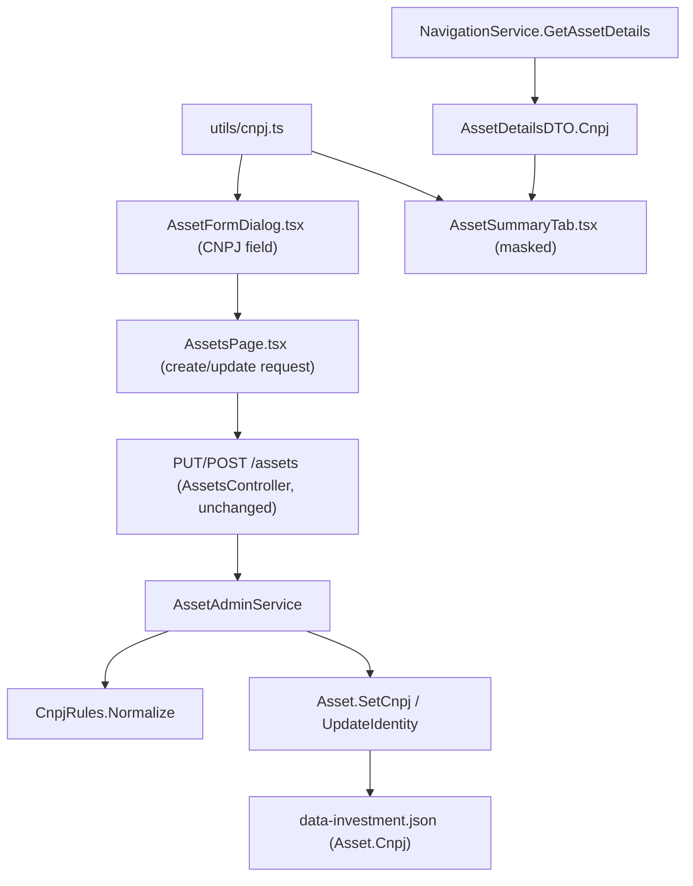

# Spec: Fund CNPJ Identifier

**Complexity:** simple. It adds one optional identity field to the asset, with its own check-digit rule and no new endpoint. It ships as two PRs: the backend contract (Domain, Application and the API snapshot with the regenerated web types), then the web form and the Summary tab.

## 1. Technical Overview

**What:** A new optional asset identity field, **CNPJ**, that applies only to assets with country BR and class Fund. The server accepts 14 digits with or without the `00.000.000/0000-00` mask, checks them with the standard CNPJ check-digit rule, and stores the 14 digits only. The field goes into the asset admin create, update and read DTOs and into `AssetDetailsDTO`. The web asset form edits it under ISIN, and the asset Summary tab shows it masked, also under ISIN.

**Why:** F07 (CVM daily quota source) matches the 14-digit `CNPJ_FUNDO_CLASSE`, and F08 (buy by amount) is enabled by the presence of a CNPJ. Both need one stored identifier that is already known to be valid, so a typo is caught when it is entered and never surfaces later as a pricing failure.

**Scope:**

*Included (PRD F06 Capabilities and Experience)*
- `Asset.Cnpj` (nullable string of 14 digits), set through `Asset.SetCnpj` and cleared by `UpdateIdentity` when the asset stops being BR + Fund.
- `CnpjRules` (Domain rule): normalise, which strips the mask and checks the length, all-same digits and check digits.
- `Cnpj` on `AssetAdminDTO`, `AssetAdminCreateDTO`, `AssetAdminUpdateDTO` and `AssetDetailsDTO`. The OpenAPI snapshot and the generated web types are regenerated.
- The web form field (shown for BR + Fund only, helper text, inline error on blur and on submit, focus on submit), masked display in the form and on the Summary tab.

*Provides (to F07, F08)*
- `Asset.Cnpj`: 14 digits, or null when it is not set or not applicable. `Cnpj` is the identifier, not the eligibility gate: whether a holding is priced from CVM (Quantity and price, BR, Fund, CNPJ set) is defined once in F07 and read by F08. `Asset.AcceptsCnpj(country, class)` only says whether the field applies.

*Excluded*
- The CVM price source, the masked source reference text and the CNPJ on the price request (F07). Buy-by-amount and quota recalculation (F08).
- Uniqueness: none, by PRD. Transactions are never touched.
- A CNPJ column in the Assets admin grid, and the alphanumeric CNPJ format (see Assumptions).

## 2. Before you design (docs/rules/design.md)

1. **Where it belongs:** the Investment bounded context. The CNPJ is part of what the asset *is*, so it lives on the `Asset` entity in Domain, next to `ISIN`/`Segment`. The check-digit rule is a stateless algorithm with its own Domain test class, and F07 will reuse its digit stripping on the CVM CSV. That is two reasons to put it in `Domain/Rules/` rather than inline on `Asset` (implementation.md §Domain rules).
2. **Layers touched:** Domain (`Asset`, `CnpjRules`) → Application (DTOs, `AssetAdminService`, `NavigationService` details mapping) → API contract (regenerated snapshot, no controller change) → Web (form, page wiring, Summary tab). Infrastructure is unchanged: the reflection-based `InvestmentTypeInfoResolver` already persists a new private-set property, as it does for `Segment`/`PickSource`.
3. **Domain stays free of Infrastructure:** nothing new crosses. `AssetAdminService` keeps using `IInvestmentRepository` (declared in Application) through `ApplyAndSaveAsync`.
4. **SOLID:** Single responsibility: the validity rule lives only in `CnpjRules`, `Asset` decides only whether the field applies to it, and the service only carries the field through. Open/closed: the field is optional on every DTO and in the data file, so existing callers and stored documents keep working with no data version bump.

## 3. Architecture Impact



## 4. Technical Decisions

| Decision | Chosen Approach | Alternative Considered | Trade-off |
|---|---|---|---|
| How the CNPJ is modelled | `string? Cnpj` on `Asset` holding the 14 digits, with the rule in a static `CnpjRules` | A `Cnpj` value-object record | A record would serialise as a nested object in the data file and on the wire, so it would need a custom converter in Infrastructure and the Api. The PRD says the value is stored as 14 digits. A plain string matches `ISIN`/`Segment` and the data file stays flat |
| Where the rule lives | `Financial.Investment.Domain/Rules/CnpjRules.cs` | Inline on `Asset`, as `NormalizeSegment` is; or Application `Validation/`, as `IsinValidator` is | The check-digit rule is a domain invariant of the stored value, not only the shape of a request. A stateless algorithm with its own test class qualifies for `Rules/`. Investment must not reference CashFlow, and neither context nor Shared has a CNPJ validator today (searched), so this is the first |
| Which assets carry it | `Asset.AcceptsCnpj(country, class)`: true only for `CountryCode.BR` with `GlobalAssetClass.Fund`. `SetCnpj` stores null otherwise, and `UpdateIdentity` clears it when the asset stops qualifying | Store it on any asset | This mirrors `HasSegments`/`SetSegment`/`UpdateIdentity` exactly. F07 relies on "has a CNPJ" meaning "is a BR fund", so a CNPJ left behind on a reclassified asset would wrongly select CVM |
| Accepted input | Trim, then remove `.`, `/`, `-` and spaces. The result must be exactly 14 ASCII digits that are not all the same and whose two check digits are correct | Accept only the bare digits or the exact mask | Lenient about punctuation, as the PRD asks ("with or without the mask"), and strict about the digits. Letters are rejected |
| Error message | One message, `CnpjRules.InvalidMessage` = "Enter a valid 14-digit CNPJ.", thrown as `ArgumentException` (400 through `DomainExceptionMappingMiddleware`) for a wrong length, wrong check digits or identical digits | A message per cause | The PRD gives a single message. The web form shows the same text, so the client and server read identically |
| Update semantics | `AssetAdminUpdateDTO.Cnpj`: null or blank clears it, as `Segment` and `PickSource` do | Null keeps the current value | Matches the neighbouring fields and the PRD ("Clearing the field removes the CNPJ"). The web form always sends the field |
| Validation order in the service | Only `SetCnpj` normalises and validates, inside `ApplyAndSaveAsync` after `UpdateIdentity` | A service pre-check plus a second normalise in `SetCnpj` | One code path; a bad value throws inside the mutation and `ApplyAndSaveAsync` rolls back, so nothing is written |
| An invalid CNPJ on an asset that is not BR + Fund | Still refused | Silently ignored | The same as an over-long segment on a class without segments: a malformed request is reported. The web never sends a CNPJ for a hidden field |
| Persistence | A new optional `Cnpj` property, with no `InvestmentDataMigrations` step and no `CurrentVersion` bump | A version bump | `Segment`/`PickSource` were added the same way. A document without the property loads it as null. A stored value is trusted on load, because the private setter is wired by reflection |
| Wire name | `Cnpj` in C#, `cnpj` in JSON | `CNPJ`, like the legacy `ISIN` | .NET naming for acronyms longer than two letters. `ISIN` is a pre-existing exception that is not repeated |
| Masking | Done in the web (`formatCnpj`). The API carries digits only | A masked string from the API | One canonical wire format. F07 adds the Domain formatter it needs for the source reference, so none is added here unused |
| Web rule copy | `isValidCnpj` and the message go in `Financial.Web/src/utils/validators.ts` next to `isValidIsin` (the existing web copy of `IsinValidator`), pinned by the same test vectors as `CnpjRules` | Validate only on the server | The PRD wants the inline error on blur, which needs a client check; the server stays authoritative |

## 5. Component Overview

### PR 1: backend contract

| File Path | New/Modified | Purpose | Key Responsibilities |
|---|---|---|---|
| `Financial.Investment.Domain/Rules/CnpjRules.cs` | New | CNPJ rule | `InvalidMessage` const; `Normalize(string? input) → string?` (blank → null; strip mask characters; throw `ArgumentException(InvalidMessage)` unless 14 digits, not all identical, with valid check digits); a private check-digit computation with weights 5,4,3,2,9,8,7,6,5,4,3,2 for the first digit and 6,5,4,3,2,9,8,7,6,5,4,3,2 for the second (remainder < 2 → 0, else 11 − remainder) |
| `Financial.Investment.Domain/Entities/Asset.cs` | Modified | Field and applicability | `public string? Cnpj { get; private set; }` after `PickSource`; `public static bool AcceptsCnpj(CountryCode country, GlobalAssetClass assetClass)`; `SetCnpj(string? cnpj)` = `CnpjRules.Normalize` then store only when `AcceptsCnpj(Country, Class)`; `UpdateIdentity` calls one private `ClearInapplicableIdentityFields()` that clears the segment (existing rule, moved) and the CNPJ |
| `Financial.Investment.Application/DTOs/AssetAdminDTO.cs` | Modified | Read | `public string? Cnpj { get; set; }` (14 digits or null) |
| `Financial.Investment.Application/DTOs/AssetAdminCreateDTO.cs` | Modified | Create | `public string? Cnpj { get; set; }` (null or blank leaves it unset) |
| `Financial.Investment.Application/DTOs/AssetAdminUpdateDTO.cs` | Modified | Update | `public string? Cnpj { get; set; }` (null or blank clears it) |
| `Financial.Investment.Application/Services/AssetAdminService.cs` | Modified | Carry through | Create and Update: `SetCnpj(request.Cnpj)` after `SetSegment`, inside `ApplyAndSaveAsync`; `ToDto` maps `Cnpj` |
| `Financial.Investment.Application/DTOs/AssetDetailsDTO.cs` | Modified | Summary read | `public string? Cnpj { get; set; }` after `ISIN` |
| `Financial.Investment.Application/Services/NavigationService.cs` | Modified | Details mapping | `GetAssetDetails` maps `Cnpj = asset.Cnpj` |
| `Tests/Financial.Api.Tests/Contract/openapi-v1.snapshot.json` | Regenerated | Contract | `cnpj` (string, nullable) on `AssetAdminDTO`, `AssetAdminCreateDTO`, `AssetAdminUpdateDTO`, `AssetDetailsDTO` |
| `Financial.Web/src/api/generated/openapi.ts` | Regenerated | Web types | `npm run generate-api-types`; `types.ts` aliases are unchanged because `AssetAdminDto`/`AssetDetailsDto` already alias the schemas |

8 non-test code files. Nothing needs a new comment or XML doc: the existing `///` on neighbouring DTO properties are kept and none are added.

### PR 2: web

| File Path | New/Modified | Purpose | Key Responsibilities |
|---|---|---|---|
| `Financial.Web/src/utils/validators.ts` | Modified | Client rule | `INVALID_CNPJ_MESSAGE` ("Enter a valid 14-digit CNPJ.") and `isValidCnpj(value)` (same rule as `CnpjRules`), next to `isValidIsin` |
| `Financial.Web/src/utils/cnpj.ts` | New | Formatting | `acceptsCnpj(country, assetClass)` (BR + Fund), `cnpjDigits(value)` (strip `.`, `/`, `-`, whitespace), `formatCnpj(digits)` (`00.000.000/0000-00`; returns the input unchanged unless it is 14 digits) |
| `Financial.Web/src/components/AssetFormDialog.tsx` | Modified | Form field | `cnpj` state initialised to `formatCnpj(asset?.cnpj ?? '')`; `AssetFormValues.cnpj` (digits or ''); the "CNPJ" `Field` directly under ISIN, rendered only when `acceptsCnpj(country, assetClass)`, with the PRD helper `hint`; on-blur error reveal; submit gating |
| `Financial.Web/src/pages/AssetsPage.tsx` | Modified | Request wiring | `cnpj: values.cnpj \|\| null` on both the create and update requests |
| `Financial.Web/src/components/AssetSummaryTab.tsx` | Modified | Display | A "CNPJ" `Field` right after "ISIN" in the identity `dl`, rendered only when `acceptsCnpj(asset.country, asset.class)`: `orMissing(asset.cnpj, formatCnpj, 'None')` |

5 non-test code files.

## 6. API Contracts

No new endpoint. The existing endpoints gain one optional field:

| Endpoint | Change |
|---|---|
| `POST /api/v1/financial/assets` (`AssetAdminCreateDTO`) | Request `cnpj` (string \| null, optional) |
| `PUT /api/v1/financial/assets/{broker}/{portfolio}/{name}` (`AssetAdminUpdateDTO`) | Request `cnpj` (string \| null, optional; null or blank clears) |
| `GET /api/v1/financial/assets` and the create/update responses (`AssetAdminDTO`) | Response `cnpj` (string \| null) |
| `GET /api/v1/financial/assets/{broker}/{portfolio}/{name}` (`AssetDetailsDTO`) | Response `cnpj` (string \| null) |

**Request field**

| Field | Type | Required | Validation | Description |
|---|---|---|---|---|
| `cnpj` | string \| null | No | After stripping `.`, `/`, `-` and spaces: 14 digits, not all identical, valid check digits | Fund CNPJ, masked or not. Ignored (stored as null) unless the asset ends up country BR and class Fund |

**Request example (update)**

```json
{
  "name": "Guepardo Institucional FIC FIA",
  "isin": "",
  "exchange": "",
  "ticker": "",
  "country": "BR",
  "localTypeCode": "Fundo",
  "class": "Fund",
  "valuationMethod": null,
  "incomePolicy": null,
  "segment": null,
  "pickSource": null,
  "cnpj": "11.222.333/0001-81"
}
```

**Response example (`AssetAdminDTO`, excerpt)**

```json
{
  "name": "Guepardo Institucional FIC FIA",
  "brokerName": "XPI",
  "portfolioName": "Fundos",
  "country": "BR",
  "class": "Fund",
  "cnpj": "11222333000181",
  "quantity": 0
}
```

**Errors**

| Case | HTTP Status | `detail` |
|---|---|---|
| Wrong length, letters, all identical digits, wrong check digits | 400 | "Enter a valid 14-digit CNPJ." |

## 7. Data Model

`data-investment.json`, each `Asset` object gains one optional property:

| Property | Type | Nullable | Default | Description |
|---|---|---|---|---|
| `Cnpj` | string (14 digits) | Yes | absent / `null` | Fund CNPJ; only ever set on BR + Fund assets |

- No `InvestmentDataMigrations` step and no `CurrentVersion` change. A document written before F06 has no property, which loads as null.
- No uniqueness constraint (the same fund can sit in several portfolios).
- `data/*.example.json` templates need no change (optional field).

## 8. Web behaviour (docs/rules/ui.md)

- **User task:** identify a Brazilian fund so that CVM can price it later. This is a secondary identity field in the existing admin asset dialog (ADR-006 modal admin CRUD). It stays in the dialog, and no new surface is added.
- **Field order:** Name, ISIN, **CNPJ**, Exchange, Ticker, Country, Local type code, Class, Segment, Pick source. The field appears or disappears in place when Country/Class change. That is the same conditional-field behaviour as Segment, and it keeps the DOM reading order.
- **Field:** Fluent `Field` label "CNPJ", `hint` = "The fund's CNPJ, shown on its fact sheet (lâmina) in XP. Used to get its daily quota value from CVM.", and an `Input` with `inputMode="numeric"`, `autoComplete="off"` and a width that suits 18 characters. It is optional, so it has no required marker.
- **States:**
  - *Initial / edit:* opens with the stored digits shown masked, or empty.
  - *Validation:* the message is computed on `cnpjDigits(cnpj)` only when the field is shown and not blank. It is revealed on blur (a local `isCnpjBlurred` flag) and on Save (`form.revealValidation`). On Save the dialog's existing `useFieldErrorSummary` moves focus to the field when it is the only invalid one, or to the summary when several fields are invalid. Errors are shown with the Fluent error icon and text, never colour alone.
  - *Masking:* the stored value is shown masked when the dialog opens; whatever the user types is kept as typed (the server normalises it). No removal warning: a hidden field submits '' and the server clears the CNPJ on reclassify.
  - *Saving / server error / unsaved changes:* unchanged `EntityFormDialog` behaviour. The server's 400 detail shows in the dialog alert and the entered values are kept. The dirty check compares `cnpjDigits(cnpj)` with the stored digits.
  - *Disabled:* the whole fieldset is disabled while saving (existing).
  - *Loading / empty / success:* not applicable beyond the dialog's existing behaviour.
- **Submit:** `cnpj` = `cnpjDigits(cnpj)` when shown, otherwise ''. The page sends `values.cnpj || null`, so a cleared or hidden field clears it on the server.
- **Summary tab:** "CNPJ" after "ISIN" in the identity group, shown only for BR + Fund, masked, and "None" (`MissingValue`) when unset.
- **Accessibility / zoom:** the label is visible and associated, the hint is linked through Fluent `Field` (`aria-describedby`), and the field reflows with the existing dialog grid at narrow widths and at 200% zoom. Light/dark and high contrast come from Fluent tokens, with no new style values.

## 9. Testing Strategy

Test vectors shared by the Domain and web tests (literals, never computed):

| Input | Expected |
|---|---|
| `11222333000181` | valid → `11222333000181` |
| `11.222.333/0001-81` | valid → `11222333000181` |
| ` 11.222.333/0001-81 ` | valid (trimmed) |
| `11222333000182` | invalid (second check digit) |
| `11222333000191` | invalid (first check digit) |
| `1122233300018` / `112223330001811` | invalid (length) |
| `00000000000000`, `11111111111111` | invalid (identical digits) |
| `1122233300018A` | invalid (letter) |
| `''`, `'   '`, null | not set (null) |

**Test files**

| Test File | Test Type | Target |
|---|---|---|
| `Tests/Financial.Investment.Domain.Tests/Rules/CnpjRulesTests.cs` (new) | Unit | `CnpjRules.Normalize` over the vectors |
| `Tests/Financial.Investment.Domain.Tests/Domain/AssetTests.cs` | Unit | `SetCnpj`, `AcceptsCnpj`, `UpdateIdentity` clearing |
| `Tests/Financial.Investment.Application.Tests/Services/AssetAdminServiceTests.cs` | Unit | Create/update persist, clear and reject. Persistence is proven by reloading from disk (`PersistedInvestmentFile.ReloadAsset`) and failure through the span |
| `Tests/Financial.Investment.Application.Tests/Services/NavigationServiceTests.cs` | Unit | `GetAssetDetails` returns `Cnpj` |
| `Tests/Financial.Investment.Infrastructure.Tests/Persistence/InvestmentSerializerAdapterTests.cs` | Unit | Round trip, and a document without the property |
| `Tests/Financial.Api.Tests/Acceptance/FundCnpjAcceptanceTests.cs` (new, `ApiEndpointTests`, `[Trait("Category","Integration")]`) | Integration | PRD F06 criteria over HTTP |
| `Tests/Financial.Api.Tests/Contract/OpenApiContractTests` (existing) | Contract | Regenerated snapshot |
| `Financial.Web/src/utils/__tests__/validators.test.ts` | Unit | `isValidCnpj` over the same vectors |
| `Financial.Web/src/utils/__tests__/cnpj.test.ts` (new) | Unit | `cnpjDigits`, `formatCnpj`, `acceptsCnpj` |
| `Financial.Web/src/components/__tests__/AssetFormDialog.test.tsx` | Unit | Visibility, blur and submit validation, focus, masked initial value, submit value |
| `Financial.Web/src/pages/__tests__/AssetsPage.test.tsx` | Unit | `cnpj` sent on create/update, `null` when cleared |
| `Financial.Web/src/components/__tests__/AssetSummaryTab.test.tsx` | Unit | Masked display, "None", hidden for other assets |
| `src/api/generated/__tests__/openapiFreshness.test.ts` (existing) | Unit | Generated types match the snapshot |

**Functions**

| Test Function | Description | Assertions |
|---|---|---|
| `Normalize_ValidDigitsOrMask_ReturnsTheFourteenDigits` (Theory) | Bare, masked, padded | Returns `11222333000181` |
| `Normalize_Blank_ReturnsNull` (Theory) | null, '', spaces | null |
| `Normalize_WrongCheckDigit_Throws` (Theory) | `…182`, `…191` | `ArgumentException`, message "Enter a valid 14-digit CNPJ." |
| `Normalize_WrongLength_Throws` (Theory) | 13 and 15 digits | Same message |
| `Normalize_AllIdenticalDigits_Throws` (Theory) | `000…`, `111…` | Same message |
| `Normalize_Letters_Throws` | `1122233300018A` | Same message |
| `SetCnpj_BrazilianFund_StoresTheDigits` | BR + Fund | `Cnpj == "11222333000181"` |
| `SetCnpj_NotABrazilianFund_StoresNothing` (Theory) | BR Equity, US Fund, Unknown | `Cnpj` null |
| `SetCnpj_Blank_ClearsIt` | after a valid set | null |
| `UpdateIdentity_ClassNoLongerFund_ClearsTheCnpj` / `UpdateIdentity_CountryNoLongerBR_ClearsTheCnpj` | Reclassify | null |
| `UpdateIdentity_StillABrazilianFund_KeepsTheCnpj` | Rename only | Unchanged |
| `CreateAssetAsync_MaskedCnpj_PersistsTheDigits` | Reloaded from disk | `"11222333000181"` |
| `UpdateAssetAsync_CnpjLeftBlank_ClearsIt` | Reloaded | null |
| `UpdateAssetAsync_InvalidCnpj_ThrowsAndWritesNothing` | Bad check digit | `ArgumentException`, file unchanged, `ShouldHaveFailedSpan<ArgumentException>("Investment.AssetAdminService.UpdateAsset")` |
| `UpdateAssetAsync_CnpjChange_LeavesTransactionsUntouched` | Asset with buys | Transaction list equal before/after |
| `CreateAssetAsync_SameCnpjInTwoPortfolios_IsAllowed` | No uniqueness | Both persisted |
| `GetAssetDetails_FundWithCnpj_ReturnsIt` | Details mapping | `Cnpj` equals the stored value |
| `SerializeDeserialize_RoundTripPreservesTheCnpj` | Round trip | Equal |
| `Deserialize_AssetWithoutCnpj_LoadsItAsNotSet` | Old JSON | null |
| web `cnpj.test.ts` "accepts the masked and bare forms", "rejects wrong check digits, length, identical digits and letters", "formats 14 digits with the mask", "applies only to BR funds" | Vectors | As table |
| web `AssetFormDialog.test.tsx` "shows CNPJ under ISIN only for country BR and class Fund" | Visibility | Field present / absent |
| … "shows the CNPJ message on blur and keeps it until fixed" | Blur | Message text, `aria-invalid` |
| … "refuses an invalid CNPJ on Save and moves focus to it" | Submit | `onSubmit` not called, focus on the CNPJ input |
| … "submits the 14 digits of a masked CNPJ" | Submit | Typed `11.222.333/0001-81`, submitted `11222333000181` |
| … "opens an existing fund's CNPJ masked and submits '' when cleared" | Edit/clear | Value, submitted '' |
| … "submits '' when the CNPJ field is hidden" | Hidden | '' |
| web `AssetsPage.test.tsx` "sends the CNPJ, and null for a cleared CNPJ" | Wiring | Request bodies |
| web `AssetSummaryTab.test.tsx` "renders_the_cnpj_masked_for_a_brazilian_fund", "renders_none_for_a_brazilian_fund_without_a_cnpj", "hides_the_cnpj_for_other_assets" | Display | As named |

**Acceptance (PRD Section 9, F06)**

The F06 checkboxes in the PRD have no ids yet. They are numbered `P69-F06-fund-cnpj-identifier-01`…`-05` in order and the ids are added to the PRD boxes in the ticking commit of PR 2.

| AC | Test |
|---|---|
| -01 The CNPJ field appears for country BR with class Fund, and nowhere else | `AssetFormDialog.test.tsx` "[AC P69-F06-fund-cnpj-identifier-01] shows CNPJ under ISIN only for country BR and class Fund" |
| -02 A valid CNPJ with or without the mask is stored as 14 digits and shown masked | `CreateAsset_WithAMaskedCnpj_StoresTheFourteenDigits`, `UpdateAsset_WithBareDigits_StoresThem` (acceptance); `AssetSummaryTab.test.tsx` "[AC …-02] renders_the_cnpj_masked_for_a_brazilian_fund" |
| -03 Wrong check digits, wrong length or identical digits show the message and are not saved | `UpdateAsset_WithAnInvalidCnpj_Returns400AndKeepsTheStoredValue` (Theory over the three causes, acceptance); `AssetFormDialog.test.tsx` "[AC …-03] refuses an invalid CNPJ on Save and moves focus to it" |
| -04 Clearing the field removes the CNPJ | `UpdateAsset_WithABlankCnpj_RemovesIt` (acceptance); `AssetFormDialog.test.tsx` "[AC …-04] opens an existing fund's CNPJ masked and submits '' when cleared" |
| -05 The CNPJ is in the asset admin DTOs and the OpenAPI snapshot, and the generated web types are regenerated | `OpenApiContractTests` (snapshot), `openapiFreshness.test.ts`, plus `GetAssets_ReturnsTheCnpj` tagged `[Trait("AC","P69-F06-fund-cnpj-identifier-05")]` |

**Cross-feature (PRD Section 9 Integration):** "A CNPJ saved on a fund (F06) is used by the CVM source (F07)…" and "The CNPJ (F06) and the quota value on a date (F07) drive…" are proven by F07/F08, which consume `Asset.Cnpj`. F06 provides the precondition they rely on, `UpdateIdentity_ClassNoLongerFund_ClearsTheCnpj` (a CNPJ never outlives BR + Fund), and the acceptance test `UpdateAsset_WithABlankCnpj_RemovesIt` ("clearing it stops CVM pricing" starts from a null `Cnpj`).

## 10. Assumptions and Decisions (Batch Mode auto-accepted)

Each is an Auto-Accept default ("Technical decisions with a clear recommendation" unless noted) for a point the PRD does not settle. Review and override as needed.

1. **Applicability rule on the server:** a CNPJ is kept only for country BR + class Fund, and reclassifying clears it, following the `HasSegments` precedent. The PRD only says where the form shows the field.
2. **Create with Class left at "Unknown":** the form decides visibility from the Class select, so a new BR fund whose class the server would auto-resolve to Fund does not show the field until Class is set to Fund (or on the next edit, which shows the resolved class). Documented rather than mirroring `GlobalAssetClassMapping` on the client, because showing the field for Class Unknown would break PRD AC -01 ("for class Fund, and nowhere else").
3. **Lenient punctuation:** any mix of `.`, `/`, `-` and spaces is stripped. Only the digits are validated ("Partial PRD specification" row).
4. **One error message** for every invalid cause, the PRD's text, used on the server and the client.
5. **Alphanumeric CNPJ** (issued by the Receita Federal since July 2026, so a recently registered fund can already have one) is out of scope by choice: the PRD fixes 14 digits, and the funds held today, including Guepardo, have numeric CNPJs. Such a CNPJ is rejected with the standard message; widening `CnpjRules` and `utils/cnpj.ts` together is a follow-up.
6. **No data version bump.** The property is optional, as `Segment`/`PickSource` were in P68. Stored values are trusted on load.
7. **Wire/property name `Cnpj` / `cnpj`**, not `CNPJ` (naming guideline; `ISIN` is legacy).
8. **Rule placement:** `Domain/Rules/CnpjRules.cs` (stateless algorithm + own test class; F07 reuses digit stripping). No CNPJ rule exists anywhere in the solution, including CashFlow and Shared, so nothing is reused and no cross-context reference is introduced.
9. **Client-side mirror** of the check-digit rule in `utils/cnpj.ts`, pinned by the same literal vectors (the `utils/roundUp.ts` precedent), because the PRD requires an on-blur error.
10. **Blur behaviour:** a local blur flag reveals the CNPJ error (the admin dialog otherwise reveals errors only on Save). The value is not re-masked on blur. The dirty check compares digits only.
11. **No removal warning** for the CNPJ (simplify review): the server clears it on reclassify, and the field disappears when Country/Class stop qualifying.
12. **Summary tab** shows the CNPJ row only for BR + Fund ("None" when unset), so other assets' Summary stays unchanged.
13. **No masked formatter in Domain yet:** F07 adds it with its first caller (no unused code in this slice).
14. **Slicing:** two PRs (backend 8 non-test code files; web 4). Between them, the web update request omits `cnpj`, which the server reads as "clear". No CNPJ can exist before PR 2 except one set through the raw API, and deploys happen after a feature's last PR, so this is accepted rather than adding a keep-on-null special case.
15. **AC ids:** `P69-F06-fund-cnpj-identifier-01…05` in PRD order, added to the PRD boxes in PR 2's ticking commit.
16. **Parallel F01 work:** F01 (Tracked by) also edits `Asset.cs`, the asset admin DTOs, `AssetAdminService` and `AssetFormDialog.tsx` in the same wave. The two features touch neighbouring lines, so whichever merges second rebases, and regenerates `openapi-v1.snapshot.json` and `src/api/generated/openapi.ts` after the rebase rather than hand-merging them. There is no design dependency.
17. **No `context.md` change:** it does not document asset identity fields today.
