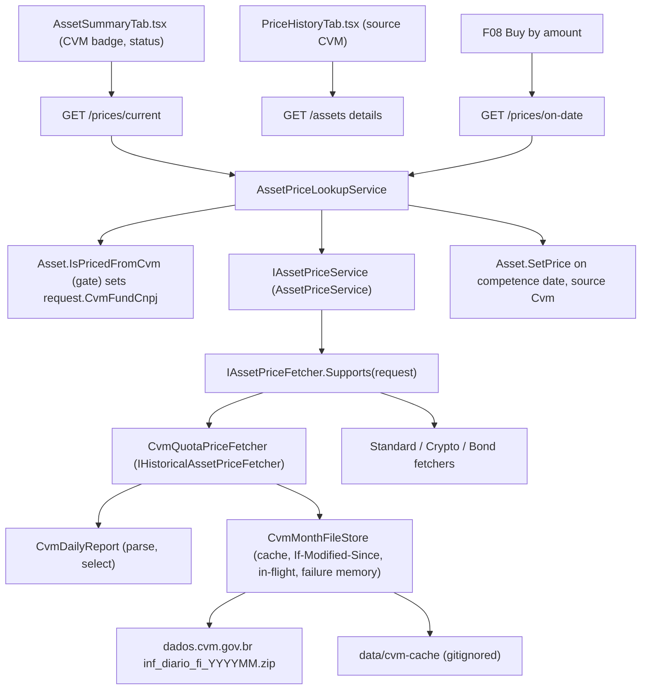

# Spec: CVM Daily Quota Price Source

**Complexity:** complex. A new external data source (monthly zipped CSV files with a disk cache, conditional revalidation, shared in-flight downloads and failure memory), a change to how a price source is chosen, dated automatic prices, a new read endpoint, a wire enum value and new status texts on the asset Summary. It ships as six PRs in four stages, each within the PR size rule: (1) request-aware source selection with the CVM eligibility gate, (2) dated automatic prices, (3) the CVM daily report reader and month-file cache, (4) the CVM price source switched on, (5) CVM fetch status on the Summary tab, (6) quota on a date.

**Read §13 first: its review amendments supersede earlier sections.**

**Builds on (specified, not yet built):**
- **F06** (`../P69-F06-brazilian-cnpj-identifiers/spec.md`): `Asset.Cnpj` (14 digits or null, only ever set on BR assets), `CnpjRules` in `Financial.Investment.Domain/Rules/`, `cnpj` on `AssetDetailsDTO`, and `Financial.Web/src/utils/cnpj.ts` (`formatCnpj`). F06 leaves the masked Domain formatter and the CVM eligibility gate to this feature.
- **F01** (`../P69-F01-balance-tracked-holding-option/spec.md`): `Asset.IsTrackedByBalance` (from `ValuationRules`), and the lookup's "no automatic fetch" branch rewritten as `!asset.ValuationRules.FetchesAutomatically`.

Both are in wave 1 and merge before any F07 PR. Where this spec names an F01 or F06 member, it is that spec's contract; if the built code differs, follow the built code and record the difference in the PR's docs commit.

## 1. Technical Overview

**What:** A new automatic price source, **CVM**, for holdings tracked by Quantity and price with country BR, class Fund and a CNPJ. It reads the CVM open-data daily fund report (`inf_diario_fi_YYYYMM.zip`, one per month from 2021-01), finds the fund's rows by CNPJ and returns its quota value (`VL_QUOTA`) with the competence date (`DT_COMPTC`). Two capabilities:
- **Latest quota** (the current price): the latest valid row on or before the valuation date (host-local today), from the current month's file or, when it has none, the previous month's. Saved as a price snapshot dated on the competence date, source `Cvm`, source reference `CNPJ 00.000.000/0000-00 · competence DD/MM/YYYY`.
- **Quota on a date** (for F08): the row on exactly that date, or the nearest earlier one within 5 calendar days, or "not available" with a reason. Exposed as an optional historical-price capability of the price-fetcher seam and as a read endpoint.

The month files are kept in a gitignored disk cache under `data/`, revalidated with `If-Modified-Since` once 12 hours old, downloaded once per month however many requests ask at the same time, and a failed download is not retried for 15 minutes.

**Why:** The fund's XP screen shows only a total, so today its price is a hand-made division. The CVM publishes the real quota value every business day, keyed by CNPJ, which F06 now stores. Pricing from it removes the arithmetic, and the dated "quota on a date" lookup is what F08 needs to turn purchase amounts into quota counts.

**Scope:**

*Included (PRD F07 Capabilities, Experience, Error Handling)*
- `Asset.IsPricedFromCvm`: the single CVM eligibility gate (Quantity and price, BR, Fund, CNPJ set), read by this feature and by F08.
- `IAssetPriceFetcher.Supports` takes the price request, which now carries the fund's CNPJ (only for an eligible asset), so CVM is selected through the existing `Supports` selection, first, and the Google/Yahoo/Status Invest chain is never tried for those holdings.
- Dated automatic prices: a fetched value can carry its own date and source reference; the lookup records it on that date (not today) and derives its market status from it with the existing weekday rule.
- `Integrations/WebPageParser`: the CVM report reader (layout check, streaming parse, subclass and invalid-value rules, latest and on-date selection) and the month-file store (disk cache, revalidation, shared in-flight download, failure memory, 60-second timeout).
- `CvmQuotaPriceFetcher` in Investment Infrastructure, behind `IAssetPriceFetcher` and the new `IHistoricalAssetPriceFetcher`.
- `PriceSource.Cvm` ("CVM" in Price history), `CnpjRules.Format` (masked CNPJ) for the source reference.
- Fetch status on `AssetPriceDTO` (`fetchIssue`, `fetchIssueSource`, `sourceReference`), and the Summary tab's CVM badge, last-saved badge and status texts.
- `GET /api/v1/financial/prices/on-date` returning the quota on a date.
- Configuration keys for the cache folder, timeout, revalidation age and failure memory, with defaults.

*Provides (to F08)*
- `Asset.IsPricedFromCvm`: F08's Buy-by-amount and Recalculate actions apply exactly where this is true.
- `IAssetPriceLookupService.GetPriceOnDate` and `GET /prices/on-date`: competence date and quota value, or `issue` = `NotFound` / `FundHasSubclasses` / `BeforeAvailableHistory` / `SourceUnreachable`.
- `CvmDailyReport` series reading per CNPJ and month, which F08's "every month it needs in one request" builds on.

*Excluded*
- The yearly HIST files (2000–2020): dates before 2021-01 are `BeforeAvailableHistory` (PRD Out of Scope).
- Back-filling past quotas into price history (only the latest quota is saved; F08 owns the one-off replacement).
- Buy-by-amount, the recalculation dialog and its series request (F08).
- Fetching a fund that has no ticker: the existing fetch trigger (web, controller, `AssetPriceService`) still requires one (Assumption 9).
- Cache eviction (Assumption 14).

## 2. Before you design (docs/rules/design.md)

1. **Where it belongs:** the Investment bounded context. The eligibility gate is a fact about the asset, so it is `Asset.IsPricedFromCvm` in Domain (one rule, two consumers: this feature's request building and F08). Choosing a source, recording a fetched price and falling back to a saved one stay in Application (`AssetPriceLookupService`). Talking to CVM (HTTP, zip, CSV, cache files) is vendor plumbing in `Integrations/WebPageParser`, next to `TesouroTransparente`, as the PRD decides. The adapter that turns CVM rows into an `AssetValueSnapshot` is Investment Infrastructure (`CvmQuotaPriceFetcher`).
2. **Layers touched, in direction:** Domain (`Asset`, `PriceSource`, `CnpjRules`, `AssetValueSnapshot`) → Application (request/price DTOs, lookup service, issue enum, exception, on-date DTO and interfaces) → Infrastructure (fetcher seam, `AssetPriceService`, CVM fetcher, options, DI) → Integrations (reader, store) → API (one new GET action, regenerated snapshot) → Web (Price history label, Summary tab). That is all four layers plus an integration, which is why it is six PRs.
3. **What keeps Domain free of Infrastructure:** Application declares `IAssetPriceService` (and gains `GetPriceOnDate`); Infrastructure implements it. `IAssetPriceFetcher` and `IHistoricalAssetPriceFetcher` are Infrastructure-internal seams. Domain only gains a computed property, an enum value, a formatter and two optional record fields. `WebPageParser` references no bounded-context assembly (enforced by `InvestmentDependencyRuleTests.WebPageParser_Should_Not_Reference_Investment_Domain`), so it strips CNPJ digits itself and returns its own `CvmQuote` rows.
4. **SOLID:** Open/closed: CVM is a new `IAssetPriceFetcher`, chosen by `Supports`, not a branch in `AssetPriceService` or the lookup. Interface segregation: "a price on a date" is a separate `IHistoricalAssetPriceFetcher`, so the three existing fetchers implement nothing they cannot do. Single responsibility: the reader parses and selects, the store owns files and HTTP, the fetcher adapts, the lookup decides fallback and recording. Dependency inversion: the lookup depends only on the Application-declared `IAssetPriceService`.

## 3. Architecture Impact



## 4. Technical Decisions

| Decision | Chosen Approach | Alternative Considered | Trade-off |
|---|---|---|---|
| Eligibility gate | `Asset.IsPricedFromCvm => !IsTrackedByBalance && Country == CountryCode.BR && Class == GlobalAssetClass.Fund && Cnpj is not null` | A check in the fetcher's `Supports`; or on `ValuationRules` | The rule is a fact of the asset and has two callers (here and F08); the policy (F01) describes how a snapshot is read, not where it comes from |
| How the fetcher sees the CNPJ | `AssetPriceRequestDTO.CvmFundCnpj` (string?), set by `DescribeWith` only when `asset.IsPricedFromCvm` | A plain `Cnpj` always copied from the asset | Since F06 every BR holding can carry a CNPJ; naming it for its one use keeps a share's CNPJ from ever selecting CVM |
| Source selection | `IAssetPriceFetcher.Supports(AssetPriceRequestDTO request)`; the three existing fetchers read `request.AssetClass` / `request.ValuationMethod` exactly as today; CVM registered first and supports `request.CvmFundCnpj is not null` | Keep `Supports(class, method)` and add a CNPJ branch in `AssetPriceService` | PRD asks for the existing `Supports` selection; a branch would make `AssetPriceService` know about CVM |
| Historical capability | `IHistoricalAssetPriceFetcher : IAssetPriceFetcher` with `GetPriceOnDate(request, date)`; `AssetPriceService.GetPriceOnDate` picks the supporting fetcher and throws `UnsupportedAssetClassException` when it is not historical | A default member on `IAssetPriceFetcher` | Optional by type (ISP); the existing fetchers stay untouched |
| Carrying the competence date | `AssetValueSnapshot` gains optional `DateOnly? EffectiveDate` and `string? SourceReference`; `AssetPriceService` maps `EffectiveDate` to `AssetPriceDTO.AsOfDate` with `AsOf` null, and `SourceReference` to the new `AssetPriceDTO.SourceReference` | Return the competence date as `AsOf` at midnight | A midnight timestamp is re-read in the viewer's time zone and can show the previous day (the reason `AsOfDate` exists); the lookup can only reach Infrastructure's answer through `AssetPriceDTO` |
| Recording date | The lookup records `price.AsOfDate ?? today`, with `price.SourceReference`, through the existing `RecordAutomaticPriceIfNeededAsync` (renamed parameter, same check-and-write) | A CVM-specific recording path | One rule for every source: a source that publishes dated values gets its value recorded on that date |
| Market status of a live dated price | `asset.ValuationRules.StatusOn(asOfDate, today)` when `AsOfDate` is set, else `Current` (today's behaviour) | `MarketStatusCalculator.For` directly | PRD: the weekday rule against the competence date; going through the policy (F01, extended by F03) keeps one status path for live and saved prices |
| Where CVM code lives | `Integrations/WebPageParser`: `CvmDailyReport` (static, pure), `CvmMonthFileStore` (instance), `CvmReportException`; Investment Infrastructure: `CvmQuotaPriceFetcher`, `CvmQuoteOptions` | A new `Integrations/Cvm` project | PRD decision; plain HTTP + CSV, no vendor SDK |
| HTTP client | One named client (`CvmMonthFileStore.HttpClientName`) from `AddHttpClient`, created once and held by the singleton store, `Timeout` from options (60 s) | A `static readonly HttpClient` as `TesouroTransparente` does | Same effect (one long-lived client) but the tests and `ApiTestFactory` can give it a fake handler |
| Revalidation timestamp | The cached file's last-write time (UTC) is "last downloaded or confirmed": `If-Modified-Since` sends it, a 304 touches it, a 200 replaces the file | A sidecar file holding the server's `Last-Modified` | No second file to keep in step; survives restarts (AC -08) |
| Atomic cache writes | Download to `<name>.zip.download` in the cache folder, then `File.Move(overwrite: true)` | Write in place | A failed or partial download never replaces a good cached file |
| Shared in-flight download | `ConcurrentDictionary<string, Lazy<Task<CvmMonthFile>>>` keyed by file name, removed when the task completes | A lock around the download | Concurrent callers await the same task; current and previous months download in parallel |
| Failure memory | Per month file, `retryAfter = now + FailureRetryDelay` (15 min) on timeout, non-success status (other than 304/404), `HttpRequestException` or `IOException`; within it the store throws `CvmReportException(Unavailable)` without a request | Retry every request | PRD; one failure is logged once, not once per grid row |
| Revalidation fails but a cached copy exists | Serve the cached copy (its data is still correct up to its last competence date), remember the failure, log once | Treat as unavailable and fall back to the last saved price | More useful and never wrong; see Assumption 6 (deviation from the PRD's literal wording) |
| HTTP 404 for a month | "Not published yet" (the 1st of a month before CVM's first run): the month has no rows; remembered for `FailureRetryDelay`; not logged as a failure | Treat as a failure | Otherwise every month's first morning would show "Couldn't fetch" instead of using the previous month (AC -03) |
| Parsing | Open the zip from the cached file, require exactly one `.csv` entry, stream it through a `StreamReader` with the confirmed encoding, split each line on the confirmed separator, keep only rows whose identifier's digits equal the 14-digit CNPJ | Load the CSV into memory | PRD: never hold the whole uncompressed CSV; ~10–12 MB compressed per month |
| Parsed-series memo | `CvmQuotaPriceFetcher` memoises the parsed rows per (month file, cached file version, CNPJ), and a format failure per (month file, version) | Re-parse on every request | A month is parsed at most once per downloaded version and CNPJ; a bad layout is logged once per version |
| Layout check | Header must name the identifier column (`CNPJ_FUNDO_CLASSE`, or `CNPJ_FUNDO` in the pre-2024 layout, see Assumption 5), `DT_COMPTC` and `VL_QUOTA`, matched case-insensitively after trimming; `ID_SUBCLASSE` optional (absent = every row class-level). Anything else → `CvmReportException(FormatNotRecognised)` | Fixed column positions | Column-index lookup as `TesouroTransparente.ColumnIndex` does; a changed layout fails loudly and nothing is saved |
| Separator, encoding, decimal mark | Expected `;`, ISO-8859-1 (`Encoding.Latin1`) and `.` with `CultureInfo.InvariantCulture`; **the implementer confirms all three against one real recent file and one 2021 file** and pins them in `CvmDailyReportTests` with the recorded samples | Detect at run time | PRD: confirmed against a real file and pinned by a test; no CVM file was downloaded while writing this spec |
| Subclasses | Only rows with an empty `ID_SUBCLASSE` are quotes. A date whose rows for the CNPJ all have a subclass makes the month's answer `FundHasSubclasses` when no class-level row exists in the searched range | Use a lone subclass row | PRD out of scope: "Fund subclasses with no class-level quota"; one strict rule (Assumption 12) |
| Invalid rows | A row whose `VL_QUOTA` is not a number or is ≤ 0, or whose `DT_COMPTC` is not `yyyy-MM-dd`, is ignored; the previous valid competence date is used | Fail the month | PRD Error Handling |
| Where selection rules live | `CvmDailyReport.LatestOnOrBefore(rows, date)` and `CvmDailyReport.OnOrNearestBefore(rows, date)` with `MaxLookbackDays = 5` and `FirstAvailableMonth = 2021-01` as named constants there | Domain rule | They interpret one vendor's dated rows; Domain has no quote-row type and would gain one only for this; pure and unit-tested beside the parser |
| Fetch failures reaching the user | `PriceSourceUnavailableException(PriceSource source, PriceLookupIssue issue)` (Application) thrown by the CVM fetcher; the lookup's existing fallback reads it into `AssetPriceDTO.FetchIssue` / `FetchIssueSource` | Parse the exception message | Typed, and generic: any future source can report the same way |
| "Price not saved" | The lookup sets `FetchIssue = NotSaved` (source = the fetched source) when the automatic record fails, for every source | CVM only | The persistence path is shared; PRD's "existing warning" does not exist today (Assumption 1) |
| Quota-on-date failures | Not-available outcomes return 200 with `issue`; an unreachable source is caught by the lookup, logged by type and also returned as `issue = SourceUnreachable` | 503 | Same "never an error for a source outage" behaviour as the current price; F08 shows its own message per issue |
| Logging | The store logs a failed download once (`Warning`, `{Operation}`, `{MonthFile}`, `{ErrorType}`) where it records the failure; the fetcher logs a layout failure once per file version (`Error`, "CVM daily report format not recognised."); the lookup keeps its per-request fallback warning. `MonthFile` is added to `LogRedactionTests.AllowedPlaceholders` | Log only in the lookup | PRD asks for the month file name; it is a public file name, not financial data (Assumption 10) |
| Configuration | `CvmQuoteOptions` (Infrastructure, shaped like `PriceQuoteOptions`): `Investment:PriceQuotes:Cvm:CacheDirectory` (default `data/cvm-cache`, resolved against `AppContext.BaseDirectory` when relative), `:DownloadTimeout` (`00:01:00`), `:RevalidateAfter` (`12:00:00`), `:FailureRetryDelay` (`00:15:00`). The CVM base address is a `public const` on `CvmDailyReport`, as `FrankfurterExchangeRateProvider.BaseAddress` is | Hard-coded durations | User preference: no hard-coded values; the default folder lands in the mounted `/app/data` in Docker with no compose change |
| Synchronous seam | The fetcher awaits the store's tasks with `GetAwaiter().GetResult()`, as `TesouroTransparente.LoadRows` does | Make the whole price chain async | `IAssetPriceService` and every fetcher are synchronous today; making them async is a separate refactor (Assumption 11) |

## 5. Component Overview

### Stage 1, PR 1: request-aware source selection and the CVM gate

| File Path | New/Modified | Purpose | Key Responsibilities |
|---|---|---|---|
| `Financial.Investment.Domain/Entities/Asset.cs` | Modified | Gate | `public bool IsPricedFromCvm => !IsTrackedByBalance && Country == CountryCode.BR && Class == GlobalAssetClass.Fund && Cnpj is not null` (F01 `IsTrackedByBalance`, F06 `Cnpj`) |
| `Financial.Investment.Application/DTOs/AssetPriceRequestDTO.cs` | Modified | Request | `public string? CvmFundCnpj { get; set; }` (14 digits; no doc comment) |
| `Financial.Investment.Application/Services/AssetPriceLookupService.cs` | Modified | Request building | `DescribeWith` sets `CvmFundCnpj = asset.IsPricedFromCvm ? asset.Cnpj : null` |
| `Financial.Investment.Infrastructure/Interfaces/IAssetPriceFetcher.cs` | Modified | Seam | `bool Supports(AssetPriceRequestDTO request)` |
| `Financial.Investment.Infrastructure/Services/StandardAssetPriceFetcher.cs` | Modified | Mechanical | Same rule over `request.ValuationMethod` / `request.AssetClass` |
| `Financial.Investment.Infrastructure/Services/BondAssetPriceFetcher.cs` | Modified | Mechanical | Same |
| `Financial.Investment.Infrastructure/Services/CryptocurrencyAssetPriceFetcher.cs` | Modified | Mechanical | Same |
| `Financial.Investment.Infrastructure/Services/AssetPriceService.cs` | Modified | Selection | `_fetchers.FirstOrDefault(f => f.Supports(request))`; message and exception unchanged |

8 non-test code files, three of them a one-line mechanical change. No wire change (`AssetPriceRequestDTO` is built in the controller, not bound, and is not in the OpenAPI document). Behaviour is unchanged for every existing holding. Docs commit: add the F07 AC ids to PRD §9 (Assumption 17).

### Stage 1, PR 2: dated automatic prices

| File Path | New/Modified | Purpose | Key Responsibilities |
|---|---|---|---|
| `Financial.Investment.Domain/ValueObjects/AssetValueSnapshot.cs` | Modified | Value object | Optional trailing parameters `DateOnly? EffectiveDate = null`, `string? SourceReference = null` |
| `Financial.Investment.Application/DTOs/AssetPriceDTO.cs` | Modified | Wire | `public string? SourceReference { get; set; }`; the existing `AsOfDate` doc text is corrected to say it is also set for a fetched value its source dates (edit an existing comment, add none) |
| `Financial.Investment.Infrastructure/Services/AssetPriceService.cs` | Modified | Mapping | `AsOf = snapshot.EffectiveDate is null ? snapshot.AsOf : null`, `AsOfDate = snapshot.EffectiveDate`, `SourceReference = snapshot.SourceReference` |
| `Financial.Investment.Application/Services/AssetPriceLookupService.cs` | Modified | Recording and status | Live price: `MarketStatus = AsOfDate is { } d ? asset.ValuationRules.StatusOn(d, today) : Current` (F03 PR 1 adds `StatusOn`; if F07 PR 2 merges first, it adds `StatusOn` to the policy with the PerUnit weekday rule only and F03 adds the PositionTotal rule). `RecordAutomaticPriceIfNeededAsync(asset, price)` records on `price.AsOfDate ?? today` with `price.SourceReference`; the existing "only automatic entries are overwritten; unchanged price and source skip the write" check is evaluated against the entry on that date |

4 non-test code files. Wire change: `sourceReference` on `AssetPriceDTO`. Regenerate the OpenAPI snapshot and the web types.

### Stage 2, PR 3: CVM daily report reader and month-file cache

| File Path | New/Modified | Purpose | Key Responsibilities |
|---|---|---|---|
| `Integrations/WebPageParser/CvmDailyReport.cs` | New | Read and select | `public const string BaseAddress = "https://dados.cvm.gov.br/dados/FI/DOC/INF_DIARIO/DADOS/"`; `FirstAvailableMonth` (2021-01), `MaxLookbackDays` (5), column-name constants; `MonthFileName(year, month)` → `inf_diario_fi_YYYYMM.zip`; `ReadQuotes(string zipPath, string cnpjDigits) → CvmMonthQuotes` (opens the zip, one `.csv` entry, streams through `ParseQuotes`); `internal ParseQuotes(TextReader csv, string cnpjDigits) → CvmMonthQuotes` (layout check, row filter by digits of the identifier cell, invalid rows skipped, class-level rows kept, a flag when subclass-only rows were seen); `LatestOnOrBefore(quotes, date)` and `OnOrNearestBefore(quotes, date)` returning a `CvmQuoteResult` (`Found(CvmQuote)`, `NotFound`, `FundHasSubclasses`); records `CvmQuote(DateOnly CompetenceDate, decimal QuotaValue, string FundIdentifier)` (identifier as published, masked) and `CvmMonthQuotes` |
| `Integrations/WebPageParser/CvmMonthFileStore.cs` | New | Download and cache | `public const string HttpClientName`; constructor `(HttpClient, CvmMonthFileStoreSettings, TimeProvider, ILogger<CvmMonthFileStore>)` with `CvmMonthFileStoreSettings(string CacheDirectory, TimeSpan RevalidateAfter, TimeSpan FailureRetryDelay)`; `Task<CvmMonthFile> GetAsync(int year, int month)` → `CvmMonthFile(string FileName, string? LocalPath, DateTime Version)` (`LocalPath` null = not published). Rules in §8.2 |
| `Integrations/WebPageParser/CvmReportException.cs` | New | Failure | `CvmReportException(CvmReportFailure failure, string monthFile)` with `CvmReportFailure { Unavailable, FormatNotRecognised }`; `FormatNotRecognised` message is exactly "CVM daily report format not recognised." |
| `Integrations/WebPageParser/WebPageParser.csproj` | Modified | Package | `Microsoft.Extensions.Logging.Abstractions` 10.0.9, as `Frankfurter.csproj` |

3 non-test code files plus the project file. This PR is an Integrations building block wired in PR 4 (Assumption 15). It also adds `Tests/Financial.TestUtilities/CvmDailyReportZip.cs` (builds an in-memory zip from header and rows in the pinned encoding, for PR 3–6 tests and `ApiTestFactory`) and a TestUtilities project reference in `Financial.WebPageParser.Tests.csproj`.

### Stage 2, PR 4: CVM price source switched on

| File Path | New/Modified | Purpose | Key Responsibilities |
|---|---|---|---|
| `Financial.Investment.Domain/Entities/PriceSource.cs` | Modified | Enum | `Cvm` appended last (stored and wire values of the others unchanged) |
| `Financial.Investment.Domain/Rules/CnpjRules.cs` | Modified | Formatter | `Format(string digits) → string`: `00.000.000/0000-00` for 14 digits; throws `ArgumentException(InvalidMessage)` otherwise (F06's rule file) |
| `Financial.Investment.Infrastructure/Services/CvmQuotaPriceFetcher.cs` | New | Adapter | `IAssetPriceFetcher`; `Supports(request) => request.CvmFundCnpj is not null`; `GetSnapshot`: today from `TimeProvider.GetLocalToday()`, current and previous month files fetched in parallel, `LatestOnOrBefore` on the current month then the previous one, memoised parse; returns `AssetValueSnapshot(Ticker, Name, QuotaValue, retrievedAt, PriceSource.Cvm, EffectiveDate: competence, SourceReference: "CNPJ {CnpjRules.Format(cnpj)} · competence {dd/MM/yyyy}")`. In this PR every failure (unavailable, format, not found, subclasses) is thrown as `InvalidOperationException`, so the existing fallback applies; PR 5 types them |
| `Financial.Investment.Infrastructure/Configuration/CvmQuoteOptions.cs` | New | Options | Four keys and defaults (§4), `Load(Func<string, string?>)` validating non-negative durations with the `PriceQuoteOptions` message shape, `ToStoreSettings()` resolving a relative folder against `AppContext.BaseDirectory` |
| `Financial.Investment.Infrastructure/DependencyInjection/InvestmentInfrastructureServiceCollectionExtensions.cs` | Modified | Wiring | `Configure<CvmQuoteOptions>`; `AddHttpClient(CvmMonthFileStore.HttpClientName, c => c.Timeout = options.DownloadTimeout)`; singleton `CvmMonthFileStore`; `CvmQuotaPriceFetcher` registered as the **first** `IAssetPriceFetcher` |
| `Financial.Web/src/components/PriceHistoryTab.tsx` | Modified | Label | `Cvm: 'CVM'` in `SOURCE_LABELS` (required by the `Record` type once the enum is regenerated) |

6 non-test code files, plus `Financial.Api/appsettings.json` (the `Cvm` block under `Investment:PriceQuotes` with the defaults), `Financial.Api/appsettings.Development.json` (`CacheDirectory` = `../../../../data/cvm-cache`, the repo-root `data/`), `README.md` (the four keys next to the existing `PriceQuotes` ones, and that the cache lives in `data/cvm-cache`). No `.gitignore` change: `/data/*` already ignores the folder. No `.worktreeinclude` change: a worktree downloads its own cache. No `docker-compose.yml` change: the default resolves to `/app/data/cvm-cache`, inside the mounted volume. Regenerate the OpenAPI snapshot and the web types (`PriceSource` gains `Cvm`).

### Stage 3, PR 5: CVM fetch status on the Summary tab

| File Path | New/Modified | Purpose | Key Responsibilities |
|---|---|---|---|
| `Financial.Investment.Application/Enums/PriceLookupIssue.cs` | New | Enum | `SourceUnreachable`, `NotFound`, `FundHasSubclasses`, `BeforeAvailableHistory`, `NotSaved` |
| `Financial.Investment.Application/Exceptions/PriceSourceUnavailableException.cs` | New | Typed failure | `Source` (`PriceSource`), `Issue` (`PriceLookupIssue`); fixed message "The price source could not provide a price." |
| `Financial.Investment.Infrastructure/Services/CvmQuotaPriceFetcher.cs` | Modified | Typed failures | `CvmReportException` (either kind) → `PriceSourceUnavailableException(Cvm, SourceUnreachable)`; no row in either month → `(Cvm, NotFound)`; subclass-only → `(Cvm, FundHasSubclasses)` |
| `Financial.Investment.Application/DTOs/AssetPriceDTO.cs` | Modified | Wire | `PriceLookupIssue? FetchIssue`, `PriceSource? FetchIssueSource`, both with `[JsonConverter(typeof(JsonStringEnumConverter))]` like `Source` |
| `Financial.Investment.Application/Services/AssetPriceLookupService.cs` | Modified | Fallback status | The fallback branch and the unavailable branch copy `Issue`/`Source` from a `PriceSourceUnavailableException`; any other exception leaves both null (today's behaviour). A failed record sets `FetchIssue = NotSaved`, `FetchIssueSource = price.Source` |
| `Financial.Web/src/utils/priceStatus.ts` | Modified | Texts | `CVM_PRICE_MEANING`, `lastSavedMeaning(date)`, `priceFetchIssueMessage(price, cnpj)` returning the §9 text or null |
| `Financial.Web/src/components/AssetSummaryTab.tsx` | Modified | Display | "CVM" `PriceBadge` on Current price for a live CVM price; "Last saved" `PriceBadge` when `fetchIssue` is a fallback issue; a "Status" field with `role="status"` showing `priceFetchIssueMessage` |

7 non-test code files. Wire change: `fetchIssue`, `fetchIssueSource` on `AssetPriceDTO`. Regenerate the OpenAPI snapshot and the web types.

### Stage 4, PR 6: quota on a date

| File Path | New/Modified | Purpose | Key Responsibilities |
|---|---|---|---|
| `Financial.Investment.Infrastructure/Interfaces/IHistoricalAssetPriceFetcher.cs` | New | Optional capability | `: IAssetPriceFetcher`; `AssetPriceOnDateDTO GetPriceOnDate(AssetPriceRequestDTO request, DateOnly date)` |
| `Financial.Investment.Infrastructure/Services/CvmQuotaPriceFetcher.cs` | Modified | Implementation | Implements it (§8.4): before 2021-01 → `BeforeAvailableHistory` without a download; the date's month, plus the previous month when the 5-day window crosses into it, fetched in parallel; `OnOrNearestBefore`; `CvmReportException` → `PriceSourceUnavailableException(Cvm, SourceUnreachable)` |
| `Financial.Investment.Application/Interfaces/IAssetPriceService.cs` | Modified | Contract | `AssetPriceOnDateDTO GetPriceOnDate(AssetPriceRequestDTO request, DateOnly date)` |
| `Financial.Investment.Infrastructure/Services/AssetPriceService.cs` | Modified | Selection | Picks `Supports(request)`; not an `IHistoricalAssetPriceFetcher`, or none → `UnsupportedAssetClassException("No price source provides a price on a date for this holding.")` |
| `Financial.Investment.Application/DTOs/AssetPriceOnDateDTO.cs` | New | Wire | `RequestedDate`, `Date?`, `Price?`, `Source`, `SourceReference?`, `Issue?` (enums as strings) |
| `Financial.Investment.Application/Interfaces/IAssetPriceLookupService.cs` | Modified | Contract | `AssetPriceOnDateDTO GetPriceOnDate(string brokerName, string portfolioName, string assetName, DateOnly date)` (the existing XML doc on the interface stays; none added) |
| `Financial.Investment.Application/Services/AssetPriceLookupService.cs` | Modified | Use case | Span `GetPriceOnDate`; date after today → `ArgumentException("Date can't be in the future.")`; unresolved asset → `KeyNotFoundException`; builds the request with `DescribeWith`; a `PriceSourceUnavailableException` is logged by type (`Warning`) and returned as `Issue = SourceUnreachable` with `Source = Cvm` |
| `Financial.Api/Controllers/AssetPricesController.cs` | Modified | Endpoint | `[HttpGet("on-date")]` with four `[FromQuery]` scalars (§6); 400 when a name is blank or `date` is not `yyyy-MM-dd`. The action carries `///` summary/param/returns like its neighbours, because `Financial.Api`'s XML docs feed the OpenAPI descriptions (Assumption 13) |

8 non-test code files. Wire change: new endpoint and `AssetPriceOnDateDTO`. Regenerate the OpenAPI snapshot and the web types (no web caller in F07; F08 adds the client method). Every test double implementing `IAssetPriceService` (`AssetPriceEndpointsTests` ×3, `AssetPriceLookupServiceTests`) gains the method. Docs commit: tick the F07 PRD boxes (Assumption 17).

## 6. API Contracts

### `GET /api/v1/financial/prices/current` (existing, response extended)

Request unchanged. `AssetPriceDTO` gains three optional fields (PR 2, PR 5), and `source` gains the value `Cvm` (PR 4):

| Field | Type | Description |
|---|---|---|
| `asOf` | string (date-time) \| null | Now null for a value its source dates (CVM) |
| `asOfDate` | string (date) \| null | The competence date for a CVM quote, live or saved |
| `source` | `PriceSource` | Adds `Cvm` |
| `sourceReference` | string \| null | `CNPJ 00.000.000/0000-00 · competence DD/MM/YYYY` for a live CVM quote; null otherwise |
| `fetchIssue` | `SourceUnreachable` \| `NotFound` \| `FundHasSubclasses` \| `NotSaved` \| null | Why the live fetch did not produce a saved price. `NotSaved`: fetched and shown but not recorded |
| `fetchIssueSource` | `PriceSource` \| null | The source the issue is about |

Live CVM quote:
```json
{
  "exchange": "BVMF",
  "ticker": "Example Fund FIC FIA",
  "name": "Example Fund FIC FIA",
  "price": 3.482917000000,
  "asOf": null,
  "asOfDate": "2026-11-26",
  "isManual": false,
  "source": "Cvm",
  "marketStatus": "Current",
  "sourceReference": "CNPJ 11.222.333/0001-81 · competence 26/11/2026",
  "fetchIssue": null,
  "fetchIssueSource": null
}
```

CVM unreachable, last saved price used:
```json
{
  "price": 3.471002000000,
  "asOf": null,
  "asOfDate": "2026-11-24",
  "isManual": false,
  "source": "Cvm",
  "marketStatus": "Stale",
  "sourceReference": null,
  "fetchIssue": "SourceUnreachable",
  "fetchIssueSource": "Cvm"
}
```

### `GET /api/v1/financial/prices/on-date` (new, PR 6)

| Field (query) | Type | Required | Validation | Description |
|---|---|---|---|---|
| `brokerName` | string | Yes | not blank | Holding's broker |
| `portfolioName` | string | Yes | not blank | Holding's portfolio |
| `assetName` | string | Yes | not blank | Holding's name |
| `date` | string (date) | Yes | `yyyy-MM-dd`, not after host-local today | The date wanted (F08: the quota date) |

Example: `GET /api/v1/financial/prices/on-date?brokerName=XPI&portfolioName=Fundos&assetName=Example%20Fund%20FIC%20FIA&date=2026-11-22`

**Response 200 (`AssetPriceOnDateDTO`):**

| Field | Type | Description |
|---|---|---|
| `requestedDate` | string (date) | Echo of `date` |
| `date` | string (date) \| null | Competence date used: the requested date or the nearest earlier one within 5 calendar days |
| `price` | number \| null | Quota value on `date`; null when `issue` is set |
| `source` | `PriceSource` | `Cvm` |
| `sourceReference` | string \| null | As for the current price |
| `issue` | `NotFound` \| `FundHasSubclasses` \| `BeforeAvailableHistory` \| `SourceUnreachable` \| null | Why no value |

```json
{
  "requestedDate": "2026-11-22",
  "date": "2026-11-21",
  "price": 3.455120000000,
  "source": "Cvm",
  "sourceReference": "CNPJ 11.222.333/0001-81 · competence 21/11/2026",
  "issue": null
}
```

```json
{
  "requestedDate": "2020-12-15",
  "date": null,
  "price": null,
  "source": "Cvm",
  "sourceReference": null,
  "issue": "BeforeAvailableHistory"
}
```

**Errors**

| Case | HTTP Status | Description |
|---|---|---|
| A name blank, `date` missing or not `yyyy-MM-dd` | 400 | Controller `BadRequest()` |
| `date` after today | 400 | "Date can't be in the future." (`ArgumentException`) |
| Holding not found | 404 | `KeyNotFoundException` |
| Holding not priced from a dated source (not `IsPricedFromCvm`) | 422 | "No price source provides a price on a date for this holding." |

### Contract regeneration

PR 2, PR 4, PR 5 and PR 6 each change the wire: `UPDATE_OPENAPI_SNAPSHOT=1 dotnet test Tests/Financial.Api.Tests --filter "FullyQualifiedName~OpenApiContractTests"`, review the diff (only the fields above), then `cd Financial.Web && npm run generate-api-types`, commit both, and fix whatever `tsc -b` flags (PR 4: `SOURCE_LABELS`). The decimal-schema transformer in `Program.cs` applies to `price` unchanged.

## 7. Data Model, Configuration and Cache

**`data-investment.json`:** no shape change. A CVM quote is an ordinary `PriceSnapshots` entry:

| Property | Value |
|---|---|
| `Date` | Competence date (never after today) |
| `Price` | `VL_QUOTA` (up to 12 decimals, stored as `decimal`) |
| `Source` | `"Cvm"` (new enum value, appended, so stored values of existing sources are unchanged) |
| `SourceReference` | `CNPJ 00.000.000/0000-00 · competence DD/MM/YYYY` |
| `RetrievedAt` | Fetch instant (UTC) |
| `Currency` | `""`, as other automatic entries |

No `InvestmentDataMigrations` step, no version bump. `data/*.example.json` unchanged.

**Configuration (`CvmQuoteOptions`):**

| Key | Default | Meaning |
|---|---|---|
| `Investment:PriceQuotes:Cvm:CacheDirectory` | `data/cvm-cache` | Folder for the month zips; relative paths resolve against `AppContext.BaseDirectory`. Development: `../../../../data/cvm-cache`. Docker: resolves to `/app/data/cvm-cache` (mounted `./data`) |
| `Investment:PriceQuotes:Cvm:DownloadTimeout` | `00:01:00` | `HttpClient.Timeout` |
| `Investment:PriceQuotes:Cvm:RevalidateAfter` | `12:00:00` | Age after which a cached month is revalidated |
| `Investment:PriceQuotes:Cvm:FailureRetryDelay` | `00:15:00` | No new request for a month file after a failure (or a 404) for this long |

An invalid duration throws `InvalidOperationException` at start-up naming the key, as `PriceQuoteOptions` does.

**Cache folder:** `inf_diario_fi_YYYYMM.zip` files, each the last good download; `*.zip.download` is a transient partial file, deleted on failure and overwritten on the next attempt. The folder is created on first use. It is gitignored by the existing `/data/*` rule, never read by any import tool, and can be deleted at any time (everything is re-downloaded).

## 8. Rules in detail

### 8.1 Reading a month file (`CvmDailyReport`)

- Exactly one `.csv` entry in the zip, else `FormatNotRecognised`.
- First line is the header, split on the confirmed separator; column lookup as in §4. Missing required column → `FormatNotRecognised`.
- A data row with fewer cells than the highest required index is skipped.
- Identifier match: the cell's ASCII digits (`.`, `/`, `-` and anything else dropped) equal the 14-digit CNPJ. The published cell is kept as `FundIdentifier`.
- `DT_COMPTC` parses with `yyyy-MM-dd` and `CultureInfo.InvariantCulture`; `VL_QUOTA` with `NumberStyles.Number` and `InvariantCulture`; a row that fails either, or has a quota ≤ 0, is skipped.
- Rows with a non-blank `ID_SUBCLASSE` are not quotes; seeing one sets `HasSubclassOnlyRows` for that month.
- The result is the CNPJ's class-level quotes in that month, keyed by competence date (a duplicate date keeps the last row read).

### 8.2 Month-file store (`CvmMonthFileStore.GetAsync`)

1. If the file is in failure memory and `now < retryAfter`: return the cached copy if one exists, else throw `CvmReportException(Unavailable)`; a remembered 404 returns "not published". No request.
2. If a cached copy exists and `now − lastWrite < RevalidateAfter`: return it. No request.
3. Otherwise join or start the shared download task for this file name:
   - cached copy: `GET` with `If-Modified-Since: lastWrite`. 304 → set last-write to now, return it. 200 → stream to `.download`, move over the cached file, set last-write to now.
   - no cached copy: plain `GET`, 200 handled the same way.
   - 404 → remember for `FailureRetryDelay`, return "not published" (or the cached copy if one exists).
   - timeout (`TaskCanceledException` from the client timeout), any other non-success status, `HttpRequestException`, `IOException` → delete the `.download` file, remember for `FailureRetryDelay`, log once (`Warning`: "{Operation} could not download {MonthFile} after {ErrorType}", operation `DownloadCvmMonthFile`), then return the cached copy if one exists, else throw `CvmReportException(Unavailable)`.
4. `Version` is the cached file's last-write time after the call.

### 8.3 Latest quota (`CvmQuotaPriceFetcher.GetSnapshot`)

- Valuation date `today = TimeProvider.GetLocalToday()`; months M = today's, P = the one before; both `GetAsync` calls start together and are awaited together.
- Current month quotes (if published) → `LatestOnOrBefore(today)`. Found → that quote. Otherwise previous month → `LatestOnOrBefore(today)`.
- Neither month has a class-level quote: subclass-only rows seen in either → `FundHasSubclasses`; otherwise `NotFound`.
- A `CvmReportException` from either month's store call fails the fetch only when the other month cannot answer: if the current month is unavailable but the previous month has a quote, the previous month's quote is used (it is still the latest the app can know), recorded as usual, and the price carries `fetchIssue = SourceUnreachable` (PR 5) so the Summary says a newer quote could not be fetched.
- Market status is then `asset.ValuationRules.StatusOn(competence, today)` (PR 2; PerUnit applies the weekday rule): a Friday quote read on Monday is Current, and a Thursday quote read on Monday (before CVM's Monday run publishes Friday) is Stale, as the PRD expects.

### 8.4 Quota on a date (`CvmQuotaPriceFetcher.GetPriceOnDate`)

- `date` before 2021-01-01 → `BeforeAvailableHistory`, no download.
- Window `date − 5 days … date`. Months needed: the date's month, plus the previous month when the window starts in it and that month is not before 2021-01. Fetched in parallel.
- `OnOrNearestBefore(date)`: the class-level quote on `date`, else the latest one inside the window. None, with subclass-only rows in the window → `FundHasSubclasses`; else `NotFound`.
- `CvmReportException` on a needed month → `PriceSourceUnavailableException(Cvm, SourceUnreachable)`.

### 8.5 Recording and precedence (unchanged rules, new date)

- Manual price for today wins and stops the fetch (existing `FindManualPriceForToday`, unchanged).
- On success, the quote is recorded on its competence date only when that date has no entry, or has an automatic entry with a different price or source. A manual entry on the competence date is never overwritten.
- On failure, the most recent saved price is returned with its own date and status (existing `GetMostRecentPrice`), and with `fetchIssue` (PR 5). With no saved price: `MarketStatus.Unavailable` with `fetchIssue`.
- Holdings tracked by Balance never reach any fetcher (F01/F03 branch); holdings without a CNPJ, non-BR or non-Fund never carry `CvmFundCnpj`, so CVM never sees them and the existing chain runs as today.

## 9. Web behaviour (docs/rules/ui.md)

- **User task:** see the fund's current quota value and how current it is, and understand at a glance when the app is showing a saved value instead of a fresh CVM one, and why.
- **Current React behaviour:** the Summary "Current" group shows Current price with a "(Manual)" `PriceBadge`, As of with "(Stale)"/"(Unavailable)" badges, and a Status field only for a hard error (`role="alert"`). A fallback to a saved price is indistinguishable from a fresh fetch. Price history shows the source label with `sourceReference` as the cell's `title`.
- **Target:**
  - Price history (PR 4): source cell reads "CVM"; its `title` is the stored reference (existing pattern); the date column is the competence date.
  - Current price (PR 5): live CVM price (`source === 'Cvm'` and no `fetchIssue`) shows `PriceBadge abbreviation="CVM"` with meaning "Daily quota value published by CVM." When `fetchIssue` is `SourceUnreachable`, `NotFound` or `FundHasSubclasses` and a saved price is shown, `PriceBadge abbreviation="Last saved"` with meaning "Last saved price, DD/MM/YYYY." (the date is `asOfDate`). As of shows `asOfDate` (the competence date) through the existing `formatAsOf`.
  - Status (PR 5): a full-width "Status" field with `role="status"` (polite, not an alert, because a value is still shown) when `priceFetchIssueMessage` returns text:
    - `SourceUnreachable` (source Cvm): "Couldn't fetch the CVM quota value. Showing the last saved value." (with no saved value: "Couldn't fetch the CVM quota value. No saved value yet.")
    - `NotFound` (source Cvm): "CVM has no quota value for CNPJ 00.000.000/0000-00. Check the CNPJ on the asset." (masked with F06's `formatCnpj(asset.cnpj)`)
    - `FundHasSubclasses` (source Cvm): "CVM has no class-level quota value for CNPJ 00.000.000/0000-00 because the fund has subclasses."
    - `NotSaved` (any source): "This price couldn't be saved to the price history. It is shown for now."
    - Any issue whose source is not Cvm, other than `NotSaved`: no text (no other source reports issues yet).
  - The existing error Status (`priceError`, `role="alert"`) keeps priority: when it is shown, the issue status is not.
- **States:** initial and loading unchanged ("Loading" placeholders, the visually hidden loading status). Success: badges per above. Fallback: badge + status. Unavailable: existing "(Unavailable)" badge plus the status text. Error: existing alert. Refresh price re-runs the fetch and clears the previous status while loading. No form, so no validation, saving or unsaved-changes state; disabled behaviour of Refresh unchanged.
- **Accessibility:** `PriceBadge` already renders visible abbreviation plus a visually hidden meaning, so nothing relies on colour. The status text is plain text in a `dd`, announced politely. No new tokens or style values; the status uses the existing `asset-summary__value` styling (not the error class).
- **Responsive / zoom:** the Status field is `full`, so it spans the grid and wraps at narrow widths and 200% zoom like the existing error field.
- **Holdings grids:** unchanged; they read saved valuations, whose status already follows the competence date.

## 10. Error Handling

| Case | Behaviour |
|---|---|
| Download times out or returns a non-success status, no cached copy | No snapshot saved; last saved price (or Unavailable) returned with `fetchIssue = SourceUnreachable`; one `Warning` log with the month file name; no request for that file for 15 minutes |
| Same, cached copy exists | Cached copy used, quote returned and recorded as usual; failure logged once and remembered (Assumption 6) |
| Current month unavailable, previous month answers | Previous month's quote returned and recorded, with `fetchIssue = SourceUnreachable` |
| Month file not published (404) | Treated as no rows; the other month answers; remembered 15 minutes; no failure log |
| CSV layout not recognised | `Error` log "CVM daily report format not recognised." once per file version; nothing saved; fallback with `SourceUnreachable` |
| Quota ≤ 0 or not a number on a row | Row ignored; previous valid competence date used |
| CNPJ absent from both monthly files | `fetchIssue = NotFound`; last saved price; status names the masked CNPJ |
| Only subclass rows | `fetchIssue = FundHasSubclasses`; last saved price |
| Saving the snapshot fails | Fetched price returned with `fetchIssue = NotSaved`; span failed; in-memory entry rolled back (existing `ApplyAndSaveAsync`) |
| Quota on a date: future date / unknown holding / not CVM-priced | 400 / 404 / 422 (§6) |
| Quota on a date: CVM unreachable | 200 with `issue = SourceUnreachable`; `Warning` log by type |

## 11. Testing Strategy

Recorded samples (PR 3): the implementer downloads one recent monthly zip and the 2021-01 zip by hand (never in a test), confirms separator, encoding, decimal mark and header, and saves a few dozen lines of each (header plus rows of two or three public funds, including a subclass case if one exists, and one row with a Latin-1 character if one exists) as `Tests/Financial.WebPageParser.Tests/TestData/inf_diario_fi_recent_sample.csv` and `inf_diario_fi_202101_sample.csv`, byte-for-byte in the original encoding, copied to output. The confirmed values are written into this spec in PR 3's docs commit. Unit tests never download; `Category=Live` tests run only in the nightly workflow.

**Test files**

| Test File | Test Type | Target |
|---|---|---|
| `Tests/Financial.Investment.Domain.Tests/Domain/AssetTests.cs` (PR 1) | Unit | `IsPricedFromCvm` |
| `Tests/Financial.Investment.Infrastructure.Tests/Services/AssetPriceServiceTests.cs` (PR 1, 2, 6) | Unit | Selection by request, mapping of dated snapshots, on-date selection |
| `Tests/Financial.Investment.Infrastructure.Tests/Services/{Standard,Bond,Cryptocurrency}AssetPriceFetcherTests.cs` (PR 1) | Unit | `Supports(request)` unchanged per class/method |
| `Tests/Financial.Investment.Infrastructure.Tests/Services/AssetPriceLookupServiceTests.cs` (PR 1, 2, 5, 6) | Unit | Request CNPJ, dated recording and status, fetch issues, on-date use case |
| `Tests/Financial.WebPageParser.Tests/CvmDailyReportTests.cs` (PR 3, new) | Unit | Parsing, layout, selection rules over the recorded samples and literal lines |
| `Tests/Financial.WebPageParser.Tests/CvmMonthFileStoreTests.cs` (PR 3, new) | Integration | Temp cache folder + `FakeHttpMessageHandler` + `FakeTimeProvider` |
| `Tests/Financial.WebPageParser.Tests/CvmDailyReportVerificationTests.cs` (PR 3, new) | Live | Real download of the previous month, one known public fund has a positive quota |
| `Tests/Financial.Architecture.Tests/LogRedactionTests.cs` (PR 3) | Unit | `MonthFile` allow-listed |
| `Tests/Financial.Investment.Domain.Tests/Rules/CnpjRulesTests.cs` (PR 4) | Unit | `Format` |
| `Tests/Financial.Investment.Infrastructure.Tests/Services/CvmQuotaPriceFetcherTests.cs` (PR 4, 5, 6, new) | Unit | Adapter over a real store on a temp folder and a fake handler (zips from `CvmDailyReportZip`) |
| `Tests/Financial.Investment.Infrastructure.Tests/DependencyInjection/InvestmentInfrastructureServiceCollectionExtensionsTests.cs` (PR 4) | Integration | Fetcher order, options binding and validation, store resolves |
| `Tests/Financial.Api.Tests/ApiTestFactory.cs`, `ApiEndpointTests.cs` (PR 4) | Test support | `cvmHandler: HttpMessageHandler?` override; default handler throws so no test reaches the network; a temp `CacheDirectory` per factory, deleted on dispose |
| `Tests/Financial.Api.Tests/Acceptance/CvmQuotaPriceSourceAcceptanceTests.cs` (PR 4, 5, 6, new) | Integration | PRD F07 criteria through the host, holding created over HTTP (BR Fund with CNPJ), `TestClock.At(...)` |
| `Tests/Financial.Api.Tests/Contract/OpenApiContractTests` (existing) | Contract | Regenerated snapshot (PR 2, 4, 5, 6) |
| `Financial.Web/src/components/__tests__/PriceHistoryTab.test.tsx` (PR 4) | Unit | "CVM" label |
| `Financial.Web/src/utils/__tests__/priceStatus.test.ts` (PR 5, new) | Unit | Every issue text |
| `Financial.Web/src/components/__tests__/AssetSummaryTab.test.tsx` (PR 5) | Unit | Badges and status |

**Key functions**

| Test Function | Description | Assertions |
|---|---|---|
| `IsPricedFromCvm_RequiresQuantityTrackingBrazilFundAndCnpj` (Theory) | BR Fund + CNPJ + Unspecified → true; Balance, UK, BR Equity, BR Fund without CNPJ → false | Literal per row |
| `GetCurrentPrice_SelectsTheFirstFetcherSupportingTheRequest` | Two stub fetchers, first refuses by `CvmFundCnpj` | Second called once |
| `GetCurrentPriceAsync_CvmPricedAsset_SendsTheFundCnpj` / `…_BrazilianShareWithCnpj_SendsNoFundCnpj` | Request built by `DescribeWith` | `CvmFundCnpj` literal / null |
| `GetCurrentPrice_DatedSnapshot_ReportsAsOfDateNotAsOf` | Snapshot with `EffectiveDate` 2026-11-26 | `AsOf` null, `AsOfDate` 2026-11-26, `SourceReference` copied |
| `GetCurrentPriceAsync_DatedLivePrice_RecordsOnItsDateWithItsReference` | Today 2026-11-27, quote dated 26th | Reloaded asset has an entry on 26/11 with source and reference; none on 27/11 |
| `GetCurrentPriceAsync_DatedLivePrice_ManualEntryOnThatDate_IsKept` | Manual on 26/11 | Entry unchanged, write count 0 |
| `GetCurrentPriceAsync_DatedLivePrice_FridayQuoteOnMonday_IsCurrent` / `…_ThursdayQuoteOnMonday_IsStale` | Weekday rule | Literal statuses |
| `ParseQuotes_RecentSample_PinsSeparatorEncodingAndColumns` | Recorded recent sample through `ReadQuotes` of a zip built from its bytes | Known fund, date and quota literals from the sample |
| `ParseQuotes_2021Sample_PinsTheOlderLayout` | Recorded 2021 sample | Same, older header |
| `ParseQuotes_MaskedIdentifier_MatchesTheFourteenDigits` | `11.222.333/0001-81` cell, `11222333000181` asked | One quote |
| `ParseQuotes_UnknownLayout_Throws` (Theory) | Missing `VL_QUOTA`; comma-separated header; two csv entries | `CvmReportException` `FormatNotRecognised`, message "CVM daily report format not recognised." |
| `ParseQuotes_InvalidQuota_IsSkipped` (Theory) | `0`, `-1`, `abc`, bad date | Previous valid date returned by `LatestOnOrBefore` |
| `LatestOnOrBefore_PicksTheLatestNotAfterTheDate` | Rows 24, 25, 26; date 25 | 25 |
| `OnOrNearestBefore_ExactDate_ReturnsIt` / `…_WeekendDate_ReturnsFriday` / `…_SixDaysGap_IsNotFound` | 5-day window | Literal date / NotFound |
| `Select_SubclassRowsWithAClassLevelRow_UsesTheClassLevelRow` / `…_OnlySubclassRows_IsFundHasSubclasses` | Subclass rule | Literal value / result kind |
| `GetAsync_NoCache_DownloadsAndStoresTheFile` | 200 | File exists, one request, no `If-Modified-Since` |
| `GetAsync_CachedYoungerThanRevalidateAfter_MakesNoRequest` / `…_NewStoreInstance_ReusesTheCachedFile` | 11:59 elapsed; restart | 0 requests |
| `GetAsync_CachedOlderThanRevalidateAfter_SendsIfModifiedSince` / `…_NotModified_KeepsTheFileAndTouchesIt` / `…_Modified_ReplacesTheFile` | 12:00 elapsed | Header value literal; content literal |
| `GetAsync_ConcurrentCallsForOneMonth_DownloadOnce` | Handler blocked on a `TaskCompletionSource`, two calls, then release | 1 request, both get the same path |
| `GetAsync_Timeout_RemembersTheFailureForFifteenMinutes` (Theory: timeout, 500, `HttpRequestException`) | Advance 14:59 then 15:00 | Throws without a request; then exactly one new request |
| `GetAsync_Failure_LogsTheMonthFileAndErrorTypeOnce` | `RecordingLogger` | One `Warning` with `inf_diario_fi_202611.zip` and the type name; no message text |
| `GetAsync_FailureWithACachedCopy_ReturnsTheCachedCopy` | Revalidation 500 | Cached path returned |
| `GetAsync_NotPublished_ReturnsNoFileWithoutLogging` | 404 | `LocalPath` null, no log |
| `GetAsync_FailedDownload_LeavesTheCachedFileIntact` | Body stream throws mid-copy | Old content intact, no `.download` left |
| `Format_FourteenDigits_ReturnsTheMask` / `Format_InvalidInput_Throws` | `CnpjRules.Format` | `11.222.333/0001-81` / `ArgumentException` |
| `GetSnapshot_CurrentMonthHasAQuote_UsesIt` / `…_CurrentMonthEmpty_UsesThePreviousMonth` / `…_CurrentMonthNotPublished_UsesThePreviousMonth` | Latest rules | Literal date and value, source `Cvm`, reference literal |
| `GetSnapshot_RequestsBothMonthsTogether` | Handler records request start order before releasing either | Both requests started before either completes |
| `GetSnapshot_SameFileVersion_ParsesOnce` | Two calls | Second served from memo (handler and file untouched; a counting reader seam or file-lock check) |
| `GetSnapshot_FormatNotRecognised_LogsAnErrorOncePerVersion` | Two calls | One `Error` entry |
| `GetSnapshot_CnpjAbsent_ThrowsNotFound` / `…_Unavailable_ThrowsSourceUnreachable` / `…_SubclassesOnly_ThrowsFundHasSubclasses` (PR 5) | Typed failures | `PriceSourceUnavailableException` with literal issue |
| `GetPriceOnDate_BeforeJanuary2021_IsBeforeAvailableHistoryWithoutARequest` / `…_WindowCrossesAMonth_ReadsBothMonths` (PR 6) | On-date | Literal issue; two requests |
| `GetCurrentPriceAsync_SourceUnavailable_FallsBackWithTheIssue` / `…_NoSavedPrice_IsUnavailableWithTheIssue` / `…_OtherException_HasNoIssue` / `…_PersistenceFails_ReportsNotSaved` (PR 5) | Lookup | Literal fields; failed span on the persistence case |
| `GetPriceOnDate_FutureDate_Throws` / `…_UnknownAsset_Throws` / `…_SourceUnreachable_ReturnsTheIssueAndLogsTheType` (PR 6) | Lookup | Exception types with `ShouldHaveFailedSpan`; issue literal; `Warning` with type only |
| `AddFinancialInfrastructure_RegistersCvmFirst` / `…_InvalidCvmDuration_Throws` | DI | Order `[Cvm, Standard, Crypto, Bond]`; message names the key |
| web `PriceHistoryTab.test.tsx` "labels a CVM price CVM and shows its reference on hover" | Label | Text and `title` |
| web `priceStatus.test.ts` one case per issue and source | Texts | Literal strings with a masked CNPJ |
| web `AssetSummaryTab.test.tsx` "shows the CVM badge for a live CVM quote", "shows Last saved and the status when CVM can't be reached", "names the masked CNPJ when CVM has no quota", "shows the not-saved status for any source", "keeps the error alert over the issue status" | Display | Badge text, `getByRole('status')` text |

**Acceptance (PRD Section 9, F07)**

The F07 checkboxes get the ids `P69-F07-cvm-daily-quota-price-source-01` … `-15` in PRD order (PR 1's docs commit). The cross-feature bullet "A CNPJ saved on a fund (F06) is used by the CVM source (F07)…" is `P69-CF-cross-feature-08`. Acceptance tests run in `CvmQuotaPriceSourceAcceptanceTests` (`ApiEndpointTests`, `Category=Integration`, `TestClock.At(2026-11-27 12:00 UTC)`, fake CVM handler serving zips from `CvmDailyReportZip`).

| AC | Test (PR) |
|---|---|
| -01 BR Fund with CNPJ priced from the latest quota on or before the valuation date | `CurrentPrice_CvmPricedFund_ReturnsTheLatestQuotaNotAfterToday` (4) |
| -02 Snapshot source CVM, competence date, masked reference | `CurrentPrice_CvmPricedFund_SavesTheQuotaOnItsCompetenceDate` (4), reloaded through `GET /assets/…` details |
| -03 First business days: previous month used | `CurrentPrice_CurrentMonthHasNoRow_UsesThePreviousMonth` (4), clock on 2026-12-01, December file 404 |
| -04 Quota on a date: exact, nearest earlier within 5 days, else not available | `PriceOnDate_ReturnsTheExactOrNearestEarlierQuotaWithinFiveDays` (Theory: Thursday, Sunday→Friday, 6-day gap → `NotFound`) (6) |
| -05 Before January 2021 not available | `PriceOnDate_BeforeJanuary2021_IsNotAvailable` (6), handler call count 0 |
| -06 Masked identifier matches the stored 14 digits | `ParseQuotes_MaskedIdentifier_MatchesTheFourteenDigits` tagged (3) + covered by -01's masked fixture (4) |
| -07 Subclasses: empty-subclass row, else "Fund has subclasses" | `CurrentPrice_FundWithSubclasses_UsesTheClassLevelRowOrReportsSubclasses` (Theory) (5); `PriceOnDate_OnlySubclassRows_IsFundHasSubclasses` (6) |
| -08 Cache reused across restarts, revalidated after 12 h, one download for concurrent requests | `CvmMonthFileStoreTests` `…_NewStoreInstance_ReusesTheCachedFile`, `…_CachedOlderThanRevalidateAfter_SendsIfModifiedSince`, `…_ConcurrentCallsForOneMonth_DownloadOnce`, tagged (3) |
| -09 Manual price for today wins, no CVM fetch | `CurrentPrice_ManualPriceForToday_MakesNoCvmRequest` (4) |
| -10 Timeout / non-success → last saved, status, retried no sooner than 15 min | `CurrentPrice_CvmUnreachable_FallsBackWithSourceUnreachable` (5) (the clock is advanced 14 and 16 minutes; request count 1 then 2) + `AssetSummaryTab.test.tsx` "[AC …-10] shows Last saved and the status when CVM can't be reached" (5) |
| -11 Unrecognised layout saves no snapshot and logs the message | `CurrentPrice_UnrecognisedLayout_SavesNothing` (4) + `GetSnapshot_FormatNotRecognised_LogsAnErrorOncePerVersion` tagged (4) |
| -12 CNPJ absent from both months → status | `CurrentPrice_CnpjNotInCvm_ReportsNotFound` (5) + `AssetSummaryTab.test.tsx` "[AC …-12] names the masked CNPJ when CVM has no quota" (5) |
| -13 No CNPJ, or Balance → never calls CVM | `CurrentPrice_FundWithoutCnpjOrBalanceTracked_MakesNoCvmRequest` (Theory) (4); unit `IsPricedFromCvm_…` tagged (1) |
| -14 Parsing test pins separator, encoding, columns against a real sample | `ParseQuotes_RecentSample_PinsSeparatorEncodingAndColumns` tagged (3) |
| -15 Client in `WebPageParser` behind a first-party interface, selected via `Supports`, architecture tests pass | `AddFinancialInfrastructure_RegistersCvmFirst` tagged (4) + existing `InvestmentDependencyRuleTests` and `LogRedactionTests` green |

**Cross-feature:** `P69-CF-cross-feature-08` → `CurrentPrice_CnpjClearedFromTheFund_StopsCvmPricing` (4): create a BR Fund with a CNPJ, fetch (one CVM request), clear the CNPJ through `PUT /assets/…`, fetch again (no new CVM request, existing chain used). The F08 cross-feature bullets consume `GET /prices/on-date` and are proven by F08.

**Browser pass (PR 4 and PR 5, `docs/rules/ui.md` completion requirement):** run the worktree's own API and SPA on the dev data copy with a temp copy of the investment file (memory: the dev API writes the real investment file), point a BR Fund with a CNPJ at CVM (real download, once), and check Price history and the Summary tab at normal width, narrow width and 200% zoom, keyboard only, then the full `docs/ui/review-checklist.md` and the `ui-reviewer` agent.

## 12. Assumptions and Decisions (Batch Mode, auto-accepted)

Each point is one the PRD did not settle, resolved by the Auto-Accept row "Technical decisions with a clear recommendation" unless noted. Items marked **conflict** differ from the PRD's wording or from the F01/F06 specs and need the user's review.

1. **Conflict (PRD Experience/Error Handling):** the "existing fallback badge ('Last saved price, DD/MM/YYYY')" and the "existing 'price not saved' warning" do not exist in `Financial.Web` (searched `src/`), and the API gives no signal that a price is a fallback. F07 adds them: `fetchIssue` / `fetchIssueSource` on `AssetPriceDTO`, a "Last saved" `PriceBadge` and a polite status line on the Summary. `NotSaved` is reported for every automatic source, because the persistence path is shared.
2. **Conflict (PRD "existing `Supports` selection"):** `Supports` takes only class and method today, so it cannot see a CNPJ. It now takes the request (PR 1); the three existing fetchers keep their rules.
3. **Conflict (F06 spec §2 and Decision "Where the rule lives"):** F06 says F07 reuses `CnpjRules`' digit stripping on the CVM CSV. `WebPageParser` cannot reference Investment Domain (architecture test), so the integration strips digits itself. F06's placement of `CnpjRules` still stands on its other grounds; F07 adds `CnpjRules.Format`, as F06 anticipated.
4. **Conflict (F08 PRD "holdings … with a CNPJ"):** since F06 puts a CNPJ on every BR holding, F08's gate must be `Asset.IsPricedFromCvm` (BR Fund, Quantity and price, CNPJ), not "has a CNPJ". F06 already says the gate is defined here and read by F08.
5. **Unverified (PRD column list):** monthly files before CVM Resolution 175 took effect are believed to name the identifier `CNPJ_FUNDO` (and `TP_FUNDO`) instead of `CNPJ_FUNDO_CLASSE`, with no `ID_SUBCLASSE`. The reader accepts either identifier column and treats a missing `ID_SUBCLASSE` as class-level. The implementer confirms with a 2021 file and pins it (`ParseQuotes_2021Sample_PinsTheOlderLayout`); if the older layout is as the PRD says, the alias is dropped. This matters to F08, whose purchases go back years.
6. **Deviation (PRD Error Handling, "no snapshot is saved, the last saved price is used"):** when revalidation fails but a cached month exists, the cached copy is used and its quote recorded, because it is correct data up to its last competence date. Without a cached copy the PRD behaviour applies. AC -10's test runs with an empty cache.
7. **HTTP 404 = not yet published**, treated as no rows and remembered for the failure delay, so the 1st of each month uses the previous month (AC -03) instead of reporting an outage.
8. **Separator `;`, encoding ISO-8859-1, decimal mark `.`** are the expected values, to be confirmed by the implementer against real files and pinned by the parsing tests; the confirmed values are written back into §4 in PR 3.
9. **A ticker is still needed to trigger a fetch:** the web (`resolvePriceFetchArgs`), the controller and `AssetPriceService` require one. Today's fund holding has one, so it works; a new fund saved with a CNPJ but no ticker is never fetched. Making the ticker optional for CVM-priced funds touches the controller, the request contract and the web hook, and is left as a follow-up candidate.
10. **Logging twice for a first failure:** the store logs the failed download once with `{MonthFile}` where it records the failure, and the lookup keeps its per-request "fell back … after {ErrorType}" warning. They describe different events (one download, each request); later requests within 15 minutes log only the fallback. `MonthFile` joins `LogRedactionTests.AllowedPlaceholders` (a public file name).
11. **Synchronous price chain kept:** the fetcher blocks on the store's tasks, as `TesouroTransparente` does. Converting `IAssetPriceService` and the fetchers to async is a separate refactor.
12. **Subclass rule is strict:** only rows with an empty `ID_SUBCLASSE` count; a fund with subclass rows only is `FundHasSubclasses`, even when it has a single subclass.
13. **Conflict (instruction "no XML doc comments"):** the new controller action in `Financial.Api` carries `///` summary/param/returns, because `Financial.Api`'s XML docs generate the OpenAPI descriptions (project memory; implementation.md §Comments "required by tooling"), and the snapshot would otherwise lose them. Nothing else gets a comment or a doc comment; the existing `AsOfDate` doc on `AssetPriceDTO` is corrected, not extended.
14. **No cache eviction:** every month downloaded stays (about 10–12 MB each). For one fund and F08's purchase months this stays small; an age-based clean-up is a follow-up if the folder grows.
15. **Slicing (Auto-Accept: project PR size rule):** six PRs. PR 1 and PR 2 are behaviour-preserving compatibility seams with their own tests; PR 3 is an Integrations-only building block exercised by its unit, integration and Live tests and wired in PR 4. This is a conscious exception to "vertical slice per PR": the full source does not fit in one reviewable PR (about 25 files), and each PR still leaves `main` deployable.
16. **Quota on a date ships in F07 as an endpoint**, so its ACs are tested through the host and F08's Buy form calls it directly; an unreachable source is a 200 with `issue = SourceUnreachable`, matching the current-price behaviour of never failing for a source outage.
17. **AC ids and ticks:** `P69-F07-cvm-daily-quota-price-source-01` … `-15` and `P69-CF-cross-feature-08` are added to the PRD in PR 1's docs commit; the F07 boxes are ticked in PR 6's own docs commit (memory: ticks ride in the last PR).
18. **Valuation date is host-local today** (`TimeProvider.GetLocalToday()`), as for every other price, not Brasília time.
19. **Fetcher order:** CVM is registered first; because it supports only requests with `CvmFundCnpj`, the others' relative order and behaviour are unchanged.
20. **Status texts not in the PRD** ("No saved value yet", the subclasses and not-saved texts, the CVM badge meaning) are new wording, kept short and specific, for review.
21. **Status and badges on the Summary only:** the portfolio and broker Holdings grids are unchanged; their stale badges already follow the saved competence date.
22. **Parallel wave-2 work:** F03 (Balance entries) also edits `AssetPriceLookupService` and `PriceHistoryTab.tsx`. Whichever merges second rebases; the generated OpenAPI files are regenerated, never hand-merged. Both route market status through `ValuationRules.StatusOn`; whichever lands first adds it.

## 13. Review amendments (binding; they supersede any earlier section they contradict)

From `/code-review` and `/simplify` on 2026-11-27. Where an earlier table, rule or test name says otherwise, this section wins; the implementer updates the earlier wording in the PR that implements the item.

1. **Configuration reuses `PriceQuoteOptions`.** No `CvmQuoteOptions` and no `CvmMonthFileStoreSettings` options class: `PriceQuoteOptions` gains `CvmCacheDirectory` (`Investment:PriceQuotes:Cvm:CacheDirectory`, default `data/cvm-cache`), `CvmDownloadTimeout` (`:Cvm:DownloadTimeout`, 1 min) and `CvmRevalidateAfter` (`:Cvm:RevalidateAfter`, 12 h), read with its existing `ReadDuration`. The failure memory uses the existing `ProviderFailureCooldown` (30 min) instead of a new `FailureRetryDelay`, so there is one "don't retry a failing provider" setting. The store takes a plain record built from those values. Relative paths resolve the way `PathResolution.ResolveRelativeToBaseDirectory` does (same rule, local copy if the reference is not allowed).
2. **Stale-while-revalidate.** When a cached month file exists, `GetAsync` returns it at once; if it is older than `CvmRevalidateAfter`, it starts the conditional download in the background through the shared in-flight task and does not wait for it. A request blocks only when no cached copy exists. This keeps a 10–12 MB download off the request thread on every 12-hour revalidation.
3. **Content version, not touch time.** The parsed-quotes memo is keyed on the file's content version, set only when a 200 replaces the file (the server's `Last-Modified`, or the file length and write time recorded at that moment). A 304 updates only the revalidation clock, so an unchanged month is never parsed again.
4. **Previous month only when needed.** The fetcher reads the current month first and reads the previous month only when the current month is unpublished, unavailable or has no quote on or before today. `GetSnapshot_RequestsBothMonthsTogether` is replaced by `GetSnapshot_CurrentMonthHasAQuote_NeverReadsThePreviousMonth`.
5. **Standard fetcher stops claiming CVM requests.** `StandardAssetPriceFetcher.Supports` returns false when `request.CvmFundCnpj` is set, so the choice no longer depends on DI registration order; `AddFinancialInfrastructure_RegistersCvmFirst` becomes a test that each request is supported by exactly one fetcher.
6. **Shared CSV helpers.** The header lookup and invariant date/decimal cell parsing are extracted from `TesouroTransparente` (`ColumnIndex`, `TryParseRow`) into one internal helper in `Integrations/WebPageParser`, taking the exception to throw on a bad layout, and used by both readers. PR 3 modifies `TesouroTransparente.cs` and adds the helper.
7. **File staging** follows `LocalJsonStorage.WriteAsync` / `DiscardStagedFile`: stage, move with overwrite, and best-effort delete of the staged file that swallows `IOException` and `UnauthorizedAccessException`.
8. **Test doubles:** `FakeHttpMessageHandler` in `Tests/Financial.TestUtilities` gains an async responder overload (`Func<HttpRequestMessage, CancellationToken, Task<HttpResponseMessage>>`) used by every CVM test project; tests use `TestClock.At(...)` (London time zone), not a bare `FakeTimeProvider`.
9. **`AssetPriceOnDateDTO` is trimmed** to `date`, `price` and `issue`: the caller already knows the requested date and that the source is CVM.
10. **Dates in badge meanings** use `formatShortDateUtc` and the shared `daysBetween` helper F03 adds to `utils/priceStatus.ts`.
11. **Kept as specified after review:** `fetchIssueSource` (on a fallback the saved price's `source` can be `Manual`, so it can't say CVM failed); `CvmFundCnpj` on the request; `sourceReference` built by the fetcher; the two log sites (download failure with month file, format error once per version); `CvmReportException`'s failure kind (it drives which message is logged); the six-PR split (merging the seam PRs would exceed 8 non-test code files).
