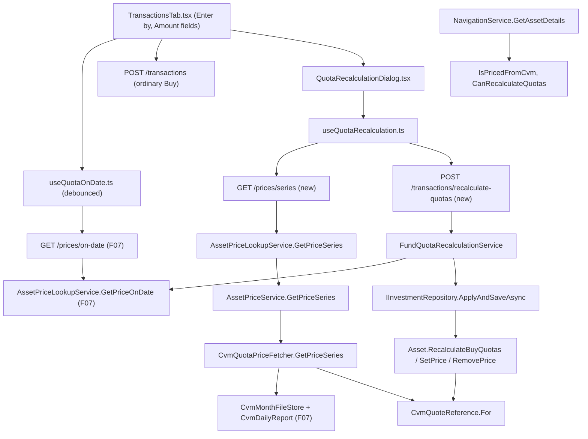

# Spec: Fund Purchases by Amount

**Complexity:** complex. Two web workflows (a second entry mode on the Buy form, and a preview-and-apply dialog that rewrites every Buy of a holding and optionally its hand-entered prices), a new read endpoint over the CVM month files, a new all-or-nothing mutation endpoint, a Domain rule and two flags on the asset details contract. It ships as five PRs in two stages, each within the PR size rule: (1) Buy by amount, (2) the quota series read, (3) the recalculation rule and flag, (4) the recalculation endpoint, (5) the recalculation dialog.

**Read §13 first: its review amendments supersede earlier sections.**

**Builds on (specified, not yet built).** Every item below must exist on `main` before the PR that uses it starts. Where this spec names a member of another feature, it is that spec's contract; if the built code differs, follow the built code and record the difference in the PR's docs commit.
- **F06** (`../P69-F06-brazilian-cnpj-identifiers/spec.md`): `Asset.Cnpj` (14 digits or null), `CnpjRules` (`Financial.Investment.Domain/Rules/CnpjRules.cs`), `AssetDetailsDTO.Cnpj`, web `utils/cnpj.ts` (`formatCnpj`). Needed from PR 1.
- **F07** (`../P69-F07-cvm-daily-quota-price-source/spec.md`, **§13 binding**): `Asset.IsPricedFromCvm` (the single CVM eligibility check; PR 1 of F07), `AssetPriceRequestDTO.CvmFundCnpj` and `DescribeWith` (F07 PR 1), `PriceSource.Cvm` and `CnpjRules.Format` (F07 PR 4), `CvmQuotaPriceFetcher` with its month-file store and memoised parse (F07 PR 3–4, stale-while-revalidate per §13.2, previous month only when needed per §13.4), `PriceLookupIssue` and `PriceSourceUnavailableException` (F07 PR 5), and the quota on a date: `IHistoricalAssetPriceFetcher`, `IAssetPriceService.GetPriceOnDate`, `IAssetPriceLookupService.GetPriceOnDate`, `GET /prices/on-date` returning the trimmed `AssetPriceOnDateDTO` (`date`, `price`, `issue`; §13.9) (F07 PR 6). F08 PR 1 starts after F07 PR 6 merges; every later F08 PR builds on it too.
- **F01** (`../P69-F01-balance-tracked-holding-option/spec.md`): `Asset.IsTrackedByBalance`, read only through `IsPricedFromCvm`.
- **F03** (`../P69-F03-balance-entries/spec.md`, **§13 binding**): `AssetPriceSnapshot.IsManual` covering `Manual` and `ProviderValuation` (F03 PR 2), and `formatShortDateUtc` / `daysBetween` for dates in web text (F03 §13.6). F08 PR 3 starts after F03 PR 2 merges.

## 1. Technical Overview

**What:** Two ways of giving a CVM-priced fund (F07's `Asset.IsPricedFromCvm`: tracked by Quantity and price, country BR, class Fund, CNPJ set) real quota counts from the amounts the investor knows:

- **Buy by amount.** On a new Buy for such a holding, the transaction form offers "Enter by: Amount / Quantity and price", defaulting to Amount. In Amount mode the investor enters Date, Amount, Quota date and Fees. The form looks up the quota value on the quota date through F07's `GET /prices/on-date` (debounced, only when the quota date changes) and shows "Quota value R$X on DD/MM/YYYY (CVM) → Y quotas", recalculating Y locally as Amount or Fees change. Saving posts an ordinary Buy through the existing `POST /transactions` with unit price = quota value and quantity = (amount − fees) ÷ quota value rounded to 8 decimals. Switching to "Quantity and price" pre-fills the derived figures for the investor to override.
- **Recalculate quotas from CVM.** On a CVM-priced holding whose transactions are all Buys (at least one) with no credits and no corporate actions, a Transactions tab action opens a dialog that loads, in one request, the CNPJ's quota values for every month it needs plus the latest quota (new `GET /prices/series`). Per Buy it keeps the date, invested amount (quantity × unit price) and fees, and proposes unit price = quota value on the row's quota date and quantity = invested ÷ quota value (8 decimals). Quota dates default to the Buy date, are editable per row and recompute locally. The dialog shows the current value the new quotas give at the latest quota, and offers to replace the holding's hand-entered prices dated before today with CVM quota values (deleting those with none). Applying posts the quota dates (new `POST /transactions/recalculate-quotas`); the server looks the quotes up again, re-checks eligibility and writes every Buy and price change in one `ApplyAndSaveAsync`.

**Why:** Guepardo's XP screen shows only its current value, so its quantities were derived by hand from an assumed price. F06 gives it a CNPJ and F07 a dated quota value; F08 turns money amounts into quota counts with them, once for the existing purchases and at entry for new ones, so its value becomes total quotas × the CVM quota with no arithmetic left to the investor.

**Scope:**

*Included (PRD F08 Capabilities, Experience, Error Handling)*
- `AssetDetailsDTO.IsPricedFromCvm` (PR 1) and `AssetDetailsDTO.CanRecalculateQuotas` (PR 3), mapped from the asset, so the web never re-derives either rule.
- Web Buy-by-amount mode: entry-mode choice, Amount/Quota date/Fees fields, debounced quota lookup with its five states, client-side quota count, pre-fill on switching, save as an ordinary Buy (PR 1).
- `GET /api/v1/financial/prices/series`: class-level quota values of the holding's CNPJ for the requested months, plus the latest quota, through a new `GetPriceSeries` on the historical-fetcher seam (PR 2).
- Domain rule `Asset.CanRecalculateQuotasFromCvm` and `Asset.RecalculateBuyQuotas`, with the 8-decimal quota constant; `CvmQuoteReference` (Domain) as the one place the CVM source-reference text is built, also used by F07's fetcher (PR 3).
- `POST /api/v1/financial/transactions/recalculate-quotas` and `FundQuotaRecalculationService`: server-side lookup, re-check, all-or-nothing write of Buys and price replacements; `PriceSourceUnavailableException` mapped to 503 with problem code `priceSourceUnavailable` (PR 4).
- The recalculation dialog with grid, per-row quota date, current-value line, price-replacement checkbox, every state (PR 5).
- OpenAPI snapshot and generated web types regenerated in PR 1, 2, 3 and 4.

*Consumes*
- F06: `Asset.Cnpj` (through `IsPricedFromCvm`), `formatCnpj` for messages.
- F07: quota on a date (`GET /prices/on-date`, `IAssetPriceLookupService.GetPriceOnDate`) with `issue` = `NotFound` / `FundHasSubclasses` / `BeforeAvailableHistory` / `SourceUnreachable`; the month-file reader and store behind `CvmQuotaPriceFetcher`; `PriceSource.Cvm`.

*Excluded*
- Editing an existing Buy by amount: the entry-mode choice is offered on a new Buy only (Assumption 3).
- Recalculation for holdings with any non-Buy transaction, credit or corporate action (PRD Out of Scope, widened in Assumption 2).
- Payout backfill and any other historical price backfill beyond the one-off replacement of hand-entered prices (PRD Out of Scope; user decision).
- Quota values before January 2021 (F07: `BeforeAvailableHistory`).
- Unit-price precision in the Transactions grid, and a discard prompt on the transaction form (Assumptions 15 and 16, flagged per `docs/rules/ui.md` §Scope of compliance).

## 2. Before you design (docs/rules/design.md)

1. **Where it belongs:** the Investment bounded context. Whether a holding can have its quotas recalculated, and how a Buy's quota count is recalculated from its invested amount, are facts about the asset and its transactions, so they live on `Asset` in Domain next to F07's `IsPricedFromCvm`. Looking quotes up, orchestrating them with the write and choosing what to do with hand-entered prices is an Application use case (`FundQuotaRecalculationService`). Reading a month's quotes is the existing CVM adapter in Investment Infrastructure (`CvmQuotaPriceFetcher`), extended with a series method. The Buy-by-amount quota count is computed in the web, because the saved Buy is an ordinary Buy whose quantity the investor sees and confirms (Decision "Where Buy-by-amount arithmetic runs").
2. **Layers touched, in direction:** Domain (`Asset`, `CvmQuoteReference`) → Application (DTOs, lookup service, recalculation service, interfaces, DI) → Infrastructure (historical-fetcher seam, `AssetPriceService`, CVM fetcher) → API (two actions, one middleware mapping, regenerated snapshot) → Web (transaction form, dialog, client). That is every layer, which is why it is five PRs.
3. **What keeps Domain free of Infrastructure:** Application declares `IAssetPriceService` (gains `GetPriceSeries`) and `IAssetPriceLookupService` (gains `GetPriceSeries`); Infrastructure implements them. `IHistoricalAssetPriceFetcher` stays Infrastructure-internal. `FundQuotaRecalculationService` depends only on `IInvestmentRepository`, `IAssetPriceLookupService` and `INavigationService`, all declared in Application. Domain gains a computed property, a method, a constant and a pure text builder, none of which does I/O.
4. **SOLID:** Single responsibility: `Asset.RecalculateBuyQuotas` only rewrites Buys from given quota values; the service only gathers quotes, decides price replacements and saves; the fetcher only reads CVM rows. Open/closed: the series read is a new member of the optional historical capability F07 introduced, so the non-historical fetchers are untouched. Interface segregation: the recalculation use case gets its own `IFundQuotaRecalculationService` rather than a fourth member on `ITransactionService`, whose callers never need it. Dependency inversion: the recalculation service reuses `IAssetPriceLookupService.GetPriceOnDate`, so it never sees the fetcher, the request DTO or the CNPJ gate.

## 3. Architecture Impact



## 4. Technical Decisions

| Decision | Chosen Approach | Alternative Considered | Trade-off |
|---|---|---|---|
| Which holdings get Buy by amount and Recalculate | Exactly where F07's `Asset.IsPricedFromCvm` is true (plus the recalculation's own transaction rule), exposed to the web as `AssetDetailsDTO.IsPricedFromCvm` and `AssetDetailsDTO.CanRecalculateQuotas` | PRD wording "a holding with a CNPJ"; or a web re-derivation from `country`, `class`, `cnpj` and the tracking flag | Since F06 every BR holding can carry a CNPJ (a share's CNPJ must never offer quota entry), and F07 already names `IsPricedFromCvm` the single gate F08 reads. A server flag keeps the rule in one place (Assumption 1) |
| Where Buy-by-amount arithmetic runs | In the web (`utils/fundQuotas.ts`): quantity = round8((amount − fees) ÷ quota), unit price = quota; posted through the unchanged `POST /transactions` | A server-side "amount + quota date" Buy (new `TransactionCreateDTO` fields, server lookup) | PRD: the saved Buy is an ordinary Buy and the investor can override it; the count must update on every keystroke without a request; and F02 (parallel) reshapes `TransactionCreateDTO` for amount-only types. What is saved is exactly the quantity and price the investor saw |
| Quota count precision | 8 decimals, `MidpointRounding.AwayFromZero` on the server (`Asset.QuotaQuantityDecimals = 8`), the same half-up rule for positives in the web (`QUOTA_DECIMALS = 8`) | Full `decimal` precision; banker's rounding | PRD fixes 8. `Transaction.Quantity` is an unbounded `decimal` (stored quantities today have up to 13 decimals) and the grid already shows quantities with `formatN8`, so 8 is exactly what the investor sees. Half-up matches what JavaScript can reproduce |
| Unit price of a derived Buy | The quota value as published (`VL_QUOTA`, up to 12 decimals, `decimal`) | Round to 8 | Keeps quantity × price within a fraction of a cent of the invested amount (well inside the PRD's R$0.01 success metric) and makes the saved price match CVM's |
| Quota-date lookup in the Buy form | F07's `GET /prices/on-date`, debounced 400 ms, only when the quota date changes, stale responses dropped (`useLatestRequestGuard`) | Look up on every render; or the series endpoint | PRD: looked up only when the quota date changes, debounced; on-date already implements the exact-or-5-days-earlier rule server-side |
| How the dialog gets quotes | One `GET /prices/series` call with the de-duplicated months the rows and the hand-entered prices need (§8.3) plus the latest quote in the same response; rows are resolved locally with the exact-or-nearest-earlier-within-5-days rule mirrored in `utils/fundQuotas.ts` | One on-date call per row | PRD: one request, months de-duplicated, recomputed locally when a quota date changes (AC -10). The 5-day rule is mirrored like `SEGMENT_CLASSES` mirrors `HasSegments`, pinned by shared literal vectors (Assumption 6) |
| Series contract | `AssetPriceSeriesDTO { prices: AssetPricePointDTO[], latest: AssetPricePointDTO?, issue: PriceLookupIssue? }`; `issue` only `SourceUnreachable` or `FundHasSubclasses`; a month without rows just contributes nothing | Per-month result objects | The web only needs dated values and one blocking reason; missing dates are already "No CVM quota for this date" per row |
| Months parameter | Repeated `months=yyyy-MM` query values (1–24, not after the current month); months before 2021-01 are ignored | POST search body | `implementation.md`: GET reads stay query-string scalars; a repeated scalar serialises cleanly as `style: form, explode: true`. 24 covers a dialog's rows and caps an accidental flood of 10–12 MB downloads; the fetcher downloads at most 4 months at a time (§8.2) |
| Recalculation: who computes the new figures | The server, from the posted quota dates: it looks each quote up again with `IAssetPriceLookupService.GetPriceOnDate` and `Asset.RecalculateBuyQuotas` computes the quantities | Trust quantities and prices posted by the web | The write is authoritative and identical to the Domain rule; the client cannot post a wrong quantity. Month files are cached by then, so the re-lookups are parse-memo reads |
| Where the recalculation write happens | Lookups outside `ApplyAndSaveAsync`; inside it: eligibility re-check, Buy-set check, `RecalculateBuyQuotas`, then `SetPrice` / `RemovePrice` per looked-up hand-entered date | Lookups inside the mutation | The repository's exclusion is not reentrant and must not wait on downloads; the re-check inside is what makes a Sell added after the dialog opened fail (AC -15) |
| All-or-nothing | One `ApplyAndSaveAsync`; any exception in the delegate or the write restores the in-memory document (existing contract) | Per-row saves | PRD: everything applied or nothing |
| Hand-entered prices | Every `AssetPriceSnapshot.IsManual` entry dated before host-local today, when the option is on: replaced with `PriceSource.Cvm` on the **same date** at the quota on that date (F07 rule), source reference `CvmQuoteReference.For(cnpj, competence)`; deleted when the date has no quota (`NotFound`, `BeforeAvailableHistory`, `FundHasSubclasses`). Today's manual entry is never touched | Re-date the replacement to the competence date | PRD: same date, so P68 month-start values keep a price on the date they read |
| CVM source-reference text | `Financial.Investment.Domain/Rules/CvmQuoteReference.cs`, `For(string cnpjDigits, DateOnly competence)` → `CNPJ 00.000.000/0000-00 · competence DD/MM/YYYY`; F07's `CvmQuotaPriceFetcher` switched to it in PR 3 | Rebuild the string in the service | Two call sites, one text; F07 §13.9 removed `sourceReference` from the on-date DTO, so the service cannot receive it (Assumption 8) |
| Rejections | Not CVM-priced, non-Buy transaction / credit / corporate action present, Buy set changed → `InvestmentRuleViolationException` (409); a row without a quote, a future quota date, empty or duplicate rows → `ArgumentException` (400); unknown holding → `KeyNotFoundException` (404); CVM unreachable → `PriceSourceUnavailableException` (503, problem code `priceSourceUnavailable`) | One generic 400 | Each maps to a distinct web message; 409 already means "well-formed but the domain refuses it now" in `DomainExceptionMappingMiddleware` |
| Endpoint home | `TransactionsController` `[HttpPost("recalculate-quotas")]`, returning `AssetDetailsDTO` like every transaction mutation | A new controller | It rewrites transactions; same response shape as add/update/delete |
| Recalculation trigger | A primary "Recalculate quotas from CVM" button beside "New transaction" in the Transactions toolbar, shown only when `canRecalculateQuotas` | A toolbar overflow menu | The tab has no menu today; `forms-data-and-visualisations.md` "Action buttons": peer actions are primary, left, standard size (Assumption 9) |
| Dialog vs inline | Fluent `Dialog` | Inline panel | PRD names a dialog; it is a self-contained, blocking review of existing rows, not a "New X" create action (`forms-data-and-visualisations.md` "Inline form, dialog, drawer, or page") |

## 5. Component Overview

### Stage 1, PR 1: Buy by amount

| File Path | New/Modified | Purpose | Key Responsibilities |
|---|---|---|---|
| `Financial.Investment.Application/DTOs/AssetDetailsDTO.cs` | Modified | Gate on the wire | `public bool IsPricedFromCvm { get; set; }` (no doc comment) |
| `Financial.Investment.Application/Services/NavigationService.cs` | Modified | Mapping | `GetAssetDetails` sets `IsPricedFromCvm = asset.IsPricedFromCvm` |
| `Financial.Web/src/api/types.ts` | Modified | Alias | `export type AssetPriceOnDateDto = Schema<'AssetPriceOnDateDTO'>` (F07 adds no web caller, so it has no alias yet; skip if F07 added it) |
| `Financial.Web/src/api/financialApiClient.ts` | Modified | Client | `getPriceOnDate(brokerName, portfolioName, assetName, date)` → `AssetPriceOnDateDto` (`GET /prices/on-date`, query encoded like `getCurrentPrice`) |
| `Financial.Web/src/utils/fundQuotas.ts` | New | Quota arithmetic and texts | `QUOTA_DECIMALS = 8` (mirrors `Asset.QuotaQuantityDecimals`); `roundQuotas(value)` (half-up to 8); `quotasForAmount(amount, fees, quotaValue)`; `formatQuotaValue(value, currency)` (currency, 2–8 decimals); the §9.1 line texts as functions of the lookup state |
| `Financial.Web/src/hooks/useQuotaOnDate.ts` | New | Debounced lookup | Input `{ enabled, brokerName, portfolioName, assetName, quotaDate }`; 400 ms debounce after `quotaDate` changes; skips blank or future dates; latest-request guard; returns `{ status: 'idle' \| 'loading' \| 'found' \| 'unavailable' \| 'error', quote, issue, retry }` (`unavailable` for `NotFound` / `BeforeAvailableHistory` / `FundHasSubclasses`, `error` for `SourceUnreachable` or a failed request) |
| `Financial.Web/src/hooks/useTransactions.ts` | Modified | Form state | `entryMode: 'Amount' \| 'QuantityAndPrice'`; `formAmount`, `formQuotaDate` and whether it still follows `formDate`; `isEntryByAmountOffered` (`asset.isPricedFromCvm && formType === 'Buy' && editingId === null`); `setEntryMode` (switching to Quantity and price pre-fills the derived quantity and unit price); Amount-mode validation (§8.1) and save (quantity, unit price from the quote, withheld 0); `TransactionFormField` gains `formAmount`, `formQuotaDate` |
| `Financial.Web/src/components/TransactionsTab.tsx` | Modified | Form | "Enter by" `RadioGroup` after Type when offered; Amount-mode fields (Amount, Quota date, Fees) and the read-only quota line with `role="status"` and a "Try again" button in the error state; Save disabled in Amount mode unless the quote is found; Quantity and Unit price inputs get `step="any"` so 8-decimal values are not flagged invalid |

8 non-test code files, plus the regenerated `Tests/Financial.Api.Tests/Contract/openapi-v1.snapshot.json` and `Financial.Web/src/api/generated/openapi.ts`. `TransactionsTab.tsx` is already in `Financial.Web/stryker.components.config.json`. Docs commit: add the F08 AC ids to PRD §9 (Assumption 18).

### Stage 2, PR 2: quota series read

| File Path | New/Modified | Purpose | Key Responsibilities |
|---|---|---|---|
| `Financial.Investment.Application/DTOs/AssetPriceSeriesDTO.cs` | New | Wire | `AssetPriceSeriesDTO` (`List<AssetPricePointDTO> Prices`, `AssetPricePointDTO? Latest`, `PriceLookupIssue? Issue` with `JsonStringEnumConverter`) and `AssetPricePointDTO` (`DateOnly Date`, `decimal Price`) |
| `Financial.Investment.Infrastructure/Interfaces/IHistoricalAssetPriceFetcher.cs` | Modified | Capability | `AssetPriceSeriesDTO GetPriceSeries(AssetPriceRequestDTO request, IReadOnlyCollection<DateOnly> monthStarts)` |
| `Financial.Investment.Infrastructure/Services/CvmQuotaPriceFetcher.cs` | Modified | Implementation | §8.2: months before 2021-01 dropped; the remaining months' store calls started together and awaited together; class-level quotes of every month (memoised parse) flattened and ordered by date; `Latest` from the same rule as `GetSnapshot` (current month, previous only when needed, F07 §13.4); `CvmReportException` on any month → `PriceSourceUnavailableException(Cvm, SourceUnreachable)`; no class-level row anywhere, subclass rows seen → `Issue = FundHasSubclasses` |
| `Financial.Investment.Application/Interfaces/IAssetPriceService.cs` | Modified | Contract | `AssetPriceSeriesDTO GetPriceSeries(AssetPriceRequestDTO request, IReadOnlyCollection<DateOnly> monthStarts)` |
| `Financial.Investment.Infrastructure/Services/AssetPriceService.cs` | Modified | Selection | Same selection as F07's `GetPriceOnDate`: the fetcher whose `Supports(request)` is true, if it is an `IHistoricalAssetPriceFetcher`; otherwise `UnsupportedAssetClassException("No price source provides a price on a date for this holding.")` (F07's message reused) |
| `Financial.Investment.Application/Interfaces/IAssetPriceLookupService.cs` | Modified | Contract | `AssetPriceSeriesDTO GetPriceSeries(string brokerName, string portfolioName, string assetName, IReadOnlyCollection<DateOnly> monthStarts)` (no doc comment added) |
| `Financial.Investment.Application/Services/AssetPriceLookupService.cs` | Modified | Use case | Span `GetPriceSeries`; 1–24 distinct months, none after the current month, else `ArgumentException` (§10); unresolved asset → `KeyNotFoundException`; request from `DescribeWith`; a `PriceSourceUnavailableException` is logged by type (`Warning`) and returned as `Issue = SourceUnreachable` with no prices, as F07's `GetPriceOnDate` does |
| `Financial.Api/Controllers/AssetPricesController.cs` | Modified | Endpoint | `[HttpGet("series")]` with `[FromQuery] string? brokerName, portfolioName, assetName` and `[FromQuery] string[]? months`; 400 when a name is blank, `months` is empty or a value is not `yyyy-MM`; `///` summary/param/returns like its neighbours (OpenAPI descriptions; Assumption 17) |

8 non-test code files. Every test double implementing `IAssetPriceService` gains the method (test files). Regenerate the snapshot and the web types (no web caller until PR 5).

### Stage 2, PR 3: recalculation rule and flag

| File Path | New/Modified | Purpose | Key Responsibilities |
|---|---|---|---|
| `Financial.Investment.Domain/Entities/Asset.cs` | Modified | Rule | `public const int QuotaQuantityDecimals = 8`; message constants (§8.4); `public bool CanRecalculateQuotasFromCvm` (`IsPricedFromCvm`, at least one transaction, every transaction a Buy, no credits, no corporate actions); `RecalculateBuyQuotas(IReadOnlyDictionary<Guid, decimal> quotaValueByBuyId)` (§8.4) |
| `Financial.Investment.Domain/Rules/CvmQuoteReference.cs` | New | Text rule | `For(string cnpjDigits, DateOnly competence)` → `"CNPJ {CnpjRules.Format(cnpjDigits)} · competence {dd/MM/yyyy}"` with `CultureInfo.InvariantCulture` |
| `Financial.Investment.Infrastructure/Services/CvmQuotaPriceFetcher.cs` | Modified | Reuse | Builds its `SourceReference` with `CvmQuoteReference.For` (text unchanged) |
| `Financial.Investment.Application/DTOs/AssetDetailsDTO.cs` | Modified | Flag | `public bool CanRecalculateQuotas { get; set; }` |
| `Financial.Investment.Application/Services/NavigationService.cs` | Modified | Mapping | `CanRecalculateQuotas = asset.CanRecalculateQuotasFromCvm` |

5 non-test code files. Regenerate the snapshot and the web types. `RecalculateBuyQuotas` has no caller until PR 4; it is a Domain building block proven by its own tests (Assumption 19).

### Stage 2, PR 4: recalculation endpoint

| File Path | New/Modified | Purpose | Key Responsibilities |
|---|---|---|---|
| `Financial.Investment.Application/DTOs/FundQuotaRecalculationDTO.cs` | New | Wire | `FundQuotaRecalculationDTO` (`required string BrokerName`, `PortfolioName`, `AssetName`; `List<FundQuotaPurchaseDTO> Purchases`; `bool ReplaceManualPrices`) and `FundQuotaPurchaseDTO` (`Guid TransactionId`, `DateOnly QuotaDate`) |
| `Financial.Investment.Application/Interfaces/IFundQuotaRecalculationService.cs` | New | Contract | `Task<AssetDetailsDTO> RecalculateAsync(FundQuotaRecalculationDTO request)` |
| `Financial.Investment.Application/Services/FundQuotaRecalculationService.cs` | New | Use case | §8.5; span `Investment.FundQuotaRecalculationService.RecalculateQuotas`, entity type `Transaction`; dependencies `IInvestmentRepository`, `IAssetPriceLookupService`, `INavigationService`, `TimeProvider`, `ITelemetryTracer`, `ILogger<>` |
| `Financial.Investment.Application/DependencyInjection/InvestmentApplicationServiceCollectionExtensions.cs` | Modified | Wiring | `AddFinancialApplication` gains `AddSingleton<IFundQuotaRecalculationService, FundQuotaRecalculationService>()` (no Application DI test class exists; the host acceptance tests resolve the controller and so the registration) |
| `Financial.Api/Controllers/TransactionsController.cs` | Modified | Endpoint | `[HttpPost("recalculate-quotas")]` taking `[FromBody] FundQuotaRecalculationDTO?` (null → 400), returning `Ok(details)`; constructor gains `IFundQuotaRecalculationService`; `///` docs and `ProducesResponseType` 200/400/404/409/503 |
| `Financial.Api/Middleware/DomainExceptionMappingMiddleware.cs` | Modified | Mapping | `PriceSourceUnavailableException` → 503 with problem extension `code = "priceSourceUnavailable"` (new `PriceSourceUnavailableProblemCode`), logged by type like every mapped exception |

6 non-test code files. Regenerate the snapshot (new path and two schemas) and the web types.

### Stage 2, PR 5: recalculation dialog

| File Path | New/Modified | Purpose | Key Responsibilities |
|---|---|---|---|
| `Financial.Web/src/api/types.ts` | Modified | Aliases | `AssetPriceSeriesDto`, `AssetPricePointDto`, `FundQuotaRecalculationDto`, `FundQuotaPurchaseDto` |
| `Financial.Web/src/api/financialApiClient.ts` | Modified | Client | `getPriceSeries(brokerName, portfolioName, assetName, months)` (repeated `months` params) → `AssetPriceSeriesDto`; `recalculateQuotas(request)` → `AssetDetailsDto` (`POST /transactions/recalculate-quotas`) |
| `Financial.Web/src/utils/fundQuotas.ts` | Modified | Preview rules | `CVM_MAX_LOOKBACK_DAYS = 5`, `CVM_FIRST_QUOTA_DATE = '2021-01-01'` (mirroring `CvmDailyReport`); `monthsNeeded(rows, manualPriceDates, today)` (§8.3); `quoteOnOrNearestBefore(prices, date)`; `recalculatedQuantity(quantity, unitPrice, quotaValue)`; `recalculationErrorMessage(err)` (§9.2) |
| `Financial.Web/src/hooks/useQuotaRecalculation.ts` | New | Dialog state | Phases `closed / loading / loadError / ready / loadingMonths / applying`; rows from the asset's Buys (newest first) with editable quota dates; hand-entered prices before today; `replaceManualPrices` (default true); derived preview (per-row quote and new quantity, current value, prices to replace / delete, rows without quote); `isDirty`; `apply()` posting quota dates; missing months fetched once when an edited date needs one (§8.3) |
| `Financial.Web/src/components/QuotaRecalculationDialog.tsx` | New | View | §9.2: grid, current-value line, checkbox and deletion list, disabled-Apply message, loading / error / applying states, discard prompt (`useDiscardPrompt` + `DiscardChangesDialog`) |
| `Financial.Web/src/components/QuotaRecalculationDialog.css` | New | Layout | Surface width (wide, capped to the viewport less the 16 px gutters), grid wrapper `overflow-x: auto`, quota-date column width; Fluent tokens only |
| `Financial.Web/src/components/TransactionsTab.tsx` | Modified | Trigger | "Recalculate quotas from CVM" button beside "New transaction" when `asset.canRecalculateQuotas`; opens the dialog; on success replaces the tab's asset with the returned details and shows the toast (`useSuccessToast`) |
| `Financial.Web/stryker.components.config.json` | Modified | Mutation list | Adds `src/components/QuotaRecalculationDialog.tsx` |

8 non-test code files. No contract change. Docs commit: tick the F08 PRD boxes (Assumption 18).

## 6. API Contracts

### `GET /api/v1/financial/assets/{broker}/{portfolio}/{name}` and every response returning `AssetDetailsDTO` (existing, extended)

| Field | Type | Description |
|---|---|---|
| `isPricedFromCvm` | boolean | `Asset.IsPricedFromCvm` (PR 1). The Buy form offers "Enter by" only when true |
| `canRecalculateQuotas` | boolean | `Asset.CanRecalculateQuotasFromCvm` (PR 3). The Transactions tab shows the recalculation action only when true |

### `GET /api/v1/financial/prices/on-date` (F07, consumed unchanged)

The Buy form calls it with the quota date. Response `{ "date": "2026-11-21", "price": 3.455120000000, "issue": null }`, or `date`/`price` null with `issue`.

### `GET /api/v1/financial/prices/series` (new, PR 2)

| Field (query) | Type | Required | Validation | Description |
|---|---|---|---|---|
| `brokerName` | string | Yes | not blank | Holding's broker |
| `portfolioName` | string | Yes | not blank | Holding's portfolio |
| `assetName` | string | Yes | not blank | Holding's name |
| `months` | string (repeated) | Yes | each `yyyy-MM`; 1–24 distinct; none after the current month | Months whose quota values are wanted. Months before 2021-01 return nothing |

Example: `GET /api/v1/financial/prices/series?brokerName=XPI&portfolioName=Fundos&assetName=Example%20Fund%20FIC%20FIA&months=2026-10&months=2026-11`

**Response 200 (`AssetPriceSeriesDTO`):**

| Field | Type | Description |
|---|---|---|
| `prices` | `AssetPricePointDTO[]` | Every class-level quota of the CNPJ in the requested months, ascending by date; empty when `issue` is set |
| `prices[].date` | string (date) | Competence date |
| `prices[].price` | number | Quota value |
| `latest` | `AssetPricePointDTO` \| null | Latest quota on or before today (F07's latest rule); null when none or when `issue` is set |
| `issue` | `SourceUnreachable` \| `FundHasSubclasses` \| null | Why no values could be given |

```json
{
  "prices": [
    { "date": "2026-10-30", "price": 3.401877000000 },
    { "date": "2026-11-03", "price": 3.410212000000 },
    { "date": "2026-11-26", "price": 3.482917000000 }
  ],
  "latest": { "date": "2026-11-26", "price": 3.482917000000 },
  "issue": null
}
```

```json
{ "prices": [], "latest": null, "issue": "SourceUnreachable" }
```

**Errors**

| Case | HTTP Status | Description |
|---|---|---|
| A name blank, `months` missing or a value not `yyyy-MM` | 400 | Controller `BadRequest()` |
| More than 24 distinct months | 400 | "Ask for at most 24 months at a time." |
| A month after the current month | 400 | "Months can't be in the future." |
| Holding not found | 404 | `KeyNotFoundException` |
| Holding not priced from CVM | 422 | "No price source provides a price on a date for this holding." |

### `POST /api/v1/financial/transactions/recalculate-quotas` (new, PR 4)

**Request (`FundQuotaRecalculationDTO`):**

| Field | Type | Required | Validation | Description |
|---|---|---|---|---|
| `brokerName` | string | Yes | not blank | Holding's broker |
| `portfolioName` | string | Yes | not blank | Holding's portfolio |
| `assetName` | string | Yes | not blank | Holding's name |
| `purchases` | `FundQuotaPurchaseDTO[]` | Yes | ≥ 1, distinct `transactionId`; together exactly the holding's Buys | One row per Buy |
| `purchases[].transactionId` | string (uuid) | Yes | an existing Buy of the holding | The Buy to recalculate |
| `purchases[].quotaDate` | string (date) | Yes | not after host-local today | Date whose quota value is used (exact, or nearest earlier within 5 days) |
| `replaceManualPrices` | boolean | No (default false) | — | Replace hand-entered prices dated before today with CVM quotas, deleting those without one |

```json
{
  "brokerName": "XPI",
  "portfolioName": "Fundos",
  "assetName": "Example Fund FIC FIA",
  "purchases": [
    { "transactionId": "5f0c1a52-3b9e-4f0a-9c55-0d2f6b1e7a10", "quotaDate": "2026-11-04" },
    { "transactionId": "a7e2c9d4-1f63-4b8e-8a20-6c3d9e5f4b21", "quotaDate": "2026-10-30" }
  ],
  "replaceManualPrices": true
}
```

**Response 200:** `AssetDetailsDTO` of the holding after the write (transactions, price snapshots, valuation, both flags), as every transaction mutation returns.

**Errors**

| Case | HTTP Status | `detail` |
|---|---|---|
| Body missing | 400 | — (controller `BadRequest()`) |
| A name blank, `purchases` empty or a duplicate `transactionId` | 400 | "Send one row per purchase." |
| A `quotaDate` after today | 400 | "Quota date can't be in the future." |
| One or more rows without a CVM quota | 400 | "1 purchase has no CVM quota. Fix its date or enter it manually." / "N purchases have no CVM quota. Fix their dates or enter them manually." |
| Holding not found | 404 | "Holding not found." |
| Holding not priced from CVM | 409 | "This holding isn't priced from CVM, so its quotas can't be recalculated." |
| Holding has a non-Buy transaction, a credit or a corporate action | 409 | "This holding now has sales or income, so its quotas can't be recalculated." |
| The posted rows are not exactly the holding's Buys | 409 | "The purchases of this holding changed after the preview opened. Close it and open it again." |
| CVM unreachable for a needed month | 503 | "The price source could not provide a price." (problem `code`: `priceSourceUnavailable`) |
| Storage fails | 503 (`TransientStorageException`) or 500 | Existing behaviour; nothing is changed |

### Contract regeneration

PR 1, 2, 3 and 4 change the wire: `UPDATE_OPENAPI_SNAPSHOT=1 dotnet test Tests/Financial.Api.Tests --filter "FullyQualifiedName~OpenApiContractTests"`, review the diff (only the fields, path and schemas above), then `cd Financial.Web && npm run generate-api-types`, commit both, add each `src/api/types.ts` alias in the PR whose client first uses it (PR 1: `AssetPriceOnDateDto`; PR 5: the four new schemas) and fix whatever `tsc -b` flags (`AssetDetailsDto` web fixtures gain the two booleans). The decimal-schema transformer in `Program.cs` applies to `price` unchanged.

## 7. Data Model

`data-investment.json`: no shape change, no `InvestmentDataMigrations` step, no version bump, `data/*.example.json` unchanged.

| Write | Effect on the stored asset |
|---|---|
| Buy by amount | One ordinary `Transactions` entry: `Type` Buy, `Date` = form Date (order date), `Quantity` with ≤ 8 decimals, `UnitPrice` = CVM quota value, `Fees`, `Withheld` 0, currency and FX snapshot captured as for any Buy |
| Recalculation, per Buy | Same `Id`, `Date`, `Fees`, `Withheld`, `Currency`, `FxRateSnapshot`; `UnitPrice` = quota value on the row's quota date; `Quantity` = round8(old quantity × old unit price ÷ quota value). The quota date itself is not stored (Assumption 5) |
| Recalculation, replace option on | Each `PriceSnapshots` entry with `IsManual` and `Date` before today: replaced on the same `Date` by `Source` `"Cvm"`, `Price` = quota on that date, `SourceReference` = `CNPJ 00.000.000/0000-00 · competence DD/MM/YYYY`, `Currency` `""`, `RetrievedAt` now; or removed when the date has no quota |

The live data has one holding this applies to today: 3 Buys (none before 2021, all with fees, in 2 calendar months), 0 other transactions, 0 credits, 0 corporate actions and 5 hand-entered prices (one dated on a weekend, none before the first Buy), so the first recalculation needs a handful of month files and replaces up to 5 prices.

## 8. Rules in detail

### 8.1 Buy by amount (web)

- Offered when `asset.isPricedFromCvm`, the type is Buy and the form is creating (not editing). Each time the form opens for such a Buy, the mode is Amount. Choosing another type hides the choice and shows the existing fields; choosing Buy again returns to Amount.
- Fields in Amount mode, in order: Date, Type, Enter by, Amount, Quota date, Fees, then the quota line. Withheld is not shown and is sent as 0.
- Quota date defaults to Date and follows it while the investor has not edited Quota date; once edited it stays.
- Validation on save, focus on the first invalid field (`useFormErrorFocus`), messages under each field:
  - Amount: blank or ≤ 0 → "Enter an amount greater than 0."; more than 2 decimals → "Enter an amount with up to 2 decimals."
  - Quota date: blank → "Quota date is required."; after today → "Quota date can't be in the future." (shown as soon as the date is entered, because no lookup is made for it)
  - Fees: negative → "Fees can't be negative."; ≥ Amount → "Fees must be less than the amount."
- Quota count Y = `roundQuotas((amount − fees) ÷ quotaValue)`; unit price = `quotaValue` as returned. With R$1,000 and quota 2.50 → 400; with R$10 fees → 396.
- Save in Amount mode is disabled while the lookup is not `found` (and while saving, and before the type effects load, as today).
- Switching to "Quantity and price": when the lookup is `found` and Amount is valid, Quantity is set to Y (8 decimals) and Unit price to the quota value; Fees keep their value; Withheld appears (0). Otherwise the existing fields keep whatever they had. Switching back to Amount keeps Amount, Quota date and Fees as they were.

### 8.2 Quota series (server, `CvmQuotaPriceFetcher.GetPriceSeries`)

- Distinct month starts; those before 2021-01-01 are dropped without a download.
- The remaining months' `CvmMonthFileStore.GetAsync` calls run with at most 4 in flight (`SemaphoreSlim`), all awaited before the result is built (a month with a cached copy returns at once, F07 §13.2). A month not yet published contributes no rows. Parsed months stay in F07's parse memo under its own rule (keyed on content version); F08 adds no second cache.
- Each month's class-level quotes come from the memoised parse (F07 §4 "Parsed-series memo"), flattened, ordered by competence date.
- `Latest`: the same selection as `GetSnapshot` (current month, previous only when needed); its months are read even if not requested. Latest found → `{ date, price }`; none → null.
- No class-level quote in any read month and subclass-only rows seen → `Issue = FundHasSubclasses`, empty `Prices`. Any `CvmReportException` on a needed month (including the latest's) → `PriceSourceUnavailableException(Cvm, SourceUnreachable)`, which the lookup returns as `Issue = SourceUnreachable`.

### 8.3 Months the dialog asks for (web, `monthsNeeded`)

- For each Buy row's quota date and each hand-entered price date before today: the date's month, plus the previous month when `date − 5 days` falls in it.
- For each Buy row: also the month after the quota date's month, when it is not after the current month (conversion dates usually fall a few business days after the order date, so editing a quota date forward rarely needs another request).
- Months before 2021-01 are left out; the set is de-duplicated and sorted.
- When an edited quota date needs a month that was not loaded, the hook fetches just the missing months (one request), merges the values, and the row shows "Getting the quota value from CVM…" meanwhile (phase `loadingMonths`, Apply disabled). Editing within loaded months makes no request (AC -10).

### 8.4 Recalculation rule (Domain, `Asset`)

- `CanRecalculateQuotasFromCvm` = `IsPricedFromCvm` and at least one transaction and every transaction's type is Buy and no credits and no corporate actions.
- `RecalculateBuyQuotas(quotaValueByBuyId)`, checks in order:
  1. Not `IsPricedFromCvm` → `InvestmentRuleViolationException(NotPricedFromCvmMessage)` "This holding isn't priced from CVM, so its quotas can't be recalculated."
  2. A non-Buy transaction, a credit or a corporate action → `InvestmentRuleViolationException(HasSalesOrIncomeMessage)` "This holding now has sales or income, so its quotas can't be recalculated."
  3. The keys are not exactly the set of Buy ids (a Buy was added or removed, or no Buy exists) → `InvestmentRuleViolationException(PurchasesChangedMessage)` "The purchases of this holding changed after the preview opened. Close it and open it again."
  4. A quota value ≤ 0 → `ArgumentException("Quota value must be greater than zero.")`.
- Then for each Buy: `invested = Quantity × UnitPrice`; `newQuantity = Math.Round(invested / quota, QuotaQuantityDecimals, MidpointRounding.AwayFromZero)`; replaced through `UpdateTransaction(Transaction.CreateWithId(id, Date, Buy, newQuantity, quota, Fees, Withheld, Currency, FxRateSnapshot))`. A rounded quantity of 0 is rejected by `Transaction`'s own guard. No realised-gain regeneration is needed (there are no sales). 100 × 2.00 with R$5 fees at 2.50 → 80, fees 5.

### 8.5 Recalculation use case (`FundQuotaRecalculationService.RecalculateAsync`)

1. Names blank, `Purchases` empty or duplicate ids → `ArgumentException("Send one row per purchase.")`; a quota date after host-local today → `ArgumentException("Quota date can't be in the future.")`.
2. `repository.GetAsset(broker, portfolio, name)` (Active) or `KeyNotFoundException("Holding not found.")`. Not `IsPricedFromCvm` → the §8.4 message (fails before any lookup).
3. For each distinct quota date: `IAssetPriceLookupService.GetPriceOnDate`. Any `SourceUnreachable` → `PriceSourceUnavailableException(Cvm, SourceUnreachable)`. Rows whose quote has any other issue are counted; a non-zero count → `ArgumentException` with the §6 singular/plural text.
4. When `ReplaceManualPrices`: for each `IsManual` snapshot dated before today, `GetPriceOnDate(snapshot.Date)`; `SourceUnreachable` → as in 3; any other issue → that date is marked for deletion.
5. `ApplyAndSaveAsync`: `asset.RecalculateBuyQuotas(quota by transaction id)`; then for each looked-up date whose entry is still manual: `SetPrice(date, quote, PriceSource.Cvm, "", CvmQuoteReference.For(asset.Cnpj, quoteDate), now, today)` or `RemovePrice(date)`; returns true. An exception in the delegate or the write restores the in-memory document (repository contract) and propagates.
6. Return `INavigationService.GetAssetDetails(...)`; span marked success, `"{Operation} completed"` logged. On any exception: `span.MarkFailed(ex); throw;` (the middleware logs).

## 9. Web behaviour (docs/rules/ui.md)

### 9.1 Buy form in Amount mode (PR 1)

- **User task:** record a fund purchase from the amount on the XP order and the conversion date, and check the quota count before saving.
- **Current React behaviour:** the inline form shows Date, Type, Quantity, Unit price (for types with a quantity effect), Fees, Withheld; validation on save; Save shows "Saving…"; a failed save keeps the values; no discard prompt.
- **Target:** "Enter by" (`Field` + horizontal `RadioGroup`: "Amount", "Quantity and price") after Type, only when offered (§8.1). Amount mode fields: Amount (`Input type="number" step="0.01" min="0"`, required, hint "The total paid, including fees."), Quota date (`Input type="date"`, required, hint "The fund's conversion date (data de cotização). It can be a few business days after the order date."), Fees. Below them a full-width read-only line (`role="status"`, polite):
  - idle (no valid quota date): nothing shown.
  - loading: "Getting the quota value from CVM…".
  - found, Amount valid: "Quota value R$2.50 on 26/11/2026 (CVM) → 400.00000000 quotas" for an Amount of 1,000 (`formatQuotaValue` with 2–8 decimals, the competence date from the response via `formatShortDateUtc`, quotas with `formatN8`).
  - found, Amount not yet valid: "Quota value R$2.50 on 26/11/2026 (CVM). Enter an amount to see the quotas."
  - unavailable (`NotFound`, `BeforeAvailableHistory`): "CVM has no quota value for DD/MM/YYYY. Pick another quota date or enter quantity and price." (the requested quota date); `FundHasSubclasses`: "CVM has no class-level quota value for CNPJ 00.000.000/0000-00 because the fund has subclasses. Enter quantity and price." (`formatCnpj(asset.cnpj)`).
  - error (`SourceUnreachable`, network, 5xx): "Couldn't get the quota value from CVM. Try again or enter quantity and price." followed by a "Try again" button (primary, standard size) that re-runs the lookup without changing the input.
- **States:** initial (Amount mode, Quota date = Date, line loading then found for today's date); loading (line); validation (field messages, focus first invalid); server error on save (existing `ActionErrorAlert`, values kept); saving (button "Saving…", form actions disabled); success (form closes, grid and chart update from the returned details, as today); disabled (Save in Amount mode unless found); unsaved changes: unchanged existing behaviour (Assumption 16); empty: not applicable.
- **Accessibility:** visible associated labels and hints (Fluent `Field`); the radio group is keyboard-operable with arrow keys; the line is announced politely and its state is text, never colour; the retry button has a visible label; no colour-only meaning. **Responsive / zoom:** fields reflow in the existing `formPanelStyles` grid; the line wraps at narrow widths and 200% zoom.

### 9.2 Recalculation dialog (PR 5)

- **User task:** replace hand-calculated quantities with real quota counts in one reviewed step, compare the result with XP, and decide whether old hand-entered prices go.
- **Trigger → title → confirm:** button "Recalculate quotas from CVM" (primary, left, beside "New transaction") → dialog title "Recalculate quotas from CVM" → confirm "Recalculate quotas" (primary) with "Cancel" (secondary), action row left-aligned (Assumption 10).
- **Content, in order:**
  1. One sentence: "Each purchase keeps its date, amount and fees. Its quantity becomes the amount divided by the CVM quota value on its quota date."
  2. Grid (`Table` with `data-table`, `aria-label="Purchases to recalculate"`, newest first, fixed order), columns: Date, Amount, Fees, Current quantity, New quantity, Quota value, Quota date used. Numbers right-aligned; Amount and Fees `formatN2`; quantities `formatN8`; Quota value `formatQuotaValue`, with "from DD/MM/YYYY" under it when the competence date differs from the quota date; Quota date used is an `Input type="date"` per row with `aria-label="Quota date for the purchase of DD/MM/YYYY"`. A row without a quote shows `MissingValue` in New quantity and Quota value and the text "No CVM quota for this date" in the row; a future date shows "Quota date can't be in the future." under its input.
  3. "Current value with new quotas: R$X at the CVM quota value of DD/MM/YYYY. Compare it with XP before applying." (R$X = Σ new quantities × `latest.price`, `formatAmount`). With no latest: "CVM has no recent quota value to compare with yet."
  4. When the holding has N > 0 hand-entered prices before today: checkbox "Also replace N hand-entered prices recorded before today with CVM quota values" (default on). When on and some dates have no quota: "These hand-entered prices have no CVM quota and will be deleted: DD/MM/YYYY, DD/MM/YYYY."
  5. When rows lack a quote: "N purchases have no CVM quota. Fix their dates or enter them manually." (`role="status"`) and the confirm is disabled.
- **States:**
  - *Loading* (opening, one series request): `Spinner` labelled "Getting quota values from CVM…"; confirm disabled.
  - *Load error* (`issue = SourceUnreachable` or a failed request): `ErrorState` "Couldn't get quota values from CVM. Try again later." with its retry; `FundHasSubclasses`: "CVM has no class-level quota value for CNPJ 00.000.000/0000-00 because the fund has subclasses." without retry. Nothing can be applied.
  - *Ready / editing:* preview recomputed locally on every date edit; *loadingMonths* (§8.3): affected rows read "Getting the quota value from CVM…", confirm disabled.
  - *Disabled:* confirm disabled while loading, while any row lacks a quote or has a future date, and while applying.
  - *Applying:* confirm reads "Saving…", every input and both buttons disabled, dialog cannot be dismissed.
  - *Server error:* `ActionErrorAlert` in the dialog, inputs kept, dialog open: 409 → the server's message; 400 → the server's message; 503 with code `priceSourceUnavailable` → "Couldn't get quota values from CVM. Try again later."; any other failure, network included → "Couldn't save the recalculated quotas. Nothing was changed."
  - *Success:* dialog closes, the Transactions grid, chart and both flags update from the returned details, toast "Quotas recalculated for N purchases" ("1 purchase" when one); Summary and Price history show the new figures when next opened (they load on mount).
  - *Unsaved changes:* edited quota dates or a changed checkbox make the dialog dirty; Cancel, Escape or the close control then ask "Discard changes?" through `DiscardChangesDialog`; a clean dialog closes at once.
  - *Empty:* not reachable (the trigger needs at least one Buy).
- **Accessibility:** Fluent `Dialog` traps focus and restores it to the trigger; first focus on the first quota-date input; every input labelled; status texts in polite live regions; no colour-only meaning; table named. **Responsive / zoom:** the surface takes the viewport width less the 16 px gutters on narrow screens; the grid scrolls horizontally inside its own `overflow-x: auto` wrapper; text wraps at 200% zoom.

## 10. Error Handling

| Case | Behaviour |
|---|---|
| Buy form: CVM unreachable on lookup | Line "Couldn't get the quota value from CVM. Try again or enter quantity and price."; Save disabled in Amount mode; input kept; "Try again" re-runs |
| Buy form: no quota for the quota date | Line "CVM has no quota value for DD/MM/YYYY. Pick another quota date or enter quantity and price."; Save disabled in Amount mode |
| Buy form: a newer lookup finishes before an older one | Older response ignored (latest-request guard) |
| Buy form: save fails | Existing behaviour: message shown, values kept |
| Series: a month file unavailable without a cached copy | 200 `issue = SourceUnreachable`; `Warning` log by type; dialog load error |
| Series: invalid or too many months | 400 (§6) |
| Apply: holding gained a Sell, other non-Buy transaction, credit or corporate action | 409 "This holding now has sales or income, so its quotas can't be recalculated."; nothing changed |
| Apply: a Buy added or removed after the preview opened | 409 "The purchases of this holding changed after the preview opened. Close it and open it again."; nothing changed |
| Apply: CNPJ cleared or class changed after the preview opened | 409 "This holding isn't priced from CVM, so its quotas can't be recalculated." |
| Apply: CVM unreachable during the server's lookups | 503 `priceSourceUnavailable`; dialog "Couldn't get quota values from CVM. Try again later."; nothing changed |
| Apply: a row has no quota (posted despite the disabled button) | 400 with the count message |
| Apply: storage fails | Repository restores the in-memory document; 503/500; dialog "Couldn't save the recalculated quotas. Nothing was changed." |

## 11. Testing Strategy

AC ids: the F08 checkboxes become `P69-F08-fund-purchases-by-amount-01` … `-15` in PRD order (PR 1's docs commit); the cross-feature bullets "The CNPJ (F06) and the quota value on a date (F07) drive the derived quantity…" and "After Guepardo's purchases are recalculated…" are `P69-CF-cross-feature-09` and `-10` (F07 took `-08`). Host acceptance tests derive from `ApiEndpointTests`, `Category=Integration`, clock `TestClock.At(2026-11-27 12:00 UTC)`, a BR Fund with a CNPJ created over HTTP, quotes served by F07's fake CVM handler with zips from `CvmDailyReportZip` (`Tests/Financial.TestUtilities`). Web AC tests render the real `TransactionsTab` with `renderWithSelectedNode` and mock only `apiClient` (`implementation.md` §Tests 13).

**Test files**

| Test File | Test Type | Target |
|---|---|---|
| `Tests/Financial.Investment.Application.Tests/Services/NavigationServiceTests.cs` (PR 1, 3) | Unit | Both flags mapped |
| `Financial.Web/src/utils/__tests__/fundQuotas.test.ts` (PR 1, 5, new) | Unit | Rounding, quota count, texts, months needed, nearest-earlier rule, recalculated quantity |
| `Financial.Web/src/hooks/__tests__/useQuotaOnDate.test.ts` (PR 1, new) | Unit | Debounce, states, stale responses, retry |
| `Financial.Web/src/hooks/__tests__/useTransactions.test.ts` (PR 1) | Unit | Entry mode, quota-date follow, validation, pre-fill, posted body |
| `Financial.Web/src/components/__tests__/TransactionsTab.test.tsx` (PR 1, 5) | Unit (AC) | Buy-by-amount ACs; recalculation trigger visibility, success toast |
| `Financial.Web/src/api/__tests__/financialApiClient.test.ts` (PR 1, 5) | Unit | Verb, URL, body, `ApiError` |
| `Tests/Financial.Investment.Infrastructure.Tests/Services/CvmQuotaPriceFetcherTests.cs` (PR 2, 3) | Unit | Series rules over a real store on a temp folder and a fake handler; reference via `CvmQuoteReference` |
| `Tests/Financial.Investment.Infrastructure.Tests/Services/AssetPriceServiceTests.cs` (PR 2) | Unit | Series selection |
| `Tests/Financial.Investment.Infrastructure.Tests/Services/AssetPriceLookupServiceTests.cs` (PR 2) | Unit | Series use case |
| `Tests/Financial.Api.Tests/AssetPriceEndpointsTests.cs` (PR 2) | Integration | Series status codes and shape |
| `Tests/Financial.Investment.Domain.Tests/Domain/AssetTests.cs` (PR 3) | Unit | `CanRecalculateQuotasFromCvm`, `RecalculateBuyQuotas` |
| `Tests/Financial.Investment.Domain.Tests/Rules/CvmQuoteReferenceTests.cs` (PR 3, new) | Unit | Text |
| `Tests/Financial.Investment.Infrastructure.Tests/Services/FundQuotaRecalculationServiceTests.cs` (PR 4, new) | Integration | Real `InvestmentJsonRepository` on a temp file (`RecordingJsonStorage` for the failing write), stub `IAssetPriceLookupService`, `RecordingTelemetryTracer`, `RecordingLogger` |
| `Tests/Financial.Api.Tests/Acceptance/FundPurchasesByAmountAcceptanceTests.cs` (PR 3, 4, new) | Integration (AC) | Recalculation ACs and cross-feature -10 through the host |
| `Tests/Financial.Api.Tests/ExceptionMappingTests.cs` (PR 4) | Integration | 503 + problem code + type-only log |
| `Financial.Web/src/hooks/__tests__/useQuotaRecalculation.test.ts` (PR 5, new) | Unit | Phases, preview, missing months, apply, errors |
| `Financial.Web/src/components/__tests__/QuotaRecalculationDialog.test.tsx` (PR 5, new) | Unit (AC) | Recalculation preview ACs, states, discard prompt |
| `Tests/Financial.Api.Tests/Contract/OpenApiContractTests` (existing) | Contract | Regenerated snapshot (PR 1–4) |

**Key functions**

| Test Function | Description | Assertions |
|---|---|---|
| `GetAssetDetails_CvmPricedFund_SetsIsPricedFromCvm` / `…_BrazilianShareWithCnpj_DoesNot` (PR 1) | Mapping | `true` / `false` |
| `GetAssetDetails_FundWithOnlyBuys_CanRecalculateQuotas` / `…_WithASell_CannotRecalculate` (PR 3) | Mapping | Literal booleans |
| web `roundQuotas` cases | 1/3 → 0.33333333; 0.123456785 → 0.12345679 | Literals |
| web `quotasForAmount` "1000 at 2.50 is 400", "1000 with 10 fees at 2.50 is 396" | PRD vectors | Literals |
| web `recalculatedQuantity` "100 × 2.00 at 2.50 is 80" | PRD vector | Literal |
| web `quoteOnOrNearestBefore` exact / Sunday → Friday / 6-day gap → none / before 2021 → none | Mirror of F07 vectors | Literal dates |
| web `monthsNeeded` window crossing, next month, before 2021 dropped, de-duplicated, not after current month | §8.3 | Literal month lists |
| web `useQuotaOnDate` "waits 400 ms after the last change", "ignores a stale response", "maps NotFound to unavailable", "maps SourceUnreachable and a failed request to error", "retry re-runs the lookup", "skips a future date" | Hook | `getPriceOnDate` call count and args, status |
| web `useTransactions` "quota date follows the date until edited", "rejects fees not below the amount", "switching to quantity and price pre-fills the derived figures", "posts quantity and unit price in Amount mode with withheld 0" | Hook | State and posted body literals |
| `GetPriceSeries_ReturnsClassLevelQuotesOfEveryMonthInDateOrder` / `…_BeforeJanuary2021_IsDroppedWithoutARequest` / `…_RequestsAllMonthsTogether` / `…_IncludesTheLatestQuote` / `…_UnpublishedMonth_ContributesNothing` / `…_OnlySubclassRows_IsFundHasSubclasses` / `…_MonthUnavailable_ThrowsSourceUnreachable` (PR 2) | Fetcher | Literal dates, prices, request counts and order, issue |
| `GetPriceSeries_SelectsTheHistoricalFetcher` / `…_NotHistorical_ThrowsUnsupported` (PR 2) | Service | Fetcher called / exception message |
| `GetPriceSeries_UnknownAsset_Throws` / `…_TooManyMonths_Throws` / `…_FutureMonth_Throws` / `…_SourceUnreachable_ReturnsTheIssueAndLogsTheType` (PR 2) | Lookup | Exception types with `ShouldHaveFailedSpan`; issue literal; `Warning` with type only |
| `PriceSeries_ReturnsQuotesAndLatest` / `…_InvalidMonth_Is400` / `…_NotCvmPriced_Is422` / `…_UnknownHolding_Is404` (PR 2) | Host | Status and JSON literals |
| `CanRecalculateQuotasFromCvm_RequiresCvmPricingOnlyBuysNoCreditsNoCorporateActions` (Theory, PR 3) | Domain | One row per blocker (Sell, Fee, TransferIn, credit, split, no transactions, no CNPJ, balance-tracked) → false; Buys only → true |
| `RecalculateBuyQuotas_KeepsDateInvestedAndFees` (PR 3) | 100 × 2.00, fees 5, quota 2.50 | Quantity 80, unit price 2.50, fees 5, same id and date |
| `RecalculateBuyQuotas_RoundsAwayFromZeroToEightDecimals` (PR 3) | Invested 1, quota 3 | 0.33333333 |
| `RecalculateBuyQuotas_WithASell_Throws` / `…_BuySetDiffers_Throws` / `…_NotCvmPriced_Throws` / `…_NonPositiveQuota_Throws` (PR 3) | Guards | Exception type and message literal; transactions unchanged |
| `For_FormatsTheMaskedCnpjAndCompetenceDate` (PR 3) | `CvmQuoteReference` | `CNPJ 11.222.333/0001-81 · competence 21/11/2026` |
| `GetSnapshot_SourceReference_IsUnchanged` (PR 3, existing literal kept) | Fetcher | Same text as before |
| `RecalculateAsync_RewritesEveryBuyAndPersists` (PR 4) | Reload from disk (`PersistedInvestmentFile.ReloadAsset`) | Literal quantities and prices |
| `RecalculateAsync_ReplaceOn_ReplacesManualPricesBeforeTodayAndDeletesThoseWithoutQuota` / `…_ReplaceOff_KeepsThem` / `…_TodaysManualPrice_IsKept` (PR 4) | Price rules | Reloaded snapshots: source, price, reference, count |
| `RecalculateAsync_RowWithoutQuota_ThrowsAndChangesNothing` / `…_FutureQuotaDate_Throws` / `…_DuplicateRows_Throws` / `…_SourceUnreachable_ThrowsPriceSourceUnavailable` / `…_UnknownAsset_Throws` (PR 4) | Guards | Types, messages, `ShouldHaveFailedSpan<T>("Investment.FundQuotaRecalculationService.RecalculateQuotas")`, file unchanged |
| `RecalculateAsync_StorageFails_ChangesNothing` (PR 4) | `RecordingJsonStorage { FailWrites = true }` | Exception propagates; in-memory asset (re-read from the repository) and file both unchanged |
| `PriceSourceUnavailable_Is503WithProblemCode` (PR 4) | Middleware | 503, `code` = `priceSourceUnavailable`, log has type only |
| web `useQuotaRecalculation` "loads the months once on open", "an edit inside loaded months makes no request", "an edit outside fetches only the missing month", "is dirty after an edit or a toggle", "maps 503 priceSourceUnavailable to the CVM message", "maps a 500 to the nothing-changed message", "keeps edits after a failed apply" | Hook | Call counts, phases, messages |
| web `QuotaRecalculationDialog` "asks to discard edited quota dates", "disables the confirm while loading and while applying", "shows the deletion list only with the option on" | Component | Roles, names, text |

**Acceptance (PRD Section 9, F08)**

| AC | Test (PR) |
|---|---|
| -01 CVM-priced holding defaults to Amount; other holdings unchanged | `TransactionsTab.test.tsx` "[AC …-01] defaults a new Buy to Enter by: Amount on a CVM-priced fund" and "[AC …-01] keeps the Buy form unchanged on a holding not priced from CVM" (1) |
| -02 R$1,000 at R$2.50 saves quantity 400, unit price 2.50 | "[AC …-02] saves an amount as an ordinary Buy of quotas" (1): posted body `quantity` 400, `unitPrice` 2.5 |
| -03 Fees deducted: 396 | "[AC …-03] deducts fees before dividing" (1) |
| -04 Quota value, date and count shown before saving and updated | "[AC …-04] shows and updates the quota line" (1): Amount, Fees edits change the count with no new lookup; a quota-date edit makes one |
| -05 No quota: message, Save disabled | "[AC …-05] disables Save when CVM has no quota for the date" (1) |
| -06 Switch to Quantity and price overrides | "[AC …-06] lets quantity and price override the derived figures" (1): pre-filled, edited, posted as edited |
| -07 Recalculate available only on CNPJ + ≥ 1 Buy + no Sells, credits, CAs | `Recalculation_IsOfferedOnlyForCvmFundsWithOnlyBuys` (Theory over `canRecalculateQuotas`) (3) + `TransactionsTab.test.tsx` "[AC …-07] shows the recalculation action only when the holding can be recalculated" (5) |
| -08 Preview keeps date, amount, fees; shows current and new quantity and quota value | `QuotaRecalculationDialog.test.tsx` "[AC …-08] previews each purchase" (5) |
| -09 100 × R$2.00, R$5 fees, quota R$2.50 → 80, fees 5 | `Recalculation_KeepsInvestedAndFeesAndDerivesTheQuotas` (4) through `POST /transactions/recalculate-quotas` and `GET` details |
| -10 Quota date per row, edit recomputes without a request | "[AC …-10] recomputes an edited row without another request" (5): `getPriceSeries` called once |
| -11 Current value at the latest quota | "[AC …-11] shows the current value at the latest CVM quota" (5) |
| -12 Replace on: manual prices before today replaced or deleted, month-start values still priced; off: kept | `Recalculation_ReplaceOption_ReplacesOrDeletesManualPrices` (Theory on/off) (4), checking the price snapshots and the broker holdings' `thisMonthStartValue` not null |
| -13 Apply disabled while a Buy has no quota, count shown | "[AC …-13] disables recalculation while purchases have no CVM quota" (5) + `Recalculation_RowWithoutQuota_Is400` (4) |
| -14 One save; a storage failure changes nothing | `RecalculateAsync_StorageFails_ChangesNothing` tagged (4) + `Recalculation_AppliesEveryRowInOneWrite` (4) (storage write count 1) |
| -15 A Sell, credit or CA after opening makes Apply fail with the message | `Recalculation_SaleAddedAfterTheDialogOpened_Is409AndChangesNothing` (Theory: Sell, credit, split) (4) |

**Cross-feature:** `P69-CF-cross-feature-09` → `TransactionsTab.test.tsx` "[AC …-09] derives the quotas from the fund's quota on the quota date" (1): `getPriceOnDate` called with the selected holding and the quota date, posted quantity from its price (the host side of on-date is F07's `PriceOnDate_…` tests). `P69-CF-cross-feature-10` → `Recalculation_CurrentValueEqualsTotalQuotasTimesLatestQuota` (4): recalculate, `GET /prices/current`, then `GET` details: `marketValue` equals the literal Σ quotas × latest quota.

**Not added:** no Playwright spec. Every risk is caught lower (arithmetic in utils tests, form and dialog states in component tests with the real hooks, the write and its guards through the host); an E2E journey would repeat them (`references/e2e-environment.md`).

**Browser pass (PR 1 and PR 5, `docs/rules/ui.md` completion requirement):** run the worktree's own API and SPA on the dev data with a temp copy of the investment file (the dev API writes the real investment file), point a BR Fund with a CNPJ at CVM (real downloads, once), and check the Amount mode and the dialog at wide, narrow and 200% zoom, keyboard only, light and dark, then the full `docs/ui/review-checklist.md` and the `ui-reviewer` agent. Never apply a recalculation to the real file.

## 12. Assumptions and Decisions (Batch Mode, auto-accepted)

Each point is one the PRD did not settle, resolved by the Auto-Accept row "Technical decisions with a clear recommendation" unless noted. Items marked **conflict** differ from the PRD's wording or from an earlier spec and need the user's review.

1. **Conflict (PRD "holdings … with a CNPJ"):** both actions apply where `Asset.IsPricedFromCvm` is true (Quantity and price, BR, Fund, CNPJ), as F07 Assumption 4 already flagged. A BR share or FII with a CNPJ keeps the existing Buy form. The AC wording "on a holding with a CNPJ" is read that way.
2. **Recalculation needs only Buys** (PRD says 0 Sells, 0 credits, 0 corporate actions): any other transaction type (Fee, Redemption, transfers, capital calls) also blocks it, because the rule rewrites quantities from invested amounts and those types have no invested amount to keep. Live data: the one holding has Buys only.
3. **Buy by amount on new Buys only:** an existing Buy opens in Quantity and price (the quota date is not stored, so Amount mode could not be pre-filled); its quotas are corrected by the recalculation or by editing quantity and price.
4. **Amount is the total paid, fees included**, as the PRD formula (amount − fees) implies; Withheld is not shown in Amount mode and is 0.
5. **The quota date is not stored** on the Buy (PRD: the transaction date stays the order date, and the saved Buy is ordinary). The recalculation therefore defaults every row to the Buy date again if run twice.
6. **The 5-day look-back and the 2021 start are mirrored in the web** (`utils/fundQuotas.ts`) for the dialog's local recompute, pinned by the same literal vectors as F07's `OnOrNearestBefore` tests. The server stays authoritative: Apply re-resolves every date.
7. **Months loaded up front include the month after each Buy's quota date**, so moving a quota date forward to the conversion date normally needs no request; an edit outside the loaded months fetches only the missing months. First-time cost is one 10–12 MB download per month not yet cached (F07 keeps them, no eviction).
8. **Conflict (F07 §13.9 and F07 §4 "sourceReference built by the fetcher"):** the trimmed on-date DTO has no `sourceReference`, so F08 moves the reference text into Domain (`CvmQuoteReference`) and switches the F07 fetcher to it in PR 3, keeping one text. If F07 is built with the text already in a shared place, PR 3 reuses that instead.
9. **Trigger placement (PRD "Transactions tab menu"):** the tab has no menu, so the action is a primary toolbar button beside "New transaction" (peer action buttons), shown only when `canRecalculateQuotas`, hidden otherwise.
10. **Conflict (PRD button "Apply"):** the confirm reads "Recalculate quotas", because `forms-data-and-visualisations.md` "Trigger-to-form naming consistency" forbids a generic confirm that drops the entity. The PRD message "Apply is disabled…" maps to this button; the visible message text is unchanged.
11. **A Fees column is added** to the dialog grid (PRD lists Date, Amount, Current quantity, New quantity, Quota value, Quota date used), so the "keeps fees" AC is visible.
12. **New wording not in the PRD:** Amount and Quota date hints, the found-without-amount line, the subclasses texts, "CVM has no recent quota value to compare with yet.", the deletion list, the dialog's lead sentence, "Getting quota values from CVM…", the singular toast and count message, and the 400/409 messages for invalid rows, a changed Buy set and a non-CVM holding. All for review.
13. **Server recomputes on Apply** from posted quota dates instead of trusting posted figures; preview and result agree because both use the same quotes and the same half-up 8-decimal rounding (JavaScript floating point can differ in the 8th decimal in rare cases; the server's figure is the one saved and shown after the refresh).
14. **Hand-entered = `AssetPriceSnapshot.IsManual`** (Manual, and ProviderValuation after F03 PR 2); only entries dated before host-local today; today's entry is always kept, as the PRD's "before today" says.
15. **Flagged, not fixed (`docs/rules/ui.md` §Scope of compliance):** the Transactions grid shows Unit price with 2 decimals (`formatN2`), so a quota value reads rounded there; the form line and the dialog show it with up to 8. Changing the grid's precision is a follow-up candidate.
16. **Flagged, not fixed:** the transaction inline form (`TransactionsTab`) has no "Discard changes?" prompt today. F02 adds one only to its own `BalanceTransactionForm` and leaves `TransactionsTab` untouched, so the Buy form still has none after both features. F08 adds the prompt only to its own dialog; adding it to the Buy/Sell form is a follow-up candidate for the UI clean-up list.
17. **Conflict (instruction "no XML doc comments"):** the two new controller actions carry `///` summary/param/returns, because `Financial.Api`'s XML docs feed the OpenAPI descriptions (`implementation.md` §Comments "required by tooling"). Nothing else gets a comment.
18. **AC ids and ticks:** `P69-F08-fund-purchases-by-amount-01` … `-15`, `P69-CF-cross-feature-09` and `-10`, added in PR 1's docs commit; the F08 boxes ticked in PR 5's own docs commit (memory: ticks ride in the last PR).
19. **Slicing (Auto-Accept: project PR size rule):** five PRs. PR 1 is a full vertical slice. PR 2 and PR 3 are backend compatibility boundaries with their own unit, integration and contract tests (the series read and the flag are on the wire; `RecalculateBuyQuotas` is wired in PR 4), PR 4 is the working endpoint, PR 5 the dialog. Merging PR 3 and PR 4 would be 11 non-test code files; adding the client to PR 2 would be 9.
20. **Valuation date is host-local today** (`TimeProvider.GetLocalToday()` on the server, `todayIsoDate()` in the web), as for every other price.
21. **No `context.md` or README change:** neither documents transaction entry modes today; the PR bodies describe the workflows.
22. **Parallel wave-3 work:** F02 (Deposits and Withdrawals, `../P69-F02-deposits-and-withdrawals/spec.md`) shares these files with F08: `Asset.cs` (F02 PR 1/4, F08 PR 3), `NavigationService.cs` (F02 PR 2, F08 PR 1/3), `TransactionsController.cs` (F02 PR 4, F08 PR 4), `financialApiClient.ts` and `types.ts` (F02 PR 5, F08 PR 1/5), and the generated OpenAPI files. F02 builds its own `BalanceTransactionsTab` and does not touch `TransactionsTab.tsx` or `useTransactions.ts`; F08 does not touch `TransactionCreateDTO`, `TransactionService` or `DetailPanel.tsx`. Whichever merges second rebases and regenerates the OpenAPI files rather than hand-merging them. The F02 form appears only on balance-tracked holdings and F08's only on CVM-priced ones, which `IsPricedFromCvm` keeps disjoint.

## 13. Review amendments (binding; they supersede any earlier section they contradict)

From `/code-review` and `/simplify` on 2026-11-27. Where an earlier table, rule or test name says otherwise, this section wins; the implementer updates the earlier wording in the PR that implements the item.

1. **No `latest` on the series.** `AssetPriceSeriesDTO` is `{ prices, issue }`. `monthsNeeded` treats today as one more date (its month, plus the previous one when today − 5 days falls in it), and the current-value line uses `quoteOnOrNearestBefore(prices, today)`. The fetcher's second "latest" selection and `GetPriceSeries_IncludesTheLatestQuote` are dropped.
2. **No 2021 constant in the web.** `CVM_FIRST_QUOTA_DATE` is dropped; the server already returns no points before 2021, so such a row reads "No CVM quota for this date". The server applies the 24-month cap after dropping pre-2021 months. Only the 5-day rule is mirrored in `utils/fundQuotas.ts`.
3. **Next month only when it can matter.** `monthsNeeded` adds the month after a quota date only when quota date + 7 days crosses into it (and it is not after the current month); a larger forward edit uses the existing on-demand fetch (§8.3).
4. **No `CvmQuoteReference`.** The internal seams `IHistoricalAssetPriceFetcher.GetPriceOnDate` / `GetPriceSeries` and `IAssetPriceService.GetPriceOnDate` / `GetPriceSeries` return an Application result that keeps the fetcher-built `SourceReference` (F07 §13 item 11); only `AssetPriceLookupService` maps it to the trimmed wire DTOs (F07 §13 item 9). If F07 is built with the wire DTO on its seams, F08 PR 2 changes those seams. The source-reference text stays in the CVM fetcher; PR 3 loses `CvmQuoteReference.cs` and its test, and `FundQuotaRecalculationService` passes the returned `SourceReference` to `SetPrice`.
5. **One lookup per distinct date on apply.** `FundQuotaRecalculationService` looks up the union of the quota dates and the hand-entered price dates once each, through `IAssetPriceService.GetPriceOnDate` (the Application seam, which throws `PriceSourceUnavailableException` natively), into one date → quote map used by both steps. No per-date span, log or issue round trip; the service's own span covers the call. The look-back rule stays in F07's one server place; the web copy is pinned by the same literal vectors (Assumption 6).
6. **Shared read steps.** `AssetPriceService` and `AssetPriceLookupService` move the historical-fetcher selection and the resolve / `DescribeWith` / `PriceSourceUnavailableException` → issue steps into private helpers used by both `GetPriceOnDate` and `GetPriceSeries`, so the `UnsupportedAssetClassException` message and the issue mapping exist once.
7. **Web reuse:**
    - `useQuotaOnDate` is `useAsyncResource` fed by the shared `hooks/useDebouncedValue.ts` (F02 §13 item 11); its `retry` is the "Try again" button.
    - Amount-mode validation uses the shared `amountError` and `futureDateError` ("Date must not be in the future." wording for the quota date: "Quota date must not be in the future.").
    - The dialog uses `useDialogSubmit` for applying and its error, and `useEntityForm(values).isDirty` for edited dates or the checkbox; the 503 check is a new `isPriceSourceUnavailable(err)` in `api/apiError.ts` next to `isDuplicateName`.
    - Whichever of F08 PR 1 and F02 PR 3/5 merges first adds `useDebouncedValue` and `amountError`.
8. **Kept as specified after review:** the two server flags on `AssetDetailsDTO`; the series endpoint (one request, as the PRD asks); the web copy of the 5-day rule (local recompute, AC -10); the quota count computed in the web; `RecalculateBuyQuotas` over the raw `UpdateTransaction`; the five-PR split.
