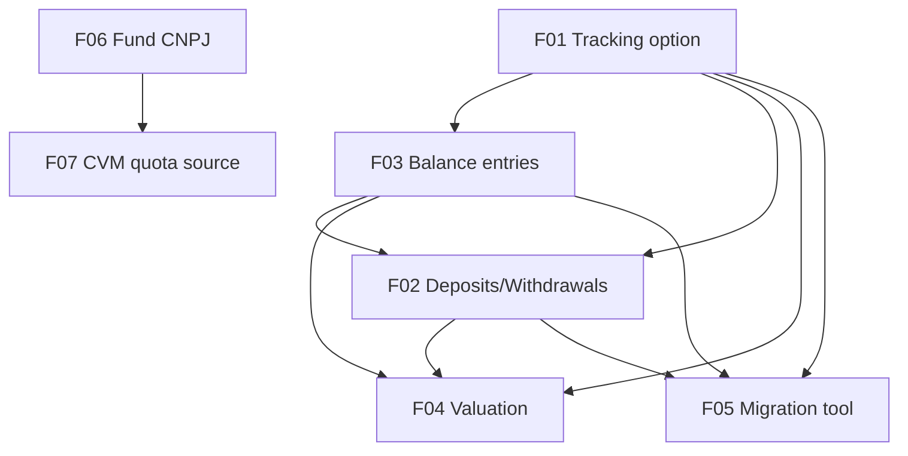

# Investments Without a Quantity

## 1. Executive Summary

Investments Without a Quantity gives holdings that have no usable unit count the same oversight in the app as shares, ETFs and bonds: what was invested, what the holding is worth today, the unrealised and realised gain, the result % and the XIRR, all counted in portfolio, broker, dashboard, ARCA and month-start totals. It covers three XPI holdings today: **Inco** (real-estate credit projects), **Grão ARCA** (a VGBL pension plan inside the multi-market ARCA bucket) and **Guepardo Institucional FIC FIA** (a Brazilian equity fund), plus any similar holding added later.

The three holdings need two different answers. Guepardo does have a real quantity: the XP statement shows the number of quotas and the quota value, and the CVM (Brazil's securities regulator) publishes every fund's daily quota value on its open-data portal. Guepardo therefore becomes a normal quantity holding, with its purchases corrected to the real quotas, a new **CNPJ** identifier on the asset and a new **CVM daily quota** price source that prices it automatically. Inco and Grão only ever show a balance. They are tracked with a new **Tracked by: Balance** option, where money moves in as **Deposits** and out as **Withdrawals** (amounts only, no quantity), and the investor records the statement balance once a month as a dated **Balance entry**.

Gains on balance-tracked holdings use **proportional cost**: a withdrawal removes the same fraction of the invested amount as it removes of the balance, and the difference is realised gain. This matches how share holdings already separate the cost of what is still held from gains already realised, and it matches how Brazilian income tax treats a partial redemption. Values are shown gross, as XP shows them. The only tax recorded is the income tax (IR) actually withheld on a withdrawal. A one-off migration tool moves the existing Inco and Grão records off today's workaround, where each deposit is a "Buy of 1 unit" and every price is the balance divided by the number of deposits.

## 2. Problem and Opportunity

### The Problem

**Invented quantities make every value update a manual calculation**
- Inco and Grão are recorded as one "Buy" of quantity 1 per deposit, so each price snapshot has to be entered as the statement balance divided by the number of deposits held on that date.
- Guepardo is recorded with fractional quantities derived by hand, so its snapshots are a pseudo unit price that matches nothing on the statement.
- Each update takes a calculator step per holding per month, and a slip in the divisor silently misstates the holding's value, the portfolio total and the dashboard.

**History breaks every time money is added**
- Adding a deposit changes the divisor, so every earlier per-unit snapshot is re-read against the new unit count and older values stop meaning what was recorded.
- The month-start values and month-on-month change added by P68 read those snapshots, so the change column for these holdings jumps whenever a deposit lands.
- Price-history charts for these holdings show steps caused by deposits, not by performance.

**Inco's invested amount and gain are wrong**
- Inco projects pay money back as one lump sum to the XP account, and the investor reinvests it in new projects.
- The reinvestments are recorded as new purchases, but the payouts are recorded nowhere, so the same money is counted as invested twice.
- The holding's invested amount is inflated and its gain and result % are understated by the total of all payouts.

**A balance-only holding cannot be entered correctly at all**
- The transaction form requires a quantity and a unit price, but neither exists for a VGBL plan or a real-estate credit pool.
- The domain already reads a snapshot as the whole position's worth for the `ProviderValue` and `Manual` valuation methods, but nothing in the web app can set that method, and the transaction model still needs a quantity.
- There is no way to record a partial redemption of a balance and get a meaningful realised gain.

**Guepardo needs a typed price even though an official one is published**
- Fund quota values are published daily by the CVM, but no price source reads them, and the fund has no ticker the existing Google/Yahoo/Status Invest chain can price.
- The asset has no field to hold the fund's CNPJ, the identifier CVM uses.

### The Opportunity

- **Manual calculation → direct entry.** Balance-tracked holdings take the statement balance exactly as printed (F03), and Guepardo is priced automatically from the CVM quota value (F07). No arithmetic remains.
- **Broken history → stable history.** A balance entry is a total, not a per-unit price, so adding a deposit never changes an earlier entry's meaning (F02, F03). Between entries, the current value is the last balance plus the money moved since, so a new deposit is not misread as a loss (F04).
- **Double-counted Inco money → correct invested amount.** Payouts are recorded as lump-sum Withdrawals with proportional cost, so invested, realised and unrealised gain are true figures (F02), and past payouts can be entered after migration (F05).
- **No way to enter → first-class option.** "Tracked by: Balance" is a choice in the asset form for any holding (F01), with amount-only Deposits and Withdrawals (F02).
- **Typed fund price → official quota.** A CNPJ field (F06) and a CVM daily quota price source (F07) turn Guepardo into an ordinary quantity holding.
- **Same oversight as shares.** Balance-tracked holdings report the same figures and feed the same totals as share holdings (F04).

## 3. Target Audience

### Primary Users

**Self-directed investor (single user)**
- Holds shares, ETFs, bonds and funds across Brazilian (XPI) and UK brokers, and wants one consolidated view in BRL and GBP.
- Holds pension, fund and private-credit products whose statements show a balance rather than units, and updates them monthly from the XP statement or portal.
- Expects every holding to show invested amount, current value, gain and return on the same screens, so the portfolio totals and ARCA allocation can be trusted without a side spreadsheet.

## 4. Objectives

### Product Objectives

1. **Remove manual value arithmetic** for holdings without a usable quantity: the investor types the number printed on the statement, or nothing at all for CVM-priced funds.
2. **Report correct invested amount and gain** for balance-tracked holdings, including partial and full withdrawals.
3. **Show balance-tracked holdings with the same figures as share holdings** across the asset summary, portfolio and broker holdings, the dashboard, ARCA and month-start values.
4. **Price Brazilian funds automatically** from the official CVM daily quota value.
5. **Migrate the existing records** of Inco and Grão without losing any deposit or recorded value.

### Success Metrics

1. **Arithmetic removed:** 0 calculator steps per monthly update for Inco, Grão and Guepardo, measured as the number of values the investor must derive rather than copy (today 3 per update round).
2. **Gain correctness:** for every balance-tracked holding, invested − realised gain (gross) = total deposits + fees − total withdrawals, to within R$0.01,, checked by automated tests over deposit/withdrawal sequences of at least 20 flows, including partial and full withdrawals and backdated entries.
3. **Same figures:** 100% of the summary fields shown for a quantity holding (invested, current value, unrealised gain, realised gain, result %, XIRR, as-of date and status) have a value or an explicit "not available" reason for a balance-tracked holding, verified on the asset Summary tab and the portfolio and broker Holdings tabs.
4. **Automatic fund pricing:** Guepardo's price is refreshed without manual entry on at least 95% of weekdays over a 30-day period, measured by saved snapshots with source CVM dated no more than 2 business days before the day they were fetched.
5. **Lossless migration:** after the migration tool runs on a temp copy, 100% of the original deposits of Inco and Grão exist as Deposits with the same date and amount, and every converted balance entry equals the original per-unit snapshot × units held on its date to within R$0.01, as reported by the tool's own verification output.

## 5. User Stories

### F01. Balance-Tracked Holding Option
- As an investor, I want to choose "Tracked by: Balance" when creating a holding so that I can add a pension plan or fund that has no unit count.
- As an investor, I want the asset form to show how an existing holding is tracked so that I know which kind of transactions it takes.
- As an investor, I want the app to stop me from changing how a holding is tracked once it has transactions so that its history is never reinterpreted.

### F02. Deposits and Withdrawals
- As an investor, I want to record a deposit with a date and an amount only so that I can enter a VGBL contribution exactly as the statement shows it.
- As an investor, I want to record a lump-sum withdrawal, with optional IR withheld, so that Inco payouts and pension redemptions reduce the holding correctly.
- As an investor, I want the withdrawal form to pre-fill the balance just before the withdrawal from my latest balance entry so that I only correct it when the statement differs.
- As an investor, I want each withdrawal to show the realised gain it produced, gross and net of IR withheld, so that I know what I actually earned.
- As an investor, I want to edit or delete a deposit or withdrawal, including backdated ones, so that I can fix mistakes and enter past Inco payouts after migration.
- As an investor, I want a withdrawal of the whole balance to close the position so that a fully redeemed holding looks like a fully sold share holding.

### F03. Balance Entries
- As an investor, I want to record a dated balance taken from the statement so that the holding's current value is up to date.
- As an investor, I want to see a balance history with the change since the previous entry so that I can follow the holding's evolution month by month.
- As an investor, I want to edit or delete a balance entry so that I can correct a typo.
- As an investor, I want a warning when no balance has been entered for more than 35 days so that I know the value shown is out of date.

### F04. Balance Holding Valuation and Performance
- As an investor, I want a balance-tracked holding's Summary tab to show invested, current value, unrealised gain, realised gain, result % and XIRR so that I get the same oversight as for shares.
- As an investor, I want a deposit made after the latest balance entry to be added to the current value so that a new contribution is not shown as a loss.
- As an investor, I want balance-tracked holdings to count in portfolio, broker and dashboard totals, in ARCA and in month-start values so that my overall picture is complete.
- As an investor, I want quantity and average price to be shown as not applicable for a balance-tracked holding so that I'm never shown a meaningless number.

### F05. Balance Holding Migration Tool
- As an investor, I want a one-off tool to convert Inco and Grão from "Buy of 1 unit" records to Deposits and balance entries so that I don't re-enter dozens of records by hand.
- As an investor, I want the tool to run against a copy of my data file first and report what it changed so that my live data is never put at risk.
- As an investor, I want the tool to refuse a holding that has sales, credits or corporate actions so that nothing it cannot convert exactly is silently lost.

### F06. Fund CNPJ Identifier
- As an investor, I want to enter a Brazilian fund's CNPJ on the asset form, with or without punctuation, so that the app can find its official quota value.
- As an investor, I want an invalid CNPJ to be rejected with a clear message so that a typo never causes silent pricing failures.

### F07. CVM Daily Quota Price Source
- As the system, I want to fetch a fund's latest quota value from the CVM daily fund report by CNPJ so that Guepardo is priced without manual entry.
- As an investor, I want the quota value's date and the source "CVM" to be shown next to the price so that I know how current it is.
- As an investor, I want a manual quota value for today to still take priority over the CVM value so that I can override it when needed.
- As an investor, I want the last saved quota value to be used when the CVM fetch fails so that the holding is still valued.

## 6. Functionalities

### F01. Balance-Tracked Holding Option

**Provides:**
- Holding tracking mode, either "Quantity and price" or "Balance" (used by F02, F03, F04, F05)

**Capabilities:**
- Every holding has a tracking mode: **Quantity and price** (default, today's behaviour) or **Balance**.
- Balance maps to the existing `ProviderValue` valuation method, under which a snapshot is the whole position's worth. Holdings already set to `ProviderValue` or `Manual` are shown as Balance. All other valuation methods are shown as Quantity and price.
- The tracking mode can be set when the holding is created and changed only while the holding has 0 transactions, 0 credits and 0 corporate actions. Price snapshots alone do not block the change, but changing mode with snapshots present asks for confirmation because their meaning changes (per-unit vs total).
- A balance-tracked holding accepts only Deposit and Withdrawal transactions (F02). It never accepts Buy, Sell, credits (dividends, interest), splits or other corporate actions. Payouts are Withdrawals.
- Available for any country, class and broker. The asset-class, segment and pick-source rules from P68 are unchanged.

**Experience:**
- The asset form (create and edit) gets a "Tracked by" radio group with two options: "Quantity and price" and "Balance". Helper text under Balance: "For holdings whose statement shows only a balance, such as pension plans. You record deposits, withdrawals and the balance."
- When the holding has transactions, credits or corporate actions, the group is disabled and the helper text reads: "Can't change how this holding is tracked because it has transactions. Remove them first."
- Changing the mode on a holding with price snapshots shows a confirmation dialog: "This holding has N saved prices. After the change they will be read as [total balances / per-unit prices]. Continue?" with "Change" and "Cancel".
- The asset's header shows a "Balance" tag next to the asset class for balance-tracked holdings.
- The save, saving and error states of the existing asset form are reused unchanged.

**Error Handling:**
- A mode change is sent for a holding that gained a transaction after the form was opened → the save is rejected with "This holding now has transactions, so how it is tracked can't be changed." The form stays open with the previous mode reselected.
- Save fails because of a storage error → the existing "Couldn't save the asset" error is shown, the form keeps the user's input, and nothing is changed.

### F02. Deposits and Withdrawals

**Consumes:**
- F01: holding tracking mode (Balance)
- F03: latest balance entry on or before a given date (value, date), used to pre-fill "Balance before withdrawal"

**Provides:**
- Dated deposits (date, amount, fees) and withdrawals (date, amount, IR withheld, balance before withdrawal) (used by F04, F05)
- Remaining invested amount (cost of what is still held) and realised gain per withdrawal, gross and net of IR withheld (used by F04)

**Capabilities:**
- **Deposit**: date (required, not in the future), amount (required, > 0, up to 2 decimals, at most 1,000,000,000), fees (optional, ≥ 0, default 0). The currency is the holding's currency. Fees add to the invested amount.
- **Withdrawal**: date (required, not in the future), amount (required, > 0, up to 2 decimals; the gross amount redeemed), IR withheld (optional, ≥ 0 and < amount, default 0), balance before withdrawal (required, ≥ amount). When the statement shows only the net amount received, the investor enters it as the amount with IR withheld 0.
- **Proportional cost rule** (in date order; on the same date, deposits before withdrawals, then by entry order):
  - fraction = amount ÷ balance before withdrawal
  - cost removed = invested before the withdrawal × fraction, rounded to 2 decimals
  - realised gain (gross) = amount − cost removed
  - realised gain (net) = realised gain (gross) − IR withheld
  - invested after the withdrawal = invested before − cost removed
- A withdrawal whose amount equals the balance before is a **full withdrawal**: fraction is exactly 1, invested becomes 0 and the position is Flat (closed), shown with the same closed-position treatment as a fully sold share holding. A later Deposit reopens it.
- Saving a withdrawal also saves a balance entry (F03) dated on the withdrawal date with value = balance before − amount, replacing any existing entry on that date only after confirmation.
- Adding, editing or deleting any Deposit or Withdrawal recalculates every later withdrawal's cost removed and realised gain in date order, the same way the share realised-gain regeneration works today.
- Withdrawals produce realised-gain records, so balance-tracked holdings appear in the existing realised-gain views and totals alongside share sales. Tax classification (P51) records them as unclassified; no tax rule is applied.

**Experience:**
- On a balance-tracked holding, the Transactions tab's "Add transaction" opens a form with a "Type" choice of **Deposit** or **Withdrawal** only. Quantity and unit price fields are not shown.
- Deposit form: Date, Amount, Fees. Withdrawal form: Date, Amount, IR withheld, Balance before withdrawal.
- "Balance before withdrawal" is pre-filled with the value calculated as at the chosen date (latest balance entry on or before that date, plus deposits and minus withdrawals dated after that entry and before this withdrawal) and re-calculated when the date changes, until the user types in the field. Helper text: "From your balance on DD/MM/YYYY. Change it if the statement shows a different balance just before this withdrawal."
- When no balance entry exists on or before the date, the field is empty and required, with the helper text "No balance recorded before this date. Enter the balance just before the withdrawal."
- Before saving, the withdrawal form shows a live preview: "Cost removed R$X · Realised gain R$Y (net R$Z)".
- The Transactions grid for a balance-tracked holding shows the columns Date, Type, Amount, Fees / IR withheld, Balance before, Realised gain. Amounts are right-aligned. Withdrawals show realised gain with a sign and a "+"/"−" prefix, not colour alone.
- Validation messages appear inline under each field on blur and on submit, and focus moves to the first invalid field: "Enter an amount greater than 0.", "Date can't be in the future.", "IR withheld must be less than the amount.", "Balance before withdrawal must be at least the amount withdrawn."
- Save shows the existing saving state on the button. On success the dialog closes, the grid and summary refresh, and a success toast reads "Deposit saved" or "Withdrawal saved". Closing a dirty form asks "Discard changes?".
- Delete asks "Delete this withdrawal? Realised gains of later withdrawals will be recalculated." with "Delete" and "Cancel".

**Error Handling:**
- An edit or delete makes a later withdrawal impossible (for example, deleting a deposit leaves a later withdrawal's invested-before at 0 with a positive amount, or a backdated withdrawal leaves a later withdrawal larger than its balance before) → the change is rejected with "This change would make the withdrawal on DD/MM/YYYY larger than the balance at that time. Adjust that withdrawal first." Nothing is saved.
- A Buy, Sell or credit is sent to a balance-tracked holding (for example by a stale browser tab or the API) → rejected with "This holding is tracked by balance. Record a deposit or withdrawal instead." and nothing is saved.
- Storage fails while saving → "Couldn't save the transaction. Your entry is still in the form." The dialog stays open with the input intact and the in-memory holding is left unchanged.
- The automatic balance entry on the withdrawal date conflicts with an existing entry and the user cancels the replacement → the withdrawal is not saved and the form stays open.

### F03. Balance Entries

**Consumes:**
- F01: holding tracking mode (Balance)

**Provides:**
- Dated balance entries (date, value, source, retrieved-at), the latest entry and the entry nearest a given date (used by F02, F04, F05)
- Balance status (Current or Stale, with as-of date) (used by F04)

**Capabilities:**
- A balance entry is a date (required, not in the future) and a value (required, ≥ 0, up to 2 decimals) in the holding's currency, with an optional note of up to 100 characters (stored as the source reference, for example "XP statement Oct 2026").
- At most one entry per holding per date. Saving on a date that already has an entry replaces it after confirmation.
- Entries are stored as the holding's existing price snapshots with source "Provider valuation", so the existing price-history storage, editing and deletion are reused.
- A balance entry is read as the holding's value at the end of its date, including that day's deposits and withdrawals.
- **Staleness:** a balance-tracked holding is **Stale** when its latest balance entry is more than 35 days before the valuation date, otherwise **Current**. This replaces the weekday rule used for market prices, for balance-tracked holdings only.
- No automatic fetching ever runs for a balance-tracked holding (unchanged from today's `ProviderValue` behaviour).

**Experience:**
- For a balance-tracked holding, the "Price history" tab is titled **Balance history**. "Add price" becomes **Add balance**, with the fields Date (default today), Balance and Note.
- The history grid shows Date, Balance, Change since previous entry (amount and %), Net deposits/withdrawals since previous entry, and Note, newest first. Numbers are right-aligned. Change is shown with a sign, not colour alone.
- Empty state: "No balance recorded yet. Add the balance from your latest statement to see this holding's value." with an "Add balance" button.
- When the holding is Stale, the Summary tab's status line and the holdings grids show the existing stale badge with the text "Balance as of DD/MM/YYYY (N days ago)".
- Validation, saving and success behaviour reuse the existing price form: inline messages "Enter a balance of 0 or more." and "Date can't be in the future.", toast "Balance saved", and "Discard changes?" when closing a dirty form.
- Delete asks "Delete the balance of DD/MM/YYYY?".

**Error Handling:**
- Storage fails while saving or deleting → "Couldn't save the balance. Try again." The form keeps the input and the in-memory history is unchanged.
- The user replaces the entry the automatic withdrawal balance created (F02) → confirmation "This balance was saved with the withdrawal on the same date. Replace it?". Cancelling keeps the original.
- Deleting the only entry of a holding with deposits → allowed, with the warning "This holding will have no current value until you add a balance."

### F04. Balance Holding Valuation and Performance

**Consumes:**
- F01: holding tracking mode (Balance)
- F02: deposits (date, amount, fees), withdrawals (date, amount, IR withheld), remaining invested amount, realised gain gross and net
- F03: latest balance entry, entry nearest a given date, balance status

**Capabilities:**
- **Current value** = latest balance entry on or before the valuation date + deposits − withdrawals dated after that entry and on or before the valuation date. With no balance entry, current value is unavailable and status is "No balance recorded"; the holding is left out of value totals, the same treatment as a share holding with no price.
- **Invested** = remaining invested amount after all withdrawals (F02).
- **Unrealised gain** = current value − invested.
- **Realised gain** = sum of the withdrawals' realised gains (gross), with the net figure alongside.
- **Result %** = unrealised gain ÷ invested; unavailable when invested is 0.
- **XIRR** uses the existing XIRR calculator with cash flows: each deposit (amount + fees) negative on its date, each withdrawal (amount − IR withheld) positive on its date, and the current value positive on the valuation date (omitted when the position is closed). "XIRR with credits" equals "XIRR" because balance-tracked holdings have no credits.
- **Totals**: "Total bought" = sum of deposits including fees, "Total sold" = sum of withdrawal amounts, "Total credits" = 0.
- **Not applicable fields**: quantity, average price, average sell price and current price are shown as "Not applicable" and are never 0 or blank.
- **Month-start values (P68)**: the value on the 1st of a month uses the balance entry nearest the 1st (the P68 nearest-price rule) adjusted by deposits and withdrawals between that entry's date and the 1st, so a deposit made on the 2nd never appears in the 1st's value.
- **Aggregation**: current value, invested, unrealised and realised gain of balance-tracked holdings are added into portfolio, broker and dashboard totals, the broker Holdings tab (P68) and ARCA bucket values (Grão ARCA stays in its ARCA bucket), converted to the reporting currency with the existing FX rules.
- Market status for portfolio and broker grids uses F03's balance status for balance-tracked holdings.

**Experience:**
- The asset Summary tab for a balance-tracked holding replaces "Quantity" and "Average price" with "Tracked by: Balance", and shows the groups Totals (Total deposited, Total withdrawn), Realised (Realised gain, Realised net of IR, XIRR) and Current (Current value, Balance as of, Invested, Unrealised gain, Result %, XIRR).
- When deposits or withdrawals were dated after the latest balance entry, the "Current value" field shows a note: "Balance of DD/MM/YYYY plus R$X net deposits since."
- Portfolio and broker Holdings grids show the balance-tracked holding in the same row layout as other holdings. Quantity and price cells show "—" with the accessible label "Not applicable, tracked by balance".
- Loading, empty ("No balance recorded"), stale and error states reuse the existing Summary and Holdings components.

### F05. Balance Holding Migration Tool

**Consumes:**
- F01: holding tracking mode (Balance)
- F02: deposits (date, amount, fees)
- F03: balance entries (date, value)

**Capabilities:**
- A command in the existing `Tools/` family (a new `InvestmentBalanceHoldingMigration` tool) takes the data file path and one or more holding identifiers (broker / portfolio / asset name). It refuses to run when the path is the configured live `data/data-investment.json` unless `--confirm-live` is passed, and it is documented to be verified on a temp copy first.
- For each named holding it requires: every transaction is a Buy, there are 0 credits, 0 corporate actions and 0 realised-gain records. Otherwise it stops for that holding and reports why.
- **Conversion**:
  - Each Buy becomes a Deposit with the same date and id, amount = quantity × unit price rounded to 2 decimals, and fees = the Buy's fees rounded to 2 decimals (values below 0.01 become 0).
  - Each price snapshot becomes a balance entry with value = snapshot price × total quantity bought on or before the snapshot date, rounded to 2 decimals, keeping its date and retrieved-at. The source becomes "Provider valuation" and the original per-unit value is kept in the source reference ("migrated: unit value N × Q units").
  - The holding's tracking mode becomes Balance.
- **Verification output** per holding: count of Buys vs Deposits, sum of Buy amounts vs sum of Deposit amounts, each snapshot's original and converted value, and the holding's invested amount and current value before and after. A holding whose before/after invested amount differs by more than R$0.01 fails the run, and nothing is written.
- `--dry-run` prints the verification output without writing. A real run writes atomically: either every named holding is converted or the file is left untouched.
- Guepardo is not converted. Its 3 Buys are corrected to the real quota count and quota value through the existing transaction edit screen (see F07), and past Inco payouts are entered through F02 after migration.
- The app must be restarted after the tool writes, because the data file is loaded once at startup. The tool prints this reminder.

**Experience:**
- Console output: one block per holding with the verification table, then "Converted N holdings" or "No changes written: <reason>", and the restart reminder.
- Exit code 0 on success or a clean dry run, 1 when any holding fails validation or verification.

**Error Handling:**
- A holding is not found → "Holding '<broker>/<portfolio>/<asset>' not found." Exit 1, nothing written.
- A holding has a non-Buy transaction, a credit, a corporate action or a realised gain → "Can't migrate '<asset>': it has <N sells / credits / corporate actions>." Exit 1, nothing written.
- A holding is already tracked by Balance → reported as "already migrated", skipped, and not treated as a failure.
- The file can't be written (locked, permissions) → "Couldn't write <path>: <reason>." The original file is left unchanged because the write goes through a temp file and a rename.

### F06. Fund CNPJ Identifier

**Provides:**
- Fund CNPJ, 14 digits (used by F07)

**Capabilities:**
- New optional asset identity field **CNPJ**, shown in the asset form for holdings with country BR and class Fund or Pension.
- Accepted input: 14 digits with or without the mask `00.000.000/0000-00`. Stored as 14 digits only. Validated with the standard CNPJ check-digit rule. All-same-digit values (for example 00000000000000) are rejected.
- Shown masked (`00.000.000/0000-00`) in the asset form and on the Summary tab identity group.
- Not required to be unique, because one fund can be held in more than one portfolio. Editing it never touches transactions.
- Included in the asset admin create/update DTOs and the OpenAPI snapshot.

**Experience:**
- The asset form shows a "CNPJ" text field under ISIN with the helper text "Used to fetch the fund's daily quota value from CVM."
- An invalid value shows the inline error "Enter a valid 14-digit CNPJ." on blur and on submit, and focus moves to it on submit.
- Clearing the field removes the CNPJ; the CVM price source then no longer applies to that holding.

### F07. CVM Daily Quota Price Source

**Consumes:**
- F06: fund CNPJ (14 digits)

**Capabilities:**
- New price source **CVM**, used for holdings tracked by Quantity and price with country BR, class Fund and a CNPJ. It comes first in the fetch routing for those holdings, and the existing Google/Yahoo/Status Invest chain is not tried for them.
- Data comes from the CVM open-data daily fund report (Informe Diário de Fundos de Investimento): one compressed CSV per month listing every fund's daily quota value by CNPJ and competence date. The quota value used is the row for the holding's CNPJ with the latest competence date on or before the valuation date.
- The current month's file is downloaded at most once every 12 hours per process and kept in memory as a CNPJ → (date, quota value) map, holding only the funds the app needs. When the current month's file has no row for the CNPJ (the first business days of a month), the previous month's file is used.
- Each successful fetch is saved as a price snapshot with source "CVM", the quota's competence date as the snapshot date (not the fetch date), and the source reference "CNPJ <masked> · competence DD/MM/YYYY". It only replaces an existing automatic snapshot for that date.
- Existing price rules are unchanged: a manual price for today wins and stops the fetch, and a failed fetch falls back to the most recent saved price with the existing fallback status.
- Market status uses the existing weekday rule against the quota's competence date. A quota value dated more than 1 weekday back is Stale, which is expected on Mondays and the day after holidays.
- Download timeout is 30 seconds; the file can be tens of MB, so it is streamed and parsed without loading the whole uncompressed CSV into memory.
- The CVM client lives in its own `Integrations/` project behind a first-party interface, following the integration isolation rule.
- **Guepardo correction** (manual, using existing screens): the investor adds the CNPJ (F06) and edits the 3 existing Buys to the real quota count and quota value from the XP statement, keeping each Buy's date and total amount. Because Guepardo has no sales, no realised-gain regeneration is triggered. Its existing pseudo-unit snapshots are deleted from Price history, since they no longer match real quotas.

**Experience:**
- The price badge and Price history grid show "CVM" as the source, with the quota's competence date as "As of".
- When CVM can't be reached, the existing fallback badge is shown ("Last saved price, DD/MM/YYYY") and the Summary tab status reads "Couldn't fetch the CVM quota value. Showing the last saved value."
- When the CNPJ is not found in the last two monthly files, the status reads "CVM has no quota value for CNPJ <masked>. Check the CNPJ on the asset." and the holding falls back to its last saved price.

**Error Handling:**
- CVM download times out or returns a non-success status → no snapshot is saved, the last saved price is used, and the failure is logged with the month file name. The next attempt happens on the next price request after 15 minutes, not on every request.
- The CSV columns don't match the expected layout (CVM changed the format) → the fetch fails with "CVM daily report format not recognised." logged as an error, falling back to the last saved price. No partial or mis-parsed value is ever saved.
- Quota value is ≤ 0 or not a number for the CNPJ → that row is ignored and the previous valid competence date is used.
- Saving the snapshot fails → the fetched price is still shown for the current request, with the existing "price not saved" warning, as today for other automatic sources.

## 7. Out of Scope

**Tax**
- Estimating income tax on open positions (VGBL regressive/progressive tables, FIA 15%, private-credit IR) or showing a net-of-tax current value.
- Applying P51 tax rules to balance-tracked withdrawals: they are recorded as unclassified.
- IOF and VGBL loading fees (taxa de carregamento) as separate concepts; they can only be entered as deposit fees.

**Inco payouts**
- Splitting a payout into interest (income) and principal (capital returned). Every payout is a lump-sum Withdrawal.
- Tracking individual Inco projects separately inside the holding.

**Tracking-mode changes**
- Switching an existing holding between Quantity and price and Balance in the app while it has transactions. Only the F05 tool converts existing holdings.
- Converting a balance-tracked holding back to quantities.

**Automation**
- Importing balances, deposits or withdrawals automatically from XP statements, the XP portal or e-mail.
- Fetching values for VGBL plans or Inco from any external source.
- Back-filling historical CVM quota values for past dates or past month-starts: only the latest quota value is fetched, and the month-start values use saved snapshots as P68 defines.

**Other**
- Time-weighted return for any holding.
- Balance-tracked holdings in currencies other than the holding's own currency.
- Changes to CashFlow; no money is moved between the investment and CashFlow contexts when a withdrawal is recorded.

## 8. Dependency Graph

### Part 1: Dependency Table

| # | Feature | Priority | Dependencies |
|---|---------|----------|--------------|
| F01 | Balance-Tracked Holding Option | 1 | None |
| F03 | Balance Entries | 1 | F01 |
| F02 | Deposits and Withdrawals | 1 | F01, F03 |
| F04 | Balance Holding Valuation and Performance | 1 | F01, F02, F03 |
| F05 | Balance Holding Migration Tool | 1 | F01, F02, F03 |
| F06 | Fund CNPJ Identifier | 2 | None |
| F07 | CVM Daily Quota Price Source | 2 | F06 |

### Part 3: Execution Waves

Features within the same wave can be built in parallel. A wave starts only after every feature in earlier waves is complete.

- **Wave 1**: F01, F06
- **Wave 2**: F03, F07
- **Wave 3**: F02
- **Wave 4**: F04, F05

### Part 4: Priority Levels

- **1** = Essential — product does not work without it
- **2** = Important — significant value addition
- **3** = Desirable — incremental improvement

### Part 5: Mermaid Diagram

## 9. Acceptance Criteria

### F01. Balance-Tracked Holding Option
- [ ] A new holding can be created with "Tracked by: Balance", and it is stored with the `ProviderValue` valuation method.
- [ ] A new holding created without a choice is "Quantity and price", and existing holdings keep their current behaviour.
- [ ] Holdings already set to `ProviderValue` or `Manual` show "Balance" in the asset form.
- [ ] The "Tracked by" group is disabled, with the explanatory helper text, on a holding with at least 1 transaction, credit or corporate action.
- [ ] Changing the mode on a holding with saved prices and no transactions shows the confirmation dialog with the price count, and Cancel leaves the mode unchanged.
- [ ] A mode change sent through the API for a holding with transactions is rejected with the "can't be changed" message, and nothing is saved.
- [ ] The asset header shows a "Balance" tag for balance-tracked holdings only.
- [ ] The "Tracked by" group is keyboard operable, has a visible focus indicator and an accessible group name.

### F02. Deposits and Withdrawals
- [ ] On a balance-tracked holding, the transaction form offers only Deposit and Withdrawal, with no quantity or unit price field.
- [ ] A Deposit of R$1,000 with R$5 fees raises the invested amount by R$1,005.
- [ ] With invested R$10,000 and balance before R$12,000, a R$3,000 withdrawal records cost removed R$2,500, realised gain R$500 gross, and invested afterwards R$7,500.
- [ ] The same withdrawal with R$75 IR withheld shows realised gain R$500 gross and R$425 net.
- [ ] A withdrawal equal to the balance before sets invested to 0 and the position to closed, and a later Deposit reopens it.
- [ ] Saving a withdrawal saves a balance entry on its date equal to balance before − amount.
- [ ] "Balance before withdrawal" is pre-filled from the latest balance entry on or before the date plus later net flows, and the helper text names that entry's date.
- [ ] With no balance entry on or before the date, the field is empty and required.
- [ ] The live preview shows cost removed, realised gain and net gain before saving.
- [ ] A backdated withdrawal recalculates the realised gains of all later withdrawals, in date order.
- [ ] Same-date deposits are applied before same-date withdrawals.
- [ ] A change that makes a later withdrawal exceed its balance before is rejected with the message naming that withdrawal's date, and nothing is saved.
- [ ] A Buy, Sell or credit sent to a balance-tracked holding is rejected with "This holding is tracked by balance…", and nothing is saved.
- [ ] Amount ≤ 0, a future date, IR withheld ≥ amount, and balance before < amount each show their inline message, and focus moves to the first invalid field on submit.
- [ ] A storage failure keeps the dialog open with the input intact and leaves the holding unchanged.
- [ ] Closing a dirty form asks "Discard changes?".
- [ ] Withdrawals appear in the existing realised-gain views as unclassified.

### F03. Balance Entries
- [ ] On a balance-tracked holding, the Price history tab is titled "Balance history" and its action is "Add balance".
- [ ] A balance entry with date, value and note is saved as a snapshot with source "Provider valuation" and the note as source reference.
- [ ] Saving on a date that already has an entry asks for confirmation before replacing it.
- [ ] The grid shows the change since the previous entry and the net deposits/withdrawals since the previous entry, newest first, with right-aligned numbers.
- [ ] The empty state message and "Add balance" button appear when no entries exist.
- [ ] With a latest entry 35 days before the valuation date the holding is Current, and with one 36 days before it is Stale, with the badge text "Balance as of DD/MM/YYYY (36 days ago)".
- [ ] No automatic price fetch is made for a balance-tracked holding.
- [ ] A negative value and a future date are rejected with their inline messages.
- [ ] A storage failure keeps the form input and leaves the history unchanged.

### F04. Balance Holding Valuation and Performance
- [ ] With a balance entry of R$12,000 on 01/11 and a R$1,000 deposit on 05/11, the current value on 10/11 is R$13,000, and the note "plus R$1,000 net deposits since" is shown.
- [ ] Unrealised gain = current value − invested, and Result % = unrealised gain ÷ invested; Result % is "not available" when invested is 0.
- [ ] XIRR is calculated from deposits (negative), withdrawals net of IR (positive) and the current value (positive) on the valuation date, and "XIRR with credits" equals it.
- [ ] Quantity, average price and current price show "Not applicable" on the Summary tab, and "—" with the accessible label in the Holdings grids, never 0.
- [ ] A holding with deposits and no balance entry shows status "No balance recorded" and is excluded from value totals, the same way as an unpriced share holding.
- [ ] The month-start value on the 1st uses the balance entry nearest the 1st, adjusted by flows between that entry and the 1st; a deposit dated the 2nd is not included.
- [ ] Portfolio, broker, dashboard and broker Holdings totals include balance-tracked holdings' current value, invested and gains, converted to the reporting currency.
- [ ] Grão ARCA's value counts in its ARCA bucket from its balance-tracked current value.
- [ ] Portfolio and broker grids show the balance status (Current/Stale) for balance-tracked holdings.

### F05. Balance Holding Migration Tool
- [ ] On a temp copy, converting Inco and Grão produces one Deposit per original Buy with the same id, date and amount (quantity × unit price, 2 decimals).
- [ ] Each converted balance entry equals the original per-unit price × units bought on or before its date, to within R$0.01, and keeps its date and retrieved-at.
- [ ] The original per-unit value is kept in each converted entry's source reference.
- [ ] Each holding's invested amount before and after conversion matches to within R$0.01, and the verification output shows it.
- [ ] `--dry-run` prints the verification output and leaves the file byte-for-byte unchanged.
- [ ] A holding with a Sell, credit, corporate action or realised gain stops the run with exit code 1 and the reason, and nothing is written.
- [ ] A holding already tracked by Balance is reported as "already migrated" and skipped.
- [ ] Running against the configured live data file without `--confirm-live` is refused.
- [ ] A write failure leaves the original file unchanged.
- [ ] The tool prints the restart reminder after a successful write.

### F06. Fund CNPJ Identifier
- [ ] The CNPJ field appears in the asset form for country BR with class Fund or Pension, and nowhere else.
- [ ] A valid CNPJ entered with or without the mask is stored as 14 digits and shown masked.
- [ ] A CNPJ with wrong check digits, the wrong length or all identical digits shows "Enter a valid 14-digit CNPJ." and is not saved.
- [ ] Clearing the field removes the CNPJ.
- [ ] The CNPJ is in the asset admin DTOs and the OpenAPI snapshot, and the generated web types are regenerated.

### F07. CVM Daily Quota Price Source
- [ ] A BR Fund holding with a CNPJ, tracked by quantity, is priced from the CVM daily report's latest quota value on or before the valuation date.
- [ ] The saved snapshot has source "CVM", the competence date as its date, and the source reference with the masked CNPJ and competence date.
- [ ] In the first business days of a month, when the current month's file has no row for the CNPJ, the previous month's latest value is used.
- [ ] The monthly file is downloaded at most once every 12 hours per process.
- [ ] A manual price for today takes priority, and no CVM fetch is made.
- [ ] A timeout or non-success response falls back to the last saved price, shows the "Couldn't fetch the CVM quota value" status, and retries no sooner than 15 minutes later.
- [ ] An unrecognised CSV layout saves no snapshot and logs "CVM daily report format not recognised."
- [ ] A CNPJ absent from the last two monthly files shows the "CVM has no quota value for CNPJ…" status.
- [ ] Holdings without a CNPJ, or tracked by Balance, never call CVM.
- [ ] The CVM client sits in its own `Integrations/` project behind a first-party interface, and the architecture tests pass.

### Cross-Feature Integration
- [ ] A holding set to "Tracked by: Balance" (F01) accepts Deposits and Withdrawals (F02) and rejects Buys, and a holding set to "Quantity and price" shows the Buy/Sell form.
- [ ] A holding set to Balance (F01) shows the Balance history tab and the 35-day staleness rule (F03).
- [ ] The withdrawal form's "Balance before withdrawal" (F02) is pre-filled from the latest balance entry on or before its date (F03), and saving the withdrawal adds the post-withdrawal balance entry (F03).
- [ ] Deposits, fees, withdrawals, IR withheld, remaining invested and realised gain recorded in F02 appear unchanged on the Summary tab and in the totals (F04).
- [ ] The latest balance entry, the entry nearest the 1st and the balance status from F03 drive the current value, the month-start value and the market status shown in F04.
- [ ] A holding marked Balance (F01) is valued by F04's rules in the portfolio, broker, dashboard and ARCA totals.
- [ ] Holdings converted by the F05 tool show the same deposits as F02 Deposits and the converted values as F03 balance entries after the app restarts, and are flagged as tracked by Balance (F01).
- [ ] After migration, entering a past Inco payout as a Withdrawal (F02) lowers the invested amount and raises the realised gain shown in F04.
- [ ] A CNPJ saved on Guepardo (F06) is used by the CVM source (F07) to price it, and after its 3 Buys are corrected to real quotas, its current value equals quotas × CVM quota value.
