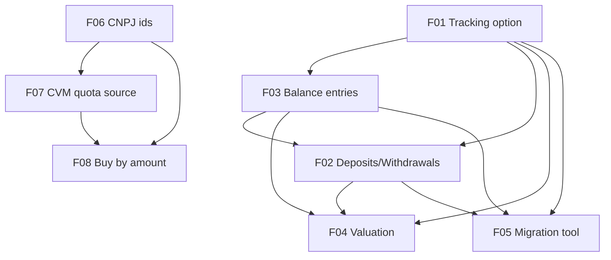

# Investments Without a Quantity

## 1. Executive Summary

Investments Without a Quantity gives holdings without a usable unit count the same oversight in the app as shares, ETFs and bonds: what was invested, what the holding is worth today, the unrealised and realised gain, the result % and the XIRR, all counted in portfolio, broker, dashboard, ARCA and month-start totals. It covers three XPI holdings today: **Inco** (real-estate credit projects), **Grão ARCA** (a VGBL pension plan inside the multi-market ARCA bucket) and **Guepardo Institucional FIC FIA** (a Brazilian equity fund), plus any similar holding added later.

The three holdings need two answers. Inco and Grão only ever show a balance, so they get a new **Tracked by: Balance** option. Money the investor adds is a **Deposit**, money taken out to a bank account or redeemed is a **Withdrawal** (amounts only, no quantity), and the balance shown by XP is recorded once a month as a dated **Balance entry**. For Inco, project payouts that stay in the Inco balance and are reinvested in new projects are internal movements and are never recorded. Only new money added and money moved out are. Gains use **proportional cost**: a withdrawal removes the same fraction of the invested amount as it removes of the balance, and the difference is realised gain.

Guepardo is a regulated investment fund. XP shows only its current value, but the fund has a real quota value: the CVM (Brazil's securities regulator) publishes every fund's daily quota value by CNPJ in its open-data portal. Guepardo therefore stays a quantity holding and gets real quotas without the investor needing to know them. A new optional **CNPJ** field identifies the fund (and every other Brazilian holding, with an optional **Administrator CNPJ** for funds, FIIs and ETFs, as the Brazilian IR declaration needs), a new **CVM daily quota** price source prices it every day, and a **buy-by-amount** option works out the quota count of each purchase from the amount invested and the CVM quota value on the conversion date. The same calculation recomputes the existing purchases once. Values are shown gross, as XP shows them, and the only tax recorded is the income tax (IR) actually withheld on a withdrawal. A one-off migration tool moves Inco and Grão off today's workaround, where each deposit is a "Buy of 1 unit" and each price is the balance divided by the number of deposits.

## 2. Problem and Opportunity

### The Problem

**Invented quantities make every value update a manual calculation**
- Inco and Grão are recorded as one "Buy" of quantity 1 per deposit, so each price has to be entered as the XP balance divided by the number of deposits held on that date.
- Guepardo's purchases have quantities derived by hand from an assumed price, and its prices are entered as the XP current value divided by that invented quantity.
- Each update takes a calculator step per holding, every time, and a slip in the divisor silently misstates the holding's value, the portfolio total and the dashboard.

**History breaks every time money is added**
- Adding a deposit changes the divisor, so every earlier per-unit price is re-read against the new unit count and older values stop meaning what was recorded.
- The month-start values and month-on-month change added by P68 read those prices, so the change column for these holdings jumps whenever a deposit lands.
- Price-history charts for these holdings show steps caused by deposits, not by performance.

**A balance-only holding cannot be entered correctly at all**
- The transaction form requires a quantity and a unit price, but neither exists for a VGBL plan or a real-estate credit pool.
- The domain already reads a snapshot as the whole position's worth for the `ProviderValue` and `Manual` valuation methods, but nothing in the web app can set that method, and transactions still need a quantity.
- There is no way to record money moved out of a balance (an Inco transfer to a bank, a VGBL redemption) and get a meaningful realised gain.

**Guepardo's real value is published, but the app can't use it**
- XP shows the fund's current value but not the quota count or the quota value, so the investor has no quotas to enter.
- The CVM publishes the quota value of every fund every day, but no price source reads it, and the fund has no ticker that the existing Google/Yahoo/Status Invest chain can price.
- The asset has no field for the fund's CNPJ, the identifier CVM uses, and nothing can turn an amount invested on a date into a quota count.

### The Opportunity

- **Manual calculation → direct entry.** Balance-tracked holdings take the XP balance exactly as shown (F03), and Guepardo is priced automatically from the CVM quota value (F07). No arithmetic remains.
- **Broken history → stable history.** A balance entry is a total, not a per-unit price, so adding a deposit never changes an earlier entry's meaning (F02, F03). Between entries, the current value is the last balance plus the money moved since, so a new deposit is not read as a loss (F04).
- **No way to enter → first-class option.** "Tracked by: Balance" is a choice in the asset form for any holding (F01), with amount-only Deposits and Withdrawals and proportional cost (F02).
- **Unknown quotas → derived quotas.** An optional CNPJ field on every Brazilian holding (F06, which also gives the IR declaration its identifiers), a CVM daily quota source with quota history by date (F07), and buy-by-amount plus a one-off quota recalculation (F08) give Guepardo real quotas from the amounts the investor already knows.
- **Same oversight as shares.** Balance-tracked holdings report the same figures and feed the same totals as share holdings (F04), and existing records are converted without re-typing (F05).

## 3. Target Audience

### Primary Users

**Self-directed investor (single user)**
- Holds shares, ETFs, bonds and funds across Brazilian (XPI) and UK brokers, and wants one consolidated view in BRL and GBP.
- Holds pension, fund and private-credit products whose XP screens show a balance or current value rather than units, and updates them from the XP app.
- Expects every holding to show invested amount, current value, gain and return on the same screens, so the portfolio totals and ARCA allocation can be trusted without a side spreadsheet.

## 4. Objectives

### Product Objectives

1. **Remove manual value arithmetic** for holdings without a usable quantity: the investor types the number XP shows, or nothing at all for CVM-priced funds.
2. **Report correct invested amount and gain** for balance-tracked holdings, including partial and full withdrawals.
3. **Show balance-tracked holdings with the same figures as share holdings** across the asset summary, portfolio and broker holdings, the dashboard, ARCA and month-start values.
4. **Price Brazilian funds from official data**: real quota counts derived from amounts, and a daily quota value from CVM.
5. **Migrate the existing records** of Inco, Grão and Guepardo without losing any deposit, purchase or recorded value.

### Success Metrics

1. **Arithmetic removed:** 0 values the investor must derive rather than copy per update round for Inco, Grão and Guepardo (today 3).
2. **Gain correctness:** for every balance-tracked holding, invested − realised gain (gross) = total deposits + fees − total withdrawals, to within R$0.01, checked by automated tests over deposit/withdrawal sequences of at least 20 flows, including partial and full withdrawals and backdated entries.
3. **Same figures:** 100% of the summary fields shown for a quantity holding (invested, current value, unrealised gain, realised gain, result %, XIRR, as-of date and status) have a value or an explicit "not available" reason for a balance-tracked holding, verified on the asset Summary tab and the portfolio and broker Holdings tabs.
4. **Fund pricing accuracy and freshness:** after its purchases are recalculated (F08), Guepardo's current value in the app differs from the value XP shows for the same date by less than 0.5%, checked by the investor once at rollout. Its price is refreshed without manual entry on at least 95% of weekdays over a 30-day period, measured by saved CVM prices dated no more than 2 business days before the day they were fetched.
5. **Lossless migration:** after the migration tool runs on a temp copy, 100% of the original deposits of Inco and Grão exist as Deposits with the same date and amount, and every converted balance entry equals the original per-unit price × units held on its date to within R$0.01, as reported by the tool's verification output. Every Guepardo purchase keeps its date and total amount to within R$0.01 after the quota recalculation.

## 5. User Stories

### F01. Balance-Tracked Holding Option
- As an investor, I want to choose "Tracked by: Balance" when creating a holding so that I can add a pension plan or credit pool that has no unit count.
- As an investor, I want the asset form to show how an existing holding is tracked so that I know which kind of transactions it takes.
- As an investor, I want the app to stop me from changing how a holding is tracked once it has transactions so that its history is never reinterpreted.

### F02. Deposits and Withdrawals
- As an investor, I want to record a deposit of only the new money I add, with a date and an amount, so that a contribution is entered exactly as I made it.
- As an investor, I want Inco payouts that I reinvest inside Inco to need no record so that only money crossing in or out of the holding is logged.
- As an investor, I want to record a withdrawal when I move money out to a bank account or redeem, with optional IR withheld, so that the holding's invested amount and realised gain stay correct.
- As an investor, I want the withdrawal form to pre-fill the balance just before the withdrawal from my latest balance entry so that I only correct it when XP shows a different figure.
- As an investor, I want each withdrawal to show the realised gain it produced, gross and net of IR withheld, so that I know what I actually earned.
- As an investor, I want to edit or delete a deposit or withdrawal, including backdated ones, so that I can fix mistakes.
- As an investor, I want a withdrawal of the whole balance to close the position so that a fully redeemed holding looks like a fully sold share holding.

### F03. Balance Entries
- As an investor, I want to record a dated balance taken from XP so that the holding's current value is up to date.
- As an investor, I want to see a balance history with the change since the previous entry so that I can follow the holding month by month.
- As an investor, I want to edit or delete a balance entry so that I can correct a typo.
- As an investor, I want a warning when no balance has been entered for more than 35 days so that I know the value shown is out of date.

### F04. Balance Holding Valuation and Performance
- As an investor, I want a balance-tracked holding's Summary tab to show invested, current value, unrealised gain, realised gain, result % and XIRR so that I get the same oversight as for shares.
- As an investor, I want a deposit made after the latest balance entry to be added to the current value so that a new contribution is not shown as a loss.
- As an investor, I want balance-tracked holdings to count in portfolio, broker and dashboard totals, in ARCA and in month-start values so that my overall picture is complete.
- As an investor, I want quantity and average price shown as not applicable for a balance-tracked holding so that I'm never shown a meaningless number.

### F05. Balance Holding Migration Tool
- As an investor, I want a one-off tool to convert Inco and Grão from "Buy of 1 unit" records to Deposits and balance entries so that I don't re-enter dozens of records by hand.
- As an investor, I want the tool to run against a copy of my data file first and report what it changed so that my live data is never put at risk.
- As an investor, I want the tool to refuse a holding that has sales, credits or corporate actions so that nothing it cannot convert exactly is silently lost.

### F06. Brazilian CNPJ Identifiers
- As an investor, I want to enter the CNPJ of any Brazilian holding (the company for shares, the fund for FIIs, funds and ETFs, the issuer for fixed income, the insurer for a pension plan), with or without punctuation, so that it is identified the way the IR declaration needs.
- As an investor, I want to enter the administrator's CNPJ for a fund, FII or ETF so that the declaration's asset description can cite it.
- As an investor, I want a fund's CNPJ to let the app find its official quota value so that it is priced from CVM.
- As an investor, I want an invalid CNPJ to be rejected with a clear message so that a typo never reaches the declaration or causes silent pricing failures.

### F07. CVM Daily Quota Price Source
- As the system, I want to fetch a fund's latest quota value from the CVM daily fund report by CNPJ so that Guepardo is priced without manual entry.
- As the system, I want to look up a fund's quota value on a given past date so that quota counts can be derived from purchase amounts.
- As an investor, I want the quota value's date and the source "CVM" shown next to the price so that I know how current it is.
- As an investor, I want a manual quota value for today to still take priority over the CVM value so that I can override it when needed.
- As an investor, I want the last saved quota value to be used when the CVM fetch fails so that the holding is still valued.

### F08. Fund Purchases by Amount
- As an investor, I want to record a fund purchase by entering only the amount and the conversion date so that the app works out the quotas from the CVM quota value.
- As an investor, I want to see the quota value and quota count the app derived before saving, and override them if XP's order details differ, so that I stay in control.
- As an investor, I want to recalculate the quotas of a fund holding's existing purchases from their amounts in one action, with a preview, so that Guepardo's invented quantities are replaced by real ones.
- As an investor, I want the preview to show the current value the recalculated quotas give so that I can compare it with the value XP shows before applying.
- As an investor, I want the old hand-calculated prices to be removable in the same action so that they don't distort the price history.

## 6. Functionalities

### F01. Balance-Tracked Holding Option

**Provides:**
- Holding tracking mode, either "Quantity and price" or "Balance" (used by F02, F03, F04, F05)

**Capabilities:**
- Every holding has a tracking mode: **Quantity and price** (default, today's behaviour) or **Balance**.
- Balance maps to the existing `ProviderValue` valuation method, under which a snapshot is the whole position's worth. Holdings already set to `ProviderValue` or `Manual` are shown as Balance. All other valuation methods are shown as Quantity and price.
- The asset's valuation method is the only authority for how its snapshots are read. Valuation stops trusting the copy of the method stored on each snapshot, so a snapshot is just a dated number.
- The tracking mode can be set when the holding is created and changed only while the holding has 0 transactions, 0 credits, 0 corporate actions and 0 saved prices.
- A balance-tracked holding accepts only Deposit and Withdrawal transactions (F02). It never accepts Buy, Sell, credits (dividends, interest), splits or other corporate actions.
- Available for any country, class and broker. The asset-class, segment and pick-source rules from P68 are unchanged.

**Experience:**
- The asset form (create and edit) gets a "Tracked by" radio group with two options: "Quantity and price" and "Balance". Helper text under Balance: "For holdings whose broker shows only a balance, such as pension plans. You record deposits, withdrawals and the balance."
- When the holding has transactions, credits, corporate actions or saved prices, the group is disabled and the helper text reads: "Can't change how this holding is tracked because it has transactions or prices. Remove them first."
- The asset's header shows a "Balance" tag next to the asset class for balance-tracked holdings.
- The save, saving and error states of the existing asset form are reused unchanged.

**Error Handling:**
- A mode change is sent for a holding that gained a transaction after the form was opened → the save is rejected with "This holding now has transactions, so how it is tracked can't be changed." The form stays open with the previous mode reselected.
- Save fails because of a storage error → the existing "Couldn't save the asset" error is shown, the form keeps the user's input, and nothing is changed.

### F02. Deposits and Withdrawals

**Consumes:**
- F01: holding tracking mode (Balance)
- F03: balance on a given date, with the date of the entry it starts from, used to pre-fill "Balance before withdrawal"

**Provides:**
- Dated deposits (date, amount, fees) and withdrawals (date, amount, IR withheld, balance before withdrawal) (used by F04, F05)
- Remaining invested amount (cost of what is still held) and realised gain per withdrawal, gross and net of IR withheld (used by F04)

**Capabilities:**
- **What is recorded:** only money that crosses the holding's boundary. A Deposit is new money the investor adds. A Withdrawal is money moved out to a bank account or another holding, or a redemption. Income, interest, amortisation and payouts that stay inside the holding's balance (for example an Inco project payout reinvested in another Inco project, or left as uninvested Inco cash) are not recorded; they are part of the balance (F03).
- **Deposit**: date (required, not in the future), amount (required, > 0, up to 2 decimals, at most 1,000,000,000), fees (optional, ≥ 0, default 0). The currency is the holding's currency. Fees add to the invested amount.
- **Withdrawal**: date (required, not in the future), amount (required, > 0, up to 2 decimals; the gross amount taken out), IR withheld (optional, ≥ 0 and < amount, default 0), balance before withdrawal (required, ≥ amount). When XP shows only the net amount received, the investor enters it as the amount with IR withheld 0.
- **Proportional cost rule** (in date order; on the same date, deposits before withdrawals, then by entry order):
  - fraction = amount ÷ balance before withdrawal
  - cost removed = invested before the withdrawal × fraction, rounded to 2 decimals
  - realised gain (gross) = amount − cost removed
  - realised gain (net) = realised gain (gross) − IR withheld
  - invested after the withdrawal = invested before − cost removed
- A withdrawal whose amount equals the balance before is a **full withdrawal**: fraction is exactly 1, invested becomes 0 and the position is Flat (closed), shown with the same closed-position treatment as a fully sold share holding. A later Deposit reopens it.
- A withdrawal stores its balance before and nothing else; the balance after it is derived by F03's balance-on-date rule, so no balance entry is written with it.
- Adding, editing or deleting any Deposit or Withdrawal recalculates every later withdrawal's cost removed and realised gain in date order.
- **Reuse:** Deposit and Withdrawal are added to `TransactionTypeEffects` as cash-only effects (no quantity change), like the existing `CapitalCall` and `ReturnOfCapital`, so `Transaction.NetCash`, the existing `Withheld` field (IR withheld), `AssetTotalsCalculator.ClassifyNetCash` and `AssetCashFlowBuilder` (XIRR flows) work unchanged. The proportional-cost rule plugs into `RealisedGainRegenerator` as the per-row calculator for balance holdings in place of `RealisedGainCalculator`, so supersede/replace bookkeeping, tax-classification records and `RefreshRealisedCapitalGain` are reused. `TransactionReplayOrder` gains the cash-direction tie-break for same-date deposits before withdrawals.
- Withdrawals produce realised-gain records, so balance-tracked holdings appear in the existing realised-gain views and totals alongside share sales. Tax classification (P51) records them as unclassified; no tax rule is applied.

**Experience:**
- On a balance-tracked holding, the Transactions tab's "Add transaction" opens a form with a "Type" choice of **Deposit** or **Withdrawal** only. Quantity and unit price fields are not shown.
- Deposit form: Date, Amount, Fees, with the helper text under Amount "Only new money you add. Reinvested payouts that stay in the balance aren't recorded." Withdrawal form: Date, Amount, IR withheld, Balance before withdrawal.
- "Balance before withdrawal" is pre-filled with F03's balance on the chosen date, excluding this withdrawal, and recalculated when the date changes until the user types in the field. Helper text: "From your balance on DD/MM/YYYY. Change it if XP shows a different balance just before this withdrawal."
- When no balance entry exists on or before the date, the field is empty and required, with the helper text "No balance recorded before this date. Enter the balance just before the withdrawal."
- Before saving, the withdrawal form shows a live preview: "Cost removed R$X · Realised gain R$Y (net R$Z)".
- The Transactions grid for a balance-tracked holding shows the columns Date, Type, Amount, Fees / IR withheld, Balance before, Realised gain. Amounts are right-aligned. Realised gain is shown with a "+" or "−" sign, not colour alone.
- Validation messages appear inline under each field on blur and on submit, and focus moves to the first invalid field: "Enter an amount greater than 0.", "Date can't be in the future.", "IR withheld must be less than the amount.", "Balance before withdrawal must be at least the amount withdrawn."
- Save shows the existing saving state on the button. On success the dialog closes, the grid and summary refresh, and a success toast reads "Deposit saved" or "Withdrawal saved". Closing a dirty form asks "Discard changes?".
- Delete asks "Delete this withdrawal? Realised gains of later withdrawals will be recalculated." with "Delete" and "Cancel".

**Error Handling:**
- An edit or delete leaves a withdrawal with no deposit on or before its date (for example, deleting the only earlier deposit) → the change is rejected with "The withdrawal on DD/MM/YYYY would have no deposit before it. Adjust that withdrawal first." Nothing is saved. A withdrawal whose invested-before is 0 after earlier full withdrawals but with a later reopening deposit is valid; its whole amount is realised gain.
- A Buy, Sell or credit is sent to a balance-tracked holding (for example by a stale browser tab or the API) → rejected with "This holding is tracked by balance. Record a deposit or withdrawal instead." and nothing is saved.
- Storage fails while saving → "Couldn't save the transaction. Your entry is still in the form." The dialog stays open with the input intact and the in-memory holding is rolled back by the existing `ApplyAndSaveAsync`.

### F03. Balance Entries

**Consumes:**
- F01: holding tracking mode (Balance)

**Provides:**
- Dated balance entries (date, value, source, retrieved-at) (used by F05) and the balance on a given date with the entry date it starts from (used by F02, F04)
- Balance status (Current or Stale, with as-of date) (used by F04)

**Capabilities:**
- A balance entry is a date (required, not in the future) and a value (required, ≥ 0, up to 2 decimals) in the holding's currency, with an optional note of up to 100 characters (stored as the source reference, for example "XP app 01/11").
- The value is the holding's whole balance as XP shows it, including any uninvested cash inside the holding (for Inco, payouts not yet reinvested).
- At most one entry per holding per date. Saving on a date that already has an entry replaces it after confirmation.
- Entries are stored as the holding's existing price snapshots with source "Provider valuation" (for both `ProviderValue` and `Manual` holdings, which today save source Manual), so the existing price-history storage, editing and deletion are reused.
- A balance entry is read as the holding's value at the end of its date, including that day's deposits and withdrawals.
- **Balance on a date D** (the one rule used by F02's pre-fill, F04's current value and F04's month-start value): take the latest balance entry on or before D and add deposits minus withdrawals dated after that entry and on or before D. For a month-start value, when P68's nearest-price rule picks an entry dated after the 1st, subtract the net flows between the 1st and that entry instead. With no usable entry, the balance is unavailable.
- **Staleness:** a balance-tracked holding is **Stale** when its latest balance entry is more than 35 days before the valuation date, otherwise **Current**. This replaces the weekday rule used for market prices, for balance-tracked holdings only.
- Balance on a date and status are implemented once, as a valuation policy chosen by the asset's valuation method (value on a date, status on a date, whether the holding has units), called by `HoldingValuationService` and `MonthStartValueCalculator`, rather than as separate balance branches in each calculator and in `MarketStatusCalculator`.
- No automatic fetching ever runs for a balance-tracked holding (unchanged from today's `ProviderValue` behaviour).

**Experience:**
- For a balance-tracked holding, the "Price history" tab is titled **Balance history**. "Add price" becomes **Add balance**, with the fields Date (default today), Balance and Note.
- The history grid shows Date, Balance, Change since previous entry (amount and %), Net deposits/withdrawals since previous entry, and Note, newest first. Numbers are right-aligned. Change is shown with a sign, not colour alone.
- Empty state: "No balance recorded yet. Add the balance XP shows to see this holding's value." with an "Add balance" button.
- When the holding is Stale, the Summary tab's status line and the holdings grids show the existing stale badge with the text "Balance as of DD/MM/YYYY (N days ago)".
- Validation, saving and success behaviour reuse the existing price form: inline messages "Enter a balance of 0 or more." and "Date can't be in the future.", toast "Balance saved", and "Discard changes?" when closing a dirty form.
- Delete asks "Delete the balance of DD/MM/YYYY?".

**Error Handling:**
- Storage fails while saving or deleting → "Couldn't save the balance. Try again." The form keeps the input and the in-memory history is unchanged.
- Deleting the only entry of a holding with deposits → allowed, with the warning "This holding will have no current value until you add a balance."

### F04. Balance Holding Valuation and Performance

**Consumes:**
- F01: holding tracking mode (Balance)
- F02: deposits (date, amount, fees), withdrawals (date, amount, IR withheld), remaining invested amount, realised gain gross and net
- F03: balance on a given date, balance status

**Capabilities:**
- **Current value** = F03's balance on the valuation date. With no balance entry, current value is unavailable and status is "No balance recorded"; the holding is left out of value totals, the same treatment as a share holding with no price.
- **Invested** = remaining invested amount after all withdrawals (F02).
- **Unrealised gain** = current value − invested. For Inco this includes the return on payouts reinvested inside the holding, since those were never recorded as new money.
- **Realised gain** = sum of the withdrawals' realised gains (gross), with the net figure alongside.
- **Result %** = unrealised gain ÷ invested; unavailable when invested is 0.
- **XIRR** uses the existing XIRR calculator with cash flows: each deposit (amount + fees) negative on its date, each withdrawal (amount − IR withheld) positive on its date, and the current value positive on the valuation date (omitted when the position is closed). "XIRR with credits" equals "XIRR" because balance-tracked holdings have no credits.
- **Totals**: "Total bought" = sum of deposits including fees, "Total sold" = sum of withdrawal amounts, "Total credits" = 0.
- **Not applicable fields**: quantity, average price, average sell price and current price are shown as "Not applicable" and are never 0 or blank. The valuation DTOs carry them as nullable with a single "has units" flag from the valuation policy (F03), and every summary and grid renders that flag the same way.
- **Month-start values (P68)**: the value on the 1st of a month is F03's balance on the 1st, so a deposit made on the 2nd never appears in the 1st's value.
- Each holding is valued once per request and the result is reused by every total that includes it.
- **Aggregation**: current value, invested, unrealised and realised gain of balance-tracked holdings are added into portfolio, broker and dashboard totals, the broker Holdings tab (P68) and ARCA bucket values (Grão ARCA stays in its ARCA bucket), converted to the reporting currency with the existing FX rules.
- Market status for portfolio and broker grids uses F03's balance status for balance-tracked holdings.

**Experience:**
- The asset Summary tab for a balance-tracked holding replaces "Quantity" and "Average price" with "Tracked by: Balance", and shows the groups Totals (Total deposited, Total withdrawn), Realised (Realised gain, Realised net of IR, XIRR) and Current (Current value, Balance as of, Invested, Unrealised gain, Result %, XIRR).
- When deposits or withdrawals are dated after the latest balance entry, the "Current value" field shows a note: "Balance of DD/MM/YYYY plus R$X net deposits since."
- Portfolio and broker Holdings grids show the balance-tracked holding in the same row layout as other holdings. Quantity and price cells show "—" with the accessible label "Not applicable, tracked by balance".
- Loading, empty ("No balance recorded"), stale and error states reuse the existing Summary and Holdings components.

### F05. Balance Holding Migration Tool

**Consumes:**
- F01: holding tracking mode (Balance)
- F02: deposits (date, amount, fees)
- F03: balance entries (date, value)

**Capabilities:**
- A command in the existing `Tools/` family (a new `InvestmentBalanceHoldingMigration` tool) takes the data file path and one or more holding identifiers (broker / portfolio / asset name). It is a dry run by default and writes only with `--write`. It reuses `LiveDataFileGuard` (given a path parameter instead of the hardcoded CashFlow file) to refuse the live `data/data-investment.json`, `MigrationBackup.Create` to back up the file before writing, and the stage-then-move atomic write of `LocalJsonStorage`. It is run on a temp copy first, as the other tools are.
- For each named holding it requires: every transaction is a Buy, there are 0 credits, 0 corporate actions and 0 realised-gain records. Otherwise it stops for that holding and reports why.
- **Conversion**:
  - Each Buy becomes a Deposit with the same date and id, amount = quantity × unit price rounded to 2 decimals, and fees = the Buy's fees rounded to 2 decimals (values below 0.01 become 0).
  - Each price snapshot becomes a balance entry with value = snapshot price × total quantity bought on or before the snapshot date, rounded to 2 decimals, keeping its date and retrieved-at. When the quantity held on the snapshot's retrieved-at date differs (a deposit was made between the snapshot date and the day it was entered, so the investor may have divided by the later count), the tool still uses the snapshot-date quantity and lists the entry with both converted values, so the investor can correct it in Balance history. The source becomes "Provider valuation" and the original per-unit value is kept in the source reference ("migrated: unit value N × Q units").
  - The holding's tracking mode becomes Balance.
- **Verification output** per holding: count of Buys vs Deposits, sum of Buy amounts vs sum of Deposit amounts, each snapshot's original and converted value, and the holding's invested amount and current value before and after. A holding whose before/after invested amount or current value differs by more than R$0.01 fails the run, and nothing is written.
- Without `--write` the tool only prints the verification output. With it, it writes atomically: either every named holding is converted or the file is left untouched.
- Guepardo is not converted by this tool; its purchases are corrected in the app by the quota recalculation (F08).
- The app must be restarted after the tool writes, because the data file is loaded once at startup. The tool prints this reminder.

**Experience:**
- Console output: one block per holding with the verification table, then "Converted N holdings" or "No changes written: <reason>", and the restart reminder.
- Exit code 0 on success or a clean dry run, 1 when any holding fails validation or verification.

**Error Handling:**
- A holding is not found → "Holding '<broker>/<portfolio>/<asset>' not found." Exit 1, nothing written.
- A holding has a non-Buy transaction, a credit, a corporate action or a realised gain → "Can't migrate '<asset>': it has <N sells / credits / corporate actions>." Exit 1, nothing written.
- A holding is already tracked by Balance → reported as "already migrated", skipped, and not treated as a failure.
- The file can't be written (locked, permissions) → "Couldn't write <path>: <reason>." The original file is left unchanged because the write goes through a temp file and a move, and the backup is kept.

### F06. Brazilian CNPJ Identifiers

**Provides:**
- Asset CNPJ, 14 digits: for a fund, the fund's own CNPJ (used by F07, F08)

**Capabilities:**
- New optional asset identity field **CNPJ**, shown in the asset form for every holding with country BR. It is the CNPJ that identifies the holding in the Brazilian IR declaration (Bens e Direitos and income): the company for shares, the fund for FIIs, funds and ETFs, the issuer for fixed income, the insurer for a pension plan. For class Fund it is also the identifier CVM pricing uses (F07).
- New optional field **Administrator CNPJ**, shown for holdings with country BR and class Fund, Real estate (FIIs) or ETF. It is the administrator's CNPJ that the declaration cites in the asset description. Nothing else in P69 reads it.
- Neither field is required: a holding saves without them, and they can be filled in later. A value is validated only when one is entered.
- CNPJ exists only in Brazil: neither field is shown or kept for a holding whose country is not BR. Changing a holding's country away from BR clears both, and changing its class away from Fund/Real estate/ETF clears the Administrator CNPJ.
- Accepted input for both fields: 14 digits with or without the mask `00.000.000/0000-00`. Stored as 14 digits only. Validated with the standard CNPJ check-digit rule. All-same-digit values (for example 00000000000000) are rejected.
- Shown masked (`00.000.000/0000-00`) in the asset form and on the Summary tab identity group.
- Not required to be unique, because one company or fund can be held in more than one portfolio. Editing either never touches transactions.
- Both are included in the asset admin create/update DTOs and the OpenAPI snapshot.

**Experience:**
- The asset form shows a "CNPJ" text field under ISIN for BR holdings, with the helper text "The CNPJ that identifies this holding in the IR declaration: the company, fund, issuer or insurer. For a fund, also used to get its daily quota value from CVM."
- For BR funds, FIIs and ETFs, an "Administrator CNPJ" field follows it, with the helper text "The fund administrator's CNPJ, cited in the IR declaration."
- An invalid value in either field shows the inline error "Enter a valid 14-digit CNPJ." on blur and on submit, and focus moves to it on submit.
- Clearing the CNPJ removes it; the CVM price source and buy-by-amount then no longer apply to that holding. Clearing the Administrator CNPJ removes it.

### F07. CVM Daily Quota Price Source

**Consumes:**
- F06: fund CNPJ (14 digits)

**Provides:**
- A fund's quota value on a given date: competence date and quota value, or "not available" (used by F08)

**Capabilities:**
- New price source **CVM**, used for holdings tracked by Quantity and price with country BR, class Fund and a CNPJ. It is an `IAssetPriceFetcher` chosen through the existing `Supports` selection, with the CNPJ carried on the price request, so it comes first for those holdings and the Google/Yahoo/Status Invest chain is not tried for them. "Quota on a date" is added as an optional historical-price capability of `IAssetPriceFetcher` that CVM implements, not a CVM-only API.
- **Data**: the CVM open-data daily fund report (Informe Diário de Fundos de Investimento) at `dados.cvm.gov.br/dados/FI/DOC/INF_DIARIO/DADOS/`, one compressed CSV per month named `inf_diario_fi_YYYYMM.zip`, available from January 2021. Each row has the fund identifier `CNPJ_FUNDO_CLASSE`, the competence date `DT_COMPTC` and the quota value `VL_QUOTA`, plus an optional `ID_SUBCLASSE`. `CNPJ_FUNDO_CLASSE` is up to 18 characters (the masked form), so it is stripped to digits before it is matched with the 14-digit CNPJ stored by F06. A recent month's file is about 10–12 MB compressed. The current and previous months' files are refreshed daily (Monday to Saturday, around 08:00 Brasília time) with values up to the previous day; older months are refreshed weekly.
- **Latest quota**: the row for the holding's CNPJ with the latest competence date on or before the valuation date. When the current month's file has no row yet (the first business days of a month), the previous month's file is used.
- **Quota on a date** (used by F08): the row for the CNPJ on exactly that competence date; when that date has no row (weekend, holiday), the nearest earlier competence date within 5 calendar days. Otherwise "not available". Dates before January 2021 are "not available" (the yearly historical files are out of scope).
- **Subclasses**: when a CNPJ has rows with more than one `ID_SUBCLASSE`, the row with an empty subclass is used; if none is empty, the quota is "not available" with the reason "Fund has subclasses".
- **Caching**: downloaded monthly zips are kept in a local cache folder (gitignored, under `data/`), so a restart or a newly entered CNPJ re-reads the local file instead of downloading again. A cached file is revalidated with `If-Modified-Since` once it is 12 hours old (one rule for every month). Each month file has one shared in-flight download, so concurrent price requests await the same download, and the current and previous months are fetched in parallel. A failed download is remembered per month file for 15 minutes. Files are streamed and parsed without loading the whole uncompressed CSV into memory. The CSV separator and text encoding are confirmed against a real file in the spec and pinned by a parsing test.
- Each successful latest-quota fetch is saved as a price snapshot with source "CVM", the quota's competence date as the snapshot date (not the fetch date), and the source reference "CNPJ <masked> · competence DD/MM/YYYY". It only replaces an existing automatic snapshot for that date.
- Existing price rules in `AssetPriceLookupService` are reused unchanged: a manual price for today wins and stops the fetch, a failed fetch falls back to the most recent saved price with the existing fallback status, and only automatic entries are overwritten. The competence date is passed as the snapshot date to the existing automatic-price recording, which today always stamps today's date.
- Market status uses the existing weekday rule against the quota's competence date. A quota value dated more than 1 weekday back is Stale, which is expected on Mondays and the day after a holiday.
- Download timeout is 60 seconds.
- The CVM client lives in `Integrations/WebPageParser` next to `TesouroTransparente`, reusing its pattern: static `HttpClient` with timeout, column-index layout check, streaming parse and a pure `Parse…(TextReader)` function for tests. No vendor SDK is involved.

**Experience:**
- The price badge and Price history grid show "CVM" as the source, with the quota's competence date as "As of".
- When CVM can't be reached, the existing fallback badge is shown ("Last saved price, DD/MM/YYYY") and the Summary tab status reads "Couldn't fetch the CVM quota value. Showing the last saved value."
- When the CNPJ is not found in the last two monthly files, the status reads "CVM has no quota value for CNPJ <masked>. Check the CNPJ on the asset." and the holding falls back to its last saved price.

**Error Handling:**
- CVM download times out or returns a non-success status → no snapshot is saved, the last saved price is used, and the failure is logged with the month file name. The next attempt for that month file happens no sooner than 15 minutes later, not on every request.
- The CSV columns don't match the expected layout (CVM changed the format) → the fetch fails with "CVM daily report format not recognised." logged as an error, falling back to the last saved price. No partial or mis-parsed value is ever saved.
- Quota value is ≤ 0 or not a number for the CNPJ → that row is ignored and the previous valid competence date is used.
- Saving the snapshot fails → the fetched price is still shown for the current request, with the existing "price not saved" warning, as today for other automatic sources.

### F08. Fund Purchases by Amount

**Consumes:**
- F06: fund CNPJ (14 digits)
- F07: a fund's quota value on a given date (competence date, quota value, or not available)

**Capabilities:**
- Applies to holdings tracked by Quantity and price with a CNPJ (F06). Other holdings keep the existing Buy form unchanged.
- **Buy by amount**: the Buy form gets an "Enter by: Amount / Quantity and price" choice, defaulting to Amount for these holdings. With Amount, the investor enters Amount (required, > 0, up to 2 decimals), Quota date (required, not in the future, defaults to the transaction date) and Fees (optional). The app looks up the quota value on the quota date (F07) and sets unit price = quota value and quantity = (amount − fees) ÷ quota value, rounded to 8 decimals. The saved Buy is an ordinary Buy with that quantity and unit price, so every existing share calculation applies.
- The quota date is the fund's conversion date (data de cotização), which for many equity funds is one or more business days after the order date. The Buy's transaction date stays the order date.
- The investor can switch to "Quantity and price" at any time to override the derived figures, for example when XP's order details show a different quota count.
- **Recalculate quotas from CVM**: an action on the holding (Transactions tab menu) available when the holding has a CNPJ, at least 1 Buy, and 0 Sells, 0 credits and 0 corporate actions. For each Buy it keeps the date, invested amount (quantity × unit price, which excludes fees) and fees unchanged, looks up the quota value on the row's quota date (F07), and proposes unit price = quota value and quantity = (old quantity × old unit price) ÷ quota value. Fees are not deducted again.
- Each row's quota date defaults to the Buy's date and can be edited per row, because existing Buys store the order date rather than the conversion date.
- The dialog loads the CNPJ's quota series for every month it needs in one request (months de-duplicated), and recomputes quantities, the current-value line and the price replacements locally when a quota date changes.
- The recalculation preview also shows the current value the new quotas give at the latest CVM quota value, so the investor can compare it with the value XP shows.
- The recalculation optionally replaces the holding's manual price snapshots dated before today (default on, showing their count), because hand-calculated pseudo prices don't match real quotas. Each one is replaced by a CVM snapshot with the quota value on the same date (F07's quota on a date), so P68 month-start values keep a price. A manual snapshot whose date has no CVM quota is deleted, and the preview lists those dates.
- Applying the recalculation writes all Buys and price replacements in one `ApplyAndSaveAsync` call: either everything is applied or nothing.

**Experience:**
- Buy form in Amount mode: Date, Amount, Quota date, Fees, and a read-only line under them, "Quota value R$X on DD/MM/YYYY (CVM) → Y quotas", where the quota value is looked up only when the quota date changes (debounced) and the quota count is recalculated locally as Amount or Fees change. While the lookup runs, the line reads "Getting the quota value from CVM…".
- When the quota is not available for the quota date, the line reads "CVM has no quota value for DD/MM/YYYY. Pick another quota date or enter quantity and price." and Save is disabled in Amount mode.
- Recalculate dialog: a grid with Date, Amount, Current quantity, New quantity, Quota value, Quota date used, newest first, with right-aligned numbers. Below it: "Current value with new quotas: R$X at the CVM quota value of DD/MM/YYYY. Compare it with XP before applying." Below the grid, a checkbox "Also replace N hand-entered prices recorded before today with CVM quota values", and the buttons "Apply" and "Cancel".
- Rows whose quota is not available are listed with "No CVM quota for this date", and Apply is disabled with the message "N purchases have no CVM quota. Fix their dates or enter them manually."
- On success: toast "Quotas recalculated for N purchases", and the grid, summary and price history refresh.

**Error Handling:**
- CVM can't be reached during a Buy in Amount mode → "Couldn't get the quota value from CVM. Try again or enter quantity and price." Save is disabled in Amount mode, and the input is kept.
- CVM can't be reached during a recalculation → the dialog shows "Couldn't get quota values from CVM. Try again later." and nothing is changed.
- The holding gained a Sell, credit or corporate action after the dialog was opened → Apply is rejected with "This holding now has sales or income, so its quotas can't be recalculated." and nothing is changed.
- Storage fails while applying → "Couldn't save the recalculated quotas. Nothing was changed." The in-memory holding is restored to its previous state.

## 7. Out of Scope

**Tax**
- Estimating income tax on open positions (VGBL regressive/progressive tables, FIA 15%, private-credit IR) or showing a net-of-tax current value.
- Applying P51 tax rules to balance-tracked withdrawals: they are recorded as unclassified.
- IOF and VGBL loading fees (taxa de carregamento) as separate concepts; they can only be entered as deposit fees.

**Inco**
- Recording payouts, interest or amortisation that stay inside the Inco balance, or splitting a withdrawal into interest and principal.
- Tracking individual Inco projects separately inside the holding.

**IR declaration**
- Producing the Brazilian IR declaration (Bens e Direitos, income reports) or its asset descriptions. F06 only stores the CNPJs that the declaration needs.

**Tracking-mode changes**
- Switching an existing holding between Quantity and price and Balance in the app while it has transactions. Only the F05 tool converts existing holdings.
- Converting a balance-tracked holding back to quantities.

**Funds and CVM**
- CVM quota values before January 2021 (the yearly historical files).
- Recalculating quotas for a fund holding that has sales, credits or corporate actions.
- Fund subclasses with no class-level quota.
- Pricing VGBL plans from CVM: Grão is tracked by balance.

**Automation**
- Importing balances, deposits or withdrawals automatically from XP.
- Fetching values for Inco or VGBL plans from any external source.
- Back-filling past CVM prices into price history in general: only the latest quota value is saved as a price, apart from the one-off replacement of hand-entered prices in F08, and month-start values use saved prices as P68 defines.

**Other**
- Time-weighted return for any holding.
- Changes to CashFlow: recording a withdrawal moves no money into a CashFlow bank account.

## 8. Dependency Graph

### Dependency Table

| # | Feature | Priority | Dependencies |
|---|---------|----------|--------------|
| F01 | Balance-Tracked Holding Option | 1 | None |
| F03 | Balance Entries | 1 | F01 |
| F02 | Deposits and Withdrawals | 1 | F01, F03 |
| F04 | Balance Holding Valuation and Performance | 1 | F01, F02, F03 |
| F05 | Balance Holding Migration Tool | 1 | F01, F02, F03 |
| F06 | Brazilian CNPJ Identifiers | 1 | None |
| F07 | CVM Daily Quota Price Source | 1 | F06 |
| F08 | Fund Purchases by Amount | 1 | F06, F07 |

### Execution Waves

Features within the same wave can be built in parallel. A wave starts only after every feature in earlier waves is complete.

- **Wave 1**: F01, F06
- **Wave 2**: F03, F07
- **Wave 3**: F02, F08
- **Wave 4**: F04, F05

### Priority levels

- **1** = Essential — product does not work without it
- **2** = Important — significant value addition
- **3** = Desirable — incremental improvement

## 9. Acceptance Criteria

### F01. Balance-Tracked Holding Option
- [ ] **P69-F01-balance-tracked-holding-option-01** A new holding can be created with "Tracked by: Balance", and it is stored with the `ProviderValue` valuation method.
- [ ] **P69-F01-balance-tracked-holding-option-02** A new holding created without a choice is "Quantity and price", and existing holdings keep their current behaviour.
- [ ] **P69-F01-balance-tracked-holding-option-03** Holdings already set to `ProviderValue` or `Manual` show "Balance" in the asset form.
- [ ] **P69-F01-balance-tracked-holding-option-04** The "Tracked by" group is disabled, with the explanatory helper text, on a holding with at least 1 transaction, credit, corporate action or saved price.
- [ ] **P69-F01-balance-tracked-holding-option-05** Valuation reads a snapshot as a total or a per-unit price from the asset's valuation method, not from the method stored on the snapshot.
- [ ] **P69-F01-balance-tracked-holding-option-06** A mode change sent through the API for a holding with transactions is rejected with the "can't be changed" message, and nothing is saved.
- [ ] **P69-F01-balance-tracked-holding-option-07** The asset header shows a "Balance" tag for balance-tracked holdings only.
- [ ] **P69-F01-balance-tracked-holding-option-08** The "Tracked by" group is keyboard operable, has a visible focus indicator and an accessible group name.

### F02. Deposits and Withdrawals
- [ ] On a balance-tracked holding, the transaction form offers only Deposit and Withdrawal, with no quantity or unit price field.
- [ ] The Deposit form shows the helper text explaining that reinvested payouts aren't recorded.
- [ ] A Deposit of R$1,000 with R$5 fees raises the invested amount by R$1,005.
- [ ] With invested R$10,000 and balance before R$12,000, a R$3,000 withdrawal records cost removed R$2,500, realised gain R$500 gross, and invested afterwards R$7,500.
- [ ] The same withdrawal with R$75 IR withheld shows realised gain R$500 gross and R$425 net.
- [ ] A withdrawal equal to the balance before sets invested to 0 and the position to closed, and a later Deposit reopens it.
- [ ] Saving a withdrawal writes no balance entry, and the balance shown the day after it equals balance before − amount when no other flow or entry follows.
- [ ] "Balance before withdrawal" is pre-filled from F03's balance on the date, and the helper text names the date of the entry it starts from.
- [ ] With no balance entry on or before the date, the field is empty and required.
- [ ] The live preview shows cost removed, realised gain and net gain before saving.
- [ ] A backdated withdrawal recalculates the realised gains of all later withdrawals, in date order.
- [ ] Same-date deposits are applied before same-date withdrawals.
- [ ] A change that leaves a withdrawal with no deposit on or before its date is rejected with the message naming that withdrawal's date, and nothing is saved.
- [ ] A Buy, Sell or credit sent to a balance-tracked holding is rejected with "This holding is tracked by balance…", and nothing is saved.
- [ ] Amount ≤ 0, a future date, IR withheld ≥ amount, and balance before < amount each show their inline message, and focus moves to the first invalid field on submit.
- [ ] A storage failure keeps the dialog open with the input intact and leaves the holding unchanged.
- [ ] Closing a dirty form asks "Discard changes?".
- [ ] Withdrawals appear in the existing realised-gain views as unclassified.

### F03. Balance Entries
- [ ] On a balance-tracked holding, the Price history tab is titled "Balance history" and its action is "Add balance".
- [ ] A balance entry with date, value and note is saved as a snapshot with source "Provider valuation" and the note as source reference.
- [ ] Saving on a date that already has an entry asks for confirmation before replacing it.
- [ ] The grid shows the change since the previous entry and the net deposits/withdrawals since the previous entry, newest first, with right-aligned numbers.
- [ ] The empty state message and "Add balance" button appear when no entries exist.
- [ ] With a latest entry 35 days before the valuation date the holding is Current, and with one 36 days before it is Stale, with the badge text "Balance as of DD/MM/YYYY (36 days ago)".
- [ ] No automatic price fetch is made for a balance-tracked holding.
- [ ] A negative value and a future date are rejected with their inline messages.
- [ ] A storage failure keeps the form input and leaves the history unchanged.

### F04. Balance Holding Valuation and Performance
- [ ] With a balance entry of R$12,000 on 01/11 and a R$1,000 deposit on 05/11, the current value on 10/11 is R$13,000, and the note "plus R$1,000 net deposits since" is shown.
- [ ] With deposits of R$10,000, no withdrawals and a balance of R$11,500 (including reinvested payouts), invested is R$10,000 and unrealised gain is R$1,500.
- [ ] Unrealised gain = current value − invested, and Result % = unrealised gain ÷ invested; Result % is "not available" when invested is 0.
- [ ] XIRR is calculated from deposits (negative), withdrawals net of IR (positive) and the current value (positive) on the valuation date, and "XIRR with credits" equals it.
- [ ] Quantity, average price and current price show "Not applicable" on the Summary tab, and "—" with the accessible label in the Holdings grids, never 0.
- [ ] A holding with deposits and no balance entry shows status "No balance recorded" and is excluded from value totals, the same way as an unpriced share holding.
- [ ] The month-start value on the 1st is F03's balance on the 1st, including when the nearest entry is dated after the 1st; a deposit dated the 2nd is not included.
- [ ] Portfolio, broker, dashboard and broker Holdings totals include balance-tracked holdings' current value, invested and gains, converted to the reporting currency.
- [ ] Grão ARCA's value counts in its ARCA bucket from its balance-tracked current value.
- [ ] Portfolio and broker grids show the balance status (Current/Stale) for balance-tracked holdings.

### F05. Balance Holding Migration Tool
- [ ] On a temp copy, converting Inco and Grão produces one Deposit per original Buy with the same id, date and amount (quantity × unit price, 2 decimals).
- [ ] Each converted balance entry equals the original per-unit price × units bought on or before its date, to within R$0.01, and keeps its date and retrieved-at.
- [ ] The original per-unit value is kept in each converted entry's source reference.
- [ ] A snapshot whose retrieved-at date has a different unit count than its date is flagged with both values, and the run refuses to write until one of the two quantity options is passed.
- [ ] Each holding's invested amount and current value before and after conversion match to within R$0.01, and the verification output shows them.
- [ ] Without `--write` the tool prints the verification output and leaves the file byte-for-byte unchanged.
- [ ] A holding with a Sell, credit, corporate action or realised gain stops the run with exit code 1 and the reason, and nothing is written.
- [ ] A holding already tracked by Balance is reported as "already migrated" and skipped.
- [ ] Running against the live data file is refused by the reused `LiveDataFileGuard`, and a backup is made before any write.
- [ ] A write failure leaves the original file unchanged.
- [ ] The tool prints the restart reminder after a successful write.

### F06. Brazilian CNPJ Identifiers
- [ ] The CNPJ field appears in the asset form for every holding with country BR, and for no other country.
- [ ] The Administrator CNPJ field appears for country BR with class Fund, Real estate or ETF, and nowhere else.
- [ ] A valid CNPJ or Administrator CNPJ entered with or without the mask is stored as 14 digits and shown masked.
- [ ] A value with wrong check digits, the wrong length or all identical digits shows "Enter a valid 14-digit CNPJ." in that field and is not saved.
- [ ] A BR holding with both fields left empty saves without an error.
- [ ] Clearing either field removes that value.
- [ ] Changing a holding's country away from BR clears both values, and changing its class away from Fund/Real estate/ETF clears the Administrator CNPJ.
- [ ] Both fields are in the asset admin DTOs and the OpenAPI snapshot, and the generated web types are regenerated.

### F07. CVM Daily Quota Price Source
- [ ] A BR Fund holding with a CNPJ, tracked by quantity, is priced from the CVM daily report's latest quota value on or before the valuation date.
- [ ] The saved snapshot has source "CVM", the competence date as its date, and the source reference with the masked CNPJ and competence date.
- [ ] In the first business days of a month, when the current month's file has no row for the CNPJ, the previous month's latest value is used.
- [ ] The quota on a date returns the exact competence date's value, or the nearest earlier one within 5 calendar days, and otherwise "not available".
- [ ] A date before January 2021 returns "not available".
- [ ] A masked `CNPJ_FUNDO_CLASSE` in the CSV matches the 14-digit CNPJ stored on the asset.
- [ ] A CNPJ with several subclasses uses the row with an empty subclass, and otherwise returns "not available" with "Fund has subclasses".
- [ ] A cached month file is reused across restarts and revalidated with `If-Modified-Since` only after 12 hours, and concurrent requests for the same month trigger one download.
- [ ] A manual price for today takes priority, and no CVM fetch is made.
- [ ] A timeout or non-success response falls back to the last saved price, shows the "Couldn't fetch the CVM quota value" status, and that month file is retried no sooner than 15 minutes later.
- [ ] An unrecognised CSV layout saves no snapshot and logs "CVM daily report format not recognised."
- [ ] A CNPJ absent from the last two monthly files shows the "CVM has no quota value for CNPJ…" status.
- [ ] Holdings without a CNPJ, or tracked by Balance, never call CVM.
- [ ] A parsing test pins the CSV separator, encoding and column names against a sample taken from a real CVM file.
- [ ] The CVM client sits in `Integrations/WebPageParser` behind a first-party interface, is selected through `IAssetPriceFetcher.Supports`, and the architecture tests pass.

### F08. Fund Purchases by Amount
- [ ] On a holding with a CNPJ, the Buy form defaults to "Enter by: Amount"; on other holdings the Buy form is unchanged.
- [ ] An amount of R$1,000 with a quota value of R$2.50 on the quota date saves a Buy with quantity 400 and unit price 2.50.
- [ ] Fees are deducted before dividing: R$1,000 with R$10 fees at R$2.50 gives 396 quotas.
- [ ] The derived quota value, its date and the quota count are shown before saving, and update when Amount, Quota date or Fees change.
- [ ] When CVM has no quota for the quota date, the message is shown and Save is disabled in Amount mode.
- [ ] Switching to "Quantity and price" lets the investor override the derived quantity and unit price.
- [ ] "Recalculate quotas from CVM" is available only on a holding with a CNPJ, at least 1 Buy, and no Sells, credits or corporate actions.
- [ ] The recalculation preview keeps each Buy's date, invested amount and fees, and shows the current and new quantity and the quota value used.
- [ ] A Buy of 100 × R$2.00 with R$5 fees, recalculated at a quota of R$2.50, gets quantity 80 and keeps fees R$5.
- [ ] Each row's quota date defaults to its Buy date and can be edited on its own, and editing it recomputes the row without another server request.
- [ ] The preview shows the current value at the latest CVM quota value for comparison with XP.
- [ ] With the replace option on, applying replaces each manual price dated before today with a CVM snapshot of that date's quota, deletes the ones without a CVM quota, and month-start values still show a price; with it off, they are kept.
- [ ] Apply is disabled while any Buy has no CVM quota for its date, with the count shown.
- [ ] Applying changes all Buys (and deletions) in one save, and a storage failure changes nothing.
- [ ] A Sell, credit or corporate action added after the dialog opened makes Apply fail with the message, and nothing is changed.

### Cross-Feature Integration
- [ ] A holding set to "Tracked by: Balance" (F01) accepts Deposits and Withdrawals (F02) and rejects Buys, and a holding set to "Quantity and price" shows the Buy/Sell form.
- [ ] A holding set to Balance (F01) shows the Balance history tab and the 35-day staleness rule (F03).
- [ ] The withdrawal form's "Balance before withdrawal" (F02) is pre-filled from the balance on its date (F03).
- [ ] Deposits, fees, withdrawals, IR withheld, remaining invested and realised gain recorded in F02 appear unchanged on the Summary tab and in the totals (F04).
- [ ] F03's balance on a date and balance status drive the current value, the month-start value and the market status shown in F04, through one valuation policy.
- [ ] A holding marked Balance (F01) is valued by F04's rules in the portfolio, broker, dashboard and ARCA totals.
- [ ] Holdings converted by the F05 tool show their deposits as F02 Deposits and their converted values as F03 balance entries after the app restarts, and are tracked by Balance (F01).
- [ ] A CNPJ saved on a fund (F06) is used by the CVM source (F07) to price it, and clearing it stops CVM pricing.
- [ ] The CNPJ (F06) and the quota value on a date (F07) drive the derived quantity of a Buy by amount (F08).
- [ ] After Guepardo's purchases are recalculated (F08) with quota values from F07, its current value equals the total quotas × the latest CVM quota value.
